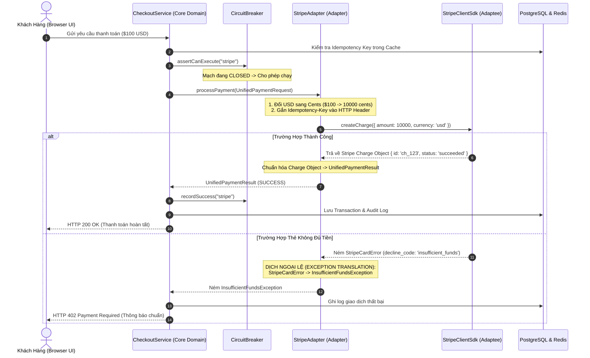

# Adapter Pattern (Mẫu Thiết Kế Bộ Chuyển Đổi) - Cẩm Nang Chuyên Sâu Từ Nguyên Lý Cốt Lõi Đến Tầng Vật Lý Hệ Thống

> **Bản Tóm Tắt Tinh Hoa (Executive Summary)**:  
> **Adapter Pattern** (còn gọi là *Wrapper Pattern*) là một mẫu thiết kế cấu trúc (Structural Design Pattern) cho phép các đối tượng hoặc hệ thống có giao diện (Interface) hoàn toàn bất tương thích có thể bắt tay và làm việc trơn tru với nhau.  
> Trong kiến trúc phần mềm hiện đại, Adapter không đơn thuần là một class bọc vài dòng code đổi tên hàm, mà là nền tảng cốt lõi của **Hexagonal Architecture (Kiến trúc Lục giác - Ports and Adapters)**, **Clean Architecture**, cơ chế **Virtual File System (VFS)** trong nhân Linux Kernel, và các nền tảng tích hợp đa cổng thanh toán/đa đám mây cấp độ Enterprise.

---

## 🏛️ Mục Lục Toàn Diện

1. [Mức Độ Cơ Bản (Basic Fundamentals)](#1-mức-độ-cơ-bản-basic-fundamentals)
   - [Định Nghĩa & Ẩn Dụ Đời Thực](#định-nghĩa--ẩn-dụ-đời-thực-real-world-analogy)
   - [Vấn Đề Cốt Lõi Sinh Ra Pattern](#vấn-đề-cốt-lõi-sinh-ra-pattern-problem-statement)
   - [Kiến Trúc Tổng Quan Mức High-Level](#kiến-trúc-tổng-quan-mức-high-level)
2. [Mức Độ Trung Bình (Intermediate - Architecture & Use Cases)](#2-mức-độ-trung-bình-intermediate---architecture--use-cases)
   - [Bốn Thành Phần Trụ Cột](#bốn-thành-phần-trụ-cột-core-components)
   - [Object Adapter vs Class Adapter](#object-adapter-vs-class-adapter)
   - [Khi Nào NÊN Dùng và KHÔNG NÊN Dùng](#khi-nào-nên-dùng-và-không-nên-dùng)
3. [Mức Độ Chuyên Sâu: BẢN CHẤT VẬN HÀNH (Under The Hood & Core Mechanics)](#3-mức-độ-chuyên-sâu-bản-chất-vận-hành-under-the-hood--core-mechanics)
   - [Bản Chất Đa Hình & Cơ Chế Ủy Quyền (Polymorphism & Delegation)](#bản-chất-đa-hình--cơ-chế-ủy-quyền-polymorphism--delegation)
   - [Dòng Chảy Dữ Liệu Qua Lớp Chuyển Đổi (Data Flow Pipeline)](#dòng-chảy-dữ-liệu-qua-lớp-chuyển-đổi-data-flow-pipeline)
   - [Hexagonal Architecture (Ports & Adapters) Trong Thực Tế](#hexagonal-architecture-ports--adapters-trong-thực-tế)
4. [Mức Độ Nâng Cao: Vận Hành Thực Chiến (Production Engineering & Best Practices)](#4-mức-độ-nâng-cao-vận-hành-thực-chiến-production-engineering--best-practices)
   - [Khả Năng Phục Hồi: Circuit Breaker & Adaptive Retry](#khả-năng-phục-hồi-circuit-breaker--adaptive-retry)
   - [Idempotency & Chuẩn Hóa Ngoại Lệ (Exception Shielding)](#idempotency--chuẩn-hóa-ngoại-lệ-exception-shielding)
   - [Anti-Patterns & Sai Lầm Chí Mạng Cần Tránh](#anti-patterns--sai-lầm-chí-mạng-cần-tránh)
5. [Góc Nhìn Thực Chiến Cho Middle-Level Trở Xuống (Must-Know vs Nice-to-Know Roadmap)](#5-góc-nhìn-thực-chiến-cho-middle-level-trở-xuống-must-know-vs-nice-to-know-roadmap)
   - [Phân định ranh giới kiến thức theo từng cấp độ](#phân-định-ranh-giới-kiến-thức-theo-từng-cấp-độ)
   - [Bộ câu hỏi phỏng vấn thực chiến kinh điển (Intern -> Middle)](#bộ-câu-hỏi-phỏng-vấn-thực-chiến-kinh-điển-intern---middle)
   - [Những thứ TẠM THỜI BỎ QUA (Dành riêng cho Senior / Tech Lead / SRE)](#những-thứ-tạm-thời-bỏ-qua-dành-riêng-cho-senior--tech-lead--sre)
6. [So Sánh Bản Chất (First-Principles Comparison)](#6-so-sánh-bản-chất-first-principles-comparison)
7. [Sơ Đồ Trực Quan (Mermaid Diagrams)](#7-sơ-đồ-trực-quan-mermaid-diagrams)
8. [Bảng Tra Thuật Ngữ Chi Tiết (Glossary)](#8-bảng-tra-thuật-ngữ-chi-tiết-glossary)
9. [Hướng Dẫn Chạy & Kiểm Thử Hệ Thống (Step-by-Step Run Guide)](#9-hướng-dẫn-chạy--kiểm-thử-hệ-thống-step-by-step-run-guide)

---

## 1. Mức Độ Cơ Bản (Basic Fundamentals)

### Định Nghĩa & Ẩn Dụ Đời Thực (Real-world Analogy)

> **Cầu Nối Trực Quan (Intuitive Bridge)**:  
> - **Nôm na nó là gì?** Hãy tưởng tượng bạn mua một chiếc laptop xách tay từ Mỹ với củ sạc có 3 chấu dẹt (chuẩn Bắc Mỹ NEMA 5-15). Khi về Việt Nam, các ổ cắm trên tường trong căn hộ của bạn chỉ có 2 lỗ tròn (chuẩn Châu Âu Type C). Bạn không thể đập nát bức tường để thay lại toàn bộ hệ thống điện tòa nhà, và bạn cũng không thể lấy kìm bẻ gãy chấu thứ 3 của củ sạc tiền triệu. Bạn ghé tiệm điện mua một **Cục Chuyển Đổi (Adapter)** giá vài chục ngàn. Cục chuyển đổi cắm một đầu vào ổ tường tròn, đầu kia nhận 3 chấu dẹt. Điện vẫn chạy qua an toàn, máy tính vẫn sạc ngon lành.  
> - **Trong phần mềm**: Hệ thống của bạn (Client) mong muốn gọi hàm `processPayment(orderId, amount)`. Tuy nhiên, thư viện SDK của đối tác (Adaptee) lại bắt bạn phải gọi `createCharge({ amount_in_cents: 1000, currency: 'usd' })`. Adapter chính là lớp phần mềm đứng ở giữa nhận lệnh chuẩn từ Client, âm thầm dịch đổi sang cú pháp của SDK đối tác và trả ngược kết quả về cho Client.

```
+----------------+          +-------------------------+          +------------------------+
| Client Code    |  ====>   | Target Interface (Port) |  <....|  | Adapter (Wrapper)      |
| (Core Domain)  |          | + processPayment()      |          | - adapts Target to SDK |
+----------------+          +-------------------------+          +------------------------+
                                                                             ||
                                                                   (Ủy quyền qua composition)
                                                                             \/
                                                                 +------------------------+
                                                                 | Adaptee (External SDK) |
                                                                 | + createChargeInCents()|
                                                                 +------------------------+
```

### Vấn Đề Cốt Lõi Sinh Ra Pattern (Problem Statement)

Tại sao một kỹ sư phần mềm chuyên nghiệp không gọi trực tiếp thư viện đối tác trong code nghiệp vụ mà bắt buộc phải dùng Adapter?

1. **Ngăn chặn Ô Nhiễm Mã Nguồn Lõi (Domain Pollution)**:  
   Nếu bạn nhúng trực tiếp SDK của Stripe, PayPal hoặc thư viện XML của một ngân hàng vào các file `CheckoutService.ts` hoặc `OrderController.ts`:
   - Toàn bộ nghiệp vụ kinh doanh của bạn sẽ bị "dính chặt" (Tightly Coupled) với các kiểu dữ liệu dị biệt của đối tác (ví dụ: Stripe tính tiền bằng Cents nguyên, PayPal dùng chuỗi string `10.50`, VNPay nhân 100 bằng tiền VND).
   - Khi đối tác nâng cấp SDK lên phiên bản mới gây breaking changes, bạn sẽ phải mở hàng chục file nghiệp vụ lõi để sửa code!
2. **Tuân thủ Nguyên lý Mở/Đóng (Open/Closed Principle - OCP)**:  
   Hệ thống phải mở rộng được cho các đối tác mới mà không được sửa đổi code cũ đang vận hành ổn định. Nếu không có Adapter, mỗi lần ký hợp đồng với một cổng thanh toán mới (ví dụ thêm Apple Pay, MoMo, ZaloPay), lập trình viên sẽ phải viết thêm một đống câu lệnh `if (gateway === 'MOMO') ... else if (gateway === 'STRIPE') ...` làm phình to hàm checkout và tạo ra vô số rủi ro hồi quy (Regression Bugs).
3. **Giải Quyết Bất Tương Thích Giao Thức (Protocol Impedance Mismatch)**:  
   Nhiều hệ thống Core Banking hoặc bảo hiểm quốc doanh đã được xây dựng từ thập niên 1980 bằng ngôn ngữ COBOL hoặc C, giao tiếp qua giao thức XML SOAP RPC. Trong khi đó, ứng dụng hiện đại sử dụng JSON REST API hoặc gRPC. Adapter đóng vai trò là "biên dịch viên thời gian thực", biến đổi giữa các hệ thống thời kỳ đồ đá và thời kỳ hiện đại mà không bên nào phải viết lại từ đầu.

### Kiến Trúc Tổng Quan Mức High-Level

Luồng điều khiển (Control Flow) và Luồng phụ thuộc (Dependency Flow) trong một hệ thống áp dụng Adapter Pattern:

```
[UI / REST API Client]
         │
         ▼
[CheckoutService] ──────(Phụ thuộc chiều thuận)──────► [IPaymentGateway (Port)]
                                                                ▲
                                                                │ (Thực thi giao diện)
                                                    [StripeAdapter / BankAdapter]
                                                                │ (Sở hữu đối tượng)
                                                                ▼
                                                    [External 3rd-Party SDK]
```

> **Điểm mấu chốt**: Nhờ có Adapter, **Mã nguồn lõi (CheckoutService)** không hề biết đến sự tồn tại của `StripeClient` hay `BankSoapClient`. Nó hoàn toàn độc lập và chỉ nói chuyện với giao diện trừu tượng `IPaymentGateway`.

---

## 2. Mức Độ Trung Bình (Intermediate - Architecture & Use Cases)

### Bốn Thành Phần Trụ Cột (Core Components)

Một mô hình Adapter Pattern chuẩn Gang of Four (GoF) bao gồm đúng 4 thành phần:

1. **Target Interface (Mục tiêu / Port)**:  
   - Giao diện chuẩn mực mà Client mong muốn tương tác.
   - Được định nghĩa hoàn toàn bởi nhu cầu của Domain nội bộ, phản ánh ngôn ngữ nghiệp vụ thuần túy (Ubiquitous Language trong DDD).
   - Ví dụ: `IPaymentGateway` với các phương thức `processPayment()`, `processRefund()`, `checkHealth()`.
2. **Client (Khách hàng)**:  
   - Tầng ứng dụng hoặc Service điều phối nghiệp vụ (ví dụ: `CheckoutService`).
   - Client hoàn toàn mù tịt về công nghệ phía sau, chỉ lập trình dựa trên giao diện Target Interface (`Dependency Inversion Principle`).
3. **Adaptee (Đối tượng cần chuyển đổi)**:  
   - Thư viện của bên thứ 3, SDK đối tác, hệ thống Legacy hoặc driver phần cứng có sẵn.
   - Nó cung cấp tính năng hữu ích mà ta cần, nhưng giao diện hàm, tham số đầu vào, kiểu dữ liệu và mã lỗi hoàn toàn không khớp với Target Interface.
   - Ta **không có quyền (hoặc không muốn) can thiệp sửa mã nguồn** của Adaptee.
4. **Adapter (Bộ chuyển đổi / Wrapper)**:  
   - Lớp keo dán trung gian kết nối hai thế giới.
   - Cài đặt (Implements) Target Interface.
   - Nắm giữ tham chiếu tới Adaptee (thông qua Composition) hoặc kế thừa Adaptee (thông qua Inheritance).
   - Biến đổi dữ liệu đầu vào từ dạng chuẩn của Target sang dạng riêng của Adaptee, gọi hàm Adaptee, rồi dịch ngược kết quả trả về.

---

### Object Adapter vs Class Adapter

Trong lý thuyết hướng đối tượng kinh điển, có 2 biến thể chính để hiện thực hóa Adapter Pattern:

```
+---------------------------------------------------+---------------------------------------------------+
|               OBJECT ADAPTER                      |                  CLASS ADAPTER                    |
|       (Composition - Khuyên Dùng Hàng Đầu)        |        (Multiple Inheritance - Hạn chế)           |
+---------------------------------------------------+---------------------------------------------------+
|                                                   |                                                   |
|   +---------------+        +------------------+   |   +---------------+        +------------------+   |
|   | Target (Intf) |        | Adaptee (Class)  |   |   | Target (Intf) |        | Adaptee (Class)  |   |
|   +---------------+        +------------------+   |   +---------------+        +------------------+   |
|           ^                         ^             |           ^                         ^             |
|           | implements              | has-a       |           | implements              | inherits    |
|   +---------------+                 |             |   +---------------------------------------+   |
|   | ObjectAdapter | ────────────────+             |   |             ClassAdapter              |   |
|   +---------------+                               |   +---------------------------------------+   |
|                                                   |                                                   |
+---------------------------------------------------+---------------------------------------------------+
```

#### 1. Object Adapter (Dựa trên Thành phần - Composition)
- **Cơ chế**: Adapter chứa một biến tham chiếu cục bộ (Pointer/Reference) trỏ tới đối tượng Adaptee.
- **Ưu điểm**:
  - Tuân thủ triết lý vàng của GoF: *"Favor object composition over class inheritance"* (Ưu tiên cấu thành hơn kế thừa).
  - Cực kỳ linh hoạt: Một Adapter có thể bọc được không chỉ bản thân Adaptee mà còn mọi class con kế thừa từ Adaptee đó.
  - Có thể thay thế Adaptee tại thời điểm Runtime (Dynamic Dependency Injection).
- **Nhược điểm**: Tốn thêm 1 con trỏ tham chiếu trong bộ nhớ và thêm một bước nhảy con trỏ (Pointer dereference).

#### 2. Class Adapter (Dựa trên Kế thừa - Inheritance)
- **Cơ chế**: Adapter kế thừa cùng lúc từ cả Target Class và Adaptee Class (Đa kế thừa - Multiple Inheritance).
- **Ưu điểm**: Gọi trực tiếp phương thức của Adaptee mà không cần đi qua con trỏ đối tượng.
- **Nhược điểm**:
  - Chỉ hiện thực được trong các ngôn ngữ hỗ trợ đa kế thừa như C++, Python. Hoàn toàn không dùng được trong Java, C#, Go.
  - Tạo ra sự dính chặt (Coupling) cứng nhắc tại thời điểm Compile-time. Không thể thay đổi Adaptee lúc runtime.
  - Dễ dẫn đến vấn đề "Viên kim cương tử thần" (Diamond Problem) trong phân cấp kế thừa C++.

---

### Khi Nào NÊN Dùng và KHÔNG NÊN Dùng

#### ✅ KHI NÊN DÙNG (Use Cases Kinh Điển):
1. **Tích hợp Dịch vụ Bên Thứ Ba (Third-party Integration)**:  
   Tích hợp các cổng thanh toán (Stripe, PayPal, VNPay), nhà cung cấp dịch vụ gửi SMS/Email (Twilio, SendGrid, Amazon SES), hoặc dịch vụ lưu trữ đám mây (AWS S3, Google Cloud Storage, Azure Blob).
2. **Kiến Trúc Hexagonal / Onion / Clean Architecture**:  
   Tất cả các I/O phụ thuộc bên ngoài (Database Repository, Message Broker Producer, Cache Store, Search Engine) đều được thiết kế dưới dạng Secondary Adapters gắn vào Ports của Core Domain.
3. **Nâng cấp Hệ thống Cũ Từng Bước (Legacy System Migration / Strangler Fig Pattern)**:  
   Thay vì đập bỏ hệ thống nguyên khối cũ (Monolith), ta viết Adapter để ứng dụng Microservices mới có thể giao tiếp với Database cũ hoặc RPC cũ của Monolith cho tới khi quá trình chuyển giao hoàn tất.
4. **Mocking & Unit Testing**:  
   Tạo các `MockPaymentAdapter` hoặc `InMemoryRepositoryAdapter` thực thi đúng Interface chuẩn để chạy Unit Test offline với tốc độ siêu nhanh mà không cần gọi API thật ra Internet.

#### ❌ KHI KHÔNG NÊN DÙNG:
1. **Khi bạn có toàn quyền sở hữu cả 2 hệ thống**:  
   Nếu cả Client và Service đích đều do đội ngũ của bạn viết và chưa có khách hàng sử dụng, hãy mạnh dạn **Refactor lại Interface** cho đồng nhất thay vì vội vàng đẻ thêm một Adapter làm tăng độ phức tạp không đáng có.
2. **Nhầm lẫn với Facade Pattern**:  
   Nếu mục tiêu của bạn là gom 10 bước phức tạp của một hệ thống con thành 1 hàm đơn giản cho Client dễ dùng (nhưng không cần đổi Interface), bạn đang cần **Facade Pattern**, không phải Adapter.
3. **Nhầm lẫn với Decorator Pattern**:  
   Nếu mục tiêu của bạn là muốn bổ sung tính năng logging, caching, retry hay audit trail mà giao diện hàm **giữ nguyên không đổi**, bạn đang cần **Decorator Pattern** hoặc **Proxy Pattern**.

---

## 3. Mức Độ Chuyên Sâu: BẢN CHẤT VẬN HÀNH (Under The Hood & Core Mechanics)

### 3.1 Bản Chất Đa Hình & Cơ Chế Ủy Quyền (Polymorphism & Delegation)

#### Tại sao lại là "Composition over Inheritance" (Ủy quyền thay vì Kế thừa)?
Trong thế giới hướng đối tượng, có hai cách để hiện thực Adapter:
1. **Class Adapter (Dùng Đa Kế Thừa - Inheritance)**: Adapter kế thừa đồng thời từ Target Interface và Adaptee Class.
   - *Nhược điểm chí mạng*: Tạo ra sự gắn kết cứng nhắc tại thời điểm Compile-time. Bạn không thể hoán đổi Adaptee lúc runtime. Ngoài ra, hầu hết các ngôn ngữ hiện đại (Java, C#, TypeScript, Go) đều **cấm đa kế thừa class**.
2. **Object Adapter (Dùng Ủy Quyền - Composition)**: Adapter chứa một biến tham chiếu (reference) trỏ tới Adaptee instance.
   - *Bản chất*: Adapter đóng vai trò là người ủy quyền. Khi nhận lệnh từ Client, nó gọi tới phương thức của Adaptee bên trong.
   - *Ưu thế*: Cực kỳ linh hoạt. Bạn có thể truyền bất kỳ instance nào của Adaptee (kể cả Mock Adaptee khi viết Unit Test) vào Adapter thông qua Dependency Injection.

> 💡 **Cầu nối trực quan**: Thay vì phẫu thuật ghép thẳng củ sạc 3 chấu vào bo mạch laptop (Kế thừa cứng), bạn dùng một đầu chuyển cắm ngoài (Ủy quyền qua Composition). Khi đi du lịch sang nước khác, bạn chỉ cần thay đầu chuyển khác mà không phải tháo rời laptop.

```
+------------------+             +-------------------------+
|   Client Code    | ----------> | <<Interface>> Target    |
| (Service / Logic)|             | + processPayment(req)   |
+------------------+             +-------------------------+
                                              ^
                                              | implements
                                 +-------------------------+
                                 |      StripeAdapter      |
                                 |-------------------------|
                                 | - stripeSdk: StripeSdk  | -----(Ủy quyền / Composition)-----> +-----------------------+
                                 |-------------------------|                                     |       StripeSdk       |
                                 | + processPayment(req)   |                                     | + createCharge(param) |
                                 +-------------------------+                                     +-----------------------+
```

---

### 3.2 Dòng Chảy Dữ Liệu Qua Lớp Chuyển Đổi (Data Flow Pipeline)

Một Adapter chuẩn trong môi trường Production không đơn thuần là gọi hàm, mà là một **Đường ống chuyển hóa dữ liệu (Transformation Pipeline)** gồm 4 bước khép kín:

```
[Client / Core Domain]
        │
        ▼ 1. Gọi Interface Chuẩn: processPayment(UnifiedPaymentRequest)
┌────────────────────────────────────────────────────────────────────────┐
│                        ADAPTER PIPELINE                                │
│                                                                        │
│  [Bước 1: Validate & Pre-process]                                      │
│  - Kiểm tra hợp lệ dữ liệu Domain                                      │
│  - Chuẩn hóa: Đổi USD sang Cents ($199 -> 19900 cents)                 │
│  - Sinh Idempotency Key gắn vào Header nếu cần                         │
│                                                                        │
│  [Bước 2: Giao tiếp với Bên Thứ Ba (Adaptee Interaction)]              │
│  - Gọi SDK / HTTP REST / gRPC / SOAP XML sang nhà cung cấp             │
│                                                                        │
│  [Bước 3: Chuẩn hóa Kết quả (Result Normalization)]                    │
│  - Bóc tách Vendor Response thành UnifiedPaymentResult (SUCCESS)       │
│                                                                        │
│  [Bước 4: Chuẩn hóa Ngoại lệ (Exception Translation)]                  │
│  - Bắt lỗi Vendor (card_declined, timeout) -> Dịch sang Domain Error   │
└────────────────────────────────────────────────────────────────────────┘
        │
        ▼ 4. Trả về UnifiedPaymentResult hoặc ném DomainException
[Client / Core Domain]
```

1. **Bước 1 - Tiền xử lý & Chuyển đổi định dạng**:
   - Chuyển đổi đơn vị tiền tệ hoặc cấu trúc dữ liệu theo đúng yêu cầu của đối tác (ví dụ: Stripe bắt buộc nhận số nguyên Cents, VNPay bắt buộc băm chuỗi bí mật HMAC-SHA512).
2. **Bước 2 - Giao tiếp với Adaptee**:
   - Thực thi lời gọi tới SDK hoặc giao thức mạng của bên thứ ba.
3. **Bước 3 - Chuẩn hóa kết quả trả về**:
   - Chuyển đổi JSON/XML phản hồi phức tạp của vendor thành DTO chuẩn của hệ thống (`UnifiedPaymentResult`), đảm bảo Caller không bị dính bất kỳ trường dữ liệu lạ nào của vendor.
4. **Bước 4 - Dịch chuyển ngoại lệ (Exception Translation)**:
   - Nếu xảy ra lỗi mạng hoặc lỗi từ chối, Adapter bắt lỗi vendor và chuyển thành mã lỗi nghiệp vụ nội bộ (`DomainException`).

---

### 3.3 Hexagonal Architecture (Ports & Adapters) Trong Thực Tế

Trong kiến trúc phần mềm hiện đại (Clean Architecture / Hexagonal Architecture), Adapter Pattern được nâng tầm trở thành **xương sống của toàn bộ hệ thống**:

```
                              HEXAGONAL SYSTEM BOUNDARY
                ─────────────────────────────────────────────────────
               │                                                     │
[HTTP Request] ┼──► [Driving Adapter (Primary)]                       │
               │    (REST Controller / GraphQL Resolver)              │
               │                 │                                   │
               │                 ▼                                   │
               │         [Driving Port]                              │
               │         (ICheckoutUseCase Interface)                │
               │                 │                                   │
               │                 ▼                                   │
               │       ┌───────────────────┐                         │
               │       │    CORE DOMAIN    │                         │
               │       │  Business Logic   │                         │
               │       └───────────────────┘                         │
               │                 │                                   │
               │                 ▼                                   │
               │         [Driven Port]                               │
               │         (IPaymentGateway Interface)                 │
               │                 │                                   │
               │                 ▼                                   │
[Postgres/MQ]  │    [Driven Adapter (Secondary)] ────────────────────┼──► [Stripe / VNPay]
               │    (StripeAdapter, PostgresRepoAdapter)             │
                ─────────────────────────────────────────────────────
```

- **Driving Ports & Adapters (Phía dẫn dắt / Primary)**: Nơi nhận request từ người dùng hoặc hệ thống khác (ví dụ: `PaymentController` nhận HTTP JSON rồi gọi vào UseCase).
- **Driven Ports & Adapters (Phía bị dẫn dắt / Secondary)**: Nơi Core Domain gọi ra thế giới bên ngoài (ví dụ: `IPaymentGateway` là Port; `StripeAdapter`, `VNPayAdapter`, `PaypalAdapter` là các Driven Adapters).
- **Lợi ích tối thượng**: Core Domain hoàn toàn độc lập với hạ tầng. Bạn có thể đổi từ Stripe sang VNPay hoặc đổi PostgreSQL sang MongoDB mà **không phải sửa một dòng code nghiệp vụ nào** trong Core Domain.

---

## 4. Mức Độ Nâng Cao: Vận Hành Thực Chiến (Production Engineering & Best Practices)

### 4.1 Khả Năng Phục Hồi: Circuit Breaker & Adaptive Retry

Adapter là nơi trực tiếp gửi request qua mạng Internet tới hệ thống bên thứ ba, vì vậy đây là nơi **bắt buộc phải trang bị cơ chế tự vệ**:

#### 1. Circuit Breaker (Cầu dao chống sập hệ thống)
- **Vấn đề**: Khi ngân hàng hoặc cổng đối tác bị sập mạng, nếu mỗi request đều treo 30 giây để chờ timeout, hàng ngàn request đồng thời sẽ ngốn sạch Connection Pool của server và làm sập luôn toàn bộ hệ thống của bạn.
- **Giải pháp**: Gắn Circuit Breaker tại tầng Adapter. Khi tỷ lệ lỗi vượt ngưỡng (ví dụ: 3 lần liên tiếp lỗi mạng), cầu dao chuyển sang trạng thái **OPEN** (Ngắt mạch). Mọi request tiếp theo sẽ bị từ chối ngay lập tức trong 1ms (Fast-Fail), giúp bảo vệ server của bạn.

#### 2. Thử lại an toàn với Exponential Backoff & Jitter
- Khi gặp lỗi mạng chập chờn, Adapter tự động thử lại nhưng tăng dần thời gian chờ kèm biến số ngẫu nhiên (Jitter) để tránh việc hàng ngàn worker cùng lúc bắn request dồn dập vào đối tác (Thundering Herd):
  $$\text{Delay} = 2^{\text{attempt}} \times 100\text{ms} + \text{random}(0, 50\text{ms})$$

---

### 4.2 Idempotency & Chuẩn Hóa Ngoại Lệ (Exception Shielding)

#### 1. Xử lý Idempotency Key tại tầng Adapter
- Khi mạng chập chờn, Client có thể bấm thanh toán 2 lần. Adapter có nhiệm vụ lấy `idempotencyKey` từ Domain và ánh xạ vào chuẩn của từng cổng:
  - Với **Stripe**: Đưa vào Header `Idempotency-Key: idemp_123`.
  - Với **VNPay**: Đưa vào tham số `vnp_TxnRef`.
  - Với **PayPal**: Đưa vào trường `purchase_units[0].custom_id`.

#### 2. Chuẩn hóa Ngoại lệ (Exception Shielding / Translation Matrix)
Tuyệt đối không để exception đặc thù của SDK bên ngoài rò rỉ ra ngoài Adapter:

```javascript
// ❌ ANTI-PATTERN: Bắt lỗi SDK nào ném thẳng SDK đó ra ngoài
catch (stripeError) {
  throw stripeError; // Controller/Service sẽ phải import StripeCardError!
}

// ✅ PRODUCTION PATTERN: Bắt và dịch sang Domain Exception chuẩn
catch (err) {
  if (err.code === 'card_declined' && err.decline_code === 'insufficient_funds') {
    throw new InsufficientFundsException(err.message, { gatewayType: this.gatewayId });
  }
  if (err.type === 'StripeConnectionError') {
    throw new GatewayTimeoutException(err.message, { gatewayType: this.gatewayId, retryable: true });
  }
  throw new PaymentGatewayException(err.message, { gatewayType: this.gatewayId });
}
```

---

### 4.3 Anti-Patterns & Sai Lầm Chí Mạng Cần Tránh

| Anti-Pattern | Cơ Chế Gây Hại | Hậu Quả Thực Tế | Giải Pháp Chuẩn Production |
| :--- | :--- | :--- | :--- |
| **Fat Adapter (Adapter Béo)** | Nhét thêm logic nghiệp vụ kinh doanh (tính thuế, giảm giá voucher, gửi email) vào bên trong Adapter. | Phá vỡ nguyên lý Đơn trách nhiệm (SRP). Khi đổi cổng thanh toán, mất luôn logic tính thuế. | Adapter **CHỈ ĐƯỢC PHÉP** dịch dữ liệu và giao thức. Nghiệp vụ phải nằm ở Domain Service. |
| **Two-Way Leakage (Rò Rỉ Hai Chiều)** | Adapter trả về một đối tượng chứa trường dữ liệu nội bộ của thư viện SDK bên thứ ba. | Tầng UI hoặc Service vô tình đọc trường của SDK đối tác. Toàn bộ kiến trúc bị ô nhiễm ngược trở lại. | Bắt buộc chuyển đổi 100% sang Domain DTO thuần khiết (`UnifiedPaymentResult`). |
| **Hidden Network I/O trong Getters** | Viết getter trong Adapter nhưng bên trong lại âm thầm gọi mạng (ví dụ gọi HTTP lấy token). | Hàm tưởng chừng chạy ngay lập tức lại làm nghẽn Event-Loop hoặc timeout mà caller không lường trước. | Tách rõ các phương thức bất đồng bộ `async acquireToken()` tường minh. |
| **Error Swallowing (Nuốt Chửng Lỗi)** | Bắt lỗi trong Adapter nhưng chỉ `console.log` rồi trả về `null` hoặc status giả. | Hệ thống tưởng thanh toán thành công nhưng thực chất khách chưa bị trừ tiền, dẫn đến xuất hàng thất thoát. | Luôn bọc lại thành `DomainException` có ngữ nghĩa rõ ràng và ném ra cho tầng điều phối. |

---

## 5. Góc Nhìn Thực Chiến Cho Middle-Level Trở Xuống (Must-Know vs Nice-to-Know Roadmap)

> 💡 **Thông điệp giải tỏa áp lực**: Nếu bạn là Intern, Junior hoặc Mid-level, bạn không cần phải áp lực về việc phân tích VTABLE assembly, CPU branch prediction hay viết Kernel module. Trong thực tế công việc hàng ngày, giá trị lớn nhất của Adapter Pattern nằm ở việc **tách rời mã nguồn khỏi sự phụ thuộc vào bên thứ ba và giúp code dễ bảo trì, dễ viết Unit Test**. Dưới đây là lộ trình thực chiến 80/20 giúp bạn tự tin đi làm và phỏng vấn.

---

### Phân định ranh giới kiến thức theo từng cấp độ

```
  +---------------------------------------------------------------------------------+
  | CẤP ĐỘ INTERN / JUNIOR (QUY TẮC 80/20 - DEVELOPER SỬ DỤNG & HIỂU PATTERN)       |
  |  - Hiểu đúng bài toán: Tại sao không gọi trực tiếp Stripe SDK trong Controller? |
  |  - Viết được 1 Adapter cơ bản implements Target Interface chuẩn                |
  |  - Biết cách dùng Dependency Injection để hoán đổi Adapter trong test/code      |
  |  - Phân biệt rõ ràng giữa Adapter vs Decorator vs Facade                        |
  +---------------------------------------------------------------------------------+
                                          │
                                          ▼
  +---------------------------------------------------------------------------------+
  | CẤP ĐỘ MIDDLE-LEVEL (KIẾN TRÚC & TỰ VỆ PRODUCTION)                              |
  |  - Thiết kế Exception Translation Matrix (không để rò rỉ mã lỗi của bên thứ 3) |
  |  - Tích hợp Circuit Breaker và Retry with Exponential Backoff tại tầng Adapter  |
  |  - Áp dụng Idempotency Key truyền qua các cổng giao tiếp bên ngoài             |
  |  - Thiết kế kiến trúc Hexagonal (Ports & Adapters) để mock và test không cần net|
  +---------------------------------------------------------------------------------+
```

#### Intern / Junior: Những gì BẮT BUỘC phải nắm vững
1. **Mô hình tư duy cốt lõi (Mental Model)**: Hiểu Adapter như một "cục chuyển đổi nguồn điện" – đứng giữa để phiên dịch hai giao diện không ăn khớp nhau.
2. **Kỹ năng code thực tế**:
   - Định nghĩa một Interface chuẩn (ví dụ: `IPaymentGateway` có `charge(amount, currency)`).
   - Viết class `StripeAdapter` implements `IPaymentGateway`, nhận `StripeClient` qua constructor.
   - Viết mock adapter (ví dụ: `MockPaymentAdapter`) để chạy test mà không tốn tiền gọi API thật.

#### Middle-Level: Tối ưu hóa & Thiết kế chuẩn mực
1. **Chuẩn hóa ngoại lệ (Exception Shielding)**: Không để lỗi `StripeCardError` lọt lên Controller làm sập API hoặc lộ thông tin bảo mật. Bắt buộc map sang các Domain Exception chuẩn (`PaymentFailedException`, `InsufficientFundsException`).
2. **Phòng thủ hệ thống phân tán**: Nhúng Circuit Breaker (ví dụ: dùng Opossum hoặc Resilience4j) và cơ chế Retry có Jitter vào Adapter.
3. **Data Mapping 2 chiều an toàn**: Đảm bảo toàn bộ request và response đều đi qua DTO trung gian, không để rò rỉ trường dữ liệu đặc thù của đối tác vào Core Domain.

---

### Bộ câu hỏi phỏng vấn thực chiến kinh điển (Intern -> Middle)

#### Câu 1 (Intern/Junior): Adapter Pattern khác gì với Decorator và Facade?
- **Trả lời ghi điểm**:
  - **Adapter**: Làm cho **hai interface không khớp** nói chuyện được với nhau (thay đổi giao diện).
  - **Decorator**: **Bổ sung tính năng mới** (logging, cache, retry) tại runtime nhưng **giữ nguyên giao diện ban đầu**.
  - **Facade**: Gom **nhiều class phức tạp** thành một interface đơn giản hơn để dễ gọi (đơn giản hóa giao diện).

#### Câu 2 (Junior/Middle): Tại sao nên dùng Object Adapter (Composition) thay vì Class Adapter (Inheritance)?
- **Trả lời ghi điểm**:
  - Hầu hết các ngôn ngữ hiện đại (Java, C#, TypeScript) không hỗ trợ đa kế thừa class, nên Class Adapter không khả thi.
  - Composition tuân thủ nguyên lý *"Favor composition over inheritance"*, giúp Adapter lỏng lẻo (loose coupling), có thể hoán đổi Adaptee instance linh hoạt lúc runtime và dễ dàng mock khi viết Unit Test.

#### Câu 3 (Middle): Trong dự án thực tế, làm thế nào để đảm bảo khi đối tác thứ ba (ví dụ Stripe hoặc PayPal) thay đổi API thì hệ thống của ta ít bị ảnh hưởng nhất?
- **Trả lời ghi điểm**:
  - Áp dụng kiến trúc Ports & Adapters (Hexagonal Architecture).
  - Định nghĩa Driven Port (`IPaymentGateway`) thuộc sở hữu của Core Domain.
  - Mọi thay đổi của API đối tác chỉ nằm gói gọn bên trong file `StripeAdapter` (cập nhật cách gọi SDK và cách map dữ liệu). Toàn bộ Use Cases, Controller và Database Logic ở phía sau hoàn toàn không cần thay đổi một dòng code nào.

---

### Những thứ TẠM THỜI BỎ QUA (Dành riêng cho Senior / Tech Lead / SRE)
- **VTABLE Assembly & Indirect Dispatch**: Cơ chế CPU tra cứu bảng con trỏ hàm ảo ở mức hợp ngữ assembly.
- **Cache line alignment & Pointer Chasing physics**: Tối ưu hóa bộ nhớ đệm L1/L2 ở cấp độ nano-giây.
- **Linux VFS C struct file_operations**: Viết driver nhân hệ điều hành Linux.
- *Đây là các kiến thức tra cứu tầng sâu của chuyên gia hệ thống, bạn không cần phải lo lắng hay áp lực học thuộc trong công việc phát triển ứng dụng thường ngày!*

---

## 6. So Sánh Bản Chất (First-Principles Comparison)

Năm mẫu thiết kế cấu trúc kinh điển của Gang of Four thường bị nhầm lẫn với nhau. Dưới đây là bảng đối chiếu chi tiết:

| Mẫu Thiết Kế | Ý Định Cốt Lõi (Primary Intent) | Giao Diện Thay Đổi Thế Nào? | Đối Tượng Được Bọc | Chi Phí Overhead |
| :--- | :--- | :--- | :--- | :--- |
| **Adapter** | **Làm cho 2 Interface không khớp nói chuyện được với nhau.** | **Thay đổi hoàn toàn** (từ Interface A sang Interface B). | Bọc 1 đối tượng có sẵn (Adaptee). | Thêm 1 bước nhảy con trỏ vptr hoặc map DTO. |
| **Facade** | **Đơn giản hóa** việc sử dụng một hệ thống con phức tạp gồm nhiều class. | **Thu gọn lại** (cung cấp 1 API đơn giản mức cao). | Bọc cả một hệ thống con (Subsystem nhiều class). | Rất thấp (chỉ là hàm bọc điều phối). |
| **Proxy** | **Kiểm soát truy cập** tới đối tượng (Lazy loading, auth, logging, cache). | **Giữ nguyên 100%** (Proxy cài đặt cùng Interface với RealSubject). | Bọc 1 đối tượng thực. | Thấp (chỉ thêm bước kiểm tra điều kiện). |
| **Decorator** | **Bổ sung tính năng mới** một cách linh hoạt tại runtime mà không sửa code. | **Giữ nguyên 100%** (Decorator cài đặt cùng Interface với Component). | Bọc 1 đối tượng cùng loại (có thể bọc lồng nhau nhiều lớp). | Tăng chiều sâu call-stack. |
| **Bridge** | **Tách biệt Trừu tượng (Abstraction) khỏi Hiện thực (Implementation)** ngay từ đầu. | Tách rời thành 2 cây phân cấp độc lập. | Abstraction nắm giữ tham chiếu tới Implementor. | Tương đương Object Adapter nhưng thiết kế từ đầu. |

---

## 7. Sơ Đồ Trực Quan (Mermaid Diagrams)

### 1. Sơ Đồ Lớp Kiến Trúc Của Hệ Thống (Class Diagram)

```mermaid
classDiagram
    class IPaymentGateway {
        <<Interface / Port>>
        +gatewayId() String
        +processPayment(UnifiedPaymentRequest req)* UnifiedPaymentResult
        +processRefund(UnifiedRefundRequest req)* UnifiedRefundResult
        +verifyWebhook(Object payload, Object headers)* UnifiedWebhookEvent
        +checkHealth()* GatewayHealthResult
    }

    class StripeAdapter {
        <<Adapter>>
        -StripeClientSdk stripeSdk
        +processPayment(UnifiedPaymentRequest req) UnifiedPaymentResult
        +processRefund(UnifiedRefundRequest req) UnifiedRefundResult
    }

    class PayPalAdapter {
        <<Adapter>>
        -PayPalClientSdk payPalSdk
        +processPayment(UnifiedPaymentRequest req) UnifiedPaymentResult
        +processRefund(UnifiedRefundRequest req) UnifiedRefundResult
    }

    class VNPayAdapter {
        <<Adapter>>
        -VNPayGatewayClient vnpayClient
        +processPayment(UnifiedPaymentRequest req) UnifiedPaymentResult
        +processRefund(UnifiedRefundRequest req) UnifiedRefundResult
    }

    class LegacyBankXmlAdapter {
        <<Adapter>>
        -LegacyBankXmlHost bankHost
        +processPayment(UnifiedPaymentRequest req) UnifiedPaymentResult
        +processRefund(UnifiedRefundRequest req) UnifiedRefundResult
    }

    class StripeClientSdk {
        <<Adaptee - Vendor SDK>>
        +createCharge(Object params, Object opts)
        +createRefund(String chargeId, Object params)
    }

    class LegacyBankXmlHost {
        <<Adaptee - Mainframe>>
        +executeXmlRpc(String xmlPayload) String
        +executeXmlReversal(String xml) String
    }

    class CheckoutService {
        <<Client / Domain Core>>
        -GatewayRegistry registry
        -CircuitBreaker breaker
        +processCheckout(Object input)
        +processRefund(Object input)
    }

    CheckoutService --> IPaymentGateway : Chỉ phụ thuộc vào Interface chuẩn
    StripeAdapter ..|> IPaymentGateway : Implements
    PayPalAdapter ..|> IPaymentGateway : Implements
    VNPayAdapter ..|> IPaymentGateway : Implements
    LegacyBankXmlAdapter ..|> IPaymentGateway : Implements

    StripeAdapter *-- StripeClientSdk : Composition (Has-A)
    LegacyBankXmlAdapter *-- LegacyBankXmlHost : Composition (Has-A)
```



### 2. Sơ Đồ Tuần Tự Xử Lý & Dịch Ngoại Lệ (Sequence Diagram)



---

## 8. Bảng Tra Thuật Ngữ Chi Tiết (Glossary)

| Thuật Ngữ | Tên Đầy Đủ / Định Nghĩa Kỹ Thuật | Giải Thích Dễ Hiểu & Ngữ Cảnh Sử Dụng |
| :--- | :--- | :--- |
| **Adaptee** | *Adapted Entity* (Đối tượng bị chuyển đổi) | Thư viện, SDK ngoài hoặc hệ thống cũ có giao diện bất tương thích mà ta cần tái sử dụng. |
| **Target Interface** | *Target Port / Abstract Contract* | Hợp đồng giao diện chuẩn do hệ thống của ta đặt ra, bắt các Adapter phải tuân theo. |
| **Object Adapter** | *Composition-based Adapter* | Biến thể sử dụng một con trỏ hoặc biến thành viên trỏ tới Adaptee (mô hình `Has-A`). |
| **Class Adapter** | *Inheritance-based Adapter* | Biến thể đa kế thừa từ cả Target lẫn Adaptee (mô hình `Is-A`, chỉ có ở C++/Python). |
| **VTABLE** | *Virtual Method Table* | Bảng tra cứu địa chỉ con trỏ hàm được tạo trong bộ nhớ Data Segment để hỗ trợ gọi hàm đa hình. |
| **Dynamic Dispatch** | *Phân giải hàm tại runtime* | Cơ chế CPU xác định địa chỉ hàm thực tế cần nhảy tới tại thời điểm chạy dựa trên VTABLE. |
| **Pointer Chasing** | *Đuổi bắt con trỏ bộ nhớ* | Quá trình CPU phải giải tuần tự nhiều địa chỉ con trỏ để tìm dữ liệu, dễ gây Cache Miss. |
| **VFS** | *Virtual File System (Linux Kernel)* | Tầng trừu tượng Adapter vĩ đại của nhân Unix biến mọi thiết bị lưu trữ thành tệp tin. |
| **Ports & Adapters** | *Hexagonal Architecture* | Phong cách kiến trúc cô lập Core Domain khỏi thế giới bên ngoài thông qua Cổng và Bộ Chuyển Đổi. |
| **Exception Shielding** | *Bảo vệ / Chuẩn hóa ngoại lệ* | Kỹ thuật bắt toàn bộ lỗi đặc thù của thư viện thứ ba và dịch sang Domain Exception nội bộ. |
| **Circuit Breaker** | *Cầu dao ngắt mạch bảo vệ* | Mẫu thiết kế ngắt kết nối lập tức khi một dịch vụ phụ thuộc bị lỗi liên tục, chống sập domino. |
| **Idempotency** | *Tính bất biến / Tính lũy đẳng* | Khả năng gửi lặp lại cùng một request nhiều lần mà không làm thay đổi trạng thái hệ thống. |
| **Zero-Copy** | *Xử lý không sao chép bộ nhớ* | Kỹ thuật truyền dữ liệu trực tiếp giữa các buffer mà không copy qua lại trên RAM. |

---

## 9. Hướng Dẫn Chạy & Kiểm Thử Hệ Thống (Step-by-Step Run Guide)

Dự án đi kèm một ứng dụng Full-Stack Production-Grade hoàn chỉnh nằm ngay trong thư mục này:
- **Hạ tầng Docker**: [docker-compose.yml](/Users/ductri0981/Documents/Studying-Software/Design_Patterns/adapter_pattern/docker-compose.yml) (PostgreSQL 16 + Redis 7).
- **Backend Node.js**: [server.js](/Users/ductri0981/Documents/Studying-Software/Design_Patterns/adapter_pattern/backend/server.js) (Chạy cổng 5002 với kiến trúc Hexagonal).
- **Frontend React/Vite**: [App.jsx](/Users/ductri0981/Documents/Studying-Software/Design_Patterns/adapter_pattern/frontend/src/App.jsx) (Giao diện trực quan hoá 4 cổng thanh toán).

### Bước 1: Khởi Chạy Hạ Tầng (Docker Compose)
Mở một cửa sổ Terminal tại thư mục `adapter_pattern`:
```bash
docker compose up -d
```
*Lệnh này sẽ khởi động PostgreSQL tại cổng 5433 và Redis tại cổng 6382 với đầy đủ Health Checks.*

### Bước 2: Nạp Dữ Liệu Mẫu & Khởi Động Backend Server
Mở Terminal thứ hai:
```bash
cd backend
npm run seed     # Nạp các giao dịch mẫu ban đầu vào DB
npm start        # Khởi động Backend tại http://localhost:5002
```

### Bước 3: Khởi Động Frontend Dashboard
Mở Terminal thứ ba:
```bash
cd frontend
npm run dev      # Khởi động Vite tại http://localhost:5174
```
Truy cập trình duyệt tại: **http://localhost:5174**

---

### Các Kịch Bản Kiểm Thử Trực Quan Trên Giao Diện

1. **Kiểm Chứng Chuyển Đổi Dữ Liệu Đa Cổng (Data Mapping)**:
   - Trên tab **E-Commerce Terminal**, chọn sản phẩm `Keychron Q1 Keyboard ($199.00)`.
   - Chọn cổng **Stripe**: Bấm thanh toán -> Chuyển sang tab **Protocol Inspector** -> Quan sát Cột 2 và 3: Số tiền `$199.00` đã được Stripe Adapter tự động nhân 100 thành `19900 cents` và sinh `Idempotency-Key` trên header!
   - Đổi sang cổng **VNPay**: Bấm thanh toán -> Quan sát Cột 2 và 3: Số tiền đã được nhân tỷ giá VND và băm mã `HMAC-SHA512` an toàn.
   - Đổi sang cổng **Legacy Core Banking**: Bấm thanh toán -> Quan sát Cột 3: Dữ liệu JSON đã được đóng gói thành chuỗi **XML SOAP Envelope** cổ điển với thẻ `<soapenv:Envelope>`.

2. **Kiểm Chứng Chuẩn Hóa Ngoại Lệ (Exception Translation)**:
   - Tại mục **Giả Lập Kịch Bản Test**, chọn `🔴 Lỗi không đủ tiền (Insufficient Funds)`.
   - Bấm thanh toán với từng cổng (Stripe, PayPal, VNPay, Ngân hàng):
   - **Kết quả**: Cả 4 cổng ném ra 4 mã lỗi hoàn toàn khác nhau của vendor (`card_declined`, `INSTRUMENT_DECLINED`, `vnp_ResponseCode: 51`, `HOST_ERR_51`), nhưng màn hình đều hiển thị **một thông điệp Domain Exception duy nhất**: `INSUFFICIENT_FUNDS` (HTTP 402)!

3. **Kiểm Chứng Khả Năng Tự Vệ Của Circuit Breaker**:
   - Chuyển sang tab **Chaos & Circuit Breaker**.
   - Bấm nút **"Bắn 3 Request Lỗi Timeout"** trên cổng `Stripe`.
   - Quan sát: Mạch của Stripe ngay lập tức nhảy từ `CLOSED` sang `OPEN` (Màu đỏ).
   - Bấm **"Test Fast-Fail Khi Mạch Ngắt"**: Request bị chặn đứng ngay lập tức với lỗi `CircuitBreakerOpen` chỉ trong 1ms mà không phải chờ 3 giây timeout!

4. **Kiểm Chứng Hoàn Tiền Đa Giao Thức (Refund Console)**:
   - Chuyển sang tab **Transactions & Refunds**.
   - Bấm nút **"Hoàn tiền"** trên bất kỳ giao dịch nào.
   - Adapter tương ứng sẽ tự động kích hoạt logic Reversal/Refund đặc thù của cổng đó và cập nhật trạng thái đơn hàng thành `REFUNDED`.
