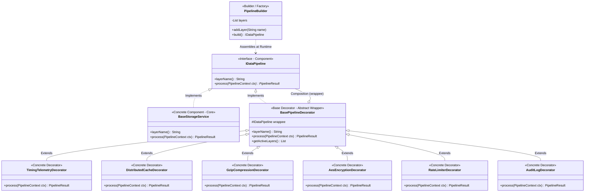
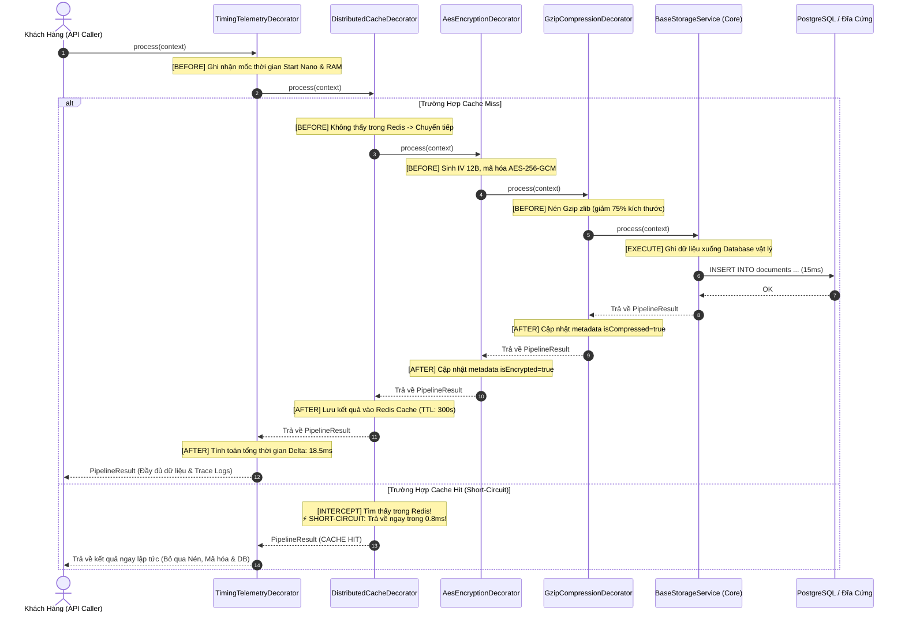

# Decorator Pattern (Mẫu Thiết Kế Trang Trí / Vỏ Bọc Củ Hành) - Cẩm Nang Chuyên Sâu Từ Bản Chất Vật Lý Đến Vận Hành Tải Cao

> **Bản Tóm Tắt Tinh Hoa (Executive Summary)**:  
> **Decorator Pattern** (còn được gọi là *Wrapper Pattern*) là một mẫu thiết kế cấu trúc (Structural Design Pattern) cho phép lập trình viên bổ sung các hành vi, trách nhiệm mới vào một đối tượng cụ thể tại thời điểm **Runtime** (thời điểm chạy) một cách linh hoạt mà **không làm thay đổi cấu trúc mã nguồn gốc** và không làm biến đổi giao diện (Interface) của đối tượng đó.  
> Trong kỹ nghệ phần mềm hiện đại, Decorator không phải là vài dòng code "thêm topping cho ly cà phê", mà là xương sống của toàn bộ thư viện I/O dòng chảy dữ liệu (**Java `InputStream/OutputStream`**, **Node.js Streams**, **C# Streams**), middleware pipeline đa tầng, cơ chế đệm bộ nhớ (Caching Layer), nén luồng và mã hóa dữ liệu nhạy cảm theo mô hình **Onion Architecture**.

---

## 🏛️ Mục Lục Toàn Diện

1. [Mức Độ Cơ Bản (Basic Fundamentals)](#1-mức-độ-cơ-bản-basic-fundamentals)
   - [Định Nghĩa & Ẩn Dụ Đời Thực](#định-nghĩa--ẩn-dụ-đời-thực-real-world-analogy)
   - [Vấn Đề Cốt Lõi: Thảm Họa Bùng Nổ Lớp (Class Explosion)](#vấn-đề-cốt-lõi-thảm-họa-bùng-nổ-lớp-class-explosion)
   - [Kiến Trúc Tổng Quan Mức High-Level](#kiến-trúc-tổng-quan-mức-high-level)
2. [Mức Độ Trung Bình (Intermediate - Architecture & Use Cases)](#2-mức-độ-trung-bình-intermediate---architecture--use-cases)
   - [Bốn Thành Phần Trụ Cột](#bốn-thành-phần-trụ-cột-core-components)
   - [Cơ Chế Bọc Lồng Nhau (Recursive Composition)](#cơ-chế-bọc-lồng-nhau-recursive-composition)
   - [Khi Nào NÊN Dùng và KHÔNG NÊN Dùng](#khi-nào-nên-dùng-và-không-nên-dùng)
3. [Mức Độ Chuyên Sâu: BẢN CHẤT VẬN HÀNH (Under The Hood & Core Mechanics)](#3-mức-độ-chuyên-sâu-bản-chất-vận-hành-under-the-hood--core-mechanics)
   - [Cơ Chế Bọc Lồng & Mô Hình Vỏ Củ Hành (Onion Call Chain)](#cơ-chế-bọc-lồng--mô-hình-vỏ-củ-hành-onion-call-chain)
   - [Dòng Chảy Dữ Liệu Hai Chiều (Inbound & Outbound Data Flow)](#dòng-chảy-dữ-liệu-hai-chiều-inbound--outbound-data-flow)
   - [Phân Biệt: GoF Decorator vs Python/TypeScript `@decorator`](#phân-biệt-gof-decorator-vs-pythontypescript-decorator)
4. [Mức Độ Nâng Cao: Vận Hành Thực Chiến (Production Engineering & Best Practices)](#4-mức-độ-nâng-cao-vận-hành-thực-chiến-production-engineering--best-practices)
   - [Quy Tắc Sắp Xếp Thứ Tự Bắt Buộc (Ordering Matters)](#quy-tắc-sắp-xếp-thứ-tự-bắt-buộc-ordering-matters)
   - [Kỹ Thuật Ngắt Luồng Sớm (Short-Circuiting Trong Caching & Rate Limiting)](#kỹ-thuật-ngắt-luồng-sớm-short-circuiting-trong-caching--rate-limiting)
   - [Anti-Patterns & Sai Lầm Chí Mạng Cần Tránh](#anti-patterns--sai-lầm-chí-mạng-cần-tránh)
5. [Góc Nhìn Thực Chiến Cho Middle-Level Trở Xuống (Must-Know vs Nice-to-Know Roadmap)](#5-góc-nhìn-thực-chiến-cho-middle-level-trở-xuống-must-know-vs-nice-to-know-roadmap)
   - [Phân định ranh giới kiến thức theo từng cấp độ](#phân-định-ranh-giới-kiến-thức-theo-từng-cấp-độ)
   - [Bộ câu hỏi phỏng vấn thực chiến kinh điển (Intern -> Middle)](#bộ-câu-hỏi-phỏng-vấn-thực-chiến-kinh-điển-intern---middle)
   - [Những thứ TẠM THỜI BỎ QUA (Dành riêng cho Senior / Tech Lead / SRE)](#những-thứ-tạm-thời-bỏ-qua-dành-riêng-cho-senior--tech-lead--sre)
6. [So Sánh Bản Chất (First-Principles Comparison)](#6-so-sánh-bản-chất-first-principles-comparison)
7. [Sơ Đồ Trực Quan (Mermaid Diagrams)](#7-sơ-đồ-trực-quan-mermaid-diagrams)
8. [Bảng Tra Thuật Ngữ Chi Tiết (Glossary)](#8-bảng-tra-thuật-ngữ-chi-tiết-glossary)
9. [Hướng Dẫn Chạy & Kiểm Thử Hệ Thống (Step-by-Step Run Guide)](#9-hướng-dẫn-chạy--kiểm-thử-hệ-thống-step-by-step-run-guide)

---

## 1. Mức Độ Cơ Bản (Basic Fundamentals)

### Định Nghĩa & Ẩn Dụ Đời Thực (Real-world Analogy)

> **Cầu Nối Trực Quan (Intuitive Bridge)**:  
> - **Nôm na nó là gì?** Hãy tưởng tượng một buổi sáng mùa đông lạnh giá tại Hà Nội hoặc Sa Pa:
>   1. Bạn mặc một chiếc **Áo Thun Cộc Tay** ở trong cùng (đây là đối tượng cốt lõi - *Concrete Component*).
>   2. Trời lạnh hơn, bạn mặc thêm một chiếc **Áo Len** bên ngoài (đây là *Decorator 1: Giữ Ấm*).
>   3. Trời bắt đầu mưa phùn, bạn khoác thêm một chiếc **Áo Gió Chống Thấm Nước** ra ngoài cùng (đây là *Decorator 2: Chống Nước*).
>   4. Nếu bạn phải đi xe máy vào ban đêm, bạn dán thêm một **Huy Hiệu Phản Quang** lên ngực áo gió (đây là *Decorator 3: Cảnh Báo An Toàn*).
> - **Điểm cốt tử**: 
>   - Dù bạn mặc 1 lớp hay 4 lớp áo, nhìn từ bên ngoài bạn **vẫn là một con người mặc áo** (cùng chung giao diện - *Interface*). 
>   - Bạn có thể tùy ý cởi áo gió ra nếu trời tạnh mưa, hoặc cởi áo len nếu trời ấm lên (tháo lắp hành vi linh hoạt tại *Runtime*).
>   - Bạn không cần phải phẫu thuật gắn vĩnh viễn chiếc áo len hay áo gió vào da thịt của mình (*Kế thừa tĩnh - Static Inheritance*).

```
[ Khách (Client) ]
       │
       ▼  (Gọi phương thức chuẩn: process())
┌───────────────────────────────────────────────────────────┐
│ Outer Decorator: TimingTelemetryDecorator                 │
│   ┌───────────────────────────────────────────────────┐   │
│   │ Middle Decorator: DistributedCacheDecorator       │   │
│   │   ┌───────────────────────────────────────────┐   │   │
│   │   │ Inner Decorator: AesEncryptionDecorator   │   │   │
│   │   │   ┌───────────────────────────────────┐   │   │   │
│   │   │   │ CORE COMPONENT: BaseStorageService│   │   │   │
│   │   │   │ (Lưu trữ đĩa cứng vật lý)         │   │   │   │
│   │   │   └───────────────────────────────────┘   │   │   │
│   │   └───────────────────────────────────────────┘   │   │
│   └───────────────────────────────────────────────────┘   │
└───────────────────────────────────────────────────────────┘
```

---

### Vấn Đề Cốt Lõi: Thảm Họa Bùng Nổ Lớp (Class Explosion)

Tại sao các kỹ sư cấp cao lại tránh dùng Kế Thừa (Inheritance) để mở rộng tính năng và thay bằng Decorator?

> **Cầu Nối Trực Quan (Intuitive Bridge)**:  
> - **Nôm na Class Explosion là gì?** Hãy thử tưởng tượng bạn đang viết một dịch vụ lưu trữ dữ liệu `DataStorage`. Khách hàng yêu cầu thêm 4 tính năng độc lập:
>   1. Tính năng Nén (Compression)
>   2. Tính năng Mã Hóa (Encryption)
>   3. Tính năng Lưu Đệm (Caching)
>   4. Tính năng Giới Hạn Tần Suất (Rate Limiting)
> - **Nếu dùng Kế Thừa truyền thống**:
>   - Bạn tạo `CompressedStorage` kế thừa `DataStorage`.
>   - Bạn tạo `EncryptedStorage` kế thừa `DataStorage`.
>   - Nhưng khách hàng muốn vừa nén vừa mã hóa? Bạn phải tạo `CompressedEncryptedStorage`.
>   - Khách muốn vừa nén, vừa mã hóa, vừa có cache? Bạn phải tạo `CompressedEncryptedCachedStorage`...
>   - Với $N$ tính năng độc lập, số lượng class con bạn phải viết sẽ tăng theo cấp số nhân:
>     $$\text{Số Lượng Class Con} = 2^N$$
>   - Với $N = 4$, bạn cần $2^4 = 16$ class! Với $N = 10$, bạn phải viết $2^{10} = 1024$ class!  
> - **Nếu có Decorator Pattern**: Bạn chỉ cần viết đúng $N = 4$ class Decorator! Tại thời điểm chạy, bạn muốn tổ hợp nào chỉ cần bọc lồng chúng vào nhau:
>   `new RateLimit(new Cache(new Encryption(new Compression(new BaseStorage()))))`

---

### Kiến Trúc Tổng Quan Mức High-Level

Decorator Pattern cho phép mở rộng tính năng bằng cách **ủy quyền (Delegation)** thay vì ghi đè mã nguồn:

```
[ Client ] ─────► [ Component Interface ] ◄─────┐
                         ▲                       │
           ┌─────────────┴─────────────┐         │
           │                           │         │
[ Concrete Component ]       [ Base Decorator ]  │
 (Lõi nghiệp vụ gốc)         (Abstract Wrapper) ─┘
                                       ▲ (has-a)
                                       │
                         ┌─────────────┴─────────────┐
                         │                           │
              [ ConcreteDecorator A ]     [ ConcreteDecorator B ]
               (Bổ sung tính năng A)       (Bổ sung tính năng B)
```

1. **Client** chỉ biết đến `Component Interface`.
2. **Base Decorator** cũng cài đặt `Component Interface` và nắm giữ một biến tham chiếu trỏ tới đối tượng bên trong (`wrappee`).
3. **Concrete Decorators** can thiệp thêm logic vào trước hoặc sau khi chuyển tiếp lời gọi cho `wrappee`.

---

## 2. Mức Độ Trung Bình (Intermediate - Architecture & Use Cases)

### Bốn Thành Phần Trụ Cột (Core Components)

Một cấu trúc Decorator Pattern chuẩn chỉ bao gồm đúng 4 thành phần:

1. **Component Interface (Giao diện chuẩn / Hợp đồng trừu tượng)**:
   - Định nghĩa hành vi chung cho cả đối tượng gốc lẫn các lớp vỏ bọc bên ngoài.
   - Ví dụ: `IDataPipeline` với phương thức `process(context)`.
2. **Concrete Component (Thành phần cụ thể cốt lõi)**:
   - Đối tượng thực hiện công việc nền tảng cơ bản nhất.
   - Hoàn toàn độc lập, không hề biết đến sự tồn tại của bất kỳ lớp vỏ trang trí nào.
   - Ví dụ: `BaseStorageService` chỉ tập trung mở kết nối và ghi mảng byte xuống database/đĩa cứng.
3. **Base Decorator (Lớp vỏ bọc cơ sở)**:
   - Một class trừu tượng implements `Component Interface`.
   - Nắm giữ đối tượng `wrappee` kiểu `Component Interface` (nguyên tắc *Composition*).
   - Triển khai mặc định: Chuyển tiếp lời gọi hàm sang cho `wrappee.process(context)`.
4. **Concrete Decorators (Các lớp trang trí cụ thể)**:
   - Kế thừa từ `Base Decorator`.
   - Bổ sung hành vi động:
     - **Pre-processing**: Can thiệp trước khi gọi wrappee (ví dụ: `GzipCompressionDecorator` nén dữ liệu trước khi đẩy xuống tầng lưu trữ).
     - **Post-processing**: Can thiệp sau khi wrappee hoàn thành (ví dụ: `TimingTelemetryDecorator` đo thời gian thực thi sau khi các tầng bên trong trả về).
     - **Short-circuiting**: Chặn đứng không gọi wrappee (ví dụ: `DistributedCacheDecorator` trả về ngay khi Cache Hit).

---

### Cơ Chế Bọc Lồng Nhau (Recursive Composition)

Điểm kỳ diệu của Decorator là tính chất **đệ quy cấu trúc (Recursive Composition)**. Vì mọi Decorator đều cài đặt cùng một Interface, ta có thể lồng Decorator này vào bên trong một Decorator khác vô hạn lần:

```javascript
// Khởi tạo lõi
const base = new BaseStorageService();

// Bọc tầng 1: Nén dữ liệu
const compressed = new GzipCompressionDecorator(base);

// Bọc tầng 2: Mã hóa dữ liệu đã nén
const encrypted = new AesEncryptionDecorator(compressed);

// Bọc tầng 3: Kiểm tra Cache trước khi nén & mã hóa
const cached = new DistributedCacheDecorator(encrypted);

// Bọc tầng 4: Đo lường thời gian toàn bộ chuỗi
const pipeline = new TimingTelemetryDecorator(cached);

// Khi Client gọi:
await pipeline.process(context);
```

Dòng chảy thực thi (Execution Flow) sẽ đi tuần tự theo 2 chiều:
1. **Chiều Đi Vào (Inward / Pre-processing)**:  
   `Timing` ➔ `Cache` (nếu Miss) ➔ `Encryption` ➔ `Compression` ➔ `BaseStorage`
2. **Chiều Đi Ra (Outward / Post-processing / Unwinding)**:  
   `BaseStorage` ➔ `Compression` ➔ `Encryption` ➔ `Cache` (lưu cache) ➔ `Timing` (tính delta ms)

---

### Khi Nào NÊN Dùng và KHÔNG NÊN Dùng

#### ✅ KHI NÊN DÙNG:
1. **Gán thêm trách nhiệm động cho đối tượng tại thời điểm Runtime**:  
   Khi cần bật/tắt các tính năng bổ trợ (như nén, mã hóa, ghi log, rate limit) dựa trên cấu hình tenant hoặc cờ tính năng (Feature Flags) mà không muốn tạo ra hàng chục class con tĩnh.
2. **Khi việc sử dụng kế thừa bị cấm hoặc gây hại**:  
   Khi class gốc được đánh dấu là `final` (Java/C#) hoặc khi cây phả hệ kế thừa đã quá sâu, việc kế thừa thêm sẽ gây ra hiện tượng *Fragile Base Class*.
3. **Xây dựng Data Pipelines / Stream Processing**:  
   Khi xử lý dữ liệu theo dòng chảy (Stream) nơi mỗi bước xử lý biến đổi dữ liệu một cách độc lập (tương tự như `java.io` hoặc `TransformStream` trong Node.js).

#### ❌ KHI KHÔNG NÊN DÙNG:
1. **Khi các tính năng phụ thuộc lẫn nhau một cách chặt chẽ**:  
   Nếu tính năng A bắt buộc phải biết rõ cấu trúc dữ liệu nội bộ của tính năng B, việc bọc lồng qua Decorator sẽ phá vỡ tính đóng gói.
2. **Khi thứ tự bọc không thể kiểm soát**:  
   Nếu người dùng có thể bọc lộn xộn dẫn đến phá hỏng hệ thống (như Mã hóa trước rồi Nén sau), việc dùng Decorator tự do có thể tạo ra rủi ro vận hành nghiêm trọng. Trong trường hợp này, hãy sử dụng **Builder Pattern** hoặc **Pipeline Orchestrator** để kiểm soát thứ tự bọc.
3. **Khi cần thay đổi bản chất Interface của đối tượng**:  
   Nếu mục tiêu là biến đổi Interface A thành Interface B, bạn đang cần **Adapter Pattern**, không phải Decorator.

---

## 3. Mức Độ Chuyên Sâu: BẢN CHẤT VẬN HÀNH (Under The Hood & Core Mechanics)

### 3.1 Cơ Chế Bọc Lồng & Mô Hình Vỏ Củ Hành (Onion Call Chain)

#### Bản chất của tính kế thừa giao diện và ủy quyền đối tượng
Để hiểu thấu đáo Decorator, bạn cần trả lời câu hỏi: *Tại sao Decorator vừa kế thừa Interface `IDataPipeline`, vừa chứa một đối tượng `wrappee` kiểu `IDataPipeline`?*
- **Kế thừa Interface (Is-a Contract)**: Giúp Decorator có hình dạng bên ngoài giống hệt Component gốc. Client không thể phân biệt được đối tượng nó đang cầm là quả táo nguyên bản hay quả táo đã được bọc đường.
- **Chứa đối tượng con (Has-a Delegation)**: Giúp Decorator ủy quyền hành vi cho lớp bên trong.

> 💡 **Cầu nối trực quan**: Mô hình **Vỏ Củ Hành (Onion)**:
> - Khi bạn gọi hàm `process()` từ ngoài cùng: Lệnh đi qua Lớp vỏ 1 (Đo thời gian) -> Lớp vỏ 2 (Kiểm tra Cache) -> Lớp vỏ 3 (Nén dữ liệu) -> Chạm tới **Lõi củ hành** (Ghi đĩa thực sự).
> - Sau khi lõi xử lý xong, kết quả lại lần lượt đi ngược từ trong ra ngoài: Lớp 3 đóng gói -> Lớp 2 ghi cache -> Lớp 1 tính tổng thời gian và trả về cho Client.

```
[Client Gọi process()]
         │
         ▼
┌────────────────────────────────────────────────────────┐
│ Lớp Vỏ 1: TimingDecorator                              │
│   - Ghi nhận startTime = now()                         │
│   ┌────────────────────────────────────────────────┐   │
│   │ Lớp Vỏ 2: DistributedCacheDecorator            │   │
│   │   - Kiểm tra Redis Cache                       │   │
│   │   ┌────────────────────────────────────────┐   │   │
│   │   │ Lớp Vỏ 3: GzipCompressionDecorator     │   │   │
│   │   │   - Nén chuỗi byte                     │   │   │
│   │   │   ┌────────────────────────────────┐   │   │   │
│   │   │   │ LÕI: BaseStorageService        │   │   │   │
│   │   │   │   - Ghi xuống PostgreSQL / S3  │   │   │   │
│   │   │   └────────────────────────────────┘   │   │   │
│   │   │   - Gắn cờ compressed = true           │   │   │
│   │   └────────────────────────────────────────┘   │   │
│   │   - Lưu kết quả vào Redis Cache                │   │
│   └────────────────────────────────────────────────┘   │
│   - Tính duration = now() - startTime                  │
└────────────────────────────────────────────────────────┘
         │
         ▼
[Client Nhận Kết Quả]
```

---

### 3.2 Dòng Chảy Dữ Liệu Hai Chiều (Inbound & Outbound Data Flow)

Không giống như các hàm bọc một chiều thông thường, một Decorator có hai thời điểm can thiệp vào dòng chảy dữ liệu:
1. **Pha Đi Vào (Pre-processing / Inbound Hook)**: Diễn ra TRƯỚC KHI gọi `wrappee.process()`. Thường dùng để: xác thực quyền, kiểm tra rate limit, kiểm tra cache hit, giải nén dữ liệu đầu vào.
2. **Pha Đi Ra (Post-processing / Outbound Hook)**: Diễn ra SAU KHI `wrappee.process()` hoàn tất. Thường dùng để: nén kết quả trả về, mã hóa dữ liệu nhạy cảm, tính toán thời gian thực thi (metrics), lưu kết quả vào cache.

#### Ví dụ kinh điển: Java I/O Streams
Gói thư viện `java.io` của Java là ví dụ kinh điển nhất về Decorator:
```java
InputStream stream = new BufferedInputStream(new FileInputStream("data.bin"));
```
- `FileInputStream`: Đối tượng cốt lõi, đọc từng byte từ đĩa cứng. Đọc từng byte một sẽ làm nghẽn CPU và I/O đĩa.
- `BufferedInputStream`: Decorator bọc ngoài. Thay vì đọc từng byte, nó đọc sẵn một mảng đệm 8KB vào RAM. Mỗi khi bạn gọi `read()`, nó lấy ngay từ mảng đệm trong RAM mà không cần đọc lại đĩa, giúp tăng tốc độ đọc hàng chục lần mà giao diện `InputStream` vẫn giữ nguyên vẹn 100%.

---

### 3.3 Phân Biệt: GoF Decorator vs Python/TypeScript `@decorator`

Đây là điểm cực kỳ hay bị nhầm lẫn trong các buổi phỏng vấn:

| Tiêu Chí | GoF Decorator Pattern (OOP Chuẩn) | Python / TypeScript `@decorator` |
| :--- | :--- | :--- |
| **Thời Điểm Kích Hoạt** | **Runtime (Thời điểm chạy ứng dụng)** | **Compile / Load Time (Lúc nạp code / transpile)** |
| **Bản Chất Kỹ Thuật** | Lồng ghép đối tượng (Object Composition) qua Interface chung. | Hàm bậc cao (Higher-Order Function) hoặc Siêu lập trình (Metaprogramming). |
| **Mức Độ Linh Hoạt** | Cực cao: Có thể bọc, gỡ, hoặc đổi thứ tự cho từng request cụ thể. | Cố định: Gắn chết vào định nghĩa hàm/class từ lúc khởi động server. |
| **Phạm Vi Tác Động** | Tác động lên **từng instance cụ thể**. | Tác động lên **toàn bộ các instance** sinh ra từ class/hàm đó. |

> 📌 **Kết luận**: Cú pháp `@decorator` trong Python hay TypeScript là cú pháp tiện ích (Syntactic Sugar) cho metaprogramming, **không phải** là Gang of Four Decorator Pattern hướng đối tượng thuần túy!

---

## 4. Mức Độ Nâng Cao: Vận Hành Thực Chiến (Production Engineering & Best Practices)

### 4.1 Quy Tắc Sắp Xếp Thứ Tự Bắt Buộc (Ordering Matters)

Trong một chuỗi Decorator gồm Caching, Compression, Encryption và Rate Limiting, **thứ tự sắp xếp các lớp bọc không phải là sở thích, mà là quy luật an toàn và hiệu năng**:

```
                       THỨ TỰ BỌC CHUẨN PRODUCTION
                     (Từ Lớp Ngoài Cùng Vào Trong Lõi)
                     
[ Inbound Request ]
       │
       ▼
1. TimingTelemetryDecorator  ──► Đo lường toàn bộ thời gian của cả chuỗi (kể cả thời gian cache)
       │
       ▼
2. RateLimiterDecorator      ──► Ngắt sớm nếu vượt hạn mức (Bảo vệ CPU và Cache bên dưới)
       │
       ▼
3. DistributedCacheDecorator ──► Trả về ngay nếu Cache Hit (Tiết kiệm CPU nén & I/O đĩa)
       │
       ▼
4. GzipCompressionDecorator  ──► [QUY TẮC VÀNG]: Phải NÉN TRƯỚC khi mã hóa!
       │
       ▼
5. AesEncryptionDecorator    ──► Mã hóa dữ liệu đã được nén
       │
       ▼
6. BaseStorageService        ──► Ghi mảng byte mã hóa an toàn xuống kho lưu trữ
```

#### Tại Sao Bắt Buộc Phải: Nén Trước Khi Mã Hóa (Compress-then-Encrypt)?
- **Bản chất của mã hóa**: Các thuật toán mã hóa mạnh (nhu AES-256) biến dữ liệu thành một chuỗi ngẫu nhiên hoàn hảo, không còn bất kỳ quy luật hay chuỗi lặp lại nào.
- **Nếu mã hóa trước rồi mới nén**: Thuật toán nén (Gzip/Deflate) dựa trên việc tìm các chuỗi ký tự lặp lại. Vì dữ liệu đã bị biến thành ngẫu nhiên, **nén sẽ hoàn toàn thất bại**, thậm chí dung lượng sau nén còn phình to hơn ban đầu!

---

### 4.2 Kỹ Thuật Ngắt Luồng Sớm (Short-Circuiting Trong Caching & Rate Limiting)

Sức mạnh lớn nhất của Decorator trong hệ thống tải cao nằm ở khả năng **Ngắt luồng sớm (Short-Circuiting)**:

```javascript
// Minh họa Short-circuiting trong CacheDecorator
async process(context) {
  const cached = await redis.get(context.cacheKey);
  if (cached) {
    // ⚡ NGẮT SỚM: Trả về kết quả ngay lập tức trong 0.5ms!
    // Tuyệt đối KHÔNG gọi await this.wrappee.process(context)!
    return new PipelineResult({ ...cached, cacheStatus: 'HIT' });
  }

  // CACHE MISS: Mới tiếp tục đi sâu vào các lớp bên trong
  const result = await this.wrappee.process(context);
  await redis.set(context.cacheKey, result);
  return result;
}
```

- Nhờ cơ chế này, 90% lượng request đọc (Read Traffic) được trả về ngay từ lớp vỏ bên ngoài. Các tầng tốn CPU nặng nề bên trong (Giải mã, Giải nén, Truy vấn Database) được bảo vệ hoàn toàn khỏi quá tải.

---

### 4.3 Anti-Patterns & Sai Lầm Chí Mạng Cần Tránh

| Anti-Pattern | Cơ Chế Gây Hại | Hậu Quả Thực Tế | Giải Pháp Chuẩn Production |
| :--- | :--- | :--- | :--- |
| **Heavy Constructor (Khởi tạo nặng nề)** | Mở kết nối mạng (Socket, DB) hoặc đọc file cấu hình ngay bên trong constructor của Decorator. | Làm chậm quá trình khởi động, không thể kiểm thử offline, dễ gây rò rỉ tài nguyên (Memory Leak). | Constructor chỉ nhận `wrappee` và lưu biến. Logic kết nối mạng phải nằm trong phương thức `process()`. |
| **Losing Concrete Identity (Mất định danh lớp con)** | Client sử dụng toán tử `instanceof` để kiểm tra kiểu đối tượng con: `if (obj instanceof SpecialStorage)`. | Khi bọc Decorator, `obj` giờ là `TimingDecorator`, phép thử `instanceof SpecialStorage` trả về `false`! | Client **CHỈ ĐƯỢC PHÉP** phụ thuộc vào Component Interface. Tuyệt đối không kiểm tra kiểu cụ thể của class con. |
| **Decorator Loop (Vòng lặp vô tận)** | Tầng ngoài bọc tầng trong, nhưng tầng trong lại vô tình lưu tham chiếu ngược lại tầng ngoài: `A(B(A))`. | Gây ra vòng lặp vô hạn đệ quy, tràn ngăn xếp (Stack Overflow) làm sập tiến trình Node.js/JVM. | Sử dụng **PipelineBuilder** có cơ chế kiểm tra trùng lặp (Set validation) để ngăn ngừa vòng lặp. |
| **Breaking Interface Contract (Phá vỡ hợp đồng)** | Decorator tự ý ném ra các ngoại lệ không được định nghĩa trong Interface hoặc thay đổi kiểu trả về. | Phá vỡ nguyên lý thay thế Liskov (LSP). Các tầng bên ngoài không thể bắt hoặc xử lý được dữ liệu. | Luôn tuân thủ nghiêm ngặt kiểu dữ liệu trả về và tài liệu hóa các Domain Exception chuẩn. |

---

## 5. Góc Nhìn Thực Chiến Cho Middle-Level Trở Xuống (Must-Know vs Nice-to-Know Roadmap)

> 💡 **Thông điệp giải tỏa áp lực**: Nếu bạn là Intern, Junior hoặc Mid-level, bạn không cần phải bận tâm về Return Stack Buffer của CPU hay chi phí cấp phát bộ nhớ cấp độ nano-giây. Giá trị thực tế lớn nhất của Decorator Pattern trong công việc hàng ngày là giúp bạn **viết code tuân thủ Open/Closed Principle: bổ sung tính năng mới (log, cache, retry, validate) mà không phải sửa nát code cũ**. Dưới đây là lộ trình thực chiến 80/20.

---

### Phân định ranh giới kiến thức theo từng cấp độ

```
  +---------------------------------------------------------------------------------+
  | CẤP ĐỘ INTERN / JUNIOR (QUY TẮC 80/20 - SỬ DỤNG VÀ HIỂU ĐÚNG PATTERN)           |
  |  - Hiểu ẩn dụ chiếc áo nhiều lớp (Áo thun -> Áo len -> Áo khoác chống nước)     |
  |  - Hiểu tại sao dùng Decorator thay vì Kế thừa (Tránh bùng nổ class con)        |
  |  - Viết được 1 Decorator cơ bản nhận Component qua constructor và bọc thêm logic|
  |  - Phân biệt được GoF Decorator vs cú pháp @decorator trong Python/TypeScript   |
  +---------------------------------------------------------------------------------+
                                          │
                                          ▼
  +---------------------------------------------------------------------------------+
  | CẤP ĐỘ MIDDLE-LEVEL (KIẾN TRÚC PIPELINE & VẬN HÀNH TẢI CAO)                     |
  |  - Thiết kế chuỗi Decorator nhiều tầng theo thứ tự chuẩn (Metrics -> Rate Limit |
  |    -> Cache -> Compress -> Encrypt -> Storage)                                  |
  |  - Áp dụng kỹ thuật Ngắt luồng sớm (Short-circuiting) cho Caching & Security   |
  |  - Xây dựng Builder/Factory để lắp ráp chuỗi Decorator an toàn, chống loop      |
  |  - Tránh lỗi dùng `instanceof` kiểm tra đối tượng đã bị bọc Decorator          |
  +---------------------------------------------------------------------------------+
```

#### Intern / Junior: Những gì BẮT BUỘC phải nắm vững
1. **Mô hình tư duy cốt lõi (Mental Model)**: Hiểu Decorator như việc "mặc thêm áo ấm" – thêm chức năng mà không làm thay đổi bản chất đối tượng ban đầu.
2. **Kỹ năng code thực tế**:
   - Định nghĩa một Interface chuẩn (ví dụ: `INotificationService` có hàm `send(message)`).
   - Viết `EmailNotificationService` (lớp gốc).
   - Viết `SmsDecorator` và `SlackDecorator` nhận `INotificationService` qua constructor và gọi `this.wrappee.send(message)` kèm gửi thêm SMS/Slack.

#### Middle-Level: Tối ưu hóa & Thiết kế chuẩn mực
1. **Thứ tự thực thi (Pipeline Ordering)**: Hiểu rõ tại sao đo thời gian (Telemetry) phải nằm ngoài cùng, Cache phải nằm trước Database, và Nén phải nằm trước Mã hóa.
2. **Short-circuiting**: Biết cách ngắt luồng sớm tại Decorator mà không gọi lớp bên trong khi gặp Cache Hit hoặc lỗi Rate Limit.
3. **Pipeline Builder**: Thay vì để lập trình viên tự gõ `new DecoratorA(new DecoratorB(new DecoratorC(...)))` dễ nhầm thứ tự, viết một lớp Builder quản lý việc ghép tầng an toàn.

---

### Bộ câu hỏi phỏng vấn thực chiến kinh điển (Intern -> Middle)

#### Câu 1 (Intern/Junior): Tại sao nên dùng Decorator Pattern thay vì Kế thừa (Inheritance)?
- **Trả lời ghi điểm**:
  - Kế thừa mang tính **tĩnh (Static tại compile-time)**. Nếu bạn có 4 tính năng tùy chọn (Cache, Log, Encrypt, Compress), bạn sẽ phải tạo $2^4 = 16$ class con để bao quát hết các trường hợp kết hợp (Class Explosion).
  - Decorator áp dụng tính **động (Dynamic tại runtime)** thông qua Composition. Bạn chỉ cần 4 class Decorator độc lập và có thể tùy ý bọc chúng lồng nhau theo bất kỳ sự kết hợp nào lúc ứng dụng đang chạy.

#### Câu 2 (Junior/Middle): Cú pháp `@Log()` trong TypeScript / NestJS có phải là Decorator Pattern của GoF không?
- **Trả lời ghi điểm**:
  - Không hoàn toàn. `@Log()` trong TypeScript là cú pháp **Metaprogramming (Siêu lập trình)** can thiệp vào prototype/metadata của class tại thời điểm nạp file (Build/Load time), tác động lên tất cả instance.
  - Decorator của Gang of Four là **Object Composition tại Runtime**, cho phép bọc thêm tính năng cho **một instance cụ thể** mà không ảnh hưởng tới các instance khác cùng class.

#### Câu 3 (Middle): Trong một hệ thống lưu trữ file nhạy cảm, bạn sẽ sắp xếp chuỗi Decorator gồm Caching, Gzip Compression, AES Encryption và Logging như thế nào? Giải thích lý do.
- **Trả lời ghi điểm**:
  - Thứ tự từ ngoài vào trong: **Logging -> Caching -> Gzip Compression -> AES Encryption -> Core Storage**.
  - **Lý do**:
    - *Logging ở ngoài cùng*: Để đo được toàn bộ thời gian của cả chuỗi (kể cả khi cache hit).
    - *Caching trước Compression & Encryption*: Nếu cache hit, ta trả về kết quả ngay lập tức, tiết kiệm tối đa CPU cho việc nén và mã hóa.
    - *Compression trước Encryption*: Bắt buộc phải nén trước vì thuật toán mã hóa biến dữ liệu thành ngẫu nhiên, nếu mã hóa trước thì thuật toán nén sẽ không thể tìm thấy chuỗi lặp lại và thất bại hoàn toàn.

---

### Những thứ TẠM THỜI BỎ QUA (Dành riêng cho Senior / Tech Lead / SRE)
- **CPU Return Stack Buffer (RSB) & Call Stack Unwinding physics**: Chi phí ngắt CPU và tràn RSB phần cứng khi lồng đệ quy sâu.
- **V8 JIT Megamorphic call-site devirtualization**: Cách trình biên dịch JIT tối ưu hóa lời gọi đa hình trong V8.
- **Linux Kernel System Call context switch internals**: Chuyển đổi ngữ cảnh từ User mode sang Kernel mode khi gọi I/O.
- *Đây là các kiến thức tra cứu tầng sâu của chuyên gia tối ưu hóa hiệu năng, người học từ Middle-level trở xuống không cần áp lực phải thuộc lòng!*

---

## 6. So Sánh Bản Chất (First-Principles Comparison)

Năm mẫu thiết kế cấu trúc và hành vi thường bị nhầm lẫn trong kiến trúc phần mềm:

| Mẫu Thiết Kế | Mục Đích Cốt Lõi | Số Lượng Đối Tượng Bọc | Giao Diện (Interface) | Có Thể Bọc Đa Tầng Lồng Nhau? |
| :--- | :--- | :--- | :--- | :--- |
| **Decorator** | **Bổ sung hành vi động tại Runtime** bằng cách bọc lồng. | Bọc 1 đối tượng cùng loại. | **Giữ nguyên 100%** Interface của Component. | **CÓ** (Bọc lồng vô hạn tầng đệ quy). |
| **Proxy** | **Kiểm soát truy cập** (Lazy loading, phân quyền, caching). | Bọc 1 đối tượng thực tế (RealSubject). | **Giữ nguyên 100%** Interface của Subject. | Hiếm khi (thường chỉ 1 lớp Proxy đứng trước). |
| **Adapter** | **Chuyển đổi giao diện bất tương thích** để 2 bên nói chuyện được. | Bọc 1 đối tượng có sẵn (Adaptee). | **Thay đổi hoàn toàn** sang Interface mới mà Client yêu cầu. | Không (chỉ dùng để dịch giao thức). |
| **Chain of Responsibility** | **Chuyển tiếp yêu cầu** dọc theo một chuỗi cho đến khi có 1 handler xử lý. | Mỗi node nắm giữ 1 con trỏ trỏ tới node tiếp theo. | Giao diện Handler nhận request và quyết định dừng hay chuyển tiếp. | CÓ (Chuỗi tuyến tính, chỉ 1 handler chịu trách nhiệm chính). |
| **Strategy** | **Thay đổi thuật toán hoán đổi cho nhau** từ bên trong đối tượng. | Đối tượng nắm giữ 1 Strategy (Has-a). | Đối tượng có Interface riêng, Strategy có Interface riêng. | Không (đây là mẫu thiết kế hoán đổi ruột, không phải bọc vỏ). |

---

## 7. Sơ Đồ Trực Quan (Mermaid Diagrams)

### 1. Sơ Đồ Lớp Kiến Trúc Của Hệ Thống (Class Diagram)



### 2. Sơ Đồ Dòng Chảy Bóc Tách Vỏ Hành (Call Stack Unwinding Sequence)



---

## 8. Bảng Tra Thuật Ngữ Chi Tiết (Glossary)

| Thuật Ngữ | Tên Đầy Đủ / Định Nghĩa Kỹ Thuật | Giải Thích Dễ Hiểu & Ngữ Cảnh Sử Dụng |
| :--- | :--- | :--- |
| **Wrappee** | *Wrapped Component Instance* | Đối tượng thành phần nằm ở tầng bên trong được Decorator bao bọc và ủy quyền thực thi. |
| **Component Interface** | *Component Contract* | Giao diện chuẩn mực mà cả đối tượng gốc lẫn mọi lớp Decorator bắt buộc phải tuân theo. |
| **Recursive Composition** | *Cấu thành đệ quy* | Khả năng một Decorator có thể bọc một Decorator khác cùng loại tạo thành chuỗi mắt xích dài vô hạn. |
| **Class Explosion** | *Bùng nổ tổ hợp lớp* | Hiện tượng số lượng class tăng theo cấp số nhân ($2^N$) khi lạm dụng kế thừa để tổ hợp tính năng. |
| **Stack Unwinding** | *Xả ngăn xếp lời gọi hàm* | Quá trình CPU lần lượt hoàn tất và giải phóng các Stack Frame từ trong ra ngoài sau khi lõi hoàn thành. |
| **Short-Circuiting** | *Ngắt luồng xử lý sớm* | Khả năng một Decorator (như Cache hoặc RateLimit) trả về kết quả ngay mà không gọi các tầng bên dưới. |
| **Entropy** | *Độ hỗn loạn thông tin* | Thước đo tính ngẫu nhiên của dữ liệu. Dữ liệu mã hóa có entropy tối đa nên không thể nén tiếp. |
| **Token Bucket** | *Thùng Token kiểm soát lưu lượng* | Thuật toán giới hạn tần suất request bằng cách cấp phát và tiêu thụ token theo thời gian. |
| **System Call Context Switch** | *Chuyển đổi ngữ cảnh lời gọi hệ thống* | Chi phí CPU khi chuyển từ User Mode (Ring 3) sang Kernel Mode (Ring 0) để đọc/ghi đĩa. |
| **Return Stack Buffer (RSB)** | *Bộ đệm ngăn xếp lệnh quay về* | Cấu trúc phần cứng trong CPU giúp dự đoán địa chỉ lệnh tiếp theo khi thực thi lệnh `RET`. |

---

## 9. Hướng Dẫn Chạy & Kiểm Thử Hệ Thống (Step-by-Step Run Guide)

Dự án đi kèm một ứng dụng Full-Stack Production-Grade hoàn chỉnh nằm ngay trong thư mục này:
- **Hạ tầng Docker**: [docker-compose.yml](/Users/ductri0981/Documents/Studying-Software/Design_Patterns/decorator/docker-compose.yml) (PostgreSQL 16 tại cổng 5434 + Redis 7 tại cổng 6383).
- **Backend Node.js**: [server.js](/Users/ductri0981/Documents/Studying-Software/Design_Patterns/decorator/backend/server.js) (Chạy cổng 5003 với đầy đủ 6 Concrete Decorators).
- **Frontend React/Vite**: [App.jsx](/Users/ductri0981/Documents/Studying-Software/Design_Patterns/decorator/frontend/src/App.jsx) (Giao diện Studio trực quan hóa bóc vỏ củ hành).

### Bước 1: Khởi Chạy Hạ Tầng (Docker Compose)
Mở một cửa sổ Terminal tại thư mục `decorator`:
```bash
docker compose up -d
```
*Lệnh này khởi động PostgreSQL tại cổng 5434 và Redis tại cổng 6383 với volume persistence và health checks.*

### Bước 2: Nạp Dữ Liệu Mẫu & Khởi Động Backend Server
Mở Terminal thứ hai:
```bash
cd backend
npm run seed     # Nạp các tài liệu mẫu ban đầu vào Database
npm start        # Khởi động Backend tại http://localhost:5003
```

### Bước 3: Khởi Động Frontend Dashboard
Mở Terminal thứ ba:
```bash
cd frontend
npm run dev      # Khởi động Vite tại http://localhost:5175
```
Truy cập trình duyệt tại: **http://localhost:5175**

---

### Các Kịch Bản Thử Nghiệm Trực Quan Trên Giao Diện

1. **Thí Nghiệm Lắp Ráp Decorator Động Tại Runtime (Pipeline Studio)**:
   - Trên tab **Pipeline Studio**, bấm chọn preset **"1. Raw Base (Không Decorator)"** -> Bấm **Kích Hoạt Pipeline**.
   - Quan sát: Dữ liệu thô lưu thẳng vào Database, dung lượng không đổi, thời gian xử lý ~18ms (Disk I/O).
   - Tiếp tục chọn preset **"3. Compliance Security"** (bật Nén Gzip + Mã hóa AES + Audit) -> Bấm **Kích Hoạt Pipeline**.
   - Quan sát kết quả: Kích thước payload giảm từ 3,800 B xuống 950 B (tiết kiệm ~75%), payload đã được mã hóa thành chuỗi an toàn `ENC_GCM:iv:tag:data`.

2. **Thí Nghiệm Bóc Tách Vỏ Hành (Onion Skin Inspector)**:
   - Chuyển sang tab **Onion Skin Inspector**.
   - Quan sát sơ đồ các tầng lồng nhau (Concentric Stack) từ Tầng 1 đến Tầng Lõi.
   - Kéo xem bảng **Dòng Chảy Xuyên Suốt (Timeline Traces)**:
     - Giai đoạn `PRE-PROCESS`: Thấy rõ bước nén Gzip làm giảm kích thước trước, rồi mới đến bước mã hóa AES sinh IV.
     - Giai đoạn `CORE PERSISTENCE`: BaseStorageService ghi dữ liệu xuống đĩa.
     - Giai đoạn `POST-PROCESS (UNWIND)`: Ngăn xếp đảo chiều, AuditLog tính toán chữ ký SHA-256, Timing ghi nhận tổng thời gian nano-giây.

3. **Thí Nghiệm Đo Lường Đánh Đổi Hiệu Năng (Benchmark Arena)**:
   - Chuyển sang tab **Benchmark Arena**.
   - Chọn số lượt lặp `50 lần` -> Bấm **Bắt Đầu Benchmark**.
   - Quan sát bảng so sánh và biểu đồ P95 Latency trực quan giữa 4 cấu hình:
     - Cấu hình có **Distributed Cache** cho tốc độ phản hồi vượt trội (< 1ms) nhờ cơ chế Short-circuiting.
     - Cấu hình có **Compression + Encryption** tốn thêm khoảng 2ms tính toán CPU nhưng tiết kiệm 70% băng thông mạng và đĩa cứng!

4. **Thí Nghiệm Chặn Đứng Quá Tải Bằng Token Bucket (Rate Limiter)**:
   - Quay lại **Pipeline Studio**, bật duy nhất Decorator `RateLimiterDecorator`.
   - Bấm nút **"Kích Hoạt Pipeline"** liên tục 15-20 lần thật nhanh.
   - **Kết quả**: Khi số lượng token trong thùng cạn kiệt, màn hình chuyển sang cảnh báo màu đỏ: `HTTP 429 - Rate limit exceeded`. Decorator đã chặn đứng request ngay lập tức mà không để chạm vào Database!
