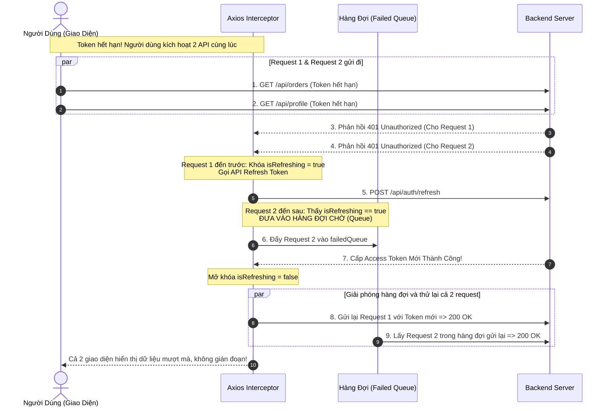

# INTERCEPTOR PATTERN ARCHITECTURE & HTTP PIPELINE DEEP DIVE

> **Tài liệu lý thuyết chuyên sâu và hướng dẫn kiến trúc toàn diện về Interceptor Pattern (HTTP Request / Response Interceptor & Middleware Pipeline)**  
> Dành cho Software Engineer, Frontend Engineer và Backend Developer từ cấp độ Intern đến Middle-level và Tech Lead.

---

## 📑 MỤC LỤC
1. [Mức Độ Cơ Bản (Basic Fundamentals)](#1-mức-độ-cơ-bản-basic-fundamentals)
2. [Mức Độ Trung Bình (Intermediate - Architecture & Use Cases)](#2-mức-độ-trung-bình-intermediate---architecture--use-cases)
3. [Mức Độ Chuyên Sâu: BẢN CHẤT VẬN HÀNH (Under The Hood & Core Mechanics)](#3-mức-độ-chuyên-sâu-bản-chất-vận-hành-under-the-hood--core-mechanics)
4. [Mức Độ Nâng Cao: Vận Hành Thực Chiến (Production Engineering & Best Practices)](#4-mức-độ-nâng-cao-vận-hành-thực-chiến-production-engineering--best-practices)
5. [Góc Nhìn Thực Chiến Cho Middle-Level Trở Xuống (Must-Know vs Nice-to-Know Roadmap)](#5-góc-nhìn-thực-chiến-cho-middle-level-trở-xuống-must-know-vs-nice-to-know-roadmap)
6. [So Sánh Bản Chất (First-Principles Comparison)](#6-so-sánh-bản-chất-first-principles-comparison)
7. [Sơ Đồ Trực Quan (Mermaid Diagrams)](#7-sơ-đồ-trực-quan-mermaid-diagrams)
8. [Bảng Tra Thuật Ngữ Chi Tiết (Glossary)](#8-bảng-tra-thuật-ngữ-chi-tiết-glossary)
9. [Hướng Dẫn Chạy & Kiểm Thử Hệ Thống (Step-by-Step Run Guide)](#9-hướng-dẫn-chạy--kiểm-thử-hệ-thống-step-by-step-run-guide)

---

## 1. Mức Độ Cơ Bản (Basic Fundamentals)

### 1.1. Định nghĩa & Ẩn dụ đời thực (Real-world Analogy)
**Interceptor Pattern** (Mẫu thiết kế Kẻ Chặn Đường) là một mẫu kiến trúc phần mềm cho phép can thiệp, kiểm tra, sửa đổi hoặc hủy bỏ một luồng thực thi (Execution Pipeline) tại các thời điểm then chốt **TRƯỚC KHI** yêu cầu được gửi đi hoặc **TRƯỚC KHI** phản hồi được trả về cho mã nguồn nghiệp vụ chính.

```
+-----------------------------------------------------------------------------------+
|                        ẨN DỤ: TRẠM KIỂM SOÁT HẢI QUAN SÂN BAY                     |
|                                                                                   |
|  [HÀNH KHÁCH (REQUEST GỬI ĐI)]:                                                   |
|   - Bạn (Business Logic) chuẩn bị bay (gửi HTTP Request).                         |
|   - CỬA KIỂM SOÁT XUẤT CẢNH (Request Interceptor):                                |
|     + Kiểm tra xem bạn có dán visa/hộ chiếu chưa?                                 |
|     + Nếu quên dán tem (Thiếu Authorization Header), bảo vệ tự động dán tem       |
|       Bearer Token cho bạn trước khi lên máy bay.                                 |
|                                                                                   |
|  [HÀNH KHÁCH VỀ NƯỚC (RESPONSE TRẢ VỀ)]:                                          |
|   - Máy bay hạ cánh mang hành lý về (HTTP Response).                              |
|   - CỬA KIỂM SOÁT NHẬP CẢNH (Response Interceptor):                              |
|     + Máy quét phát hiện: "Hộ chiếu đã hết hạn (Mã lỗi 401 Unauthorized)!"        |
|     + Thay vì trục xuất bạn ngay, cán bộ hải quan giữ hành lý lại, tự động đưa     |
|       bạn sang quầy đổi hộ chiếu mới (Refresh Token API), rồi cho hành lý qua     |
|       cổng một cách trong suốt!                                                   |
+-----------------------------------------------------------------------------------+
```

- **Nếu không có Interceptor**: Cứ mỗi lần gọi API trong dự án (100 hàm `axios.get`, `axios.post`), lập trình viên đều phải tự viết code thêm Header, tự bọc `try/catch` để kiểm tra lỗi 401, tự viết logic gọi Refresh Token... Dẫn đến code trùng lặp hàng ngàn dòng, cực kỳ dễ sót lỗi và khó bảo trì.
- **Khi có Interceptor**: Toàn bộ logic kiểm soát tầng ngang (Cross-Cutting Concerns) như gắn Token, xử lý Refresh Token, xử lý lỗi toàn cục và Loading Spinner được gom về **một điểm duy nhất (Single Point of Truth)**.

---

### 1.2. Vấn đề cốt lõi sinh ra công nghệ (Problem Statement)
Trong các ứng dụng Enterprise (Frontend SPA React/Vue hoặc Backend Gateway), việc giao tiếp qua mạng luôn đòi hỏi các bước tiền xử lý và hậu xử lý:
1. **Trùng lặp mã nguồn (Code Duplication Violation of DRY)**: Mỗi API đều cần `Authorization: Bearer <token>`, `Accept-Language: vi`, `X-Trace-Id`.
2. **Khủng hoảng Hết Hạn Token (Token Expiration Glitch)**: Access Token thường chỉ sống 15 phút. Nếu không có cơ chế chặn phản hồi 401 tự động, người dùng đang gõ dở văn bản sẽ bị văng ra trang Login một cách đột ngột.
3. **Bài toán Đua Lệnh Làm Mới Token (Refresh Token Race Condition)**: Nếu trên một trang Dashboard có 5 component cùng gọi 5 API cùng lúc khi Access Token vừa hết hạn, nếu không có cơ chế xếp hàng (Queueing), hệ thống sẽ gửi **5 request refresh token đồng thời** dẫn đến lỗi Invalid Refresh Token và hủy phiên người dùng.

Interceptor Pattern ra đời để đóng gói toàn bộ quy trình tiền xử lý, hậu xử lý và điều phối luồng thử lại (Retry Loop) một cách hoàn toàn tự động và trong suốt với các tầng code phía trên.

---

## 2. Mức Độ Trung Bình (Intermediate - Architecture & Use Cases)

### 2.1. Hai Trụ Cột: Request Interceptor vs Response Interceptor

```
[ FRONTEND CODE ]
       |
       | 1. axios.get('/api/orders')
       v
+------------------------------------------------------------------+
| REQUEST INTERCEPTOR PIPELINE                                     |
| - Tự động đính kèm Authorization: Bearer <access_token>          |
| - Bật cờ trạng thái Loading Indicator                            |
| - Tiêm X-Correlation-ID phục vụ Distributed Tracing              |
+------------------------------------------------------------------+
       |
       | 2. Gói tin mạng bay qua Internet
       v
[ BACKEND SERVER ]
       |
       | 3. Trả về HTTP Response (200 OK hoặc 401 Unauthorized)
       v
+------------------------------------------------------------------+
| RESPONSE INTERCEPTOR PIPELINE                                    |
| - Tắt cờ Loading Indicator                                       |
| - Bóc tách response.data (Loại bỏ vỏ bọc axios thô)              |
| - NẾU MÃ LỖI LÀ 401:                                             |
|   + Tạm dừng request hiện tại                                    |
|   + Kích hoạt quy trình lấy Access Token mới (Refresh Token)     |
|   + Tự động gửi lại (Retry) request ban đầu                      |
+------------------------------------------------------------------+
       |
       | 4. Trả kết quả sạch về cho hàm ban đầu
       v
[ KẾT QUẢ HIỂN THỊ TRÊN GIAO DIỆN ]
```

---

### 2.2. Khi nào NÊN dùng và KHÔNG NÊN dùng Interceptor

#### ✅ Khi nào NÊN dùng Interceptor (Best Use Cases)
1. **Xử lý Tự Động Làm Mới Token (Silent Refresh Token)**: Bắt mã lỗi 401, gọi API refresh, xếp hàng các request đang chờ và thử lại tự động mà người dùng không hề hay biết.
2. **Gắn Authentication & Trace Headers**: Đính kèm JWT token, API key, hoặc Request ID trên mọi request.
3. **Quản trị Lỗi Toàn Cục (Global Error Handling)**: Tự động hiển thị Toast thông báo lỗi khi gặp lỗi mạng (Network Error), lỗi 500 hoặc tự động điều hướng sang trang 403 Forbidden.
4. **Chuẩn hóa Định dạng Dữ liệu (Transform Pipeline)**: Tự động chuyển đổi JSON từ `snake_case` (của Backend Python/Postgres) sang `camelCase` (của Frontend JavaScript) và ngược lại.
5. **Đo lường Hiệu năng (Telemetry & APM)**: Tính toán thời gian khứ hồi (Round-Trip Time) của mỗi API để phát hiện các endpoint bị chậm.

#### ❌ Khi nào KHÔNG NÊN dùng Interceptor (What to Avoid)
1. **Xử lý Nghiệp Vụ Cụ Thể Của Từng Trang (Page-Specific Business Logic)**: Không kiểm tra xem nếu URL là `/checkout` thì làm việc A, URL là `/profile` thì làm việc B trong Interceptor. Interceptor chỉ dành cho các tác vụ mang tính dùng chung toàn cục.
2. **Tạo Vòng Lặp Vô Tận (Infinite Loop Trap)**: Nếu trong hàm xử lý lỗi 401 của Response Interceptor lại gọi một API bị lỗi 401 khác mà không có cờ chặn (`_retry = true`), Interceptor sẽ tự gọi chính nó liên tục hàng ngàn lần làm treo trình duyệt.

---

## 3. Mức Độ Chuyên Sâu: BẢN CHẤT VẬN HÀNH (Under The Hood & Core Mechanics)

### 3.1. Cấu Trúc Hàng Đợi Promise Chained Pipeline Trong Axios
Bên dưới thư viện Axios, Interceptor được hiện thực hóa như thế nào?

Bí mật nằm ở **mô hình chuỗi Promise liên hoàn (Chained Promise Array)**:

```javascript
// NGUYÊN LÝ HOẠT ĐỘNG BÊN DƯỚI AXIOS:
const chain = [
  // Cặp hàm Request Interceptors: [fulfilled, rejected]
  requestInterceptor1, requestError1,
  // Hàm gửi request mạng thực sự
  dispatchRequest, undefined,
  // Cặp hàm Response Interceptors: [fulfilled, rejected]
  responseInterceptor1, responseError1
];

// Axios duyệt mảng chain và móc nối tuần tự qua Promise:
let promise = Promise.resolve(config);
while (chain.length) {
  promise = promise.then(chain.shift(), chain.shift());
}
return promise;
```

- Mọi Request Interceptor được xếp vào nửa đầu của chuỗi.
- Hàm gửi mạng `dispatchRequest` (sử dụng `XMLHttpRequest` hoặc `fetch`) nằm chính giữa.
- Mọi Response Interceptor được xếp vào nửa sau của chuỗi.
- Nhờ cơ chế móc xích Promise, dữ liệu hoặc lỗi sẽ tuần tự chảy qua từng trạm kiểm soát một cách nhịp nhàng.

---

### 3.2. Thuật Toán Khóa Đua Lệnh Làm Mới Token (Mutex Lock & Request Queueing)
Đây là bài toán phỏng vấn Senior/Lead hóc búa nhất: *Nếu có 5 request gửi đi cùng lúc khi Token hết hạn, làm sao để chỉ gọi API Refresh đúng 1 lần duy nhất và không làm rớt 4 request còn lại?*

```
[ 5 REQUEST CÙNG NHẬN 401 UNAUTHORIZED ]
  ├── Request A (Đến đầu tiên):
  │     => Thấy `isRefreshing === false`
  │     => Khóa biến: `isRefreshing = true`
  │     => Bắt đầu gọi API: POST /api/refresh-token
  │
  └── Request B, C, D, E (Đến sau vài mili-giây):
        => Thấy `isRefreshing === true`
        => KHÔNG GỌI REFRESH NỮA!
        => Tạo ra một Promise chưa resolve và đưa vào HÀNG ĐỢI (failedQueue).
        
[ KHI REQUEST A NHẬN ĐƯỢC TOKEN MỚI THÀNH CÔNG ]:
  1. Mở khóa biến: `isRefreshing = false`
  2. Duyệt qua hàng đợi `failedQueue`:
     => Cung cấp Token mới cho Request B, C, D, E
     => Kích hoạt axios(originalRequest) để gửi lại tất cả!
  3. Xóa sạch hàng đợi `failedQueue = []`.
```

---

## 4. Mức Độ Nâng Cao: Vận Hành Thực Chiến (Production Engineering & Best Practices)

### 4.1. Code Mẫu Response Interceptor Tự Động Refresh Token Chuẩn Doanh Nghiệp

```javascript
import axios from 'axios';

const api = axios.create({
  baseURL: 'https://api.example.com',
  withCredentials: true // Gửi cookie an toàn
});

let isRefreshing = false;
let failedQueue = [];

// Hàm giải quyết các request bị kẹt trong hàng đợi
const processQueue = (error, token = null) => {
  failedQueue.forEach(prom => {
    if (error) {
      prom.reject(error);
    } else {
      prom.resolve(token);
    }
  });
  failedQueue = [];
};

// RESPONSE INTERCEPTOR
api.interceptors.response.use(
  (response) => response, // Trả về nếu thành công
  async (error) => {
    const originalRequest = error.config;

    // Nếu lỗi là 401 và request này chưa từng được thử lại lần nào
    if (error.response?.status === 401 && !originalRequest._retry) {
      // Nếu chính API refresh-token bị lỗi 401 => Phiên làm việc đã chết hoàn toàn => Đăng xuất
      if (originalRequest.url.includes('/api/auth/refresh')) {
        window.location.href = '/login';
        return Promise.reject(error);
      }

      // Đánh dấu cờ _retry để tránh vòng lặp vô tận
      originalRequest._retry = true;

      // NẾU ĐANG CÓ MỘT TIẾN TRÌNH KHÁC REFRESH TOKEN => XẾP HÀNG CHỜ
      if (isRefreshing) {
        return new Promise((resolve, reject) => {
          failedQueue.push({ resolve, reject });
        })
          .then(() => api(originalRequest))
          .catch(err => Promise.reject(err));
      }

      // NẾU CHƯA CÓ AI REFRESH => BẬT KHÓA VÀ TIẾN HÀNH REFRESH
      isRefreshing = true;

      try {
        await api.post('/api/auth/refresh');
        processQueue(null); // Thông báo cho hàng đợi là đã có token mới
        return api(originalRequest); // Gửi lại request ban đầu
      } catch (refreshErr) {
        processQueue(refreshErr, null);
        window.location.href = '/login'; // Chuyển về login
        return Promise.reject(refreshErr);
      } finally {
        isRefreshing = false; // Luôn mở khóa
      }
    }

    return Promise.reject(error);
  }
);

export default api;
```

---

## 5. Góc Nhìn Thực Chiến Cho Middle-Level Trở Xuống (Must-Know vs Nice-to-Know Roadmap)

```
+------------------------------------------------------------------------------------+
|               LỘ TRÌNH KỸ NĂNG INTERCEPTOR: PHÂN CẤP TỪ JUNIOR ĐẾN SENIOR          |
|                                                                                    |
|  [INTERN / JUNIOR] (80/20 - Sử dụng thực chiến)                                    |
|   ├── Hiểu rõ khái niệm Interceptor là gì thông qua ẩn dụ trạm hải quan            |
|   ├── Khởi tạo Axios Instance dùng chung (`axios.create({ baseURL, timeout })`)    |
|   ├── Viết Request Interceptor cơ bản để tự động gắn `Authorization: Bearer`       |
|   ├── Viết Response Interceptor cơ bản để bóc tách `response.data`                 |
|   └── Hiển thị thông báo Toast lỗi toàn cục khi server trả về mã lỗi 500           |
|                                                                                    |
|  ============================== Ranh giới Middle ===============================   |
|                                                                                    |
|  [MIDDLE-LEVEL] (Thiết kế luồng phục hồi, Xếp hàng đợi & Tránh xung đột)          |
|   ├── Xây dựng cơ chế Silent Refresh Token tự động phục hồi phiên làm việc         |
|   ├── Giải quyết triệt để bài toán Đua Lệnh (Race Condition) bằng Mutex Queue      |
|   ├── Sử dụng cờ `_retry` để phòng chống vòng lặp vô tận (Infinite Loop)           |
|   ├── Tích hợp Hủy Yêu Cầu Cũ (AbortController) khi người dùng spam click chuyển tab|
|   └── Đồng bộ hóa Interceptor với Cookie Authentication (`withCredentials: true`)   |
|                                                                                    |
|  ============================== Ranh giới Senior / Architect ===================   |
|                                                                                    |
|  [SENIOR / ARCHITECT] (Tạm thời bỏ qua nếu ở mức Middle trở xuống)                 |
|   ├── Xây dựng Interceptor Middleware Pipeline đa tầng (AOP - Aspect-Oriented)     |
|   ├── Tích hợp Distributed Tracing (W3C Trace-Context: traceparent injection)      |
|   └── Tối ưu hóa bộ nhớ Chained Promise trên các ứng dụng Micro-Frontend phức tạp  |
+------------------------------------------------------------------------------------+
```

---

### 5.1. Chi Tiết Đáp Án & Kỹ Thuật Thực Chiến Cho Cấp Độ [INTERN / JUNIOR]

#### 1. Hiểu rõ khái niệm Interceptor là gì thông qua ẩn dụ trạm hải quan
- **Vấn đề thực tế:** Nếu không có trạm kiểm soát chung, mỗi lần gọi API ta đều phải thủ công gắn token, tự bọc try/catch xử lý lỗi... Code bị lặp lại hàng trăm lần.
- **Đáp án & Cách hiểu:** Interceptor là "cửa khẩu trung gian".
  - **Request Interceptor (Cửa xuất cảnh):** Chặn gói tin trước khi bay ra Internet để kiểm tra, bổ sung thông tin (dán tem visa / gắn Bearer token, gắn timestamp).
  - **Response Interceptor (Cửa nhập cảnh):** Chặn gói tin vừa từ server về trước khi đến code component để kiểm tra tình trạng (nếu hộ chiếu hết hạn / lỗi 401 thì gọi gia hạn, nếu dữ liệu bọc trong envelope thì bóc tách lấy data sạch).

#### 2. Khởi tạo Axios Instance dùng chung (`axios.create({ baseURL, timeout })`)
- **Vấn đề thực tế:** Nếu gọi trực tiếp `axios.get('https://api.domain.com/...')`, ta không thể cấu hình timeout hoặc base URL tập trung, khó đổi môi trường dev/staging/prod.
- **Đáp án & Code chuẩn:**
```typescript
import axios from 'axios';

export const apiClient = axios.create({
  baseURL: import.meta.env.VITE_API_BASE_URL || 'https://api.example.com',
  timeout: 10000, // Quá 10s tự hủy request để tránh nghẽn UI
  headers: {
    'Content-Type': 'application/json',
    'Accept': 'application/json',
  },
});
```

#### 3. Viết Request Interceptor cơ bản để tự động gắn `Authorization: Bearer`
- **Vấn đề thực tế:** Mỗi API private đều cần header `Authorization: Bearer <token>`. Không thể để lập trình viên tự copy-paste token ở từng component.
- **Đáp án & Code chuẩn:**
```typescript
apiClient.interceptors.request.use(
  (config) => {
    const token = localStorage.getItem('access_token');
    if (token && config.headers) {
      config.headers.Authorization = `Bearer ${token}`;
    }
    return config; // BẮT BUỘC phải return config để request tiếp tục đi
  },
  (error) => Promise.reject(error)
);
```

#### 4. Viết Response Interceptor cơ bản để bóc tách `response.data`
- **Vấn đề thực tế:** Axios mặc định bọc dữ liệu trong `{ data, status, headers, config }`. Ở giao diện, ta chỉ quan tâm `response.data`. Mỗi lần gọi lại phải gõ `res.data.data` rất rườm rà.
- **Đáp án & Code chuẩn:**
```typescript
apiClient.interceptors.response.use(
  (response) => {
    // Trả thẳng dữ liệu nghiệp vụ của backend, loại bỏ vỏ bọc của axios
    return response.data;
  },
  (error) => Promise.reject(error)
);
```

#### 5. Hiển thị thông báo Toast lỗi toàn cục khi server trả về mã lỗi 500
- **Vấn đề thực tế:** Lỗi sập server (500) hoặc lỗi mạng (Network Error) xảy ra bất ngờ. Nếu từng component phải viết popup báo lỗi thì vừa rối vừa thiếu sót.
- **Đáp án & Code chuẩn:**
```typescript
import { toast } from 'react-toastify'; // Hoặc thư viện thông báo bất kỳ

apiClient.interceptors.response.use(
  (response) => response,
  (error) => {
    if (!error.response) {
      toast.error('Mất kết nối mạng! Vui lòng kiểm tra đường truyền.');
    } else if (error.response.status >= 500) {
      toast.error('Hệ thống máy chủ đang bận hoặc gặp sự cố (500). Vui lòng thử lại sau!');
    }
    return Promise.reject(error);
  }
);
```

---

### 5.2. Chi Tiết Đáp Án & Kỹ Thuật Thực Chiến Cho Cấp Độ [MIDDLE-LEVEL]

#### 1. Xây dựng cơ chế Silent Refresh Token tự động phục hồi phiên làm việc
- **Vấn đề thực tế:** Access token thường ngắn (ví dụ 15 phút). Hết hạn thì server trả về 401. Nếu bắt user đăng nhập lại thì trải nghiệm cực tệ.
- **Đáp án & Cách làm:** Bắt mã 401 tại `response.interceptors`. Tạm dừng request hiện tại, âm thầm gọi API `/auth/refresh` bằng Refresh Token (hoặc HttpOnly Cookie). Khi có Access Token mới, cập nhật lại Authorization Header của request ban đầu và gọi lại chính nó (`apiClient(originalRequest)`). Người dùng trên màn hình không hề nhận ra phiên vừa hết hạn.

#### 2. Giải quyết triệt để bài toán Đua Lệnh (Race Condition) bằng Mutex Queue
- **Vấn đề thực tế:** Khi load một Dashboard có 5 widget gọi đồng thời 5 API: API A, B, C, D, E. Cả 5 cùng nhận mã 401 trong cùng 1 mili-giây. Nếu không chặn, cả 5 sẽ cùng gọi 5 lần `/auth/refresh` song song! Hầu hết backend áp dụng kỹ thuật "Refresh Token Rotation" sẽ hủy bỏ phiên ngay lập tức vì phát hiện nghi vấn gian lận (Reuse Detection).
- **Đáp án & Cách làm:** Dùng biến cờ khóa `isRefreshing` kết hợp một mảng hàng đợi `failedQueue`:
  - Request đầu tiên thấy `isRefreshing = false` $\rightarrow$ bật `isRefreshing = true` và trực tiếp gọi API refresh token.
  - Các request tiếp theo thấy `isRefreshing = true` $\rightarrow$ không gọi refresh nữa, mà tạo ra Promise chưa resolve và nhét callback vào `failedQueue`.
  - Khi refresh thành công, duyệt qua `failedQueue` gọi `resolve()` để kích hoạt gửi lại tất cả request đang xếp hàng, sau đó dọn sạch queue và reset `isRefreshing = false`.

#### 3. Sử dụng cờ `_retry` để phòng chống vòng lặp vô tận (Infinite Loop)
- **Vấn đề thực tế:** Request ban đầu bị 401 $\rightarrow$ Interceptor refresh token và gọi lại request ban đầu $\rightarrow$ nhưng token mới vẫn không có quyền hoặc server vẫn trả 401 $\rightarrow$ Interceptor lại bắt 401 và lại refresh tiếp... tạo thành vòng lặp vô tận dội bom server và đơ trình duyệt.
- **Đáp án & Cách làm:**
```typescript
// Trước khi thử lại, BẮT BUỘC đánh dấu cờ vào config:
originalRequest._retry = true;

// Ở đầu điều kiện kiểm tra:
if (error.response?.status === 401 && !originalRequest._retry) {
  // Chỉ thử lại NẾU CHƯA TỪNG ĐƯỢC THỬ LẠI LẦN NÀO!
}
```
Ngoài ra, nếu chính endpoint `/auth/refresh` bị 401 thì lập tức `window.location.href = '/login'`, không được retry API refresh.

#### 4. Tích hợp Hủy Yêu Cầu Cũ (AbortController) khi người dùng spam click chuyển tab
- **Vấn đề thực tế:** Người dùng chuyển liên tục giữa các Tab hoặc gõ nhanh vào ô tìm kiếm (Autocomplete/Search). Các request cũ vẫn đang bay trên mạng. Nếu request cũ về chậm hơn request mới, dữ liệu cũ sẽ ghi đè lên dữ liệu mới (bài toán Out-of-Order / Race Condition ở UI) và gây lãng phí băng thông.
- **Đáp án & Code chuẩn:**
```typescript
const pendingRequests = new Map<string, AbortController>();

apiClient.interceptors.request.use((config) => {
  // Tạo định danh duy nhất cho request (URL + Method)
  const requestKey = `${config.method}:${config.url}`;

  // Nếu đang có request tương tự chưa hoàn thành => HỦY NGAY LẬP TỨC
  if (pendingRequests.has(requestKey)) {
    const existingController = pendingRequests.get(requestKey);
    existingController?.abort();
  }

  // Khởi tạo controller mới cho request này
  const controller = new AbortController();
  config.signal = controller.signal;
  pendingRequests.set(requestKey, controller);

  return config;
});

apiClient.interceptors.response.use(
  (response) => {
    const requestKey = `${response.config.method}:${response.config.url}`;
    pendingRequests.delete(requestKey);
    return response;
  },
  (error) => {
    if (axios.isCancel(error)) {
      console.log('Request cũ đã bị hủy an toàn để ưu tiên request mới!');
    }
    return Promise.reject(error);
  }
);
```

#### 5. Đồng bộ hóa Interceptor với Cookie Authentication (`withCredentials: true`)
- **Vấn đề thực tế:** Lưu JWT trong `localStorage` rất dễ bị tấn công đánh cắp bằng XSS (Cross-Site Scripting). Do đó, các hệ thống production ưu tiên lưu Refresh Token (hoặc cả Access Token) trong **HttpOnly Cookie**.
- **Đáp án & Cách làm:**
  - Frontend bật cờ `withCredentials: true` trên Axios instance để trình duyệt tự động đính kèm Cookie trong các request cross-origin.
  - Phía Backend phải cấu hình CORS: `Access-Control-Allow-Credentials: true` và `Access-Control-Allow-Origin` phải chỉ định cụ thể domain (không được để dấu `*`).
  - Trong Interceptor, khi gọi API refresh token, ta không cần truyền tay refreshToken qua body/header, mà chỉ cần `apiClient.post('/auth/refresh')`, trình duyệt sẽ tự kẹp cookie bảo mật gửi đi.

---

### 5.3. Chi Tiết Thực Chiến Từng Mục Cho Cấp Độ [SENIOR / ARCHITECT] (Mở Rộng)

#### 1. Xây dựng Interceptor Middleware Pipeline đa tầng (AOP - Aspect-Oriented Programming)
- **Vấn đề:** Để tất cả logic (Auth, Log, Caching, Retry, Error) chung trong 1 file interceptor khiến code thành "Spaghetti".
- **Đáp án:** Phân tách thành từng plugin interceptor độc lập (`authInterceptor`, `loggingInterceptor`, `cacheInterceptor`, `metricsInterceptor`). Đăng ký tuần tự theo thứ tự ưu tiên bằng cơ chế Pipeline Chain. Có hàm `eject()` để tháo gỡ interceptor khi chuyển context hoặc logout.

#### 2. Tích hợp Distributed Tracing (W3C Trace-Context: `traceparent` injection)
- **Vấn đề:** Khi một request đi qua Frontend $\rightarrow$ API Gateway $\rightarrow$ Service A $\rightarrow$ Service B, nếu lỗi xảy ra, làm sao biết log ở backend thuộc về hành động click chuột nào của user?
- **Đáp án:** Trong Request Interceptor, tự động sinh mã định danh W3C Trace-Context và tiêm vào header:
```typescript
config.headers['traceparent'] = `00-${traceId}-${spanId}-01`;
config.headers['X-Correlation-ID'] = crypto.randomUUID();
```
Backend đọc header này và truyền tiếp qua các microservices, liên kết toàn bộ log vào hệ thống OpenTelemetry/Jaeger/Datadog.

#### 3. Tối ưu hóa bộ nhớ Chained Promise trên các ứng dụng Micro-Frontend phức tạp
- **Vấn đề:** Trong kiến trúc Micro-Frontend (Module Federation) hoặc Single-Page Application chạy lâu không reload, việc liên tục gán interceptor mới mỗi khi nạp một micro-app con mà không dọn dẹp sẽ gây rò rỉ bộ nhớ (Memory Leak) và trùng lặp chuỗi Promise chạy ngầm.
- **Đáp án:** Luôn lưu lại `id` do `interceptors.request.use()` trả về và gọi `interceptors.request.eject(id)` trong hook cleanup/unmount (`useEffect` return hoặc `beforeUnmount`). Đồng thời sử dụng Singleton Axios Instance cho toàn bộ shell app.

---

### 5.4. Bộ Câu Hỏi Phỏng Vấn Kinh Điển (Top Interview Questions)

#### Câu 1: Tại sao chúng ta nên sử dụng Axios Interceptor thay vì tự gắn Token trong từng hàm gọi API?
> **Trả lời mẫu ghi điểm**:  
> "Việc gắn Token trong từng hàm gọi API vi phạm nguyên lý DRY (Don't Repeat Yourself), làm phình to mã nguồn và cực kỳ dễ xảy ra sai sót khi dự án có hàng trăm endpoint.  
> Bằng cách sử dụng Request Interceptor, ta thiết lập một trạm kiểm soát tập trung duy nhất (Single Point of Truth): bất kể lập trình viên gọi API ở trang nào, Interceptor cũng sẽ tự động đọc Token và tiêm vào HTTP Header một cách nhất quán. Hơn thế nữa, Interceptor còn cho phép xử lý phản hồi tập trung (như tự động Refresh Token khi gặp mã 401 hoặc hiển thị thông báo lỗi hệ thống), giúp tách biệt hoàn toàn giữa logic nghiệp vụ hiển thị giao diện và logic kỹ thuật hạ tầng mạng."

#### Câu 2: Trong cơ chế tự động Refresh Token bằng Response Interceptor, làm thế nào để ngăn chặn hiện tượng vòng lặp vô tận (Infinite Loop)?
> **Trả lời mẫu ghi điểm**:  
> "Hiện tượng vòng lặp vô tận xảy ra khi: API ban đầu bị lỗi 401 $\rightarrow$ Interceptor bắt lỗi và thử lại $\rightarrow$ request thử lại tiếp tục bị 401 $\rightarrow$ Interceptor lại bắt lỗi và thử lại mãi mãi.  
> Để ngăn chặn điều này, ta áp dụng hai biện pháp bắt buộc:  
> 1. Gắn một cờ đánh dấu trên cấu hình request ban đầu: `originalRequest._retry = true`. Khi Interceptor bắt lỗi 401, nó sẽ kiểm tra cờ này; nếu cờ đã bật, nó sẽ từ chối thử lại lần thứ hai.  
> 2. Kiểm tra URL của chính API refresh: Nếu bản thân request `/api/auth/refresh` bị trả về mã lỗi 401, Interceptor phải lập tức hủy phiên làm việc, xóa dữ liệu và điều hướng người dùng về trang đăng nhập thay vì tiếp tục thử lại."

#### Câu 3: Làm thế nào để giải quyết bài toán nhiều API đồng thời cùng bị lỗi 401 khi Access Token hết hạn?
> **Trả lời mẫu ghi điểm**:  
> "Khi nhiều request đồng thời cùng nhận lỗi 401, nếu không kiểm soát, mỗi request sẽ tự kích hoạt một lệnh Refresh Token riêng biệt, gây lãng phí tài nguyên và làm mất đồng bộ token.  
> Ta giải quyết bằng kỹ thuật **Khóa Mutex kết hợp Hàng Đợi (Failed Request Queue)**: Ta duy trì một biến cờ `isRefreshing`. Request 401 đầu tiên tới sẽ bật cờ này lên `true` và trực tiếp thực thi lệnh Refresh Token. Tất cả các request 401 tiếp theo tới trong thời gian này sẽ được đóng gói thành các Promise chưa resolve và đưa vào một hàng đợi mảng `failedQueue`. Khi request đầu tiên hoàn tất việc làm mới token, ta sẽ mở khóa `isRefreshing = false`, duyệt qua mảng `failedQueue` để cung cấp token mới và kích hoạt gửi lại tất cả các request đang chờ một cách trật tự."

---

## 6. So Sánh Bản Chất (First-Principles Comparison)

| Tiêu Chí | **Axios Interceptor** | **Fetch API Wrapper** | **Express Middleware** | **Service Worker** |
| :--- | :--- | :--- | :--- | :--- |
| **Môi trường thực thi** | Frontend (Browser) / Node.js | Frontend (Browser) | **Backend Server** | Trình duyệt (Background Thread) |
| **Cơ chế can thiệp** | Chuỗi Promise Chained Pipeline | Hàm bọc đệ quy (Higher-Order Func) | Chuỗi hàm `(req, res, next)` | Can thiệp mức mạng OS/Browser |
| **Khả năng tự động Retry**| **Cực kỳ dễ dàng** (Trả về Promise gọi lại) | Phải tự code hàm đệ quy | Không hỗ trợ tự nhiên | Có thể can thiệp cache |
| **Phạm vi kiểm soát** | Các request gọi qua Axios instance | Các request gọi qua hàm bọc | Các request nhận vào tại Server | Toàn bộ request mạng của trình duyệt |
| **Độ phổ biến trong SPA** | **Chiếm ưu thế tuyệt đối** (React, Vue, Vite) | Trung bình (Tùy dự án tự build) | Không áp dụng cho Client | Dùng cho PWA Offline Caching |

---

## 7. Sơ Đồ Trực Quan (Mermaid Diagrams)

### 7.1. Sơ đồ Tuần Tự Giải Quyết Bài Toán Đua Lệnh (Race-Condition Queue)


---

## 8. Bảng Tra Thuật Ngữ Chi Tiết (Glossary)

| Thuật Ngữ | Tên Tiếng Anh | Định Nghĩa & Ý Nghĩa Thực Tiễn |
| :--- | :--- | :--- |
| **Interceptor** | Interceptor Pattern | Mẫu thiết kế phần mềm chặn và can thiệp vào luồng thực thi của một tác vụ để thực hiện logic dùng chung. |
| **Silent Refresh** | Silent Token Refresh | Kỹ thuật tự động làm mới Access Token trong nền khi token cũ hết hạn mà người dùng không hề hay biết và không bị chuyển hướng. |
| **Mutex Lock** | Mutex (Mutual Exclusion) Lock | Cơ chế khóa loại trừ tương hỗ ngăn chặn nhiều tiến trình cùng thực hiện một tác vụ nhạy cảm (như gọi refresh token) đồng thời. |
| **Race Condition** | Race Condition | Tình trạng xung đột thời gian thực khi nhiều tác vụ cùng truy cập và biến đổi một trạng thái chung dẫn đến kết quả sai lệch. |
| **Failed Queue** | Request Queueing | Hàng đợi lưu tạm các HTTP request bị lỗi 401 để chờ được cấp token mới trước khi kích hoạt gửi lại hàng loạt. |
| **Cross-Cutting Concerns** | Cross-Cutting Concerns | Các tác vụ kỹ thuật mang tính chất dùng chung xuyên suốt toàn bộ ứng dụng như Logging, Bảo mật, Caching và Đo lường. |
| **AbortController** | AbortController API | Giao diện chuẩn của trình duyệt cho phép chủ động hủy bỏ một HTTP Request đang bay trên đường truyền. |
| **Correlation ID** | X-Correlation-ID / Trace ID | Mã định danh duy nhất được tiêm vào request header để theo dõi hành trình của request qua nhiều microservices. |

---

## 9. Hướng Dẫn Chạy & Kiểm Thử Hệ Thống (Step-by-Step Run Guide)

### 9.1. Cấu trúc thư mục Dự Án Demo
Dự án demo Interceptor bao gồm:
- **Hạ tầng (`docker-compose.yml`)**: Khởi chạy Backend Express và Frontend React/Vite.
- **Backend Service (`backend/`)**: Mô phỏng hệ thống phân quyền có Access Token và Refresh Token, có sẵn endpoint `/api/data` từ chối nếu token hết hạn và `/api/refresh` để cấp token mới.
- **Frontend Dashboard (React/Vite)**: Tích hợp Axios Interceptor hoàn chỉnh có Mutex Queue, trực quan hóa trạng thái hàng đợi và quy trình tự động thử lại.

### 9.2. Lệnh Khởi Chạy
Mở terminal tại thư mục dự án:

```bash
# 1. Di chuyển vào thư mục Interceptor
cd /Users/ductri0981/Documents/Studying-Software/Design_Patterns/interceptor

# 2. Khởi chạy toàn bộ hệ thống bằng Docker Compose
docker compose up -d --build
```

Sau khi khởi chạy:
- **Frontend Interceptor Console**: Truy cập `http://localhost:5177`.
- **Backend Service**: `http://localhost:3000/api`.

---

### 9.3. Kịch Bản Kiểm Thử Thực Tế Trên Giao Diện

#### Kịch Bản 1: Kiểm Chứng Tự Động Refresh Token Trong Suốt (Silent Refresh)
1. Bấm nút **"1. Đăng Nhập"**: Backend cố tình cấp một Access Token đã hết hạn kèm Refresh Token hợp lệ.
2. Bấm nút **"2. Gọi API Lấy Dữ Liệu (/api/data)"**:
   - Request đầu tiên nhận về mã lỗi **$401\text{ Unauthorized}$**.
   - Quan sát khung log của Interceptor: Interceptor lập tức chặn mã lỗi 401, tạm dừng request, tự động gọi API `/api/refresh` để lấy Token mới, và gửi lại request ban đầu!
   - Kết quả: Giao diện hiển thị dữ liệu thành công ($200\text{ OK}$) mà người dùng **hoàn toàn không thấy lỗi nào xuất hiện**!

#### Kịch Bản 2: Kiểm Chứng Cơ Chế Chống Đua Lệnh (Race Condition Queue Test)
1. Bấm nút **"Bắn Cùng Lúc 3 Requests Khi Token Hết Hạn"**.
2. Quan sát khung điều khiển:
   - Request 1 kích hoạt tiến trình làm mới token duy nhất.
   - Request 2 và 3 tự động được đưa vào **Hàng Đợi Chờ (Queue)**.
   - API `/api/refresh` chỉ được gọi **ĐÚNG 1 LẦN DUY NHẤT**!
   - Sau khi có token mới, cả 3 request đều nhận kết quả thành công rực rỡ!
