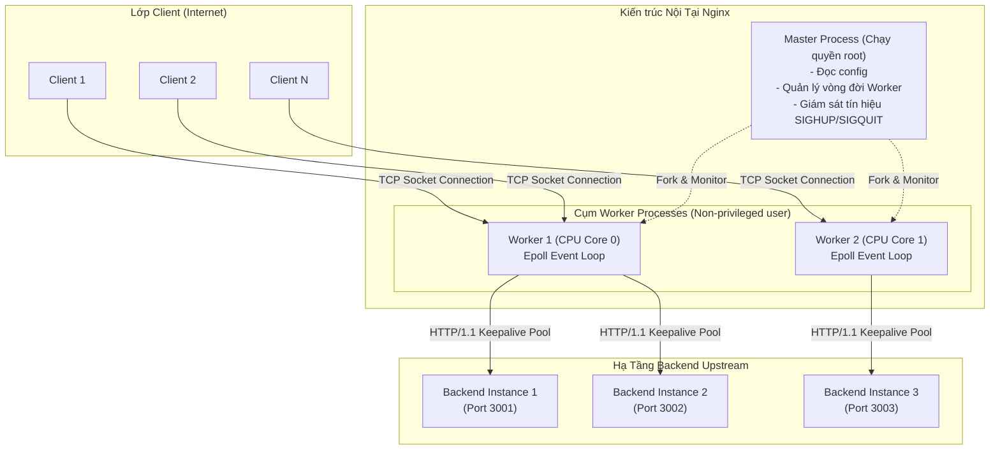
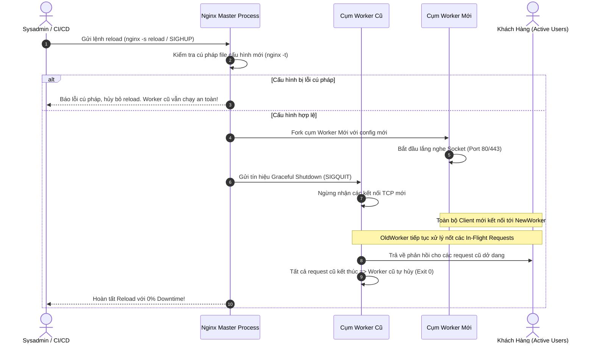

# NGINX ARCHITECTURE & PRODUCTION ENGINEERING DEEP DIVE

> **Tài liệu lý thuyết chuyên sâu và hướng dẫn kiến trúc toàn diện về Nginx (Engine X)**  
> Dành cho Software Engineer, Backend Developer và DevOps Engineer từ cấp độ Intern đến Middle-level và Tech Lead.

---

## 📑 MỤC LỤC
1. [Mức Độ Cơ Bản (Basic Fundamentals)](#1-mức-độ-cơ-bản-basic-fundamentals)
2. [Mức Độ Trung Bình (Intermediate - Architecture & Use Cases)](#2-mức-độ-trung-bình-intermediate---architecture--use-cases)
3. [Mức Độ Chuyên Sâu: BẢN CHẤT VẬN HÀNH (Under The Hood & Core Mechanics)](#3-mức-độ-chuyên-sâu-bản-chất-vận-hành-under-the-hood--core-mechanics)
4. [Mức Độ Nâng Cao: Vận Hành Thực Chiến (Production Engineering & Best Practices)](#4-mức-độ-nâng-cao-vận-hành-thực-chiến-production-engineering--best-practices)
5. [Góc Nhìn Thực Chiến Cho Middle-Level Trở Xuống (Must-Know vs Nice-to-Know Roadmap)](#5-góc-nhìn-thực-chiến-cho-middle-level-trở-xuống-must-know-vs-nice-to-know-roadmap)
6. [So Sánh Bản Chất (First-Principles Comparison)](#6-so-sánh-bản-chất-first-principles-comparison)
7. [Sơ Đồ Trực Quan (Mermaid Diagrams)](#7-sơ-đồ-trực-quan-mermaid-diagrams)
8. [Bảng Tra Thuật Ngữ Chi Tiết (Glossary)](#8-bảng-tra-thuật-ngữ-chi-tiết-glossary)
9. [Hướng Dẫn Chạy & Kiểm Thử Hệ Thống (Step-by-Step Run Guide)](#9-hướng-dẫn-chạy--kiểm-thử-hệ-thống-step-by-step-run-guide)

---

## 1. Mức Độ Cơ Bản (Basic Fundamentals)

### 1.1. Định nghĩa & Ẩn dụ đời thực (Real-world Analogy)
**Nginx** (phát âm là *"Engine-X"*) là một phần mềm mã nguồn mở hoạt động như một **Web Server**, **Reverse Proxy** (Máy chủ ủy quyền ngược), **Load Balancer** (Bộ cân bằng tải) và **HTTP Cache** với hiệu năng cực cao, độ trễ thấp và khả năng chịu tải hàng chục ngàn kết nối đồng thời với lượng RAM tối thiểu.

```
+-----------------------------------------------------------------------------------+
|                            ẨN DỤ: QUẦY TIẾP ĐÓN ĐẠI SỨ QUÁN                       |
|                                                                                   |
|  [Khách đến nộp hồ sơ] ----> [LỄ TÂN / AN NINH CỬA KHẨU (NGINX)]                 |
|                                     |                                             |
|                                     +---> 1. Khách xin tờ khai? Phát ngay tại chỗ |
|                                     |        (Static Asset / Cached File).        |
|                                     +---> 2. Khách gửi đồ độc hại / Spam? Chặn lại|
|                                     |        (Rate Limiting / WAF / SSL Check).   |
|                                     +---> 3. Khách cần gặp chuyên viên?           |
|                                              Điều phối sang Quầy 1, 2 hoặc 3      |
|                                              đang rảnh (Reverse Proxy & Load      |
|                                              Balancing sang Backend Node.js).     |
+-----------------------------------------------------------------------------------+
```

- **Nếu không có Nginx**: Mỗi người dùng (Client) kết nối trực tiếp vào từng ứng dụng backend (Node.js, Python, Go). Khi có 10.000 khách ùa vào cùng lúc, backend sẽ bị nghẽn vì phải tự giải mã SSL/TLS, tự phục vụ từng file ảnh/CSS tĩnh, và dễ bị sập vì quá tải bộ nhớ.
- **Khi có Nginx đứng đầu**: Nginx đóng vai trò là "người bảo vệ kiêm lễ tân" đứng tại cửa ngõ duy nhất. Nginx giải mã SSL, chặn IP xấu, phát ngay các file tĩnh đã lưu trong bộ nhớ tạm, và chỉ chuyển tiếp (proxy) các nghiệp vụ động vào cụm server phía sau theo cách nhịp nhàng nhất.

---

### 1.2. Vấn đề cốt lõi sinh ra công nghệ (Problem Statement: The C10K Problem)
Vào cuối thập niên 1990 và đầu những năm 2000, Internet bùng nổ mạnh mẽ. Các web server thống trị thời bấy giờ như **Apache HTTP Server** (sử dụng mô hình Process/Thread-per-connection) vấp phải một rào cản kỹ thuật khổng lồ mang tên **Bài toán C10K (Concurrent 10,000 Connections)**:
- **Cơ chế cũ (Apache Prefork / Worker)**: Mỗi kết nối mạng (TCP connection) từ một người dùng mới sẽ được gán cho 1 Tiến trình (Process) hoặc 1 Luồng (Thread) riêng biệt.
- **Điểm nghẽn**:
  1. **Tốn RAM khủng khiếp**: Mỗi luồng/tiến trình chiếm từ vài trăm KB đến vài MB bộ nhớ để lưu Stack frame. Khi đạt 10.000 kết nối, hệ thống cần hàng chục Gigabytes RAM chỉ để duy trì kết nối ở trạng thái rảnh (Idle Keep-Alive).
  2. **Bão chuyển ngữ cảnh (Context Switching Storm)**: Hệ điều hành (OS Kernel) phải liên tục chuyển đổi giữa hàng ngàn luồng. CPU dành phần lớn thời gian để lưu/phục hồi thanh ghi và bộ nhớ luồng thay vì xử lý dữ liệu mạng thực tế.
  3. **Tê liệt hoàn toàn**: Khi lượng truy cập tăng vọt, máy chủ cạn kiệt tài nguyên và từ chối dịch vụ.

Năm 2004, lập trình viên người Nga **Igor Sysoev** phát hành Nginx với một triết lý kiến trúc hoàn toàn mới: **Bất đồng bộ (Asynchronous), Hướng sự kiện (Event-Driven) và I/O Không chặn (Non-blocking I/O)**. Thay vì dùng 1 luồng cho 1 khách, Nginx dùng chỉ **1 Worker Process duy nhất trên mỗi CPU Core** để phục vụ hàng chục ngàn kết nối cùng lúc mà chỉ tốn vài chục Megabytes RAM.

---

### 1.3. Kiến trúc tổng quan mức High-Level
Luồng dữ liệu di chuyển từ Internet đến ứng dụng backend thông qua Nginx:

```
[ Internet Clients ]
   |  (HTTPS: 443 / HTTP: 80)
   v
+-----------------------------------------------------------------------+
| NGINX REVERSE PROXY                                                   |
| - SSL/TLS Termination (Giải mã chứng chỉ HTTPS)                       |
| - Static File Cache (Zero-Copy Sendfile)                              |
| - Rate Limiter (Leaky Bucket chống DDoS/Spam)                         |
| - Gzip / Brotli Compression                                           |
+-----------------------------------------------------------------------+
       |                           |                           |
       | (HTTP Keepalive)          | (HTTP Keepalive)          | (HTTP Keepalive)
       v                           v                           v
[ Backend Node 1 ]          [ Backend Node 2 ]          [ Backend Node 3 ]
(Port 3001)                 (Port 3002)                 (Port 3003)
```

---

## 2. Mức Độ Trung Bình (Intermediate - Architecture & Use Cases)

### 2.1. Các thành phần cốt lõi trong cấu hình Nginx
File cấu hình `nginx.conf` được tổ chức dưới dạng cấu trúc cây phân cấp gồm các **Context** (ngữ cảnh) và các **Directive** (chỉ thị):

1. **`main` Context**: Cấp cao nhất (Global), chứa các thông số về tiến trình hệ thống:
   - `user`: User/Group sở hữu quyền thực thi Nginx worker.
   - `worker_processes`: Số lượng worker tiến trình con (thường đặt là `auto` tương ứng số nhân CPU).
   - `error_log` & `pid`: Nơi lưu trữ log lỗi và process ID của Master process.

2. **`events` Context**: Cấu hình cơ chế vòng lặp I/O:
   - `worker_connections`: Số lượng kết nối mạng đồng thời tối đa mà 1 worker có thể xử lý (ví dụ: `1024` hoặc `4096`).
   - `multi_accept`: Cho phép worker nhận tất cả kết nối mới trong hàng đợi cùng lúc thay vì nhận từng kết nối một.

3. **`http` Context**: Bao bọc toàn bộ cấu hình liên quan đến giao thức HTTP:
   - Chứa các module: Logging (`access_log`, `log_format`), Gzip (`gzip on;`), Caching (`proxy_cache_path`), Rate Limiting (`limit_req_zone`), Timeout.

4. **`upstream` Context**: Khai báo nhóm các máy chủ backend (Upstream Cluster) để cân bằng tải:
   - Cung cấp địa chỉ IP/Domain và Port của các node backend.
   - Chỉ định thuật toán điều phối: Round-Robin, `least_conn`, `ip_hash`.
   - Cấu hình keepalive connection pool sang backend.

5. **`server` Context**: Định nghĩa một Virtual Host (máy chủ ảo) phục vụ một Domain hoặc Port cụ thể:
   - `listen`: Port lắng nghe (ví dụ `80` cho HTTP, `443 ssl` cho HTTPS).
   - `server_name`: Tên miền (ví dụ `api.example.com`, `localhost`).
   - Chứng chỉ SSL (`ssl_certificate`, `ssl_certificate_key`).

6. **`location` Context**: Định tuyến request dựa trên URI đường dẫn:
   - Điều phối xem URI này phục vụ file tĩnh (`root`, `alias`) hay chuyển tiếp sang backend (`proxy_pass`).

---

### 2.2. Khi nào NÊN dùng và KHÔNG NÊN dùng

#### ✅ Khi nào NÊN dùng Nginx (Best Use Cases)
1. **Reverse Proxy & Single Entrypoint**: Đứng trước toàn bộ các microservices hoặc monolithic app để gom cổng mạng về 80/443, ẩn IP thật của backend.
2. **SSL/TLS Termination**: Xử lý việc bắt tay mã hóa TLS nặng nề tập trung tại Nginx, giúp backend nhẹ gánh và chỉ cần giao tiếp bằng HTTP nội bộ.
3. **Phục vụ Static Assets (HTML, CSS, JS, Images, Video)**: Tận dụng cơ chế Kernel Zero-Copy để trả file tĩnh với tốc độ tối đa, không tốn tài nguyên runtime của Node.js hay Python.
4. **Cân bằng tải (Layer 7 Load Balancing)**: Phân phối tải thông minh giữa nhiều replica của backend service.
5. **Microcaching**: Lưu cache phản hồi của các API đọc nhiều (Read-heavy API) trong 10-60 giây, giảm 90% áp lực truy vấn cho Database.
6. **Bảo vệ cổng (Rate Limiting, IP Blacklist/Whitelist)**: Chặn đứng các hành vi spam brute-force, web scraping trước khi chạm tới code ứng dụng.

#### ❌ Khi nào KHÔNG NÊN dùng Nginx (What to Avoid)
1. **Thực thi nghiệp vụ logic phức tạp (Heavy Business Logic)**: Không cố gắng viết logic xác thực dữ liệu, tính toán giỏ hàng bằng Lua/JavaScript bên trong Nginx. Đó là việc của Backend Application.
2. **Thay thế Message Queue**: Nginx không phải là RabbitMQ hay Kafka; không dùng Nginx làm bộ đệm hàng đợi lưu trữ message khi backend chết.
3. **Môi trường Service Mesh phân tán cao**: Trong các cụm Kubernetes cực lớn với hàng trăm microservices cần quan sát mTLS nội bộ tinh vi từng Pod, các giải pháp Sidecar như Envoy Proxy thường được ưu tiên hơn Nginx truyền thống.

---

## 3. Mức Độ Chuyên Sâu: BẢN CHẤT VẬN HÀNH (Under The Hood & Core Mechanics)

### 3.1. Nguyên lý I/O Multiplexing & Vòng lặp Sự kiện (Epoll / Kqueue)
Bí mật đằng sau sức mạnh chịu tải của Nginx không nằm ở phần cứng máy chủ, mà nằm ở **cơ chế I/O Multiplexing** của Hệ điều hành (OS Kernel):

```
+------------------------------------------------------------------------------------+
|                MÔ HÌNH NHÀ HÀNG: THREAD TRUYỀN THỐNG VS NGINX EPOLL                |
|                                                                                    |
| [Apache / Thread-per-request]:                                                    |
|  - 100 khách ăn = 100 người bồi bàn.                                              |
|  - Khách đang suy nghĩ gọi món (Socket Idle) => Bồi bàn đứng im chờ đợi,          |
|    không phục vụ ai khác được. 1.000 khách = Nhà hàng vỡ trận vì hết nhân viên!  |
|                                                                                    |
| [Nginx / Event-Driven Epoll]:                                                     |
|  - 10.000 khách ăn = Chỉ cần 1-4 người phục vụ siêu đẳng (Worker Processes).       |
|  - Bồi bàn đưa menu cho khách kèm một chiếc CHUÔNG ĐIỆN TỬ (Kernel Socket Event).  |
|  - Bồi bàn tiếp tục đi đón khách khác. Khách nào bấm chuông (dữ liệu mạng đã tới),|
|    chuông reo (Epoll notify) => Bồi bàn quay lại lấy món ngay lập tức rồi đi tiếp!|
+------------------------------------------------------------------------------------+
```

#### Chi tiết kỹ thuật tầng OS:
1. **Hệ thống truyền thống (`select` / `poll`)**:
   - Khi có $N$ kết nối mạng, mỗi lần kiểm tra xem socket nào có dữ liệu, CPU phải duyệt qua toàn bộ $N$ socket với độ phức tạp $O(N)$. Khi $N = 10.000$, CPU bị nghẽn nghiêm trọng dù chỉ có 2-3 socket thực sự có dữ liệu.
2. **Cơ chế Nginx (`epoll` trên Linux / `kqueue` trên macOS & BSD)**:
   - Sử dụng bảng băm (Hash Table) và danh sách liên kết kép (Ready List) trong Kernel.
   - Khi gói tin mạng TCP cập bến card mạng, ngắt phần cứng (Hardware Interrupt) đánh thức Kernel và đưa socket vào Ready List.
   - Hàm `epoll_wait()` của Nginx Worker chỉ lấy chính xác danh sách các socket **đã sẵn sàng** với độ phức tạp $O(1)$.
   - Worker duyệt tuần tự qua các sự kiện này, đọc dữ liệu, xử lý và quay lại vòng lặp. Không có bất kỳ luồng nào bị block (Non-blocking I/O).

---

### 3.2. Vòng đời Request (Request Lifecycle) & 11 Phase Xử Lý
Khi một HTTP Request gửi tới Nginx, nó không nhảy ngay vào code backend mà phải đi qua một đường ống (HTTP Processing Pipeline) gồm 11 giai đoạn nghiêm ngặt:

```
[ Gói tin TCP vào Socket ]
           |
           v
1. NGX_HTTP_POST_READ_PHASE      : Đọc toàn bộ header của request
           v
2. NGX_HTTP_SERVER_REWRITE_PHASE : Xử lý rewrite URI ở cấp độ Server context
           v
3. NGX_HTTP_FIND_CONFIG_PHASE    : Match URI với Location block tối ưu nhất
           v
4. NGX_HTTP_REWRITE_PHASE        : Xử lý rewrite URI ở cấp độ Location
           v
5. NGX_HTTP_POST_REWRITE_PHASE   : Xử lý vòng lặp nội bộ nếu rewrite đổi URI
           v
6. NGX_HTTP_PREACCESS_PHASE      : Áp dụng Rate Limiting (limit_req) & Connection Limiting
           v
7. NGX_HTTP_ACCESS_PHASE         : Kiểm tra quyền truy cập IP (allow / deny, basic auth)
           v
8. NGX_HTTP_POST_ACCESS_PHASE    : Hoàn tất kiểm tra bảo mật (trả về 403 / 429 nếu vi phạm)
           v
9. NGX_HTTP_PRECONTENT_PHASE     : Kiểm tra Microcache (proxy_cache HIT hay MISS?)
           v
10. NGX_HTTP_CONTENT_PHASE       : Tạo nội dung: Đọc file tĩnh HOẶC proxy_pass sang Upstream
           v
11. NGX_HTTP_LOG_PHASE           : Ghi access.log và hoàn tất dọn dẹp bộ nhớ socket
```

#### Quy tắc ưu tiên đối sánh URI trong Location (Location Matching Precedence):
Thứ tự ưu tiên từ cao xuống thấp khi Nginx chọn `location`:
1. `= /exact/path`: Khớp tuyệt đối chính xác (Exact match) - Dừng tìm kiếm ngay lập tức.
2. `^~ /static/`: Khớp tiền tố không dùng Regex (Prefix non-regex match) - Dừng kiểm tra regex nếu khớp tiền tố dài nhất.
3. `~ \.(jpg|png)$` hoặc `~* \.(jpg|png)$`: Khớp Regular Expression (Phân biệt hoặc không phân biệt hoa thường). So sánh tuần tự từ trên xuống dưới theo thứ tự xuất hiện trong file cấu hình.
4. `/prefix/`: Khớp tiền tố thông thường (Standard prefix match) - Chọn tiền tố dài nhất khớp được nếu không có regex nào thỏa mãn.

---

### 3.3. Cơ chế Phục vụ File Tĩnh Tốc độ Ánh Sáng: Zero-Copy Sendfile
Tại sao Nginx trả file ảnh/video nhanh hơn gấp 10 lần so với việc để Node.js (`fs.readFile`) hay Python phục vụ?

```
CÁCH THÔNG THƯỜNG (4 lần Context Switch & 4 lần Copy dữ liệu):
[Ổ Đĩa (Disk)] 
    --Copy 1 (DMA)--> [Kernel Buffer] 
    --Copy 2 (CPU)--> [User Space RAM của Ứng dụng] 
    --Copy 3 (CPU)--> [Socket Buffer của Kernel] 
    --Copy 4 (DMA)--> [Card Mạng (NIC)]

CƠ CHẾ NGINX SENDFILE (Zero-Copy):
[Ổ Đĩa (Disk)] 
    --Copy 1 (DMA)--> [Kernel Page Cache] 
                      --Copy 2 (DMA direct pointer)--> [Card Mạng (NIC)]
```

- Nhờ directive `sendfile on;`, Nginx gọi thẳng System Call `sendfile()` của Linux Kernel.
- Dữ liệu đi thẳng từ ổ cứng vào bộ nhớ đệm Kernel rồi đẩy ra card mạng, **hoàn toàn không cần copy vào bộ nhớ RAM của tiến trình Nginx** (User Space).
- Giảm thiểu hoàn toàn xung đột Context Switch giữa Kernel Space và User Space, giúp CPU rảnh rỗi tuyệt đối.
- Kết hợp với `tcp_nopush on;` (gom gói tin TCP đầy kích thước MTU trước khi gửi) và `tcp_nodelay on;` (tắt thuật toán Nagle để đẩy gói tin đi ngay lập tức), tối ưu hóa băng thông mạng đến từng byte.

---

### 3.4. Kiến trúc Master-Worker & Cơ chế Zero-Downtime Reload (`nginx -s reload`)
Làm sao Nginx có thể cập nhật cấu hình hoặc chứng chỉ SSL mới mà không làm rớt bất kỳ kết nối nào của khách hàng đang truy cập?

1. **Master Process**: Chạy với quyền `root` (để bind vào cổng đặc quyền 80/443). Master không xử lý request mạng nào mà chỉ làm nhiệm vụ quản lý, giám sát các Worker Process, đọc và phân tích cú pháp cấu hình.
2. **Worker Processes**: Chạy với user không đặc quyền (`nginx` hoặc `nobody`), trực tiếp xử lý các socket mạng.

```
TIẾN TRÌNH ZERO-DOWNTIME RELOAD:

1. Quản trị viên gõ: nginx -s reload
2. Master Process nhận tín hiệu SIGHUP (Signal Hangup).
3. Master kiểm tra cú pháp file cấu hình mới (syntax validation):
   - Nếu có lỗi cú pháp => Hủy bỏ, tiếp tục giữ nguyên worker cũ. Hệ thống an toàn 100%.
   - Nếu cú pháp chuẩn => Khởi tạo cấu hình mới.
4. Master fork ra CỤM WORKER MỚI chạy cấu hình mới. Cụm worker mới lập tức tiếp nhận các kết nối mới từ Client.
5. Master gửi tín hiệu SIGQUIT (Graceful Shutdown) cho CỤM WORKER CŨ:
   - Worker cũ ngừng nhận kết nối mới.
   - Worker cũ tiếp tục phục vụ nốt các kết nối đang dở dang (Drain in-flight connections).
   - Khi tất cả kết nối dở dang hoàn tất, Worker cũ tự động thoát và giải phóng tài nguyên.
=> KHÔNG CÓ BẤT KỲ 1 REQUEST NÀO BỊ RỚT (0% Downtime).
```

---

## 4. Mức Độ Nâng Cao: Vận Hành Thực Chiến (Production Engineering & Best Practices)

### 4.1. Kỹ thuật Tối ưu Hiệu năng (Performance Tuning)

#### 1. Upstream Keepalive (Tái sử dụng kết nối TCP sang Backend)
Mặc định, khi Nginx chuyển tiếp request sang backend (`proxy_pass`), Nginx sử dụng HTTP/1.0 và ngắt kết nối TCP ngay sau mỗi request (Close Connection). Điều này gây ra lãng phí khủng khiếp vì phải bắt tay 3 bước TCP (3-way handshake) liên tục cho mỗi request.

```nginx
upstream backend_cluster {
    server backend-1:3001;
    server backend-2:3002;
    server backend-3:3003;
    
    # Duy trì sẵn 32 kết nối TCP rảnh rỗi trong pool cho mỗi worker
    keepalive 32;
}

server {
    ...
    location /api/ {
        proxy_pass http://backend_cluster;
        
        # BẮT BUỘC: Nâng cấp lên HTTP/1.1 và xóa header Connection: close
        proxy_http_version 1.1;
        proxy_set_header Connection "";
    }
}
```
*Hiệu quả thực tế*: Giảm độ trễ trung bình của API từ 20ms xuống còn 2-3ms, loại bỏ hoàn toàn hiện tượng cạn kiệt cổng mạng nội bộ (TCP Port Exhaustion / TIME_WAIT).

#### 2. Kỹ thuật Microcaching cho Read-Heavy APIs
Với các API danh mục sản phẩm, bảng tin hoặc tỷ giá có lượng đọc cực lớn nhưng dữ liệu ít thay đổi, lưu cache 10 đến 60 giây ngay tại Nginx sẽ giúp hệ thống chịu tải gấp hàng trăm lần:

```nginx
# Khai báo vùng nhớ cache 10MB lưu metadata, dữ liệu tối đa 1GB
proxy_cache_path /var/cache/nginx levels=1:2 keys_zone=api_cache:10m max_size=1g inactive=60m use_temp_path=off;

server {
    ...
    location /api/products {
        proxy_cache api_cache;
        proxy_cache_valid 200 302 30s;       # Cache phản hồi thành công trong 30 giây
        proxy_cache_use_stale error timeout updating http_500 http_502 http_503; # Trả cache cũ nếu backend lỗi
        
        # Gắn header để Frontend/Client biết trạng thái cache (HIT, MISS, BYPASS)
        add_header X-Cache-Status $upstream_cache_status;
        
        proxy_pass http://backend_cluster;
    }
}
```

---

### 4.2. Bảo vệ Hệ thống: Rate Limiting với Thuật Toán Leaky Bucket
Nginx hiện thực hóa Rate Limiting bằng giải thuật **Leaky Bucket (Thùng nước rò rỉ)**:

```
[ Giao thông đổ vào ồ ạt ] ===> [ THÙNG NƯỚC (BURST BUFFER) ]
                                            |
                                            | Rò rỉ với tốc độ cố định
                                            v (Rate = 5 requests/sec)
                                 [ Chuyển tiếp sang Backend ]
```

```nginx
# Định nghĩa vùng nhớ 10MB theo dõi IP khách hàng, giới hạn 5 request/giây
limit_req_zone $binary_remote_addr zone=api_limit_zone:10m rate=5r/s;

server {
    ...
    location /api/ {
        # burst=10: Cho phép chứa tối đa 10 request vượt ngưỡng trong hàng đợi
        # nodelay: Xử lý ngay các request trong burst mà không bắt client chờ lâu,
        #          nhưng request thứ 11 vượt quá burst sẽ lập tức nhận HTTP 429.
        limit_req zone=api_limit_zone burst=10 nodelay;
        limit_req_status 429;
        
        proxy_pass http://backend_cluster;
    }
}
```

---

### 4.3. Anti-patterns & Sai lầm Kinh Điển trong Cấu Hình Nginx

#### ❌ Sai lầm 1: "If is Evil" trong Location Block
- **Hiện tượng**: Viết lệnh `if` bên trong `location` dẫn đến request bị trả về mã lỗi khó hiểu (404, 500) hoặc các directive rewrite/proxy_pass không được thực thi.
- **Nguyên nhân**: Trong Nginx, `if` không phải là lệnh rẽ nhánh luồng lệnh thông thường như các ngôn ngữ lập trình. `if` thực chất tạo ra một nested location ẩn. Khi điều kiện thỏa mãn, ngữ cảnh của request bị thay đổi hoàn toàn, làm mất các chỉ thị cấu hình cha.
- **Khắc phục**: Thay vì dùng `if` trong location, hãy dùng chỉ thị `map` ở cấp độ `http` context hoặc dùng `try_files`.

#### ❌ Sai lầm 2: Thiếu Reverse Proxy Headers (Mất IP thật của Client)
- **Hiện tượng**: File log của Backend chỉ ghi nhận toàn bộ truy cập đến từ IP `127.0.0.1` hoặc IP của Docker container. Các hàm redirect HTTPS bị vòng lặp vô tận (Infinite Redirect Loop).
- **Nguyên nhân**: Khi Nginx làm reverse proxy, backend chỉ nhìn thấy socket TCP mở giữa Nginx và backend. Nếu Nginx không gán thông tin gốc vào HTTP header, backend sẽ mất hoàn toàn ngữ cảnh người dùng.
- **Khắc phục chuẩn mực**:
```nginx
proxy_set_header Host $host;
proxy_set_header X-Real-IP $remote_addr;
proxy_set_header X-Forwarded-For $proxy_add_x_forwarded_for;
proxy_set_header X-Forwarded-Proto $scheme;
```

#### ❌ Sai lầm 3: Buffer Overflow tràn vào Disk (`proxy_temp_path`)
- **Hiện tượng**: Khi backend trả về response JSON kích thước lớn (vài chục MB), đĩa cứng của server Nginx bị quá tải I/O (Disk I/O Spike), CPU iowait tăng vọt.
- **Nguyên nhân**: Mặc định kích thước `proxy_buffers` nhỏ, khi dữ liệu vượt quá buffer trong RAM, Nginx tự động ghi dữ liệu tạm ra ổ đĩa (`proxy_temp_path`).
- **Khắc phục**: Tăng kích thước buffer trong RAM cho các route trả dữ liệu lớn:
```nginx
proxy_buffers 16 32k;
proxy_buffer_size 64k;
proxy_busy_buffers_size 128k;
```

---

## 5. Góc Nhìn Thực Chiến Cho Middle-Level Trở Xuống (Must-Know vs Nice-to-Know Roadmap)

Nhằm định hướng lộ trình học tập hiệu quả, bảng phân định dưới đây giúp bạn tập trung 80% sức lực vào những kỹ năng cốt lõi mang lại hiệu quả cao nhất mà không bị ngợp bởi các lý thuyết hàn lâm tầng sâu:

```
+------------------------------------------------------------------------------------+
|                LỘ TRÌNH KỸ NĂNG NGINX: PHÂN CẤP TỪ JUNIOR ĐẾN SENIOR               |
|                                                                                    |
|  [INTERN / JUNIOR] (80/20 - Sử dụng thực chiến)                                    |
|   ├── Khái niệm Reverse Proxy vs Forward Proxy                                     |
|   ├── Khởi chạy Nginx qua Docker / Docker Compose                                  |
|   ├── Cấu hình cơ bản: proxy_pass, server_name, listen                             |
|   ├── Phục vụ Frontend SPA (React/Vue) với try_files $uri $uri/ /index.html        |
|   └── Đọc và debug file access.log / error.log                                     |
|                                                                                    |
|  ============================== Ranh giới Middle ===============================   |
|                                                                                    |
|  [MIDDLE-LEVEL] (Thiết kế kiến trúc, Tối ưu hóa & Bảo vệ ứng dụng)                |
|   ├── Cân bằng tải Upstream (Round-Robin, least_conn, keepalive pool)              |
|   ├── Bảo vệ hệ thống: Leaky Bucket Rate Limiting (limit_req) & Connection Limit   |
|   ├── Tối ưu hóa API: Microcaching, Gzip/Brotli, Buffer tuning                     |
|   ├── Bảo mật: Cấu hình SSL/TLS (Certbot, Let's Encrypt, HTTP/2, Security Headers) |
|   └── Xử lý Zero-Downtime Reload và Graceful Upstream Failover                     |
|                                                                                    |
|  ============================== Ranh giới Senior / SRE =========================   |
|                                                                                    |
|  [SENIOR / DEVOPS / SRE] (Tạm thời bỏ qua nếu ở mức Middle trở xuống)              |
|   ├── Tinh chỉnh Kernel Socket (SO_REUSEPORT, sysctl tcp_tw_reuse, SOMAXCONN)      |
|   ├── Viết module Nginx bằng C / Lua (OpenResty, Nginx C Module Development)       |
|   ├── Dynamic configuration discovery (Nginx Plus API, Consul-template)            |
|   └── Tối ưu giao thức UDP/QUIC (HTTP/3) ở tầng mạng OS                            |
+------------------------------------------------------------------------------------+
```

---

### 5.1. Chi Tiết Đáp Án & Kỹ Thuật Thực Chiến Cho Cấp Độ [INTERN / JUNIOR]

#### 1. Khái niệm Reverse Proxy vs Forward Proxy
- **Bản chất:**
  - **Forward Proxy (Đại diện cho Client):** Client đứng sau proxy (ví dụ VPN), máy chủ đích không biết ai là người gửi thật.
  - **Reverse Proxy (Đại diện cho Server):** Nginx đứng phía trước cụm backend. Client chỉ gửi request tới domain Nginx, Nginx âm thầm chuyển tiếp tới backend thích hợp mà client không biết IP thật của backend.

#### 2. Khởi chạy Nginx qua Docker / Docker Compose
- **Đáp án & Cấu hình chuẩn:**
```yaml
services:
  nginx:
    image: nginx:alpine
    ports:
      - "80:80"
    volumes:
      - ./nginx.conf:/etc/nginx/nginx.conf:ro
      - ./dist:/usr/share/nginx/html:ro
```

#### 3. Cấu hình cơ bản: `proxy_pass`, `server_name`, `listen`
- **Đáp án & Block chuẩn:**
```nginx
server {
    listen 80;
    server_name api.example.com;

    location / {
        proxy_pass http://backend-upstream:3000;
        proxy_set_header Host $host;
        proxy_set_header X-Real-IP $remote_addr;
        proxy_set_header X-Forwarded-For $proxy_add_x_forwarded_for;
        proxy_set_header X-Forwarded-Proto $scheme;
    }
}
```

#### 4. Phục vụ Frontend SPA (React/Vue) với `try_files $uri $uri/ /index.html`
- **Vấn đề thực tế:** Khi người dùng F5 tại `/dashboard/orders`, Nginx tìm file vật lý và báo lỗi `404 Not Found`.
- **Đáp án & Cấu hình cứu cánh:**
```nginx
location / {
    root /usr/share/nginx/html;
    index index.html;
    try_files $uri $uri/ /index.html;
}
```

#### 5. Đọc và debug file `access.log` / `error.log`
- **Đáp án:** Theo dõi trực tiếp trên terminal:
  - `tail -f /var/log/nginx/access.log`: Xem từng request bay vào, mã trạng thái HTTP status code và thời gian phản hồi.
  - `tail -f /var/log/nginx/error.log`: Phát hiện lỗi `502 Bad Gateway` (thường do backend chưa bật hoặc sai cổng port).

---

### 5.2. Chi Tiết Đáp Án & Kỹ Thuật Thực Chiến Cho Cấp Độ [MIDDLE-LEVEL]

#### 1. Cân bằng tải Upstream (Round-Robin, `least_conn`, `keepalive` pool)
- **Vấn đề thực tế:** Nếu Nginx mở kết nối TCP mới cho mỗi request sang backend thì sẽ bị cạn kiệt cổng (port exhaustion) khi tải cao.
- **Đáp án & Cấu hình chuẩn:**
```nginx
upstream backend_cluster {
    least_conn; # Chuyển request cho server đang rảnh nhất
    server 10.0.0.1:3000 max_fails=3 fail_timeout=10s;
    server 10.0.0.2:3000 max_fails=3 fail_timeout=10s;
    
    # BẮT BUỘC: Giữ sẵn 32 kết nối TCP sống ngầm để tái sử dụng, giảm độ trễ
    keepalive 32;
}
```

#### 2. Bảo vệ hệ thống: Leaky Bucket Rate Limiting (`limit_req`) & Connection Limit
- **Vấn đề thực tế:** Hacker viết script spam hàng ngàn request/giây làm nghẽn API.
- **Đáp án & Cấu hình chuẩn:**
```nginx
# Tạo vùng nhớ 10MB lưu IP, giới hạn mỗi IP chỉ 10 request/giây
limit_req_zone $binary_remote_addr zone=api_limit:10m rate=10r/s;

server {
    location /api/ {
        limit_req zone=api_limit burst=20 nodelay; # Cho phép đệm 20 request đột biến
        proxy_pass http://backend_cluster;
    }
}
```

#### 3. Tối ưu hóa API: Microcaching, Gzip/Brotli, Buffer tuning
- **Đáp án & Cấu hình chuẩn:**
```nginx
# Nén dữ liệu truyền tải tiết kiệm 70% băng thông
gzip on;
gzip_types text/plain text/css application/json application/javascript text/xml;

# Microcaching 1 giây cho endpoint xem danh sách: giảm 90% tải cho DB khi có triệu view
proxy_cache_path /tmp/nginx_cache levels=1:2 keys_zone=microcache:10m inactive=60s;
```

#### 4. Bảo mật: Cấu hình SSL/TLS (Let's Encrypt, HTTP/2, Security Headers)
- **Đáp án:**
```nginx
listen 443 ssl http2;
ssl_certificate /etc/letsencrypt/live/example.com/fullchain.pem;
ssl_certificate_key /etc/letsencrypt/live/example.com/privkey.pem;

# Thêm header bảo mật chống Clickjacking & XSS
add_header X-Frame-Options "SAMEORIGIN" always;
add_header X-Content-Type-Options "nosniff" always;
```

#### 5. Xử lý Zero-Downtime Reload và Graceful Upstream Failover
- **Đáp án:** Chạy `nginx -s reload` (Master fork worker mới, worker cũ giải phóng sau khi xử lý xong request). Trong `location`:
```nginx
proxy_next_upstream error timeout invalid_header http_502 http_503;
```
Khi Server 1 bị lỗi 502, Nginx tự động chuyển ngay request sang Server 2 mà client không hề bị gián đoạn.

---

### 5.3. Chi Tiết Kỹ Thuật Cho Cấp Độ [SENIOR / DEVOPS / SRE] (Mở Rộng)

#### 1. Tinh chỉnh Kernel Socket (`SO_REUSEPORT`, `sysctl tcp_tw_reuse`, `SOMAXCONN`)
- **Bản chất:** Bật `listen 80 reuseport` để Kernel Linux tự phân phối kết nối TCP trực tiếp cho các worker process độc lập, loại bỏ hiện tượng tranh chấp lock giữa các CPU cores.

#### 2. Viết module Nginx bằng C / Lua (OpenResty)
- **Bản chất:** Nhúng mã Lua trực tiếp vào Nginx (`access_by_lua_block`) để xác thực JWT token hoặc tra cứu Redis ngay tại tầng gateway với tốc độ sub-millisecond mà không cần gọi sang NodeJS backend.

#### 3. Dynamic configuration discovery (Nginx Plus API, Consul-template)
- **Bản chất:** Tự động cập nhật danh sách IP trong upstream khi các container Docker được bật/tắt (Auto-scaling) mà không cần reload Nginx file.

#### 4. Tối ưu giao thức UDP/QUIC (HTTP/3) ở tầng mạng OS
- **Bản chất:** Cấu hình `listen 443 quic reuseport` kèm module `ngx_http_v3_module` để phục vụ khách hàng di động mạng yếu không bị gián đoạn khi chuyển từ WiFi sang 4G.

---

### 5.4. Bộ Câu Hỏi Phỏng Vấn Kinh Điển (Top Interview Questions)

#### Câu 1: Sự khác biệt bản chất giữa Apache và Nginx là gì? Tại sao Nginx chịu tải cao tốt hơn?
> **Trả lời mẫu ghi điểm**:  
> "Khác biệt cốt lõi nằm ở mô hình xử lý vào/ra (I/O Concurrency Model). Apache theo truyền thống sử dụng mô hình Thread/Process-per-connection: mỗi kết nối từ client chiếm 1 tiến trình hoặc luồng riêng, dẫn đến tốn nhiều RAM và CPU bị nghẽn do Context Switching khi có hàng ngàn kết nối đồng thời.  
> Ngược lại, Nginx sử dụng mô hình Bất đồng bộ, Hướng sự kiện (Event-driven, Non-blocking I/O) kết hợp với I/O Multiplexing (cụ thể là `epoll` trên Linux). Nginx chỉ cần một số lượng nhỏ Worker Process (thường tương ứng với số nhân CPU) để phục vụ hàng chục ngàn kết nối cùng lúc theo cơ chế vòng lặp sự kiện với độ phức tạp $O(1)$, từ đó duy trì mức tiêu thụ RAM cực thấp và thông lượng xử lý vượt trội."

#### Câu 2: Làm thế nào để triển khai cấu hình mới hoặc đổi chứng chỉ SSL trên Nginx mà không gây gián đoạn dịch vụ của người dùng (Zero Downtime)?
> **Trả lời mẫu ghi điểm**:  
> "Ta sử dụng lệnh `nginx -s reload`. Cơ chế vận hành bên dưới diễn ra như sau:  
> 1. Master Process nhận tín hiệu SIGHUP và kiểm tra cú pháp file cấu hình mới. Nếu có lỗi cú pháp, lệnh reload sẽ bị hủy và các worker hiện tại vẫn chạy bình thường, đảm bảo an toàn tuyệt đối.  
> 2. Nếu cấu hình hợp lệ, Master sẽ tạo (fork) ra một cụm Worker Process mới chạy theo cấu hình mới để lập tức tiếp nhận các kết nối mới từ khách hàng.  
> 3. Đồng thời, Master gửi tín hiệu SIGQUIT (Graceful Shutdown) cho cụm Worker cũ. Cụm worker cũ ngừng nhận kết nối mới nhưng tiếp tục duy trì và xử lý nốt các request đang dang dở. Khi tất cả request này hoàn tất, worker cũ mới tự giải phóng. Do đó không có bất kỳ request nào bị rớt."

#### Câu 3: Khi cấu hình Nginx làm Reverse Proxy, tại sao bắt buộc phải thêm các header `X-Real-IP` và `X-Forwarded-For`?
> **Trả lời mẫu ghi điểm**:  
> "Khi Client kết nối tới Nginx và Nginx chuyển tiếp request sang backend, kết nối TCP thực tế giữa Nginx và backend chỉ mang địa chỉ IP của Nginx (ví dụ `127.0.0.1` hoặc IP mạng nội bộ).  
> Nếu không gắn thêm các header `X-Real-IP` (chứa IP của client trực tiếp) và `X-Forwarded-For` (chứa danh sách chuỗi các proxy mà request đã đi qua), ứng dụng backend sẽ không thể nhận diện được người dùng thực. Điều này dẫn đến việc ghi log sai, các tính năng giới hạn lượt truy cập theo IP (IP rate limiting) bị sai lệch (áp dụng nhầm cho toàn bộ user), và các thuật toán chống gian lận/định vị địa lý bị vô hiệu hóa."

---

## 6. So Sánh Bản Chất (First-Principles Comparison)

| Tiêu Chí | **Nginx** | **Apache HTTP Server** | **Envoy Proxy** | **HAProxy** |
| :--- | :--- | :--- | :--- | :--- |
| **Mô hình I/O** | Event-Driven, Non-blocking Epoll | Process / Thread Pool (Prefork / Worker) | Event-Driven, Thread-local Epoll | Event-Driven, Multi-threaded |
| **Mức độ tiêu thụ RAM** | **Rất thấp** (~10MB - 50MB cho hàng vạn connection) | **Cao** (hàng trăm MB - vài GB khi tải cao) | **Trung bình** (phù hợp container) | **Rất thấp** |
| **Điểm mạnh nhất** | Static files, Reverse Proxy, Microcaching, Web Server | Module linh hoạt (`.htaccess`), hệ sinh thái legacy | Cloud-Native, Service Mesh, gRPC, xDS dynamic config | Load Balancing Layer 4 & Layer 7 siêu nhanh, ổn định |
| **Khả năng làm Web Server** | **Xuất sắc** (Direct static file serving) | **Xuất sắc** | Kém (chủ yếu là Service Proxy) | Không (chỉ là Load Balancer thuần túy) |
| **Cấu hình động (Dynamic Reconfig)** | Cần reload process (`nginx -s reload`) | Cần reload process | **Dynamic API (xDS API)** không cần reload | Runtime Socket API |
| **Trường hợp khuyên dùng** | Cửa ngõ ứng dụng Monolith / Microservices, Web Server chính | Ứng dụng PHP cũ cần `.htaccess` | Hạ tầng Microservices phức tạp, Kubernetes Service Mesh | Cụm Load Balancer chuyên dụng thuần túy |

---

## 7. Sơ Đồ Trực Quan (Mermaid Diagrams)

### 7.1. Sơ đồ Kiến trúc Master-Worker & Epoll Event Loop


---

### 7.2. Sơ đồ Tuần Tự Zero-Downtime Reload (`nginx -s reload`)


---

## 8. Bảng Tra Thuật Ngữ Chi Tiết (Glossary)

| Thuật Ngữ | Tên Tiếng Anh | Định Nghĩa & Ý Nghĩa Thực Tiễn |
| :--- | :--- | :--- |
| **Reverse Proxy** | Reverse Proxy | Máy chủ đứng trước các backend server, nhận request từ internet và chuyển tiếp tới server đích, che giấu cấu trúc nội bộ. |
| **Upstream** | Upstream Servers | Cụm các máy chủ ứng dụng (Application Servers) nằm phía sau Nginx, trực tiếp xử lý mã nguồn nghiệp vụ. |
| **I/O Multiplexing** | I/O Multiplexing | Kỹ thuật hệ điều hành cho phép 1 luồng đơn theo dõi trạng thái sẵn sàng (ready state) của hàng ngàn kết nối mạng đồng thời (epoll/kqueue). |
| **Epoll** | Event Poll | Cơ chế xử lý sự kiện I/O hướng sự kiện hiệu năng cao trên Linux, có độ phức tạp thuật toán $O(1)$. |
| **Non-blocking I/O** | Non-blocking I/O | Cơ chế vào/ra dữ liệu mà thao tác đọc/ghi không bắt tiến trình phải dừng lại chờ đợi dữ liệu mạng. |
| **Zero-Copy** | Zero-Copy Data Transfer | Cơ chế sao chép dữ liệu từ ổ đĩa trực tiếp ra mạng thông qua Kernel Page Cache mà không qua bộ nhớ User-space của ứng dụng (`sendfile`). |
| **Leaky Bucket** | Leaky Bucket Algorithm | Thuật toán điều tiết lưu lượng mạng hoạt động như một thùng nước có lỗ rò cố định, giúp làm mịn lưu lượng và chặn đứng đột biến spam (Rate Limiting). |
| **Microcaching** | Microcaching | Kỹ thuật lưu trữ bộ nhớ đệm phản hồi của API động trong thời gian cực ngắn (1 - 60 giây) để giảm tải 90%+ truy vấn cho database. |
| **SSL Termination** | SSL/TLS Termination | Việc giải mã giao thức HTTPS tại tầng Proxy, sau đó chuyển tiếp dữ liệu dạng HTTP thuần túy trong mạng nội bộ an toàn. |
| **Keepalive** | TCP Keepalive Connection Pool | Kỹ thuật duy trì các kết nối TCP đã mở sẵn giữa Nginx và Upstream để tái sử dụng, tránh việc phải bắt tay 3 bước TCP liên tục. |
| **Context Switching** | Context Switching | Quá trình CPU lưu trạng thái của một tiến trình/luồng và nạp trạng thái của tiến trình khác; gây tốn tài nguyên nếu xảy ra quá nhiều. |
| **Graceful Shutdown** | Graceful Shutdown | Quá trình tắt tiến trình một cách an toàn: ngừng nhận việc mới, hoàn thành nốt các việc đang làm dở rồi mới dừng hẳn. |

---

## 9. Hướng Dẫn Chạy & Kiểm Thử Hệ Thống (Step-by-Step Run Guide)

### 9.1. Cấu trúc thư mục Dự Án Demo
Dự án demo Nginx bao gồm đầy đủ 3 tầng chuẩn Production:
- **Hạ tầng (`docker-compose.yml`)**: Khởi chạy Nginx Gateway, 3 Replicas Backend (Node.js/Express) và Frontend Dashboard.
- **Cấu hình Nginx (`nginx/conf.d/default.conf`)**: Tích hợp Load Balancing (Round-Robin), Leaky Bucket Rate Limiting, Microcaching và Reverse Proxy Headers.
- **Frontend Dashboard (React/Vite)**: Giao diện trực quan hóa việc điều phối traffic, test spam chặn 429 và đo lường Cache Hit/Miss.

### 9.2. Lệnh Khởi Chạy
Mở terminal tại thư mục chứa dự án:

```bash
# 1. Di chuyển vào thư mục Nginx
cd /Users/ductri0981/Documents/Studying-Software/DevOps_And_Deployment/nginx

# 2. Khởi động toàn bộ cụm dịch vụ bằng Docker Compose
docker compose up -d --build

# 3. Kiểm tra trạng thái các container
docker compose ps
```

Sau khi khởi chạy thành công:
- **Frontend Web Dashboard**: Truy cập tại `http://localhost:8080` (thông qua Nginx Reverse Proxy).
- **Trực tiếp API Gateway**: `http://localhost:8080/api/products`.
- **Backend 1, 2, 3**: Lần lượt là các container độc lập được Nginx điều phối tự động.

---

### 9.3. Kịch Bản Kiểm Thử Thực Tế Trên Giao Diện

#### Kịch Bản 1: Kiểm Chứng Cân Bằng Tải (Round-Robin Load Balancing)
1. Trên giao diện Web Dashboard, chọn Tab **"Load Balancing Dispatcher"**.
2. Nhấn nút **"Gửi 1 Request"** hoặc **"Bật Auto-Traffic (5 req/s)"**.
3. **Quan sát thực tế**: 
   - Biểu đồ phân phối sẽ hiển thị các request lần lượt luân chuyển qua **Instance 1 (Port 3001)** $\rightarrow$ **Instance 2 (Port 3002)** $\rightarrow$ **Instance 3 (Port 3003)**.
   - Header phản hồi `X-Handled-By` hiển thị chính xác địa chỉ IP container nội bộ đã xử lý request.

#### Kịch Bản 2: Kiểm Chứng Cơ Chế Chặn Spam Rate Limiting (Leaky Bucket)
1. Chuyển sang Tab **"Rate Limiting Shield"**.
2. Nhấn nút **"Spam Burst (Gửi dồn 20 requests cùng lúc)"**.
3. **Quan sát thực tế**:
   - 5 request đầu tiên được phục vụ thành công ngay lập tức ($200\text{ OK}$).
   - 10 request tiếp theo nằm trong hàng đợi `burst` và được xử lý theo tốc độ rò rỉ ($5\text{ req/s}$).
   - Các request vượt ngưỡng sẽ lập tức bị Nginx chặn đứng tại cửa ngõ với mã phản hồi **$429\text{ Too Many Requests}$**.
   - Backend hoàn toàn không bị quá tải vì các request spam đã bị loại bỏ trước khi chạm vào Node.js!

#### Kịch Bản 3: Kiểm Chứng Tốc Độ Microcaching (HIT vs MISS)
1. Chuyển sang Tab **"Microcaching Benchmark"**.
2. Nhấn nút **"Lấy Dữ Liệu Lần 1"**:
   - Header `X-Cache-Status`: **MISS** (Nginx chưa có cache, phải gọi backend).
   - Thời gian phản hồi: ~**120ms - 150ms** (do backend truy vấn dữ liệu).
3. Ngay lập tức nhấn **"Lấy Dữ Liệu Lần 2"** (trong khoảng 30 giây):
   - Header `X-Cache-Status`: **HIT** (Nginx lấy trực tiếp từ RAM/Disk Cache).
   - Thời gian phản hồi: **1ms - 2ms** (nhanh hơn gấp 100 lần!).
   - Backend không ghi nhận thêm bất kỳ log truy vấn nào.
