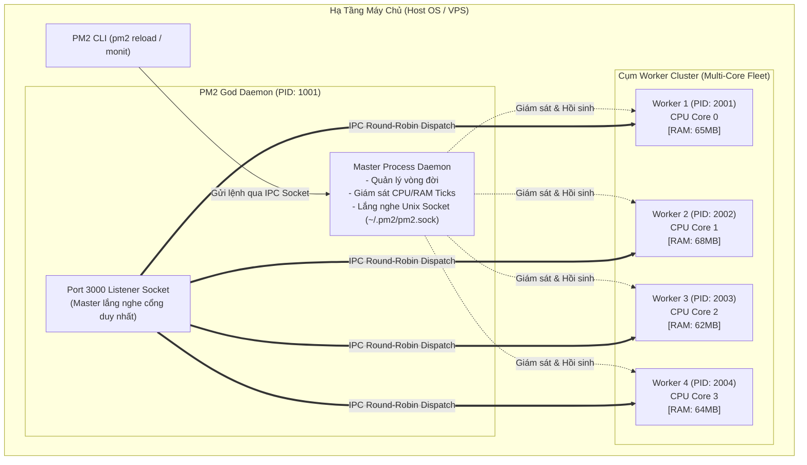
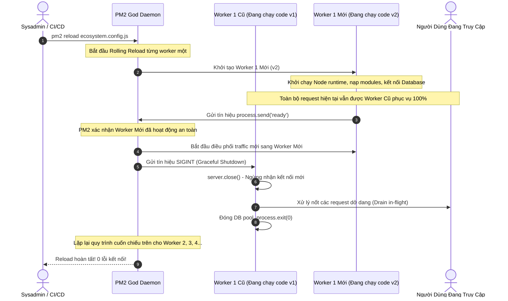

# PM2 (PROCESS MANAGER 2) ARCHITECTURE & PRODUCTION ENGINEERING DEEP DIVE

> **Tài liệu lý thuyết chuyên sâu và hướng dẫn kiến trúc toàn diện về PM2 (Production Process Manager for Node.js)**  
> Dành cho Software Engineer, Backend Developer và DevOps Engineer từ cấp độ Intern đến Middle-level và Tech Lead.

---

## 📑 MỤC LỤC
1. [Mức Độ Cơ Bản (Basic Fundamentals)](#1-mức-độ-cơ-bản-basic-fundamentals)
2. [Mức Độ Trung Bình (Intermediate - Architecture & Use Cases)](#2-mức-độ-trung-bình-intermediate---architecture--use-cases)
3. [Mức Độ Chuyên Sâu: BẢN CHẤT VẬN HÀNH (Under The Hood & Core Mechanics)](#3-mức-độ-chuyên-sâu-bản-chất-vận-hành-under-the-hood--core-mechanics)
4. [Mức Độ Nâng Cao: Vận Hành Thực Chiến (Production Engineering & Best Practices)](#4-mức-độ-nâng-cao-vận-hành-thực-chiến-production-engineering--best-practices)
5. [Góc Nhìn Thực Chiến Cho Middle-Level Trở Xuống (Must-Know vs Nice-to-Know Roadmap)](#5-góc-nhìn-thực-chiến-cho-middle-level-trở-xuống-must-know-vs-nice-to-know-roadmap)
6. [So Sánh Bản Chất (First-Principles Comparison)](#6-so-sánh-bản-chất-first-principles-comparison)
7. [Sơ Đồ Trực Quan (Mermaid Diagrams)](#7-sơ-đồ-trực-quan-mermaid-diagrams)
8. [Bảng Tra Thuật Ngữ Chi Tiết (Glossary)](#8-bảng-tra-thuật-ngữ-chi-tiết-glossary)
9. [Hướng Dẫn Chạy & Kiểm Thử Hệ Thống (Step-by-Step Run Guide)](#9-hướng-dẫn-chạy--kiểm-thử-hệ-thống-step-by-step-run-guide)

---

## 1. Mức Độ Cơ Bản (Basic Fundamentals)

### 1.1. Định nghĩa & Ẩn dụ đời thực (Real-world Analogy)
**PM2** (viết tắt của *Process Manager 2*) là một trình quản lý tiến trình cấp độ production (Production Process Manager) mã nguồn mở dành riêng cho các ứng dụng chạy trên nền tảng **Node.js** (và hỗ trợ cả Python, Ruby, Bash...).

```
+-----------------------------------------------------------------------------------+
|                        ẨN DỤ: QUẢN ĐỐC DÂY CHUYỀN SẢN XUẤT 24/7                   |
|                                                                                   |
|  [GIÁM ĐỐC / DEVELOPER] ----> [QUẢN ĐỐC XƯỞNG (PM2 GOD DAEMON)]                   |
|                                         |                                         |
|                                         +---> 1. Tuyển dụng & Giám sát 4 công nhân|
|                                         |        (Worker 1, 2, 3, 4 trên 4 core). |
|                                         +---> 2. Công nhân #2 ngất xỉu (Crash)?   |
|                                         |        Lập tức kéo dậy và thay thế trong|
|                                         |        0.2 giây (Auto-Restart).         |
|                                         +---> 3. Cần đổi đồng phục (Deploy code)?  |
|                                         |        Cho từng người thay phiên thay đồ|
|                                         |        để xưởng không nghỉ 1 giây nào   |
|                                         |        (Zero-Downtime Reload).          |
|                                         +---> 4. Công nhân #3 kiệt sức (Leak RAM)?|
|                                                  Tự động cho đi viện và đổi người |
|                                                  mới (Max Memory Restart).        |
+-----------------------------------------------------------------------------------+
```

- **Nếu không có PM2**: Bạn chạy ứng dụng bằng lệnh `node server.js`. Nếu bạn đóng cửa sổ terminal, tiến trình sẽ tắt theo. Nếu có 1 lỗi logic chưa được bọc `try/catch` (`unhandledRejection` hoặc `uncaughtException`), toàn bộ máy chủ Node.js sẽ lập tức sập vĩnh viễn, người dùng truy cập nhận về mã lỗi kết nối.
- **Khi có PM2**: PM2 chạy ngầm như một daemon dịch vụ của hệ thống 24/7/365. Nếu một worker bị crash, PM2 hồi sinh nó trong vài mili-giây. Nếu máy chủ có 8 nhân CPU, PM2 tự động nhân bản 8 worker để tận dụng 100% công suất phần cứng.

---

### 1.2. Vấn đề cốt lõi sinh ra công nghệ (Problem Statement)
Node.js sở hữu mô hình I/O bất đồng bộ (Asynchronous Non-blocking I/O) cực nhanh, nhưng bản chất kiến trúc của nó có hai điểm yếu "chí mạng" trong môi trường Production:

1. **Bản chất Đơn Luồng (Single-Threaded Event Loop)**:
   - Một tiến trình Node.js chỉ chạy trên **1 luồng chính duy nhất (Main Thread)** và chỉ chiếm dụng **1 nhân CPU (1 CPU Core)**.
   - Nếu bạn thuê một máy chủ Dedicated hoặc VPS mạnh mẽ có 16 Cores CPU và 32GB RAM, việc gõ `node app.js` đồng nghĩa với việc bạn đang **lãng phí 15 Cores CPU còn lại** (chỉ sử dụng được 1/16 sức mạnh máy chủ).
2. **Cái chết tức thì của Single Point of Failure (Crash on Uncaught Exception)**:
   - Trong kiến trúc đa luồng truyền thống (như Java hay C#), một thread bị crash vì lỗi logic thì các thread khác vẫn tiếp tục phục vụ các người dùng khác.
   - Trong Node.js, nếu xảy ra một lỗi runtime nghiêm trọng không được bắt, toàn bộ tiến trình chết ngay lập tức. Toàn bộ người dùng đang kết nối vào hệ thống sẽ bị ngắt kết nối.
3. **Bài toán Gián Đoạn Dịch Vụ khi Cập Nhật Code (Deployment Downtime)**:
   - Mỗi lần cập nhật phiên bản mới, ta phải tắt server cũ (`Ctrl+C`) rồi bật server mới lên. Khoảng thời gian từ lúc tắt đến lúc server mới kết nối xong Database và lắng nghe socket (thường từ 2 đến 10 giây) là thời gian chết hoàn toàn (Downtime).

**PM2 ra đời để giải quyết triệt để 3 bài toán trên**: Cung cấp **Cluster Mode** (tận dụng mọi CPU Core), **Auto-healing Daemon** (tự phục hồi sau tai nạn), và **Zero-Downtime Reload** (cập nhật ứng dụng không rớt 1 request nào).

---

### 1.3. Kiến trúc tổng quan mức High-Level

```
+------------------------------------------------------------------------+
|                      HỆ ĐIỀU HÀNH HOST (LINUX / MACOS)                 |
|                                                                        |
|  [PM2 CLI (pm2 start/reload/logs)]                                     |
|               |                                                        |
|               | (Unix Domain Socket IPC: ~/.pm2/pm2.sock)              |
|               v                                                        |
|  +------------------------------------------------------------------+  |
|  | PM2 GOD DAEMON (Master Process - PID: 1042)                      |  |
|  | - Quản lý trạng thái tiến trình (State Machine)                  |  |
|  | - Thu thập Metrics (CPU %, RAM RSS, Event Loop Lag)              |  |
|  | - OS Watchdog (Tự động Restart khi Crash / Vượt ngưỡng RAM)      |  |
|  +------------------------------------------------------------------+  |
|         |                     |                     |                  |
|  (child_process.fork)  (cluster.fork)        (cluster.fork)            |
|         v                     v                     v                  |
|  [ Worker 0 (Core 0) ] [ Worker 1 (Core 1) ] [ Worker 2 (Core 2) ]     |
|  PID: 2011             PID: 2012             PID: 2013                 |
|  Port: 3000 (Shared)   Port: 3000 (Shared)   Port: 3000 (Shared)       |
+------------------------------------------------------------------------+
```

---

## 2. Mức Độ Trung Bình (Intermediate - Architecture & Use Cases)

### 2.1. Các thành phần cốt lõi của PM2

1. **PM2 God Daemon (`PM2 Daemon`)**:
   - Là một tiến trình Node.js chạy ngầm liên tục độc lập với terminal.
   - Quản lý vòng đời (Lifecycle) của mọi ứng dụng con, ghi log tập trung, theo dõi tài nguyên RAM/CPU định kỳ theo nhịp tick.
2. **PM2 CLI (`Command Line Interface`)**:
   - Giao diện dòng lệnh người dùng tương tác (`pm2 list`, `pm2 logs`, `pm2 monit`, `pm2 reload`).
   - Mỗi khi bạn gõ một lệnh PM2, CLI thực chất chỉ mở một kết nối IPC (qua Unix Domain Socket) để gửi lệnh tới PM2 God Daemon rồi hiển thị kết quả.
3. **Chế độ Chạy: Fork Mode vs Cluster Mode**:
   - **Fork Mode**: Chạy ứng dụng như một tiến trình con độc lập (`child_process.fork()`). Dùng cho các tiến trình Background Worker, Cron Job, Message Queue Consumer (RabbitMQ/Kafka Consumer) nơi chỉ cần 1 tiến trình duy nhất chạy nền.
   - **Cluster Mode**: Tận dụng module `cluster` của Node.js. Chạy $N$ bản sao (thường là `instances: 'max'`) chia sẻ cùng một cổng mạng (Port). Thích hợp nhất cho Web Server / REST API.
4. **File Khai Báo Hệ Sinh Thái (`ecosystem.config.js`)**:
   - Trái tim cấu hình của dự án trong Production. Thay vì gõ các cờ dài dòng trên CLI, toàn bộ thông số về biến môi trường (`env_production`), bộ nhớ giới hạn (`max_memory_restart`), đường dẫn log, số lượng instance được khai báo tập trung và quản lý phiên bản qua Git.

---

### 2.2. Khi nào NÊN dùng và KHÔNG NÊN dùng PM2

#### ✅ Khi nào NÊN dùng PM2 (Best Use Cases)
1. **Triển khai trên VPS / Bare-Metal / Dedicated Server**: Đây là lãnh địa thống trị tuyệt đối của PM2. Quản lý các ứng dụng Node.js trên Ubuntu/CentOS một cách chuyên nghiệp, tích hợp tự khởi động cùng hệ điều hành (`pm2 startup`).
2. **Tận dụng CPU Multi-core trong 1 máy chủ**: Muốn ứng dụng Node.js xử lý được gấp 4x - 8x thông lượng mà không cần thiết lập hạ tầng Kubernetes phức tạp.
3. **Zero-Downtime Deployment cho VM**: Cập nhật code mới trực tiếp trên máy chủ bằng `pm2 reload ecosystem.config.js` mà khách hàng không nhận bất kỳ lỗi gián đoạn nào.
4. **Quản lý Background Jobs / Microservices nhỏ**: Quản lý nhiều service khác nhau (ví dụ: API server, Email worker, Telegram Bot) trên cùng một máy chủ qua 1 file `ecosystem.config.js`.

#### ❌ Khi nào KHÔNG NÊN dùng PM2 (What to Avoid)
1. **Môi trường Kubernetes (K8s) quy mô lớn**:
   - Trong Kubernetes, mỗi Pod bản chất đã là một đơn vị quản lý tiến trình được Kubelet giám sát liveness/readiness và tự động restart khi crash.
   - Việc chạy PM2 Cluster Mode bên trong một Kubernetes Pod thường gây xung đột về giới hạn CPU Throttling, làm sai lệch số liệu của Horizontal Pod Autoscaler (HPA) và vi phạm nguyên lý "Single Responsibility" của Docker Container (1 process per container).
2. **Serverless Architectures (AWS Lambda, Google Cloud Run, Vercel)**:
   - Các nền tảng Serverless tự động quản lý vòng đời và co giãn theo request; PM2 hoàn toàn không phù hợp và không có đất diễn trong mô hình này.

---

## 3. Mức Độ Chuyên Sâu: BẢN CHẤT VẬN HÀNH (Under The Hood & Core Mechanics)

### 3.1. Node.js Cluster Module & Cơ chế Chia Sẻ Cổng Mạng (Socket Sharing)
Nhiều lập trình viên thắc mắc: *Nếu chạy 4 tiến trình Node.js riêng biệt, tại sao chúng lại có thể cùng lắng nghe (listen) trên một cổng mạng duy nhất (ví dụ Port 3000) mà không bị lỗi `EADDRINUSE` (Address already in use)?*

Bí mật nằm ở cơ chế **Socket Handoff & Round-Robin Scheduler** của Node.js `cluster` module:

```
+------------------------------------------------------------------------------------+
|                CƠ CHẾ ĐIỀU PHỐI KẾT NỐI TRONG CLUSTER MODE (LINUX/NODE.JS)         |
|                                                                                    |
|  [CLIENT] --(TCP SYN)--> [CỔNG MẠNG PORT 3000]                                     |
|                                  |                                                 |
|                                  v                                                 |
|                   [MASTER PROCESS (PM2 DAEMON)]                                    |
|                   - Là tiến trình DUY NHẤT thực sự bind và listen trên Port 3000.  |
|                   - Khi có kết nối TCP mới, Master chấp nhận kết nối (accept()).   |
|                   - Phân phối File Descriptor (Socket Handle) qua IPC Channel      |
|                     theo thuật toán ROUND-ROBIN:                                   |
|                                  |                                                 |
|           +----------------------+----------------------+                          |
|           | (IPC Round-Robin)    | (IPC Round-Robin)    | (IPC Round-Robin)        |
|           v                      v                      v                          |
|    [Worker 1 (PID 2011)]  [Worker 2 (PID 2012)]  [Worker 3 (PID 2013)]             |
|    - Nhận Socket Handle   - Nhận Socket Handle   - Nhận Socket Handle              |
|    - Đọc HTTP Request     - Đọc HTTP Request     - Đọc HTTP Request                |
|    - Xử lý Controller     - Xử lý Controller     - Xử lý Controller                |
|    - Ghi HTTP Response    - Ghi HTTP Response    - Ghi HTTP Response               |
+------------------------------------------------------------------------------------+
```

1. **Tiến trình Master duy nhất lắng nghe**: Chỉ có Master process là người thực hiện System Call `bind()` và `listen()` trên cổng mạng (Port 3000). Các Worker Process khi gọi `app.listen(3000)` thực chất chỉ gửi một thông điệp IPC tới Master để đăng ký tham gia vào nhóm xử lý.
2. **Master phân phối qua IPC**: Khi một kết nối mạng mới được thiết lập, Master nhận kết nối và chuyển giao định danh kết nối (Socket File Descriptor) tới Worker tiếp theo theo vòng lặp Round-Robin.
3. **Worker độc lập thực thi**: Worker nhận socket, trực tiếp đọc dữ liệu HTTP, thực thi controller và ghi dữ liệu phản hồi trả thẳng về cho Client.

---

### 3.2. Bản Chất Zero-Downtime Reload (`pm2 reload` vs `pm2 restart`)
Hiểu sai sự khác nhau giữa `reload` và `restart` là nguyên nhân hàng đầu khiến các dự án bị downtime ngoài ý muốn:

| Tiêu Chí | `pm2 restart` | `pm2 reload` (Zero-Downtime) |
| :--- | :--- | :--- |
| **Cơ chế hoạt động** | **Kill All $\rightarrow$ Start All** | **Rolling Replacement (Cuốn chiếu từng node)** |
| **Downtime** | **Có Downtime** (vài giây gián đoạn dịch vụ) | **0% Downtime** (Không rớt bất kỳ kết nối nào) |
| **Trình tự thực thi** | Gửi `SIGKILL`/`SIGINT` tới toàn bộ worker cùng lúc $\rightarrow$ Toàn bộ worker dừng $\rightarrow$ Bật worker mới. | Worker 1 mới bật $\rightarrow$ Chờ Worker 1 gửi tín hiệu `ready` $\rightarrow$ Tắt Worker 1 cũ $\rightarrow$ Lặp lại với Worker 2... |
| **Khi nào dùng** | Thay đổi môi trường runtime sâu hoặc Node version | Triển khai mã nguồn mới trên Production |

#### Điều kiện tiên quyết để `pm2 reload` đạt 0% Downtime thực sự:
Nhiều người dùng `pm2 reload` nhưng khách hàng vẫn bị lỗi kết nối. Lý do là vì:
- Mặc định, PM2 coi một worker mới là "sẵn sàng" ngay khi tiến trình đó được khởi chạy (Process spawned). Nhưng lúc này, ứng dụng Node.js còn phải nạp thư viện, kết nối tới PostgreSQL, kết nối Redis (tốn từ 1 - 3 giây). Nếu PM2 tắt ngay worker cũ khi worker mới chưa kịp kết nối DB, toàn bộ request mới sẽ bị sập!
- **Giải pháp Production Chuẩn Mực**:
  1. Trong `ecosystem.config.js`: Bật `wait_ready: true` và đặt `listen_timeout: 10000`.
  2. Trong file `server.js`: Sau khi server đã khởi động và kết nối thành công toàn bộ Database, gọi hàm:
     ```javascript
     process.send('ready');
     ```
  Lúc này, PM2 mới chính thức chuyển tiếp traffic sang worker mới và cho phép worker cũ về hưu!

---

### 3.3. Cơ chế Tự Động Khởi Động Khi Rò Rỉ Bộ Nhớ (`max_memory_restart`)
V8 Engine của Node.js quản lý bộ nhớ thông qua bộ dọn rác (Garbage Collector). Tuy nhiên, các lỗi lập trình phổ biến (như gán biến vào biến toàn cục `global`, quên hủy bỏ Event Listener `socket.on`, hoặc Closure giữ tham chiếu đối tượng) sẽ gây ra **Rò Rỉ Bộ Nhớ (Memory Leak)**:

```
[ RAM tiêu thụ tăng dần ] : 50MB ---> 80MB ---> 150MB ---> 200MB (Vượt ngưỡng 150MB)
                                                              |
                                                              v
                                             [ PM2 GOD DAEMON PHÁT HIỆN ]
                                             - Gửi SIGINT cho Worker đó
                                             - Chờ hoàn tất request dang dở
                                             - Hồi sinh Worker mới với 40MB RAM sạch!
```

- PM2 God Daemon định kỳ kiểm tra thông số **RSS (Resident Set Size)** của từng worker.
- Nếu một worker vượt quá ngưỡng cấu hình (ví dụ `max_memory_restart: '150M'`), PM2 sẽ không để tiến trình đó phình to dẫn đến lỗi `JavaScript heap out of memory` làm đơ máy chủ. PM2 tự động khởi động lại chính xác worker bị rò rỉ một cách êm ái mà không làm ảnh hưởng đến các worker còn lại.

---

## 4. Mức Độ Nâng Cao: Vận Hành Thực Chiến (Production Engineering & Best Practices)

### 4.1. Cấu Hình File `ecosystem.config.js` Chuẩn Doanh Nghiệp

```javascript
module.exports = {
  apps: [
    {
      name: 'production-ecommerce-api',
      script: './src/server.js',

      // 1. CLUSTER MODE & ĐIỀU PHỐI CPU
      instances: 'max',               // Tự động scale tương ứng số nhân CPU
      exec_mode: 'cluster',           // Bắt buộc bật cluster mode

      // 2. ZERO-DOWNTIME RELOAD BẢO ĐẢM
      wait_ready: true,               // Chờ ứng dụng phát tín hiệu process.send('ready')
      listen_timeout: 10000,          // Chờ tối đa 10s trước khi coi worker mới khởi động thất bại
      kill_timeout: 5000,             // Cho worker cũ 5s để giải phóng tài nguyên trước khi cưỡng chế kill

      // 3. BẢO VỆ TÀI NGUYÊN & PHÒNG CHỐNG MEMORY LEAK
      max_memory_restart: '300M',     // Tự động khởi động lại nếu RAM vượt quá 300MB

      // 4. CHỐNG CRASH LOOP (FLAPPING PREVENTION)
      min_uptime: '5s',               // Tiến trình phải sống ít nhất 5s mới tính là khởi động ổn định
      max_restarts: 10,               // Nếu crash liên tục 10 lần trong khoảng thời gian min_uptime, PM2 dừng lại để bảo vệ CPU

      // 5. QUẢN LÝ LOGS TẬP TRUNG
      merge_logs: true,               // Gom toàn bộ log của các worker vào 1 file chung
      log_date_format: 'YYYY-MM-DD HH:mm:ss Z',
      error_file: './logs/api-err.log',
      out_file: './logs/api-out.log',

      // 6. BIẾN MÔI TRƯỜNG PHÂN THEO PROFILE
      env: {
        NODE_ENV: 'development',
        PORT: 3000
      },
      env_production: {
        NODE_ENV: 'production',
        PORT: 3000
      }
    }
  ]
};
```

---

### 4.2. Graceful Shutdown Chuẩn Mực Trong Mã Nguồn Backend
Cấu hình PM2 chỉ là một nửa chặng đường; nửa còn lại nằm ở cách code ứng dụng của bạn phản ứng khi nhận được tín hiệu dừng từ PM2:

```javascript
const express = require('express');
const app = express();

const server = app.listen(process.env.PORT || 3000, () => {
  console.log(`Worker ${process.pid} listening on port ${process.env.PORT || 3000}`);
  
  // THÔNG BÁO CHO PM2 BIẾT ỨNG DỤNG ĐÃ SẴN SÀNG
  if (process.send) {
    process.send('ready');
  }
});

// LẮNG NGHE TÍN HIỆU DỪNG TỪ PM2
process.on('SIGINT', () => {
  console.log(`[Worker ${process.pid}] Nhận tín hiệu SIGINT từ PM2. Đang đóng kết nối...`);

  // 1. Ngừng nhận request mới
  server.close(async () => {
    console.log(`[Worker ${process.pid}] Đã hoàn tất mọi HTTP request đang dở dang.`);

    try {
      // 2. Đóng kết nối Database Pool an toàn
      // await db.pool.end();
      // await redis.quit();
      console.log(`[Worker ${process.pid}] Đã giải phóng toàn bộ DB Connection Pool.`);
      process.exit(0); // Thoát thành công
    } catch (err) {
      console.error('Lỗi khi dọn dẹp:', err);
      process.exit(1);
    }
  });

  // 3. Fallback: Buộc thoát sau 8s nếu có request bị treo vô tận
  setTimeout(() => {
    console.error(`[Worker ${process.pid}] Quá thời gian chờ (Timeout)! Buộc thoát.`);
    process.exit(1);
  }, 8000);
});
```

---

### 4.3. Anti-patterns & Sai lầm Kinh Điển khi Dùng PM2

#### ❌ Sai lầm 1: Lưu Trữ Session Trong Bộ Nhớ (In-Memory Session) Khi Dùng Cluster Mode
- **Hiện tượng**: Người dùng đăng nhập thành công, nhưng vừa bấm F5 hoặc chuyển trang thì đột ngột bị văng ra trang Login (mất phiên đăng nhập).
- **Nguyên nhân**: Khi dùng Cluster Mode, 4 worker là 4 tiến trình độc lập với 4 vùng nhớ RAM hoàn toàn riêng biệt. Request đăng nhập được gửi tới Worker 1 (lưu session vào biến RAM của Worker 1). Request tiếp theo được round-robin sang Worker 2; Worker 2 kiểm tra RAM của mình không thấy session và kết luận người dùng chưa đăng nhập.
- **Khắc phục**: Khi chạy Cluster Mode, **bắt buộc phải lưu trữ Session/Token vào hạ tầng tập trung dùng chung** (như Redis hoặc JWT Stateless).

#### ❌ Sai lầm 2: Chạy Socket.IO trong Cluster Mode mà thiếu Redis Adapter
- **Hiện tượng**: Client A gửi tin nhắn WebSocket nhưng Client B không nhận được, hoặc kết nối WebSocket bị ngắt và handshake liên tục thất bại.
- **Nguyên nhân**: Client A kết nối WebSocket tới Worker 1, còn Client B kết nối tới Worker 2. Worker 1 phát sự kiện (broadcast) thì Worker 2 không hay biết gì.
- **Khắc phục**: Sử dụng `@socket.io/redis-adapter` để các worker đồng bộ sự kiện WebSocket qua kênh Redis Pub/Sub.

#### ❌ Sai lầm 3: Quên Cài Đặt Log Rotation Làm Đầy Ổ Cứng
- **Hiện tượng**: Ứng dụng chạy mượt mà 6 tháng, đột ngột một ngày server chết đứng, database không ghi được dữ liệu, SSH không vào được.
- **Nguyên nhân**: PM2 ghi log ra các file `.log` mà không tự động xoay vòng (rotate). File log phình to lên hàng chục Gigabytes làm đầy 100% ổ cứng máy chủ.
- **Khắc phục**: Luôn luôn cài đặt module logrotate của PM2 trên máy chủ:
  ```bash
  pm2 install pm2-logrotate
  pm2 set pm2-logrotate:max_size 50M
  pm2 set pm2-logrotate:retain 10
  ```

---

## 5. Góc Nhìn Thực Chiến Cho Middle-Level Trở Xuống (Must-Know vs Nice-to-Know Roadmap)

```
+------------------------------------------------------------------------------------+
|                  LỘ TRÌNH KỸ NĂNG PM2: PHÂN CẤP TỪ JUNIOR ĐẾN SENIOR               |
|                                                                                    |
|  [INTERN / JUNIOR] (80/20 - Sử dụng thực chiến)                                    |
|   ├── Hiểu tại sao cần PM2 thay cho 'node server.js' thông thường                  |
|   ├── Các lệnh CLI cơ bản: pm2 start, stop, restart, delete, list, logs, monit     |
|   ├── Phân biệt chế độ Fork Mode vs Cluster Mode                                   |
|   ├── Tạo file cấu hình ecosystem.config.js cơ bản                                 |
|   └── Xem log lỗi để debug khi server bị crash                                     |
|                                                                                    |
|  ============================== Ranh giới Middle ===============================   |
|                                                                                    |
|  [MIDDLE-LEVEL] (Thiết kế chuẩn mực, Khả năng tự phục hồi & Triển khai)           |
|   ├── Hiện thực hóa Zero-Downtime Reload với wait_ready & process.send('ready')    |
|   ├── Cấu hình Graceful Shutdown bắt tín hiệu SIGINT để giải phóng DB connection   |
|   ├── Phòng chống rò rỉ bộ nhớ với max_memory_restart                              |
|   ├── Cấu hình chống Crash Loop (min_uptime & max_restarts)                         |
|   ├── Thiết lập môi trường Production (env_production)                             |
|   └── Tích hợp pm2-logrotate bảo vệ dung lượng ổ đĩa                               |
|                                                                                    |
|  ============================== Ranh giới Senior / SRE =========================   |
|                                                                                    |
|  [SENIOR / DEVOPS / SRE] (Tạm thời bỏ qua nếu ở mức Middle trở xuống)              |
|   ├── Tích hợp PM2 Enterprise / APM Metrics Monitoring                             |
|   ├── Tinh chỉnh OS Systemd Startup Scripts (`pm2 startup systemd`)                |
|   ├── Điều phối kiến trúc lai giữa PM2 và Kubernetes Sidecars                      |
|   └── Lập trình custom module mở rộng cho PM2 Daemon                               |
+------------------------------------------------------------------------------------+
```

---

### 5.1. Chi Tiết Đáp Án & Kỹ Thuật Thực Chiến Cho Cấp Độ [INTERN / JUNIOR]

#### 1. Hiểu tại sao cần PM2 thay cho `node server.js` thông thường
- **Vấn đề thực tế:** Khi chạy `node server.js`, nếu gặp một Exception chưa bắt (`unhandledRejection` hoặc lỗi cú pháp), tiến trình sẽ chết ngay lập tức và web sập. Khi đóng cửa sổ terminal SSH, ứng dụng cũng bị tắt theo.
- **Đáp án & Bản chất:** PM2 là Process Manager chạy ngầm dưới nền OS (Daemon). Khi ứng dụng crash, PM2 tự động hồi sinh (auto-restart) trong vài mili-giây. Khi máy chủ VPS khởi động lại, PM2 tự động bật lại ứng dụng.

#### 2. Các lệnh CLI cơ bản trong lập trình hàng ngày
- **Đáp án & Bảng lệnh sống còn:**
  - `pm2 start app.js --name my-api`: Khởi chạy ứng dụng và đặt tên.
  - `pm2 list`: Xem danh sách tất cả tiến trình đang chạy, CPU, RAM và trạng thái.
  - `pm2 logs my-api --lines 100`: Xem 100 dòng log gần nhất để debug.
  - `pm2 monit`: Mở giao diện Dashboard thời gian thực theo dõi hiệu năng ngay trên terminal.
  - `pm2 restart my-api` / `pm2 stop my-api` / `pm2 delete my-api`.

#### 3. Phân biệt chế độ Fork Mode vs Cluster Mode
- **Đáp án:**
  - **Fork Mode (`instances: 1`):** Chạy 1 tiến trình đơn lẻ. Phù hợp cho Cron Jobs, background workers đọc queue (BullMQ/RabbitMQ) để tránh chạy trùng tác vụ.
  - **Cluster Mode (`instances: 'max'`):** Nhân bản tiến trình lên bằng số nhân CPU của máy chủ để tận dụng tối đa phần cứng và chia tải HTTP requests. Dành cho mọi Web API/Backend.

#### 4. Tạo file cấu hình `ecosystem.config.js` cơ bản
- **Đáp án & Cấu hình chuẩn:**
```javascript
module.exports = {
  apps: [{
    name: 'order-api',
    script: './dist/server.js',
    instances: 'max', // Tận dụng toàn bộ core CPU
    exec_mode: 'cluster',
    env: {
      NODE_ENV: 'development',
      PORT: 3000,
    },
  }],
};
```

#### 5. Xem log lỗi để debug khi server bị crash
- **Đáp án:** Mặc định PM2 lưu log tại `~/.pm2/logs/`. Dùng lệnh `pm2 logs my-api --err` để chỉ lọc ra các dòng log đỏ `stderr` và tìm nguyên nhân crash.

---

### 5.2. Chi Tiết Đáp Án & Kỹ Thuật Thực Chiến Cho Cấp Độ [MIDDLE-LEVEL]

#### 1. Hiện thực hóa Zero-Downtime Reload với `wait_ready` & `process.send('ready')`
- **Vấn đề thực tế:** Khi chạy `pm2 reload`, PM2 bật tiến trình mới nhưng NodeJS cần 2-3 giây để kết nối DB và nạp schema. Nếu PM2 chuyển traffic sang ngay thì các request đầu tiên sẽ nhận lỗi kết nối!
- **Đáp án & Code chuẩn:**
  - Trong `ecosystem.config.js`: thêm `wait_ready: true, listen_timeout: 10000`.
  - Trong code NodeJS Backend:
  ```javascript
  app.listen(PORT, async () => {
    await connectDatabase();
    console.log(`Server đã sẵn sàng tại port ${PORT}`);
    // BẮT BUỘC: Gửi tín hiệu báo cho PM2 biết server đã kết nối DB xong
    if (process.send) {
      process.send('ready');
    }
  });
  ```

#### 2. Cấu hình Graceful Shutdown bắt tín hiệu SIGINT để giải phóng DB connection
- **Vấn đề thực tế:** Khi tắt hoặc reload tiến trình cũ, các request đang chạy dở dang và các transaction DB chưa commit sẽ bị đứt gãy.
- **Đáp án & Code chuẩn:**
```javascript
process.on('SIGINT', async () => {
  console.log('Nhận tín hiệu SIGINT từ PM2, bắt đầu dọn dẹp...');
  server.close(async () => {
    await db.disconnect();
    console.log('Đã đóng kết nối Database an toàn. Tắt tiến trình.');
    process.exit(0);
  });
});
```

#### 3. Phòng chống rò rỉ bộ nhớ với `max_memory_restart`
- **Vấn đề thực tế:** NodeJS code bị memory leak (giữ biến global hoặc closure). Sau vài ngày RAM tăng từ 70MB lên 1.5GB làm máy chủ đơ.
- **Đáp án:** Trong `ecosystem.config.js`, đặt `max_memory_restart: '300M'`. Khi 1 worker chạm mốc 300MB, PM2 sẽ graceful restart riêng worker đó mà các worker khác vẫn chạy bình thường.

#### 4. Cấu hình chống Crash Loop (`min_uptime` & `max_restarts`)
- **Vấn đề thực tế:** Code bị lỗi cú pháp hoặc thiếu biến môi trường nghiêm trọng khiến NodeJS vừa bật lên là crash ngay trong 10ms. PM2 sẽ restart liên tục hàng ngàn lần làm treo CPU máy chủ.
- **Đáp án:** Trong `ecosystem.config.js`:
```javascript
min_uptime: '10s', // Ứng dụng phải sống ít nhất 10 giây mới tính là khởi động thành công
max_restarts: 5,   // Nếu crash liên tục 5 lần trước 10s => Dừng lại, không restart nữa để tránh loop
```

#### 5. Thiết lập môi trường Production (`env_production`)
- **Đáp án:**
```javascript
env_production: {
  NODE_ENV: 'production',
  PORT: 8080,
}
// Chạy lệnh: pm2 start ecosystem.config.js --env production
```

#### 6. Tích hợp `pm2-logrotate` bảo vệ dung lượng ổ đĩa
- **Vấn đề thực tế:** File log của PM2 chạy nhiều tháng có thể phình to lên 50GB làm đầy ổ đĩa cứng của máy chủ VPS.
- **Đáp án:** Cài đặt module mở rộng tự động nén và xoay vòng log:
```bash
pm2 install pm2-logrotate
pm2 set pm2-logrotate:max_size 10M       # File quá 10MB thì cắt sang file mới
pm2 set pm2-logrotate:retain 7           # Chỉ giữ tối đa 7 file gần nhất
pm2 set pm2-logrotate:compress true      # Tự động nén gzip tiết kiệm dung lượng
```

---

### 5.3. Chi Tiết Kỹ Thuật Cho Cấp Độ [SENIOR / DEVOPS / SRE] (Mở Rộng)

#### 1. Tích hợp PM2 Enterprise / APM Metrics Monitoring
- **Bản chất:** Đẩy số liệu telemetry thời gian thực về PM2 Plus / Keymetrics dashboard để theo dõi Event Loop Latency, HTTP latency, và tự động gửi thông báo qua Webhook/Discord.

#### 2. Tinh chỉnh OS Systemd Startup Scripts (`pm2 startup systemd`)
- **Bản chất:** Tạo file service `/etc/systemd/system/pm2-root.service` chuẩn mực để hệ điều hành Linux quản lý PM2 như một native system daemon có cờ restart on-failure và kill signal chuẩn.

#### 3. Điều phối kiến trúc lai giữa PM2 và Kubernetes Sidecars
- **Bản chất:** Trong môi trường Kubernetes, nguyên tắc là "1 Process per Container" (K8s tự scale pods). Senior cần biết khi nào NÊN dùng PM2 trong Docker (ví dụ chạy Monolith lớn trên máy ảo) và khi nào KHÔNG NÊN dùng (để Kubernetes tự quản lý vòng đời tiến trình qua Liveness/Readiness probes).

---

### 5.4. Bộ Câu Hỏi Phỏng Vấn Kinh Điển (Top Interview Questions)

#### Câu 1: Tại sao chúng ta cần sử dụng PM2 Cluster Mode cho ứng dụng Node.js trong môi trường Production thay vì chạy bằng `node server.js`?
> **Trả lời mẫu ghi điểm**:  
> "Node.js hoạt động trên mô hình Single-Threaded Event Loop, đồng nghĩa với việc mỗi tiến trình chỉ có thể sử dụng tối đa 1 nhân CPU. Khi triển khai trên máy chủ vật lý hoặc VPS có nhiều nhân CPU (ví dụ 8 cores), việc chỉ chạy `node server.js` sẽ lãng phí 7 nhân CPU còn lại và dễ bị nghẽn thông lượng.  
> PM2 Cluster Mode sử dụng module `cluster` của Node.js để tự động nhân bản ứng dụng thành $N$ tiến trình con tương ứng với số nhân CPU (`instances: 'max'`) và cùng chia sẻ một cổng mạng duy nhất thông qua cơ chế Master Socket Round-Robin. Điều này giúp nhân lên gấp nhiều lần khả năng xử lý đồng thời, đồng thời nếu 1 tiến trình bị crash, các tiến trình còn lại vẫn tiếp tục phục vụ người dùng mà không gây gián đoạn dịch vụ."

#### Câu 2: Sự khác biệt bản chất giữa `pm2 restart` và `pm2 reload` là gì? Khi nào thì dùng lệnh nào?
> **Trả lời mẫu ghi điểm**:  
> "`pm2 restart` thực hiện quy trình ngắt kết nối đồng loạt: nó gửi tín hiệu dừng tới toàn bộ các worker hiện tại, chờ chúng thoát rồi mới khởi động các worker mới. Do đó, trong khoảng thời gian từ lúc worker cũ dừng đến lúc worker mới sẵn sàng, hệ thống sẽ rơi vào trạng thái ngừng hoạt động (Downtime).  
> Ngược lại, `pm2 reload` là cơ chế Zero-Downtime Reload (Rolling Restart). PM2 sẽ giữ nguyên các worker cũ, khởi chạy lần lượt từng worker mới. Khi worker mới đã khởi động và sẵn sàng (thông qua tín hiệu `process.send('ready')`), PM2 mới ra lệnh dừng worker cũ tương ứng. Nhờ vậy, lưu lượng truy cập của khách hàng luôn được duy trì liên tục 100%, không bị rớt bất kỳ request nào. Trong quy trình CI/CD triển khai production, ta luôn luôn sử dụng `pm2 reload`."

#### Câu 3: Làm thế nào để xử lý hiện tượng Memory Leak trong Node.js bằng PM2 mà không làm sập server?
> **Trả lời mẫu ghi điểm**:  
> "Để phòng chống việc ứng dụng Node.js bị lỗi tràn bộ nhớ (Out-Of-Memory) làm đơ máy chủ, ta cấu hình directive `max_memory_restart` trong `ecosystem.config.js` (ví dụ `max_memory_restart: '300M'`).  
> PM2 God Daemon liên tục giám sát chỉ số RSS (Resident Set Size) của từng worker. Khi bộ nhớ của một worker vượt qua ngưỡng 300MB, PM2 sẽ chủ động gửi tín hiệu `SIGINT` để thực hiện Graceful Restart riêng cho worker đó: chờ worker xử lý xong các request hiện tại, giải phóng bộ nhớ và hồi sinh một tiến trình mới với lượng RAM sạch ban đầu. Các worker khác trong cụm cluster vẫn hoạt động hoàn toàn bình thường, giúp ứng dụng duy trì tính liên tục và khả năng tự phục hồi (Self-healing)."

---

## 6. So Sánh Bản Chất (First-Principles Comparison)

| Tiêu Chí | **PM2** | **Docker Container** | **Systemd (Linux Daemon)** | **Nodemon / Forever** |
| :--- | :--- | :--- | :--- | :--- |
| **Bản chất công nghệ** | Process Manager chuyên dụng cho Node.js | Containerization ảo hóa tầng OS (cgroups, namespaces) | Bộ quản lý dịch vụ hệ thống cốt lõi của Linux OS | Công cụ restart đơn giản cho môi trường Dev / Legacy |
| **Khả năng Multi-Core Clustering** | **Tích hợp sẵn** (Node.js cluster built-in) | Không (Cần cấu hình scale container replica) | Không (Cần tạo nhiều systemd service file riêng) | Không (Chỉ chạy đơn tiến trình) |
| **Zero-Downtime Reload** | **Hỗ trợ tuyệt vời** (`pm2 reload` rolling) | Cần kết hợp Rolling Update (K8s/Docker Swarm) | Không hỗ trợ rolling tự nhiên | Không có |
| **Môi trường phù hợp nhất** | **VPS, Dedicated Server, VM Monolith/Microservices** | **Cloud-Native, Kubernetes, AWS ECS, Microservices** | Quản lý daemon cấp thấp (Nginx, Postgres, Redis) | Chỉ dùng cho Local Development (`nodemon`) |
| **Độ phức tạp thiết lập** | **Cực kỳ thấp** (1 file `ecosystem.config.js`) | Trung bình đến Cao (Dockerfile, compose, registry) | Trung bình (cần quyền root và cú pháp systemd) | Rất thấp |

---

## 7. Sơ Đồ Trực Quan (Mermaid Diagrams)

### 7.1. Sơ đồ Kiến trúc PM2 God Daemon & Worker Fleet


---

### 7.2. Sơ đồ Tuần Tự Zero-Downtime Rolling Reload


---

## 8. Bảng Tra Thuật Ngữ Chi Tiết (Glossary)

| Thuật Ngữ | Tên Tiếng Anh | Định Nghĩa & Ý Nghĩa Thực Tiễn |
| :--- | :--- | :--- |
| **Process Manager** | Process Manager | Phần mềm chuyên trách quản lý, giám sát, phục hồi và điều phối các tiến trình ứng dụng trong hệ thống. |
| **Daemon** | God Daemon | Tiến trình chạy nền độc lập không gắn với giao diện người dùng hay cửa sổ terminal nào, luôn hoạt động liên tục 24/7. |
| **Cluster Mode** | Cluster Mode | Chế độ chạy đa tiến trình con chia sẻ chung một cổng mạng trên các nhân CPU khác nhau của Node.js. |
| **Fork Mode** | Fork Mode | Chế độ chạy ứng dụng như một tiến trình đơn lẻ thông thường, thích hợp cho cron job và worker đọc queue. |
| **IPC** | Inter-Process Communication | Cơ chế giao tiếp liên tiến trình cho phép các tiến trình con trao đổi thông điệp, dữ liệu và socket handle với tiến trình cha. |
| **Zero-Downtime Reload** | Zero-Downtime Reload | Kỹ thuật cập nhật phiên bản mã nguồn mới theo phương pháp cuốn chiếu lần lượt từng worker, đảm bảo hệ thống không bị gián đoạn 1 giây nào. |
| **Graceful Shutdown** | Graceful Shutdown | Quy trình tắt tiến trình có văn hóa: từ chối việc mới, hoàn thành nốt việc đang làm dở, giải phóng kết nối database rồi mới thoát an toàn. |
| **In-flight Requests** | In-flight Requests | Các HTTP request đang được tiến trình backend tiếp nhận và xử lý dở dang trước khi nhận lệnh tắt máy. |
| **Memory Leak** | Memory Leak | Hiện tượng bộ nhớ RAM bị chiếm dụng tăng dần theo thời gian do các tham chiếu đối tượng không được Garbage Collector dọn dẹp. |
| **RSS** | Resident Set Size | Lượng bộ nhớ RAM vật lý thực tế mà một tiến trình đang chiếm dụng trong không gian nhớ của hệ điều hành. |
| **Flapping / Crash Loop** | Crash Loop Flapping | Hiện tượng một tiến trình vừa bật lên đã lập tức bị sập và bị daemon khởi động lại liên tục hàng trăm lần gây quá tải 100% CPU máy chủ. |
| **Socket Handoff** | Socket Handoff | Kỹ thuật tiến trình cha nhận kết nối TCP từ card mạng và chuyển giao quyền xử lý (File Descriptor) sang tiến trình con qua kênh IPC. |

---

## 9. Hướng Dẫn Chạy & Kiểm Thử Hệ Thống (Step-by-Step Run Guide)

### 9.1. Cấu trúc thư mục Dự Án Demo
Dự án demo PM2 bao gồm:
- **Cấu hình PM2 (`ecosystem.config.js`)**: Chạy Cluster Mode 4 instances, kích hoạt `wait_ready`, cấu hình `max_memory_restart: '120M'` và log retention.
- **Backend Service (`backend/`)**: Viết bằng Express.js tích hợp sẵn các endpoint mô phỏng Chaos Engineering:
  - `/api/chaos/crash`: Gây ra Unhandled Exception để kiểm chứng PM2 Auto-Healing.
  - `/api/chaos/leak`: Rò rỉ 25MB RAM mỗi lần gọi để kiểm chứng `max_memory_restart`.
  - `/api/cluster/status`: Trả về dữ liệu PID, Worker ID, CPU, RAM của từng node.
- **Frontend Console (React/Vite)**: Giao diện trực quan hóa 4 Worker Nodes, kích hoạt sự cố và đo lường tỷ lệ thành công của Zero-Downtime Reload.

### 9.2. Lệnh Khởi Chạy
Mở terminal tại thư mục dự án:

```bash
# 1. Di chuyển vào thư mục PM2
cd /Users/ductri0981/Documents/Studying-Software/DevOps_And_Deployment/pm2

# 2. Khởi chạy cụm PM2 và Frontend Dashboard qua Docker Compose
docker compose up -d --build

# 3. Theo dõi danh sách worker chạy ngầm bên trong container PM2
docker compose exec pm2_backend pm2 list

# 4. Mở bảng điều khiển thời gian thực PM2 Monit
docker compose exec pm2_backend pm2 monit
```

Sau khi khởi chạy:
- **Web Cluster Console**: Truy cập `http://localhost:5174` (hoặc cổng cấu hình).
- **Trực tiếp API Status**: `http://localhost:3000/api/cluster/status`.

---

### 9.3. Kịch Bản Kiểm Thử Thực Tế Trên Giao Diện

#### Kịch Bản 1: Kiểm Chứng Tự Động Phục Hồi Khi Gặp Sự Cố (Chaos Crash Test)
1. Trên giao diện Web Console, bạn sẽ thấy **4 Worker Boxes** tương ứng với 4 CPU Cores (Worker #1, #2, #3, #4) kèm mã PID cụ thể (ví dụ Worker 1 có PID 42).
2. Nhấn nút **"Kích Hoạt Unhandled Crash trên Worker Đang Gọi"**.
3. **Quan sát thực tế**:
   - Worker nhận lệnh bị crash ngay lập tức do lỗi unhandled exception.
   - Chỉ trong **vòng chưa đầy 300 mili-giây**, PM2 God Daemon tự động hồi sinh worker đó với một **mã PID mới**!
   - 3 Worker còn lại hoàn toàn không bị ảnh hưởng, người dùng khác truy cập hệ thống hoàn toàn bình thường!

#### Kịch Bản 2: Kiểm Chứng Chống Tràn Bộ Nhớ (`max_memory_restart`)
1. Nhấn nút **"Rò Rỉ Bộ Nhớ (+25MB RAM)"** nhiều lần liên tiếp.
2. **Quan sát thanh đo RAM**: Lượng RAM tiêu thụ của Worker tăng từ 50MB $\rightarrow$ 75MB $\rightarrow$ 100MB $\rightarrow$ 125MB.
3. Khi vượt qua ngưỡng trần cấu hình trong file `ecosystem.config.js` (**120MB**):
   - PM2 God Daemon lập tức đánh dấu worker này vượt ngưỡng an toàn.
   - PM2 tự động khởi động lại worker đó. Lượng RAM lập tức được giải phóng trở về mức sạch ban đầu (~**45MB**), loại bỏ hoàn toàn nguy cơ sập máy chủ vì hết RAM!

#### Kịch Bản 3: Kiểm Chứng 0% Downtime Khi Triển Khai (`pm2 reload`)
1. Nhấn nút **"Bắt Đầu Bắn Traffic Liên Tục (100 Requests/giây)"**.
2. Trong khi traffic đang bắn dồn dập, mở terminal và gõ:
   ```bash
   docker compose exec pm2_backend pm2 reload ecosystem.config.js
   ```
3. **Quan sát biểu đồ kết quả**:
   - 100% các request gửi đi đều phản hồi **$200\text{ OK}$**.
   - Tỷ lệ lỗi kết nối là **0%** ($0\text{ Failed Requests}$).
   - Chứng minh cơ chế Rolling Restart với `wait_ready: true` bảo vệ an toàn tuyệt đối cho người dùng!
