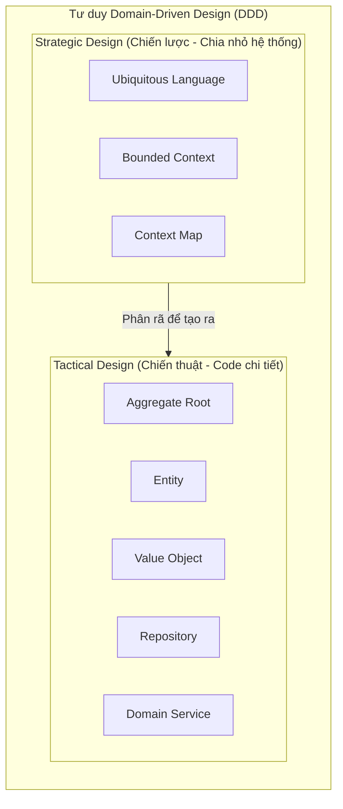

# Domain-Driven Design (Thiết kế Hướng Miền - DDD)

> **Ý tưởng chính việc sử dụng:** Lấy nghiệp vụ lõi (Domain) làm trung tâm để thiết kế phần mềm, kỹ sư và chuyên gia nghiệp vụ dùng chung một ngôn ngữ.
> **Ví dụ:** Thay vì gọi là 'User', cả team thống nhất gọi là 'Patient' trong hệ thống bệnh viện để khớp với thực tế.

Khi phần mềm phát triển đến mức quá phức tạp, mã nguồn trở thành một mớ bòng bong vì lập trình viên không hiểu rõ **nghiệp vụ thật sự** của công ty, và ngược lại, chuyên gia nghiệp vụ thì không hiểu lập trình viên đang viết code gì. 
**Domain-Driven Design (DDD)** ra đời năm 2003 (do Eric Evans đề xướng) để làm cầu nối xóa bỏ khoảng cách đó.

## 1. Mức Độ Cơ Bản (Basic)

### DDD là gì?
DDD không phải là một "kiến trúc" (như Microservices hay Layered), mà nó là một **Phương pháp luận (Cách tư duy)** để thiết kế phần mềm. 
Trọng tâm của DDD là **Domain** (Lĩnh vực/Miền nghiệp vụ). Mọi dòng code, cấu trúc file, tên biến đều phải phản ánh chính xác nghiệp vụ thực tế ngoài đời.

Ví dụ: Nếu bạn làm phần mềm cho Bệnh viện (Domain), code của bạn phải có các class là `Patient`, `Doctor`, `Prescription`, chứ không phải là `UserData`, `StaffRecord`, `Doc_Tbl`.

### Vấn đề cốt lõi giải quyết
Sự bất đồng ngôn ngữ giữa đội Kỹ thuật (Dev) và đội Nghiệp vụ (Sale, Kế toán, Bác sĩ). DDD tạo ra **Ubiquitous Language (Ngôn ngữ Chung)** - Một bộ từ vựng mà cả Giám đốc, Kế toán và Lập trình viên đều dùng chung. Nếu Kế toán gọi hành động là "Chốt sổ", thì trong code hàm đó phải tên là `chotSo()` (hoặc `closeLedger()`), chứ không được đặt là `updateStatusToDone()`.

## 2. Mức Độ Trung Bình (Intermediate): Under the Hood

DDD được chia làm 2 nhánh kỹ thuật cực kỳ rõ ràng:

1. **Strategic Design (Thiết kế Chiến lược - Tầm nhìn rộng)**: 
   - Nhìn toàn cảnh hệ thống.
   - Nhận diện các **Bounded Context** (Ranh giới ngữ cảnh). 
   - Giúp chia một hệ thống khổng lồ (Monolithic) thành nhiều mảnh nhỏ độc lập (Rất hợp để xây dựng Microservices).

2. **Tactical Design (Thiết kế Chiến thuật - Chi tiết Code)**:
   - Cách tổ chức các dòng code bên trong một Bounded Context.
   - Sử dụng các mẫu thiết kế (Design Patterns) như: **Entity**, **Value Object**, **Aggregate**, **Repository**, **Domain Service** để bảo vệ tính toàn vẹn của dữ liệu kinh doanh. (Chúng ta sẽ có bài Deep-Dive riêng cho từng khái niệm này ở các thư mục sau).

*Use Cases*: BẮT BUỘC cho các hệ thống có logic nghiệp vụ siêu phức tạp (Ngân hàng, ERP, Sàn thương mại điện tử, Core Banking).
*Không nên dùng*: Ứng dụng CRUD đơn giản, ứng dụng thiên về kỹ thuật (ví dụ phần mềm dọn rác ổ cứng, vì nó thiên về thuật toán chứ không có "nghiệp vụ con người"). Dùng DDD cho app bé sẽ dẫn đến over-engineering trầm trọng.

## 3. Mức Độ Nâng Cao (Advanced)

### Chuyển đổi tư duy: Từ Database-Driven sang Domain-Driven
Các lập trình viên thường mắc "bệnh" thiết kế Database trước (vẽ các bảng SQL), sau đó mới viết Class ánh xạ (ORM mapping), và cuối cùng viết code CRUD. 
Trong DDD, tư duy này bị đảo ngược hoàn toàn! 
Bạn thiết kế **Domain Model (Class, Logic, Hành vi)** trước trên giấy/mã nguồn, xem nó giải quyết bài toán nghiệp vụ thế nào. Còn chuyện lưu xuống bảng SQL hay MongoDB chỉ là "chi tiết kỹ thuật tầm thường" (Infrastructure) làm sau cùng.

### Rich Domain vs Anemic Domain
- **Anemic Domain (Miền thiếu máu)**: Class `Order` chỉ có các biến `total`, `status` và hàm get/set. Logic tính toán tổng tiền bị nhét ra ngoài nằm ở lớp `OrderService`. (Đây là Anti-pattern trong DDD).
- **Rich Domain (Miền phong phú)**: Class `Order` có chứa luôn hàm `calculateTotal()` và hàm `cancelOrder()`. Nó tự quản lý trạng thái của chính nó và không cho kẻ khác sửa trực tiếp. DDD yêu cầu phải dùng Rich Domain.

## 4. So Sánh (Compare & Contrast)

| Đặc điểm | Data-Driven Design (Thiết kế hướng dữ liệu) | Domain-Driven Design (Thiết kế hướng miền) |
| :--- | :--- | :--- |
| **Bắt đầu từ đâu?** | Thiết kế các bảng CSDL (Database Tables) trước. | Phỏng vấn chuyên gia nghiệp vụ, thiết kế Class/Hành vi trước. |
| **Vai trò của Database** | Là trung tâm (Core) của hệ thống. | Chỉ là công cụ lưu trữ ở lớp ngoài cùng (Infrastructure). |
| **Ngôn ngữ trong code** | Ngôn ngữ máy (Cột, Bảng, Flag, Status ID, UpdateRow). | Ngôn ngữ chung (Chốt sổ, Nhập viện, Hủy đơn - Ubiquitous Language). |

## 5. Bài Tập Thực Hành Nhỏ

**Tình huống**: Trong file code `demo-ddd.ts`, chúng ta có 1 lớp `BankAccount` (Tài khoản ngân hàng) được thiết kế theo kiểu **Anemic Domain** (Thiếu máu). Mọi logic rút tiền bị quăng ra ngoài nằm ở một Service rác, dẫn đến nguy cơ Service đó sửa sai số dư tài khoản.

*Nhiệm vụ*: Hãy Refactor (viết lại) đoạn code đó thành **Rich Domain Model**. Chuyển logic rút tiền vào đúng vị trí của nó bên trong lớp `BankAccount` và khóa kín dữ liệu lại.

Code đề bài và đáp án nằm tại: [answers-ddd](/Users/ductri0981/Documents/Studying-Software/domain_driven_design/answers-ddd.ts)

## 6. Phụ Lục (Sơ Đồ Tương Quan)

## 7. Giải Thích Thuật Ngữ (Glossary)
- **Domain (Miền)**: Lĩnh vực kinh doanh thực tế mà phần mềm phục vụ (Vd: Giao hàng, Kế toán).
- **Ubiquitous Language (Ngôn ngữ Chung)**: Bộ từ vựng chung, thống nhất giữa đội Dev và đội Kinh doanh, bắt buộc phải dùng nguyên xi tên gọi đó vào trong Code.
- **Domain Expert (Chuyên gia miền)**: Những người không biết code, nhưng cực kỳ rành rẽ về nghiệp vụ (Giám đốc, Sale, Nhân viên kho...). Đội Dev phải phỏng vấn họ để lấy yêu cầu.
- **Strategic Design**: Việc lên kế hoạch kiến trúc tổng thể, phân rã một hệ thống lớn thành các phần nhỏ có giới hạn rõ ràng (Bounded Context).
- **Tactical Design**: Áp dụng các mẫu code (Entity, Value Object, Repository) để hiện thực hóa cái Domain ở mức độ code.
- **Rich Domain Model**: Mô hình đối tượng xịn, các Entity tự chứa cả Dữ liệu và Hành vi (Logic) của nó.
- **Anemic Domain Model**: "Bệnh" thiết kế phổ biến, Entity chỉ là các túi chứa data vô tri (chỉ có getter/setter), đẩy hết trách nhiệm tính toán cho các file Service bên ngoài.
