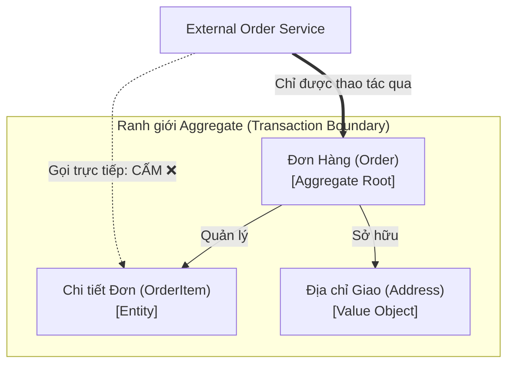

# Aggregate & Aggregate Root (Cụm đối tượng & Gốc cụm)

> **Ý tưởng chính việc sử dụng:** Gom nhóm các thực thể liên quan chặt chẽ thành một cụm duy nhất (Aggregate) và thao tác thông qua một gốc (Root).
> **Ví dụ:** Đơn Hàng (Order) là Root chứa nhiều Dòng Chi Tiết (OrderItem). Bất kỳ ai muốn sửa OrderItem đều phải gọi qua Order.

Đây là mẫu thiết kế (Tactical Design) mang tính sống còn trong DDD để đảm bảo dữ liệu không bị hỏng hóc hoặc mâu thuẫn khi có nhiều người dùng thao tác cùng một lúc.

## 1. Mức Độ Cơ Bản (Basic)

### Aggregate là gì?
**Aggregate (Cụm)** là một nhóm các Đối tượng (Entities và Value Objects) gắn liền với nhau về mặt nghiệp vụ, và được xử lý như **MỘT ĐƠN VỊ DUY NHẤT** khi có sự thay đổi dữ liệu.

Ví dụ: Bạn có một `Đơn Hàng` (Order). Trong Đơn hàng có nhiều `Dòng sản phẩm` (OrderItem), có `Địa chỉ giao` (Address). Toàn bộ cục này gọi là một Aggregate. Nếu xóa Đơn hàng, các Dòng sản phẩm bên trong cũng vô nghĩa và phải biến mất theo.

### Aggregate Root là gì?
Trong một Cụm (Aggregate), bắt buộc phải có một Entity đứng ra làm **Trưởng nhóm (Root)**. Trong ví dụ trên, `Order` chính là Trưởng nhóm.
**Quy tắc bất di bất dịch**: Bất kỳ thế giới bên ngoài nào muốn sửa đổi thông tin của `OrderItem` đều KHÔNG ĐƯỢC PHÉP gọi trực tiếp `OrderItem`. Họ BẮT BUỘC phải đưa yêu cầu cho Trưởng nhóm `Order` xử lý!

### Vấn đề cốt lõi giải quyết
Bảo vệ **Invariants** (Tính toàn vẹn/Bất biến của dữ liệu). 
Ví dụ luật: "Tổng tiền Order phải bằng tổng tiền các OrderItem cộng lại". Nếu ta cho phép người ngoài (như một Service bậy bạ nào đó) lấy thẳng `OrderItem` ra sửa giá thành 0 đồng mà không báo cho `Order`, thì tổng tiền của `Order` sẽ bị sai lệch hoàn toàn so với thực tế!

## 2. Mức Độ Trung Bình (Intermediate): Under the Hood

### Nguyên tắc thiết kế Aggregate:
1. **Giao tiếp qua Root**: Mã nguồn bên ngoài chỉ được giữ `Id` hoặc tham chiếu (Reference) tới Aggregate Root, tuyệt đối không giữ tham chiếu tới các thành phần con bên trong.
2. **Xóa đồng bộ (Cascade Delete)**: Khi Root bị xóa khỏi Database, toàn bộ thành phần con phải bay màu theo.
3. **Giữ Aggregate càng nhỏ càng tốt**: Rất nhiều người tham lam nhét 50 cái bảng Database liên quan vào chung 1 Aggregate. Hậu quả là mỗi khi sửa 1 thứ nhỏ xíu, toàn bộ cục bự chảng bị Lock (khóa), gây nghẽn cổ chai hiệu năng (Performance Bottleneck).

## 3. Mức Độ Nâng Cao (Advanced)

### Ranh giới Giao dịch (Transaction Boundary)
Đây là lý do tối thượng của việc thiết kế Aggregate.
Quy tắc: **Một Giao dịch Database (Database Transaction) CHỈ ĐƯỢC PHÉP cập nhật duy nhất MỘT Aggregate.**
Nếu hành động của bạn cần cập nhật 2 Aggregate khác nhau (Ví dụ: Trừ tiền ở `AccountAggregate` và Tạo đơn hàng ở `OrderAggregate`), bạn phải dùng **Eventual Consistency** (Tính nhất quán cuối cùng) thông qua việc gửi các Domain Events, chứ không được ôm cả 2 vào chung một Transaction. Đây là kỹ năng tối quan trọng khi làm Microservices để chống dính (coupling) Database.

### Rủi ro Anti-pattern
- **Lưu các Aggregate khác bên trong Aggregate**: Ví dụ `Order` chứa mảng các `Product` hoàn chỉnh (cả giá, tên, kho...). Điều này sai. `Order` chỉ nên chứa `ProductId` (chỉ là chuỗi ID) của `Product` Aggregate, chứ không được ôm trọn đối tượng đó vào lòng.

## 4. So Sánh (Compare & Contrast)

| Đặc điểm | Cơ sở dữ liệu quan hệ (SQL Database) | Aggregate (DDD) |
| :--- | :--- | :--- |
| **Góc nhìn** | Dữ liệu là các Bảng (Tables) được nối bằng Khóa ngoại (Foreign Key). Mọi bảng đều bình đẳng. | Dữ liệu là các Cụm. Có phân cấp Gốc (Root) và Nhánh (Child). |
| **Cập nhật dữ liệu** | Có thể viết lệnh UPDATE trực tiếp vào bất kỳ bảng nào (VD: UPDATE OrderItem). | BẮT BUỘC phải load Aggregate Root (Order) lên bộ nhớ, dùng hàm của Root để sửa Child, rồi Save lại toàn bộ Cụm. |
| **Mapping ORM** | 1 Bảng SQL = 1 Model class. | 1 Aggregate có thể được sinh ra từ việc JOIN 3, 4 bảng SQL lại với nhau bởi Repository. |

## 5. Bài Tập Thực Hành Nhỏ

**Tình huống**: Trong file `demo-aggregate.ts`, có một lớp `OrderService` đang vi phạm nghiêm trọng quy tắc của DDD. Nó tự tay lấy phần tử con `OrderItem` ra và sửa đổi số lượng trực tiếp, bỏ qua mặt của Trưởng nhóm `Order` (Aggregate Root). Việc này làm biến `totalPrice` của Order không được cập nhật lại, dẫn đến lỗi tính tiền!

*Nhiệm vụ*: Hãy Refactor đoạn code đó. Xóa quyền truy cập trực tiếp vào `OrderItem`. Thay vào đó, viết một hàm `updateItemQuantity()` bên trong `Order` để Trưởng nhóm tự xử lý việc tính toán lại giá tiền.

Code đề bài và đáp án nằm tại: [answers-aggregate](/Users/ductri0981/Documents/Studying-Software/aggregate/answers-aggregate.ts)

## 6. Phụ Lục (Sơ Đồ Kiến Trúc)

## 7. Giải Thích Thuật Ngữ (Glossary)
- **Aggregate (Cụm/Tập hợp)**: Một cụm các đối tượng dữ liệu gắn chặt với nhau, coi như 1 thực thể nguyên khối khi lưu trữ/cập nhật.
- **Aggregate Root (Gốc cụm)**: Đối tượng Entity đứng đầu cụm, chịu trách nhiệm bảo vệ toàn vẹn dữ liệu cho cả cụm.
- **Invariants (Tính bất biến/Toàn vẹn)**: Các quy tắc kinh doanh bắt buộc phải luôn đúng (VD: Tổng tiền > 0, Ngày trả sách phải sau ngày mượn).
- **Transaction Boundary (Ranh giới giao dịch)**: Giới hạn của một khối thao tác Database (COMMIT hoặc ROLLBACK chung một lượt).
- **Eventual Consistency**: Tính nhất quán cuối cùng. Không yêu cầu dữ liệu ở mọi nơi phải đúng cùng một phần nghìn giây. Nó cho phép dữ liệu từ từ đồng bộ thông qua message queue.
