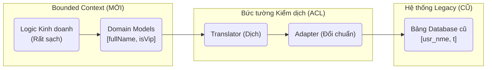

# Anti-Corruption Layer (Lớp chống tham nhũng - ACL)

> **Ý tưởng chính việc sử dụng:** Dựng một bức tường biên dịch ở giữa hệ thống cũ (Dữ liệu rác) và hệ thống mới (Dữ liệu chuẩn DDD) để chặn sự lây nhiễm rác.
> **Ví dụ:** Hệ thống kế toán cũ trả JSON `usr_nme` và `t=1`. Lớp ACL đứng giữa hứng cục đó, phiên dịch thành `fullName` và `isVIP=true` rồi mới đưa cho hệ thống mới dùng.

Trong thiết kế chiến lược của DDD (Strategic Design), bạn thường phải đối mặt với một thực tại tàn khốc: Hệ thống của bạn (Microservice mới làm, đẹp đẽ, chuẩn DDD) phải móc nối với một Hệ thống Kế toán 20 năm tuổi (Lộn xộn, tên cột sai bét, dữ liệu rác).
Nếu bạn dùng chung **Context** (Mô hình/Thuật ngữ) của hệ thống cũ, hệ thống mới của bạn sẽ lây nhiễm bệnh bẩn thỉu đó. Bạn cần một **Anti-Corruption Layer (ACL)**.

## 1. Mức Độ Cơ Bản (Basic)

### ACL là gì?
ACL dịch là **Lớp chống tham nhũng / Lớp chống suy thoái**. Nó là bức tường kiểm dịch đứng giữa hệ thống Mới (Sạch) và hệ thống Cũ (Bẩn).

Ví dụ: 
- Hệ thống ERP cũ lưu trạng thái Đơn hàng là `status = 1` (Mới tạo), `status = 2` (Đã hủy).
- Hệ thống Microservice Mới của bạn dùng Enum rõ ràng `OrderStatus.CREATED`, `OrderStatus.CANCELLED`.
- ACL sẽ đứng ở giữa làm nhiệm vụ **Thông Dịch Viên**. Nó hứng con số `1` từ API cũ, dịch thành `CREATED` rồi mới đưa vào hệ thống mới. Tuyệt đối không để con số `1` quái thai đó lọt vào code lõi của bạn.

### Vấn đề cốt lõi giải quyết
- Bảo vệ **Ubiquitous Language (Ngôn ngữ chung)** của Bounded Context mới.
- Chặn đứng sự ô nhiễm về mặt mô hình (Data Model Pollution). Kỹ sư code hệ thống Mới không cần phải nhức đầu học lại đống thuật ngữ tối nghĩa của hệ thống Cũ.

## 2. Mức Độ Trung Bình (Intermediate): Under the Hood

### ACL vs Adapter Pattern
Nghe y chang Adapter Pattern phải không? Nhưng khác ở tầm vóc!
- **Adapter Pattern**: Giải quyết vấn đề **kỹ thuật (Technical)**. Biến cái hàm tên `A` thành hàm tên `B`. Cắm phích 3 chấu vào ổ 2 chấu.
- **ACL**: Giải quyết vấn đề **chiến lược kinh doanh (Strategic)**. Nó không chỉ đổi tên hàm. Nó có thể gọi 3 API của hệ thống cũ, nhào nặn lại, sửa lại logic lỗi, dịch thuật ngữ, đôi khi tự tạo một cái Database nhỏ bên trong nó để ánh xạ Mapping ID giữa Mới và Cũ. Lớp ACL có thể lớn tương đương nguyên một Microservice riêng biệt!

### 3 Thành phần của một ACL
1. **Facade (Mặt nạ)**: Đơn giản hóa các API phức tạp hầm bà lằng của hệ thống Cũ thành 1 API dễ gọi.
2. **Adapter (Chuyển đổi)**: Đổi định dạng Protocol (Từ SOAP XML sang REST JSON).
3. **Translator (Thông dịch)**: Dịch thuật ngữ, kiểm tra tính đúng đắn, chuyển đổi Models (Từ Bẩn sang Sạch).

## 3. Mức Độ Nâng Cao (Advanced)

### Khi nào thì NÊN dùng ACL?
- Khi hệ thống Cũ quá to, không thể sửa, và bạn không muốn (hoặc không được quyền) tác động vào nó.
- Khi 2 hệ thống thuộc 2 công ty khác nhau (Ví dụ bạn tích hợp với API của Thuế Nhà Nước).
- Khi bạn dùng Mẫu thiết kế Conformist (Chấp nhận tuân theo luật của kẻ mạnh) nhưng không cam tâm bị làm bẩn code.

### Khi nào KHÔNG NÊN dùng ACL?
- Nếu 2 hệ thống do cùng 1 team nhỏ quản lý, hãy thẳng tay sửa mẹ cái hệ thống Cũ đi cho đồng bộ. (Shared Kernel). Viết ACL sẽ gây thừa thãi, rườm rà.

## 4. So Sánh (Compare & Contrast)

| Đặc điểm | Đồng hóa (Dùng trực tiếp code Cũ) | Có Lớp Chống Tham Nhũng (ACL) |
| :--- | :--- | :--- |
| **Mô hình Dữ liệu** | Tràn ngập mã lỗi `type=1`, `type=2` khắp nơi trong code mới. | Dữ liệu tinh khiết (`type="VIP"`). Ngôn ngữ thống nhất. |
| **Gánh nặng Lập trình** | Kỹ sư team Mới phát điên vì phải học tài liệu của team Cũ. | Kỹ sư Mới chỉ đọc tài liệu nội bộ. Kỹ sư ACL chịu trận dịch thuật. |
| **Chi phí / Tốc độ** | Code rất nhanh. | Mất nhiều thời gian để code lớp ACL ở giữa. |

## 5. Bài Tập Thực Hành Nhỏ

**Tình huống**: Trong file `demo-acl.ts`, `ModernApp` gọi hệ thống `LegacyERP` để lấy thông tin khách hàng. Hệ thống cũ trả về cái biến tên là `usr_nme` và `t` (type: 1 là VIP, 0 là Thường). `ModernApp` bị ép phải dùng 2 cái tên củ chuối này trong code, làm code trở nên tối nghĩa.

*Nhiệm vụ*: Áp dụng Anti-Corruption Layer.
1. Xây một class `ERPTranslatorACL` bọc giữa.
2. Bên trong ACL, nhận cục JSON bẩn `{ usr_nme: "Bob", t: 1 }` và dịch nó thành cái DTO sạch đẹp `{ fullName: "Bob", isVip: true }`.
3. `ModernApp` giờ chỉ thao tác với DTO sạch.

Code đề bài và đáp án nằm tại: [answers-acl](/Users/ductri0981/Documents/Studying-Software/anti_corruption_layer/answers-acl.ts)

## 6. Phụ Lục (Sơ Đồ Kiến Trúc)

## 7. Giải Thích Thuật Ngữ (Glossary)
- **Anti-Corruption Layer (ACL)**: Lớp chống suy thoái / tham nhũng. Lớp trung gian bảo vệ Bounded Context khỏi sự lây nhiễm mô hình dữ liệu xấu từ bên ngoài.
- **Legacy System**: Hệ thống phần mềm di sản (Đã cũ, khó bảo trì, nhưng vẫn phải dùng vì nó đang kiếm ra tiền).
- **Translator**: Thông dịch viên. Hàm chuyên làm nhiệm vụ xào nấu, chuyển hóa các biến dị hợm thành tên biến dễ đọc chuẩn DDD.
- **Conformist**: Kẻ tuân thủ. Mẫu quan hệ mà bên yếu thế phải chấp nhận mọi cấu trúc dữ liệu do bên mạnh đưa ra (Ví dụ: Chơi với API của Facebook thì Facebook cho sao nhận vậy).
