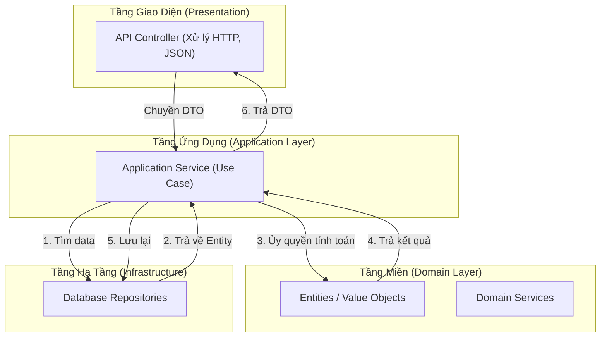

# Application Service (Dịch vụ Ứng dụng / Use Case)

> **Ý tưởng chính việc sử dụng:** Đóng vai trò là người điều phối (Orchestrator) luồng Use-case, không chứa logic nghiệp vụ.
> **Ví dụ:** Nhận request Đặt hàng -> Gọi Repository lấy User -> Gọi Domain tính tiền -> Gọi Repository lưu Order -> Báo thành công.

Nếu Domain Layer (Entities, Value Objects, Domain Services) là khối óc chứa mọi thuật toán và luật lệ kinh doanh của công ty, thì **Application Service** chính là chân tay và hệ thần kinh kết nối khối óc đó ra thế giới thực (Database, UI, API). 
Trong Clean Architecture, nó thường được gọi là lớp **Use Cases**.

## 1. Mức Độ Cơ Bản (Basic)

### Application Service là gì?
Nó là "Người Nhạc Trưởng" (Orchestrator). 
Khi người dùng bấm nút "Đặt hàng" trên website, request HTTP sẽ bay vào Controller. Controller không biết cách đặt hàng, nó gọi Application Service.

Application Service cũng KHÔNG chứa logic đặt hàng! Nó làm các bước sau:
1. Mở một Transaction (Bảo vệ dữ liệu DB).
2. Gọi Repository móc từ DB lên cái `Customer` và `Product` Entity.
3. Chuyền chúng cho Entity hoặc Domain Service xử lý: `customer.placeOrder(product)`.
4. Gọi Repository để lưu cái `Order` mới xuống DB.
5. Đóng Transaction. Trả kết quả (ID đơn hàng) về cho Web.

### Vấn đề cốt lõi giải quyết
Giải phóng lớp UI (Controller) và lớp Domain. 
- UI chỉ làm việc với HTTP, JSON.
- Domain chỉ làm việc với luật kinh doanh.
- Application Service làm phần việc trung gian tẻ nhạt nhưng cực kỳ quan trọng: Lấy data lên, giao cho Domain tính, lưu data xuống.

## 2. Mức Độ Trung Bình (Intermediate): Under the Hood

### Đặc điểm bắt buộc:
1. **Không chứa Logic Kinh Doanh (No Business Rules)**: Nếu bạn thấy trong file Application Service có những câu lệnh if/else kiểm tra tiền, kiểm tra tuổi, tính phần trăm giảm giá... tức là bạn đã thiết kế sai! Mọi tính toán đó phải nhét vào Domain.
2. **Quản lý Vòng đời Data (Lifecycle Management)**: Chuyên dùng Repository để find, save, delete.
3. **Quản lý Giao dịch (Transaction Management)**: Nếu lưu thất bại, App Service phải tự Rollback.
4. **Phát tín hiệu (Event Dispatching)**: Nếu tạo đơn thành công, App Service sẽ bắn ra tín hiệu `OrderCreatedEvent` cho các hệ thống khác biết.

*Use Cases*: MỌI hành động mà người dùng/hệ thống ngoài có thể làm được với phần mềm của bạn đều tương ứng với 1 Application Service (hoặc 1 hàm trong đó). Ví dụ: Đăng ký tài khoản, Đổi mật khẩu, Thanh toán đơn hàng.

## 3. Mức Độ Nâng Cao (Advanced)

### DTO (Data Transfer Object)
Rất nhiều người truyền thẳng cục JSON (hoặc tham số nguyên thủy) từ Controller qua App Service. Tốt hơn một chút thì nhận vào.
Nhưng lỗi nặng nhất là **trả về Entity trực tiếp ra Controller**. Bạn sẽ vô tình ném cả Hash Password ra màn hình UI.
**Quy tắc**: Đầu vào và Đầu ra của Application Service phải là các lớp `RequestDTO` và `ResponseDTO`. Service phải có bước Mapping (chuyển đổi) Entity thành DTO trước khi trả về.

### Tránh Fat Service (Service béo phì)
Có 2 kiểu thiết kế:
1. **Gom nhóm (Service-based)**: `UserService` chứa các hàm `createUser()`, `deleteUser()`, `updateUser()`. File có thể dài nghìn dòng.
2. **Lệnh đơn (Command-based / CQRS)**: Mỗi Service là một class duy nhất chỉ có 1 hàm `execute()`. VD: `CreateUserCommand`, `DeleteUserCommand`. Cách này rất tuyệt vời cho các hệ thống lớn.

## 4. So Sánh (Compare & Contrast)

| Đặc điểm | Domain Service (Dịch vụ Miền) | Application Service (Dịch vụ Ứng dụng) |
| :--- | :--- | :--- |
| **Vị trí** | Nằm ở lõi trong cùng (Domain Layer). | Nằm bao bọc bên ngoài lớp Domain (Application Layer). |
| **Trách nhiệm** | Chứa logic kinh doanh phức tạp lõi. Tính toán, ra quyết định. | Nhạc trưởng điều phối (Lấy DB -> Ném cho Domain -> Lưu DB). |
| **Phụ thuộc** | KHÔNG gọi Database, không gọi API. Chỉ làm việc trên RAM. | Gọi Repository, gọi Queue, bắn Event, thao tác với ngoại vi. |
| **Ví dụ** | `MoneyTransferService`, `TaxCalculatorService` | `RegisterAccountUseCase`, `CheckoutCartCommand` |

## 5. Bài Tập Thực Hành Nhỏ

**Tình huống**: Trong file `demo-application-service.ts`, có một class `UserController` đóng vai trò API hứng Request. Controller này đang tự mình làm mọi thứ: Khởi tạo Entity, lưu DB, kiểm tra logic... Rất lộn xộn.

*Nhiệm vụ*: Hãy tạo một `UserRegistrationApplicationService`. Di dời phần việc điều phối (Tìm User -> Khởi tạo -> Lưu DB) từ Controller sang App Service. Controller chỉ còn nhiệm vụ hứng và trả JSON. Đảm bảo sử dụng DTO thay vì nhận JSON thô.

Code đề bài và đáp án nằm tại: [answers-application-service](/Users/ductri0981/Documents/Studying-Software/application_service/answers-application-service.ts)

## 6. Phụ Lục (Sơ Đồ Tương Quan)

## 7. Giải Thích Thuật Ngữ (Glossary)
- **Application Service (Use Case)**: Tầng chứa các kịch bản sử dụng (workflow) của ứng dụng.
- **DTO (Data Transfer Object)**: Đối tượng vận chuyển dữ liệu. Chỉ có cấu trúc biến, không có hàm xử lý. Chuyên dùng để giao tiếp giữa các Layer để giấu đi cấu trúc nội bộ của Entity.
- **Orchestrator**: Người điều phối, người chỉ huy. Không tự làm ra sản phẩm, nhưng biết cách sai bảo đúng người làm đúng việc.
- **Transaction**: Giao dịch. Một chuỗi các hành động DB gộp lại. Nếu có 1 hành động rớt, tất cả bị hủy (Rollback). Thường được khởi tạo ở ngay cửa ngõ Application Service.
