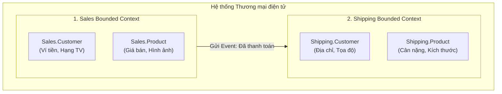

# Bounded Context (Giới hạn Ngữ cảnh)

> **Ý tưởng chính việc sử dụng:** Chia hệ thống lớn thành các ngữ cảnh nhỏ có ranh giới rõ ràng, mỗi ngữ cảnh tự định nghĩa thực thể theo cách riêng.
> **Ví dụ:** Từ 'Sản phẩm' trong ngữ cảnh Bán Hàng mang nghĩa giá cả, nhưng trong ngữ cảnh Vận Chuyển lại mang nghĩa trọng lượng/kích thước.

Bounded Context là khái niệm cốt lõi nhất của **Strategic Design** (Thiết kế chiến lược) trong Domain-Driven Design (DDD). Nó là chìa khóa để phá vỡ một hệ thống khổng lồ (Monolithic) thành các Microservices siêu hiệu quả.

## 1. Mức Độ Cơ Bản (Basic)

### Bounded Context là gì?
Bounded Context dịch thô là "Ranh giới Ngữ cảnh". Nó vẽ ra một đường biên giới rõ ràng trong phần mềm. Bên trong đường biên giới đó, mọi từ vựng (Ngôn ngữ Chung - Ubiquitous Language) đều mang một ý nghĩa duy nhất và chính xác.

**Ví dụ kinh điển**: Hãy lấy từ khóa `"Khách hàng" (Customer)` trong một hệ thống Thương mại điện tử:
- Ở ngữ cảnh **Bán Hàng (Sales Context)**: "Khách hàng" nghĩa là người có ví tiền, lịch sử mua hàng, hạng thẻ thành viên.
- Ở ngữ cảnh **Vận Chuyển (Shipping Context)**: "Khách hàng" đơn thuần chỉ là một cái Tên, Địa chỉ nhà, và Số điện thoại. Tài xế giao hàng không cần biết khách có thẻ VIP hay số dư trong ví bao nhiêu.

### Vấn đề cốt lõi giải quyết
Sự "nhập nhằng" thuật ngữ. Nếu ta cố tình gom chung cả 2 ngữ cảnh trên thành một class `Customer` duy nhất (có 50 thuộc tính hầm bà lằng), class đó sẽ biến thành **God Class (Lớp Chúa tể)**. Bất kỳ ai động vào cũng sợ làm hỏng logic của đội khác. Bounded Context giải quyết bằng cách: Cắt đôi nó ra! Đội Sales giữ class `Sales.Customer`, đội Shipping giữ class `Shipping.Customer`.

## 2. Mức Độ Trung Bình (Intermediate): Under the Hood

### Đặc điểm của một Bounded Context
- **Độc lập về Code**: Mỗi Context thường nằm trong một Module/Thư mục riêng, hoặc tốt nhất là một Repository (Git) riêng.
- **Độc lập về Database**: Mỗi Context NÊN có Database riêng biệt. Context Bán hàng không được phép viết câu lệnh SQL `JOIN` thẳng vào bảng của Context Vận chuyển. Nếu cần dữ liệu, chúng phải gọi API của nhau.
- **Độc lập về Đội ngũ**: Ở các công ty lớn (như Spotify, Amazon), mỗi Bounded Context được giao hẳn cho một đội (Squad) tự quản lý từ thiết kế đến deploy.

*Use Cases*: Bắt buộc dùng khi muốn chuyển từ Monolithic sang Microservices. Hoặc khi hệ thống có quá nhiều bộ phận nghiệp vụ khác nhau (Sale, HR, Accounting) dùng chung một hệ thống phần mềm.

## 3. Mức Độ Nâng Cao (Advanced)

### Context Map (Bản đồ Tương quan)
Vì các Context bị chia tách, chúng phải giao tiếp với nhau. DDD đưa ra **Context Map** để quy định "kiểu quan hệ" giữa chúng:
- **Shared Kernel (Lõi chung)**: 2 Context quyết định xài chung một đoạn code/model cốt lõi. Cực kỳ hạn chế dùng vì dễ gây dính chặt (Coupling).
- **Customer / Supplier (Khách hàng / Nhà cung cấp)**: Context A (Nhà cung cấp) cung cấp API cho Context B (Khách hàng). A ưu tiên phát triển theo yêu cầu của B.
- **Conformist (Kẻ tuân thủ)**: Context B dùng API của Context A, nhưng A quá lớn và không thèm quan tâm B cần gì (Ví dụ: B là app của bạn, A là API của Facebook). Lúc này B phải chấp nhận biến đổi model của mình để khớp với A.
- **Anti-Corruption Layer (Lớp chống tham nhũng - ACL)**: Để giải quyết vụ Conformist ở trên, ta xây một bức tường ACL ở giữa. Bức tường này sẽ dịch dữ liệu từ Facebook sang dạng chuẩn của app mình, bảo vệ app mình không bị "ô nhiễm" bởi cấu trúc rác của Facebook.

## 4. So Sánh (Compare & Contrast)

| Đặc điểm | Mô hình Nguyên khối (Monolithic) | Bounded Context (DDD) | Microservices |
| :--- | :--- | :--- | :--- |
| **Góc độ nhìn nhận** | 1 khối code duy nhất | Khái niệm Logic (Cách chia ranh giới theo nghiệp vụ) | Khái niệm Vật lý (Các server chạy độc lập) |
| **Model (Lớp dữ liệu)** | 1 class `User` khổng lồ xài chung toàn cty | Tách thành `Sale.User`, `Support.User` | Mỗi Microservice tự có bảng DB và Model riêng |
| **Liên kết với nhau** | Rất tuyệt vời | **Một Microservice lý tưởng chính là BẤT BIẾN của MỘT Bounded Context.** | Rất tuyệt vời |

## 5. Bài Tập Thực Hành Nhỏ

**Tình huống**: Trong file `demo-bounded-context.ts`, có một class `GodProduct` khổng lồ chứa mọi thứ từ tên, giá bán, đến số lượng tồn kho, cân nặng... Hậu quả là đội Bán hàng và đội Kho bãi liên tục dẫm chân lên code của nhau.

*Nhiệm vụ*: Hãy đập bỏ class `GodProduct` này. Áp dụng Bounded Context bằng cách tách nó ra thành 2 class độc lập ở 2 Module (Namespace) khác nhau: `SalesContext` và `InventoryContext`.

Code đề bài và đáp án nằm tại: [answers-bounded-context](/Users/ductri0981/Documents/Studying-Software/bounded_context/answers-bounded-context.ts)

## 6. Phụ Lục (Sơ Đồ Kiến Trúc)

## 7. Giải Thích Thuật Ngữ (Glossary)
- **Bounded Context**: Ranh giới ngữ cảnh. Một vùng an toàn trong phần mềm nơi mọi thuật ngữ đều có ý nghĩa nhất quán.
- **God Class / God Object**: Lớp Chúa Tể. Một class khổng lồ biết quá nhiều và làm quá nhiều việc (Anti-pattern).
- **Context Map**: Sơ đồ thể hiện cách các Bounded Context nói chuyện và ảnh hưởng lẫn nhau.
- **Shared Kernel**: Vùng code/database dùng chung giữa các Context (cần tránh nếu có thể).
- **ACL (Anti-Corruption Layer)**: Lớp trung gian làm nhiệm vụ phiên dịch dữ liệu, bảo vệ Context của mình khỏi sự lộn xộn của Context hệ thống khác.
