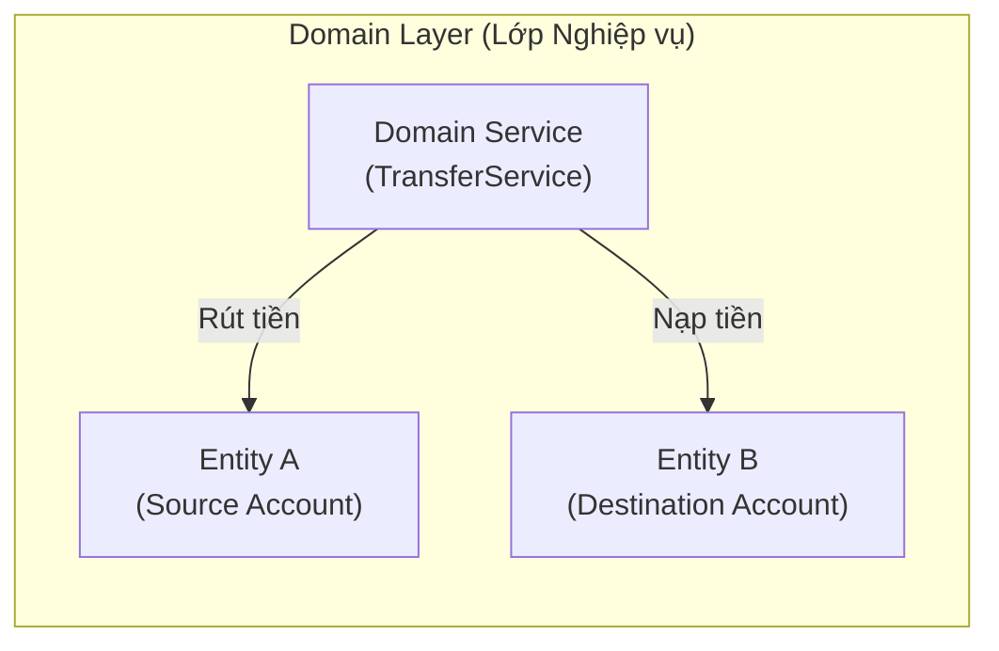

# Domain Service (Dịch vụ Miền)

> **Ý tưởng chính việc sử dụng:** Xử lý logic nghiệp vụ liên quan đến nhiều Aggregate mà không thể nhét logic đó vào một Aggregate cụ thể.
> **Ví dụ:** Dịch vụ chuyển tiền (TransferService) lấy tiền từ Tài Khoản A (Aggregate 1) và cộng vào Tài Khoản B (Aggregate 2).

Trong mô hình Domain-Driven Design (DDD), chúng ta luôn muốn nhét mọi logic kinh doanh vào bên trong các `Entity` hoặc `Value Object` để tạo ra Rich Domain.
Tuy nhiên, đôi khi có những logic kinh doanh (Business Rules) **không thể nhét vừa vặn** vào một Entity nào cả. Đó là lúc ta cần tới **Domain Service**.

## 1. Mức Độ Cơ Bản (Basic)

### Domain Service là gì?
Là một class (hàm) chứa logic nghiệp vụ thuần túy, nhưng nó đứng độc lập bên ngoài các Entity.

Ví dụ kinh điển: Chuyển tiền.
Bạn có `AccountA` và `AccountB`. Hành động chuyển tiền (Transfer) liên quan đến cả 2 tài khoản. Vậy hàm `transfer()` nên đặt ở đâu?
- Đặt ở `AccountA.transfer(AccountB)`? Nghe có vẻ khiên cưỡng. Tài khoản A tại sao lại có quyền thọc tay vào đổi số dư của Tài khoản B?
- Đặt ở `AccountB` cũng sai.
- Giải pháp: Tạo ra một class thứ 3 gọi là `TransferDomainService`. Class này sẽ nhận vào 2 tài khoản và thực hiện nghiệp vụ chuyển tiền.

### Vấn đề cốt lõi giải quyết
Giải quyết các nghiệp vụ liên quan đến nhiều Entity, hoặc các thuật toán tính toán phức tạp (như tính thuế, tính chiết khấu nhiều tầng) mà nếu nhét vào Entity sẽ làm Entity đó bị phình to (God Class) hoặc vi phạm Single Responsibility Principle (Đơn trách nhiệm).

## 2. Mức Độ Trung Bình (Intermediate): Under the Hood

### Đặc điểm của Domain Service chuẩn:
1. **Hoạt động dựa trên Ngôn ngữ chung (Ubiquitous Language)**: Tên class và tên hàm phải mang đúng ý nghĩa nghiệp vụ. Ví dụ: `CurrencyExchangeService`, `LoanApprovalService`.
2. **Không có trạng thái (Stateless)**: Một Domain Service tuyệt đối không được lưu trạng thái (như `this.totalCount`, `this.tempData`). Mọi dữ liệu cần thiết để tính toán phải được truyền vào qua tham số (Parameters) của hàm, và nó trả ra kết quả.
3. **Chỉ chứa Logic, Không gọi DB trực tiếp**: Nó có thể gọi Repository (thông qua interface) để check một luật gì đó, nhưng nhiệm vụ chính của nó là *tính toán và xử lý*, không phải là *điều phối luồng* (đó là việc của Application Service).

*Use Cases*: Dùng cho tính toán phức tạp, hoặc kiểm tra logic toàn hệ thống (VD: Check xem Email này có tồn tại trong hệ thống chưa trước khi tạo User).

## 3. Mức Độ Nâng Cao (Advanced)

### Rủi ro biến hệ thống thành Anemic Domain Model
Đây là cạm bẫy lớn nhất!
Rất nhiều lập trình viên quá lạm dụng Domain Service. Bất cứ logic gì họ cũng moi ra tạo Service (như `ChangePasswordService`, `UpdateProfileService`), biến các Entity trở lại thành những cái túi data rỗng tuếch (Anemic Domain). 
**Quy tắc vàng**: LUÔN cố gắng nhét logic vào Entity hoặc Value Object trước. Chỉ khi nào thật sự khiên cưỡng, bế tắc, hoặc dính tới nhiều Aggregate khác nhau thì mới dùng đến Domain Service.

## 4. So Sánh (Compare & Contrast)

| Phân loại | Domain Service | Application Service | Infrastructure Service |
| :--- | :--- | :--- | :--- |
| **Vai trò** | Chứa **Logic nghiệp vụ lõi** của công ty (Cách tính lãi, Chuyển tiền). | Làm **Nhạc trưởng điều phối**. Lấy data từ DB -> Đưa cho Domain xử lý -> Lưu lại DB. | Chứa **Logic kỹ thuật**. (Gửi Email bằng SendGrid, upload file lên AWS S3). |
| **Phụ thuộc** | Chỉ dùng code thuần túy (Pure). | Có gọi Repository, Database, API. | Chứa đầy thư viện bên thứ 3. |

## 5. Bài Tập Thực Hành Nhỏ

**Tình huống**: Trong file `demo-domain-service.ts`, có 2 Entity `Account`. Lập trình viên cố ép logic chuyển tiền vào bên trong class `Account` (hàm `transferTo`). Điều này làm `Account` phải biết quá nhiều về các Account khác, phá vỡ tính đóng gói.

*Nhiệm vụ*: Hãy Refactor đoạn code đó. Xóa hàm `transferTo` khỏi `Account`. Tạo một `MoneyTransferDomainService` độc lập để xử lý việc chuyển tiền một cách chính quy.

Code đề bài và đáp án nằm tại: [answers-domain-service](/Users/ductri0981/Documents/Studying-Software/domain_service/answers-domain-service.ts)

## 6. Phụ Lục (Sơ Đồ Kiến Trúc)

## 7. Giải Thích Thuật Ngữ (Glossary)
- **Domain Service**: Lớp dịch vụ nghiệp vụ. Nơi chứa các logic (rules) của hệ thống không thuộc về Entity nào.
- **Application Service**: Lớp dịch vụ ứng dụng. (Sẽ học ở bài tiếp theo). Chỉ điều phối, không chứa logic lõi.
- **Stateless (Không trạng thái)**: Đối tượng không lưu lại bất kỳ dữ liệu gì sau khi hàm chạy xong. Đầu vào giống nhau thì đầu ra phải luôn giống nhau.
- **Single Responsibility Principle (SRP)**: Nguyên lý đơn trách nhiệm (chữ S trong SOLID). Mỗi class chỉ nên có đúng 1 lý do để thay đổi.
