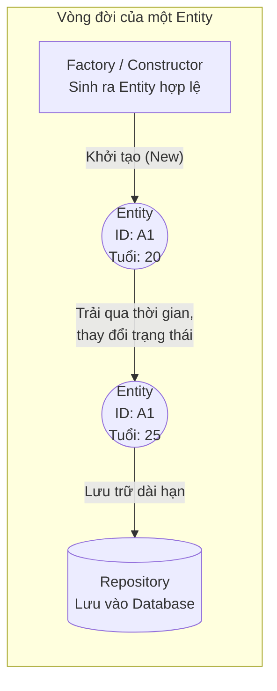

# Entity (Thực thể)

> **Ý tưởng chính việc sử dụng:** Biểu diễn một vật thể có tính duy nhất thông qua một ID, dù thuộc tính của nó thay đổi theo thời gian.
> **Ví dụ:** Khách hàng đổi tên, đổi địa chỉ, nhưng ID (Mã CCCD) vẫn giữ nguyên nên vẫn là cùng một người đó.

Bên cạnh Bounded Context ở góc độ vĩ mô, thì **Entity** chính là viên gạch nền móng đầu tiên ở góc độ vi mô (code) để xây dựng nên một hệ thống phần mềm hướng miền (DDD).

## 1. Mức Độ Cơ Bản (Basic)

### Entity là gì?
**Entity (Thực thể)** là một đối tượng trong mã nguồn mà yếu tố quan trọng nhất làm nên nó chính là **Mã định danh (Identity / ID)**, và nó có một vòng đời (Lifecycle) thay đổi liên tục theo thời gian.

Ví dụ: Bạn là một công dân, bạn có "Số CMND" (Định danh). Dù bạn có mập lên, ốm đi, chuyển nhà, hay thậm chí... đổi tên (Thay đổi trạng thái), thì bạn **vẫn là chính bạn** nhờ vào số CMND đó. Trong phần mềm, class `User`, `Order`, `Product` thường là các Entities.

### Vấn đề cốt lõi giải quyết
Giải quyết bài toán **So sánh (Equality)**. Làm sao hệ thống biết 2 biến object trong bộ nhớ có phải là mô tả cùng một người hay không? Với Entity, ta KHÔNG so sánh các thuộc tính (Không quan tâm tên hay tuổi có giống nhau không). Ta chỉ cần lấy ID của chúng ra so sánh. `if (A.id === B.id)` thì A và B là một! (Được gọi là Identity Equality).

## 2. Mức Độ Trung Bình (Intermediate): Under the Hood

### Đặc điểm của một Entity DDD chuẩn
1. **Phải có ID định danh**: ID có thể do DB cấp (Auto-increment), do code tự tạo (UUID, GUID), hoặc do nghiệp vụ ngoài đời cấp (Mã số thuế).
2. **Khả năng biến đổi (Mutability)**: Trạng thái (thuộc tính) của Entity được phép thay đổi theo thời gian thông qua các hàm hành vi (VD: `user.changePassword()`).
3. **Mô hình phong phú (Rich Domain)**: Đừng biến Entity thành một cái rổ rỗng chỉ chứa getter/setter. Nó phải chứa các hàm xử lý logic nghiệp vụ liên quan mật thiết đến dữ liệu của chính nó.

*Lưu ý*: Entity của DDD **KHÔNG PHẢI** là Entity của ORM (TypeORM, Hibernate). Entity của ORM chỉ là cái class dùng để map cột bảng SQL. Entity của DDD là nơi chứa não bộ tính toán nghiệp vụ. Ở các hệ thống lớn (Hexagonal/Clean), 2 class này thường phải tách biệt hoàn toàn!

## 3. Mức Độ Nâng Cao (Advanced)

### Quản lý vòng đời (Lifecycle) và Tạo mới
Vì Entity chứa các luật lệ kinh doanh (Invariants) cực kỳ nghiêm ngặt, việc tạo ra một Entity (khởi tạo `new`) không được tùy tiện.
- Bạn phải đảm bảo khi Entity sinh ra, nó phải ở trong một trạng thái **hợp lệ 100%**. (Không thể tạo một User mà không có ID hay thiếu username).
- Kỹ thuật nâng cao: Ẩn đi Constructor (để private), và dùng **Factory Method** (VD: `User.createNew(email, pass)`) để bắt buộc người gọi cung cấp đủ dữ liệu và phải qua khâu kiểm duyệt ngay khi sinh ra.

### Vòng đời của Entity trong ứng dụng Web (Stateless)
Trong môi trường Web/API hiện đại, vòng đời của một Entity thường diễn ra rất ngắn ngủi trong phạm vi một HTTP Request:
1. **Reconstitution (Tái tạo):** Load dữ liệu từ Database lên bộ nhớ RAM và dựng lại thành Entity Object (`repository.findById(id)`).
2. **Mutation (Thay đổi trạng thái):** Gọi các hàm nghiệp vụ để xử lý và thay đổi trạng thái Entity trên RAM (`entity.doSomething()`).
3. **Persistence (Lưu trữ):** Lưu trạng thái mới an toàn xuống Database (`repository.save(entity)`).
4. **Destruction (Dọn dẹp):** Request kết thúc, Garbage Collector dọn dẹp biến Entity khỏi RAM. Ở lần request tiếp theo, quá trình này sẽ phải lặp lại từ bước 1.

Cách làm này (mỗi lần xử lý đều load data mới nhất) đảm bảo Entity luôn phản ánh đúng dữ liệu thực tại (The Source of Truth), giúp tránh xung đột (stale data) khi có nhiều người thao tác cùng lúc. Ngoại lệ chỉ dành cho các hệ thống Stateful (như Server Game, Desktop App), nơi Entity được giữ sống liên tục trong RAM.

### Rò rỉ ID ra thế giới bên ngoài
Nếu bạn dùng Integer Auto-increment ID (1, 2, 3...) của SQL Database trực tiếp cho Domain Entity, bạn đã vô tình để cấu trúc hạ tầng (Infrastructure) rò rỉ vào Domain. Domain không nên phụ thuộc vào DB. Tốt nhất là dùng UUID (được tạo ra bằng code trước khi xuống DB).

## 4. So Sánh (Compare & Contrast)

| Đặc điểm | Entity | Value Object (Chi tiết ở phần sau) |
| :--- | :--- | :--- |
| **Tính chất khác biệt nhất** | Được nhận diện bằng **ID (Định danh)**. | Được nhận diện bằng **Giá trị (Values) của các thuộc tính**. |
| **Sự biến đổi** | Có thể thay đổi trạng thái (Mutable). VD: Tuổi tăng lên. | Tuyệt đối không thể thay đổi (Immutable). Sửa là phải tạo mới. |
| **Ví dụ thực tế** | Con người (User), Chiếc xe ô tô (Car). | Màu Đỏ (Color), Địa chỉ nhà (Address), Tọa độ (Coordinates). |

## 5. Bài Tập Thực Hành Nhỏ

**Tình huống**: Trong file `demo-entity.ts`, một lập trình viên mới vào nghề đã viết logic so sánh 2 User dựa trên việc "kiểm tra tên, tuổi và email xem có giống nhau không". Điều này cực kỳ sai lầm đối với khái niệm Entity, dẫn đến việc nhận dạng sai hai người khác nhau thành một người.

*Nhiệm vụ*: Viết lại phương thức `equals(other)` chuẩn cho lớp Entity. Đảm bảo tuân thủ tính chất Identity Equality (Chỉ so sánh dựa trên ID).

Code đề bài và đáp án nằm tại: [answers-entity](/Users/ductri0981/Documents/Studying-Software/entity/answers-entity.ts)

## 6. Phụ Lục (Sơ Đồ Kiến Trúc)

## 7. Giải Thích Thuật Ngữ (Glossary)
- **Identity Equality (Đồng nhất qua Định danh)**: Cách so sánh của Entity. Nếu ID giống nhau, chúng là 1 đối tượng, bất kể các thuộc tính khác có sai lệch.
- **Structural Equality (Đồng nhất qua Cấu trúc)**: Cách so sánh của Value Object. Mọi thuộc tính phải giống nhau y đúc 100% thì mới coi là 1.
- **Lifecycle (Vòng đời)**: Quá trình một Entity được tạo ra (Creation), thay đổi trạng thái trong bộ nhớ (Mutation), lưu xuống ổ cứng (Persistence), đọc lên (Reconstitution) và xóa đi (Deletion).
- **UUID / GUID**: Universally Unique Identifier. Chuỗi định danh độc nhất sinh ra bằng thuật toán mã hóa ngẫu nhiên, không cần chờ Database tự tăng. Ví dụ: `123e4567-e89b-12d3-a456-426614174000`.
