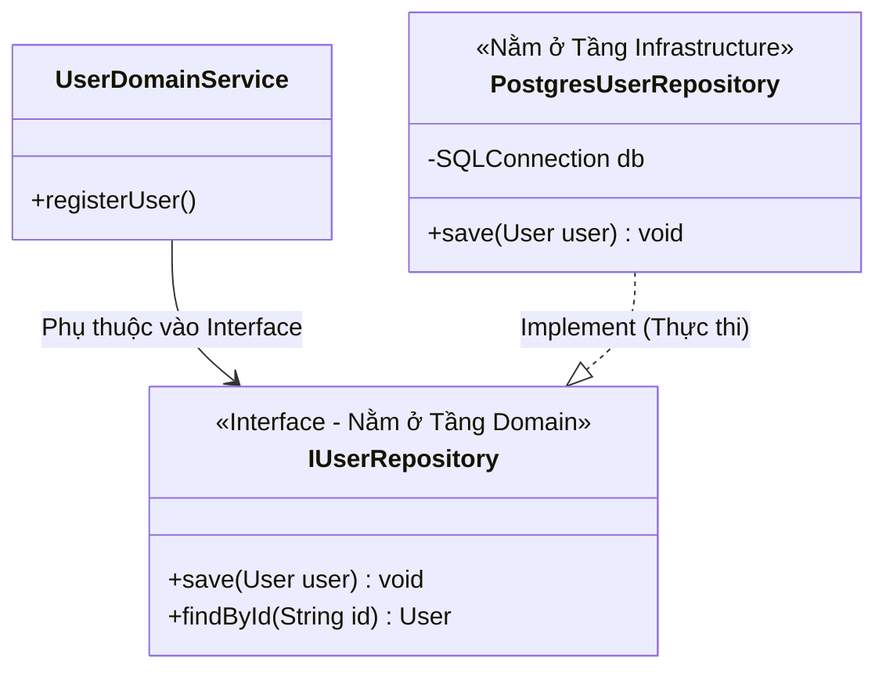

# Repository Pattern (Mẫu kho lưu trữ)

> **Ý tưởng chính việc sử dụng:** Đóng gói logic làm việc với Database (SQL, MongoDB) thành một lớp giao diện (Collection) trong bộ nhớ.
> **Ví dụ:** Domain gọi hàm `userRepo.findById(1)` mà không cần biết dữ liệu được lấy bằng lệnh SELECT SQL hay từ API bên thứ 3.

Khi xây dựng phần mềm có kết nối Cơ sở dữ liệu (Database), lập trình viên rất dễ mắc lỗi vứt các câu lệnh SQL (SELECT, INSERT) nằm lung tung khắp nơi trong Logic nghiệp vụ. **Repository Pattern** sinh ra để làm một lớp áo tàng hình che đậy toàn bộ sự lộn xộn của Database.

## 1. Mức Độ Cơ Bản (Basic)

### Repository là gì?
Hãy tưởng tượng **Repository** như một bộ nhớ RAM (In-Memory Collection) vô hạn. Mã nguồn (Logic nghiệp vụ) của bạn chỉ đơn giản gọi các hàm như `repo.add(user)`, `repo.findById(123)`, `repo.remove(user)`. 
Đối với Logic nghiệp vụ, nó cứ ngỡ là đang lấy dữ liệu từ một mảng Array trong RAM. Nó hoàn toàn bị "mù", không hề biết rằng ở dưới đáy, Repository đang còng lưng gọi SQL, gọi MongoDB hay ghi ra file JSON ổ cứng.

### Vấn đề cốt lõi giải quyết
Cô lập (Isolate) Logic kinh doanh khỏi Công nghệ lưu trữ. Nếu ngày mai sếp yêu cầu đổi Database từ MySQL sang Postgres, bạn chỉ cần thay ruột của class Repository. Logic kinh doanh ở tầng trên không cần sửa một chữ.

## 2. Mức Độ Trung Bình (Intermediate): Under the Hood

### Nguyên tắc 1 Root - 1 Repository
Trong Domain-Driven Design (DDD), bạn **KHÔNG ĐƯỢC PHÉP** tạo Repository cho mọi Entity.
Bạn **CHỈ ĐƯỢC** tạo Repository cho **Aggregate Root** (Gốc cụm).
- Ví dụ: Một Đơn hàng (`Order` Root) có nhiều Chi tiết (`OrderItem` Child). Bạn chỉ có `OrderRepository`. Bạn cấm tuyệt đối việc tạo `OrderItemRepository`.
- Tại sao? Vì lấy `OrderItem` lên mà không có gốc `Order` đi kèm thì mất hết tính toàn vẹn dữ liệu. Khi bạn gọi `orderRepo.findById()`, nó phải có trách nhiệm join các bảng lại và trả về cho bạn một cục `Order` hoàn chỉnh chứa đầy đủ mảng `OrderItem`.

### Phụ thuộc ngược (Dependency Inversion)
- **Interface của Repository**: Phải được khai báo ở lớp Lõi (Domain Layer). Lớp Lõi định nghĩa luật: "Tôi cần ai đó lưu dữ liệu, phải có 2 hàm save() và find()".
- **Lớp thực thi (Implementation)**: Phải nằm ở lớp ngoài cùng (Infrastructure Layer). Class `SQLOrderRepository` sẽ implement cái interface trên.

*Use Cases*: Dùng trong các dự án áp dụng DDD, Clean Architecture, cần test (Mock DB) dễ dàng. Không nên dùng cho các ứng dụng CRUD đơn giản, hoặc báo cáo (Reporting) cần SELECT JOIN hàng chục bảng vì chi phí tạo ra các Model rất lớn (nen xài thẳng SQL/CQRS cho báo cáo).

## 3. Mức Độ Nâng Cao (Advanced)

### Repository vs DAO (Data Access Object)
Nhiều lập trình viên nhầm lẫn 2 cái này là 1. Rất sai lầm!
- **DAO (Hướng Dữ Liệu)**: Thiết kế bám sát Database. Một bảng SQL (Table) sẽ có một DAO tương ứng. DAO trả về Database Model. Hàm thường thấy: `updateRow`, `deleteColumn`.
- **Repository (Hướng Nghiệp Vụ)**: Thiết kế bám sát Domain. Một Aggregate Root có một Repository. Repository có thể phải ngầm gọi 4-5 cái DAO để gom dữ liệu lại thành một Aggregate duy nhất. Trả về Domain Entity. Hàm thường thấy: `findActiveUsers()`.

### Impedance Mismatch (Sự không ăn khớp)
Class OOP và Bảng SQL là 2 thế giới khác nhau. Một bên là Cây (Object Graph), một bên là Bảng 2 chiều. Nhiệm vụ của Repository là giải quyết sự không ăn khớp này thông qua các kỹ thuật như **Lazy Loading** (Khi nào gọi mới móc DB lấy mảng con) hoặc **Eager Loading** (Lấy toàn bộ một cục ngay từ đầu).

## 4. So Sánh (Compare & Contrast)

| Đặc điểm | Active Record (Ví dụ: Laravel Eloquent, Ruby on Rails) | Repository Pattern (Trong DDD) |
| :--- | :--- | :--- |
| **Cách dùng** | `user.save()`. Entity tự chứa luôn logic của DB. | `userRepo.save(user)`. Entity độc lập 100% với DB. |
| **Trọng tâm** | Phù hợp thiết kế hướng dữ liệu (CRUD nhanh). | Phù hợp thiết kế hướng nghiệp vụ (Rich Domain). |
| **Vi phạm nguyên lý** | Vi phạm Single Responsibility (1 class vừa làm logic vừa gọi DB). | Tuân thủ chặt chẽ Separation of Concerns (Tách biệt logic và lưu trữ). |

## 5. Bài Tập Thực Hành Nhỏ

**Tình huống**: Trong file `demo-repository.ts`, class `User` đang sử dụng mẫu **Active Record** (`user.saveToSQL()`). Nó tự thân nó chứa lệnh console log mô phỏng gọi SQL. Điều này làm bẩn Domain Model.

*Nhiệm vụ*: Hãy đập bỏ mẫu Active Record đó. Áp dụng Repository Pattern bằng cách: 
1. Tạo một Interface `IUserRepository`.
2. Tạo một class `PostgresUserRepository` thực thi Interface trên.
3. Class `User` (Entity) trở thành hoàn toàn trong sạch, không chứa bất kỳ logic DB nào.

Code đề bài và đáp án nằm tại: [answers-repository](/Users/ductri0981/Documents/Studying-Software/repository/answers-repository.ts)

## 6. Phụ Lục (Sơ Đồ Kiến Trúc)

## 7. Giải Thích Thuật Ngữ (Glossary)
- **Repository**: Kho lưu trữ. Một mẫu thiết kế tạo ảo giác cho Domain Layer rằng nó đang làm việc với một bộ nhớ array đơn giản thay vì DB phức tạp.
- **DAO (Data Access Object)**: Đối tượng móc nối với cơ sở dữ liệu ở cấp độ thấp (1 DAO = 1 Bảng).
- **Active Record**: Mẫu thiết kế gộp chung dữ liệu DB và Logic vào 1 class. Rất tiện lợi nhưng phá vỡ quy tắc DDD.
- **In-Memory Collection**: Một tập hợp dữ liệu được lưu trên RAM (ví dụ một Array hoặc Map trong Javascript).
- **Impedance Mismatch**: Sự lệch pha giữa việc tổ chức dữ liệu dưới dạng class Hướng Đối Tượng (OOP) và dạng Bảng (Relational DB).
