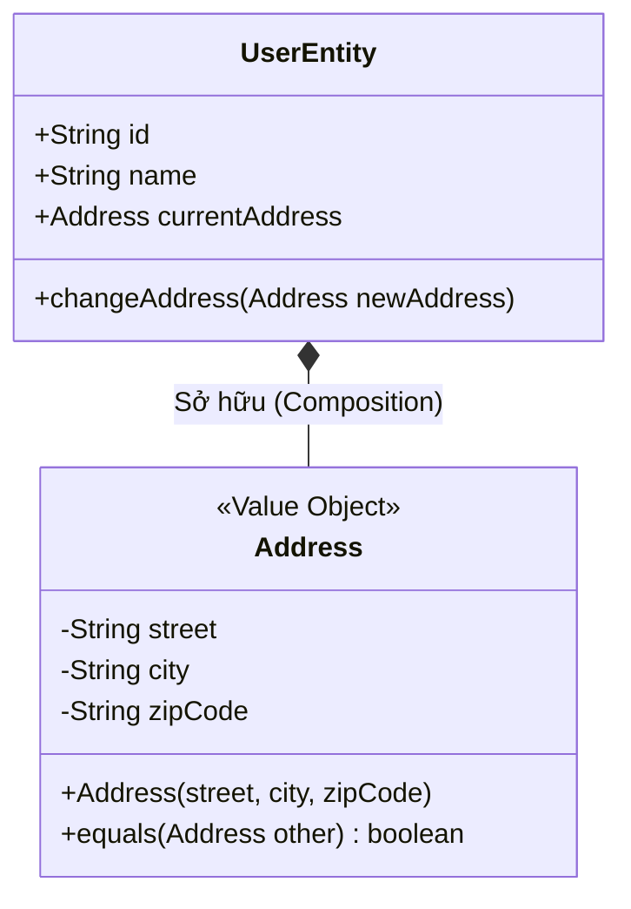

# Value Object (Đối tượng Giá trị)

> **Ý tưởng chính việc sử dụng:** Biểu diễn các khái niệm phụ thuộc hoàn toàn vào giá trị, không cần ID, nếu đổi giá trị tức là biến thành cái khác.
> **Ví dụ:** Địa chỉ (Số nhà, Tên đường). Nếu đổi số nhà 12 thành 14, nó là một địa chỉ hoàn toàn mới, không ai quan tâm ID của số nhà là gì.

Trong Domain-Driven Design (DDD), nếu **Entity** là đối tượng được định danh bằng một ID duy nhất, thì **Value Object (VO)** là đối tượng được định danh hoàn toàn bởi **giá trị của các thuộc tính** bên trong nó.

## 1. Mức Độ Cơ Bản (Basic)

### Value Object là gì?
Hãy tưởng tượng bạn đang cầm một tờ tiền 100.000 VNĐ. Bạn đưa nó cho người bán hàng và nhận lại một tờ 100.000 VNĐ khác (tiền thối lại do đưa dư). Bạn có quan tâm tờ tiền mới nhận có phải chính xác là tờ tiền cũ của bạn không (kiểm tra số seri)? KHÔNG! Bạn chỉ quan tâm **giá trị** của nó vẫn là 100.000 VNĐ. Đó chính là Value Object.

Ví dụ trong phần mềm: Địa chỉ giao hàng (Address), Tọa độ GPS (Coordinates), Số tiền (Money), Màu sắc (Color RGB).

### Vấn đề cốt lõi giải quyết
Chống lại "Căn bệnh" **Primitive Obsession (Ám ảnh kiểu dữ liệu nguyên thủy)**. Lập trình viên rất thích dùng `string`, `int`, `float` rải rác khắp nơi. 
Ví dụ: Thay vì truyền 3 biến `string street, string city, string zipCode` vào 10 hàm khác nhau, ta gộp nó lại thành 1 class `Address`. Code vừa gọn, vừa dễ đọc, lại vừa tự đóng gói được logic kiểm tra lỗi (validate) ngay bên trong class `Address`.

## 2. Mức Độ Trung Bình (Intermediate): Under the Hood

### Đặc điểm bắt buộc của một Value Object chuẩn DDD:
1. **Không có ID (No Identity)**: Chả ai cấp ID cho một "Màu đỏ" hay một "Địa chỉ nhà".
2. **Tính Bất biến (Immutability)**: TUYỆT ĐỐI không có hàm Setter (`setStreet()`). Sau khi VO được tạo ra (thông qua constructor), bạn không bao giờ được quyền sửa giá trị của nó. Nếu muốn thay đổi địa chỉ? Hãy vứt VO cũ đi và tạo một cái VO `new Address(...)` mới hoàn toàn.
3. **So sánh theo Cấu trúc (Structural Equality)**: 2 VO được coi là bằng nhau NẾU VÀ CHỈ NẾU tất cả các thuộc tính bên trong của chúng giống y hệt nhau.

*Use Cases*: Dùng bất cứ khi nào bạn thấy 2-3 biến thường xuyên đi liền với nhau thành một bộ (Ví dụ: `startDate` và `endDate` -> Biến thành `DateRange` VO). Hoặc khi một biến primitive có những luật lệ riêng (VD: Email không chỉ là string, nó phải có định dạng @ -> Biến thành `EmailAddress` VO).

## 3. Mức Độ Nâng Cao (Advanced)

### Quản lý vòng đời cùng Entity
Value Object **không thể sống độc lập**. Nó bắt buộc phải thuộc về một Entity nào đó. Khi Entity bị xóa, VO bị xóa theo. 
Trong CSDL Quan hệ (SQL), dữ liệu của VO thường được lưu chung (dàn phẳng - flatten) vào cùng một bảng với Entity. Ví dụ bảng `Users` sẽ có cột `address_street`, `address_city` thay vì tạo một bảng `Addresses` riêng và dùng khóa ngoại (trừ khi có yêu cầu đặc biệt).

### Side-Effect Free Functions (Hàm không tác động phụ)
Vì VO là bất biến, các hàm bên trong VO không được làm thay đổi trạng thái của nó. Ví dụ class `Money` có hàm `add(otherMoney)`. Hàm này KHÔNG cộng dồn tiền vào class hiện tại, mà nó phải `return new Money(...)` trả về một tờ tiền mới với giá trị đã được cộng. (Giống y hệt cách hàm `.map()` của Javascript trả về mảng mới).

## 4. So Sánh (Compare & Contrast)

| Đặc điểm | Entity | Value Object |
| :--- | :--- | :--- |
| **Cách nhận diện** | Dựa vào ID (Identity). | Dựa vào các Thuộc tính (Attributes). |
| **Sự thay đổi** | Có thể thay đổi trạng thái (Mutable). | **Không thể thay đổi (Immutable)**. |
| **Vòng đời** | Có vòng đời riêng biệt. Dài hạn. | Ngắn hạn, thuộc về Entity. Bị thay thế liên tục. |
| **Bảng Database** | Có bảng SQL riêng. | Thường gộp cột chung vào bảng của Entity. |

## 5. Bài Tập Thực Hành Nhỏ

**Tình huống**: Trong file `demo-value-object.ts`, có một class `User` quản lý thông tin địa chỉ nhà bằng 3 biến string rời rạc. Mã nguồn đang vi phạm Primitive Obsession, và ai cũng có thể sửa đổi địa chỉ của User mà không qua kiểm duyệt.

*Nhiệm vụ*: Hãy tạo một Value Object `Address` để gom nhóm 3 biến này lại. Đảm bảo tính Bất biến (Readonly) và có logic kiểm tra (Validate) không cho phép mã bưu điện (zipcode) rỗng. Sau đó dùng VO này thay thế cho 3 biến cũ trong `User`.

Code đề bài và đáp án nằm tại: [answers-value-object](/Users/ductri0981/Documents/Studying-Software/value_object/answers-value-object.ts)

## 6. Phụ Lục (Sơ Đồ Kiến Trúc)

## 7. Giải Thích Thuật Ngữ (Glossary)
- **Value Object (VO)**: Đối tượng giá trị. Đại diện cho một đặc tính mô tả, không có tính danh định.
- **Immutability (Tính bất biến)**: Một khi đã khởi tạo thì trạng thái bên trong vĩnh viễn không thay đổi. Muốn sửa thì phải tạo mới.
- **Primitive Obsession (Ám ảnh kiểu nguyên thủy)**: Dùng các kiểu dữ liệu cơ bản (string, int, bool) để đại diện cho một khái niệm phức tạp (như Tiền tệ, Email, Địa chỉ).
- **Structural Equality (Đồng nhất cấu trúc)**: 2 đối tượng bằng nhau nếu mọi giá trị bên trong chúng khớp 100%. (Khác với Identity Equality chỉ so ID).
- **Side-Effect Free (Không hiệu ứng phụ)**: Các hàm tính toán chỉ trả về kết quả mới chứ không làm thay đổi trạng thái hiện hành.
