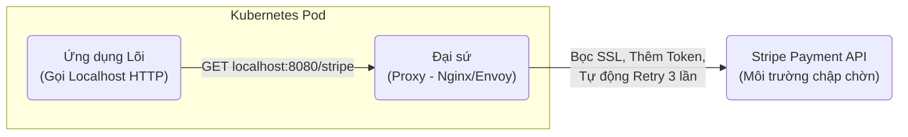

# Ambassador Pattern (Mẫu thiết kế Đại sứ)

> **Ý tưởng chính việc sử dụng:** Một biến thể của Sidecar chuyên làm nhiệm vụ Ngoại Giao (gọi mạng ra bên ngoài), xử lý Retry, Timeout, Mã hóa thay cho App chính.
> **Ví dụ:** App cũ không biết cài HTTPS. Nó gọi HTTP localhost tới Ambassador. Ambassador nhận lệnh, bọc HTTPS và tự động Retry 3 lần nếu rớt mạng khi gọi API Stripe.

Ambassador Pattern là một phiên bản đặc biệt và chuyên biệt hơn của **Sidecar Pattern**. Nếu Sidecar làm đủ mọi thứ (Log, Metric, Proxy), thì **Ambassador chỉ tập trung làm duy nhất một việc: Đại diện giao tiếp mạng ra bên ngoài (Outbound Network)**.

## 1. Mức Độ Cơ Bản (Basic)

### Ambassador là gì?
Tưởng tượng một quốc gia (Ứng dụng của bạn) muốn đi ra ngoài nói chuyện với quốc gia khác (Dịch vụ bên thứ 3). Thay vì để người dân tự đi (Ứng dụng tự viết code gọi HTTP lộn xộn), quốc gia đó cử ra một **Đại sứ (Ambassador)**. Người dân muốn gì cứ gửi thư cho Đại sứ, Đại sứ sẽ mang ra nước ngoài đàm phán.

Trong phần mềm, Ambassador là một tiến trình (Container/Proxy) nằm sát bên cạnh App chính (Localhost).
Khi App chính muốn gọi API của Stripe (Cổng thanh toán), nó KHÔNG gọi thẳng lên `api.stripe.com`. Nó gọi vào `localhost:8080` (Cổng của Ambassador). 
Ambassador sẽ đón lấy request đó, đính kèm Token bảo mật vào, mã hóa, gọi lên Stripe. Nhận kết quả về, tháo mã hóa, trả lại cho App chính.

### Vấn đề cốt lõi giải quyết
- Đóng gói (Encapsulate) toàn bộ rào cản về giao tiếp mạng (Bảo mật, Kết nối chập chờn, Lỗi Timeout).
- Giúp hệ thống cũ (Legacy) có khả năng bảo mật cao mà không cần đập đi viết lại.

## 2. Mức Độ Trung Bình (Intermediate): Under the Hood

### Sức mạnh của Ambassador
1. **Bảo mật (mTLS)**: Ứng dụng cũ kỹ viết bằng PHP không hỗ trợ HTTPS hiện đại? Không sao, PHP gọi localhost (http thường) tới Ambassador. Ambassador sẽ mở đường hầm mã hóa mTLS gửi data đi.
2. **Cơ chế Retry thông minh**: Mạng rớt 1 giây. Nếu App tự code, nó sẽ văng lỗi đỏ lòm. Nhưng Ambassador đứng giữa sẽ ngầm tự động gọi lại (Retry) 3 lần. Nếu thành công, trả về App. App không hề biết ở giữa vừa bị rớt mạng.
3. **Circuit Breaker (Cầu dao điện)**: Nếu Server bên kia sập hẳn, Ambassador sẽ "cúp cầu dao". Bất kỳ request nào tiếp theo từ App gọi ra, Ambassador lập tức từ chối ngay lập tức (Fail-fast) mà không thèm gọi mạng nữa, giúp tiết kiệm tài nguyên hệ thống.

*Use Cases*: Kết nối hệ thống Legacy ra môi trường Cloud hiện đại, Kết nối với các bên thứ 3 (Thanh toán, Gửi SMS) thường xuyên chập chờn.

## 3. Mức Độ Nâng Cao (Advanced)

### API Gateway vs Ambassador
Rất nhiều người nhầm lẫn 2 khái niệm này.
- **API Gateway (Inbound)**: Cổng ĐI VÀO. Nằm tuốt ở ngoài cùng mép mạng lưới công ty. Khách hàng, Mobile App đi qua Gateway để vào nhà bạn. Nó xử lý Định tuyến (Routing) cho toàn hệ thống.
- **Ambassador (Outbound)**: Cổng ĐI RA. Nằm sát rịt ngay bên trong nhà, dính chặt với 1 Service duy nhất. Service muốn gọi đi đâu thì đi qua cửa Đại sứ.

## 4. So Sánh (Compare & Contrast)

| Đặc điểm | Sidecar Pattern | Ambassador Pattern |
| :--- | :--- | :--- |
| **Phạm vi** | Đa dụng (Làm log, metric, sync data). | Chuyên biệt 100% cho Giao tiếp mạng (Network Proxy). |
| **Chức năng chính** | Hỗ trợ quản lý hạ tầng cho App. | Ủy quyền kết nối ra bên ngoài (Retry, Security, Routing). |
| **Mối quan hệ**| Ambassador chính là một trường hợp sử dụng (Use-case) cụ thể của Sidecar. |

## 5. Bài Tập Thực Hành Nhỏ

**Tình huống**: Trong file `demo-ambassador.ts`, `LegacyApp` đang tự mình phải code vòng lặp `for` để Retry 3 lần khi gọi API nước ngoài bị rớt mạng. Code rất xấu và nếu có 10 chỗ gọi API thì phải copy/paste vòng lặp này 10 lần.

*Nhiệm vụ*: Áp dụng Ambassador Pattern.
1. Tạo một class `NetworkAmbassador` bọc lấy logic Retry và gọi API.
2. `LegacyApp` chỉ việc gọi qua Ambassador một cách đơn giản, sạch sẽ, phó mặc mọi lỗi lầm hạ tầng cho Đại sứ lo.

Code đề bài và đáp án nằm tại: [answers-ambassador](/Users/ductri0981/Documents/Studying-Software/ambassador_pattern/answers-ambassador.ts)

## 6. Phụ Lục (Sơ Đồ Kiến Trúc)

## 7. Giải Thích Thuật Ngữ (Glossary)
- **Ambassador**: Tạm dịch là Đại sứ. Một dịch vụ phụ chịu trách nhiệm thay mặt dịch vụ chính để "ngoại giao" (gọi mạng) với bên ngoài.
- **Outbound Network**: Mạng đi ra. Yêu cầu bắt nguồn từ bên trong Server của bạn gọi ra ngoài Internet.
- **Circuit Breaker**: Cầu dao điện. Khi thấy gọi API bên thứ 3 thất bại liên tục, nó sẽ "cúp cầu dao" để ngắt kết nối một thời gian, bảo vệ hệ thống khỏi bị quá tải chờ đợi (Timeout).
- **Retry Mechanism**: Cơ chế tự động thử lại khi gặp lỗi (Thường cấu hình thử 3 lần, mỗi lần cách nhau 1-2 giây).
