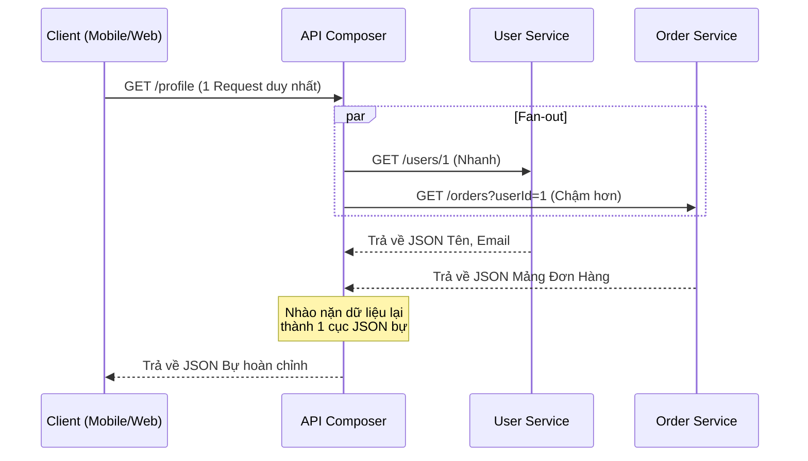

# API Composition (Tổng hợp API)

> **Ý tưởng chính việc sử dụng:** Xây một service trung gian để gom dữ liệu từ nhiều API siêu nhỏ lại, trả về duy nhất một API to cho Frontend.
> **Ví dụ:** API Composer lấy Tên từ UserService, lấy Điểm từ RewardService, gộp lại thành 1 cục JSON bự rồi trả cho Mobile App trong 1 lần gọi.

Trong thế giới Nguyên khối (Monolith), lấy dữ liệu rất dễ: Bạn chỉ cần viết một câu lệnh SQL `JOIN` 5 cái bảng lại với nhau.
Nhưng trong Microservices, dữ liệu bị xé lẻ ra 5 Database của 5 Service khác nhau. Làm sao để hiển thị một trang Web cần đủ 5 loại dữ liệu đó? Giải pháp chính là mẫu thiết kế **API Composition**.

## 1. Mức Độ Cơ Bản (Basic)

### API Composition là gì?
Thay vì bắt Frontend (Trình duyệt/App Mobile) phải tự mình đi gọi 5 cái API riêng lẻ tới 5 Service để gom nhặt dữ liệu (Client-side Composition - Gây hao pin, tốn băng thông, code FE cực kỳ rối rắm).

Ta sẽ xây dựng một con Server ở giữa, gọi là **API Composer (Người tổng hợp)**.
Frontend chỉ cần gọi ĐÚNG 1 LẦN lên API Composer. Con Composer này sẽ chui vào mạng nội bộ (Lan/VPC), chạy đi gõ cửa 5 Service kia lấy data về, "xào nấu" trộn lại thành 1 cục JSON duy nhất bự chảng, rồi trả về cho Frontend.

### Vấn đề cốt lõi giải quyết
- Giảm số lượng Request mạng (Network Calls) từ ngoài Internet vào Server (Thay vì 5 request qua Internet chậm chạp, chỉ còn 1 request. Còn lại là 5 request nội bộ LAN siêu tốc).
- Che giấu đi sự phức tạp của hệ thống Microservice. Frontend không cần biết đằng sau có bao nhiêu con service.

## 2. Mức Độ Trung Bình (Intermediate): Under the Hood

### Kỹ thuật Fan-out (Gọi song song)
Lỗi lớn nhất của người mới học là viết code gọi API... tuần tự (Sequential).
`Await Service 1` (mất 1s) -> `Await Service 2` (mất 2s) -> `Await Service 3` (mất 1s).
Tổng thời gian Frontend phải chờ là: 1 + 2 + 1 = 4 giây! Trải nghiệm người dùng cực tệ.

**Giải pháp**: Phải dùng `Promise.all()` (Fan-out) để gọi 3 Service CÙNG MỘT LÚC. 
Tổng thời gian chờ chỉ bằng thời gian của thằng chạy lâu nhất (Max): là 2 giây. Nhanh gấp đôi!

### Graceful Degradation (Suy giảm duyên dáng / Chấp nhận lỗi một phần)
Điều gì xảy ra nếu Service 3 (Lấy Điểm thưởng) bị chết mạng?
- API Composer không được quyền Báo lỗi 500 (Trắng trang) cho người dùng! 
- Người dùng vào trang "Thông tin cá nhân", họ vẫn phải xem được Tên và Lịch sử mua hàng. Chỗ Điểm thưởng, Composer có thể tự gán giá trị mặc định là `0` hoặc `"Đang bảo trì"`. Đây gọi là nghệ thuật "Suy giảm duyên dáng".

## 3. Mức Độ Nâng Cao (Advanced)

### Nhược điểm: In-memory JOIN (JOIN dữ liệu trên RAM)
Trong Monolith, SQL Database dùng Index để `JOIN` hàng triệu dòng dữ liệu siêu nhanh. 
Nhưng với API Composition, Composer lấy về 2 cục JSON và phải dùng vòng lặp `for` để móc (map) chúng lại với nhau trên bộ nhớ RAM. Nếu dữ liệu quá lớn (Phân trang, Lọc phức tạp), Composer sẽ bị phình RAM (Out of Memory) và chết.
-> **Cách khắc phục**: Nếu việc truy vấn (Query) quá phức tạp và cần JOIN dữ liệu khổng lồ, bắt buộc phải đổi sang dùng mẫu **CQRS** (Đã học ở bài trước) thay vì dùng API Composition.

## 4. So Sánh (Compare & Contrast)

| Đặc điểm | Client-side Aggregation (FE tự gom) | API Composition (BE gom) | CQRS (Read DB) |
| :--- | :--- | :--- | :--- |
| **Số lượng Request từ Client** | Rất nhiều. Tốn pin, tốn 3G/4G. | Ít (Thường là 1). | Ít (Thường là 1). |
| **Logic Frontend** | Code cực kỳ phức tạp để hứng lỗi. | FE nhẹ nhàng, nhàn hạ. | FE nhẹ nhàng. |
| **Khả năng JOIN dữ liệu lớn** | Bất khả thi. | Dễ bị tràn RAM. Chậm. | Tuyệt vời (Tối ưu từ DB). |
| **Tốc độ Triển khai** | Nhanh, không cần code thêm BE. | Trung bình. | Rất lâu (Phải dựng Message Broker). |

## 5. Bài Tập Thực Hành Nhỏ

**Tình huống**: Trong file `demo-api-composition.ts`, một lập trình viên tay ngang đã viết con API Composer dùng `await` gọi từng Service một cách tuần tự. Chức năng chạy đúng, nhưng thời gian phản hồi API quá lâu (Mất hơn 4 giây).

*Nhiệm vụ*: Hãy Refactor lại con API Composer này.
1. Sử dụng kỹ thuật **Fan-out** (Gọi song song) để giảm thời gian phản hồi.
2. Áp dụng **Graceful Degradation** (Try/Catch độc lập) để nếu hệ thống "Điểm thưởng" bị lỗi, API vẫn trả về thông tin cơ bản cho User (thay vì văng lỗi nát bét toàn trang).

Code đề bài và đáp án nằm tại: [answers-api-composition](/Users/ductri0981/Documents/Studying-Software/api_composition/answers-api-composition.ts)

## 6. Phụ Lục (Sơ Đồ Kiến Trúc)

## 7. Giải Thích Thuật Ngữ (Glossary)
- **API Composition (API Gateway Pattern)**: Kỹ thuật xây một điểm chạm tổng hợp gọi dữ liệu từ nhiều nơi gộp lại thành 1.
- **Fan-out**: Kỹ thuật tỏa ra, phát các luồng request cùng một lúc (song song) thay vì nối đuôi nhau.
- **Graceful Degradation (Chấp nhận lỗi)**: Thiết kế phần mềm sao cho khi một phần bị lỗi, toàn bộ hệ thống không sập mà chỉ giảm bớt một vài tính năng (Ví dụ: Youtube mất phần Gợi ý video, nhưng vẫn xem được video chính).
- **In-memory JOIN**: Kỹ thuật dùng mã nguồn (for, map, filter) để gom dữ liệu của 2 mảng trên RAM, thay vì dùng SQL JOIN.
