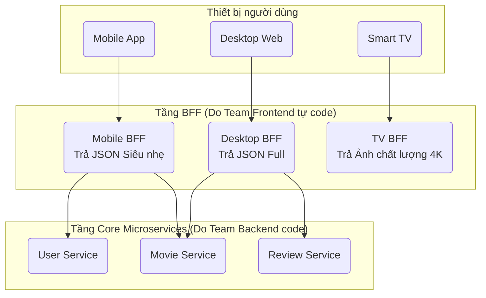

# Backend for Frontend (BFF - Backend dành riêng cho Frontend)

> **Ý tưởng chính việc sử dụng:** Xây dựng các Backend riêng biệt phục vụ ĐỘC QUYỀN cho từng loại thiết bị Frontend (Web, Mobile, TV) để cắt tỉa dữ liệu thừa.
> **Ví dụ:** Mobile BFF chỉ trả về JSON 3 trường (Tên, Ảnh nhỏ, Giá). Web BFF trả về JSON 20 trường chi tiết (Lịch sử, Đánh giá, Ảnh 4K).

Khi công ty của bạn phát triển đa nền tảng (Web Desktop, Web Mobile, iOS, Android, SmartWatch), bạn sẽ sớm nhận ra một sự thật cay đắng: **Không tồn tại một cái API nào làm hài lòng tất cả mọi thiết bị**. 
Mẫu thiết kế BFF sinh ra để giải quyết bài toán: "Ai cần mắm thì nêm mắm, ai cần muối thì nêm muối".

## 1. Mức Độ Cơ Bản (Basic)

### BFF là gì?
Thay vì xây dựng **Một con API chung chung duy nhất** (General-Purpose API) để phục vụ cho cả Web lẫn Mobile, chúng ta tạo ra nhiều con Backend "mini" đứng chắn phía trước hệ thống. Mỗi con Backend mini này phục vụ ĐỘC QUYỀN cho một loại giao diện (Frontend) cụ thể.

- **Desktop BFF**: Gọi xuống Microservices lấy JSON đầy đủ chi tiết nhất. Trả về cho Web Desktop (Màn hình to, cáp quang mạnh).
- **Mobile BFF**: Gọi xuống Microservices, nhưng **CẮT BỎ** 80% trường dữ liệu thừa. Chỉ trả về một cái JSON siêu mỏng, dung lượng vài Kilobytes để App Mobile load nhanh trên mạng 3G yếu ớt. Trả về hình ảnh kích thước nhỏ.

### Ai là người code BFF?
Điều đặc biệt nhất của BFF không nằm ở công nghệ, mà nằm ở **Cách chia đội ngũ**.
Trong kiến trúc cũ, đội Frontend phải van xin đội Backend: "Anh ơi, cái API User này data nặng quá, anh lọc bớt trả về 3 fields cho em thôi được không?". Đội BE trả lời: "Anh bận làm tính năng khác rồi, ráng đợi tháng sau".
Với BFF, **chính đội Frontend sẽ tự code cái BFF đó** (thường dùng Node.js/GraphQL). Frontend toàn quyền quyết định API của mình trả về cái gì, hình thù thế nào, mà không cần làm phiền đội Backend lõi.

## 2. Mức Độ Trung Bình (Intermediate): Under the Hood

### Data Shaping (Nhào nặn dữ liệu)
Nhiệm vụ chính của BFF là Data Shaping. Nó đóng vai trò như bộ lọc.
Microservices có thể trả ra cái `Product` chứa 100 fields (Kích thước đóng gói, lịch sử bảo hành, tồn kho). 
- Mobile BFF lấy 100 fields đó, vứt đi 95 fields, gom `firstName` và `lastName` thành `fullName`, đổi format Tiền từ `1000` thành `1.000đ` (Làm thay việc tính toán cho điện thoại, giúp điện thoại đỡ hao pin).

### Vấn đề Over-fetching và Under-fetching
- **Over-fetching (Lấy quá lố)**: API trả về 100 fields, nhưng màn hình Mobile chỉ hiện 3 fields. Tốn băng thông 4G của user.
- **Under-fetching (Lấy thiếu)**: Màn hình cần hiện Tên người dùng và Tên công ty. Nhưng API `/users` chỉ trả về `companyId`. Màn hình lại phải gọi thêm API `/companies/{id}`. Trải nghiệm load web giật cục.

BFF giải quyết cả 2: Nó làm API Composition (Gom data) để chống Under-fetching, và làm Data Shaping (Cắt bớt data) để chống Over-fetching.

## 3. Mức Độ Nâng Cao (Advanced)

### GraphQL - Kẻ hủy diệt BFF?
Nhiều người cho rằng thay vì tạo 5 con BFF cho 5 thiết bị, ta chỉ cần tạo **1 con Server GraphQL**. GraphQL cho phép Frontend gửi câu truy vấn xin ĐÚNG những field nó cần (VD: `query { user { name, age } }`).
Điều này đúng. GraphQL chính là BFF ở dạng động (Dynamic BFF). Tuy nhiên, quản lý bảo mật và hiệu năng (N+1 query problem) của GraphQL khó hơn rất nhiều so với viết REST BFF tĩnh cho từng thiết bị.

### BFF vs API Gateway
- **API Gateway**: Cổng bảo vệ, kiểm tra Token (Auth), chặn Spam (Rate Limit), Định tuyến (Routing). Chỉ có 1 cái duy nhất cho cả công ty.
- **BFF**: Nằm ngay đằng sau API Gateway (hoặc gộp chung nếu hệ thống bé). Đảm nhận việc nấu nướng JSON. Có nhiều cái BFF.

## 4. So Sánh (Compare & Contrast)

| Đặc điểm | General-Purpose API (OSFA - Một cho tất cả) | Backend for Frontend (BFF) |
| :--- | :--- | :--- |
| **Dung lượng phản hồi** | Rất nặng. Dư thừa dữ liệu ở Mobile. | Nhẹ, vừa khít (Tailor-made) cho từng màn hình. |
| **Bảo trì, Nâng cấp** | Rất khó sửa. Sửa API sợ làm bể App cũ. | Dễ. Đổi giao diện Mobile thì sửa Mobile BFF, không sợ ảnh hưởng Desktop. |
| **Tốc độ xử lý của Client** | Frontend phải viết nhiều hàm format dữ liệu (hao pin). | BFF làm sẵn hết, Frontend lấy về là ốp thẳng lên màn hình. |

## 5. Bài Tập Thực Hành Nhỏ

**Tình huống**: Trong file `demo-bff.ts`, một Microservice cốt lõi trả về cục thông tin `Movie` với hàng tá dữ liệu (Đạo diễn, doanh thu, định dạng phim, v.v.). API đang trả nguyên cục này cho MỌI thiết bị. 

*Nhiệm vụ*: Áp dụng BFF. 
1. Viết một `DesktopBFF` giữ lại hầu hết thông tin.
2. Viết một `MobileBFF` thực hiện Data Shaping: vứt bỏ các trường không cần thiết, gom `revenue` thành chuỗi hiển thị rút gọn (VD: "$2.5B") để giảm tải tính toán cho CPU điện thoại.

Code đề bài và đáp án nằm tại: [answers-bff](/Users/ductri0981/Documents/Studying-Software/backend_for_frontend/answers-bff.ts)

## 6. Phụ Lục (Sơ Đồ Kiến Trúc)

## 7. Giải Thích Thuật Ngữ (Glossary)
- **BFF (Backend for Frontend)**: Hệ thống máy chủ trung gian được thiết kế đặc chế, may đo riêng cho nhu cầu của một loại giao diện duy nhất.
- **Data Shaping**: Nhào nặn dữ liệu (cắt tỉa, đổi tên biến, gom biến) trước khi gửi qua Internet.
- **Over-fetching**: Rút dữ liệu ra quá nhiều so với mức cần thiết. Gây nghẽn mạng.
- **Under-fetching**: Rút dữ liệu ra quá ít, dẫn đến phải gửi nhiều request phụ liên tục. Gây chậm chạp (Độ trễ cao).
- **GraphQL**: Một ngôn ngữ truy vấn API mạnh mẽ do Facebook tạo ra, thường được dùng như một giải pháp thay thế/nâng cấp cho BFF REST truyền thống.
