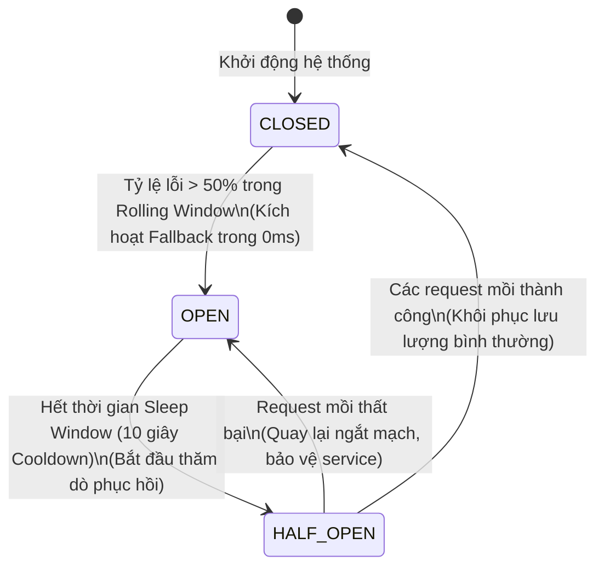

# CIRCUIT BREAKER PATTERN ARCHITECTURE & RESILIENCE ENGINEERING DEEP DIVE

> **Tài liệu lý thuyết chuyên sâu và hướng dẫn kiến trúc toàn diện về Mẫu Thiết Kế Cầu Dao Điện (Circuit Breaker Pattern)**  
> Dành cho Software Engineer, Backend Developer và Microservices Architect từ cấp độ Intern đến Middle-level và Tech Lead.

---

## 📑 MỤC LỤC
1. [Mức Độ Cơ Bản (Basic Fundamentals)](#1-mức-độ-cơ-bản-basic-fundamentals)
2. [Mức Độ Trung Bình (Intermediate - Architecture & Use Cases)](#2-mức-độ-trung-bình-intermediate---architecture--use-cases)
3. [Mức Độ Chuyên Sâu: BẢN CHẤT VẬN HÀNH (Under The Hood & Core Mechanics)](#3-mức-độ-chuyên-sâu-bản-chất-vận-hành-under-the-hood--core-mechanics)
4. [Mức Độ Nâng Cao: Vận Hành Thực Chiến (Production Engineering & Best Practices)](#4-mức-độ-nâng-cao-vận-hành-thực-chiến-production-engineering--best-practices)
5. [Góc Nhìn Thực Chiến Cho Middle-Level Trở Xuống (Must-Know vs Nice-to-Know Roadmap)](#5-góc-nhìn-thực-chiến-cho-middle-level-trở-xuống-must-know-vs-nice-to-know-roadmap)
6. [So Sánh Bản Chất (First-Principles Comparison)](#6-so-sánh-bản-chất-first-principles-comparison)
7. [Sơ Đồ Trực Quan (Mermaid Diagrams)](#7-sơ-đồ-trực-quan-mermaid-diagrams)
8. [Bảng Tra Thuật Ngữ Chi Tiết (Glossary)](#8-bảng-tra-thuật-ngữ-chi-tiết-glossary)
9. [Hướng Dẫn Chạy & Kiểm Thử Hệ Thống (Step-by-Step Run Guide)](#9-hướng-dẫn-chạy--kiểm-thử-hệ-thống-step-by-step-run-guide)

---

## 1. Mức Độ Cơ Bản (Basic Fundamentals)

### 1.1. Định nghĩa & Ẩn dụ đời thực (Real-world Analogy)
**Circuit Breaker Pattern** (Mẫu thiết kế Cầu Dao Điện) là một mẫu thiết kế đảm bảo độ bền bỉ (Resilience Pattern) trong kiến trúc phân tán Microservices, giúp ngăn chặn một dịch vụ tiếp tục gửi yêu cầu tới một dịch vụ khác đang bị quá tải, bị treo hoặc bị sập, từ đó dập tắt nguy cơ **Sập Dây Chuyền (Cascading Failures)** và bảo vệ tài nguyên hệ thống.

```
+-----------------------------------------------------------------------------------+
|                        ẨN DỤ: ÁT-TÔ-MÁT (APTOMAT) ĐIỆN GIA ĐÌNH                   |
|                                                                                   |
|  [DÒNG ĐIỆN VÀO NHÀ] ----> [CẦU DAO TỰ ĐỘNG (APTOMAT)] ----> [BẾP TỪ / TỦ LẠNH]   |
|                                                                                   |
|  1. MẠCH ĐÓNG (CLOSED - BÌNH THƯỜNG):                                             |
|     - Mọi thiết bị chạy êm ái, dòng điện lưu thông thông suốt.                    |
|                                                                                   |
|  2. CHẬP ĐIỆN BẤT NGỜ (FAILURE SPIKE):                                            |
|     - Bếp từ bị chập mạch, dòng điện tăng vọt (Dịch vụ B bị treo/lỗi liên tục).   |
|     - APTOMAT LẬP TỨC "CẠCH" BẬT LÊN NGẮT ĐIỆN (MẠCH HỞ - OPEN)!                  |
|     - Toàn bộ dòng điện vào bếp từ bị cắt ngay trong 0.01 giây, ngăn cháy nhà     |
|       (Bảo vệ Service A khỏi bị nghẽn luồng và sập nguồn).                        |
|                                                                                   |
|  3. SAU KHI SỬA CHỮA (HALF-OPEN - MỞ HÉ THỬ NGHIỆM):                              |
|     - Sau 30 phút, thợ bật thử át-tô-mát lên hé (Cho vài dòng điện nhỏ chạy qua). |
|     - Nếu bếp từ chạy êm => Đóng hẳn cầu dao (Quay lại CLOSED).                   |
|     - Nếu vẫn nổ tia lửa => Lập tức ngắt lại (Quay lại OPEN)!                     |
+-----------------------------------------------------------------------------------+
```

- **Nếu không có Circuit Breaker**: Service A (Order Service) gọi Service B (Payment Gateway). Nếu cổng Payment bị nghẽn và phản hồi mất 30 giây:
  - 100 khách hàng đặt hàng cùng lúc = 100 kết nối TCP của Service A bị treo cứng trong 30 giây chờ đợi.
  - Hàng đợi yêu cầu của Service A bị tràn bộ nhớ RAM (Thread Starvation).
  - Service A lăn ra chết $\rightarrow$ Service Frontend chết theo $\rightarrow$ **Toàn bộ hệ thống sập hoàn toàn vì một dịch vụ bên thứ ba bị chậm!**
- **Khi có Circuit Breaker**: Sau khi thấy Payment Gateway lỗi 5 lần liên tiếp, Circuit Breaker lập tức **"Nhảy Cầu Dao" (Trạng thái OPEN)**. 10.000 khách hàng tiếp theo nhấn thanh toán sẽ nhận được phản hồi ngay tức khắc trong **0ms** (Fallback: *"Cổng thanh toán đang bảo trì, vui lòng chọn COD"*). Service A rảnh rỗi tuyệt đối, hệ thống đứng vững 100%!

---

### 1.2. 3 Trạng Thái Cốt Lõi Của Circuit Breaker

```
         +---------------------------------------------------+
         |                                                   |
         v                                                   |
   [ CLOSED ] -------(Tỷ lệ lỗi vượt ngưỡng)-------> [ OPEN ]
   (Bình thường)                                    (Ngắt mạch)
         ^                                               |
         |                                               |
  (Thử nghiệm         (Sau thời gian chờ Cooldown)        |
   thành công)                   |                       |
         |                       v                       |
         +---------------- [ HALF-OPEN ] <---------------+
                           (Mở hé thăm dò)
                                 |
                                 v
                     (Nếu vẫn còn lỗi => Ngắt lại)
```

1. **`CLOSED` (Mạch Đóng - Trạng thái bình thường)**:
   - Các request được chuyển tiếp tới downstream service bình thường.
   - Bộ đếm thống kê tỷ lệ lỗi (Failure Rate) trong một khung thời gian trượt (Rolling Window).
   - Nếu tỷ lệ lỗi vượt ngưỡng quy định (ví dụ $> 50\%$ hoặc $5$ lỗi liên tiếp) $\rightarrow$ Chuyển sang **`OPEN`**.
2. **`OPEN` (Mạch Hở - Ngắt kết nối tuyệt đối)**:
   - Cầu dao đã ngắt. **Mọi request gửi tới downstream service đều bị chặn đứng ngay lập tức tại chỗ**.
   - Không có bất kỳ gói tin mạng nào được gửi đi (Tiết kiệm 100% băng thông và tài nguyên CPU/RAM).
   - Ngay lập tức kích hoạt hàm dự phòng (**Fallback Method**) hoặc trả lỗi `503 Service Unavailable` trong vài micro-giây.
   - Bắt đầu bộ đếm thời gian nguội (**Sleep Window / Cooldown Period**, ví dụ: 10 giây).
3. **`HALF-OPEN` (Mở Hé - Thử nghiệm phục hồi)**:
   - Sau khi hết thời gian Sleep Window, hệ thống mở hé cầu dao.
   - Chỉ cho phép một số lượng nhỏ request mồi (**Trial Requests / Probes**, ví dụ: 3 request) đi qua để kiểm tra downstream service đã hồi phục chưa.
   - Nếu cả 3 request mồi đều **thành công** $\rightarrow$ Hệ thống tin tưởng downstream service đã khỏe lại $\rightarrow$ Chuyển về **`CLOSED`**.
   - Nếu có bất kỳ request mồi nào **thất bại** $\rightarrow$ Downstream service vẫn đang bệnh $\rightarrow$ Chuyển ngược lại **`OPEN`** và chờ thêm 1 chu kỳ cooldown mới.

---

## 2. Mức Độ Trung Bình (Intermediate - Architecture & Use Cases)

### 2.1. Các thông số cấu hình cốt lõi (Tuning Parameters)

Khi cấu hình Circuit Breaker trong thực tế (sử dụng thư viện như `opossum` trong Node.js, `Resilience4j` trong Java, hoặc `Polly` trong C#/.NET), bạn cần nắm rõ 5 thông số vàng:

1. **`timeout` (Thời hạn quá giờ)**: Thời gian tối đa cho phép downstream service xử lý trước khi bị tính là 1 lỗi (ví dụ: `3000ms`).
2. **`errorThresholdPercentage` (Ngưỡng phần trăm lỗi)**: Tỷ lệ lỗi tối thiểu trong cửa sổ trượt để kích hoạt ngắt mạch (ví dụ: `50%`).
3. **`rollingCountTimeout` (Kích thước cửa sổ trượt)**: Khoảng thời gian thống kê số liệu (ví dụ: `10000ms` - chỉ tính các request trong 10 giây gần nhất).
4. **`resetTimeout` (Thời gian chờ hạ nhiệt - Cooldown Window)**: Khoảng thời gian mạch ở trạng thái `OPEN` trước khi chuyển sang `HALF-OPEN` để thử lại (ví dụ: `10000ms`).
5. **`volumeThreshold` (Số lượng mẫu tối thiểu)**: Số request tối thiểu cần phải có trong cửa sổ trượt trước khi bắt đầu tính tỷ lệ lỗi (ví dụ: `10 requests`). Giúp tránh trường hợp mới có 1 request bị lỗi đã vội vã ngắt mạch ($1/1 = 100\%$).

---

### 2.2. Khi nào NÊN dùng và KHÔNG NÊN dùng Circuit Breaker

#### ✅ Khi nào NÊN dùng (Best Use Cases)
1. **Giao tiếp mạng giữa các Microservices nội bộ**: Service Order gọi Service Inventory, Shipping, Notification.
2. **Gọi dịch vụ bên thứ ba (Third-Party APIs)**: Cổng thanh toán (Stripe, VNPay, PayPal), dịch vụ gửi SMS (Twilio), dịch vụ định danh KYC.
3. **Truy vấn Cơ sở dữ liệu và Cache phân tán**: Bảo vệ Redis, MongoDB, Elasticsearch khi cluster đang gặp sự cố đứt kết nối.

#### ❌ Khi nào KHÔNG NÊN dùng (What to Avoid)
1. **Truy vấn tài nguyên nội bộ cục bộ (Local In-Memory Calls)**: Đọc một biến RAM, truy vấn hàm trong cùng một tiến trình không bao giờ cần Circuit Breaker.
2. **Các lỗi nghiệp vụ từ phía Client (Client 4xx Errors)**: Lỗi người dùng nhập sai mật khẩu (401), thiếu tham số (400), hay không tìm thấy sản phẩm (404) **tuyệt đối không được tính vào tỷ lệ lỗi của Circuit Breaker**. Nếu tính, hacker có thể cố tình gửi 100 request 404 để làm ngắt cầu dao của toàn hệ thống!

---

## 3. Mức Độ Chuyên Sâu: BẢN CHẤT VẬN HÀNH (Under The Hood & Core Mechanics)

### 3.1. Cơ Chế Cửa Sổ Trượt (Rolling Window Bucket Statistics)
Làm thế nào Circuit Breaker biết được tỷ lệ lỗi mà không làm chậm tốc độ xử lý của từng request?

Bí mật nằm ở cấu trúc dữ liệu **Thùng đếm thời gian xoay vòng (Time-Bucket Circular Ring Buffer)**:

```
CỬA SỔ TRƯỢT 10 GIÂY ĐƯỢC CHIA THÀNH 10 BUCKET (MỖI BUCKET = 1 GIÂY):

 [ Giây 1 ] [ Giây 2 ] [ Giây 3 ] ... [ Giây 8 ] [ Giây 9 ] [ Giây 10 (Hiện tại) ]
   Succ: 20   Succ: 25   Succ: 30       Succ: 10   Succ: 0     Succ: 0
   Fail: 0    Fail: 1    Fail: 0        Fail: 15   Fail: 20    Fail: 25
 
 => TỔNG 10 GIÂY: Success = 85 | Failure = 61
 => TỶ LỆ LỖI = 61 / (85 + 61) = 41.7%
 
Khi bước sang Giây 11:
 - Bucket của Giây 1 bị xóa sạch (Dọn rác $O(1)$).
 - Dịch chuyển con trỏ sang Giây 11 để ghi nhận dữ liệu mới!
```

- Nhờ việc chia nhỏ thời gian thành các Bucket, việc thêm số liệu đếm thành công/thất bại diễn ra trong thời gian $O(1)$.
- Hệ thống luôn phản ánh chính xác sức khỏe của dịch vụ trong thời gian thực mà không bao giờ bị trôi số liệu cũ của ngày hôm qua.

---

### 3.2. Cơ Chế Fallback (Graceful Degradation - Thoái Biến Duyên Dáng)
Khi cầu dao ở trạng thái `OPEN`, ứng dụng không nên chỉ ném ra lỗi thô kệch. Một kiến trúc chuẩn Production luôn cung cấp **Chiến Lược Dự Phòng (Fallback Strategy)**:

1. **Fallback Trả Về Cache Cũ (Stale Cache Fallback)**:
   - Dịch vụ Recommendation (Gợi ý sản phẩm) bị sập $\rightarrow$ Fallback trả về danh sách sản phẩm bán chạy lưu sẵn trong local cache. Người dùng vẫn thấy giao diện đẹp đẽ.
2. **Fallback Giá Trị Mặc Định (Default Static Value)**:
   - Dịch vụ tính thuế VAT bị treo $\rightarrow$ Fallback áp dụng mức thuế tạm thời $8\%$ hoặc $10\%$ để người dùng hoàn tất giỏ hàng.
3. **Fallback Hàng Đợi Bất Đồng Bộ (Queue Fallback)**:
   - Dịch vụ gửi Email hóa đơn bị chết $\rightarrow$ Fallback đẩy yêu cầu vào hàng đợi RabbitMQ/Dead-Letter-Queue để gửi bù sau khi dịch vụ hồi phục.

---

## 4. Mức Độ Nâng Cao: Vận Hành Thực Chiến (Production Engineering & Best Practices)

### 4.1. Code Mẫu Circuit Breaker Chuẩn Production (Node.js Opossum)

```javascript
const CircuitBreaker = require('opossum');
const axios = require('axios');

// HÀM GỌI DỊCH VỤ NGOÀI (CÓ NGUY CƠ CHẬM HOẶC LỖI)
async function callPaymentGateway(orderData) {
  const response = await axios.post('https://payment-partner.com/charge', orderData, {
    timeout: 3000 // Timeout 3s
  });
  return response.data;
}

// CẤU HÌNH CIRCUIT BREAKER CHUẨN ENTERPRISE
const options = {
  timeout: 3000,                    // 3s không phản hồi => Tính là 1 lỗi
  errorThresholdPercentage: 50,     // Nếu 50% request bị lỗi => Nhảy cầu dao (OPEN)
  resetTimeout: 10000,              // Sau 10s => Chuyển sang HALF-OPEN thử lại
  rollingCountTimeout: 10000,       // Khung thời gian theo dõi: 10s
  rollingCountBuckets: 10,          // 10 buckets (mỗi bucket 1s)
  volumeThreshold: 5,               // Tối thiểu 5 requests mới bắt đầu kích hoạt tính tỷ lệ

  // BỘ LỌC LỖI QUAN TRỌNG: KHÔNG TÍNH LỖI 4XX CỦA CLIENT VÀO CIRCUIT BREAKER!
  errorFilter: (err) => {
    // Nếu là lỗi 400 Bad Request, 401, 404 => Bỏ qua, KHÔNG coi là lỗi của service downstream
    if (err.response && err.response.status >= 400 && err.response.status < 500) {
      return true; // true = filter out (bỏ qua không tính vào failure count)
    }
    return false;  // false = tính là lỗi hạ tầng (500, timeout, network error)
  }
};

const paymentBreaker = new CircuitBreaker(callPaymentGateway, options);

// HÀM DỰ PHÒNG KHI CẦU DAO BỊ NGẮT (FALLBACK)
paymentBreaker.fallback((orderData, err) => {
  console.warn(`[CIRCUIT OPEN] Payment Service đang bảo trì. Chuyển sang phương thức COD! Lỗi: ${err.message}`);
  return {
    status: 'FALLBACK_TRIGGERED',
    paymentMethod: 'COD (Cash On Delivery)',
    message: 'Cổng thanh toán điện tử đang quá tải. Đơn hàng đã được tự động chuyển sang thanh toán khi nhận hàng.'
  };
});

// LẮNG NGHE SỰ KIỆN QUAN SÁT (METRICS & TELEMETRY)
paymentBreaker.on('open', () => console.error('🚨 [CIRCUIT BREAKER] Cầu dao đã NGẮT (OPEN)!'));
paymentBreaker.on('halfOpen', () => console.warn('⚠️ [CIRCUIT BREAKER] Đang MỞ HÉ (HALF-OPEN) thử nghiệm...'));
paymentBreaker.on('close', () => console.log('✅ [CIRCUIT BREAKER] Cầu dao đã ĐÓNG LẠI (CLOSED). Dịch vụ ổn định!'));

module.exports = paymentBreaker;
```

---

## 5. Góc Nhìn Thực Chiến Cho Middle-Level Trở Xuống (Must-Know vs Nice-to-Know Roadmap)

```
+------------------------------------------------------------------------------------+
|            LỘ TRÌNH KỸ NĂNG CIRCUIT BREAKER: PHÂN CẤP TỪ JUNIOR ĐẾN SENIOR         |
|                                                                                    |
|  [INTERN / JUNIOR] (80/20 - Sử dụng thực chiến)                                    |
|   ├── Hiểu rõ tại sao một service bị chậm có thể làm sập toàn bộ hệ thống          |
|   ├── Nắm vững 3 trạng thái của Cầu dao: CLOSED, OPEN, HALF-OPEN                   |
|   ├── Biết cách bọc một lời gọi API bên ngoài vào thư viện (Opossum, Resilience4j) |
|   ├── Viết được hàm Fallback trả về thông báo lỗi thân thiện thay vì crash 500     |
|   └── Luôn luôn cấu hình Timeout chặt chẽ cho mọi lời gọi HTTP                     |
|                                                                                    |
|  ============================== Ranh giới Middle ===============================   |
|                                                                                    |
|  [MIDDLE-LEVEL] (Tinh chỉnh thông số, Phân loại lỗi & Thiết kế Fallback)          |
|   ├── Cấu hình bộ lọc lỗi (Error Filter): Bỏ qua lỗi 4xx của Client                |
|   ├── Thiết kế chiến lược Fallback nhiều tầng (Stale Cache -> Default -> Queue)    |
|   ├── Tinh chỉnh ngưỡng (volumeThreshold, errorThreshold, resetTimeout) phù hợp    |
|   ├── Kết hợp Circuit Breaker với Retry Pattern an toàn (Tránh Retry Storm)        |
|   └── Giám sát trạng thái Cầu dao qua Prometheus metrics & Alerting                |
|                                                                                    |
|  ============================== Ranh giới Senior / Architect ===================   |
|                                                                                    |
|  [SENIOR / ARCHITECT] (Tạm thời bỏ qua nếu ở mức Middle trở xuống)                 |
|   ├── Chuyển giao Circuit Breaker xuống tầng hạ tầng Service Mesh (Envoy / Istio)   |
|   ├── Adaptive Circuit Breaker: Tự động tính toán ngưỡng lỗi theo phân phối chuẩn  |
|   └── Distributed Shared Breaker giữa hàng trăm Pods bằng Redis Lua Script         |
+------------------------------------------------------------------------------------+
```

---

### 5.1. Chi Tiết Đáp Án & Kỹ Thuật Thực Chiến Cho Cấp Độ [INTERN / JUNIOR]

#### 1. Hiểu rõ tại sao một service bị chậm có thể làm sập toàn bộ hệ thống
- **Vấn đề thực tế:** Khi Service B bị chậm (mỗi request mất 30 giây thay vì 100ms), Service A gọi sang B sẽ phải giữ mở connection và thread để chờ đợi. Khi hàng ngàn request từ user đổ vào A, toàn bộ connection pool/thread pool của A bị cạn kiệt. Kết quả: Service A sập theo, kéo theo toàn bộ hệ thống tê liệt (Cascading Failure).
- **Đáp án & Bản chất:** "Một dịch vụ bị chậm còn nguy hiểm hơn một dịch vụ chết hẳn". Circuit Breaker ra đời để **ngắt kết nối sớm (Fail Fast trong 0ms)** thay vì để hệ thống bị treo cứng vì chờ đợi.

#### 2. Nắm vững 3 trạng thái của Cầu dao: CLOSED, OPEN, HALF-OPEN
- **Đáp án & Cách hiểu:**
  - **CLOSED (Đóng mạch - Bình thường):** Request được đi qua bình thường. Mạch theo dõi tỷ lệ lỗi.
  - **OPEN (Ngắt mạch - Có sự cố):** Tỷ lệ lỗi vượt ngưỡng $\rightarrow$ Cầu dao bật ngắt! Mọi request tới đều bị từ chối NGAY LẬP TỨC trong 0ms và chuyển thẳng sang hàm Fallback, không gửi gói tin nào qua mạng.
  - **HALF-OPEN (Thăm dò - Phục hồi):** Sau thời gian cooldown (`resetTimeout`), mạch hé mở cho phép 1 vài request mồi đi qua. Nếu thành công $\rightarrow$ quay về `CLOSED`. Nếu thất bại $\rightarrow$ nhảy lại về `OPEN`.

#### 3. Biết cách bọc một lời gọi API bên ngoài vào thư viện (Opossum trong Node.js)
- **Đáp án & Code chuẩn:**
```typescript
import CircuitBreaker from 'opossum';
import axios from 'axios';

const apiCall = (userId: string) => axios.get(`https://payment-service/users/${userId}`);

const breaker = new CircuitBreaker(apiCall, {
  timeout: 3000, // Quá 3s coi như thất bại
  errorThresholdPercentage: 50, // 50% request lỗi thì ngắt mạch
  resetTimeout: 10000, // Sau 10s cooldown thì chuyển sang HALF-OPEN
});
```

#### 4. Viết được hàm Fallback trả về thông báo lỗi thân thiện thay vì crash 500
- **Vấn đề thực tế:** Khi mạch ngắt, nếu quăng lỗi 500 thì người dùng sẽ thấy màn hình trắng hoặc popup lỗi xấu xí.
- **Đáp án & Code chuẩn:**
```typescript
// Định nghĩa hàm dự phòng khi mạch OPEN hoặc timeout
breaker.fallback((userId: string, err: any) => {
  console.warn(`Payment Service đang gặp sự cố, kích hoạt fallback cho user ${userId}:`, err?.message);
  return {
    status: 'DEGRADED',
    message: 'Hệ thống thanh toán đang bảo trì định kỳ. Đơn hàng của bạn đã được ghi nhận và sẽ được xử lý sớm!',
    cachedData: true,
  };
});
```

#### 5. Luôn luôn cấu hình Timeout chặt chẽ cho mọi lời gọi HTTP
- **Vấn đề thực tế:** Rất nhiều thư viện HTTP client mặc định timeout là `0` (vô tận)! Một request bị treo mạng có thể nằm đó mãi mãi.
- **Đáp án & Quy tắc:** Mọi lời gọi HTTP sang microservice khác BẮT BUỘC phải có `timeout` tường minh (thường là 2-5 giây):
```typescript
const client = axios.create({ timeout: 2500 });
```

---

### 5.2. Chi Tiết Đáp Án & Kỹ Thuật Thực Chiến Cho Cấp Độ [MIDDLE-LEVEL]

#### 1. Cấu hình bộ lọc lỗi (Error Filter): Bỏ qua lỗi 4xx của Client
- **Vấn đề thực tế:** Hacker hoặc người dùng nhập sai mật khẩu (lỗi 401) hoặc truyền sai body (lỗi 400). Nếu tính các lỗi này vào Circuit Breaker, mạch sẽ bị ngắt oan $\rightarrow$ người dùng hợp lệ khác cũng bị chặn!
- **Đáp án & Code chuẩn:**
```typescript
const breaker = new CircuitBreaker(apiCall, {
  errorFilter: (err: any) => {
    // Nếu là lỗi 4xx do Client => BỎ QUA, KHÔNG TÍNH VÀO TỶ LỆ LỖI CỦA CẦU DAO
    if (err.response && err.response.status >= 400 && err.response.status < 500) {
      return true; // true = filter out (không đếm là lỗi hạ tầng)
    }
    return false; // Chỉ đếm lỗi 5xx, Network Timeout, ECONNREFUSED
  },
});
```

#### 2. Thiết kế chiến lược Fallback nhiều tầng (Stale Cache -> Default -> Queue)
- **Vấn đề thực tế:** Không phải dịch vụ nào cũng có thể trả về một chuỗi thông báo rỗng.
- **Đáp án chuẩn kiến trúc:**
  1. **Tầng 1 (Stale Cache):** Đọc dữ liệu cũ trong Redis (dù hết hạn vẫn dùng tạm để hiển thị cho khách xem).
  2. **Tầng 2 (Default Value):** Trả về giá trị mặc định (ví dụ danh sách gợi ý rỗng).
  3. **Tầng 3 (Asynchronous Queue):** Đẩy yêu cầu vào BullMQ / Kafka để hệ thống tự động xử lý bù khi dịch vụ phục hồi.

#### 3. Tinh chỉnh ngưỡng (volumeThreshold, errorThreshold, resetTimeout) phù hợp
- **Vấn đề thực tế:** Nếu đặt `volumeThreshold = 1`, chỉ cần 1 request đầu tiên bị lỗi là mạch ngắt ngay lập tức $\rightarrow$ Quá nhạy cảm (False Positive).
- **Đáp án & Bộ thông số vàng:**
  - `volumeThreshold: 10` (Phải có ít nhất 10 request trong cửa sổ trượt mới bắt đầu tính toán).
  - `errorThresholdPercentage: 50` (Tỷ lệ lỗi trên 50% mới ngắt).
  - `resetTimeout: 10000` (10 giây yên tĩnh để downstream phục hồi).

#### 4. Kết hợp Circuit Breaker với Retry Pattern an toàn (Tránh Retry Storm)
- **Đáp án chuẩn:** Circuit Breaker bọc bên ngoài Retry. Khi mạch đang OPEN, toàn bộ cơ chế Retry bị vô hiệu hóa lập tức, ngăn ngừa thảm họa dội bom vào server đang hấp hối.

#### 5. Giám sát trạng thái Cầu dao qua Prometheus metrics & Alerting
- **Vấn đề thực tế:** Nếu mạch bị ngắt (OPEN) trong 15 phút mà không ai biết, doanh thu công ty sẽ bốc hơi.
- **Đáp án:** Bắt các sự kiện `breaker.on('open')`, `breaker.on('halfOpen')`, `breaker.on('close')` để tăng Prometheus Counter / Gauge và bắn cảnh báo về Slack / PagerDuty ngay khi mạch chuyển sang `OPEN`.

---

### 5.3. Chi Tiết Kỹ Thuật Cho Cấp Độ [SENIOR / ARCHITECT] (Mở Rộng)

#### 1. Chuyển giao Circuit Breaker xuống tầng hạ tầng Service Mesh (Envoy / Istio)
- **Bản chất:** Loại bỏ logic Circuit Breaker ra khỏi code ứng dụng. Cấu hình bằng Envoy `OutlierDetection` trong `DestinationRule` của Istio (ví dụ: `consecutive5xxErrors: 3`, `baseEjectionTime: 30s`). Envoy sidecar tự động cô lập Pod lỗi khỏi luồng traffic.

#### 2. Adaptive Circuit Breaker: Tự động tính toán ngưỡng lỗi theo phân phối chuẩn
- **Bản chất:** Không fix cứng con số 50%, mà dùng thuật toán phát hiện bất thường (Anomaly Detection dựa trên Z-Score hoặc phân vị P99) để tự động điều chỉnh ngưỡng theo độ biến thiên của lưu lượng ngày/đêm.

#### 3. Distributed Shared Breaker giữa hàng trăm Pods bằng Redis Lua Script
- **Bản chất:** Thay vì mỗi Pod có bộ đếm riêng trong RAM (dẫn đến việc 100 Pods vẫn gửi 100 request lỗi sang downstream), chia sẻ trạng thái mạch tập trung qua Redis bằng sliding window bitwise để cả 100 Pod cùng ngắt mạch đồng bộ.

---

### 5.4. Bộ Câu Hỏi Phỏng Vấn Kinh Điển (Top Interview Questions)

#### Câu 1: Tại sao chúng ta cần Circuit Breaker trong kiến trúc Microservices? Tại sao không chỉ dùng Timeout và Retry?
> **Trả lời mẫu ghi điểm**:  
> "Nếu chỉ dùng Timeout và Retry, khi một downstream service bị sập hoặc quá tải, việc tiếp tục thử lại (Retry) từ hàng ngàn người dùng sẽ tạo ra 'Cơn bão thử lại' (Retry Storm), khiến dịch vụ đã yếu lại càng bị tấn công dồn dập và không bao giờ ngóc đầu dậy được. Hơn nữa, việc phải chờ Timeout (ví dụ 3 giây) trên mỗi request sẽ làm cạn kiệt tài nguyên luồng/kết nối của upstream service, dẫn đến hiện tượng sập dây chuyền (Cascading Failure).  
> Circuit Breaker giải quyết điều này bằng cách chủ động ngắt mạch (trạng thái OPEN) ngay khi phát hiện tỷ lệ lỗi cao. Khi mạch ngắt, toàn bộ các request tiếp theo bị từ chối tức thì trong 0ms và trả về Fallback ngay lập tức mà không gửi bất kỳ gói tin nào qua mạng. Điều này vừa giúp bảo vệ upstream service rảnh rỗi, vừa cho downstream service một khoảng thời gian yên tĩnh (Cooldown Window) để tự khởi động lại và hồi phục."

#### Câu 2: Trong trạng thái HALF-OPEN, hệ thống hoạt động như thế nào để đảm bảo không làm sập lại dịch vụ vừa mới hồi phục?
> **Trả lời mẫu ghi điểm**:  
> "Khi hết thời gian Cooldown (resetTimeout), Circuit Breaker chuyển sang trạng thái HALF-OPEN. Tại trạng thái này, hệ thống không mở toang cửa cho toàn bộ lưu lượng truy cập ùa vào, mà chỉ cho phép một số lượng giới hạn các request mồi (Trial Requests) đi qua để thăm dò.  
> Nếu các request mồi này thành công, hệ thống coi như dịch vụ đã hoàn toàn bình phục và đóng mạch trở lại (CLOSED) để tiếp nhận lưu lượng bình thường. Ngược lại, nếu chỉ cần một trong các request mồi thất bại, Circuit Breaker sẽ lập tức chuyển ngược lại trạng thái OPEN và kích hoạt một chu kỳ cooldown mới. Cơ chế này bảo vệ downstream service khỏi bị thảm họa 'Thundering Herd' làm sập lại ngay khi vừa mới bật lên."

#### Câu 3: Tại sao bắt buộc phải lọc bỏ các mã lỗi HTTP 4xx (như 400, 401, 404) ra khỏi bộ đếm lỗi của Circuit Breaker?
> **Trả lời mẫu ghi điểm**:  
> "Các mã lỗi HTTP 4xx là lỗi do phía Client gây ra (như truyền sai tham số, sai mật khẩu, hoặc tìm kiếm tài nguyên không tồn tại), hoàn toàn không phản ánh sức khỏe hay tình trạng quá tải của máy chủ downstream service.  
> Nếu không lọc bỏ lỗi 4xx, kẻ tấn công hoặc một bộ phận người dùng nhập sai thông tin liên tục sẽ làm tỷ lệ lỗi vượt ngưỡng quy định, kích hoạt Circuit Breaker nhảy sang trạng thái OPEN. Khi đó, toàn bộ những người dùng hợp lệ khác cũng sẽ bị ngắt kết nối và không thể sử dụng dịch vụ. Do đó, Circuit Breaker chỉ được phép đếm các lỗi tầng hạ tầng như HTTP 5xx, Network Timeout, và Connection Refused."

---

## 6. So Sánh Bản Chất (First-Principles Comparison)

| Tiêu Chí | **Circuit Breaker** | **Retry Pattern** | **Rate Limiting** | **Bulkhead Pattern** |
| :--- | :--- | :--- | :--- | :--- |
| **Mục tiêu cốt lõi** | **Ngăn sập dây chuyền**, cho service hạ nhiệt | **Vượt qua lỗi chập chờn tạm thời** (Transient) | **Chống quá tải**, chống DDoS/Spam | **Cô lập vùng lỗi**, chia khoang tài nguyên |
| **Hành vi khi có lỗi** | **Dừng gọi ngay lập tức** khi vượt ngưỡng | **Gọi lại nhiều lần** với khoảng cách tăng dần | Từ chối nếu vượt số lượng req/giây | Chặn nếu cạn kiệt thread pool riêng |
| **Trạng thái** | **Stateful** (Closed, Open, Half-Open) | Stateless (Chỉ retry theo từng request) | Stateful (Token Bucket / Leaky Bucket)| Stateful (Semaphore / Thread Pool) |
| **Quan hệ kết hợp** | **Bọc ngoài Retry**: Ngắt Retry nếu mạch Open | Nằm bên trong Circuit Breaker | Đứng tại Gateway bảo vệ cổng | Đứng tại Service bảo vệ phân vùng |

---

## 7. Sơ Đồ Trực Quan (Mermaid Diagrams)

### 7.1. Sơ đồ Máy Trạng Thái Của Circuit Breaker (State Machine)


---

## 8. Bảng Tra Thuật Ngữ Chi Tiết (Glossary)

| Thuật Ngữ | Tên Tiếng Anh | Định Nghĩa & Ý Nghĩa Thực Tiễn |
| :--- | :--- | :--- |
| **Circuit Breaker** | Circuit Breaker Pattern | Mẫu thiết kế phần mềm tự động ngắt kết nối mạng tới một dịch vụ bị lỗi để chống sập dây chuyền. |
| **Cascading Failure** | Cascading Failure | Hiệu ứng sụp đổ dây chuyền domino khi một dịch vụ phụ thuộc chết kéo theo toàn bộ các dịch vụ gọi nó chết theo. |
| **Thread Starvation** | Thread Starvation | Hiện tượng toàn bộ luồng xử lý của máy chủ bị chiếm giữ bởi các kết nối bị treo, khiến không còn luồng nào phục vụ khách mới. |
| **Rolling Window** | Rolling / Sliding Window | Khung thời gian trượt xoay vòng (ví dụ 10s) dùng để thu thập số liệu thống kê thời gian thực một cách chính xác. |
| **Sleep Window** | Reset / Sleep Window | Khoảng thời gian mạch ở trạng thái OPEN để cho downstream service được nghỉ ngơi phục hồi trước khi mở hé thử lại. |
| **Fallback** | Fallback Strategy | Hàm xử lý dự phòng cung cấp kết quả thay thế an toàn khi mạch chính bị ngắt nhằm duy trì trải nghiệm người dùng. |
| **Graceful Degradation**| Graceful Degradation | Khả năng ứng dụng hạ cấp dịch vụ một cách mềm mại (tắt bớt tính năng phụ) thay vì sập toàn bộ hệ thống. |
| **Transient Fault** | Transient Fault | Lỗi mạng chập chờn xảy ra trong tích tắc (vài mili-giây) và thường tự biến mất khi thử lại ngay sau đó. |

---

## 9. Hướng Dẫn Chạy & Kiểm Thử Hệ Thống (Step-by-Step Run Guide)

### 9.1. Cấu trúc thư mục Dự Án Demo
Dự án demo Circuit Breaker bao gồm:
- **Hạ tầng (`docker-compose.yml`)**: Khởi chạy API Gateway (có bọc Opossum Circuit Breaker) + Downstream Unstable Service (có thể gạt công tắc gây lỗi 500 hoặc Timeout) + Frontend Dashboard trực quan.
- **Backend Gateway (`backend/`)**: Triển khai Circuit Breaker Opossum với đầy đủ 3 trạng thái CLOSED, OPEN, HALF-OPEN và Fallback method.
- **Frontend Console (React/Vite)**: Giao diện trực quan hóa đồng hồ đo Cầu dao điện thời gian thực, nút chuyển trạng thái của Downstream Service và đo lường độ trễ khi mạch ngắt.

### 9.2. Lệnh Khởi Chạy
Mở terminal tại thư mục dự án:

```bash
# 1. Di chuyển vào thư mục Circuit Breaker
cd /Users/ductri0981/Documents/Studying-Software/Microservices_Patterns/circuit_breaker

# 2. Khởi chạy toàn bộ hệ thống qua Docker Compose
docker compose up -d --build
```

Sau khi khởi chạy:
- **Frontend Circuit Breaker Console**: Truy cập `http://localhost:5178`.
- **API Gateway Service**: `http://localhost:3003/api`.

---

### 9.3. Kịch Bản Kiểm Thử Thực Tế Trên Giao Diện

#### Kịch Bản 1: Trạng Thái CLOSED (Hoạt Động Bình Thường)
1. Trên giao diện, trạng thái Downstream Service đang là **HEALTHY**.
2. Nhấn nút **"Gửi 1 Request Thanh Toán"**:
   - Trạng thái Circuit Breaker: **CLOSED** (Màu xanh).
   - Downstream phản hồi thành công trong ~50ms.

#### Kịch Bản 2: Kích Hoạt Sự Cố & Nhảy Cầu Dao (Chuyển Sang OPEN)
1. Nhấn nút **"Gạt Công Tắc Downstream: BỊ SẬP (LỖI 500)"**.
2. Nhấn nút **"Gửi Dồn 10 Requests"**:
   - 3-5 request đầu tiên bị lỗi do downstream sập.
   - Khi tỷ lệ lỗi vượt 50%: **CẦU DAO LẬP TỨC BẬT SANG TRẠNG THÁI OPEN (MÀU ĐỎ)!**
   - Các request tiếp theo nhận phản hồi **FALLBACK TRONG 0ms** (Không gửi ra mạng, không tốn thời gian chờ đợi).
   - Hệ thống upstream đứng vững 100%!

#### Kịch Bản 3: Tự Động Phục Hồi (Chuyển Sang HALF-OPEN và CLOSED)
1. Gạt công tắc Downstream trở lại: **HỒI PHỤC (HEALTHY)**.
2. Chờ 10 giây (Thời gian Cooldown):
   - Màn hình hiển thị trạng thái chuyển sang **HALF-OPEN (Màu vàng)**.
   - Gửi 1 request mồi: Request thành công $\rightarrow$ Circuit Breaker tự động đóng lại **CLOSED (Màu xanh)**!
