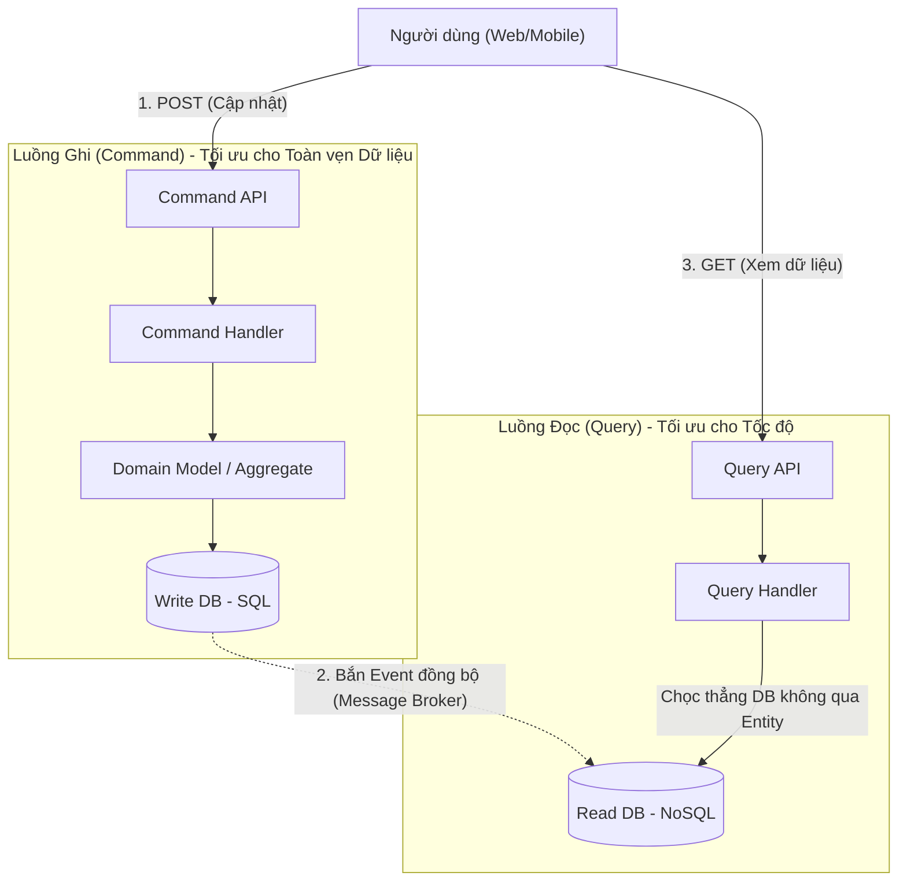

# CQRS (Command Query Responsibility Segregation)

> **Ý tưởng chính việc sử dụng:** Tách biệt luồng Ghi (Command) và luồng Đọc (Query) ra hai model (hoặc hai Database) khác nhau để tối ưu hiệu năng.
> **Ví dụ:** Database SQL dùng để Ghi (đảm bảo ACID), sau đó đồng bộ dữ liệu sang ElasticSearch để tối ưu việc Đọc/Tìm kiếm siêu nhanh.

Khi hệ thống lớn lên, tỷ lệ giữa Đọc (Read) và Ghi (Write) có thể chênh lệch kinh khủng, ví dụ 90% là Đọc, 10% là Ghi. Nếu dùng chung một mô hình (như CRUD) cho cả hai, bạn sẽ gặp tình trạng "kéo cày giữa đường". CQRS ra đời để phân tách hoàn toàn hai trách nhiệm này.

## 1. Mức Độ Cơ Bản (Basic)

### CQRS là gì?
Dịch sát nghĩa: **Tách biệt Trách nhiệm giữa Lệnh (Command) và Truy vấn (Query)**.
- **Command (Ghi)**: Các thao tác làm thay đổi dữ liệu (Insert, Update, Delete). Nó trả về `void` hoặc trạng thái thành công/thất bại. (VD: `ĐổiMậtKhẩu`, `ThêmGiỏHàng`).
- **Query (Đọc)**: Các thao tác chỉ lấy dữ liệu ra xem, TUYỆT ĐỐI KHÔNG làm thay đổi dữ liệu. (VD: `XemDanhSáchĐơnHàng`).

### Vấn đề cốt lõi giải quyết
Sự xung đột về mặt tối ưu hóa:
- **Lúc GHI**: Cần dữ liệu ở dạng chuẩn hóa (Normalized), áp dụng các luật lệ kinh doanh (Invariants) cực kỳ nghiêm ngặt qua Entity/Aggregate để không bị lỗi logic.
- **Lúc ĐỌC**: Cần dữ liệu càng nhanh càng tốt, cần JOIN nhiều bảng lại với nhau để hiển thị lên UI, không cần quan tâm đến luật lệ kinh doanh (vì data đã đúng sẵn rồi).

Nếu ép cả 2 dùng chung 1 class `UserRepository` và 1 class `UserEntity`, bạn sẽ phải nhét đủ thứ biến phụ vào Entity chỉ để phục vụ cho việc hiển thị UI. CQRS tách chúng ra làm 2 luồng hoàn toàn độc lập.

## 2. Mức Độ Trung Bình (Intermediate): Under the Hood

Có 2 mức độ triển khai CQRS:

### Mức độ 1: Cùng Database, Tách Model (Code)
Bạn dùng 1 DB duy nhất (như MySQL).
- **Luồng Command**: Đi qua API -> `CommandService` -> Gọi `Repository` móc `Aggregate` lên -> Chạy hàm nghiệp vụ -> Lưu lại DB. Rất an toàn và chuẩn DDD.
- **Luồng Query**: Đi qua API -> `QueryService` -> VIẾT THẲNG CÂU LỆNH SQL THÔ (hoặc Query Builder) chọc vào DB -> Lấy data ra thẳng `DTO` trả về UI. (Không cần qua Repository, Không cần load Aggregate lên bộ nhớ làm gì cho nặng nề!).

### Mức độ 2: Tách Code, Tách luôn cả Database
- **Command DB**: Chuyên dụng cho Ghi. Thường là SQL (Postgres/MySQL) để đảm bảo toàn vẹn dữ liệu (ACID).
- **Query DB**: Chuyên dụng cho Đọc. Thường là NoSQL (MongoDB) hoặc Search Engine (Elasticsearch) lưu dữ liệu dưới dạng JSON đã được tính toán sẵn. Khi UI gọi tới, chỉ móc JSON ra là xong (Siêu tốc độ).

*Use Cases*: Dùng cho các hệ thống có lưu lượng Read/Write cực lớn và phức tạp.
*Không nên dùng*: Ứng dụng CRUD đơn giản, màn hình admin panel cơ bản (vì sẽ x2 số lượng file code phải viết).

## 3. Mức Độ Nâng Cao (Advanced)

### Eventual Consistency (Tính nhất quán cuối cùng)
Nếu tách làm 2 Database, làm sao để Data ở DB Ghi chạy được sang DB Đọc?
-> Giải pháp: Thông qua một **Message Broker** (Kafka/RabbitMQ).
Khi Command DB lưu xong, nó ném ra một Sự kiện (Event). Một con Worker bắt sự kiện này, format lại data thành dạng JSON dễ đọc rồi đập vào Query DB.
Hậu quả là sẽ có **Độ trễ (Latency)**. Người dùng vừa bấm "Sửa tên" xong, màn hình tải lại vẫn thấy tên cũ (do data chưa kịp đồng bộ sang Query DB). Đây là sự đánh đổi kinh điển của Microservices: Hy sinh tính nhất quán thời gian thực (Strong Consistency) để lấy Khả năng mở rộng khổng lồ (High Availability).

## 4. So Sánh (Compare & Contrast)

| Đặc điểm | CRUD (Create-Read-Update-Delete) | CQRS (Mức 2 DB) |
| :--- | :--- | :--- |
| **Model (Lớp dữ liệu)** | 1 Model chung cho mọi việc. | Tách làm Write Model và Read Model. |
| **Database** | 1 DB duy nhất (Chai cổ lọ ở đây). | 2 DB tối ưu riêng cho Read và Write. |
| **Tính nhất quán** | Ngay lập tức (Strong Consistency). | Có độ trễ (Eventual Consistency). |
| **Bảo trì** | Dễ rối loạn nếu màn hình UI phức tạp. | Code rành mạch (Command ra Command, Query ra Query). |

## 5. Bài Tập Thực Hành Nhỏ

**Tình huống**: Trong file `demo-cqrs.ts`, class `UserCrudService` đang làm cả 2 việc: Đăng ký tài khoản (Ghi) và Lấy thông tin hiển thị (Đọc). Thậm chí hàm Đọc còn lôi nguyên cái Entity nặng nề ra để xử lý.

*Nhiệm vụ*: Đập bỏ class CRUD đó. Tách nó ra làm 2 class độc lập (Command Service và Query Service). Thể hiện rõ sự khác biệt trong cách tiếp cận Database (Một bên dùng ORM bảo vệ dữ liệu, Một bên dùng SQL thô truy vấn siêu tốc).

Code đề bài và đáp án nằm tại: [answers-cqrs](/Users/ductri0981/Documents/Studying-Software/cqrs/answers-cqrs.ts)

## 6. Phụ Lục (Sơ Đồ Kiến Trúc)

## 7. Giải Thích Thuật Ngữ (Glossary)
- **Command**: Một lệnh yêu cầu hệ thống thực hiện thay đổi. Luôn ở thể mệnh lệnh (TạoĐơnHàng, XóaThẻ). Không trả về dữ liệu nghiệp vụ.
- **Query**: Truy vấn xin dữ liệu. Không thay đổi bất kỳ trạng thái nào của hệ thống.
- **Eventual Consistency**: Tính nhất quán cuối cùng. Dữ liệu sẽ đồng bộ ở tất cả mọi nơi... vào một thời điểm nào đó trong tương lai (thường là vài mili-giây), nhưng không phải là ngay lập tức.
- **Read Model (View Model)**: Object dữ liệu được thiết kế riêng phục vụ cho 1 màn hình UI cụ thể. Không chứa logic.
- **Write Model (Domain Model)**: Entity / Aggregate chứa các hàm bảo vệ luật lệ kinh doanh.
