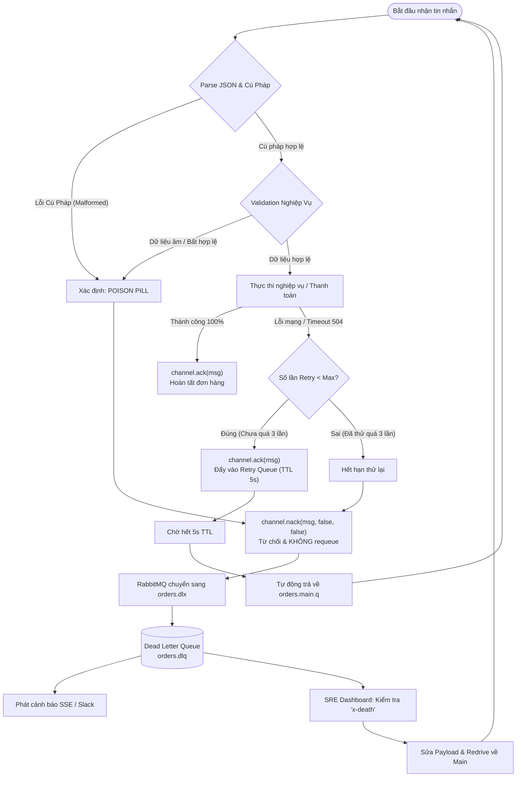
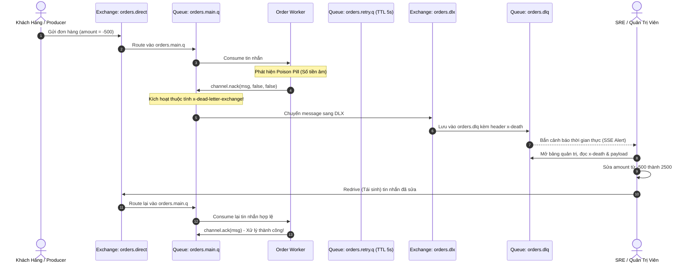

# DEAD LETTER QUEUE (DLQ) ARCHITECTURE & POISON PILL ISOLATION DEEP DIVE

> **Tài liệu lý thuyết chuyên sâu và hướng dẫn kiến trúc toàn diện về Hàng Đợi Tin Nhắn Chết (Dead Letter Queue - DLQ)**  
> Dành cho Software Engineer, Backend Developer và Microservices Architect từ cấp độ Intern đến Middle-level và Tech Lead.

---

## 📑 MỤC LỤC
1. [Mức Độ Cơ Bản (Basic Fundamentals)](#1-mức-độ-cơ-bản-basic-fundamentals)
   - 1.1. [Định nghĩa & Ẩn dụ đời thực (Real-world Analogy)](#11-định-nghĩa--ẩn-dụ-đời-thực-real-world-analogy)
   - 1.2. [Vấn đề cốt lõi sinh ra công nghệ (Problem Statement)](#12-vấn-đề-cốt-lõi-sinh-ra-công-nghệ-problem-statement)
   - 1.3. [Kiến trúc tổng quan mức High-Level](#13-kiến-trúc-tổng-quan-mức-high-level)
2. [Mức Độ Trung Bình (Intermediate - Architecture & Use Cases)](#2-mức-độ-trung-bình-intermediate---architecture--use-cases)
   - 2.1. [3 Điều kiện kích hoạt Dead Letter (Dead Letter Triggers)](#21-3-điều-kiện-kích-hoạt-dead-letter-dead-letter-triggers)
   - 2.2. [Các thành phần cốt lõi trong AMQP / Message Brokers](#22-các-thành-phần-cốt-lõi-trong-amqp--message-brokers)
   - 2.3. [Khi nào NÊN dùng và KHÔNG NÊN dùng DLQ](#23-khi-nào-nên-dùng-và-không-nên-dùng-dlq)
3. [Mức Độ Chuyên Sâu: BẢN CHẤT VẬN HÀNH (Under The Hood & Core Mechanics)](#3-mức-độ-chuyên-sâu-bản-chất-vận-hành-under-the-hood--core-mechanics)
   - 3.1. [Phẫu thuật Header `x-death` - "Giấy chứng tử" của Message](#31-phẫu-thuật-header-x-death---giấy-chứng-tử-của-message)
   - 3.2. [Dòng chảy dữ liệu (Data Flow: Write, Process, Death, Redrive)](#32-dòng-chảy-dữ-liệu-data-flow-write-process-death-redrive)
   - 3.3. [Mô hình phối hợp 3 tầng: Main Queue ➔ Retry Queue (TTL) ➔ DLQ](#33-mô-hình-phối-hợp-3-tầng-main-queue--retry-queue-ttl--dlq)
   - 3.4. [Thảm họa Head-of-Line Blocking & Viên thuốc độc (Poison Pill)](#34-thảm-họa-head-of-line-blocking--viên-thuốc-độc-poison-pill)
4. [Mức Độ Nâng Cao: Vận Hành Thực Chiến (Production Engineering & Best Practices)](#4-mức-độ-nâng-cao-vận-hành-thực-chiến-production-engineering--best-practices)
   - 4.1. [Chiến lược Redrive / Replay an toàn & Idempotency](#41-chiến-lược-redrive--replay-an-toàn--idempotency)
   - 4.2. [Giám sát & Cảnh báo (Alerting & Observability)](#42-giám-sát--cảnh-báo-alerting--observability)
   - 4.3. [Anti-patterns & Sai lầm phổ biến trong dự án](#43-anti-patterns--sai-lầm-phổ-biến-trong-dự-án)
5. [Góc Nhìn Thực Chiến Cho Middle-Level Trở Xuống (Must-Know vs Nice-to-Know Roadmap)](#5-góc-nhìn-thực-chiến-cho-middle-level-trở-xuống-must-know-vs-nice-to-know-roadmap)
   - 5.1. [Chi Tiết Kỹ Thuật Thực Chiến Cấp Độ [INTERN / JUNIOR]](#51-chi-tiết-kỹ-thuật-thực-chiến-cấp-độ-intern--junior)
   - 5.2. [Chi Tiết Kỹ Thuật Thực Chiến Cấp Độ [MIDDLE-LEVEL]](#52-chi-tiết-kỹ-thuật-thực-chiến-cấp-độ-middle-level)
   - 5.3. [Chi Tiết Kỹ Thuật Cho Cấp Độ [SENIOR / ARCHITECT] (Mở Rộng)](#53-chi-tiết-kỹ-thuật-cho-cấp-độ-senior--architect-mở-rộng)
   - 5.4. [Bộ Câu Hỏi Phỏng Vấn Kinh Điển (Top Interview Questions)](#54-bộ-câu-hỏi-phỏng-vấn-kinh-điển-top-interview-questions)
6. [So Sánh Bản Chất (First-Principles Comparison)](#6-so-sánh-bản-chất-first-principles-comparison)
7. [Sơ Đồ Trực Quan (Mermaid Diagrams)](#7-sơ-đồ-trực-quan-mermaid-diagrams)
8. [Bảng Tra Thuật Ngữ Chi Tiết (Glossary)](#8-bảng-tra-thuật-ngữ-chi-tiết-glossary)
9. [Hướng Dẫn Chạy & Kiểm Thử Hệ Thống (Step-by-Step Run Guide)](#9-hướng-dẫn-chạy--kiểm-thử-hệ-thống-step-by-step-run-guide)

---

## 1. Mức Độ Cơ Bản (Basic Fundamentals)

### 1.1. Định nghĩa & Ẩn dụ đời thực (Real-world Analogy)

**Dead Letter Queue (DLQ)** — hay *Hàng Đợi Tin Nhắn Chết* — là một hàng đợi chuyên dụng trong hệ thống Message Broker (như RabbitMQ, Apache Kafka, AWS SQS, Google Cloud Pub/Sub) được thiết kế riêng để **cô lập các tin nhắn không thể xử lý thành công**, ngăn chặn chúng làm sập worker hoặc làm nghẽn toàn bộ hàng đợi chính.

```
+-----------------------------------------------------------------------------------+
|                        ẨN DỤ: BƯU ĐIỆN VÀ THÙNG THƯ LỖI ĐỊA CHỈ                   |
|                                                                                   |
|  [NGƯỜI GỬI THƯ] ----> [BƯU TÁ ĐI GIAO THƯ THEO HÀNG ĐỢI TÚI THƯ]                  |
|                                     |                                             |
|                                     v                                             |
|                     [GẶP MỘT PHONG THƯ GHI SAI ĐỊA CHỈ HOẶC RÁCH]                |
|                                     |                                             |
|  1. CÁCH XỬ LÝ NGU NGỐC (REQUEUE MÙ QUÁNG - KHÔNG CÓ DLQ):                         |
|     - Bưu tá không giao được ➔ Bỏ lại đúng vào đầu túi thư.                       |
|     - Giây tiếp theo, lại bốc đúng phong thư hỏng đó ra giao tiếp ➔ Lại lỗi!      |
|     - Bưu tá đứng chôn chân một chỗ cả ngày, hàng ngàn lá thư hợp lệ phía sau     |
|       bị tắc nghẽn hoàn toàn (Thảm họa Head-of-Line Blocking)!                     |
|                                                                                   |
|  2. CÁCH XỬ LÝ VĂN MINH CÓ DLQ (DEAD LETTER QUEUE):                              |
|     - Bưu tá phân loại: Thư này sai địa chỉ vĩnh viễn (Poison Pill).              |
|     - Bỏ ngay lá thư đó vào "Thùng Chứa Thư Chờ Xử Lý Đặc Biệt" (DLQ).            |
|     - Bưu tá tiếp tục đi giao các lá thư bình thường khác mà không bị trễ một giây.|
|     - Cuối ngày, bộ phận Chăm sóc Khách hàng mở thùng DLQ ra kiểm tra, gọi điện   |
|       cho người gửi hỏi lại địa chỉ đúng (Redrive / Replay) hoặc tiêu hủy (Discard)|
+-----------------------------------------------------------------------------------+
```

- **Nếu không có DLQ**: Một tin nhắn chứa payload lỗi cú pháp (Poison Pill) rơi vào hàng đợi $\rightarrow$ Worker crash $\rightarrow$ Khởi động lại $\rightarrow$ Lại đọc đúng tin nhắn đó $\rightarrow$ Lại crash vòng lặp vô tận (Infinite Crash Loop), làm sập toàn bộ cụm Worker.
- **Nếu có DLQ**: Worker bắt được lỗi, từ chối nhận tin nhắn (`NACK` với `requeue=false`) $\rightarrow$ Broker tự động chuyển tin nhắn sang DLQ $\rightarrow$ Hàng đợi chính thông thoáng 100%, dữ liệu lỗi được giữ nguyên vẹn để kỹ sư kiểm tra nguyên nhân gốc rễ (Root Cause Analysis - RCA).

---

### 1.2. Vấn đề cốt lõi sinh ra công nghệ (Problem Statement)

Trong kiến trúc hướng sự kiện (Event-Driven Architecture) và Microservices, tin nhắn bất đồng bộ là xương sống giao tiếp. Tuy nhiên, thế giới phân tán luôn tiềm ẩn lỗi:

1. **Viên Thuốc Độc (Poison Pill / Malformed Payload)**:
   - Client gửi một gói tin JSON rách nát, thiếu dấu ngoặc, hoặc chứa số tiền âm (`amount: -500`).
   - Đây là lỗi vĩnh viễn (**Non-transient Error**). Dù có máy tính lượng tử chạy thử lại 1 tỉ lần thì hàm `JSON.parse()` hay logic nghiệp vụ vẫn ném ra ngoại lệ.
2. **Hiện tượng Tắc Nghẽn Đầu Hàng (Head-of-Line Blocking - HoL)**:
   - Các hàng đợi message hoạt động theo nguyên lý FIFO (First-In, First-Out).
   - Nếu worker gặp lỗi mà gọi `nack(requeue = true)`, message đó lập tức nhảy ngược lại đầu hàng đợi. Nó chắn ngay cửa ra vào, khiến hàng triệu tin nhắn hợp lệ phía sau bị kẹt cứng (Starvation).
3. **Mất Dữ Liệu Âm Thầm (Silent Message Drop)**:
   - Nếu lập trình viên giải quyết tắc nghẽn bằng cách... bắt `catch` rồi `channel.ack(msg)` bỏ qua luôn, đơn hàng đó sẽ biến mất khỏi vũ trụ mà không để lại dấu vết. Tiền của khách hàng bị thất thoát và không ai biết tại sao.

$\Longrightarrow$ **Dead Letter Queue sinh ra như một chốt chặn bảo vệ sống còn**: Vừa bảo vệ hệ thống không bị nghẽn hay crash, vừa lưu giữ 100% dữ liệu lỗi cùng ngữ cảnh tử vong để phục hồi sau này.

---

### 1.3. Kiến trúc tổng quan mức High-Level

```
[Producer Service] 
       │ (1) Publish Order
       ▼
 [Main Exchange] (orders.direct)
       │ (2) Route Key: orders.process
       ▼
  [Main Queue] (orders.main.q) ───[x-dead-letter-exchange: orders.dlx]───┐
       │                                                                  │
       │ (3) Consume (Prefetch=1)                                         │ (4b) NACK (requeue=false)
       ▼                                                                  │      hoặc Max Retries
 [Order Worker] ────(4a) Lỗi tạm thời (Timeout)                           │
       │                 chuyển sang Retry                                │
       ▼                                                                  │
[Retry Exchange] (orders.retry.direct)                                    │
       │ (TTL 5000ms)                                                     │
       ▼                                                                  │
 [Retry Queue] ──(Hết TTL 5s tự DLX trả về Main Queue)                    │
                                                                          ▼
                                                                [Dead Letter Exchange] (orders.dlx)
                                                                          │ (Routing: orders.dead)
                                                                          ▼
                                                                [Dead Letter Queue] (orders.dlq)
                                                                          │
                                                      ┌───────────────────┴───────────────────┐
                                                      ▼                                       ▼
                                              [Cảnh Báo Alert]                    [Admin Redrive Console]
                                            (Slack / PagerDuty)                   (Sửa Payload & Replay)
```

---

## 2. Mức Độ Trung Bình (Intermediate - Architecture & Use Cases)

### 2.1. 3 Điều kiện kích hoạt Dead Letter (Dead Letter Triggers)

Theo chuẩn đặc tả AMQP (Advanced Message Queuing Protocol) và cơ chế vận hành của RabbitMQ, một tin nhắn sẽ chính thức bị tuyên bố là "Đã Chết" (Dead-Lettered) khi và chỉ khi rơi vào **1 trong 3 điều kiện vật lý** sau:

| Điều Kiện Kích Hoạt | Cơ Chế Kỹ Thuật Bên Dưới | Tình Huống Thực Tế Điển Hình |
| :--- | :--- | :--- |
| **1. Tin nhắn bị NACK / REJECT với `requeue = false`** | Consumer gọi `channel.nack(msg, false, false)` hoặc `channel.reject(msg, false)`. | Bắt gặp Poison Pill (JSON sai cú pháp, giá tiền âm, vi phạm validation dữ liệu nghiệp vụ). |
| **2. Tin nhắn hết hạn thời gian sống (TTL Expiration)** | Message nằm trong Queue lâu hơn cấu hình `x-message-ttl` hoặc thuộc tính `expiration` của message. | Dùng làm Delayed Queue (Hàng đợi trễ) để retry sau vài giây; hoặc các tin nhắn Flash Sale quá hạn 10 phút không ai mua thì hủy. |
| **3. Hàng đợi vượt quá độ dài tối đa (Max Queue Length)** | Queue bị đầy và chạm ngưỡng cấu hình `x-max-length` hoặc `x-max-length-bytes`. | Hàng đợi bị tràn do lượng traffic đột biến tăng vọt, các tin nhắn cũ nhất (hoặc mới nhất) bị đẩy sang DLQ để bảo vệ RAM của Broker. |

---

### 2.2. Các thành phần cốt lõi trong AMQP / Message Brokers

1. **Dead Letter Exchange (DLX)**:
   - Là một Exchange bình thường trong RabbitMQ (thường là type `direct` hoặc `fanout`).
   - Được gắn vào Main Queue thông qua thuộc tính khai báo:
     ```javascript
     {
       'x-dead-letter-exchange': 'orders.dlx',
       'x-dead-letter-routing-key': 'orders.dead'
     }
     ```
2. **Dead Letter Routing Key**:
   - Định tuyến tùy biến để gửi message từ Main Queue sang DLX. Nếu không chỉ định, RabbitMQ sẽ giữ nguyên routing key ban đầu của message.
3. **Dead Letter Queue (DLQ)**:
   - Hàng đợi vật lý được bind với DLX để lưu giữ toàn bộ các tin nhắn tử vong.
   - Thường được cấu hình `durable: true` để đảm bảo tin nhắn không bị mất khi broker restart.
4. **Header `x-death`**:
   - Mảng metadata được RabbitMQ tự động đính kèm vào phần Headers của message ngay khoảnh khắc nó bị dead-lettered. Nó đóng vai trò như một **"Bản Giám Định Pháp Y"** ghi chép chi tiết nguyên nhân, thời gian và địa điểm tử vong.

---

### 2.3. Khi nào NÊN dùng và KHÔNG NÊN dùng DLQ

#### ✅ KHI NÀO BẮT BUỘC DÙNG DLQ:
- **Xử lý giao dịch tài chính, thanh toán, đơn hàng**: Tuyệt đối không được phép làm mất tin nhắn trừ tiền hay xuất hóa đơn.
- **Tích hợp với dịch vụ bên thứ ba không ổn định**: Các cổng thanh toán (Stripe, VNPay, PayPal), dịch vụ gửi SMS/Email, dịch vụ giao hàng.
- **Xử lý tác vụ nền nặng (Background Jobs)**: Chuyển đổi định dạng video, sinh báo cáo kế toán, huấn luyện mô hình AI.

#### ❌ KHI NÀO KHÔNG CẦN THIẾT DÙNG DLQ:
- **Dữ liệu đo đạc cảm biến IoT thời gian thực**: Nhiệt độ, vị trí GPS bắn về mỗi 100ms. Dữ liệu cũ bị lỗi thì bỏ qua luôn vì dữ liệu mới đã tới ngay sau đó.
- **Log streaming / Metrics thống kê**: Mất 1 vài dòng log CPU không ảnh hưởng đến tính toàn vẹn của nghiệp vụ, tốn công dựng DLQ chỉ làm phình dung lượng lưu trữ.

---

## 3. Mức Độ Chuyên Sâu: BẢN CHẤT VẬN HÀNH (Under The Hood & Core Mechanics)

### 3.1. Phẫu thuật Header `x-death` - "Giấy chứng tử" của Message

Khi một tin nhắn bị dead-letter sang DLQ, RabbitMQ không chỉ ném nội dung thô qua mà còn tiêm vào header mảng cấu trúc `x-death`. Đây là tài sản quý giá nhất cho các kỹ sư SRE và Backend khi điều tra sự cố:

```json
{
  "headers": {
    "x-retry-count": 3,
    "x-death": [
      {
        "count": 1,
        "reason": "rejected",
        "queue": "orders.main.q",
        "time": 1729000123,
        "exchange": "orders.direct",
        "routing-keys": ["orders.process"]
      },
      {
        "count": 3,
        "reason": "expired",
        "queue": "orders.retry.q",
        "time": 1729000118,
        "exchange": "orders.retry.direct",
        "routing-keys": ["orders.retry"]
      }
    ]
  }
}
```

#### Ý nghĩa từng trường trong `x-death`:
1. **`reason`**:
   - `"rejected"`: Bị Worker từ chối nhận (`nack` hoặc `reject` với `requeue=false`).
   - `"expired"`: Chết do hết thời gian sống `x-message-ttl`.
   - `"maxlen"`: Bị đẩy ra ngoài do hàng đợi vượt quá giới hạn độ dài `x-max-length`.
2. **`queue`**: Tên hàng đợi chính xác nơi tin nhắn đã trút hơi thở cuối cùng.
3. **`count`**: Số lần liên tiếp tin nhắn này bị chết tại hàng đợi đó.
4. **`time`**: Timestamp POSIX chính xác thời điểm xảy ra tử vong.

---

### 3.2. Dòng chảy dữ liệu (Data Flow: Write, Process, Death, Redrive)

```
LUỒNG DÒNG CHẢY DỮ LIỆU ĐẦY ĐỦ CỦA MỘT TIN NHẮN TỬ VONG VÀ TÁI SINH
════════════════════════════════════════════════════════════════════════════════

[CLIENT/UI] ──(1. POST Order)──> [BACKEND PRODUCER]
                                          │
                                          │ (2. channel.publish)
                                          ▼
                                   [orders.direct]
                                          │
                                          │ (3. Routing)
                                          ▼
                                   [orders.main.q]
                                          │
                                          │ (4. Prefetch & Consume)
                                          ▼
                                   [ORDER WORKER]
                                          │
                 ┌────────────────────────┴────────────────────────┐
                 │                                                 │
          (Thành Công)                                     (Thất Bại/Lỗi)
                 │                                                 │
                 ▼                                                 ▼
        [channel.ack(msg)]                           [Kiểm Tra Bản Chất Lỗi]
                 │                                                 │
                 ▼                                  ┌──────────────┴──────────────┐
          [Hoàn Tất 100%]                           │                             │
                                             (Lỗi Tạm Thời)                (Poison Pill)
                                                    │                             │
                                                    ▼                             ▼
                                           [Retry Queue (TTL)]            [channel.nack(false, false)]
                                                    │                             │
                                              (Hết TTL 5s)                        │
                                                    │                             │
                                                    ▼                             ▼
                                            [Quay về Main]                 [orders.dlx]
                                                    │                             │
                                            (Nếu > 3 lần)                         │
                                                    │                             ▼
                                                    └────────────────────> [orders.dlq]
                                                                                  │
                                                                   (Lưu trữ & Phân tích RCA)
                                                                                  │
                                                                                  ▼
                                                                      [ADMIN REDRIVE CONSOLE]
                                                                                  │
                                                                 (Sửa Lỗi Payload & Tái Sinh)
                                                                                  │
                                                                                  ▼
                                                                       [Đẩy lại orders.direct]
```

---

### 3.3. Mô hình phối hợp 3 tầng: Main Queue ➔ Retry Queue (TTL) ➔ DLQ

Một sai lầm rất lớn của người mới làm quen với Message Queue là: **Hễ có lỗi là ném ngay vào DLQ**.  
Điều này biến DLQ thành bãi rác chứa đầy các lỗi chập chờn chỉ kéo dài 500ms. 

Mô hình chuẩn mực kiến trúc Enterprise là **Kiến Trúc 3 Hàng Đợi (Three-Queue Tier)**:

```
+---------------------------------------------------------------------------------------+
|                       MÔ HÌNH PHỐI HỢP 3 TẦNG DOANH NGHIỆP                           |
|                                                                                       |
|  [HÀNG ĐỢI 1: MAIN QUEUE] ─────────(Lỗi lần 1 & 2)─────────> [HÀNG ĐỢI 2: RETRY QUEUE]|
|         ▲                                                               │             |
|         │                                                          (Chờ TTL 5s)       |
|         │                                                               │             |
|         └─────────(Hết hạn TTL 5s, tự DLX trả ngược về)─────────────────┘             |
|                                                                                       |
|  [HÀNG ĐỢI 1: MAIN QUEUE] ─────────(Vượt quá 3 lần lỗi)─────> [HÀNG ĐỢI 3: DLQ]       |
|                                                                                       |
|  [HÀNG ĐỢI 1: MAIN QUEUE] ─────────(Phát hiện Poison Pill)──> [HÀNG ĐỢI 3: DLQ]       |
+---------------------------------------------------------------------------------------+
```

1. **Tầng 1 (Main Queue)**: Nơi tiếp nhận traffic tức thời. Worker chỉ nhận nhiệm vụ từ đây.
2. **Tầng 2 (Retry Queue with TTL)**: Không có bất kỳ Worker nào lắng nghe trên queue này! Nó chỉ đóng vai trò là một "phòng chờ" (holding buffer). Tin nhắn nằm ở đây trong khoảng thời gian TTL (ví dụ 5s, 30s). Nhờ cấu hình `x-dead-letter-exchange` trỏ ngược về Main Queue, khi hết TTL, RabbitMQ sẽ tự động nhả tin nhắn về Main Queue để thử lại.
3. **Tầng 3 (Dead Letter Queue)**: Chỉ chứa những tin nhắn đã thực sự kiệt quệ sau nhiều lần retry, hoặc là Poison Pill không thể cứu vãn.

---

### 3.4. Thảm họa Head-of-Line Blocking & Viên thuốc độc (Poison Pill)

Tại sao lại có lệnh cấm kỵ: **Tuyệt đối không gọi `nack` với `requeue = true` khi chưa có cơ chế đếm số lần thất bại?**

```
KỊCH BẢN THẢM HỌA: VÒNG LẶP NACK VÔ TẬN (REQUEUE STORM)
════════════════════════════════════════════════════════════════════════════════
12:00:00.001 - Worker nhận Message #1 (Chứa chuỗi JSON rách: "{ amount: }").
12:00:00.002 - Hàm JSON.parse() ném SyntaxError!
12:00:00.003 - Code bắt catch và gọi: channel.nack(msg, false, true /* requeue */).
12:00:00.004 - Broker nhét lại Message #1 ngay vào ĐẦU hàng đợi Main Queue!
12:00:00.005 - Worker (vừa rảnh tay) lập tức bốc lại đúng Message #1 vừa ném lại!
12:00:00.006 - Lại ném SyntaxError! Lại nack(requeue=true)!
...
KẾT QUẢ: 
- 1 giây trôi qua: Worker chạy lặp lại 10.000 lần cho đúng 1 message hỏng!
- CPU máy chủ vọt lên 100%! Log phình to hàng Gigabyte trong vài phút!
- Toàn bộ hàng triệu đơn hàng hợp lệ của khách hàng khác phía sau bị kẹt cứng 100%!
```

$\Longrightarrow$ **Chân lý bất di bất dịch**: Gặp Poison Pill hoặc quá số lần retry, bắt buộc phải `nack(msg, false, false)` để đưa vào DLQ.

---

## 4. Mức Độ Nâng Cao: Vận Hành Thực Chiến (Production Engineering & Best Practices)

### 4.1. Chiến lược Redrive / Replay an toàn & Idempotency

Tái sinh tin nhắn chết (Redrive / Replay) là hành động đọc tin nhắn từ DLQ và bắn ngược lại vào Main Queue sau khi nguyên nhân sự cố đã được khắc phục (ví dụ: Database đã online trở lại, hoặc bug code đã được deploy bản vá).

Để Redrive an toàn trong Production, cần tuân thủ 3 nguyên tắc:

1. **Bắt Buộc Phải Có Tính Bất Biến (Idempotency)**:
   - Một tin nhắn có thể đã được xử lý một nửa (ví dụ: đã trừ điểm tích lũy, nhưng bị timeout ở bước xuất hóa đơn rồi rơi vào DLQ).
   - Khi Replay lại, Worker tuyệt đối không được trừ điểm tích lũy lần thứ hai!
   - Sử dụng **`Idempotency-Key`** hoặc kiểm tra trạng thái trong Database trước khi thực thi.
2. **Chỉnh Sửa Dữ Liệu Tại Chỗ Trước Khi Replay (In-Place Payload Patching)**:
   - Với Poison Pill do sai dữ liệu (ví dụ: nhập số tài khoản ngân hàng thiếu 1 chữ số), hệ thống Dashboard quản trị phải cho phép SRE sửa trực tiếp payload rồi mới Replay.
3. **Thắt Cổ Chai Lưu Lượng Khi Replay (Throttled Redrive)**:
   - Nếu trong DLQ có 500.000 tin nhắn tích tụ sau một đợt sập mạng kéo dài 2 tiếng, tuyệt đối không được ấn "Replay All" tức thì trong 1 giây!
   - Việc này sẽ tạo ra một cơn sóng thần (Thundering Herd) dìm chết hệ thống vừa mới gượng dậy. Cần Replay theo lô nhỏ (Batch) với tốc độ kiểm soát (Rate-limited, ví dụ: 50 msg/giây).

---

### 4.2. Giám sát & Cảnh báo (Alerting & Observability)

Một Dead Letter Queue chỉ phát huy tác dụng nếu có người hoặc hệ thống theo dõi nó. Nếu không có giám sát, DLQ sẽ biến thành "bãi tha ma âm thầm".

Các chỉ số cảnh báo bắt buộc trong Prometheus & Grafana:

| Metric Cảnh Báo | Ngưỡng Cảnh Báo (Threshold) | Mức Độ | Hành Động Phản Ứng |
| :--- | :--- | :--- | :--- |
| **`dlq_messages_count > 0`** | $> 0$ tin nhắn (ngay lập tức) | **Warning** | Gửi thông báo Slack / Telegram kèm Link mở giao diện kiểm tra. |
| **`dlq_inflow_rate`** | $> 10\text{ msg/s}$ | **Critical (SEV-1)** | Kích hoạt PagerDuty gọi điện cho kỹ sư On-call: Có thể một service downstream vừa sập hoàn toàn. |
| **`dlq_oldest_message_age`** | $> 24\text{ giờ}$ | **High** | Tin nhắn chết bị bỏ quên quá lâu, có nguy cơ vi phạm cam kết SLA với khách hàng. |

---

### 4.3. Anti-patterns & Sai lầm phổ biến trong dự án

```
+---------------------------------------------------------------------------------------+
|                CÔNG THỨC TRÁNH 4 SAI LẦM KINH ĐIỂN CỦA DEAD LETTER QUEUE             |
+---------------------------------------------------------------------------------------+
|  1. "DLQ LÀ HỐ ĐEN VŨ TRỤ" (DLQ AS A BLACK HOLE):                                     |
|     - Hiện tượng: Cấu hình DLQ rất hoành tráng nhưng không bao giờ có ai xem.         |
|     - Hậu quả: Sau 6 tháng, DLQ chứa 2 triệu tin nhắn, đĩa cứng Broker bị tràn.        |
|     - Khắc phục: Gắn Alert Slack, thiết lập quy trình On-call kiểm tra DLQ hàng ngày. |
+---------------------------------------------------------------------------------------+
|  2. "VÒNG LẶP BÓNG BÀN TỬ THẦN" (PING-PONG DEATH LOOP):                               |
|     - Hiện tượng: Admin thấy có 100 tin nhắn trong DLQ, liền bấm nút Replay mù quáng. |
|     - Hậu quả: Lỗi code chưa sửa, 100 tin nhắn lại bay vào Main -> lại lỗi -> lại DLQ!|
|     - Khắc phục: Luôn phân tích nguyên nhân gốc rễ và sửa code/payload trước Replay. |
+---------------------------------------------------------------------------------------+
|  3. "XÓA SẠCH NGỮ CẢNH LỖI" (STRIPPING ERROR CONTEXT):                                |
|     - Hiện tượng: Đẩy tin nhắn vào DLQ nhưng không ghi lại lý do tại sao nó chết.    |
|     - Hậu quả: Kỹ sư mở DLQ ra nhìn thấy gói tin JSON trần trụi, không biết bị lỗi gì.|
|     - Khắc phục: Tiêm header `x-last-error`, `x-error-stack`, `x-retry-count`.        |
+---------------------------------------------------------------------------------------+
|  4. "REQUEUE = TRUE VÔ TỘI VẠ":                                                       |
|     - Hiện tượng: Viết code catch (err) { channel.nack(msg, false, true); }           |
|     - Hậu quả: Tạo bão Requeue Storm, CPU 100%, tê liệt toàn bộ Worker.               |
|     - Khắc phục: Dùng Delayed Retry Queue (TTL) kết hợp đếm số lần thất bại.          |
+---------------------------------------------------------------------------------------+
```

---

## 5. Góc Nhìn Thực Chiến Cho Middle-Level Trở Xuống (Must-Know vs Nice-to-Know Roadmap)

Nhằm giúp các bạn Intern, Junior và Middle-level không bị ngợp hay lạc lối trước khối lượng kiến thức khổng lồ về Message Queues và Resilience Engineering, sơ đồ lộ trình dưới đây phân định rạch ròi trọng tâm thực chiến:

```
+---------------------------------------------------------------------------------------+
|                LỘ TRÌNH NẮM VỮNG DEAD LETTER QUEUE (DLQ) THEO NĂNG LỰC                |
+---------------------------------------------------------------------------------------+
|  [INTERN / JUNIOR] (Quy tắc 80/20 - Sử dụng thực chiến hàng ngày)                      |
|  ├── 1. Hiểu bản chất Manual ACK vs NACK và tai hại của Auto-Ack                      |
|  ├── 2. Nắm vững sự khác biệt sống còn giữa requeue=true và requeue=false             |
|  ├── 3. Biết cách cấu hình x-dead-letter-exchange và x-dead-letter-routing-key cơ bản  |
|  └── 4. Nhận biết và cô lập ngay các Poison Pill (Malformed JSON, invalid inputs)     |
+---------------------------------------------------------------------------------------+
|  [MIDDLE-LEVEL] (Thiết kế hệ thống & Đảm bảo độ tin cậy ứng dụng)                      |
|  ├── 5. Thiết kế Delayed Retry Queue bằng Message TTL phối hợp với DLX               |
|  ├── 6. Trích xuất và phân tích mảng metadata x-death để chuẩn đoán sự cố             |
|  ├── 7. Xây dựng cơ chế Idempotency chống xử lý trùng lặp khi Replay                  |
|  └── 8. Thiết lập Dashboard giám sát & Cảnh báo tức thời khi có tin nhắn vào DLQ       |
+---------------------------------------------------------------------------------------+
|  [SENIOR / ARCHITECT] (Tạm thời bỏ qua nếu ở mức Middle trở xuống)                    |
|  ├── 9. Thiết kế Circuit Breaker tự ngắt luồng Publish khi DLQ bị tràn                |
|  ├── 10. Chiến lược Throttled Batch Redrive cho hàng triệu tin nhắn phân tán          |
|  └── 11. Cross-region DLQ replication & Disaster Recovery (DR)                        |
+---------------------------------------------------------------------------------------+
```

---

### 5.1. Chi Tiết Kỹ Thuật Thực Chiến Cấp Độ [INTERN / JUNIOR]

#### 1. Hiểu bản chất Manual ACK vs NACK và tai hại của Auto-Ack (`noAck: true`)
- **Bối cảnh (Why)**: Mặc định nhiều thư viện để `noAck: true` (Auto-Ack). Khi Broker vừa đẩy tin nhắn qua kết nối TCP cho ứng dụng, nó lập tức xóa sạch tin nhắn khỏi RAM. Nếu Worker bị mất điện hoặc crash ngay dòng code đầu tiên, tin nhắn đó vĩnh viễn biến mất không tăm hơi.
- **Giải pháp (How)**: Luôn thiết lập `{ noAck: false }`. Chỉ gọi `channel.ack(msg)` khi toàn bộ thao tác ghi database hoặc gửi email đã hoàn tất 100%. Nếu có lỗi, gọi `channel.nack()`.
- **Code mẫu**:
  ```javascript
  // Cấu hình chuẩn Production: noAck = false
  await channel.consume('orders.main.q', async (msg) => {
    if (!msg) return;
    try {
      await processOrder(JSON.parse(msg.content.toString()));
      // Chỉ ACK khi thành công hoàn toàn
      channel.ack(msg);
    } catch (err) {
      // Bắt buộc xử lý lỗi, không được để lửng
      channel.nack(msg, false, false); // Đẩy vào DLQ
    }
  }, { noAck: false });
  ```

#### 2. Nắm vững sự khác biệt sống còn giữa `requeue=true` và `requeue=false`
- **Bối cảnh (Why)**: Hàm `channel.nack(msg, allUpTo, requeue)` nhận tham số thứ 3 là boolean `requeue`. Nếu truyền `true`, message quay lại queue hiện tại. Nếu truyền `false`, message bị hủy hoặc chuyển sang DLX.
- **Giải pháp (How)**: Không bao giờ truyền `requeue: true` cho các lỗi không xác định. Chỉ dùng `requeue: false` để Broker kích hoạt cơ chế Dead Lettering.

#### 3. Biết cách cấu hình `x-dead-letter-exchange` cơ bản
- **Bối cảnh (Why)**: Làm sao RabbitMQ biết tin nhắn bị reject sẽ phải bay đi đâu?
- **Giải pháp (How)**: Khai báo qua tham số `arguments` khi gọi `channel.assertQueue()`.
- **Code mẫu**:
  ```javascript
  await channel.assertQueue('orders.main.q', {
    durable: true,
    arguments: {
      'x-dead-letter-exchange': 'orders.dlx',
      'x-dead-letter-routing-key': 'orders.dead'
    }
  });
  ```

#### 4. Nhận biết và cô lập ngay Poison Pill
- **Bối cảnh (Why)**: Dữ liệu người dùng nhập sai, mã độc hoặc cú pháp lỗi.
- **Giải pháp (How)**: Bọc khối `JSON.parse()` và các hàm validation nghiệp vụ đầu hàm. Nếu vi phạm, `nack(requeue=false)` ngay lập tức trước khi gọi bất kỳ dịch vụ downstream nào.

---

### 5.2. Chi Tiết Kỹ Thuật Thực Chiến Cấp Độ [MIDDLE-LEVEL]

#### 5. Thiết kế Delayed Retry Queue bằng Message TTL phối hợp DLX
- **Bối cảnh (Why)**: Khi gặp lỗi mạng chập chờn (Transient), ta muốn thử lại sau 5 giây hoặc 30 giây chứ không muốn thử lại ngay lập tức (Immediate Retry làm nghẽn CPU).
- **Giải pháp (How)**: Tạo một queue tạm `orders.retry.q` có `x-message-ttl: 5000`. Không cắm worker nào vào queue này. Khi message hết hạn 5 giây, cấu hình DLX của queue này sẽ tự động bắn tin nhắn trở lại `orders.main.q`!
- **Code mẫu**:
  ```javascript
  // Hàng đợi tạm trễ 5 giây
  await channel.assertQueue('orders.retry.q', {
    durable: true,
    arguments: {
      'x-message-ttl': 5000, // Độ trễ 5s
      'x-dead-letter-exchange': 'orders.direct', // Hết hạn thì quay về Main Exchange
      'x-dead-letter-routing-key': 'orders.process'
    }
  });
  ```

#### 6. Trích xuất và phân tích mảng metadata `x-death`
- **Bối cảnh (Why)**: Khi tin nhắn rơi vào DLQ, làm thế nào để Dashboard biết tin nhắn này đã chết ở đâu và vì sao chết?
- **Giải pháp (How)**: Đọc trường `msg.properties.headers['x-death']`.
- **Code mẫu**:
  ```javascript
  const headers = msg.properties.headers || {};
  const deaths = headers['x-death'] || [];
  if (deaths.length > 0) {
    console.log(`Lý do chết: ${deaths[0].reason}`); // 'rejected' hoặc 'expired'
    console.log(`Chết tại hàng đợi: ${deaths[0].queue}`); // 'orders.main.q'
    console.log(`Số lần tử vong: ${deaths[0].count}`);
  }
  ```

#### 7. Xây dựng cơ chế Idempotency chống xử lý trùng lặp khi Replay
- **Bối cảnh (Why)**: Khi Replay một tin nhắn từ DLQ, có thể tin nhắn đó đã được ghi vào bảng `orders` ở database nhưng bị fail ở bước gửi email. Nếu chạy lại toàn bộ, tài khoản ngân hàng sẽ bị trừ tiền 2 lần.
- **Giải pháp (How)**: Kiểm tra `orderId` trong Redis hoặc PostgreSQL bằng Transaction / Unique Constraint trước khi thực thi.

#### 8. Thiết lập Dashboard giám sát & Cảnh báo tức thời
- **Bối cảnh (Why)**: Tin nhắn rơi vào DLQ nhưng không ai biết cho đến khi khách hàng gọi điện phàn nàn.
- **Giải pháp (How)**: Dùng endpoint Server-Sent Events (SSE) hoặc Webhook bắn tin nhắn vào kênh Slack nội bộ kèm nội dung lỗi.

---

### 5.3. Chi Tiết Kỹ Thuật Cho Cấp Độ [SENIOR / ARCHITECT] (Mở Rộng)

#### 9. Circuit Breaker tự ngắt luồng khi DLQ bị tràn
- Nếu tốc độ tin nhắn rơi vào DLQ vượt quá 50 msg/giây, chứng tỏ toàn bộ Database hoặc Microservices phía sau đã tê liệt. Circuit Breaker cần lập tức ngắt cổng API phía trước (Fast-Fail) để bảo vệ hạ tầng.

#### 10. Chiến lược Throttled Batch Redrive
- Cung cấp cơ chế Replay theo tốc độ cố định (ví dụ dùng Token Bucket / Leaky Bucket) để bơm dần dần 500.000 tin nhắn DLQ về Main Queue mà không làm sập hệ thống.

---

### 5.4. Bộ Câu Hỏi Phỏng Vấn Kinh Điển (Top Interview Questions)

#### ❓ Câu hỏi 1: Sự khác biệt cơ bản giữa việc `nack(requeue: true)` và chuyển message vào DLQ là gì? Khi nào dùng cái nào?
> **Trả lời mẫu ghi điểm tối đa**:  
> - `nack(requeue: true)` yêu cầu Broker đưa message trở lại ngay đầu hàng đợi hiện tại. Nó chỉ phù hợp khi gặp sự cố tài nguyên cực ngắn (như Worker đang chờ giải phóng bộ nhớ in-memory). Nếu gặp lỗi logic hoặc sự cố mạng kéo dài, việc này sẽ gây ra thảm họa **Head-of-Line Blocking** và bão **Requeue Storm**, vắt kiệt 100% CPU của Worker và làm nghẽn mọi message phía sau.  
> - Chuyển message vào DLQ (`nack(requeue: false)` kết hợp với cấu hình DLX) là cơ chế **cô lập hoàn toàn** gói tin lỗi ra một hàng đợi riêng biệt, giải phóng thông thoáng hàng đợi chính để phục vụ các khách hàng khác, đồng thời bảo toàn dữ liệu lỗi để kỹ sư kiểm tra và Replay sau này.

---

#### ❓ Câu hỏi 2: Làm thế nào để triển khai cơ chế Exponential Backoff Retry trong RabbitMQ mà không làm nghẽn hàng đợi chính?
> **Trả lời mẫu ghi điểm tối đa**:  
> - Trong RabbitMQ, ta không nên dùng lệnh `sleep()` trong Worker vì nó sẽ giữ connection và chặn luồng xử lý (block thread/event loop).  
> - Giải pháp chuẩn enterprise là **Kiến trúc Retry Queue kết hợp Message TTL và Dead Letter Exchange**:
>   1. Khi Worker gặp lỗi tạm thời (lần thứ $N$), Worker gửi ACK xác nhận đã nhận tin nhắn khỏi Main Queue, sau đó publish tin nhắn đó sang một **Retry Queue** với thuộc tính `x-message-ttl` được tính theo hàm mũ ($Base \times 2^N$).  
>   2. Retry Queue này được cấu hình DLX trỏ ngược về Main Exchange.  
>   3. Khi hết thời gian TTL, RabbitMQ tự động đẩy message quay trở lại Main Queue để Worker xử lý đợt tiếp theo. Nếu vượt quá số lần retry tối đa, tin nhắn mới chính thức bị đưa vào DLQ cuối cùng.

---

#### ❓ Câu hỏi 3: Trong kiến trúc Apache Kafka, không có khái niệm Dead Letter Exchange (DLX) nguyên bản như RabbitMQ. Kỹ sư sẽ hiện thực hóa Dead Letter Pattern trong Kafka như thế nào?
> **Trả lời mẫu ghi điểm tối đa**:  
> - Apache Kafka là một append-only distributed commit log với consumer offset, không phải hàng đợi AMQP truyền thống. Vì vậy, Kafka Broker không tự động can thiệp vào việc nack message.  
> - Kỹ sư sẽ hiện thực hóa bằng **Dead Letter Topic (DLT)** do Consumer kiểm soát:  
>   1. Khi Consumer đọc một record từ Topic chính và gặp lỗi không thể phục hồi (Poison Pill), khối `catch` trong Consumer sẽ dùng một `KafkaProducer` để chủ động publish record đó sang một Topic riêng biệt (ví dụ: `orders-dead-letter-topic`), đính kèm header chứa lý do lỗi và offset ban đầu.  
>   2. Sau đó, Consumer commit offset của record hiện tại trên Topic chính để tiếp tục đọc record tiếp theo mà không bị kẹt (tránh vỡ consumer group rebalance).  
>   3. Các framework enterprise như Spring Kafka cung cấp sẵn tính năng `DeadLetterPublishingRecoverer` và `DefaultErrorHandler` để tự động hóa toàn bộ quy trình này.

---

## 6. So Sánh Bản Chất (First-Principles Comparison)

| Tiêu Chí So Sánh | RabbitMQ (DLX / DLQ) | AWS SQS (Dead Letter Queue) | Apache Kafka (Dead Letter Topic) | Redis Streams (PEL) |
| :--- | :--- | :--- | :--- | :--- |
| **Mô hình kiến trúc** | AMQP Message Broker | Cloud Managed Queue | Distributed Event Streaming Log | In-Memory Data Store |
| **Cơ chế kích hoạt** | Tự động qua Broker khi NACK `requeue=false`, hết TTL hoặc đầy Queue. | Tự động chuyển qua SQS DLQ khi số lần nhận `ReceiveCount` vượt quá `maxReceiveCount`. | Thủ công do Consumer code chủ động catch lỗi rồi publish sang DLT. | Đếm số lần claim lại message quá hạn (PEL - Pending Entries List). |
| **Thông tin lỗi đính kèm** | Tự động tiêm mảng cấu trúc `x-death` vào Headers. | Thuộc tính `ApproximateReceiveCount` của message. | Tự gắn qua Kafka Record Headers (`X-Exception-Message`, v.v.). | Tự lưu thêm trường vào Redis Hash / Stream entry. |
| **Hỗ trợ Delayed Retry** | Dùng Queue TTL + DLX (rất mạnh và linh hoạt). | Hỗ trợ qua SQS Delay Queues hoặc Visibility Timeout. | Cần tạo nhiều topic delay riêng (ví dụ: `orders-retry-5s`, `orders-retry-30s`). | Dùng Redis Sorted Set (ZSET) với score là timestamp. |
| **Khả năng Replay (Redrive)** | Cần một worker/tool đọc từ DLQ và publish lại Main Exchange. | Hỗ trợ sẵn nút bấm **"Start DLQ Redrive"** trực tiếp trên AWS Console hoặc API. | Dùng một Consumer Group chuyên dụng đọc từ DLT và publish lại Main Topic. | Đọc lại từ Stream và XADD vào Stream chính. |

---

## 7. Sơ Đồ Trực Quan (Mermaid Diagrams)

### Sơ Đồ 1: Luồng Ra Quyết Định Xử Lý Tin Nhắn (Decision Flowchart)



---

### Sơ Đồ 2: Vòng Đời Tin Nhắn Tử Vong (Sequence Diagram)



---

## 8. Bảng Tra Thuật Ngữ Chi Tiết (Glossary)

| Thuật Ngữ | Tên Tiếng Anh | Giải Thích Bản Chất Ngắn Gọn |
| :--- | :--- | :--- |
| **DLQ** | *Dead Letter Queue* | Hàng đợi lưu giữ các tin nhắn bị từ chối, hết hạn hoặc vượt quá số lần xử lý. |
| **DLX** | *Dead Letter Exchange* | Exchange trung gian trong RabbitMQ có nhiệm vụ hứng và phân phối các tin nhắn tử vong sang DLQ. |
| **Poison Pill** | *Poison Pill (Viên thuốc độc)* | Tin nhắn có nội dung lỗi cú pháp hoặc logic nghiêm trọng, luôn làm sập Consumer mỗi khi đọc. |
| **Head-of-Line Blocking** | *Head-of-Line Blocking (Tắc đầu hàng)* | Hiện tượng một tin nhắn lỗi ở đầu hàng đợi chặn đứng toàn bộ các tin nhắn hợp lệ phía sau. |
| **Requeue Storm** | *Requeue Storm (Bão thử lại vô tận)* | Vòng lặp nack(requeue=true) liên tục khiến CPU chạm đỉnh 100% trong vài giây. |
| **x-death** | *x-death Header* | Mảng metadata do RabbitMQ gắn vào message ghi nhận nguyên nhân, thời gian và nơi tử vong. |
| **Redrive / Replay** | *Message Redrive / Replay* | Hành động lấy lại tin nhắn từ DLQ đẩy ngược lại vào Main Queue để xử lý lại. |
| **Message TTL** | *Time-To-Live (Thời gian sống)* | Giới hạn thời gian (mili-giây) một tin nhắn được phép lưu lại trong Queue trước khi bị hủy hoặc dead-letter. |
| **Idempotency** | *Idempotency (Tính bất biến)* | Đảm bảo một thao tác dù được thực thi 1 lần hay 100 lần (do retry/replay) vẫn chỉ tạo ra cùng một kết quả duy nhất. |

---

## 9. Hướng Dẫn Chạy & Kiểm Thử Hệ Thống (Step-by-Step Run Guide)

### 9.1. Khởi chạy toàn bộ hệ thống bằng Docker Compose (Khuyên dùng)

Hệ thống đã được đóng gói sẵn sàng gồm 3 container: RabbitMQ Management, Node.js Backend và React/Vite Frontend.

```bash
# 1. Di chuyển vào thư mục dự án
cd /Users/ductri0981/Documents/Studying-Software/Microservices_Patterns/dead_letter_queue

# 2. Khởi chạy toàn bộ dịch vụ phụ thuộc
docker compose up -d --build

# 3. Kiểm tra trạng thái các container đang chạy
docker compose ps
```

- **Frontend Console**: Truy cập `http://localhost:5180`
- **Backend API**: Truy cập `http://localhost:3007/api/stats`
- **RabbitMQ Management Dashboard**: Truy cập `http://localhost:15672` (Tài khoản: `guest` / `guest`)

---

### 9.2. Khởi chạy cục bộ (Local Development)

Nếu bạn muốn chạy từng dịch vụ bằng tay để debug mã nguồn:

```bash
# Bước 1: Bật riêng RabbitMQ bằng Docker
docker run -d --name dlq_rabbitmq -p 5672:5672 -p 15672:15672 rabbitmq:3.13-management-alpine

# Bước 2: Chạy Backend (Cổng 3007)
cd /Users/ductri0981/Documents/Studying-Software/Microservices_Patterns/dead_letter_queue/backend
npm install
npm run dev

# Bước 3: Mở một terminal mới, chạy Frontend (Cổng 5180)
cd /Users/ductri0981/Documents/Studying-Software/Microservices_Patterns/dead_letter_queue/frontend
npm install
npm run dev
```

---

### 9.3. Ba Kịch Bản Thử Nghiệm Trực Tiếp Trên Giao Diện

Mở trình duyệt tại địa chỉ `http://localhost:5180`:

1. **Thử Nghiệm 1: Đơn Hàng Hợp Lệ (Happy Path)**
   - Bấm nút **"1. Đơn Hàng Hợp Lệ (Happy Path)"**.
   - Quan sát luồng: Tin nhắn bắn vào `orders.main.q` $\rightarrow$ Worker nhận và xử lý sau 500ms $\rightarrow$ Log hiển thị `SUCCESS (ACK)` xanh lá rực rỡ. Không có tin nhắn nào rơi vào DLQ.
2. **Thử Nghiệm 2: Lỗi Mạng Tạm Thời & Delayed TTL Retry (Transient Fault)**
   - Bấm nút **"2. Lỗi Mạng Tạm Thời (Transient)"**.
   - Quan sát luồng: 
     - Lần 1: Worker gặp Timeout 504 $\rightarrow$ Chuyển sang `orders.retry.q` với TTL 5s.
     - Đồng hồ đếm lùi 5s: Tin nhắn nằm trong Retry Queue mà không làm phiền Worker.
     - Hết 5s: RabbitMQ tự động đẩy tin nhắn về `orders.main.q` $\rightarrow$ Thử lần 2 $\rightarrow$ Thử lần 3.
     - Sau 3 lần kiệt sức $\rightarrow$ Lập tức rơi vào `orders.dlq` $\rightarrow$ Bảng điều khiển DLQ rung chuông cảnh báo đỏ!
3. **Thử Nghiệm 3: Thuốc Độc (Poison Pill) & Quyền Năng Tái Sinh (Fix & Redrive)**
   - Bấm nút **"3. Thuốc Độc (Poison Pill)"** (với số tiền âm `-$500`).
   - Quan sát luồng: Worker phát hiện ngay dữ liệu độc hại $\rightarrow$ Lập tức `NACK` với `requeue=false` $\rightarrow$ Bay thẳng vào DLQ trong $0.1$ giây mà không retry tốn CPU.
   - Tại bảng quản trị DLQ phía dưới:
     - Nhìn thấy đơn hàng kèm "Giấy chứng tử": `deathReason: rejected`, `queue: orders.main.q`.
     - Bấm nút **"Sửa & Tái Sinh"** (Edit & Redrive).
     - Sửa `amount: -500` thành `amount: 2500` rồi ấn Lưu.
     - Tin nhắn được tái sinh về Main Queue $\rightarrow$ Worker nhận lại và xử lý thành công `ACK` 100%!
