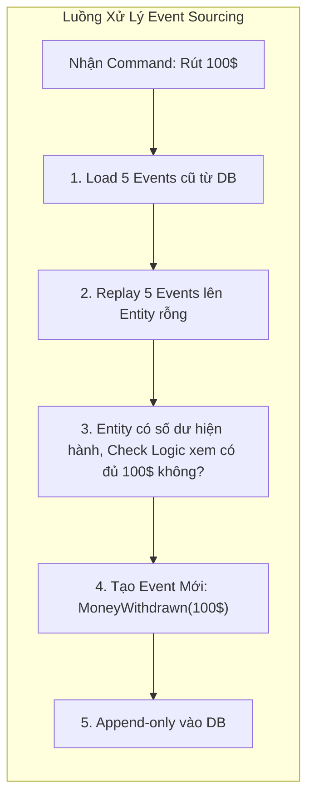

# Event Sourcing (Lưu trữ Sự kiện)

> **Ý tưởng chính việc sử dụng:** Thay vì lưu trạng thái hiện tại, ta lưu lại TẤT CẢ các sự kiện (hành động) đã xảy ra để có thể truy vết (Audit).
> **Ví dụ:** Thay vì lưu Số Dư = $50, ta lưu chuỗi sự kiện: Nạp $100 -> Rút $20 -> Rút $30. Muốn biết số dư thì cộng dồn lại.

Khi nói về CSDL, chúng ta thường nghĩ đến việc lưu trữ **trạng thái hiện tại** của một vật thể (ví dụ: số dư tài khoản của bạn đang là 10.000 VNĐ). Tuy nhiên, cách tiếp cận này sẽ xóa đi sạch sẽ toàn bộ dấu vết của việc "Tại sao bạn lại có 10.000 VNĐ?".
**Event Sourcing** là một cú đảo ngược tư duy: Thay vì lưu kết quả cuối cùng, hãy lưu **TOÀN BỘ lịch sử các sự kiện** đã xảy ra để cấu thành nên kết quả đó.

## 1. Mức Độ Cơ Bản (Basic)

### Event Sourcing là gì?
Hãy tưởng tượng hệ thống Kế toán. Bạn không thể cầm cục tẩy xóa dòng chữ "Quỹ: 50 triệu" để sửa thành "Quỹ: 30 triệu". Nếu làm vậy sếp sẽ đuổi việc bạn ngay vì không biết 20 triệu đi đâu!
Để đúng nguyên tắc, kế toán phải tạo một "Phiếu Chi" (Sự kiện: Đã chi 20 triệu tiền điện). Quỹ tự động tính toán lại thành 30 triệu. Sổ cái kế toán không bao giờ bị XÓA, nó chỉ GHI THÊM (Append-only).

Đó chính là Event Sourcing. Trong CSDL, bạn không có hàm `UPDATE` hay `DELETE`. Bạn chỉ có duy nhất hàm `INSERT` sự kiện mới.

### Ví dụ
Thay vì lưu 1 dòng trong bảng Users: `{ id: 1, name: "Bob", status: "ACTIVE" }`
Ta lưu 3 dòng trong bảng Events:
1. `UserCreated { id: 1, name: "Bob" }`
2. `UserLocked { id: 1, reason: "Spam" }`
3. `UserUnlocked { id: 1 }`
Trạng thái hiện tại (ACTIVE) được suy ra bằng cách "phát lại" (Replay) 3 sự kiện này từ đầu đến cuối.

## 2. Mức Độ Trung Bình (Intermediate): Under the Hood

### Cơ chế Rehydrate (Thủy phân / Phục hồi trạng thái)
Khi bạn cần load một Entity lên để xử lý nghiệp vụ, code sẽ thực hiện các bước sau:
1. Lấy toàn bộ mảng Events của Entity đó từ Event Store (CSDL lưu sự kiện).
2. Khởi tạo một cái Entity rỗng.
3. Dùng hàm `apply(event)` để chạy qua từng event một trong mảng, "vắt" dữ liệu đắp lên cái Entity rỗng đó.
4. Trả về Entity đã được phục hồi đầy đủ trạng thái hiện hành.

*Use Cases*: Các hệ thống tài chính, ngân hàng, e-commerce, hệ thống cần Audit (kiểm toán) lịch sử 100%, hoặc chức năng Undo/Redo (hoàn tác).
*Không nên dùng*: Ứng dụng quá đơn giản, team không quen với event-driven. Gây ra độ phức tạp cực cao.

## 3. Mức Độ Nâng Cao (Advanced)

### Cặp bài trùng: Event Sourcing + CQRS
Nếu bạn chỉ lưu Event, thì khi UI muốn hiện danh sách "Các user đang bị khóa", bạn không lẽ phải lôi hàng triệu cái event của toàn bộ user ra tính lại? Database sẽ chết ngay lập tức.
=> **BẮT BUỘC phải dùng CQRS**.
- Event Store đóng vai trò là **Write DB** (Nơi đón nhận Event).
- Phải có một con worker nghe lén các event này, sau đó build ra một cái Bảng danh sách User tĩnh (Trạng thái hiện hành) lưu vào **Read DB**. UI sẽ chọc vào Read DB để đọc (Rất nhanh).

### Snapshotting (Chụp ảnh trạng thái)
Nếu một Account sống 10 năm và có 1 triệu sự kiện giao dịch. Việc Replay 1 triệu sự kiện mỗi khi cần load Entity đó sẽ mất 5-10 giây.
=> **Snapshot**: Cứ sau 100 sự kiện, ta lưu (chụp ảnh) lại trạng thái cuối cùng của Entity ra 1 chỗ. Lần tới load, ta móc cái Snapshot 100 ra, rồi chạy tiếp từ event thứ 101. Tốc độ sẽ trở lại bình thường.

## 4. So Sánh (Compare & Contrast)

| Đặc điểm | State-based Persistence (CRUD truyền thống) | Event-based Persistence (Event Sourcing) |
| :--- | :--- | :--- |
| **Cách lưu** | Lưu trạng thái hiện tại (Ghi đè bằng UPDATE). | Chỉ nối thêm (Append-only) dữ liệu lịch sử sự kiện (INSERT). |
| **Bảo toàn dữ liệu** | Bị mất mát dấu vết nếu không tự code bảng Audit (Log). | Hoàn hảo 100%. Mọi thứ từng xảy ra đều được ghi nhận. |
| **Sửa sai (Lỗi code)** | Dữ liệu bị ghi đè sai là mất luôn. | Do chỉ lưu event, lỡ tính sai thì chỉ cần sửa thuật toán tính toán và Replay lại toàn bộ Event là data lại ĐÚNG! |
| **Độ khó** | Dễ, quen thuộc. | Siêu khó. Khó Debug, khó test. Đòi hỏi CQRS. |

## 5. Bài Tập Thực Hành Nhỏ

**Tình huống**: Trong file `demo-event-sourcing.ts`, chúng ta có class `BankAccount` đang dùng kiểu lưu trữ trạng thái (State-based) bình thường. Rất dễ bị ghi đè mất dấu vết (Không biết tại sao lại còn ngần này tiền).

*Nhiệm vụ*: Viết lại class `BankAccount` sử dụng **Event Sourcing**.
1. Lớp chỉ giữ mảng `events` nội bộ.
2. Viết hàm `applyEvent()` để đắp trạng thái lên.
3. Khi rút/nạp tiền, không cộng/trừ `balance` trực tiếp, mà phải chèn một Event vào mảng, rồi mới apply nó.

Code đề bài và đáp án nằm tại: [answers-event-sourcing](/Users/ductri0981/Documents/Studying-Software/event_sourcing/answers-event-sourcing.ts)

## 6. Phụ Lục (Sơ Đồ Kiến Trúc)

## 7. Giải Thích Thuật Ngữ (Glossary)
- **Event Sourcing (Lưu trữ bằng Sự kiện)**: Mô hình lưu trữ nơi mọi sự thay đổi trạng thái của ứng dụng đều được lưu dưới dạng một chuỗi các sự kiện.
- **Event Store**: Hệ quản trị cơ sở dữ liệu (hoặc thư viện) tối ưu chuyên biệt cho việc lưu chuỗi sự kiện. Chỉ cho phép chèn thêm (Append-only).
- **Rehydrate / Replay**: Hành động phát lại (chiếu lại) cuốn băng sự kiện từ số 0 để xây dựng lại hình hài của vật thể.
- **Snapshot (Bản chụp ảnh)**: Lưu trạng thái của entity ở một cột mốc nhất định (VD: phiên bản thứ 1000) để không phải Replay lại từ con số 0.
- **Append-only**: Chỉ được phép chèn thêm vào cuối danh sách. Không được cập nhật hay xóa dòng cũ.
