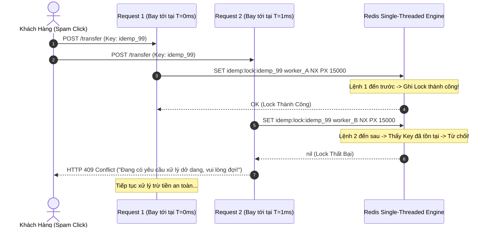
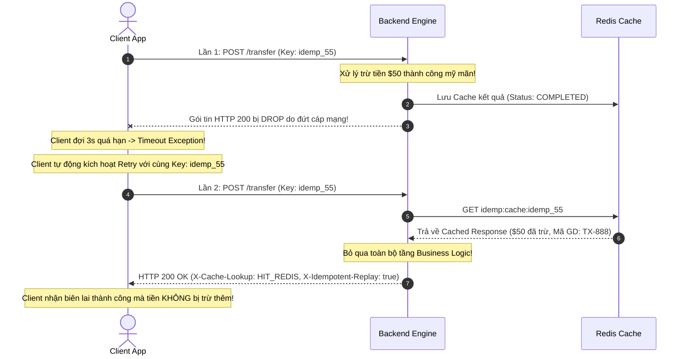
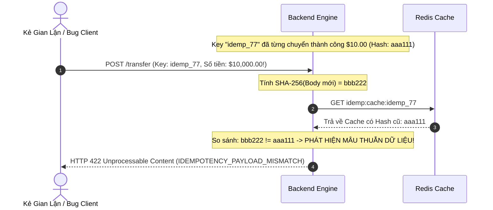

# Chuyên Sâu Về Idempotency Pattern (Tính Bất Biến & Xử Lý Trùng Lặp Phân Tán)

> **Kiến trúc hệ thống tài chính & vi dịch vụ có khả năng tự phục hồi, chống chịu lỗi mạng và loại bỏ hoàn toàn thảm họa trùng lặp dữ liệu (Double Spending / Duplicate Side-Effects).**

---

## 📑 MỤC LỤC TỔNG QUAN

1. [Mức Độ Cơ Bản (Basic Fundamentals)](#1-mức-độ-cơ-bản-basic-fundamentals)
   - [Định nghĩa & Ẩn dụ trực quan đời thực](#định-nghĩa--ẩn-dụ-trực-quan-đời-thực)
   - [Định nghĩa toán học & Chuẩn hóa giao thức HTTP](#định-nghĩa-toán-học--chuẩn-hóa-giao-thức-http)
   - [Vấn đề cốt lõi sinh ra Idempotency: "Ảo tưởng của điện toán phân tán"](#vấn-đề-cốt-lõi-sinh-ra-idempotency-ảo-tưởng-của-điện-toán-phân-tán)
   - [Kiến trúc luồng dữ liệu tổng quan (High-Level Architecture)](#kiến-trúc-luồng-dữ-liệu-tổng-quan-high-level-architecture)
2. [Mức Độ Trung Bình (Intermediate - Architecture & Use Cases)](#2-mức-độ-trung-bình-intermediate---architecture--use-cases)
   - [Các thành phần cốt lõi của một Idempotency Engine](#các-thành-phần-cốt-lõi-của-một-idempotency-engine)
   - [Chuẩn IETF Draft: Header `Idempotency-Key` trong REST API](#chuẩn-ietf-draft-header-idempotency-key-trong-rest-api)
   - [Vòng đời trạng thái (State Machine): `IN_PROGRESS` -> `COMPLETED` / `FAILED`](#vòng-đời-trạng-thái-state-machine-in_progress---completed--failed)
   - [Khi nào NÊN dùng và KHÔNG NÊN dùng](#khi-nào-nên-dùng-và-không-nên-dùng)
3. [Mức Độ Chuyên Sâu: BẢN CHẤT VẬN HÀNH (Under The Hood & Core Mechanics)](#3-mức-độ-chuyên-sâu-bản-chất-vận-hành-under-the-hood--core-mechanics)
   - [Nguyên Lý Nhận Diện & Mã Hóa Yêu Cầu (Fingerprinting & Hashing)](#nguyên-lý-nhận-diện--mã-hóa-yêu-cầu-fingerprinting--hashing)
   - [Dòng Chảy Dữ Liệu Hai Luồng: Write Path vs Read Path](#dòng-chảy-dữ-liệu-hai-luồng-write-path-vs-read-path)
   - [Bản Chất Phân Tán & Ảo Ảnh "Exactly-Once"](#bản-chất-phân-tán--ảo-ảnh-exactly-once)
4. [Mức Độ Nâng Cao: Vận Hành Thực Chiến (Production Engineering & Best Practices)](#4-mức-độ-nâng-cao-vận-hành-thực-chiến-production-engineering--best-practices)
   - [Tính Sẵn Sàng & Khả Năng Tự Phục Hồi (Fallback & Safe Lock)](#tính-sẵn-sàng--khả-năng-tự-phục-hồi-fallback--safe-lock)
   - [Chiến Lược Dọn Dẹp Dữ Liệu (TTL & Table Partitioning)](#chiến-lược-dọn-dẹp-dữ-liệu-ttl--table-partitioning)
   - [Anti-patterns & Sai lầm chí mạng cần tránh](#anti-patterns--sai-lầm-chí-mạng-cần-tránh)
5. [Góc Nhìn Thực Chiến Cho Middle-Level Trở Xuống (Must-Know vs Nice-to-Know Roadmap)](#5-góc-nhìn-thực-chiến-cho-middle-level-trở-xuống-must-know-vs-nice-to-know-roadmap)
   - [Phân định ranh giới kiến thức theo từng cấp độ](#phân-định-ranh-giới-kiến-thức-theo-từng-cấp-độ)
   - [Bộ câu hỏi phỏng vấn thực chiến kinh điển (Intern -> Middle)](#bộ-câu-hỏi-phỏng-vấn-thực-chiến-kinh-điển-intern---middle)
   - [Những thứ TẠM THỜI BỎ QUA (Dành riêng cho Senior / Tech Lead / SRE)](#những-thứ-tạm-thời-bỏ-qua-dành-riêng-cho-senior--tech-lead--sre)
6. [So Sánh Bản Chất (First-Principles Comparison)](#6-so-sánh-bản-chất-first-principles-comparison)
   - [Idempotent API vs Idempotent Consumer vs Natural Idempotency](#idempotent-api-vs-idempotent-consumer-vs-natural-idempotency)
   - [Bảng đối chiếu các giải pháp kỹ thuật](#bảng-đối-chiếu-các-giải-pháp-kỹ-thuật)
7. [Sơ Đồ Trực Quan (Mermaid Diagrams)](#7-sơ-đồ-trực-quan-mermaid-diagrams)
   - [Sơ đồ 1: Luồng chuẩn Happy Path](#sơ-đồ-1-luồng-chuẩn-happy-path)
   - [Sơ đồ 2: Xung đột đồng thời (Race Condition & Lock Contention)](#sơ-đồ-2-xung-đột-đồng-thời-race-condition--lock-contention)
   - [Sơ đồ 3: Rớt mạng Client Timeout & Tự động Retry an toàn](#sơ-đồ-3-rớt-mạng-client-timeout--tự-động-retry-an-toàn)
   - [Sơ đồ 4: Phát hiện gian lận thay đổi dữ liệu (Payload Tampering)](#sơ-đồ-4-phát-hiện-gian-lận-thay-đổi-dữ-liệu-payload-tampering)
8. [Bảng Tra Thuật Ngữ Chi Tiết (Glossary)](#8-bảng-tra-thuật-ngữ-chi-tiết-glossary)
9. [Hướng Dẫn Chạy & Kiểm Thử Hệ Thống (Step-by-Step Run Guide)](#9-hướng-dẫn-chạy--kiểm-thử-hệ-thống-step-by-step-run-guide)

---

## 1. Mức Độ Cơ Bản (Basic Fundamentals)

### Định nghĩa & Ẩn dụ trực quan đời thực

**Idempotency (Tính bất biến / Tính lũy đẳng)** trong khoa học máy tính là đặc tính của một hành động mà: **khi bạn thực thi nó một lần hay lặp lại hàng nghìn lần với cùng một tham số, kết quả cuối cùng trên trạng thái của hệ thống vẫn hoàn toàn không thay đổi so với lần thực thi đầu tiên.**

Để nắm bắt trực giác ngay lập tức, hãy tưởng tượng các sự vật trong đời sống hàng ngày:

1. **Nút gọi thang máy (Idempotent)**:
   - Bạn đứng đợi ở tầng 1 và bấm nút gọi thang máy 1 lần -> Đèn sáng lên, thang máy được điều động đi xuống.
   - Bạn sốt ruột và **bấm liên tục 10 lần nữa** -> Đèn vẫn sáng, thang máy vẫn chỉ điều động đúng 1 buồng thang xuống tầng 1. Số lần bạn bấm không làm xuất hiện 10 chiếc thang máy.
2. **Công tắc bật đèn phòng (Idempotent) vs Nút đảo trạng thái (Non-Idempotent)**:
   - Lệnh *"Hãy BẬT đèn"* (SET status = ON): Dù có hô 100 lần thì đèn vẫn ở trạng thái SÁNG. Đây là hành vi có tính lũy đẳng (Idempotent).
   - Lệnh *"Hãy BẤM công tắc"* (TOGGLE status): Bấm 1 lần đèn sáng, bấm lần 2 đèn tắt, bấm lần 3 đèn sáng lại. Đây là hành vi KHÔNG lũy đẳng (Non-Idempotent).
3. **Thanh toán tiền ví điện tử (Bài toán thảm họa nếu thiếu Idempotency)**:
   - Bạn mua món hàng $50. Bạn bấm nút *"Xác nhận thanh toán"*.
   - Mạng điện thoại chập chờn, vòng xoay loading quay mãi không dứt. Bạn bực mình bấm thêm 4 lần nữa.
   - **Nếu KHÔNG có Idempotency**: Tài khoản của bạn bị ngân hàng trừ tiền 5 lần ($250)!
   - **Nếu CÓ Idempotency**: Ngân hàng nhận diện 5 yêu cầu đó có chung một mã định danh (`Idempotency-Key`), chỉ xử lý trừ tiền duy nhất lần đầu ($50), 4 lần sau trả về ngay biên lai đã trừ tiền mà không chạm vào tài khoản.

---

### Định nghĩa toán học & Chuẩn hóa giao thức HTTP

Về mặt toán học hình thức, một hàm số $f$ được gọi là lũy đẳng (idempotent) nếu với mọi đầu vào $x$:

$$f(f(x)) = f(x)$$

Áp dụng hàm nhiều lần liên tiếp không làm biến đổi giá trị đầu ra so với lần gọi đầu.

Trong chuẩn giao thức mạng **HTTP (RFC 7231 & RFC 9110)**:
- **Phương thức Safe (An toàn)**: Không làm thay đổi trạng thái tài nguyên trên máy chủ (`GET`, `HEAD`, `OPTIONS`).
- **Phương thức Idempotent (Lũy đẳng theo chuẩn HTTP)**:
  - `GET`, `HEAD`, `OPTIONS`: Đương nhiên là idempotent vì chúng là read-only.
  - `PUT`: Cập nhật toàn bộ tài nguyên theo một bản thể cụ thể (`PUT /users/123` với body `{ "name": "Alice" }`). Gọi 1 lần hay 100 lần thì bản ghi user 123 vẫn giữ nguyên tên "Alice".
  - `DELETE`: Xóa tài nguyên (`DELETE /orders/456`). Gọi lần đầu xóa thành công (200/204), gọi các lần sau tài nguyên đã biến mất (404/204). Trạng thái cuối cùng của database là tài nguyên 456 không còn tồn tại.
- **Phương thức Non-Idempotent**:
  - `POST`: Thường dùng để tạo mới tài nguyên (`POST /payments`, `POST /orders`). Mỗi lần gọi lại máy chủ có thể cấp phát một ID mới và sinh ra tác dụng phụ mới (Side-Effect). **Đây chính là nơi chúng ta bắt buộc phải xây dựng cơ chế Idempotency nhân tạo (Synthesized Idempotency)**.

---

### Vấn đề cốt lõi sinh ra Idempotency: "Ảo tưởng của điện toán phân tán"

Trong hệ thống đơn máy chủ (Monolithic chạy chung một luồng/bộ nhớ), việc gọi một hàm thường trả về ngay kết quả: Thành công hoặc Thất bại.

Nhưng trong **Hệ thống phân tán (Distributed Systems / Microservices)**, mọi giao tiếp đều phải đi qua dây cáp mạng (Network Cables, Routers, Switches, WiFi, 4G/5G). Định luật kinh điển của L. Peter Deutsch về **8 Sai lầm ngớ ngẩn của lập trình viên về mạng (Fallacies of Distributed Computing)** chỉ ra rằng:
> *"Mạng không bao giờ đáng tin cậy (The network is reliable is a lie)."*

Khi Service A gọi Service B qua HTTP hoặc RPC:

```
[Service A] --------(1) Request HTTP POST /charge--------> [Service B]
[Service A]                                                [Service B xử lý trừ tiền $50 OK]
[Service A] <xxxxxxx(2) Network Socket bị đứt cápxxxxxxxxx [Service B trả về 200 OK]
```

Lúc này, **Service A rơi vào trạng thái mù thông tin hoàn toàn (Ambiguous State / In-doubt)**:
- Request (1) đã tới được Service B chưa?
- Service B đã xử lý trừ tiền trong Database chưa?
- Hay là Service B chết trước khi nhận được request?
- Hay Service B đã trừ tiền xong xuôi nhưng gói tin Response (2) bị router đánh rơi trên đường về?

Theo bản năng sinh tồn của hệ thống, khi bị timeout (quá thời gian chờ), Service A hoặc Client **bắt buộc phải kích hoạt cơ chế Retry (thử lại)**. Nhưng nếu Service B đã trừ tiền ở lần 1 rồi, mà lần 2 lại nhận thêm một request nữa thì chuyện gì xảy ra? **DOUBLE SPENDING (Mất tiền kép)**.

> 💡 **CẦU NỐI TRỰC QUAN**:  
> - **Nôm na nó là gì?** Idempotency giống như chiếc **tem chống làm giả có số seri duy nhất**. Dù khách hàng có gửi 10 bức thư khiếu nại giống nhau tới tòa nhà, nhân viên tiếp tân nhìn vào số seri thấy đã được giải quyết rồi thì chỉ việc lấy bản sao biên bản cũ ra gửi lại, không cử thêm nhân viên đi điều tra lại từ đầu.  
> - **Tại sao sinh ra nó?** Vì trong mạng máy tính, bạn không bao giờ biết được đối phương đã nghe thấy mình nói hay chưa khi bị ngắt kết nối giữa chừng (Bài toán Hai vị tướng - Two Generals' Problem).  
> - **Nếu không có nó thì hệ thống sập thế nào?** Khách hàng bị trừ tiền 2 lần; kho hàng xuất 2 đơn; tài xế Grab được gọi 2 lần cho 1 chuyến đi; message broker gửi đi gửi lại khiến database nổ tung vì xung đột khóa ngoại.

---

### Kiến trúc luồng dữ liệu tổng quan (High-Level Architecture)

```
                       +---------------------------------------------+
                       |              IDEMPOTENCY ENGINE             |
                       +---------------------------------------------+
                                              |
[Client / Gateway]                            |
       |                                      v
       | (1) POST /transfer          +------------------+
       | [Idempotency-Key: idemp_1]  | Fast Cache       | (Key Exists? Return Cache!)
       +---------------------------->| (Redis SETNX)    |
                                     +------------------+
                                              | (Lock Acquired)
                                              v
                                     +------------------+
                                     | Durable Store    | (Status: IN_PROGRESS)
                                     | (PostgreSQL)     |
                                     +------------------+
                                              |
                                              v
                                     +------------------+
                                     | Core Business    | (SELECT FOR UPDATE)
                                     | Logic & Ledger   | (Deduct Balance)
                                     +------------------+
                                              |
                                              v
                                     +------------------+
                                     | Finalize & Cache | (Status: COMPLETED)
       <-----------------------------| (Save Response)  | (Release Redis Lock)
       | (2) HTTP 200 OK + Payload   +------------------+
```

---

## 2. Mức Độ Trung Bình (Intermediate - Architecture & Use Cases)

### Các thành phần cốt lõi của một Idempotency Engine

Để tạo nên một bộ máy Idempotency đạt chuẩn Enterprise, 5 thành phần sau là bắt buộc:

1. **Idempotency Key (Khóa định danh)**:
   - Một chuỗi ký tự duy nhất do Client (hoặc API Gateway / Message Producer) sinh ra trước khi gửi request.
   - Thường sử dụng chuẩn **UUIDv4** (`c9a646d3-9c61-4c96-bfeb-43e7c8f192aa`) hoặc **Deterministic Business Key** (`ord_user123_checkout_20261005`).
2. **Request Payload Fingerprint (Dấu vân tay dữ liệu - SHA-256)**:
   - Dùng để ngăn chặn lỗi **Payload Tampering** (gian lận hoặc code lỗi vô tình tái sử dụng cùng một Key nhưng gửi nội dung khác, ví dụ: Key cũ chuyển $10, nay gửi lại chuyển $10,000).
   - Được tính bằng: $\text{SHA-256}(\text{HTTP Method} + \text{URL Path} + \text{Canonicalized JSON Body})$.
3. **Distributed Atomic Lock (Khóa phân tán nguyên tử)**:
   - Ngăn chặn cuộc tấn công đồng thời (**Race Condition / Concurrency Storm**) khi 5 request cùng mang 1 Key ập tới máy chủ trong cùng 1 mili-giây.
   - Triển khai trên Redis bằng lệnh nguyên tử: `SET key worker_token NX PX 15000`.
4. **State Machine Tracker (Máy trạng thái vòng đời)**:
   - Theo dõi trạng thái tiến trình của Key: `IN_PROGRESS`, `COMPLETED`, `FAILED`.
5. **Durable Response Cache (Kho lưu trữ phản hồi)**:
   - Lưu trữ nguyên vẹn: `HTTP Status Code`, `Response Headers`, `JSON Response Body` để có thể "phát lại" (Replay) cho Client mà không cần chạm vào tầng nghiệp vụ.

---

### Chuẩn IETF Draft: Header `Idempotency-Key` trong REST API

Nhóm công tác IETF (Internet Engineering Task Force) đã ban hành tài liệu dự thảo chuẩn hóa: **`draft-ietf-httpapi-idempotency-key-header`**.

Các quy tắc ứng xử theo chuẩn IETF:
- **Client gửi kèm Header**:
  ```http
  POST /api/v1/payments HTTP/1.1
  Host: api.nexuspay.com
  Idempotency-Key: 7b8b548b-30d8-4f01-9f93-41bbd9c15814
  Content-Type: application/json

  {
    "fromAccount": "ACC-1001",
    "toAccount": "ACC-2002",
    "amount": 50.00
  }
  ```
- **Các mã HTTP Status đặc thù quy định bởi IETF**:
  - `400 Bad Request`: Header `Idempotency-Key` bị thiếu hoặc định dạng không hợp lệ (nếu endpoint bắt buộc phải có).
  - `409 Conflict`: Đang có một request mang cùng Idempotency Key này đang được xử lý dở dang (In-Flight / In-Progress). Đi kèm header `Retry-After: 2`.
  - `422 Unprocessable Content`: Phát hiện Idempotency Key này đã từng được sử dụng trước đó nhưng với Request Payload (Body) hoàn toàn khác nhau (Payload Tampering / Request Mismatch).
  - `200 OK` hoặc `201 Created` đi kèm header `X-Idempotent-Replay: true`: Request này đã được xử lý thành công trước đó và đang phát lại kết quả cũ từ Cache.

### Vòng đời trạng thái (State Machine): IN_PROGRESS -> COMPLETED / FAILED

```
[Client Request Đến]
         │
         ▼
[Ghi trạng thái IN_PROGRESS]
         │
    ┌────┴────────────────────────┐
    ▼                             ▼
(Thành công)                 (Thất bại)
    │                             │
    ▼                             ▼
[Ghi trạng thái COMPLETED]   [Ghi trạng thái FAILED / Giải phóng Key]
    │                             │
    ▼                             ▼
(Cache vĩnh viễn / TTL 24h)   (Cho phép thử lại với Key mới)
```

### Khi nào NÊN dùng và KHÔNG NÊN dùng
- **NÊN DÙNG**:
  - Các API thanh toán, trừ tiền thẻ ví điện tử (Payment Gateways).
  - Các API đặt mua hàng, giữ phòng khách sạn, tạo đơn giao hàng.
  - Các background event consumers nhận message từ Message Broker (RabbitMQ, Kafka) có cơ chế retry At-least-once.
- **KHÔNG NÊN DÙNG**:
  - Các API thuần túy đọc dữ liệu `GET` (đã tự có tính chất Idempotent tự nhiên).
  - Các API logging, telemetry, metric analytics cho phép sai số nhỏ hoặc cần ghi nhận mọi sự kiện người dùng bấm.
  - Các API có tần suất ghi cực cao (> 100,000 req/sec) cho các dữ liệu tạm thời không quan trọng (ví dụ view counter của video ngắn).

---

## 3. Mức Độ Chuyên Sâu: BẢN CHẤT VẬN HÀNH (Under The Hood & Core Mechanics)

### 3.1 Nguyên Lý Nhận Diện & Mã Hóa Yêu Cầu (Fingerprinting & Hashing)

#### 1. Quy tắc sinh Idempotency Key an toàn từ Client
- **Bắt buộc dùng UUIDv4**: Mã định danh Idempotency Key phải là một chuỗi ngẫu nhiên toàn cầu (ví dụ: `9b1deb4d-3b7d-4bad-9bdd-2b0d7b3dcb6d`).
- **Gắn chặt với Form / Thao tác người dùng**: Client (Frontend) sinh ra key này ngay khi trang thanh toán được render và giữ nguyên key đó suốt phiên thanh toán. Nếu người dùng bấm "Thanh toán" 5 lần do mạng lag, cả 5 request đều mang **chính xác 1 Idempotency Key** này.
- *Sai lầm phổ biến*: Tuyệt đối không sinh key bằng `Date.now()`, vì mỗi lần click cách nhau vài mili-giây sẽ tạo ra timestamp khác nhau, khiến hệ thống hiểu nhầm thành 2 giao dịch khác nhau.

#### 2. Nhận diện gian lận thay đổi dữ liệu (Request Fingerprinting với SHA-256)
Điều gì xảy ra nếu kẻ xấu cố tình tái sử dụng một `Idempotency-Key` cũ nhưng thay đổi nội dung thanh toán từ $10 thành $1,000?
- **Thuật toán Canonicalize & Hashing**:
  1. Backend nhận Request Body, sắp xếp các key theo thứ tự bảng chữ cái (Canonical JSON Serialization) để đảm bảo `{ a: 1, b: 2 }` và `{ b: 2, a: 1 }` luôn cho ra một chuỗi duy nhất.
  2. Băm chuỗi này bằng thuật toán **SHA-256** tạo ra một mã đại diện (Request Hash).
  3. Lưu mã Hash này kèm theo Idempotency Key. Nếu một request đến sau có cùng Key nhưng khác Hash, hệ thống lập tức từ chối với mã lỗi **`422 Unprocessable Content`** (Phát hiện Payload bị sửa đổi).

---

### 3.2 Dòng Chảy Dữ Liệu Hai Luồng: Write Path vs Read Path

Hệ thống Idempotency Engine vận hành trên mô hình **Hai Luồng Tốc Độ (Dual-Path Execution)**:

```
[Client Gửi Request Kèm Idempotency-Key]
                 │
                 ▼
     [Kiểm Tra Redis Cache]
        │              │
   (Cache Hit)    (Cache Miss / Lần Đầu)
        │              │
        │              ▼
        │     [Acquire Distributed Lock: SETNX]
        │        │                   │
        │    (Lock Thất Bại)     (Lock Thành Công)
        │        │                   │
        │        ▼                   ▼
        │   [409 Conflict]     [Ghi Trạng Thái IN_PROGRESS]
        │                            │
        │                            ▼
        │                      [Thực Thi Nghiệp Vụ Chính]
        │                      (Trừ tiền, Tạo đơn hàng DB)
        │                            │
        │                            ▼
        │                      [Ghi Trạng Thái COMPLETED]
        │                      (Lưu Cache Redis + Bền Vững DB)
        │                            │
        │                            ▼
        │                      [Giải Phóng Lock An Toàn]
        ▼                            │
[Trả Về Kết Quả Kèm Header           ▼
 X-Idempotent-Replay: true]    [Trả Về Kết Quả Thành Công]
```

#### 1. Luồng Ghi Mới (Write Path - Lần đầu tiên gọi):
1. **Khóa chống tranh chấp (Concurrency Lock)**: Dùng lệnh nguyên tử Redis `SET idemp:lock:{key} worker_id NX PX 15000`. Lệnh này đảm bảo nếu 2 request đến cùng tích tắc, chỉ duy nhất 1 request chiếm được quyền xử lý. Request thứ hai nhận lỗi `409 Conflict` yêu cầu thử lại sau.
2. **Ghi nhận trạng thái `IN_PROGRESS`**: Đánh dấu giao dịch đang chạy để phòng trường hợp server sập giữa chừng.
3. **Thực thi nghiệp vụ trong Transaction**: Trừ tiền ví, tạo đơn hàng trong Database.
4. **Lưu kết quả `COMPLETED`**: Lưu toàn bộ HTTP Status Code và Response JSON vào PostgreSQL bền vững và đồng thời ghi vào Redis Cache.
5. **Giải phóng Lock**: Hoàn tất xử lý an toàn và trả kết quả về cho Client.

#### 2. Luồng Phát Lại (Read Path - Replay Cache):
1. Khi Client bấm nút lần thứ 2 hoặc mạng bị ngắt khiến gói tin gửi lại (TCP/HTTP Retry):
2. Backend kiểm tra thấy Key đã có trạng thái `COMPLETED` trong Redis Cache.
3. So khớp mã Hash SHA-256 trùng khớp 100%.
4. Backend **lấy ngay Response JSON từ RAM Redis trả về trong 1-2ms**, kèm theo header `X-Idempotent-Replay: true`.
5. **Lợi ích**: Hoàn toàn không chạm vào database, không chạy transaction, không tốn I/O đĩa!

---

### 3.3 Bản Chất Phân Tán & Ảo Ảnh "Exactly-Once"

Trong khoa học máy tính phân tán, **không thể đảm bảo một gói tin mạng chỉ gửi đến đúng 1 lần (Exactly-Once Delivery)**. Mạng Internet luôn có độ trễ, rớt gói tin và đứt cáp tạm thời.

Hạ tầng mạng chỉ có thể cam kết chuẩn **At-Least-Once Delivery (Ít nhất một lần)**: nếu chưa nhận được phản hồi ACK, hệ thống mạng hoặc client sẽ gửi lại gói tin cho đến khi thành công.

> 💡 **Bản chất của Idempotency Pattern**:
> 
> $$\text{Hạ Tầng Gửi Lặp (At-Least-Once)} + \text{Xử Lý Lũy Đẳng (Idempotency)} \equiv \text{Hiệu Ứng Duy Nhất Một Lần (Exactly-Once)}$$
> 
> Bằng cách trang bị Idempotency tại tầng ứng dụng, lập trình viên loại bỏ hoàn toàn rủi ro xử lý trùng lặp mà không cần đòi hỏi một đường truyền mạng hoàn hảo không bao giờ lag.

---

## 4. Mức Độ Nâng Cao: Vận Hành Thực Chiến (Production Engineering & Best Practices)

### 4.1 Tính Sẵn Sàng & Khả Năng Tự Phục Hồi (Fallback & Safe Lock)

#### 1. Cơ chế Fallback khi Redis gặp sự cố (Graceful Degradation)
- Redis là tầng đệm siêu tốc (Fast-Path). Nếu Redis bị sập đột ngột, hệ thống không được phép dừng luồng thanh toán của khách hàng.
- **Chiến lược phòng thủ**: Khi không kết nối được Redis, Idempotency Engine tự động hạ cấp xuống sử dụng **Khóa Unique Constraint và Row Lock (`FOR UPDATE`) trên PostgreSQL**. Hệ thống chạy chậm hơn 10-15ms nhưng độ an toàn tài chính vẫn bảo toàn 100%.

#### 2. Giải phóng Lock an toàn bằng Lua Script (Safe Atomic Unlock)
Tuyệt đối không dùng `redis.del(lockKey)` đơn giản, vì nếu request A chạy quá hạn TTL, request B nhảy vào lấy lock, request A chạy xong gọi `del` sẽ **vô tình xóa mất lock của request B**!
- **Giải pháp chuẩn**: Kiểm tra Token sở hữu trước khi xóa bằng Lua Script nguyên tử:
```lua
if redis.call("get", KEYS[1]) == ARGV[1] then
  return redis.call("del", KEYS[1])
else
  return 0
end
```

---

### 4.2 Chiến Lược Dọn Dẹp Dữ Liệu (TTL & Table Partitioning)

1. **Quản lý RAM trên Redis**:
   - Mọi key lưu kết quả trả về bắt buộc phải có thời gian sống (TTL, ví dụ: 24 giờ). Sau 24 giờ, các giao dịch đã hoàn tất đối soát, dữ liệu cũ sẽ tự động biến mất khỏi RAM để nhường chỗ cho giao dịch mới.
2. **Dọn dẹp bảng Database (Table Partitioning by Month)**:
   - Sau vài tháng, bảng `idempotency_keys` có thể phình to hàng chục triệu dòng.
   - **Giải pháp**: Phân vùng bảng theo tháng (`PARTITION BY RANGE (created_at)`). Định kỳ hàng tháng, DBA chỉ cần xóa partition cũ (`DROP TABLE idempotency_keys_2025_01`) trong tích tắc mà không gây khóa bảng hay phân mảnh đĩa.

---

### 4.3 Anti-patterns & Sai Lầm Chí Mạng Cần Tránh

| Anti-Pattern | Cơ chế gây họa | Hậu quả thực tế | Cách khắc phục chuẩn Enterprise |
| :--- | :--- | :--- | :--- |
| **Client sinh key bằng Timestamp (`Date.now()`)** | Khi người dùng double click nhanh, 2 request sinh ra cách nhau 1-2ms, timestamp khác nhau hoàn toàn. | Máy chủ coi đó là 2 key khác biệt, thực hiện trừ tiền 2 lần! | Bắt buộc Client sinh **UUIDv4 ngẫu nhiên** gắn vào trang/form checkout ngay từ khi form được render. |
| **Không hash Request Payload** | Client code lỗi tái sử dụng 1 Idempotency Key cố định cho tất cả các đơn hàng khác nhau. | Đơn hàng thứ 2 của khách hàng bị trả về kết quả của đơn hàng thứ nhất, tiền không trừ nhưng hàng không giao! | Bắt buộc tính mã **SHA-256 Fingerprint** của Body. Nếu trùng Key khác Body lập tức trả về `422 Unprocessable Content`. |
| **Giải phóng Lock trước khi Database Transaction Commit** | Backend giải phóng lock Redis ở dòng lệnh trước, sau đó mới gọi `await client.query('COMMIT')`. | Trong khoảng hở vài chục micro-giây đó, request thứ 2 lao vào lấy được lock ngay khi DB chưa commit xong -> Đọc dữ liệu cũ (Dirty/Phantom Read). | Luôn giải phóng Lock trong khối `finally` sau khi DB đã **COMMIT thành công**. |
| **Lock TTL quá ngắn (< thời gian DB timeout)** | Đặt lock TTL 2 giây trong khi DB query timeout là 5 giây. | Khi DB bị nghẽn tải chạy mất 3 giây, lock hết hạn giữa chừng, request retry nhảy vào chạy đè lên. | Đặt Lock TTL tối thiểu gấp 2.5 lần thời gian Timeout tối đa của API. |

---

## 5. Góc Nhìn Thực Chiến Cho Middle-Level Trở Xuống (Must-Know vs Nice-to-Know Roadmap)

> 💡 **Thông điệp giải tỏa áp lực**: Nếu bạn là Intern, Junior hoặc Mid-level, bạn không cần phải áp lực về việc phân tích giao thức mạng TCP retransmission, DMA memory ingress hay sự cố trôi đồng hồ (Clock drift) giữa các data center. Giá trị lớn nhất của Idempotency trong công việc hàng ngày là **bảo vệ tài khoản của khách hàng không bị trừ tiền 2 lần khi mạng lag**. Dưới đây là lộ trình thực chiến 80/20.

---

### Phân định ranh giới kiến thức theo từng cấp độ

```
  +---------------------------------------------------------------------------------+
  | CẤP ĐỘ INTERN / JUNIOR (QUY TẮC 80/20 - SỬ DỤNG VÀ HIỂU ĐÚNG PATTERN)           |
  |  - Hiểu ẩn dụ nút gọi thang máy & bài toán Double Spending trong thanh toán     |
  |  - Biết cách nhận Header `Idempotency-Key` từ Client (UUIDv4)                   |
  |  - Biết cách dùng Redis `SET key value NX PX` để làm lock đơn giản              |
  |  - Biết cách lưu và trả về response cache với `X-Idempotent-Replay: true`       |
  +---------------------------------------------------------------------------------+
                                          │
                                          ▼
  +---------------------------------------------------------------------------------+
  | CẤP ĐỘ MIDDLE-LEVEL (VẬN HÀNH BỀN VỮNG & CHỐNG LỖI PHÂN TÁN)                    |
  |  - Canonical JSON Serialization & SHA-256 Hashing để chống Payload Tampering    |
  |  - Quản lý trạng thái State Machine: `IN_PROGRESS` -> `COMPLETED` / `FAILED`    |
  |  - Giải phóng Lock an toàn bằng Lua Script (chống xóa nhầm lock của worker khác)|
  |  - Thiết kế cơ chế Fallback sang PostgreSQL Unique Index khi Redis gặp sự cố    |
  |  - Cấu hình TTL dọn dẹp bộ nhớ Redis và kế hoạch phân vùng bảng Database        |
  +---------------------------------------------------------------------------------+
```

#### Intern / Junior: Những gì BẮT BUỘC phải nắm vững
1. **Mô hình tư duy cốt lõi**: Nắm vững khái niệm Idempotency qua ẩn dụ nút thang máy: bấm 1 lần hay 10 lần thì kết quả trạng thái cuối cùng vẫn chỉ có 1 thang máy đi xuống.
2. **Kỹ năng lập trình**:
   - Đọc header `Idempotency-Key` trong Express/NestJS middleware.
   - Kiểm tra Redis: nếu có kết quả cũ thì trả về ngay; nếu chưa có thì cho request đi tiếp vào controller.
   - Nhớ gán TTL (thời gian hết hạn) cho key trong Redis để tránh phình bộ nhớ.

#### Middle-Level: Tối ưu hóa & Thiết kế chuẩn mực
1. **Chống gian lận Payload (Payload Tampering)**: Không chỉ check Key mà phải băm Request Body bằng SHA-256 để phát hiện nếu Client đổi tiền hoặc đổi số tài khoản mà dùng lại Key cũ.
2. **Xử lý tình huống tranh chấp (Concurrent Requests)**: Xử lý đúng mã HTTP `409 Conflict` khi có 2 request cùng Key đang chạy đồng thời, và `422 Unprocessable` khi lệch Payload Hash.
3. **Thứ tự thực hiện Transaction**: Luôn giải phóng lock SAU KHI Database Transaction đã COMMIT thành công.

---

### Bộ câu hỏi phỏng vấn thực chiến kinh điển (Intern -> Middle)

#### Câu 1 (Intern/Junior): Tại sao các phương thức HTTP `GET`, `PUT`, `DELETE` mặc định được coi là Idempotent, còn `POST` thì không?
- **Trả lời ghi điểm**:
  - `GET`: Chỉ đọc dữ liệu, không làm thay đổi trạng thái hệ thống.
  - `PUT`: Thay thế toàn bộ bản ghi bằng dữ liệu mới. Dù gửi 1 lần hay 100 lần với cùng dữ liệu, bản ghi trong DB vẫn giữ nguyên trạng thái đó.
  - `DELETE`: Xóa tài nguyên có ID cụ thể. Lần đầu xóa thành công, các lần sau bản ghi không còn thì trạng thái dữ liệu vẫn là "đã bị xóa".
  - `POST`: Thường dùng để tạo mới tài nguyên (ví dụ: tạo đơn hàng, chuyển khoản). Mỗi lần gọi `POST` mới mà không có cơ chế chặn sẽ tạo thêm 1 bản ghi mới trong DB.

#### Câu 2 (Junior/Middle): Điều gì xảy ra nếu 2 request thanh toán mang cùng một `Idempotency-Key` đến server tại cùng một thời điểm chính xác?
- **Trả lời ghi điểm**:
  - Nếu không có cơ chế khóa, cả 2 request sẽ cùng kiểm tra DB/Redis thấy chưa có kết quả và cùng thực thi lệnh trừ tiền (Race Condition).
  - Để ngăn chặn, hệ thống phải sử dụng lệnh khóa nguyên tử (Atomic Lock như `SETNX` trong Redis). Request đến trước lấy được lock sẽ được xử lý và đánh dấu trạng thái `IN_PROGRESS`. Request thứ hai thất bại khi lấy lock sẽ nhận mã phản hồi `409 Conflict` kèm header `Retry-After` để thử lại sau khi request thứ nhất hoàn tất.

#### Câu 3 (Middle): Làm thế nào để đảm bảo tính Idempotency khi hệ thống Redis Cache bị sập đột ngột?
- **Trả lời ghi điểm**:
  - Redis chỉ đóng vai trò Fast-Path Caching. Để đảm bảo bền vững, tầng Database (PostgreSQL/MySQL) bắt buộc phải có bảng lưu `idempotency_keys` với ràng buộc duy nhất (Unique Constraint trên cột `key`).
  - Khi Redis chết, hệ thống tự động kích hoạt cơ chế Fallback: thực hiện `INSERT INTO idempotency_keys ... ON CONFLICT DO NOTHING` hoặc dùng Transaction Row-level Lock trên DB. Nếu bản ghi đã tồn tại, DB sẽ báo lỗi trùng lặp và trả về dữ liệu cũ, bảo toàn tính đúng đắn 100% của nghiệp vụ.

---

### Những thứ TẠM THỜI BỎ QUA (Dành riêng cho Senior / Tech Lead / SRE)
- **TCP Retransmission & Socket buffer kernel mechanics**: Cơ chế tự động gửi lại gói tin ở tầng mạng Linux.
- **Clock Drift & NTP Synchronization**: Tinh thể thạch anh bo mạch chủ lệch giờ và ảnh hưởng tới thuật toán phân tán Redlock.
- **Stop-the-World Garbage Collection & Zombie Writes**: Tối ưu hóa JVM GC pauses để tránh hiện tượng worker bị ngủ đông mất lock.
- *Đây là các bài toán quy mô phân tán toàn cầu cực lớn, ở cấp độ Middle trở xuống chỉ cần nắm vững giải pháp tầng ứng dụng với Redis và Database!*

---

## 6. So Sánh Bản Chất (First-Principles Comparison)

### Idempotent API vs Idempotent Consumer vs Natural Idempotency

| Đặc tính | HTTP Idempotency-Key (API Level) | Idempotent Consumer (Message Broker Level) | Natural Idempotency (Database Level) |
| :--- | :--- | :--- | :--- |
| **Vị trí áp dụng** | Tầng Web Gateway / Ingress Controller / Reverse Proxy | Tầng Background Worker / Queue Subscriber | Tầng RDBMS / NoSQL Engine |
| **Giao thức** | HTTP REST, gRPC metadata | AMQP (RabbitMQ), Kafka Offset, AWS SQS | SQL (`INSERT ... ON CONFLICT`), MongoDB Upsert |
| **Cơ chế lưu trữ** | Redis Cache + Bảng `idempotency_keys` | Bảng `inbox_messages` (Inbox Pattern) | B-Tree Unique Constraints / Version Column |
| **Xử lý Response** | Lưu toàn bộ Status Code + Response JSON để trả lại | Không có Response HTTP; chỉ ACK message về Broker | Trả về số dòng bị tác động (Row affected = 0 hoặc 1) |
| **Khả năng chịu tải** | Cần tốc độ cao, độ trễ thấp (< 10ms) | Chấp nhận độ trễ vài trăm mili-giây | Phụ thuộc IOPS và Lock Contention của ổ cứng DB |

---

## 7. Sơ Đồ Trực Quan (Mermaid Diagrams)

### Sơ đồ 1: Luồng chuẩn Happy Path

```mermaid
sequenceDiagram
    autonumber
    actor Client as Client / Frontend
    participant Mid as Idempotency Middleware
    participant Redis as Redis Cache & Lock
    participant DB as PostgreSQL Ledger

    Client->>Mid: POST /api/transfer (Idempotency-Key: idemp_01)
    Note over Mid: Tính SHA-256(Body)
    Mid->>Redis: GET idemp:cache:idemp_01
    Redis-->>Mid: null (Cache Miss)
    Mid->>Redis: SET idemp:lock:idemp_01 token NX PX 15000
    Redis-->>Mid: OK (Lock Acquired)
    Mid->>DB: INSERT INTO idempotency_keys (Status: IN_PROGRESS)
    
    rect rgb(20, 40, 30)
    Note over Mid,DB: Thực thi Business Logic trong DB Transaction
    Mid->>DB: BEGIN -> SELECT balance FOR UPDATE -> UPDATE balance -> COMMIT
    end
    
    Mid->>DB: UPDATE idempotency_keys (Status: COMPLETED, Response: 200)
    Mid->>Redis: SETEX idemp:cache:idemp_01 86400 (Response JSON)
    Mid->>Redis: EVAL Lua Release Lock
    Redis-->>Mid: Lock Released
    Mid-->>Client: HTTP 200 OK (X-Cache-Lookup: MISS, X-Idempotent-Replay: false)
```



---

### Sơ đồ 2: Xung đột đồng thời (Race Condition & Lock Contention)



---

### Sơ đồ 3: Rớt mạng Client Timeout & Tự động Retry an toàn



---

### Sơ đồ 4: Phát hiện gian lận thay đổi dữ liệu (Payload Tampering)



---

## 8. Bảng Tra Thuật Ngữ Chi Tiết (Glossary)

| Thuật ngữ | Tên tiếng Anh | Bản chất kỹ thuật & Ý nghĩa vận hành |
| :--- | :--- | :--- |
| **Tính Lũy Đẳng** | Idempotency | Đặc tính của phép toán: $f(f(x)) = f(x)$. Thực hiện nhiều lần không sinh thêm tác dụng phụ. |
| **Khóa Lũy Đẳng** | Idempotency Key | Chuỗi định danh duy nhất (thường là UUIDv4) đại diện cho 1 ý định giao dịch duy nhất. |
| **Phát lại kết quả** | Idempotent Replay | Hành động lấy nguyên vẹn status code, header và body đã lưu từ trước trả về cho client mà không tính toán lại. |
| **Phân phối ít nhất một lần** | At-least-once Delivery | Mô hình vận chuyển mạng cam kết không làm mất tin nhắn nhưng chấp nhận có khả năng gửi trùng. |
| **Phân phối chính xác một lần** | Exactly-once Semantics | Trạng thái lý tưởng nơi mỗi thông điệp chỉ tạo ra đúng 1 tác động thực tế lên database. |
| **Khóa Phân Tán** | Distributed Lock | Cơ chế đồng bộ hóa giữa nhiều node server độc lập nhằm bảo vệ tài nguyên chia sẻ không bị truy cập đồng thời. |
| **Lệnh SETNX** | Set if Not Exists | Lệnh nguyên tử của Redis, chỉ ghi giá trị vào bộ nhớ nếu key đó chưa từng tồn tại. |
| **Chuẩn hóa dữ liệu** | Canonicalization | Quy trình sắp xếp các trường của đối tượng JSON theo thứ tự xác định trước khi tính mã hash. |
| **Thẻ bài bảo vệ** | Fencing Token | Số thứ tự tăng dần cấp phát kèm theo distributed lock để phát hiện và chặn các worker bị trễ (Zombie writes). |
| **Khóa mức dòng** | Row-Level Locking | Kỹ thuật của RDBMS (`SELECT ... FOR UPDATE`) khóa chặt 1 dòng dữ liệu trong transaction để chống ghi đè dữ liệu. |
| **Kiểm soát đồng thời lạc quan** | OCC (Optimistic Concurrency Control) | Cơ chế kiểm tra phiên bản dữ liệu (`version = current_version`) trước khi cập nhật thay vì giữ khóa cứng. |
| **Độ trôi đồng hồ** | Clock Drift | Hiện tượng đồng hồ vật lý của các máy chủ chạy nhanh hoặc chậm hơn nhau theo thời gian do yếu tố phần cứng. |

---

## 9. Hướng Dẫn Chạy & Kiểm Thử Hệ Thống (Step-by-Step Run Guide)

### Bước 1: Khởi động Hạ tầng Docker (PostgreSQL & Redis)
Mở Terminal tại thư mục gốc của project:
```bash
cd /Users/ductri0981/Documents/Studying-Software/Microservices_Patterns/idempotency_pattern
docker compose up -d
```
Kiểm tra container đang chạy:
```bash
docker ps
```
- PostgreSQL chạy tại cổng `5434`
- Redis chạy tại cổng `6383`

---

### Bước 2: Cài đặt và Khởi động Backend
Mở tab Terminal thứ nhất:
```bash
cd backend
npm install
npm run seed     # Nạp dữ liệu mẫu: Alice $1,000, Bob $100
npm run dev      # Server khởi chạy tại http://localhost:5002
```

---

### Bước 3: Cài đặt và Khởi động Frontend UI
Mở tab Terminal thứ hai:
```bash
cd frontend
npm install
npm run dev      # Vite server khởi chạy tại http://localhost:5175
```
Mở trình duyệt truy cập: **`http://localhost:5175`**

---

### Bước 4: Các Kịch Bản Kiểm Thử Trực Quan Trên Giao Diện

#### 🧪 Kịch bản 1: Giao Dịch Đơn Lẻ (Happy Path)
1. Giữ nguyên chế độ **IDEMPOTENCY: BẬT**.
2. Nhập số tiền `$50.00`, bấm **"Gửi 1 Giao Dịch"**.
3. **Quan sát**:
   - Số dư Alice giảm từ `$1,000.00` xuống `$950.00`, Bob tăng lên `$150.00`.
   - Bảng Live Inspector hiển thị: `HTTP 200`, `Cache: MISS`, thời gian xử lý khoảng `610ms`.
   - Bảng Storage Inspector ghi nhận 1 bản ghi trong PostgreSQL với trạng thái `COMPLETED`.

#### 🧪 Kịch bản 2: Spam 5 Requests Đồng Thời (Race Condition Test)
1. Để nguyên cùng `Idempotency-Key` vừa dùng (hoặc bấm tạo Key mới).
2. Bấm nút màu đỏ: **"Spam 5 Requests Đồng Thời (Race Condition)"**.
3. Hệ thống sẽ dùng `Promise.all` bắn 5 request HTTP cùng lúc trong đúng 1 mili-giây.
4. **Quan sát sự kỳ diệu**:
   - Chỉ có **DUY NHẤT 1 request** giành được Distributed Lock và xử lý thành công.
   - **4 requests còn lại** lập tức bị chặn lại với mã `HTTP 409 Conflict` ("Đang được khóa bởi worker khác") hoặc được trả về kết quả đã hoàn tất từ Cache (`HTTP 200 REPLAYED`).
   - **Số dư tài khoản Alice CHỈ BỊ TRỪ ĐÚNG $50**, hoàn toàn không bị trừ 5 lần thành $250!
5. **Thử nghiệm đối chứng**: Gạt công tắc sang **IDEMPOTENCY: TẮT** và bấm lại nút Spam 5 Requests -> Số dư sẽ bị trừ liên tiếp 5 lần!

#### 🧪 Kịch bản 3: Giả Lập Network Timeout & Retry
1. Bấm **"Tạo Key mới"**.
2. Bấm nút màu cam: **"Giả Lập Network Retry (Phục Hồi Cache)"**.
3. Hệ thống gửi Request 1 (mất ~600ms để ghi DB), giả lập mạng bị rớt khiến client phải gửi lại Request 2 với cùng Key sau 800ms.
4. **Quan sát**:
   - Lần 1: `HTTP 200 | Cache: MISS | Duration: 615ms`.
   - Lần 2: `HTTP 200 | Cache: HIT_REDIS | REPLAYED: true | Duration: 3ms`!
   - Tốc độ phản hồi nhanh gấp **200 lần**, và số dư ví hoàn toàn không bị trừ lần thứ hai.

#### 🧪 Kịch bản 4: Thử Gian Lận Thay Đổi Dữ Liệu (Payload Tampering)
1. Sau khi đã có một giao dịch `$50.00` hoàn tất.
2. Bấm nút **"Thử Gian Lận Payload (422)"** (kịch bản gửi lại chính Key đó nhưng cố tình sửa số tiền thành `$9,999.00`).
3. **Quan sát**:
   - Hệ thống phát hiện mã SHA-256 của Body bị lệch so với mã Hash đã lưu trong cơ sở dữ liệu.
   - Trả về ngay lập tức: **`HTTP 422 Unprocessable Content`** với mã lỗi `IDEMPOTENCY_PAYLOAD_MISMATCH`.
   - Ngăn chặn triệt để hành vi tráo đổi payload của kẻ xấu hoặc bug logic từ client!
