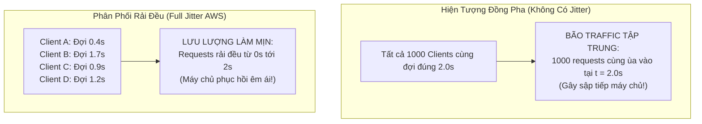

# RETRY PATTERN ARCHITECTURE & EXPONENTIAL BACKOFF DEEP DIVE

> **Tài liệu lý thuyết chuyên sâu và hướng dẫn kiến trúc toàn diện về Mẫu Thiết Kế Thử Lại (Retry Pattern, Exponential Backoff & Jitter)**  
> Dành cho Software Engineer, Backend Developer và Microservices Architect từ cấp độ Intern đến Middle-level và Tech Lead.

---

## 📑 MỤC LỤC
1. [Mức Độ Cơ Bản (Basic Fundamentals)](#1-mức-độ-cơ-bản-basic-fundamentals)
2. [Mức Độ Trung Bình (Intermediate - Architecture & Use Cases)](#2-mức-độ-trung-bình-intermediate---architecture--use-cases)
3. [Mức Độ Chuyên Sâu: BẢN CHẤT VẬN HÀNH (Under The Hood & Core Mechanics)](#3-mức-độ-chuyên-sâu-bản-chất-vận-hành-under-the-hood--core-mechanics)
4. [Mức Độ Nâng Cao: Vận Hành Thực Chiến (Production Engineering & Best Practices)](#4-mức-độ-nâng-cao-vận-hành-thực-chiến-production-engineering--best-practices)
5. [Góc Nhìn Thực Chiến Cho Middle-Level Trở Xuống (Must-Know vs Nice-to-Know Roadmap)](#5-góc-nhìn-thực-chiến-cho-middle-level-trở-xuống-must-know-vs-nice-to-know-roadmap)
6. [So Sánh Bản Chất (First-Principles Comparison)](#6-so-sánh-bản-chất-first-principles-comparison)
7. [Sơ Đồ Trực Quan (Mermaid Diagrams)](#7-sơ-đồ-trực-quan-mermaid-diagrams)
8. [Bảng Tra Thuật Ngữ Chi Tiết (Glossary)](#8-bảng-tra-thuật-ngữ-chi-tiết-glossary)
9. [Hướng Dẫn Chạy & Kiểm Thử Hệ Thống (Step-by-Step Run Guide)](#9-hướng-dẫn-chạy--kiểm-thử-hệ-thống-step-by-step-run-guide)

---

## 1. Mức Độ Cơ Bản (Basic Fundamentals)

### 1.1. Định nghĩa & Ẩn dụ đời thực (Real-world Analogy)
**Retry Pattern** (Mẫu thiết kế Thử Lại) là một kỹ thuật kiên cường (Resilience Pattern) cho phép ứng dụng tự động thực hiện lại một thao tác bị thất bại do các sự cố mạng chập chờn tạm thời (**Transient Faults**), với kỳ vọng rằng sự cố sẽ tự biến mất sau một khoảng thời gian chờ ngắn ngủi.

```
+-----------------------------------------------------------------------------------+
|                        ẨN DỤ: BẤM CHUÔNG CỬA KHI TỚI NHÀ BẠN                      |
|                                                                                   |
|  [BẠN ĐẾN NHÀ BẠN THÂN] ----> [BẤM CHUÔNG LẦN 1]                                  |
|                                     |                                             |
|                                     v                                             |
|                     [CHƯA THẤY MỞ CỬA (LỖI TẠM THỜI)]                             |
|                                     |                                             |
|  1. THỬ LẠI MÙ QUÁNG (IMMEDIATE RETRY - THẢM HỌA):                                |
|     - Bấm chuông liên tục 50 cái không ngừng nghỉ (Ting ting ting!).              |
|     - Chủ nhà đang dở tay rửa bát cáu giận, chuông chập cháy (Bão Retry Storm)!   |
|                                                                                   |
|  2. THỬ LẠI CÓ HỌC THỨC (EXPONENTIAL BACKOFF VỚI JITTER):                         |
|     - Lần 1: Chờ 2 giây rồi bấm lại.                                              |
|     - Lần 2: Chờ 4 giây rồi bấm lại.                                              |
|     - Lần 3: Chờ 8 giây kèm một chút ngẫu nhiên (+- 1 giây).                      |
|     - Chủ nhà lau xong tay và mở cửa chào bạn (Thao tác thành công rực rỡ)!       |
+-----------------------------------------------------------------------------------+
```

- **Nếu không có Retry Pattern**: Mạng chập chờn chỉ trong $100\text{ms}$ làm rơi một gói tin TCP $\rightarrow$ Ứng dụng báo ngay lỗi đỏ lòm *"Giao dịch thất bại"* cho khách hàng $\rightarrow$ Khách hàng bực bội bỏ đi.
- **Nếu có Retry Pattern**: Ứng dụng âm thầm thử lại sau $500\text{ms}$ và thành công ngay lập tức $\rightarrow$ Người dùng không hề cảm nhận thấy sự cố, trải nghiệm mượt mà 100%.

---

### 1.2. Phân Biệt Sống Còn: Lỗi Tạm Thời (Transient) vs Lỗi Vĩnh Viễn (Non-Transient)
Một trong những lỗi ngớ ngẩn nhất của lập trình viên là **thử lại mọi loại lỗi**. Bạn bắt buộc phải phân định:

| Loại Lỗi | Mã HTTP Tiêu Biểu | Nguyên Nhân | Có Được Retry Không? |
| :--- | :--- | :--- | :--- |
| **Lỗi Tạm Thời (Transient)** | `HTTP 503`, `504`, `429`, `ECONNRESET`, `ETIMEDOUT` | Mạng lag trong tích tắc, Server bận khởi động lại, Rate Limit tạm thời. | **BẮT BUỘC RETRY** (với khoảng cách hợp lý) |
| **Lỗi Vĩnh Viễn (Non-Transient)** | `HTTP 400`, `401`, `403`, `404`, `422` | Client nhập sai mật khẩu, thiếu trường dữ liệu, URL không tồn tại. | **CẤM TUYỆT ĐỐI RETRY** (Thử lại 1.000 lần vẫn thất bại, chỉ tổ tốn CPU) |

---

### 1.3. Yêu Cầu Tiên Quyết: Tính Bất Biến (Idempotency)
> ⚠️ **QUY TẮC SỐNG CÒN CỦA RETRY PATTERN**:  
> **Chỉ được Retry trên các thao tác có tính Bất Biến (Idempotent)**!

- Các thao tác đọc (`GET`, `HEAD`) tự nhiên mang tính idempotent: Gọi 1 lần hay 10 lần thì hệ thống vẫn không thay đổi.
- Thao tác ghi (`POST /charge` trừ tiền tài khoản): Nếu request thứ nhất đã trừ tiền thành công nhưng do mạng chập chờn response bị rớt $\rightarrow$ Client tưởng lỗi và Retry lần 2 $\rightarrow$ **Khách hàng bị trừ tiền 2 lần!**
- **Giải pháp**: Luôn gắn kèm **`Idempotency-Key`** vào mọi request nhạy cảm khi thực hiện Retry để máy chủ nhận biết và không thực thi nghiệp vụ lần thứ hai.

---

## 2. Mức Độ Trung Bình (Intermediate - Architecture & Use Cases)

### 2.1. Các Chiến Lược Thời Gian Chờ (Backoff Strategies)

1. **Thử Lại Ngay Tức Thì (Immediate Retry)**:
   - Thử lại ngay trong $0\text{ms}$.
   - *Đánh giá*: Cực kỳ nguy hiểm. Chỉ dùng cho các thao tác in-memory thread lock. Trong môi trường mạng, nó sẽ dìm chết máy chủ đang quá tải.
2. **Thời Gian Cố Định (Fixed Delay)**:
   - Thử lại sau mỗi khoảng cố định (ví dụ: cứ $2000\text{ms}$ một lần).
   - *Đánh giá*: Tốt hơn Immediate Retry nhưng dễ gây ra hiện tượng đồng bộ sóng nếu nhiều client cùng thử lại tại cùng một chu kỳ.
3. **Tăng Dần Theo Hàm Mũ (Exponential Backoff)**:
   - Thời gian chờ nhân đôi sau mỗi lần thất bại:
     $$\text{Delay} = \text{Base} \cdot 2^{\text{attempt}}$$
   - *Ví dụ ($Base = 1\text{s}$)*: Lần 1 chờ $1\text{s}$, Lần 2 chờ $2\text{s}$, Lần 3 chờ $4\text{s}$, Lần 4 chờ $8\text{s}$...
   - Giúp cho downstream service có một khoảng thở ngày càng rộng để phục hồi.
4. **Hàm Mũ Kết Hợp Độ Lệch Ngẫu Nhiên (Exponential Backoff with Full Jitter)**:
   - Tiêu chuẩn vàng được nghiên cứu bởi các kỹ sư kiến trúc AWS: Thêm một biến số ngẫu nhiên vào thời gian chờ để xé lẻ các đợt request của hàng triệu client, ngăn chặn bão nghẽn mạng.

---

## 3. Mức Độ Chuyên Sâu: BẢN CHẤT VẬN HÀNH (Under The Hood & Core Mechanics)

### 3.1. Thảm Họa Sóng Đồng Pha (Phase Lock) & Thuật Toán Full Jitter của AWS
Tại sao Exponential Backoff thuần túy vẫn có thể làm sập hệ thống khi có quy mô lớn?

```
KỊCH BẢN THẢM HỌA: ĐỒNG PHA (PHASE LOCK) KHI KHÔNG CÓ JITTER
1. Cụm Database bị gián đoạn 1 giây lúc 12:00:00.
2. 10.000 người dùng cùng bị lỗi kết nối tại đúng 12:00:00.
3. Vì tất cả cùng dùng công thức Base * 2^attempt (1s, 2s, 4s):
   - ĐÚNG 12:00:01: Cả 10.000 users ĐỒNG LOẠT bắn request đợt 2 (Đỉnh tải 10k req/s)!
   - ĐÚNG 12:00:03: Cả 10.000 users ĐỒNG LOẠT bắn request đợt 3!
   - ĐÚNG 12:00:07: Cả 10.000 users ĐỒNG LOẠT bắn request đợt 4!
=> Thay vì làm mịn lưu lượng, hệ thống tạo ra các ĐỢT SÓNG THẦN TRAFFIC định kỳ!
```

#### Giải pháp: Giải thuật Full Jitter (AWS Architecture Pattern)
Công thức toán học:
$$\text{MaxDelay} = \min(\text{Cap}, \text{Base} \cdot 2^{\text{attempt}})$$
$$\text{ActualDelay} = \text{Random}(0, \text{MaxDelay})$$

```
VỚI FULL JITTER:
- User A: Đợi 0.3 giây
- User B: Đợi 1.8 giây
- User C: Đợi 0.7 giây
- User D: Đợi 1.4 giây
=> 10.000 request được RẢI ĐỀU HOÀN TOÀN trên trục thời gian! Đỉnh nhọn traffic bị triệt tiêu!
```

---

### 3.2. Quản Trị Ngân Sách Thử Lại (Retry Budget)
Nếu toàn bộ hệ thống đều tự ý retry $3$ lần, lưu lượng mạng tổng có thể tăng gấp $4$ lần trong khi máy chủ đang chết dần.
Để kiểm soát, các hệ thống lớn như Google (gRPC) và Netflix triển khai **Ngân Sách Thử Lại (Retry Budget)**:
- Mỗi dịch vụ chỉ được phép dành tối đa **$10\%$ đến $20\%$ tổng lưu lượng** cho các request thử lại.
- Nếu tỷ lệ retry vượt quá $10\%$ tổng lưu lượng trong 10 giây qua, **toàn bộ các lệnh retry tiếp theo bị từ chối ngay lập tức**, ưu tiên dành 90% tài nguyên cho các request mới.

---

## 4. Mức Độ Nâng Cao: Vận Hành Thực Chiến (Production Engineering & Best Practices)

### 4.1. Code Mẫu Retry Engine Đa Chiến Lược Chuẩn Doanh Nghiệp

```javascript
/**
 * HÀM RETRY VỚI EXPONENTIAL BACKOFF VÀ FULL JITTER
 */
async function executeWithRetry(operationFn, options = {}) {
  const {
    maxRetries = 3,
    baseDelayMs = 500,
    maxDelayMs = 5000,
    useJitter = true,
    isRetryable = (err) => {
      // Mặc định chỉ retry lỗi 5xx, timeout, và network reset
      if (err.code === 'ECONNRESET' || err.code === 'ETIMEDOUT') return true;
      if (err.response && (err.response.status >= 500 || err.response.status === 429)) return true;
      return false; // Bỏ qua 4xx
    }
  } = options;

  let attempt = 0;

  while (attempt <= maxRetries) {
    try {
      return await operationFn(attempt);
    } catch (err) {
      attempt++;

      // Nếu đã hết số lần thử hoặc lỗi không thể phục hồi
      if (attempt > maxRetries || !isRetryable(err)) {
        throw err;
      }

      // TÍNH TOÁN THỜI GIAN CHỜ THEO HÀM MŨ
      let delay = Math.min(maxDelayMs, baseDelayMs * Math.pow(2, attempt - 1));

      // ÁP DỤNG FULL JITTER ĐỂ PHÂN TÁN SÓNG TRAFFIC
      if (useJitter) {
        delay = Math.floor(Math.random() * delay);
      }

      // TÔN TRỌNG HEADER RETRY-AFTER TỪ SERVER (NẾU CÓ)
      if (err.response && err.response.headers['retry-after']) {
        const retryAfterSeconds = parseInt(err.response.headers['retry-after'], 10);
        if (!isNaN(retryAfterSeconds)) delay = retryAfterSeconds * 1000;
      }

      console.warn(`[Retry Engine] Thử lại lần ${attempt}/${maxRetries} sau ${delay}ms do lỗi: ${err.message}`);
      await new Promise(resolve => setTimeout(resolve, delay));
    }
  }
}
```

---

### 4.2. Anti-patterns & Sai lầm Kinh Điển khi Dùng Retry

#### ❌ Sai lầm 1: Vụ Nổ Thử Lại Lồng Nhau (Nested Retry Explosion)
- **Hiện tượng**: Service A gọi Service B; Service B gọi Service C; Service C gọi Database. Mỗi service đều cấu hình `maxRetries = 3`.
- **Hậu quả**: Khi Database bị chậm, Service C thử lại 3 lần. Service B thấy C chậm, B thử lại 3 lần (mỗi lần B gọi 3 lần C = 9 lần). Service A thấy B chậm, A thử lại 3 lần (mỗi lần gọi 9 lần = **27 requests**!).
- **Khắc phục**: **Chỉ được Retry ở một tầng duy nhất** (thường là tầng Client hoặc API Gateway), các tầng bên dưới chỉ ném lỗi về ngay lập tức.

#### ❌ Sai lầm 2: Quên Idempotency Key Cho Các Request POST
- **Hậu quả**: Khách hàng bị thanh toán 2 lần, tạo 2 đơn hàng trùng lặp.
- **Khắc phục**: Mọi API sửa đổi trạng thái khi Retry bắt buộc phải truyền `Idempotency-Key: <UUID>`.

---

## 5. Góc Nhìn Thực Chiến Cho Middle-Level Trở Xuống (Must-Know vs Nice-to-Know Roadmap)

```
+------------------------------------------------------------------------------------+
|               LỘ TRÌNH KỸ NĂNG RETRY: PHÂN CẤP TỪ JUNIOR ĐẾN SENIOR                |
|                                                                                    |
|  [INTERN / JUNIOR] (80/20 - Sử dụng thực chiến)                                    |
|   ├── Hiểu rõ khái niệm Transient Fault (Lỗi chập chờn tạm thời)                   |
|   ├── Phân biệt rõ lỗi NÊN retry (503, 504, 429) và KHÔNG ĐƯỢC retry (400, 401, 404)|
|   ├── Nắm vững nguyên lý Exponential Backoff (2s, 4s, 8s)                          |
|   ├── Cấu hình số lần thử tối đa (maxRetries = 2 hoặc 3, không bao giờ thử vô tận) |
|   └── Luôn gắn Idempotency Key khi thực hiện Retry request POST                    |
|                                                                                    |
|  ============================== Ranh giới Middle ===============================   |
|                                                                                    |
|  [MIDDLE-LEVEL] (Triển khai Jitter, Tránh bão Traffic & Kết hợp Hàng đợi)          |
|   ├── Áp dụng thuật toán Full Jitter của AWS để triệt tiêu sóng đồng pha           |
|   ├── Xử lý đọc Header `Retry-After` trả về từ các API bị Rate Limit               |
|   ├── Triển khai chuyển giao Dead Letter Queue (DLQ) sau khi thử lại thất bại      |
|   ├── Phối hợp nhịp nhàng giữa Retry Pattern và Circuit Breaker                    |
|   └── Phòng chống thảm họa Nested Retry Explosion trong chuỗi Microservices        |
|                                                                                    |
|  ============================== Ranh giới Senior / Architect ===================   |
|                                                                                    |
|  [SENIOR / ARCHITECT] (Tạm thời bỏ qua nếu ở mức Middle trở xuống)                 |
|   ├── Triển khai cơ chế Retry Budget (Giới hạn tối đa 10% lưu lượng toàn cụm)      |
|   ├── Phân tích thống kê phân phối thời gian chờ theo chuỗi Markov / Queue Theory   |
|   └── Cấu hình Adaptive Service Mesh Retries trên Istio / Envoy VirtualService     |
+------------------------------------------------------------------------------------+
```

---

### 5.1. Chi Tiết Đáp Án & Kỹ Thuật Thực Chiến Cho Cấp Độ [INTERN / JUNIOR]

#### 1. Hiểu rõ khái niệm Transient Fault (Lỗi chập chờn tạm thời)
- **Vấn đề thực tế:** Mạng Internet và các dịch vụ đám mây không hoàn hảo. Thỉnh thoảng có 1 gói tin TCP bị rớt, 1 microservice khởi động lại mất 200ms, hoặc switch mạng bị rung rinh trong tích tắc. Nếu throw exception ngay thì ứng dụng sẽ báo lỗi oan cho khách hàng.
- **Đáp án & Cách hiểu:** Transient Fault là lỗi tự biến mất sau một thời gian rất ngắn. Retry Pattern sinh ra chỉ để vượt qua dạng lỗi này: thử lại sau vài giây thì tỷ lệ thành công là >99%.

#### 2. Phân biệt rõ lỗi NÊN retry (503, 504, 429) và KHÔNG ĐƯỢC retry (400, 401, 404)
- **Vấn đề thực tế:** Thử lại bừa bãi sẽ dội bom server và làm trầm trọng thêm sự cố.
- **Đáp án & Code chuẩn:**
```typescript
function isRetryableError(error: any): boolean {
  // Lỗi mất mạng, timeout đường truyền
  if (!error.response || error.code === 'ECONNABORTED') return true;

  const status = error.response.status;
  // CHỈ RETRY: 503 (Dịch vụ bận), 504 (Gateway Timeout), 429 (Bị Rate Limit), 502 (Bad Gateway)
  if ([429, 502, 503, 504].includes(status)) return true;

  // TUYỆT ĐỐI KHÔNG RETRY: 400 (Dữ liệu sai), 401/403 (Sai quyền), 404 (Không tìm thấy), 422 (Validate sai)
  return false;
}
```

#### 3. Nắm vững nguyên lý Exponential Backoff (2s, 4s, 8s)
- **Vấn đề thực tế:** Nếu thử lại ngay lập tức (Immediate Retry: 0s, 0s, 0s), downstream service đang quá tải sẽ bị dập tắt thở và không bao giờ kịp phục hồi.
- **Đáp án & Công thức:** Thời gian chờ tăng theo hàm mũ: $\text{delay} = \text{baseDelay} \times 2^{\text{attempt}}$.
```typescript
const calculateExponentialBackoff = (attempt: number, baseDelay = 1000) => {
  return baseDelay * Math.pow(2, attempt); // attempt 0: 1s, attempt 1: 2s, attempt 2: 4s
};
```

#### 4. Cấu hình số lần thử tối đa (maxRetries = 2 hoặc 3, không bao giờ thử vô tận)
- **Vấn đề thực tế:** Thử lại vô tận (`while(true) retry`) sẽ biến client thành kẻ tấn công DDoS chính dịch vụ của mình khi dịch vụ đó sập hẳn.
- **Đáp án & Quy tắc:** Luôn đặt ngưỡng trần cứng `maxRetries = 2` hoặc `3`. Nếu sau 3 lần vẫn lỗi $\rightarrow$ coi như dịch vụ đã hỏng nặng, lập tức fail-fast hoặc chuyển sang Fallback / Dead Letter Queue.

#### 5. Luôn gắn Idempotency Key khi thực hiện Retry request POST
- **Vấn đề thực tế:** Gửi request thanh toán POST `/api/orders`, server đã trừ tiền thành công nhưng trên đường mạng trả response về thì bị đứt (Timeout). Client tưởng lỗi và thử lại $\rightarrow$ Khách hàng bị trừ tiền 2 lần!
- **Đáp án & Kỹ thuật:** Với mọi request POST/PATCH có thay đổi trạng thái, bắt buộc phải sinh một `Idempotency-Key: UUIDv4` duy nhất từ Client và giữ nguyên key đó trong mọi lần Retry:
```typescript
const idempotencyKey = crypto.randomUUID();
// Cả 3 lần retry đều phải gửi CHUNG idempotencyKey này để server nhận diện request cũ
await axios.post('/api/pay', body, { headers: { 'Idempotency-Key': idempotencyKey } });
```

---

### 5.2. Chi Tiết Đáp Án & Kỹ Thuật Thực Chiến Cho Cấp Độ [MIDDLE-LEVEL]

#### 1. Áp dụng thuật toán Full Jitter của AWS để triệt tiêu sóng đồng pha
- **Vấn đề thực tế:** Khi 10,000 client cùng bị lỗi tại giây thứ 0, nếu đều dùng Exponential Backoff thuần túy, tất cả 10,000 client sẽ đồng loạt gửi lại đợt 2 vào đúng giây thứ 1, đồng loạt đợt 3 vào đúng giây thứ 2 $\rightarrow$ tạo sóng thần traffic chu kỳ (Phase Lock / Thundering Herd).
- **Đáp án & Code chuẩn:**
```typescript
// Thuật toán AWS Full Jitter: Sleep = random_between(0, min(cap, base * 2^attempt))
function getFullJitterDelay(attempt: number, baseDelay = 1000, maxDelay = 10000): number {
  const exponentialDelay = Math.min(maxDelay, baseDelay * Math.pow(2, attempt));
  return Math.floor(Math.random() * exponentialDelay);
}
```

#### 2. Xử lý đọc Header `Retry-After` trả về từ các API bị Rate Limit (429)
- **Vấn đề thực tế:** Khi server trả về `429 Too Many Requests`, server thường nói rõ cần chờ bao lâu qua header `Retry-After: 30` (hoặc định dạng ngày GMT). Nếu client tự tính backoff bừa bãi thì vẫn sẽ bị chặn tiếp.
- **Đáp án & Code chuẩn:**
```typescript
function extractRetryAfterDelay(response: any, defaultDelay: number): number {
  const retryAfter = response?.headers?.['retry-after'];
  if (!retryAfter) return defaultDelay;

  // Nếu là số giây (ví dụ: '30')
  if (/^\d+$/.test(retryAfter)) {
    return parseInt(retryAfter, 10) * 1000;
  }
  // Nếu là mốc thời gian HTTP Date
  const dateDiff = Date.parse(retryAfter) - Date.now();
  return dateDiff > 0 ? dateDiff : defaultDelay;
}
```

#### 3. Triển khai chuyển giao Dead Letter Queue (DLQ) sau khi thử lại thất bại
- **Vấn đề thực tế:** Một job trong Message Queue (BullMQ, RabbitMQ) bị lỗi dữ liệu sai. Nếu thử lại 3 lần mà thất bại rồi bỏ rơi (drop) thì dữ liệu nghiệp vụ của khách sẽ bị bốc hơi vĩnh viễn không dấu vết.
- **Đáp án:** Khi vượt quá `maxRetries`, bắt buộc phải chuyển giao payload kèm stack trace lỗi vào một hàng đợi cách ly **Dead Letter Queue (DLQ)** để kỹ sư kiểm tra thủ công hoặc chạy bù (Replay) sau khi fix bug.

#### 4. Phối hợp nhịp nhàng giữa Retry Pattern và Circuit Breaker
- **Vấn đề thực tế:** Nếu downstream service đã chết hẳn, việc tiếp tục Retry từ hàng ngàn user sẽ tạo ra Retry Storm giết chết dịch vụ.
- **Đáp án chuẩn mực kiến trúc:** **Circuit Breaker bọc bên ngoài Retry Pattern**.
  - Client gọi request $\rightarrow$ Circuit Breaker kiểm tra mạch. Nếu `OPEN` $\rightarrow$ chặn đứng ngay trong 0ms, không cho Retry.
  - Nếu `CLOSED` $\rightarrow$ cho phép Retry thử lại 2 lần. Nhưng nếu toàn bộ đều thất bại, Circuit Breaker tăng bộ đếm lỗi để chuẩn bị ngắt mạch bảo vệ.

#### 5. Phòng chống thảm họa Nested Retry Explosion trong chuỗi Microservices
- **Vấn đề thực tế:** Chuỗi gọi: Frontend $\rightarrow$ Service A $\rightarrow$ Service B $\rightarrow$ Service C. Mỗi tầng đều cấu hình retry 3 lần. Nếu Service C bị chậm: Service B retry 3 lần, Service A thấy B lỗi retry 3 lần ($3 \times 3 = 9$), Frontend lại retry 3 lần ($9 \times 3 = 27$ requests đổ vào C)!
- **Đáp án & Nguyên tắc:** **Chỉ Retry ở 1 tầng duy nhất gần nơi xảy ra lỗi nhất** (Service B retry với C), các tầng trên chỉ nhận lỗi và trả về Fallback; hoặc truyền header `X-Retry-Count` để các tầng sau không nhân đôi số lần thử.

---

### 5.3. Chi Tiết Kỹ Thuật Cho Cấp Độ [SENIOR / ARCHITECT] (Mở Rộng)

#### 1. Triển khai cơ chế Retry Budget (Giới hạn tối đa 10% lưu lượng toàn cụm)
- **Bản chất:** Giới hạn tổng số lượng request thử lại không được vượt quá một tỷ lệ phần trăm nhất định (thường là 10%) trong tổng số request của toàn bộ hệ thống (dùng kỹ thuật Token Bucket). Khi toàn cụm bắt đầu suy thoái, budget cạn kiệt, hệ thống tự động tắt Retry để tránh dội bom.

#### 2. Phân tích thống kê phân phối thời gian chờ theo chuỗi Markov / Queue Theory
- **Bản chất:** Mô hình hóa xác suất phục hồi của hệ thống theo lý thuyết xếp hàng $M/M/1$ hoặc $M/G/1$, tính toán điểm cân bằng giữa chi phí trễ (Latency P99) và tỷ lệ bảo toàn transaction thành công.

#### 3. Cấu hình Adaptive Service Mesh Retries trên Istio / Envoy VirtualService
- **Bản chất:** Đưa toàn bộ logic Retry ra khỏi mã nguồn ứng dụng (Zero Code Retry), cấu hình bằng Envoy Filter / Istio VirtualService với `retryOn: "5xx,connect-failure,refused-stream"`, `perTryTimeout: 2s`, tự động chuyển traffic sang Endpoint khác lành lặn (Outlier Detection / Ejection).

---

### 5.4. Bộ Câu Hỏi Phỏng Vấn Kinh Điển (Top Interview Questions)

#### Câu 1: Tại sao chúng ta cần thêm Jitter vào thuật toán Exponential Backoff?
> **Trả lời mẫu ghi điểm**:  
> "Exponential Backoff thông thường chỉ giúp tăng dần thời gian chờ sau mỗi lần thử lại (ví dụ: 1s, 2s, 4s). Tuy nhiên, khi một sự cố hạ tầng lớn xảy ra khiến hàng ngàn client cùng bị lỗi tại cùng một thời điểm, tất cả các client này sẽ cùng tính toán ra các mốc thời gian chờ giống hệt nhau. Điều này dẫn đến hiện tượng 'Sóng đồng pha' (Phase Lock): hàng ngàn client sẽ đồng loạt gửi lại request đợt 2 vào đúng giây thứ 1, đồng loạt gửi đợt 3 vào đúng giây thứ 2... tạo ra các cơn sóng thần traffic dồn dập khiến máy chủ không thể phục hồi.  
> Bằng cách thêm Jitter (độ lệch ngẫu nhiên) vào thời gian chờ theo thuật toán Full Jitter của AWS, ta làm phân tán thời điểm gửi lại của các client hoàn toàn ngẫu nhiên trên trục thời gian. Lưu lượng truy cập được làm phẳng (smoothed out), giúp triệt tiêu hoàn toàn đỉnh nhọn traffic và bảo vệ máy chủ tối đa."

#### Câu 2: Khi nào thì chúng ta KHÔNG ĐƯỢC PHÉP áp dụng Retry Pattern?
> **Trả lời mẫu ghi điểm**:  
> "Ta tuyệt đối không được áp dụng Retry trong hai trường hợp:  
> 1. **Khi lỗi thuộc nhóm Lỗi Vĩnh Viễn của Client (Non-transient 4xx errors)**: Ví dụ như 400 Bad Request, 401 Unauthorized, 403 Forbidden, 404 Not Found, 422 Validation Error. Đây là lỗi do logic nghiệp vụ hoặc dữ liệu đầu vào sai, việc thử lại thêm 100 lần nữa vẫn sẽ chỉ nhận về kết quả thất bại, gây lãng phí tài nguyên máy chủ.  
> 2. **Khi thao tác không có tính Bất Biến (Non-idempotent Operations)**: Nếu một request thay đổi trạng thái (như trừ tiền tài khoản hoặc gửi thông báo SMS) không được bảo vệ bằng cơ chế `Idempotency-Key`, việc thử lại có thể gây ra thảm họa trừ tiền người dùng nhiều lần."

#### Câu 3: Mối quan hệ kết hợp chuẩn mực giữa Circuit Breaker và Retry Pattern là gì?
> **Trả lời mẫu ghi điểm**:  
> "Retry Pattern và Circuit Breaker là hai mẫu thiết kế bổ trợ hoàn hảo cho nhau nhưng ở hai góc độ khác nhau:  
> - **Retry Pattern** nhằm giải quyết các lỗi chập chờn diễn ra trong tích tắc (Transient faults - ví dụ 1 gói tin bị rơi).  
> - **Circuit Breaker** nhằm bảo vệ hệ thống trước các lỗi kéo dài dai dẳng (Long-lasting failures - ví dụ dịch vụ đối tác đã chết hẳn).  
> Kiến trúc chuẩn mực là: **Circuit Breaker bọc bên ngoài Retry Pattern**. Khi Client gọi request, cơ chế Retry bên trong có thể thử lại 2-3 lần. Nhưng nếu toàn bộ các lần thử đó đều thất bại và kéo dài, Circuit Breaker bên ngoài sẽ ghi nhận tỷ lệ lỗi vượt ngưỡng và ngắt mạch (chuyển sang OPEN). Khi mạch đã OPEN, các request tiếp theo sẽ bị từ chối ngay lập tức và **hủy bỏ hoàn toàn việc Retry**, giúp ngăn chặn thảm họa Retry Storm dội bom vào dịch vụ đang gặp sự cố."

---

## 6. So Sánh Bản Chất (First-Principles Comparison)

| Tiêu Chí | **Retry Pattern** | **Circuit Breaker** | **Dead Letter Queue (DLQ)** |
| :--- | :--- | :--- | :--- |
| **Mục đích** | Tự động vượt qua lỗi chập chờn ngắn | Ngăn chặn sập dây chuyền khi lỗi dài | Lưu trữ các bản ghi lỗi vĩnh viễn để xử lý sau |
| **Hành vi** | Gửi lại request nhiều lần với backoff | Ngắt kết nối, từ chối request trong 0ms | Đẩy dữ liệu vào hàng đợi cách ly |
| **Áp dụng cho** | Lỗi tạm thời (Transient 503, 504, Timeout)| Lỗi diện rộng, quá tải kéo dài | Lỗi sau khi đã Retry hết số lần tối đa |
| **Tác động lưu lượng**| Làm tăng nhẹ lưu lượng truy cập | Làm giảm lưu lượng về 0 đối với service hỏng | Không ảnh hưởng đến lưu lượng gọi trực tiếp |

---

## 7. Sơ Đồ Trực Quan (Mermaid Diagrams)

### 7.1. Sơ đồ So Sánh Phân Phối Traffic Giữa Fixed Delay và Full Jitter


---

## 8. Bảng Tra Thuật Ngữ Chi Tiết (Glossary)

| Thuật Ngữ | Tên Tiếng Anh | Định Nghĩa & Ý Nghĩa Thực Tiễn |
| :--- | :--- | :--- |
| **Transient Fault** | Transient Fault | Lỗi mạng chập chờn tạm thời trong tích tắc thường tự biến mất khi thực hiện lại ngay sau đó. |
| **Exponential Backoff**| Exponential Backoff | Thuật toán tăng dần thời gian chờ thử lại theo hàm lũy thừa của 2 để cho dịch vụ thời gian phục hồi. |
| **Jitter** | Jitter (Randomization) | Kỹ thuật thêm độ trễ ngẫu nhiên vào thời gian chờ để xé lẻ các đợt request, phá vỡ hiện tượng sóng đồng pha. |
| **Retry Storm** | Retry Storm / Thundering Herd | Thảm họa khi hàng triệu client cùng đồng loạt gửi lại request làm sập hoàn toàn máy chủ vừa khởi động lại. |
| **Idempotency** | Idempotency | Tính chất của một thao tác mà khi thực hiện nhiều lần vẫn tạo ra cùng một kết quả giống như chỉ thực hiện 1 lần. |
| **Idempotency Key** | Idempotency Key | Khóa định danh duy nhất (UUID) gửi kèm request giúp máy chủ phát hiện và chặn đứng việc trừ tiền/tạo đơn trùng lặp. |
| **Retry Budget** | Retry Budget | Chính sách giới hạn tỷ lệ phần trăm tối đa của các request thử lại so với tổng lưu lượng để bảo vệ hạ tầng. |
| **Retry-After** | Retry-After Header | Header phản hồi chuẩn HTTP (RFC 7231) thông báo chính xác số giây mà client phải đợi trước khi được thử lại. |

---

## 9. Hướng Dẫn Chạy & Kiểm Thử Hệ Thống (Step-by-Step Run Guide)

### 9.1. Cấu trúc thư mục Dự Án Demo
Dự án demo Retry Pattern bao gồm:
- **Hạ tầng (`docker-compose.yml`)**: Khởi chạy Flaky Downstream Service (mô phỏng dịch vụ chập chờn: 2 lần đầu luôn lỗi 503, lần 3 mới thành công) + Gateway Service có tích hợp Retry Engine + Frontend Dashboard.
- **Backend Service (`backend/`)**: Hiện thực hóa 4 chiến lược thử lại: `NO_RETRY`, `FIXED_DELAY`, `EXPONENTIAL_BACKOFF`, và `FULL_JITTER`.
- **Frontend Console (React/Vite)**: Giao diện trực quan hóa dòng thời gian thử lại (Timeline visualizer), so sánh độ phân tán Jitter và bảo đảm an toàn Idempotency Key.

### 9.2. Lệnh Khởi Chạy
Mở terminal tại thư mục dự án:

```bash
# 1. Di chuyển vào thư mục Retry Pattern
cd /Users/ductri0981/Documents/Studying-Software/Microservices_Patterns/retry_pattern

# 2. Khởi chạy toàn bộ hệ thống bằng Docker Compose
docker compose up -d --build
```

Sau khi khởi chạy:
- **Frontend Retry Console**: Truy cập `http://localhost:5179`.
- **Gateway API**: `http://localhost:3005/api/order-with-retry`.

---

### 9.3. Kịch Bản Kiểm Thử Thực Tế Trên Giao Diện

#### Kịch Bản 1: So Sánh No-Retry vs Exponential Backoff
1. Chọn chế độ **"1. NO RETRY (Không thử lại)"** $\rightarrow$ Bấm nút "Gửi Yêu Cầu Đặt Hàng":
   - Ngay lần gọi đầu tiên nhận lỗi 503 $\rightarrow$ Giao diện báo lỗi đỏ thất bại ngay lập tức!
2. Chọn chế độ **"2. EXPONENTIAL BACKOFF WITH FULL JITTER"** $\rightarrow$ Bấm nút "Gửi Yêu Cầu Đặt Hàng":
   - Lần 1: Nhận lỗi 503 $\rightarrow$ Retry Engine tự động chờ ~400ms.
   - Lần 2: Nhận lỗi 503 $\rightarrow$ Retry Engine tự động chờ ~950ms.
   - Lần 3: Dịch vụ phục hồi $\rightarrow$ **THÀNH CÔNG RỰC RỠ (200 OK)!**
   - Người dùng nhận kết quả thành công mà không hề phải thao tác lại!

#### Kịch Bản 2: Kiểm Chứng Cơ Chế Bỏ Qua Lỗi Non-Retryable (400 Bad Request)
1. Bấm nút **"Gửi Dữ Liệu Lỗi Nghiệp Vụ (400 Bad Request)"**:
   - Retry Engine nhận diện mã lỗi 400 không phải Transient Fault $\rightarrow$ **DỪNG LẠI NGAY LẬP TỨC KHÔNG RETRY**, tránh lãng phí tài nguyên!
