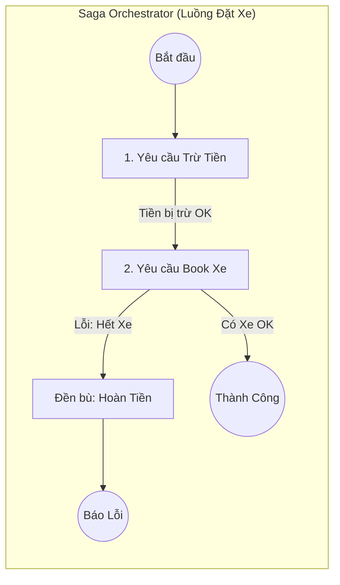

# Saga Pattern (Mẫu Giao dịch Chuỗi)

> **Ý tưởng chính việc sử dụng:** Đảm bảo tính thống nhất dữ liệu trong Microservices bằng cách chạy chuỗi giao dịch tuần tự, nếu một bước hỏng thì gọi hàm Hoàn Tác (Đền Bù) cho các bước trước.
> **Ví dụ:** Đặt Vé Máy Bay OK -> Đặt Khách Sạn LỖI -> Saga tự động gọi API 'Hủy Vé Máy Bay' để lấy lại tiền cho khách.

Trong hệ thống nguyên khối (Monolith), bạn lưu mọi thứ bằng một câu lệnh `BEGIN TRANSACTION`. Nếu mọi thứ suôn sẻ thì `COMMIT`, nếu có bất kỳ dòng code nào bị lỗi thì `ROLLBACK`, mọi thứ sẽ quay về nguyên trạng ban đầu. 
Nhưng ở Microservices, **không có câu lệnh ROLLBACK nào tồn tại trên mạng Internet cả**.

## 1. Mức Độ Cơ Bản (Basic)

### Saga Pattern là gì?
Saga là một mẫu thiết kế để giải quyết bài toán Giao dịch phân tán (Distributed Transaction).
Thay vì cố gắng khóa (Lock) nhiều Database lại cùng một lúc, Saga chia một chuỗi giao dịch lớn thành các **Giao dịch cục bộ (Local Transaction)** nhỏ chạy nối tiếp nhau trên từng Microservice.

Nếu một mắt xích bị đứt (Thất bại), Saga sẽ làm gì? 
Nó sẽ kích hoạt các **Giao dịch đền bù (Compensating Transactions)** để "hoàn tác" (undo) những bước đã làm thành công trước đó.

### Ví dụ Book Vé Máy Bay
1. `Đặt Chuyến Bay`: Thành công.
2. `Đặt Khách Sạn`: Thành công.
3. `Thu Tiền`: Bị lỗi (Khách hết tiền).

Hành động đền bù: Saga sẽ tự động gọi API "Hủy Chuyến Bay" và API "Hủy Khách Sạn" để nhả chỗ cho người khác mua.

## 2. Mức Độ Trung Bình (Intermediate): Under the Hood

### 2 Kiểu phối hợp Saga

1. **Choreography (Tự biên tự diễn / Nhảy múa)**:
Không ai làm sếp. A làm xong bắn Event `OrderCreated`. B nghe thấy lấy tiền, lấy tiền xong bắn Event `MoneyDeducted`. Kho nghe thấy, xuất kho. Nếu Kho hết hàng, nó bắn Event `OutOfStock`. B nghe thấy tự động trả lại tiền.
*Ưu điểm*: Đơn giản, lỏng lẻo. *Nhược điểm*: Phù hợp cho chuỗi ngắn (< 4 bước). Nếu dài quá, không ai biết luồng đi như thế nào.

2. **Orchestration (Người nhạc trưởng)**:
Có một class `SagaManager` làm sếp. Nó tự tay gọi API `Trừ Tiền` -> OK, Nó gọi API `Lấy Hàng` -> Trả về Lỗi. Nó tự tay gọi API `Hoàn Tiền`.
*Ưu điểm*: Dễ theo dõi luồng code ở 1 chỗ. Dễ test. *Nhược điểm*: Con Nhạc trưởng bị phình to (Single point of failure).

## 3. Mức Độ Nâng Cao (Advanced)

### Rủi ro của Giao dịch đền bù
Viết code Hủy khó gấp 10 lần code Tạo.
Ví dụ: Bạn đã gửi một Email cho khách hàng "Chúc mừng bạn đã tạo tài khoản thành công!". 5 giây sau Saga báo lỗi và đòi đền bù (Xóa tài khoản). Bạn không thể "Un-send" (Thu hồi) email đã gửi. Lúc này đền bù = Gửi 1 email xin lỗi.
Hoặc như việc Hủy đơn hàng, nếu tiền đã vô thẻ tín dụng, bạn phải tốn tiền phí giao dịch (Fee) của Visa/Mastercard.

=> Thiết kế Saga tốt là cố gắng **sắp xếp bước nào hay Lỗi nhất lên đầu tiên**, bước nào khó Đền bù nhất (như Gửi SMS) xuống cuối cùng!

## 4. So Sánh (Compare & Contrast)

| Đặc điểm | Two-Phase Commit (2PC) | Saga Pattern |
| :--- | :--- | :--- |
| **Cơ chế** | Bắt mọi DB phải "Khóa" chờ nhau. Khi nào tất cả nói OK mới Lưu. | Chạy xong thằng nào Lưu thằng nấy. Lỗi thì Đền bù. |
| **Hiệu năng** | Cực kỳ chậm, gây nghẽn cổ chai. Không ai xài cho Microservice. | Siêu nhanh, không bị Lock DB. |
| **Tính nhất quán** | Strong Consistency (Đồng nhất tuyệt đối). | Eventual Consistency (Đồng nhất cuối cùng). Trong lúc đang đền bù, khách có thể thấy tài khoản bị mất tiền tạm thời. |

## 5. Bài Tập Thực Hành Nhỏ

**Tình huống**: Trong file `demo-saga.ts`, hệ thống đặt xe (Ride Booking) đang gọi API `Trừ Tiền` và `Book Xe` một cách ngây thơ. Nếu `Book Xe` thất bại (Hết xe), tiền của khách đã bị trừ nhưng không có cơ chế hoàn lại, dẫn đến mất tiền oan!

*Nhiệm vụ*: Áp dụng Saga Orchestration.
1. Xây dựng class `BookingSagaOrchestrator`.
2. Theo dõi trạng thái của từng bước. Nếu bước 2 lỗi, bắt buộc phải có lệnh catch() gọi lại bước 1 (Refund) để bù trừ.

Code đề bài và đáp án nằm tại: [answers-saga](/Users/ductri0981/Documents/Studying-Software/saga_pattern/answers-saga.ts)

## 6. Phụ Lục (Sơ Đồ Kiến Trúc)

## 7. Giải Thích Thuật Ngữ (Glossary)
- **Saga**: Cốt truyện / Chuỗi sự kiện dài.
- **Compensating Transaction**: Giao dịch đền bù/hoàn tác. Nhiệm vụ của nó là khôi phục dữ liệu về trạng thái trước đó.
- **Orchestration**: Nhạc trưởng. Một service trung tâm cầm kịch bản và ra lệnh cho các service khác.
- **Choreography**: Múa tập thể. Các service tự tương tác với nhau thông qua sự kiện mà không cần ai chỉ đạo.
- **2PC (Two-Phase Commit)**: Thuật toán đồng thuận 2 pha cổ điển. Không được khuyên dùng trong Microservices vì nó khóa Database chờ nhau, gây lag hệ thống.
