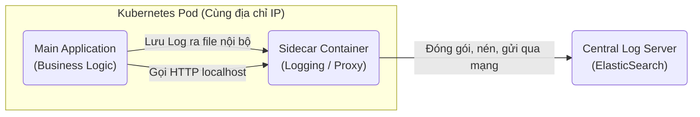

# Sidecar Pattern (Mẫu xuồng thùng/xe phụ)

> **Ý tưởng chính việc sử dụng:** Tách biệt mã hạ tầng (Log, Metric) ra khỏi mã nghiệp vụ bằng cách đính kèm một container phụ chạy song song cùng App chính.
> **Ví dụ:** App viết bằng Java chỉ lo tính tiền. Sidecar viết bằng Go (chạy cùng chung Pod) sẽ lo hứng Log của Java nén lại rồi gửi lên ElasticSearch.

Khi xây dựng một Microservice, ngoài việc code chức năng chính (Nghiệp vụ), bạn còn phải code hàng đống thứ hầm bà lằng khác: Viết log, gom Metrics (CPU, RAM), kiểm tra bảo mật, phân giải DNS... Nếu nhét tất cả vào chung một project, code của bạn sẽ trở thành mớ bòng bong. **Sidecar Pattern** ra đời để dọn dẹp đống rác này.

## 1. Mức Độ Cơ Bản (Basic)

### Sidecar Pattern là gì?
Hãy tưởng tượng một chiếc mô-tô (Xe chính). Bạn muốn chở thêm nhiều hành lý, thay vì chế cháo cái xe chính cho to ra, bạn gắn thêm một cái thùng phụ (Sidecar) nằm sát bên cạnh.

Trong Microservices (đặc biệt là Kubernetes), Xe chính là Container chạy App của bạn (Ví dụ code bằng Node.js). Thùng phụ là một Container khác (Ví dụ code bằng Go) chạy song song ngay bên cạnh. 
- App chính chỉ tập trung 100% vào việc: Bán hàng, Tạo đơn.
- Sidecar sẽ lo việc: Thu thập log từ App chính gửi lên Server trung tâm, mã hóa dữ liệu, bắt lỗi mạng.

### Vấn đề cốt lõi giải quyết
- **Tách biệt mối quan tâm (Separation of Concerns)**: Kỹ sư nghiệp vụ chỉ code nghiệp vụ. Kỹ sư hạ tầng (DevOps) chỉ lo bảo trì con Sidecar. Không dẫm chân lên nhau.

## 2. Mức Độ Trung Bình (Intermediate): Under the Hood

### Đặc điểm của Sidecar
- **Cùng vòng đời**: Sidecar được sinh ra cùng lúc với App chính, và chết đi cùng lúc với App chính.
- **Cùng không gian mạng**: Trong Kubernetes, App chính và Sidecar nằm chung trong một Pod. Điều này có nghĩa là chúng dùng chung một địa chỉ IP. App chính gọi Sidecar thông qua `localhost` siêu tốc (Gần như độ trễ = 0).

### Polyglot (Đa ngôn ngữ)
Đây là sức mạnh lớn nhất. Nếu bạn code hạ tầng dưới dạng một Thư viện (NPM Package), thì tất cả các microservices của công ty BẮT BUỘC phải viết bằng Javascript.
Nhưng nếu dùng Sidecar (Đóng gói bằng Docker), Sidecar viết bằng ngôn ngữ siêu nhanh như Go/C++, còn App chính thì các phòng ban thích viết bằng Java, Python, C#... đều được hết.

*Use Cases*: Thu thập Log/Metric (Fluentd, Prometheus), Service Mesh Proxy (Envoy).

## 3. Mức Độ Nâng Cao (Advanced)

### Service Mesh (Lưới dịch vụ)
Sidecar là nền tảng cốt lõi của **Service Mesh** (Ví dụ: Istio, Linkerd).
Thay vì bắt các lập trình viên tự code kết nối mạng (Retry, Timeout, Circuit Breaker) để gọi API của nhau, Service Mesh sẽ tự động "Tiêm" (Inject) một con Envoy Proxy làm Sidecar vào cạnh TẤT CẢ các Microservices.
Lúc này, App A gọi App B thực chất là: `App A -> Sidecar A -> Mạng Internet -> Sidecar B -> App B`. Mọi vấn đề về mã hóa bảo mật (mTLS), phân tải mạng đều do bọn Sidecar tự nói chuyện với nhau.

## 4. So Sánh (Compare & Contrast)

| Đặc điểm | Shared Library (Dùng Thư viện chung) | Sidecar Container (Dùng tiến trình phụ) |
| :--- | :--- | :--- |
| **Tính đa ngôn ngữ** | Khó. Viết thư viện NPM thì chỉ Nodejs xài được. | Thoải mái (Chạy độc lập như một server mini). |
| **Khi cần Cập nhật** | Phải báo mọi phòng ban tải thư viện mới và Rebuild lại code. Rất phiền. | DevOps đổi image docker của Sidecar. Dev không cần quan tâm. |
| **Độ trễ (Latency)** | Gần như bằng 0 (Nằm trong RAM). | Có độ trễ cực nhỏ (Vì phải gọi qua mạng localhost). |

## 5. Bài Tập Thực Hành Nhỏ

**Tình huống**: Trong file `demo-sidecar.ts`, `OrderService` đang bị nhét quá nhiều code liên quan đến hạ tầng (Kết nối Kafka, Định dạng Log JSON, Gửi Metric). Điều này làm file bị phình to và rất khó đọc logic nghiệp vụ.

*Nhiệm vụ*: Áp dụng tư tưởng Sidecar. Tách toàn bộ logic hạ tầng (Network/Logging) sang một class độc lập `InfraSidecar`. `OrderService` chỉ tập trung xử lý nghiệp vụ và gọi `localhost` ném dữ liệu thô sang Sidecar.

Code đề bài và đáp án nằm tại: [answers-sidecar](/Users/ductri0981/Documents/Studying-Software/sidecar_pattern/answers-sidecar.ts)

## 6. Phụ Lục (Sơ Đồ Kiến Trúc)

## 7. Giải Thích Thuật Ngữ (Glossary)
- **Sidecar**: Thùng phụ gắn bên xe mô tô. Trong IT là một container chạy kèm với container chính để hỗ trợ hạ tầng.
- **Pod**: Đơn vị nhỏ nhất trong Kubernetes. Một Pod có thể chứa một hoặc nhiều Container chạy chung chia sẻ chung Network và Storage.
- **Service Mesh**: Mạng lưới dịch vụ. Một lớp hạ tầng mạng thông minh dùng Sidecar để kiểm soát toàn bộ giao tiếp giữa các Microservices.
- **Polyglot**: Tính đa ngôn ngữ. Cho phép dùng nhiều ngôn ngữ lập trình khác nhau trong cùng một hệ thống.
