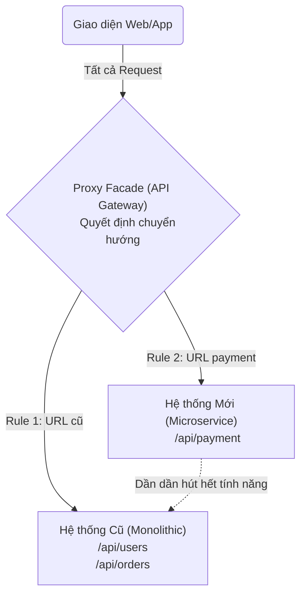

# Strangler Fig Pattern (Mẫu cây bóp cổ)

> **Ý tưởng chính việc sử dụng:** Tái cấu trúc hệ thống Monolith cũ bằng cách dùng Proxy điều phối, dời từng chức năng một sang Microservice mới cho đến khi hệ thống cũ chết đi.
> **Ví dụ:** Dựng Nginx làm Proxy. URL `/api/login` vẫn đi vào Server Cũ. URL `/api/payment` được bẻ lái vào Server Mới vừa làm xong. Khách hàng không hề hay biết.

Bạn có một hệ thống Monolith (Nguyên khối) đã chạy 10 năm. Code thối nát, bug ngập tràn, dev nào vào đọc cũng khóc thét. Sếp ra lệnh: "Viết lại hệ thống sang Microservices mới xịn xò đi em".
Bạn tính dành ra 1 năm đóng cửa cày cuốc đập đi xây mới 100% (Big Bang Rewrite)? Bạn chắc chắn sẽ bị đuổi việc trước khi code xong. 
**Strangler Fig Pattern** chính là nghệ thuật chuyển đổi hệ thống cũ sang mới một cách êm ái, rủi ro bằng 0.

## 1. Mức Độ Cơ Bản (Basic)

### Nguồn gốc tên gọi
"Strangler Fig" là loài cây đa / cây sung mọc ký sinh trên cành một cây cổ thụ. Nó thả rễ dần dần xuống đất. Rễ mọc ngày càng nhiều, quấn quanh thân cây cổ thụ. Cuối cùng, cây cổ thụ chết khô và mục nát, để lại một cây đa hoàn toàn mới đứng sừng sững thay thế vị trí đó.

### Triết lý của Pattern
Tương tự thiên nhiên, ta KHÔNG bao giờ đập bỏ hệ thống Monolith ngay lập tức.
1. Khởi tạo một dự án Microservices mới tinh (Cây leo). 
2. Chuyển TỪNG CHỨC NĂNG MỘT (ví dụ: Chức năng Khuyến mãi) từ code cũ sang code mới.
3. Người dùng vào chức năng Khuyến mãi sẽ được chuyển hướng ngầm (Routing) sang hệ thống Mới. Các chức năng khác vẫn chạy ở hệ thống Cũ.
4. Lặp lại quá trình này vài năm. Khi code cũ không còn ai truy cập, ta tắt server cũ đi (Cây cổ thụ tàn lụi).

## 2. Mức Độ Trung Bình (Intermediate): Under the Hood

### Proxy Facade (Lớp mặt nạ định tuyến)
Để làm được phép thuật này, bạn phải cài một con **API Gateway / Proxy** (như Nginx, Kong, hoặc code bằng Express) đứng chắn ở cổng trước (Cổng tên miền `api.mycompany.com`).
Khi có request:
- `GET /api/users` -> Proxy dòm vô bảng config, thấy chức năng User chưa làm lại -> Trỏ request về **Server Cũ (Monolith)**.
- `GET /api/promotions` -> Proxy thấy chức năng này đã xây xong ở Microservice -> Bẻ lái request trỏ về **Server Mới (Microservice)**.

Người dùng hoàn toàn không hề biết công ty đang xài 2 hệ thống song song.

### Rào cản Dữ liệu (Database)
Đây là phần khó nhất. Chức năng Mới thường có Database Mới. Khi chuyển chức năng Khuyến mãi sang hệ thống mới, làm sao nó móc được danh sách User ở hệ thống cũ?
- **Cách 1**: Gọi API ngược lại hệ thống Cũ để xin data (Hơi chậm).
- **Cách 2**: Chạy công cụ đồng bộ Database liên tục (CDC - Change Data Capture) như Debezium để bắn data từ DB cũ sang DB mới theo thời gian thực. (Rất phức tạp).

## 3. Mức Độ Nâng Cao (Advanced)

### Fallback (Kế hoạch lùi bước)
Một đặc điểm thiên tài của Strangler Fig: Nếu bạn triển khai Microservice Mới lên, chạy được 2 ngày thấy lỗi ngập mặt... Không sao cả! Bạn chỉ cần vào con Proxy bẻ lái URL trỏ ngược lại về Server Cũ. Lập tức lỗi biến mất. 
Sửa code Mới bình tĩnh, xong bẻ lái qua lại. An toàn tuyệt đối! Nếu dùng Big Bang Rewrite, bạn không có đường lùi.

### Rủi ro
- Hệ thống bị phân mảnh, có thể kéo dài tình trạng "nửa nạc nửa mỡ" nhiều năm trời.
- Quản lý Proxy cấu hình lằng nhằng (Quá nhiều rules if/else trong Nginx).

## 4. So Sánh (Compare & Contrast)

| Đặc điểm | Big Bang Rewrite (Đập đi xây lại 100%) | Strangler Fig Pattern |
| :--- | :--- | :--- |
| **Cách triển khai** | Dừng phát triển tính năng, giam mình 1 năm để viết mới. | Vừa viết chức năng mới, vừa dời từng chức năng cũ qua. |
| **Giá trị kinh doanh** | 1 năm sau sếp mới thấy sản phẩm ra mắt. Dễ gây nản. | 2 tuần release 1 tính năng mới. Sếp thấy kết quả liên tục. |
| **Rủi ro thất bại** | Rất rất cao (Do không ước lượng được độ phức tạp hệ thống cũ). | Rất thấp (Làm cái nào chắc cái đó, lỗi thì Rollback bẻ proxy lại). |
| **Đường lùi** | Không có. Đã tắt server cũ là hên xui. | Tắt/Mở luồng traffic qua Proxy trong 1 giây. |

## 5. Bài Tập Thực Hành Nhỏ

**Tình huống**: Trong file `demo-strangler-fig.ts`, hệ thống không có Gateway. Cả Frontend và Mobile đang gọi URL fix cứng (Hardcode) trực tiếp vào IP của Server Cũ (Monolith). Giờ công ty viết xong Microservice Payment mới, không biết làm sao để điều phối giao thông!

*Nhiệm vụ*: Áp dụng Strangler Fig.
1. Viết một `ProxyFacade` giả lập đứng ở giữa hứng mọi Request.
2. Viết luật (Rule): Nếu URL là `/api/payment` thì bẻ lái (route) sang Hệ thống Mới. Các URL khác (như `/api/users`, `/api/orders`) thả cho trôi về Hệ thống Cũ.

Code đề bài và đáp án nằm tại: [answers-strangler-fig](/Users/ductri0981/Documents/Studying-Software/strangler_fig_pattern/answers-strangler-fig.ts)

## 6. Phụ Lục (Sơ Đồ Kiến Trúc)

## 7. Giải Thích Thuật Ngữ (Glossary)
- **Strangler Fig**: Cây đa bóp cổ / Cây sung bóp cổ. Khái niệm hình tượng hóa việc bòn rút dần hệ thống cũ đến chết bằng hệ thống mới.
- **Monolith (Nguyên khối)**: Hệ thống phần mềm mà tất cả mọi tính năng, mọi logic đều nhồi chung vào một codebase duy nhất.
- **Big Bang Rewrite**: Chiến lược đập bỏ hệ thống cũ và xây lại hệ thống mới hoàn toàn trong một lần triển khai duy nhất (Rất nguy hiểm).
- **Proxy Facade / API Gateway**: Lớp trung gian đứng đón lõng các yêu cầu (Request), phân tích URL để quyết định đẩy vào hệ thống sau lưng nào.
- **Bi-directional Sync**: Kỹ thuật đồng bộ dữ liệu hai chiều (từ DB cũ sang DB mới và ngược lại) trong giai đoạn quá độ.
