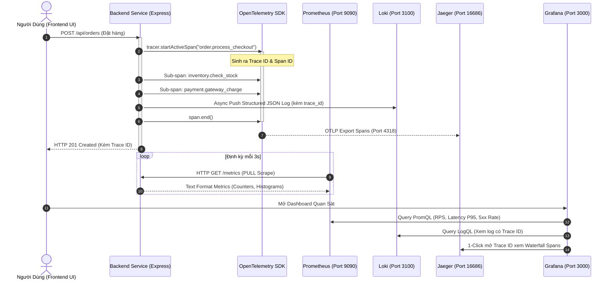
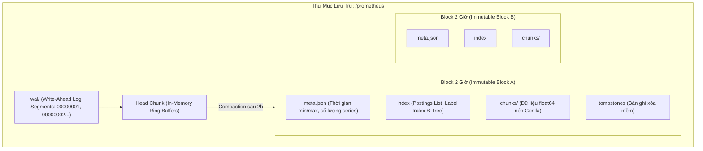
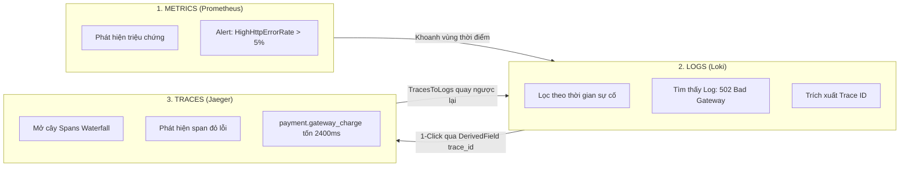

# Bộ Tứ Quan Sát (Observability Stack): Prometheus, Grafana, Loki & Jaeger
## Từ Nguyên Lý Căn Bản Đến Bản Chất Lõi Hệ Thống Tầng Sâu (Hardcore Deep Dive)

Tài liệu này cung cấp một cái nhìn toàn diện từ các nguyên lý cơ bản đến mức độ chuyên sâu nhất (Hardcore Deep Dive) về **Bộ tứ Observability kinh điển: Prometheus, Grafana, Loki và Jaeger (kết hợp chuẩn OpenTelemetry)**. Chúng ta sẽ giải phẫu chi tiết cấu trúc dữ liệu tầng thấp (Gorilla Compression, Inverted Index Postings, W3C TraceContext DAG), dòng chảy vật lý của dữ liệu (Write Path, Read Path, WAL), và các bài toán kỹ thuật vận hành quy mô lớn (High Cardinality Trap, Tail-based Sampling, Thanos/Mimir Federation).

---

## Mục Lục (Table of Contents)
1. [Mức Độ Cơ Bản (Basic Fundamentals)](#1-mức-độ-cơ-bản-basic-fundamentals)
   - [Observability Là Gì? Ẩn Dụ Đời Thực](#11-observability-là-gì-ẩn-dụ-đời-thực-real-world-analogy)
   - [Vấn Đề Cốt Lõi Sinh Ra Bộ Tứ](#12-vấn-đề-cốt-lõi-sinh-ra-bộ-tứ-problem-statement)
   - [Kiến Trúc Mức Cao Của Bộ Tứ](#13-kiến-trúc-mức-cao-của-bộ-tứ-high-level-architecture)
2. [Mức Độ Trung Bình (Intermediate - Architecture & Core Components)](#2-mức-độ-trung-bình-intermediate---architecture--core-components)
   - [Prometheus: Động Cơ Đo Lường Time-Series Dựa Trên PULL Model](#21-prometheus-động-cơ-đo-lường-time-series-dựa-trên-pull-model)
   - [Loki: Gom Log Tối Ưu Chi Phí Dựa Trên Cảm Hứng Prometheus](#22-loki-gom-log-tối-ưu-chi-phí-dựa-trên-cảm-hứng-prometheus)
   - [Jaeger: Hệ Thống Phân Tích Vết Gọi Phân Tán](#23-jaeger-hệ-thống-phân-tích-vết-gọi-phân-tán-distributed-tracing)
   - [Grafana: Trái Tim Hợp Nhất & Khả Năng Liên Kết Chéo](#24-grafana-trái-tim-hợp-nhất--khả-năng-liên-kết-chéo-cross-telemetry-correlation)
   - [Khi Nào NÊN Dùng và KHÔNG NÊN Dùng](#25-khi-nào-nên-dùng-và-không-nên-dùng)
3. [Mức Độ Chuyên Sâu: BẢN CHẤT VẬN HÀNH (Under The Hood & Core Mechanics)](#3-mức-độ-chuyên-sâu-bản-chất-vận-hành-under-the-hood--core-mechanics)
   - [Cấu Trúc Dữ Liệu & Nguyên Lý Nén Lõi](#31-cấu-trúc-dữ-liệu--nguyên-lý-nén-lõi)
   - [Dòng Chảy Dữ Liệu Vật Lý (Write Path & Read Path)](#32-dòng-chảy-dữ-liệu-vật-lý-physical-write-path--read-path)
   - [Mô Hình Phân Tán & Khả Năng Mở Rộng Quy Mô](#33-mô-hình-phân-tán--khả-năng-mở-rộng-quy-mô-distributed-systems--scaling)
4. [Mức Độ Nâng Cao: Vận Hành Thực Chiến (Production Engineering & Best Practices)](#4-mức-độ-nâng-cao-vận-hành-thực-chiến-production-engineering--best-practices)
   - [Bẫy Chết Người: Bùng Nổ Số Lượng Nhãn (High Cardinality Explosion)](#41-bẫy-chết-người-bùng-nổ-số-lượng-nhãn-high-cardinality-explosion)
   - [Chiến Lược Sampling Trong Distributed Tracing](#42-chiến-lược-sampling-trong-distributed-tracing-sampling-strategies)
   - [Cảnh Báo Chuẩn SRE: Tỷ Lệ Đốt Ngân Sách Lỗi (Error Budget Burn Rate Alerts)](#43-cảnh-báo-chuẩn-sre-tỷ-lệ-đốt-ngân-sách-lỗi-error-budget-burn-rate-alerts)
5. [Góc Nhìn Thực Chiến Cho Middle-Level Trở Xuống (Must-Know vs Nice-to-Know Roadmap)](#5-góc-nhìn-thực-chiến-cho-middle-level-trở-xuống-must-know-vs-nice-to-know-roadmap)
   - [Phân định ranh giới kiến thức theo từng cấp độ](#phân-định-ranh-giới-kiến-thức-theo-từng-cấp-độ)
   - [Bộ câu hỏi phỏng vấn thực chiến kinh điển (Intern -> Middle)](#bộ-câu-hỏi-phỏng-vấn-thực-chiến-kinh-điển-intern---middle)
   - [Những thứ TẠM THỜI BỎ QUA (Dành riêng cho Senior / Tech Lead / SRE)](#những-thứ-tạm-thời-bỏ-qua-dành-riêng-cho-senior--tech-lead--sre)
6. [So Sánh Bản Chất Các Giải Pháp (First-Principles Comparison)](#6-so-sánh-bản-chất-các-giải-pháp-first-principles-comparison)
7. [Sơ Đồ Trực Quan Hệ Thống (Mermaid Diagrams)](#7-sơ-đồ-trực-quan-hệ-thống-mermaid-diagrams)
8. [Bảng Tra Thuật Ngữ Chi Tiết (Glossary)](#8-bảng-tra-thuật-ngữ-chi-tiết-glossary)
9. [Hướng Dẫn Chạy & Kiểm Thử Toàn Diện (Step-by-Step Run Guide)](#9-hướng-dẫn-chạy--kiểm-thử-toàn-diện-step-by-step-run-guide)
10. [Cấu Trúc Mã Nguồn Dự Án (Project Structure)](#10-cấu-trúc-mã-nguồn-dự-án-project-structure)
11. [Tổng Kết](#11-tổng-kết)

---

## 1. Mức Độ Cơ Bản (Basic Fundamentals)

### 1.1 Observability Là Gì? Ẩn Dụ Đời Thực (Real-world Analogy)
Trong kỹ thuật phần mềm truyền thống, **Monitoring (Giám sát)** trả lời câu hỏi: *"Hệ thống có đang chạy hay đã sập?"* (Check ping, CPU > 90%, HTTP status != 200). 
Tuy nhiên, trong kỷ nguyên Microservices và Distributed Cloud, hệ thống thường ở trạng thái suy thoái một phần (Partially degraded): Server vẫn xanh, CPU vẫn thấp, nhưng 2% giao dịch thanh toán của khách hàng VIP bị timeout ở một service sâu bên trong.

**Observability (Khả năng quan sát)** là thước đo mức độ chúng ta có thể suy luận chính xác trạng thái nội tại của một hệ thống phức tạp chỉ bằng cách quan sát các dữ liệu đầu ra bên ngoài của nó (**Telemetry Data**).

> **Ẩn Dụ Đời Thực (Analogy: Bệnh Viện & Bệnh Nhân Cấp Cứu):**
> 
> Hãy hình dung một bệnh nhân trong phòng hồi sức cấp cứu:
> 1. **Prometheus (Metrics - Chỉ số sinh tồn):** Máy đo nhịp tim, huyết áp, nồng độ oxy trong máu ($SpO_2$), thân nhiệt. Các con số này được đo liên tục mỗi 3 giây. Bác sĩ liếc mắt qua màn hình là biết ngay: *"Huyết áp tụt dốc, bệnh nhân đang gặp nguy!"* $\rightarrow$ **Phát hiện sự cố tức thì (Cái gì đang xảy ra?)**.
> 2. **Jaeger (Distributed Tracing - Chụp X-Quang / CT-Scanner tiêm thuốc cản quang):** Khi huyết áp tụt, bác sĩ tiêm thuốc cản quang vào tĩnh mạch và chụp quét toàn thân để theo dõi dòng máu chảy qua tim, phổi, gan, thận. Nhờ đó, bác sĩ xác định chính xác: *"Động mạch vành nhánh trái bị tắc nghẽn ở giây thứ 1.4!"* $\rightarrow$ **Khoanh vùng chính xác vị trí nghẽn trong chuỗi vi dịch vụ (Nó xảy ra ở đâu?)**.
> 3. **Loki (Logs - Bệnh án chi tiết):** Nhật ký ghi chép của y tá từng phút: *"14:02:15 - Bệnh nhân uống thuốc A; 14:05:00 - Có biểu hiện dị ứng nổi mẩn đỏ; 14:05:30 - Thử thuốc B thất bại do sốc phản vệ"*. Bác sĩ đọc nhật ký để biết căn nguyên gốc rễ $\rightarrow$ **Tìm ra nguyên nhân bản chất (Tại sao nó xảy ra?)**.
> 4. **Grafana (Bảng điều khiển trung tâm của Bác sĩ trưởng):** Bảng hiển thị thông minh gom toàn bộ nhịp tim (Metrics), hình ảnh chụp CT (Traces) và bệnh án (Logs) vào cùng một màn hình duy nhất, cho phép bấm vào một nhịp tim bất thường để nhảy ngay tới trang bệnh án và phim chụp tại đúng tích tắc đó.

---

### 1.2 Vấn Đề Cốt Lõi Sinh Ra Bộ Tứ (Problem Statement)
Trước khi bộ tứ này ra đời, các kỹ sư phần mềm đối mặt với 4 "cơn ác mộng" khi vận hành:

1. **Hiểm họa "Hộp đen" phân tán (Distributed Black Box):**
   Trong kiến trúc Monolith, một request lỗi có thể debug bằng cách xem stack trace trên 1 file log duy nhất. Nhưng trong Microservices, 1 thao tác click "Mua Hàng" đi qua API Gateway $\rightarrow$ Order Service $\rightarrow$ Inventory $\rightarrow$ Payment $\rightarrow$ Shipping $\rightarrow$ Notification. Khi request bị chậm 5 giây hoặc trả về lỗi 500, log nằm rải rác trên 6 máy chủ khác nhau, không ai biết điểm nghẽn nằm ở đâu.
2. **Chi phí lưu trữ Log khổng lồ của mô hình cũ (ELK / Elasticsearch):**
   Elasticsearch đánh chỉ mục toàn văn (Full-Text Inverted Index) cho *từng từ* xuất hiện trong log message. Điều này khiến dung lượng index phình to gấp 1.5 - 2 lần dung lượng file log thô, ngốn hàng trăm GB RAM chỉ để giữ index cache. Doanh nghiệp phải trả hóa đơn đám mây khổng lồ cho những dòng log debug 99% không bao giờ đọc tới.
3. **Mô hình PUSH quá tải trong Monitoring (Push vs Pull):**
   Khi hàng ngàn server đồng loạt gặp sự cố và PUSH hàng triệu metric cảnh báo về monitoring server, bản thân monitoring server bị quá tải (DDoS nội bộ) và sập đúng vào thời điểm cần nó nhất.
4. **Sự rời rạc dữ liệu (Data Silos):**
   Kỹ sư phải mở tab 1 xem biểu đồ CPU, tab 2 xem log Kibana, tab 3 xem trace Zipkin, sau đó đối chiếu thủ công thời gian (Timestamp matching) với độ lệch múi giờ sai số hàng phút.

---

### 1.3 Kiến Trúc Mức Cao Của Bộ Tứ (High-Level Architecture)

```
       +--------------------------------------------------------------------+
       |                     NGUỒN DỮ LIỆU ỨNG DỤNG                         |
       |  E-Commerce API / Microservices (NodeJS, Go, Java, Python...)      |
       +--------------------------------------------------------------------+
              |                                  |                    |
       Prometheus Scrape                   Log Ingestion        OTLP Traces
       (PULL qua HTTP /metrics)            (PUSH HTTP JSON)    (PUSH gRPC/HTTP)
              |                                  |                    |
              v                                  v                    v
     +-----------------+                +-----------------+  +-----------------+
     |   PROMETHEUS    |                |      LOKI       |  |     JAEGER      |
     |   (Port 9090)   |                |   (Port 3100)   |  |   (Port 16686)  |
     |  - TSDB Engine  |                |  - Index Labels |  |  - OTLP Receiver|
     |  - Gorilla Comp |                |  - Chunks S3/FS |  |  - DAG Spans    |
     |  - PromQL       |                |  - LogQL        |  |  - Trace Graph  |
     +-----------------+                +-----------------+  +-----------------+
              \                                  |                   /
               \                                 |                  /
                \                                v                 /
                 +-----------------------------------------------+
                 |                    GRAFANA                    |
                 |                  (Port 3000)                  |
                 |  - Unified Dashboard & Golden Signals         |
                 |  - Trace-to-Logs 1-Click Navigation           |
                 |  - Logs-to-Trace Automatic Deep Linking       |
                 +-----------------------------------------------+
```

---

## 2. Mức Độ Trung Bình (Intermediate - Architecture & Core Components)

### 2.1 Prometheus: Động Cơ Đo Lường Time-Series Dựa Trên PULL Model

Prometheus không đợi ứng dụng gửi số liệu về; thay vào đó, Prometheus hoạt động theo cơ chế **PULL (Scraping)**:
- **Scrape Loop:** Định kỳ (ví dụ mỗi 3s - 15s), Prometheus thực hiện một HTTP GET request tới endpoint `/metrics` của ứng dụng.
- **4 Kiểu Dữ Liệu Metric Cơ Bản:**
  1. **Counter:** Số nguyên đơn điệu chỉ tăng (Monotonically Increasing), chỉ reset về 0 khi app restart (ví dụ: `http_requests_total`). Dùng với hàm `rate()` hoặc `increase()`.
  2. **Gauge:** Giá trị có thể tăng hoặc giảm tự do tại một thời điểm (ví dụ: `active_orders_count`, `cpu_memory_usage`, `temperature`).
  3. **Histogram:** Phân loại các giá trị đo lường vào các xô có cấu hình sẵn (`buckets` dạng `le` - Less Than or Equal), tính tổng số lượt `_count` và tổng giá trị `_sum`. Cho phép tính các phân vị P50, P90, P95, P99 trên máy chủ Prometheus bằng thuật toán nội suy (`histogram_quantile()`).
  4. **Summary:** Tương tự Histogram nhưng phân vị được tính toán trực tiếp ngay phía Client SDK. Nhược điểm: Không thể cộng gộp (Aggregate) giữa nhiều server/pod.

---

### 2.2 Loki: Gom Log Tối Ưu Chi Phí Dựa Trên Cảm Hứng Prometheus

Grafana Loki đảo ngược hoàn toàn triết lý của Elasticsearch:
- **Index-Free Content:** Loki **KHÔNG** đánh chỉ mục nội dung tin nhắn log.
- **Chỉ Index Nhãn (Labels Only):** Tương tự như Prometheus gán nhãn cho time-series, Loki nhóm các dòng log có cùng bộ nhãn thành một **Log Stream** (ví dụ: `{service_name="order-payment-service", env="production"}`).
- **Lưu trữ dạng Chunks:** Các dòng log trong cùng stream được nén chặt thành các Chunks (sử dụng gzip hoặc snappy) và lưu thẳng xuống Object Storage (S3, GCS, MinIO, hoặc đĩa cục bộ).
- **LogQL:** Ngôn ngữ truy vấn mạnh mẽ cho phép lọc stream bằng label trước (`{app="api"}`), sau đó dùng biểu thức Regex/Text search song song để duyệt qua log thô (`|= "error" | json | status >= 500`).

---

### 2.3 Jaeger: Hệ Thống Phân Tích Vết Gọi Phân Tán (Distributed Tracing)

Jaeger (dựa trên bài báo nghiên cứu **Google Dapper**) giúp tái hiện dòng đời của một request qua nhiều tầng dịch vụ:
- **Trace:** Một cây đồ thị có hướng (Directed Acyclic Graph - DAG) thể hiện toàn bộ hành trình của một request từ lúc người dùng click chuột cho đến khi hoàn tất.
- **Span:** Một mắt xích công việc độc lập trong Trace. Mỗi span có:
  - `Span ID`: Định danh duy nhất của mắt xích.
  - `Trace ID`: Định danh chung của cả chuỗi giao dịch.
  - `Parent Span ID`: ID của span cha đã gọi nó.
  - `Duration`: Thời gian bắt đầu và kết thúc chính xác tới micro-giây ($\mu\text{s}$).
  - `Tags / Attributes`: Key-value ngữ cảnh (ví dụ: `http.status_code=500`, `db.statement="SELECT * FROM orders"`).
  - `Logs / Events`: Các sự kiện nhỏ xảy ra bên trong span.
- **Chuẩn Mở OpenTelemetry (OTel):** Hiện nay, Jaeger hoạt động như một Backend lưu trữ và hiển thị, tiếp nhận dữ liệu thông qua giao thức chuẩn hóa công nghiệp **OTLP (OpenTelemetry Protocol)** qua cổng gRPC `4317` hoặc HTTP `4318`.

---

### 2.4 Grafana: Trái Tim Hợp Nhất & Khả Năng Liên Kết Chéo (Cross-Telemetry Correlation)

Điểm mạnh tối thượng của Grafana không chỉ nằm ở các biểu đồ bóng bẩy, mà là **Khả năng liên kết chéo giữa 3 trụ cột**:
- **Từ Metric sang Log:** Khi thấy biểu đồ lỗi 5xx của Prometheus tăng vọt lúc 14:00, bạn kéo chuột chọn vùng thời gian đó $\rightarrow$ Chuyển sang Data Source Loki với đúng khoảng thời gian để đọc log lỗi.
- **Từ Log sang Trace (Trace-to-Logs):** Nhờ cấu hình `derivedFields` trong Grafana, khi một dòng log chứa trường `"trace_id": "1085ccbe..."`, Grafana tự động biến mã hash này thành một đường link xanh. Bấm vào link, giao diện chia đôi màn hình (Split View) mở ngay Jaeger Trace Waterfall tương ứng!
- **Từ Trace sang Log:** Khi đang xem một Span bị đỏ trong Jaeger, Grafana cung cấp nút *"Explore Logs with Trace ID"* để lọc ra toàn bộ log của microservice đó trong phạm vi $\pm 5$ phút quanh span.

---

### 2.5 Khi Nào NÊN Dùng và KHÔNG NÊN Dùng

| Công Cụ | Khi Nào NÊN Dùng | Khi Nào KHÔNG NÊN Dùng (Anti-Patterns) |
| :--- | :--- | :--- |
| **Prometheus** | Đo lường hiệu năng tổng thể, SLA/SLO, tỷ lệ lỗi, cảnh báo tức thì, theo dõi CPU/RAM/Network. | **Lưu trữ dữ liệu có độ biến động nhãn vô hạn (High Cardinality):** Tuyệt đối không gán `user_id`, `email`, `order_id`, `credit_card_number` vào Label của Prometheus. Làm vậy sẽ làm sập bộ nhớ TSDB (OOM). |
| **Loki** | Quản lý log tập trung cho Kubernetes, Microservices, audit log, lưu trữ log lâu dài với chi phí đĩa cực thấp. | Tìm kiếm văn bản toàn diện (Full-Text Search) trên hàng chục petabyte log mà yêu cầu độ trễ sub-second (với use-case này Elasticsearch / ClickHouse chiếm ưu thế hơn do có inverted index nội dung). |
| **Jaeger** | Hệ thống Microservices phức tạp, gRPC/HTTP phân tán, tối ưu hóa điểm nghẽn độ trễ (Latency Bottleneck), phát hiện lỗi cascading. | Ứng dụng Monolith đơn giản một tiến trình không có giao tiếp mạng ngoài (sẽ lãng phí tài nguyên instrumentation). |
| **Grafana** | Làm Single Pane of Glass hợp nhất Prometheus, Loki, Jaeger, Postgres, CloudWatch... | Làm công cụ chỉnh sửa hoặc thao tác dữ liệu (Grafana là Read-only Visualizer, không phải Admin CRUD panel). |

---

## 3. Mức Độ Chuyên Sâu: BẢN CHẤT VẬN HÀNH (Under The Hood & Core Mechanics)

### 3.1 Cấu Trúc Dữ Liệu & Nguyên Lý Nén Lõi

#### 1. Nguyên lý nén Time-Series (Gorilla Compression) trong Prometheus
Mỗi mẫu dữ liệu (Sample) trong Time-Series gồm 2 thành phần: **Timestamp (8 bytes int64)** và **Value (8 bytes float64)**. Nếu lưu thô, mỗi sample tốn $16\text{ bytes}$. Với 1 triệu metrics cào mỗi 10 giây, mỗi ngày tiêu tốn hàng chục GB bộ nhớ.
Prometheus áp dụng thuật toán nén **Gorilla** với 2 kỹ thuật cốt lõi:
- **Nén Timestamp bằng Delta-of-Deltas**: Các chu kỳ cào diễn ra đều đặn (ví dụ mỗi 10 giây). Hiệu số giữa 2 lần cào liên tiếp gần như cố định ($D = 10$). Độ lệch giữa 2 hiệu số này ($D' = D_2 - D_1$) hầu hết bằng 0. Khi $D' = 0$, thuật toán chỉ tốn đúng **1 bit `0`** để lưu trữ thay vì 64 bits.
- **Nén Value (Float64) bằng phép XOR**: Các chỉ số float liên tiếp (ví dụ CPU 45.2% rồi 45.25%) có biểu diễn nhị phân giống nhau ở phần lớn các bit. Bằng cách lấy $V_n \text{ XOR } V_{n-1}$, các bit giống nhau triệt tiêu thành 0, chỉ cần lưu các bit khác biệt có nghĩa.
$\rightarrow$ **Kết quả**: Gorilla nén $16\text{ bytes}$ dữ liệu thô xuống trung bình chỉ còn **$\sim 1.37\text{ bytes}$ / sample** (tiết kiệm hơn 90% RAM).

---

#### 2. Cấu Trúc Inverted Index & Postings List Trong Prometheus
Để tìm kiếm các chuỗi số liệu theo nhiều nhãn như `http_requests_total{route="/api/orders", status_code="500"}`, Prometheus sử dụng **Inverted Index**:
- Mỗi Time-Series được cấp một mã số nguyên duy nhất: **Series ID (uint32)**.
- **Postings List:** Một danh sách mảng số nguyên sắp xếp tăng dần các Series ID có chứa một cặp nhãn cụ thể:
```
  route="/api/orders"  -> [Series ID: 1, 4, 9, 12, 45, 102]
  status_code="500"    -> [Series ID: 4, 12, 88, 102]
```
- Khi câu truy vấn có nhiều điều kiện kết hợp (`AND`), Prometheus chỉ cần thực hiện thuật toán **Giao hai danh sách có thứ tự (Intersection of Sorted Lists)** với độ phức tạp $O(N + M)$, duyệt nhanh bằng con trỏ mà không cần quét toàn bộ kho dữ liệu.

---

#### 3. Mô hình Stream & Chunk Của Loki
Khác với Elasticsearch (đánh chỉ mục mọi từ trong văn bản log), Loki áp dụng tư duy tối giản:
- **Chỉ Index Labels**: Mỗi tổ hợp nhãn (ví dụ `{app="backend", env="prod"}`) tạo thành một **Log Stream**. Loki chỉ đánh index ánh xạ từ Labels tới Stream ID.
- **Nén Log thành Chunks**: Các dòng log thô trong cùng stream được gom lại và nén chặt thành các Chunks nhị phân (dung lượng ~1.5MB), sau đó đẩy thẳng xuống Object Storage rẻ tiền (S3, GCS, MinIO, hoặc ổ cứng).
- **LogQL Pipeline Scanning**: Khi cần tìm kiếm log, Loki dùng Index để khoanh vùng các Chunks liên quan, sau đó cho các luồng xử lý quét song song qua các dòng log thô để lọc regex hoặc JSON.

---

#### 4. W3C TraceContext & Truyền Ngữ Cảnh Bất Đồng Bộ Trong OpenTelemetry
Làm thế nào để một chuỗi thao tác bất đồng bộ qua nhiều tầng hàm và nhiều microservices giữ được cùng một `trace_id`?
- **AsyncLocalStorage (Tầng Ứng Dụng)**: OpenTelemetry SDK trong Node.js sử dụng `AsyncLocalStorage` để lưu trữ ngữ cảnh thực thi. Bất kể qua bao nhiêu lần `await` hay callback, hàm hiện tại luôn lấy được Trace ID và Span ID của request cha.
- **W3C TraceContext (Tầng Mạng)**: Khi gọi HTTP sang service khác, SDK tự động bơm header chuẩn:
  ```http
  traceparent: 00-4bf92f3577b34da6a3ce929d0e0e4736-00f067aa0ba902b7-01
  ```
  - `4bf92f3577b3...`: **Trace ID** toàn cục (128-bit hex).
  - `00f067aa0ba...`: **Parent Span ID** của mắt xích vừa gọi (64-bit hex).
  - `01`: **Sample Flag** (đánh dấu trace này có được lưu lại hay không).

---

### 3.2 Dòng Chảy Dữ Liệu Vật Lý (Write Path & Read Path)

#### 1. Hành Trình Ghi Dữ Liệu Của Prometheus (Prometheus Write Path)
```
[Application /metrics] 
       │
       │ 1. HTTP Scrape (PULL định kỳ)
       ▼
[Prometheus Scrape Engine]
       │
       ├───> 2. Ghi append-only vào Write-Ahead Log (WAL) trên Disk (Chống mất điện)
       │
       └───> 3. Nén Gorilla đưa vào Head Chunk trong RAM (Phục vụ truy vấn tức thì)
                │
                │ 4. Sau mỗi 2 giờ (Compaction)
                ▼
       [Tạo Immutable Block 2h trên Disk (meta.json, index, chunks/)]
```
- **Bước 1 (Scrape)**: Worker gửi HTTP GET tới target, parse định dạng text metric.
- **Bước 2 (WAL Append)**: Mẫu dữ liệu mới được ghi tuần tự vào file WAL để đảm bảo an toàn nếu server khởi động lại đột ngột.
- **Bước 3 (Head Chunk)**: Nén Gorilla và giữ trong RAM để phục vụ các câu truy vấn thời gian thực tức thì ($< 2\text{h}$).
- **Bước 4 (Compaction)**: Mỗi 2 giờ, Head Chunk cũ được "đóng băng" thành Block bất biến ghi xuống đĩa và giải phóng bộ nhớ.

---

#### 2. Hành Trình Ghi & Đọc Dữ Liệu Của Loki (Loki Write & Read Path)
- **Write Path**:
  1. Client gửi log dạng JSON tới **Distributor**.
  2. Distributor băm (hash) labels để xác định stream và định tuyến log tới đúng **Ingester**.
  3. Ingester gom các dòng log vào Chunk Buffer trong RAM. Khi đạt kích thước (~1.5MB) hoặc hết thời gian chờ, Ingester nén và flush chunk xuống **Object Storage (S3/FS)**, đồng thời ghi nhãn vào Index.
- **Read Path**:
  1. Grafana gửi truy vấn LogQL tới **Query-Frontend**.
  2. Frontend chia nhỏ khoảng thời gian truy vấn và giao việc song song cho các **Querier**.
  3. Querier tra cứu Index, sau đó đọc đồng thời từ cả **RAM của Ingester** (chứa log mới nhất chưa kịp flush) và **Object Storage** (chứa log lịch sử), chạy bộ lọc regex và trả kết quả về.

---

#### 3. Hành Trình Tracing Của Jaeger & OpenTelemetry (Tracing Pipeline)
- **Application Process (Tracer SDK)**:
  1. `tracer.startActiveSpan()` khởi tạo một đối tượng Span trong bộ nhớ.
  2. Khi `span.end()`, span được đẩy vào hàng đợi trong bộ nhớ (**In-Memory Ring Buffer**).
  3. **BatchSpanProcessor** định kỳ gom các spans lại (ví dụ mỗi 500ms hoặc khi đủ 512 spans) và xuất bất đồng bộ qua giao thức **OTLP (gRPC/HTTP)** tới Jaeger Collector.
- **Jaeger Collector & Storage**:
  1. Tiếp nhận payload OTLP, validate cấu trúc cây phân cấp (DAG).
  2. Lưu trữ vào backend lưu trữ (In-memory, Elasticsearch, hoặc ClickHouse).
  3. Cung cấp dữ liệu để Jaeger UI render biểu đồ Waterfall trực quan hóa các mắt xích công việc.

---

### 3.3 Mô Hình Phân Tán & Khả Năng Mở Rộng Quy Mô (Distributed Systems & Scaling)

Khi khối lượng dữ liệu vượt quá năng lực của một máy chủ đơn lẻ:

```
                          +-------------------------+
                          |   GRAFANA DASHBOARD     |
                          +-------------------------+
                                       │
                                       ▼
                    +------------------------------------+
                    |  THANOS QUERIER / MIMIR QUERIER    |
                    +------------------------------------+
                        /             │             \
                       /              │              \
                      ▼               ▼               ▼
            +----------------+ +----------------+ +----------------+
            | Prometheus A   | | Prometheus B   | | Thanos Store   |
            | (Cluster US)   | | (Cluster EU)   | | Gateway        |
            | +Thanos Sidecar| | +Thanos Sidecar| | (Long-term S3) |
            +----------------+ +----------------+ +----------------+
```

1. **Prometheus High Availability & Thanos Federation**:
   - Prometheus bản chất là hệ thống single-node độc lập.
   - **Thanos Sidecar**: Chạy song song cạnh Prometheus, định kỳ đẩy block dữ liệu cũ lên S3 và cung cấp giao diện truy vấn gRPC.
   - **Thanos Querier**: Đóng vai trò bộ tổng hợp truy vấn trung tâm. Khi người dùng truy vấn PromQL, Thanos Querier truy vấn song song các cụm Prometheus và kho lưu trữ S3, tự động khử trùng lặp (Deduplication) giữa 2 node Prometheus chạy song song HA.
2. **Loki Microservices Mode**:
   - Thay vì chạy một binary duy nhất, Loki có thể bóc tách thành các microservices độc lập: **Distributors** (stateless, scale theo traffic ghi), **Ingesters** (stateful, quản lý buffer log), và **Queriers** (stateless, scale theo số lượng người dùng truy vấn).

---

## 4. Mức Độ Nâng Cao: Vận Hành Thực Chiến (Production Engineering & Best Practices)

### 4.1 Bẫy Chết Người: Bùng Nổ Số Lượng Nhãn (High Cardinality Explosion)
Đây là nguyên nhân số 1 khiến các hệ sinh thái Prometheus và Loki bị sập hoàn toàn:

#### Bản chất toán học:
Số lượng Time-Series được tạo ra là **Tích đề-các (Cartesian Product)** của tất cả các giá trị nhãn:
$$\text{Total Series} = \prod_{i=1}^{k} \text{Cardinality}(\text{Label}_i)$$

*Ví dụ sai lầm chí mạng:*
```javascript
// SAI LẦM NGHIÊM TRỌNG: Gán User ID vào nhãn của Prometheus Counter!
httpRequestTotal.inc({
  method: req.method,        // 4 giá trị (GET, POST, PUT, DELETE)
  route: req.path,           // 20 routes
  user_id: req.user.id       // 1,000,000 khách hàng!
});
```
$\rightarrow$ Tổng số Time-Series = $4 \times 20 \times 1,000,000 = \mathbf{80,000,000\text{ Series}}$!
Mỗi series tiêu tốn bộ nhớ trong RAM của Prometheus. 80 triệu series sẽ ngốn hàng chục GB RAM ngay lập tức, dẫn tới hiện tượng **OOM Killer** của hệ điều hành khai tử tiến trình Prometheus.

#### Quy tắc vàng chống High-Cardinality:
- **Trong Prometheus:** Tuyệt đối chỉ dùng các nhãn có tập giá trị hữu hạn, cố định và nhỏ (Enum-like values: `status_code`, `method`, `environment`, `service_name`).
- **Trong Loki:** Chỉ đặt các nhãn ở mức cơ sở hạ tầng (`app`, `cluster`, `namespace`). Đưa `user_id`, `order_id`, `ip_address` vào trong phần thân JSON log message để lọc bằng LogQL `| json | user_id="123"`.

---

### 4.2 Chiến Lược Sampling Trong Distributed Tracing (Sampling Strategies)
Nếu hệ thống xử lý $50,000\text{ requests/giây}$, việc ghi nhận $100\%$ các spans vào Jaeger sẽ tạo ra hàng chục TB dữ liệu mỗi ngày, làm nghẽn mạng và sập DB lưu trữ.

1. **Head-Based Sampling (Lấy mẫu tại nguồn):**
   - Quyết định lấy mẫu được đưa ra ngay tại service đầu tiên khi request vừa đến (ví dụ: lấy ngẫu nhiên 5% requests).
   - *Nhược điểm:* Nếu 1 lỗi hiếm gặp chỉ xảy ra với 1 trong 10,000 requests, xác suất rất cao là trace lỗi đó bị loại bỏ và không được ghi lại.
2. **Tail-Based Sampling (Lấy mẫu tại đích - Chuẩn Production):**
   - 100% spans được gửi tạm thời vào bộ đệm của OpenTelemetry Collector.
   - Collector đợi cho đến khi toàn bộ trace hoàn tất, sau đó đánh giá:
     - Nếu trong trace có **span bị lỗi (`status_code == ERROR` hoặc HTTP 5xx)** $\rightarrow$ **LƯU 100%**.
     - Nếu trace có tổng thời gian xử lý **$\ge 1.5\text{s}$ (Slow Request)** $\rightarrow$ **LƯU 100%**.
     - Nếu request hoàn toàn bình thường, chỉ giữ lại một tỷ lệ nhỏ ngẫu nhiên ($0.5\%$).
   - *Kết quả:* Không bao giờ bỏ sót sự cố bất thường mà vẫn tiết kiệm $95\%$ dung lượng lưu trữ!

---

### 4.3 Cảnh Báo Chuẩn SRE: Tỷ Lệ Đốt Ngân Sách Lỗi (Error Budget Burn Rate Alerts)
Thay vì đặt cảnh báo ngây thơ kiểu *"Nếu lỗi > 1% trong 5 phút thì hú còi"*, Google SRE áp dụng cảnh báo theo **Burn Rate (Tốc độ đốt cháy ngân sách lỗi)**:
- Nếu cam kết SLA là $99.9\%$ khả dụng trong 30 ngày, ngân sách lỗi cho phép là $0.1\%$.
- Cảnh báo được kích hoạt khi tốc độ lỗi tiêu tốn hết ngân sách 30 ngày chỉ trong vòng 1 giờ (Burn rate 14.4) hoặc 6 giờ (Burn rate 6).
- Điều này loại bỏ hoàn toàn các cảnh báo giả (Alert Fatigue) do các đợt tăng đột biến lưu lượng ngắn hạn không ảnh hưởng tới khách hàng.

---

## 5. Góc Nhìn Thực Chiến Cho Middle-Level Trở Xuống (Must-Know vs Nice-to-Know Roadmap)

### Phân định ranh giới kiến thức theo từng cấp độ

```
┌─────────────────────────────────────────────────────────────────────────────────┐
│ CẤP ĐỘ INTERN / JUNIOR (HIỂU BẢN CHẤT 3 TRỤ CỘT & SỬ DỤNG ĐÚNG)                 │
│  - Phân biệt rõ vai trò: Metrics (Cái gì), Traces (Ở đâu), Logs (Tại sao)       │
│  - Viết truy vấn PromQL cơ bản: rate(), increase(), histogram_quantile()        │
│  - Đọc log trên Grafana/Loki với LogQL cơ bản: {app="api"} |= "error"           │
│  - Đọc hiểu biểu đồ Waterfall trên Jaeger để tìm Span bị chậm hoặc lỗi          │
│  - QUY TẮC SỐNG CÒN: Không bao giờ đưa user_id, order_id vào Prometheus label   │
└─────────────────────────────────────────────────────────────────────────────────┘
                                        │
                                        ▼
┌─────────────────────────────────────────────────────────────────────────────────┐
│ CẤP ĐỘ MIDDLE-LEVEL (INSTRUMENTATION CHUẨN MỰC & LIÊN KẾT HỆ THỐNG)            │
│  - Tự tay tích hợp OpenTelemetry SDK, tạo custom spans cho các hàm quan trọng   │
│  - Truyền W3C traceparent qua các HTTP/gRPC call để trace không bị đứt đoạn     │
│  - Tự động inject trace_id vào JSON log và cấu hình Grafana Trace-to-Logs link  │
│  - Thiết kế Grafana Dashboard chuẩn Golden Signals (Latency, Traffic, Errors)   │
│  - Thiết lập cảnh báo Prometheus Alertmanager và cấu hình Sampling rate Jaeger  │
└─────────────────────────────────────────────────────────────────────────────────┘
```

#### Intern / Junior: Những gì BẮT BUỘC phải nắm vững
1. **Mô hình tư duy cốt lõi**:
   - Khi có sự cố, quy trình 3 bước luôn là: Nhìn **Metrics** để biết hệ thống đang đau ở đâu $\rightarrow$ Nhìn **Jaeger Trace** để biết service nào làm nghẽn $\rightarrow$ Đọc **Loki Log** của service đó để tìm đúng dòng code bị exception.
2. **Kỹ năng thực chiến**:
   - Khai báo đúng kiểu metric: dùng `Counter` cho số lượt đếm request, dùng `Gauge` cho số lượng kết nối đang mở / dung lượng RAM, dùng `Histogram` cho thời gian phản hồi (Latency).
   - Biết mở Jaeger UI tìm kiếm theo `service_name` và `operation_name`, sắp xếp theo thời gian chạy lâu nhất để khoanh vùng điểm nghẽn.
   - Nhớ nguyên tắc phòng tránh High Cardinality: Label chỉ dùng cho các giá trị hữu hạn như `method`, `status_code`, `env`.

#### Middle-Level: Tối ưu hóa & Thiết kế chuẩn mực
1. **Context Propagation xuyên service**: Đảm bảo mọi lời gọi HTTP outbound (`fetch`, `axios`) và gRPC client đều đính kèm header `traceparent` để không làm đứt mạch trace giữa các microservices.
2. **Liên kết chéo 1-click (Cross-Telemetry Correlation)**: Đảm bảo logger luôn ghi `trace_id` vào mỗi dòng log. Cấu hình Grafana Data Link để kỹ sư chỉ cần click vào Trace ID trong log là mở ngay cây waterfall tương ứng.
3. **Cảnh báo chuẩn mực**: Tránh tạo hàng chục cảnh báo vô nghĩa. Tập trung vào 4 chỉ số vàng (Golden Signals): Tỷ lệ lỗi 5xx vượt ngưỡng, Latency P95/P99 vượt SLA, và Service Down.

---

### Bộ câu hỏi phỏng vấn thực chiến kinh điển (Intern -> Middle)

#### Câu 1 (Intern/Junior): Tại sao Prometheus lại sử dụng mô hình PULL (Scraping) thay vì để ứng dụng PUSH metrics về server?
- **Trả lời ghi điểm**:
  - Mô hình PULL giúp bảo vệ hệ thống giám sát: Prometheus chủ động quyết định tốc độ cào số liệu, tránh bị "DDoS nội bộ" khi hàng ngàn service cùng lúc gửi metric về trong lúc gặp sự cố.
  - Tự động phát hiện Service Down: Nếu Prometheus không cào được `/metrics` của một instance sau vài lần thử, Prometheus biết ngay instance đó đã chết mà không cần đợi heartbeat.
  - Đơn giản hóa ứng dụng: Ứng dụng chỉ cần phơi một endpoint HTTP GET `/metrics` ở dạng text thô, không cần quan tâm máy chủ monitoring nằm ở đâu hay quản lý hàng đợi gửi tin phức tạp.

#### Câu 2 (Junior/Middle): Sự cố "High Cardinality" trong Prometheus là gì và làm thế nào để phòng tránh?
- **Trả lời ghi điểm**:
  - High Cardinality là hiện tượng số lượng chuỗi số liệu (Time-Series) bùng nổ theo tích đề-các của các giá trị nhãn. Nếu gán một trường có độ biến động cao như `user_id` hay `order_id` vào nhãn của Prometheus, hệ thống sẽ sinh ra hàng triệu chuỗi số liệu độc lập.
  - Hậu quả: Tiêu tốn lượng lớn RAM để duy trì Head Blocks và Inverted Index, gây ra hiện tượng OOM Crash.
  - Cách phòng tránh: Chỉ dùng các nhãn có tập giá trị cố định, hữu hạn (như HTTP method, HTTP status code, env). Các thông tin định danh như `user_id` phải đưa vào log message của Loki hoặc Span tags của Jaeger.

#### Câu 3 (Middle): Làm thế nào để liên kết một dòng log trong Loki với một Trace trong Jaeger trên cùng một giao diện Grafana?
- **Trả lời ghi điểm**:
  - Bước 1: Trong code backend, sử dụng OpenTelemetry API để lấy `trace_id` hiện tại từ `AsyncLocalStorage` và tự động nhét trường `trace_id` vào structured JSON log (ví dụ dùng Winston hoặc Zap).
  - Bước 2: Trong cấu hình Datasource Loki của Grafana, cấu hình thuộc tính `derivedFields`: định nghĩa một Regex trích xuất chuỗi `trace_id` từ log và gán link nội bộ trỏ tới Datasource Jaeger với cú pháp `${__value.raw}`.
  - Kết quả: Khi xem log trong Grafana Explore, trường `trace_id` sẽ hiển thị thành một nút bấm màu xanh, click vào sẽ mở ngay cây Span Waterfall của Jaeger tương ứng ở màn hình bên cạnh (Split View).

---

### Những thứ TẠM THỜI BỎ QUA (Dành riêng cho Senior / Tech Lead / SRE)
- **Toán học bitmask nén Gorilla chi tiết**: Không cần nhớ thứ tự bit `0`, `10`, `110` hay cơ chế XOR float64 ở cấp độ bitwise.
- **Tương tác nhân Linux mmap & page fault**: Các cơ chế quản lý Virtual Memory của Linux OS được Prometheus TSDB tự động xử lý.
- **Vận hành cụm Thanos / Mimir phân tán đa vùng**: Việc cấu hình Compactors, Store Gateways, Ruler và Object Storage cho cụm đa quốc gia thuộc phạm vi của chuyên gia SRE / Platform Engineer.
- *Ở cấp độ Middle trở xuống, hãy tập trung vào việc Instrument code đúng chuẩn OpenTelemetry, viết PromQL chính xác, thiết kế Dashboard hữu ích và xử lý triệt để bẫy High Cardinality!*

---

## 6. So Sánh Bản Chất Các Giải Pháp (First-Principles Comparison)

### 6.1 Prometheus vs InfluxDB vs VictoriaMetrics vs Datadog

| Tiêu Chí | Prometheus | InfluxDB | VictoriaMetrics | Datadog (SaaS) |
| :--- | :--- | :--- | :--- | :--- |
| **Mô hình Thu thập** | **PULL** (Scrape qua HTTP) | **PUSH** (Telegraf line protocol) | Hỗ trợ cả **PULL & PUSH** | **PUSH** (Datadog Agent) |
| **Ngôn ngữ Truy vấn** | **PromQL** | InfluxQL / Flux | MetricsQL (Siêu tập con của PromQL) | Giao diện Web / API độc quyền |
| **Khả năng chịu Cardinality** | Trung bình (cần cẩn trọng nhãn) | Kém với cấu trúc TSI cũ | **Rất Cao** (Tối ưu hóa bảng băm) | Rất cao (Tính tiền theo số custom metrics) |
| **Lưu trữ Dài hạn** | Cần thêm Thanos/Mimir | Sẵn có (Retention Policy) | Sẵn có (Cụm phân tán Victoria) | Tự động lưu trên Cloud của Datadog |
| **Chi Phí Vận Hành** | Mã nguồn mở, miễn phí bản quyền | Mã nguồn mở / Cloud thương mại | Mã nguồn mở / Enterprise | **Cực kỳ đắt đỏ** ở quy mô lớn |

---

### 6.2 Loki vs ELK Stack (Elasticsearch, Logstash, Kibana)

| Tiêu Chí | Grafana Loki | ELK Stack (Elasticsearch) |
| :--- | :--- | :--- |
| **Cơ chế Đánh Chỉ Mục** | **Chỉ Index Labels Metadata** | **Full-Text Inverted Index toàn bộ nội dung** |
| **Mức Tiêu Thụ RAM** | **Cực kỳ thấp** (vài trăm MB tới vài GB) | **Rất cao** (Thường chiếm 50% RAM máy chủ cho JVM Heap) |
| **Chi Phí Đĩa Lưu Trữ** | Nén chunks lưu thẳng S3/MinIO rẻ tiền | Cần ổ SSD IOPS cao để lưu inverted index |
| **Tốc Độ Tìm Kiếm Text** | Chậm hơn đối với văn bản khổng lồ (quét brute-force song song) | Siêu tốc độ đối với tìm kiếm cụm từ bất kỳ |
| **Tích hợp Dashboard** | Hoàn hảo với Grafana và Prometheus | Hoàn hảo với Kibana |

---

### 6.3 Jaeger vs Zipkin vs Grafana Tempo

| Tiêu Chí | Jaeger | Zipkin | Grafana Tempo |
| :--- | :--- | :--- | :--- |
| **Nguồn Gốc** | Uber / CNCF Graduation Project | Twitter Open Source (2012) | Grafana Labs (2020) |
| **Giao Thức Hỗ Trợ** | Chuẩn hóa **OTLP**, Jaeger Native | Zipkin B3, Thrift, JSON | Chuẩn hóa **OTLP**, Jaeger, Zipkin |
| **Kiến Trúc Lưu Trữ** | Cần database riêng (Cassandra, Elasticsearch, Memory) | Cần database riêng (Elasticsearch, MySQL) | **Object Storage thuần túy (S3)** không cần DB |
| **Trực Quan Hóa** | Giao diện Jaeger UI chuẩn mực | Giao diện Zipkin Web cổ điển | Tích hợp sâu vào Grafana Trace View |

---

## 7. Sơ Đồ Trực Quan Hệ Thống (Mermaid Diagrams)

### 7.1 Sơ Đồ Luồng Dữ Liệu End-to-End Của Request
Sơ đồ mô tả hành trình từ lúc Client bấm nút trên [Frontend](/Users/ductri0981/Documents/Studying-Software/Observability/full_observability_stack/frontend) tới khi phân nhánh vào 4 công cụ:



---

### 7.2 Cấu Trúc Vật Lý Trên Ổ Đĩa Của Prometheus TSDB
Minh họa kiến trúc thư mục dữ liệu của Prometheus TSDB khi hoạt động:



---

### 7.3 Cơ Chế Liên Kết 3 Trụ Cột (Observability Triad Correlation)



---

## 8. Bảng Tra Thuật Ngữ Chi Tiết (Glossary)

| Thuật Ngữ | Khái Niệm & Định Nghĩa Chuẩn |
| :--- | :--- |
| **TSDB (Time Series Database)** | Cơ sở dữ liệu chuyên dụng tối ưu hóa cho các điểm dữ liệu gắn liền với trục thời gian liên tục. |
| **PromQL** | Prometheus Query Language - Ngôn ngữ truy vấn đại số vector mạnh mẽ hỗ trợ tính toán tức thời và khoảng thời gian. |
| **Instant Vector** | Tập hợp các giá trị time-series tại đúng một tích tắc thời điểm xác định (ví dụ: `http_requests_total`). |
| **Range Vector** | Tập hợp các mẫu dữ liệu trải dài trong một khoảng thời gian lịch sử (ví dụ: `http_requests_total[5m]`). |
| **Gorilla Compression** | Thuật toán nén do Facebook phát minh kết hợp Delta-of-Deltas cho thời gian và XOR bitwise cho số thực float64. |
| **Postings List** | Cấu trúc dữ liệu danh sách mảng số nguyên có thứ tự lưu trữ các Series ID chứa một nhãn xác định, nền tảng của Inverted Index. |
| **LogQL** | Ngôn ngữ truy vấn của Loki kết hợp lọc nhãn stream theo cú pháp Prometheus và lọc nội dung log theo cú pháp pipeline. |
| **Chunk** | Một khối dữ liệu nén nhị phân chứa tập hợp các dòng log hoặc các mẫu số liệu time-series trước khi ghi xuống đĩa hoặc cloud storage. |
| **Consistent Hashing Ring** | Vòng băm phân tán (DHT Dynamo-style) giúp Loki chia sẻ việc tiếp nhận và xử lý dữ liệu log giữa các Ingesters mà không cần điều phối tập trung. |
| **Trace** | Đồ thị có hướng (DAG) đại diện cho toàn bộ chu trình xử lý của một request xuyên suốt mọi hệ thống phân tán. |
| **Span** | Một mắt xích đơn vị công việc có điểm đầu, điểm cuối và thời gian thực thi xác định nằm trong một Trace. |
| **TraceContext (W3C)** | Tiêu chuẩn HTTP Header toàn cầu (`traceparent`) giúp truyền thông tin Trace ID và Span ID qua các giao thức mạng. |
| **OTLP (OpenTelemetry Protocol)** | Giao thức mở chuẩn mực của CNCF để truyền tải Metrics, Logs, và Traces qua gRPC hoặc HTTP bằng định dạng Protobuf. |
| **Cardinality Explosion** | Hiện tượng số lượng tổ hợp nhãn tăng đột biến theo hàm nhân, dẫn tới việc tràn bộ nhớ RAM của hệ thống giám sát. |
| **P95 / P99 Latency** | Phân vị độ trễ: $95\%$ hoặc $99\%$ các yêu cầu của người dùng có thời gian phản hồi nhỏ hơn hoặc bằng con số này. |
| **Tail-Based Sampling** | Cơ chế lấy mẫu thông minh sau khi toàn bộ chuỗi trace đã kết thúc để đảm bảo giữ lại $100\%$ các trace bị lỗi hoặc bị chậm. |
| **Golden Signals** | 4 chỉ số vàng theo cẩm nang Google SRE: Lưu lượng (Traffic/RPS), Lỗi (Errors), Độ trễ (Latency), và Độ bão hòa (Saturation). |

---

## 9. Hướng Dẫn Chạy & Kiểm Thử Toàn Diện (Step-by-Step Run Guide)

### 9.1 Khởi Chạy Toàn Bộ Bằng Docker Compose (Khuyên Dùng ⭐)
Toàn bộ hệ thống gồm 6 containers đã được đóng gói sẵn trong [[docker-compose.yml](/Users/ductri0981/Documents/Studying-Software/Observability/full_observability_stack/docker-compose.yml)].

#### Bước 1: Mở Docker Desktop và chạy lệnh khởi động:
```bash
cd /Users/ductri0981/Documents/Studying-Software/Observability/full_observability_stack
docker compose up -d --build
```

#### Bước 2: Kiểm tra trạng thái các container:
```bash
docker compose ps
```
Bạn sẽ thấy 6 dịch vụ đang chạy:
- **Observability Studio UI (React Vite):** [http://localhost:5173](http://localhost:5173)
- **Grafana Dashboard:** [http://localhost:3000](http://localhost:3000) (Tài khoản: `admin` / `admin`, đã bật chế độ Anonymous View)
- **Prometheus UI:** [http://localhost:9090](http://localhost:9090)
- **Jaeger Web UI:** [http://localhost:16686](http://localhost:16686)
- **Loki Status:** [http://localhost:3100/ready](http://localhost:3100/ready)
- **Backend API:** [http://localhost:5001/metrics](http://localhost:5001/metrics)

---

### 9.2 Khởi Chạy Thủ Công (Local Development Mode)
Nếu bạn chưa bật Docker Desktop, bạn hoàn toàn có thể chạy trực tiếp Backend và Frontend trên máy Mac để kiểm nghiệm logic:

#### Bước 1: Chạy Backend Service
```bash
cd /Users/ductri0981/Documents/Studying-Software/Observability/full_observability_stack/backend
npm install
npm run dev
```

#### Bước 2: Chạy Frontend Studio
Mở một cửa sổ Terminal mới:
```bash
cd /Users/ductri0981/Documents/Studying-Software/Observability/full_observability_stack/frontend
npm install
npm run dev
```
Truy cập [http://localhost:5173](http://localhost:5173) trên trình duyệt.

#### Bước 3: Chạy script kiểm thử tự động
```bash
cd /Users/ductri0981/Documents/Studying-Software/Observability/full_observability_stack
node test_telemetry.js
```

---

### 9.3 Các Kịch Bản Thực Nghiệm Để Chứng Minh Lý Thuyết

#### 🧪 Kịch Bản 1: Đặt Hàng & Quan Sát Phân Rã Span (Distributed Trace)
1. Mở giao diện [http://localhost:5173](http://localhost:5173), chọn tab **"🛒 Đặt Hàng & Giao Dịch"**.
2. Bấm nút **"⚡ Đặt Mua Ngay"** trên sản phẩm *MacBook Pro M3*.
3. Quan sát: Giao dịch hoàn tất sau khoảng $\sim 90\text{ms}$, bảng bên dưới lập tức hiển thị mã đơn hàng kèm **Trace ID**.
4. Bấm vào dòng đơn hàng đó: Hệ thống tự động chuyển sang tab **"⚡ Jaeger Tracing (Waterfall)"**, vẽ sơ đồ các sub-span:
   - Root span: `order.process_checkout`
   - Child span 1: `order.fraud_check` ($20\text{ms}$)
   - Child span 2: `inventory.check_and_reserve` ($1\text{ms}$)
   - Child span 3: `payment.gateway_charge` ($36\text{ms}$)
   - Child span 4: `order.generate_invoice` ($35\text{ms}$)
5. Bấm nút *"Mở Jaeger Web UI (Port 16686)"* để xem bản đồ phụ thuộc dịch vụ (Service Dependency Map) trên giao diện chính thức của Jaeger.

#### 🧪 Kịch Bản 2: Tiêm Độ Trễ & Kiểm Chứng Prometheus Histogram P95
1. Chuyển sang tab **"🧪 Chaos Lab"**, bấm nút **"⚡ Kích Hoạt Latency Spike"**.
2. Backend sẽ cố tình chèn độ trễ nhân tạo $2500\text{ms}$ vào quá trình giữ kho và gọi cổng thanh toán.
3. Chuyển sang tab **"🔥 Prometheus"**: Quan sát ước tính P95 nhảy vọt từ $120\text{ms}$ lên $> 1400\text{ms}$.
4. Chuyển sang tab **"⚡ Traces"**: Quan sát thanh span của `payment.gateway_charge` bị kéo dài vượt trội so với các span khác, giúp bạn lập tức chỉ mặt điểm nghẽn mà không cần suy đoán!

#### 🧪 Kịch Bản 3: Tiêm Lỗi 500 & Liên Kết 1-Click Từ Loki Log Sang Jaeger Trace
1. Trong tab **"🧪 Chaos Lab"**, bấm nút **"🔥 Kích Hoạt Lỗi 500 Crash"**.
2. Chuyển sang tab **"📜 Loki"**:
   - Bạn sẽ thấy dòng log màu đỏ đậm ghi rõ: `[PaymentService] Giao dịch thanh toán thất bại... Mã lỗi 502: Thẻ tín dụng bị từ chối`.
   - Mỗi dòng log lỗi có gắn kèm một huy hiệu `🔗 trace: [trace_id]`.
3. Bấm vào huy hiệu `🔗 trace`: Hệ thống lập tức chuyển sang tab Traces và hiển thị đúng Span màu đỏ bị Exception!
4. Mở **Grafana** ([http://localhost:3000](http://localhost:3000)) $\rightarrow$ Vào dashboard **"Full Observability Stack - Golden Signals & Traces"**: Bạn sẽ thấy biểu đồ Error Rate (5xx) vọt lên màu đỏ và bảng Log bên dưới cho phép click chuột nhảy thẳng sang Jaeger.

---

## 10. Cấu Trúc Mã Nguồn Dự Án (Project Structure)

```text
Observability/full_observability_stack/
├── README-Observability.md              # Tài liệu lý thuyết chuyên sâu (File này)
├── docker-compose.yml                   # Cấu hình khởi chạy Prometheus, Grafana, Loki, Jaeger
├── test_telemetry.js                    # Script tự động kiểm thử toàn bộ luồng telemetry
├── prometheus/
│   ├── prometheus.yml                   # Cấu hình Scrape Target & Scrape Interval
│   └── alert.rules.yml                  # Cảnh báo ServiceDown, HighHttpErrorRate, HighP95Latency
├── loki/
│   └── loki-config.yml                  # Cấu hình Single-Binary Loki & TSDB Index Schema
├── promtail/
│   └── promtail-config.yml              # Cấu hình gom file log đẩy về Loki
├── grafana/
│   ├── provisioning/
│   │   ├── datasources/
│   │   │   └── datasources.yml          # Cấu hình sẵn Datasources (Cross-Linking Traces <-> Logs)
│   │   └── dashboards/
│   │       └── dashboards.yml           # Provider tự động nạp Dashboard
│   └── dashboards/
│       └── full_observability_dashboard.json # Dashboard Golden Signals, Throughput, Loki logs
├── backend/
│   ├── package.json                     # Express, prom-client, @opentelemetry, winston
│   ├── Dockerfile                       # Image Node 20 production
│   └── src/
│       ├── tracer.js                    # Khởi tạo OpenTelemetry NodeSDK & OTLP Jaeger Exporter
│       ├── metrics.js                   # Prometheus Registry, Counters, Histograms, Gauges
│       ├── logger.js                    # Winston Logger tự động inject trace_id/span_id & push Loki
│       ├── server.js                    # Express app, Prometheus /metrics scrape endpoint
│       ├── routes/
│       │   └── orderRoutes.js           # API đặt hàng, chaos endpoints, query telemetry
│       └── services/
│           ├── orderService.js          # Điều phối checkout, parent span, in-flight gauge
│           ├── paymentService.js        # Cổng thanh toán mô phỏng, external latency metric
│           └── inventoryService.js      # Quản lý kho hàng, gauge inventory_stock_quantity
└── frontend/
    ├── package.json                     # React 19, Vite 6
    ├── vite.config.js                   # Cấu hình port 5173
    ├── index.html                       # Font Inter & Fira Code
    ├── Dockerfile                       # Multi-stage build Nginx
    └── src/
        ├── main.jsx                     # Entry point
        ├── index.css                    # Glassmorphism, Observability brand colors
        ├── App.jsx                      # Navigation tabs & Live backend status
        └── components/
            ├── OrderFlowTab.jsx         # Giao diện đặt hàng demo phát sinh telemetry
            ├── TracesTab.jsx            # Sơ đồ Waterfall trực quan hóa Spans của Jaeger
            ├── MetricsTab.jsx           # Golden Signals & PromQL query simulator
            ├── LogsTab.jsx              # Luồng log thời gian thực của Loki kèm link Trace ID
            ├── ChaosGeneratorTab.jsx    # Bộ công cụ tiêm sự cố (Latency spike, 500 error, burst)
            └── StackOverviewTab.jsx     # Sơ đồ tổng quan kiến trúc & Cổng mở nhanh các dịch vụ
```

---

## 11. Tổng Kết

Bộ tứ **Prometheus, Grafana, Loki và Jaeger** là tiêu chuẩn vàng của ngành công nghiệp phần mềm hiện đại trong việc đảm bảo độ tin cậy và khả năng quan sát (Reliability & Observability). 

- **Prometheus** làm nhiệm vụ phát hiện nhanh các bất thường vĩ mô qua các con số thống kê Time-Series được nén siêu gọn.
- **Jaeger** lần theo vết chân của từng nano-giây xuyên qua hàng chục ranh giới mạng của các vi dịch vụ.
- **Loki** cung cấp ngữ cảnh chi tiết nguyên nhân gốc rễ với chi phí lưu trữ tối thiểu nhờ từ bỏ việc đánh index toàn văn bản.
- **Grafana** là cầu nối gắn kết cả 3 lại với nhau thành một thể thống nhất thông qua các liên kết ngữ cảnh (Data Links) dựa trên **Trace ID**.

Việc thành thạo bộ tứ này và hiểu rõ bản chất vật lý bên dưới (Gorilla compression, Inverted Postings List, W3C TraceContext, Page Cache I/O) sẽ nâng tầm tư duy thiết kế hệ thống của bạn lên tiêu chuẩn của các kỹ sư phân tán và Site Reliability Engineers (SRE) hàng đầu.
