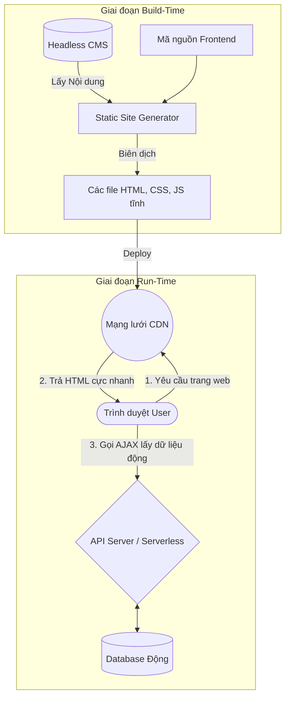

# Concept Deep Dive: Kiến trúc JAMstack

## 1. Mức độ Cơ bản (Basic)

### JAMstack là gì?
**JAMstack** là một hệ tư tưởng thiết kế kiến trúc phần mềm cho nền tảng web hiện đại. Từ "JAM" là viết tắt của:
- **J (JavaScript):** Xử lý mọi logic động ở phía trình duyệt (Client-side).
- **A (APIs):** Cung cấp các thao tác liên quan đến dữ liệu (Database) hoặc các dịch vụ nghiệp vụ phức tạp. JavaScript sẽ gọi (fetch) đến các API này.
- **M (Markup):** Các file HTML tĩnh được thiết kế và sinh ra từ trước (Pre-built/Pre-rendered) thay vì được tạo ra mỗi khi có người dùng truy cập.

### Vấn đề cốt lõi mà JAMstack giải quyết
Trong quá khứ, với mô hình truyền thống (như WordPress, PHP, Java Spring MVC), mỗi khi bạn vào một trang web, máy chủ phải chạy một đoạn code để tính toán, truy vấn Database, sau đó lắp ghép thành một file HTML và trả về. Quá trình này **mất thời gian**, tốn tài nguyên máy chủ và dễ bị sập nếu lượng truy cập tăng đột biến.

JAMstack giải quyết triệt để vấn đề này bằng cách: **Làm sẵn mọi thứ**. Toàn bộ website được "dịch" (build) thành các file HTML tĩnh trước khi tung lên mạng. Người dùng truy cập sẽ nhận được file HTML ngay lập tức (thường được đặt ở CDN), giúp tốc độ nhanh như chớp. Bất kỳ phần nội dung động nào (như xem bình luận, thêm giỏ hàng) sẽ được load riêng biệt bằng JavaScript gọi qua API.

---

## 2. Mức độ Trung bình (Intermediate)

### Cách thức hoạt động dưới nền (Under the hood)
Luồng hoạt động của JAMstack diễn ra theo 2 giai đoạn tách biệt:
1. **Build-Time (Giai đoạn Biên dịch):** 
   - Lập trình viên viết code.
   - Khi đẩy code lên (git push), hệ thống CI/CD (như Vercel, Netlify) tự động kích hoạt.
   - Các công cụ SSG (Static Site Generator như Next.js, Gatsby, Hugo) sẽ chạy. Nó chọc vào Database hoặc Headless CMS để lấy dữ liệu bài viết, sản phẩm... và "in" dữ liệu đó vào các file HTML tĩnh cứng.
   - Toàn bộ thư mục HTML/CSS/JS tĩnh này được đẩy lên mạng lưới phân phối nội dung toàn cầu (CDN).
2. **Run-Time (Giai đoạn Chạy thực tế):**
   - User gõ URL, CDN gần nhất sẽ trả file HTML về chưa tới 50ms.
   - Trình duyệt hiển thị nội dung ngay lập tức.
   - Đoạn mã JavaScript đính kèm trong HTML sẽ được kích hoạt (Hydration). Nếu cần lấy dữ liệu riêng tư (như tên User đang đăng nhập), JavaScript sẽ chọc API (serverless functions) để lấy và đắp lên màn hình.

### Use cases (Khi nào nên dùng)
- **Nên dùng:** Các trang web thiên về nội dung tĩnh nhưng cần tốc độ cực nhanh và SEO tốt: Landing Pages, Blog, Trang web tin tức, Trang giới thiệu công ty, Trang tài liệu (Documentation), E-commerce (phần danh mục sản phẩm).
- **Không nên dùng:** Ứng dụng web quá phức tạp và động tính (Highly dynamic) nơi mọi thứ đều thay đổi liên tục cho từng User riêng biệt (Ví dụ: Mạng xã hội realtime như Facebook, Dashboard quản trị phức tạp). Trong những trường hợp này, Single Page Application (SPA) truyền thống hoặc Server-Side Rendering (SSR) sẽ tốt hơn.

---

## 3. Mức độ Nâng cao (Advanced)

### Rủi ro và Thách thức
1. **API Waterfall (Hiệu ứng thác nước API):** Nếu một trang web tải xong phần HTML tĩnh, nhưng phần động cần gọi tới 5 API khác nhau theo thứ tự (cái này xong mới gọi cái kia), trang web sẽ bị giật lag và hiển thị loading liên tục, làm mất đi ý nghĩa "nhanh" của JAMstack.
   - *Cách khắc phục:* Sử dụng GraphQL để gom API, hoặc thiết kế API trả về đầy đủ data trong 1 lần gọi (BFF - Backend for Frontend).
2. **Quá trình Build tốn thời gian (Long Build Times):** Tưởng tượng một trang thương mại điện tử có 100,000 sản phẩm. Nếu mỗi lần đổi giá 1 sản phẩm mà phải chạy lệnh `build` để sinh lại 100,000 file HTML thì sẽ mất hàng tiếng đồng hồ.
   - *Cách khắc phục:* Sử dụng kiến trúc **ISR (Incremental Static Regeneration)** của Next.js, cho phép chỉ build lại những trang có thay đổi ngầm dưới nền mà không phải build lại toàn bộ.
3. **Bảo mật:** Dù HTML tĩnh rất an toàn, nhưng toàn bộ logic nghiệp vụ lúc này phụ thuộc vào các API. Nếu API không được phân quyền (Authorization) tốt, Hacker có thể lấy JavaScript ở client để tìm ra các endpoint nhạy cảm.

### Sai lầm thường gặp (Anti-patterns)
- **Đưa quá nhiều xử lý xuống Client:** Sinh file HTML tĩnh rỗng (chỉ có cái khung), sau đó dùng JS để gọi API và render toàn bộ nội dung chính (ví dụ: nguyên bài báo) ở phía Client. Điều này phá hỏng SEO và biến JAMstack thành SPA thông thường. Quy tắc là: Nội dung cốt lõi phải nằm ở Markup, chỉ phần bổ trợ (bình luận, nút like) mới dùng JS.

---

## 4. So sánh (Compare & Contrast)

| Tiêu chí | Truyền thống (Monolith/SSR - ví dụ: PHP, WordPress) | SPA (Single Page Application - ví dụ: React thuần) | JAMstack (ví dụ: Next.js SSG + Headless API) |
| :--- | :--- | :--- | :--- |
| **Nơi Render HTML** | Trên Server, mỗi khi có Request. | Trên Trình duyệt của User (Client). | Trên Server máy Build (1 lần duy nhất). |
| **Tốc độ tải trang đầu (TTFB)** | Chậm (đợi server xử lý). | Nhanh nhưng phải chờ tải cục file JS khổng lồ mới thấy nội dung. | **Cực nhanh** (HTML có sẵn trên CDN). |
| **SEO** | Rất tốt. | Cực kỳ tệ (bot Google chỉ thấy file HTML rỗng). | Rất tốt. |
| **Bảo mật Database** | Thấp (Database kết nối trực tiếp với web server). | Cao (Giao tiếp qua API). | Cao (Database chỉ mở lúc build và qua API bảo mật). |
| **Chi phí Hosting** | Cao (Cần server khỏe để chịu tải). | Rất thấp (Chỉ cần host file tĩnh). | Rất thấp (Host CDN rẻ, API Serverless tự tắt bật). |

---

## 5. Phụ lục (Sơ đồ Kiến trúc JAMstack)

---

## 6. Bài tập thực hành nhỏ
Dựa vào thư mục `jamstack-demo` mà tôi đã tạo. Hiện tại chúng ta đã có tính năng hiển thị bình luận. 
**Yêu cầu:** Hãy thêm tính năng **Đếm số lượt xem (View Counter)**. 
- Mỗi khi user tải trang, gửi 1 request API lên server.
- Server cộng 1 vào tổng view và trả về số view hiện tại.
- Frontend nhận số view và hiển thị lên màn hình.

Sau khi tự suy nghĩ và thử code, bạn có thể tham khảo code đáp án siêu chi tiết tại link dưới đây.
*Lưu ý: Không bọc trong hộp cảnh báo. Link đáp án:*
[Xem đáp án bài tập đếm View Counter](/Users/ductri0981/Documents/Studying-Software/Software_Architecture/JAM_Stack/answers-jamstack.js)

---

## 7. Giải thích thuật ngữ (Glossary)

- **Markup:** Trong ngữ cảnh này là ngôn ngữ đánh dấu HTML. Nghĩa là việc chuẩn bị sẵn tất cả nội dung thành mã HTML cứng trước khi gửi cho người dùng.
- **SSG (Static Site Generation):** Phương pháp tạo trang tĩnh. Cỗ máy tính toán chạy một lần lúc lập trình viên đưa code lên, biến toàn bộ dữ liệu thành file HTML.
- **CDN (Content Delivery Network):** Mạng lưới các máy chủ đặt khắp nơi trên toàn cầu. File web của bạn được copy ra hàng trăm bản rải khắp thế giới. User ở Việt Nam truy cập sẽ lấy file ở server Việt Nam thay vì phải vòng sang Mỹ, giúp tốc độ siêu nhanh.
- **Hydration (Bù nước / Thủy hợp):** Quá trình file HTML tĩnh "khô khan" sau khi tải xong được đính kèm JavaScript vào, khiến nó "sống lại" và có thể tương tác (bấm nút được, gọi API được).
- **Headless CMS:** Hệ thống quản trị nội dung "không đầu". Nó giống WordPress nhưng chỉ có chỗ nhập bài viết và cung cấp API để lấy bài viết ra, hoàn toàn KHÔNG CÓ giao diện hiển thị cho người xem. Giao diện hiển thị sẽ do JAMstack lo.
- **Serverless / Serverless functions:** Kiến trúc máy chủ mà lập trình viên không cần thuê hay quản lý nguyên một cái máy ảo 24/7. Bạn chỉ viết một hàm (function), vứt lên đám mây, mỗi khi có ai gọi hàm đó, đám mây mới bật máy lên chạy rồi tính tiền theo từng phần nghìn giây.
- **ISR (Incremental Static Regeneration):** Một kỹ thuật cao cấp của Next.js. Cho phép bạn sinh ra file tĩnh, nhưng đồng thời thiết lập thời gian sống (ví dụ 60 giây). Sau 60s, nếu có người truy cập, hệ thống sẽ tự động ngầm chạy lại SSG đằng sau để làm mới file tĩnh cho người tiếp theo mà không cần build lại toàn bộ website.
- **TTFB (Time To First Byte):** Thời gian tính từ lúc người dùng gõ URL đến lúc nhận được byte dữ liệu đầu tiên từ máy chủ. Ở JAMstack, TTFB cực thấp.

---

## 8. Hỏi đáp mở rộng (Extended FAQ)

**Câu hỏi 1: Next.js có phải là JAMstack không?**
- Câu trả lời là: **Vừa phải, vừa không phải.** Next.js là một framework lai (hybrid). 
- Nếu bạn sử dụng tính năng SSG (Static Site Generation), nó biên dịch mọi thứ thành HTML tĩnh lúc build. Lúc này nó là JAMstack chuẩn mực.
- Tuy nhiên, nếu bạn sử dụng SSR (Server-Side Rendering) hoặc React Server Components động, Next.js sẽ phải xử lý logic và query database trên máy chủ Node.js mỗi khi có người truy cập (y như PHP truyền thống). Lúc này nó đã phá vỡ định nghĩa thuần túy của JAMstack.

**Câu hỏi 2: SSG chọc vào Database lúc build. Vậy nếu có 100 người dùng thì nó phải tạo ra 100 file HTML riêng biệt sao?**
- **Không.** Đối với các dữ liệu dùng chung (Public data như thông tin 1 chiếc điện thoại, 1 bài viết blog), SSG chọc DB đúng 1 lần và sinh ra 1 file HTML duy nhất cho trang đó. 100 người sẽ được CDN ném cho chung 1 file này cực nhanh.
- Đối với dữ liệu cá nhân hóa (như Giỏ hàng, Tên người đăng nhập), JAMstack giải quyết bằng cách: Bỏ trống phần hiển thị đó trong file HTML tĩnh. Sau khi người dùng tải xong trang tĩnh, JavaScript ở máy họ sẽ đọc token và gọi API ngầm để lấy tên/giỏ hàng đắp lên (Hydration).

**Câu hỏi 3: Với các trang web dữ liệu thay đổi liên tục từng giây (như Shopee, Flash Sale), làm sao mà lúc build chỉ tạo 1 file HTML được?**
- Thực tế, các trang web siêu động như vậy **không thể dùng JAMstack (SSG thuần)**. Thay vào đó họ dùng:
  - **App Shell (CSR):** Chỉ build cái khung tĩnh (Header, Footer, Loading state). Còn lại 100% data được fetch bằng Client-Side JS liên tục.
  - **ISR (Incremental Static Regeneration):** Cứ mỗi 60 giây (hoặc n giây), server tự động âm thầm build lại 1 file HTML mới tinh để thay thế file cũ.
  - **SSR / Backend cổ điển:** Ở các trang nhạy cảm như Thanh toán, server bắt buộc phải tính toán Real-time chứ không xài đồ build sẵn.

**Câu hỏi 4: Code React thuần (CSR) thì không cần code backend đúng không?**
- Đúng là bạn (Frontend Dev) không cần code backend, nhưng mô hình tổng thể thì vẫn có. 
- Thứ nhất, bạn vẫn cần một "Static Server" (như Vercel, Netlify hoặc Local Dev Server) để làm nhiệm vụ quăng file HTML rỗng và file JS khổng lồ (`bundle.js`) về cho trình duyệt. Trình duyệt của user phải tự chạy đống JS đó để vẽ ra trang web (Đó chính là CSR - Client Side Rendering). 
- Thứ hai, nếu web của bạn có tính năng Đăng nhập hay Lưu dữ liệu, code React của bạn vẫn phải gọi đến một API Backend (do ai đó viết, hoặc dùng SaaS như Firebase). Sự tách bạch này chính là vẻ đẹp của kiến trúc Frontend hiện đại.
