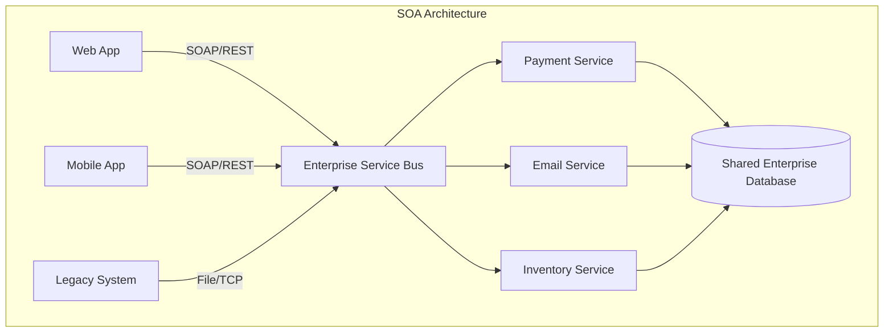

# Concept Deep Dive: SOA (Service-Oriented Architecture)

> **Ý tưởng chính việc sử dụng:** Kiến trúc Hướng Dịch vụ đời đầu, gom các dịch vụ cỡ trung giao tiếp qua một Trục trung tâm (ESB). Trọng tâm là sự tái sử dụng ở cấp độ Doanh nghiệp.
> **Ví dụ:** Các phòng ban Nhân Sự, Kế Toán, Bán Hàng dùng chung một Dịch vụ Xác thực tích hợp chung qua hệ thống ESB.

## 1. Mức độ Cơ bản (Basic)

### SOA là gì?
**SOA (Kiến trúc hướng dịch vụ)** là một phương pháp thiết kế phần mềm trong đó các thành phần của hệ thống cung cấp dịch vụ cho các thành phần khác qua một giao thức truyền thông qua mạng. Thay vì xây dựng một cục phần mềm khổng lồ (Monolith), bạn chia nó thành các "dịch vụ" (services) có tính độc lập nhất định, có thể tái sử dụng.

### Ví dụ thực tế
Tưởng tượng một ngân hàng. Thay vì có một ứng dụng khổng lồ xử lý mọi thứ, ngân hàng xây dựng các dịch vụ riêng biệt:
- **Dịch vụ Xác thực**: Kiểm tra tài khoản và mật khẩu.
- **Dịch vụ Vay vốn**: Xử lý tính toán lãi suất vay.
- **Dịch vụ Thẻ tín dụng**: Xử lý các giao dịch quẹt thẻ.

Khi một ứng dụng Mobile App muốn cho phép khách hàng đăng nhập, nó sẽ "gọi" đến **Dịch vụ Xác thực**. Khi nhân viên giao dịch tại quầy cần kiểm tra khoản vay, hệ thống của họ cũng gọi đến cùng một **Dịch vụ Vay vốn**. => Tính tái sử dụng cao.

### Vấn đề cốt lõi SOA giải quyết là gì?
- **Sự gắn kết quá chặt (Tight Coupling)**: Tách các hệ thống lớn, rối rắm thành các khối dịch vụ có hợp đồng (API) rõ ràng.
- **Tái sử dụng (Reusability)**: Tránh việc viết lại cùng một logic kinh doanh ở nhiều ứng dụng khác nhau trong cùng một công ty/tổ chức. (Ví dụ: "Dịch vụ gửi Email" có thể được dùng chung cho cả bộ phận HR và bộ phận Sale).
- **Tích hợp hệ thống cũ**: Cung cấp một lớp dịch vụ bọc bên ngoài các hệ thống cũ (Legacy Systems) để các ứng dụng hiện đại dễ dàng tương tác.

---

## 2. Mức độ Trung bình (Intermediate)

### Cách thức hoạt động dưới nền tảng
Trong SOA, sự giao tiếp thường xoay quanh 3 thành phần chính:
1. **Service Provider (Nhà cung cấp dịch vụ)**: Dịch vụ thực hiện công việc (VD: Dịch vụ Thanh toán).
2. **Service Consumer (Người tiêu thụ dịch vụ)**: Ứng dụng gọi dịch vụ (VD: App mua sắm gọi dịch vụ thanh toán).
3. **Service Registry/Broker (Tùy chọn)**: Một nơi lưu trữ để Service Consumer tìm kiếm xem Service Provider đang ở đâu trên mạng.

Đặc trưng truyền thống của SOA là sử dụng **ESB (Enterprise Service Bus)**. ESB là một trục giao tiếp trung tâm, nơi mọi dịch vụ cắm vào. Nó giúp định tuyến (routing), chuyển đổi định dạng dữ liệu (XML sang JSON), và bảo mật. Tuy nhiên, ESB thường trở thành một cục tạ nặng nề (Single Point of Failure).

### Use cases (Khi nào nên dùng)
- Các công ty lớn (Enterprise) có nhiều ứng dụng khác nhau cần chia sẻ cùng một nghiệp vụ (Dịch vụ nhân sự, Dịch vụ khách hàng).
- Tích hợp các hệ thống dị cấu trúc (Java, .NET, Mainframe cũ) giao tiếp được với nhau thông qua ESB.

### Khi nào không nên dùng
- Các dự án nhỏ, startup cần tốc độ phát triển nhanh (nên dùng Monolith).
- Các hệ thống cần phản hồi cực nhanh (Real-time cực thấp), vì việc giao tiếp qua mạng và qua ESB tạo ra độ trễ (latency).

---

## 3. Mức độ Nâng cao (Advanced)

### SOA vs Microservices vs Modular Monolith (So sánh chi tiết)
Nhiều người nhầm lẫn giữa SOA, Microservices và Modular Monolith. Dưới đây là sự khác biệt về bản chất của chúng:

- **SOA (Service-Oriented Architecture)**: Kiến trúc cấp doanh nghiệp (Enterprise-wide), chia sẻ dịch vụ để dùng lại giữa nhiều ứng dụng hoặc hệ thống khác nhau trong công ty.
- **Microservices**: Kiến trúc cấp ứng dụng (Application-wide), chia nhỏ *một ứng dụng* thành nhiều dịch vụ chạy độc lập, tự chủ hoàn toàn (dễ scale, mỗi dịch vụ một database riêng).
- **Modular Monolith**: Vẫn là một ứng dụng khối (Monolith) chạy trên một process, triển khai cùng lúc và dùng chung một database, nhưng code được tổ chức chặt chẽ thành các module tách biệt (dễ maintain, không có chi phí trễ mạng như Microservices).

| Tiêu chí | SOA (Service-Oriented Architecture) | Microservices | Modular Monolith |
|----------|-------------------------------------|---------------|------------------|
| **Quy mô / Phạm vi** | Cấp doanh nghiệp (Enterprise-wide). Chia sẻ dịch vụ giữa nhiều hệ thống. | Cấp ứng dụng. Ưu tiên sự độc lập của từng service. | Cấp ứng dụng. Vẫn là một khối thống nhất. |
| **Giao tiếp** | Thường qua trục trung tâm **ESB**. Giao thức mạng nặng (SOAP, XML). | Giao tiếp mạng trực tiếp (API Gateway, REST, gRPC). | Gọi hàm trực tiếp trong RAM (In-memory function call). |
| **Cơ sở dữ liệu**| Các dịch vụ thường **chia sẻ chung** một database lớn. | Mỗi dịch vụ có một **database riêng biệt** (DB per service). | Tất cả module dùng chung **một database**. |
| **Kích thước** | Coarse-grained (Dịch vụ lớn, bao gồm nhiều nghiệp vụ). | Fine-grained (Dịch vụ nhỏ, làm đúng một việc). | Tính theo Module, phân chia theo domain. |
| **Triển khai (Deploy)**| Phức tạp, thường đi kèm với việc deploy nhiều hệ thống liên quan. | Triển khai **độc lập** từng dịch vụ. | Triển khai **toàn bộ khối** cùng một lúc. |
| **Độ trễ (Latency)** | Rất cao (Đi qua mạng và ESB). | Cao (Gọi qua mạng giữa các services). | Rất thấp (Gọi hàm trực tiếp, không qua mạng). |

### Rủi ro và Vấn đề hiệu suất
- **ESB Bottleneck**: Nếu sử dụng ESB, toàn bộ lưu lượng của công ty đi qua một đường ống. Nếu ESB sập hoặc xử lý chậm, cả hệ thống chết theo.
- **Latency (Độ trễ mạng)**: Việc gọi hàm trong cùng một bộ nhớ (Monolith) mất vài nanosecond. Việc gọi API qua mạng trong SOA mất hàng chục, hàng trăm milliseconds.
- **Data Governance**: Nhiều dịch vụ cùng truy cập vào một database chung dễ gây ra tình trạng khóa chết (deadlock) hoặc khó khăn khi thay đổi cấu trúc bảng.

---

## 4. Phụ lục: Sơ đồ Kiến trúc

*(Lưu ý: Parser sơ đồ Mermaid đã tuân thủ quy tắc không sử dụng dấu ngoặc đơn ở tên subgraph).*

---

## 5. Bài tập thực hành nhỏ

**Thử thách**: Trong file `demo-soa.js`, ta mới chỉ có `Inventory Service` và `Order Service`.
Hãy tạo thêm một `Payment Service` (chạy ở cổng 3003). 
Yêu cầu: Khi `Order Service` nhận được request mua hàng, sau khi nó trừ tồn kho ở `Inventory Service` thành công, nó tiếp tục phải gọi sang `Payment Service` (API `/api/payments/process`) để thanh toán. Nếu thanh toán thành công mới trả về "Đặt hàng & Thanh toán thành công".

👉 **Đáp án bài tập**: Bạn có thể tham khảo file giải đáp tại đây: [answers-soa](./answers-soa.js)

---

## 6. Giải thích thuật ngữ (Glossary)

- **Monolith (Kiến trúc khối)**: Một ứng dụng phần mềm mà toàn bộ logic (giao diện, xử lý nghiệp vụ, truy cập dữ liệu) được gộp chung trong một source code duy nhất và chạy chung trên một process.
- **Modular Monolith**: Một dạng tiến hóa của Monolith, toàn bộ ứng dụng vẫn là một khối và chạy trên một process, nhưng source code được thiết kế chia tách ranh giới rõ ràng thành các module độc lập.
- **ESB (Enterprise Service Bus)**: Trục kết nối dịch vụ doanh nghiệp. Nó giống như một "tổng đài" trung gian. Thay vì dịch vụ A gọi trực tiếp dịch vụ B, A sẽ gửi tin nhắn đến ESB, và ESB biết cách định tuyến tin nhắn đó đến B, đồng thời có thể biến đổi định dạng dữ liệu cho phù hợp.
- **SOAP (Simple Object Access Protocol)**: Một giao thức mạng rất phổ biến trong thời kỳ đầu của SOA, sử dụng XML để gửi và nhận thông điệp, rất nghiêm ngặt và nặng nề.
- **REST (Representational State Transfer)**: Một kiểu kiến trúc phần mềm nhẹ nhàng hơn, thường sử dụng JSON qua HTTP, phổ biến trong Microservices và các ứng dụng web hiện đại.
- **Coarse-grained vs Fine-grained**: Coarse-grained là "hạt thô" (một dịch vụ làm nhiều việc phức tạp chung với nhau). Fine-grained là "hạt mịn" (một dịch vụ siêu nhỏ, chỉ làm 1 việc duy nhất).
- **Latency**: Độ trễ mạng. Thời gian cần thiết để một gói tin đi từ máy tính này sang máy tính khác.
- **Single Point of Failure (Điểm lỗi duy nhất)**: Một thành phần trong hệ thống mà nếu nó hỏng, toàn bộ hệ thống sẽ ngừng hoạt động (ví dụ: ESB hoặc Shared Database).
