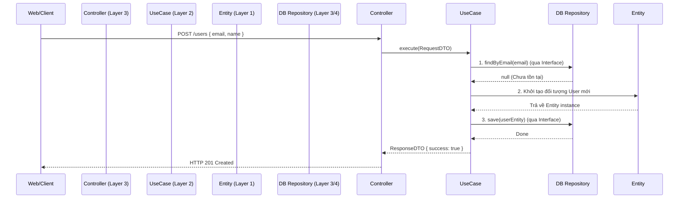

# Kiến trúc Sạch (Clean Architecture) - Deep Dive

> **Ý tưởng chính việc sử dụng:** Tách bạch mã nguồn nghiệp vụ khỏi các Framework và công cụ ngoại vi, giúp phần mềm sống lâu và dễ Unit Test.
> **Ví dụ:** Không gắn logic kinh doanh trực tiếp vào file Route của Express (Controller). Phải tách ra thành Use Case / Interactor độc lập.

## Kiến trúc Sạch (Clean Architecture) là gì?
Clean Architecture là một mẫu kiến trúc phần mềm được đề xuất bởi Robert C. Martin (Uncle Bob). Nó nhằm mục đích tạo ra các hệ thống phần mềm tách biệt hoàn toàn logic nghiệp vụ (business logic) khỏi các yếu tố bên ngoài (frameworks, databases, UI, third-party services).

Đặc điểm cốt lõi của Clean Architecture là **Quy tắc Phụ thuộc (The Dependency Rule)**: *Mã nguồn chỉ được phụ thuộc từ lớp ngoài vào lớp trong (hướng về trung tâm)*.

---

## 1. Mức độ Cơ bản (Basic)

### Vấn đề cốt lõi mà Clean Architecture giải quyết:
Trong các ứng dụng truyền thống (ví dụ: Kiến trúc 3 tầng - 3-tier architecture), logic nghiệp vụ thường bị gắn chặt vào cơ sở dữ liệu hoặc framework web.
- Nếu bạn đổi database (từ SQL Server sang MongoDB), bạn phải viết lại logic kinh doanh.
- Nếu bạn đổi UI (từ Web sang Mobile App), bạn phải sửa đổi logic cốt lõi.

**Giải pháp**: Clean Architecture đặt **nghiệp vụ (Entities & Use Cases)** ở trung tâm của ứng dụng. Cơ sở dữ liệu và Web Framework chỉ là các chi tiết (details), nằm ở vòng ngoài cùng và có thể bị thay thế bất cứ lúc nào mà không làm ảnh hưởng đến trái tim của ứng dụng.

### Bốn vòng tròn của Clean Architecture (Từ trong ra ngoài):
1. **Entities (Enterprise Business Rules)**: Các quy tắc kinh doanh chung, độc lập. Ví dụ: Lớp `User`, tính lãi suất ngân hàng.
2. **Use Cases (Application Business Rules)**: Quy tắc kinh doanh cụ thể của ứng dụng (luồng chạy). Ví dụ: `CreateUser`, `TransferMoney`.
3. **Interface Adapters (Controllers, Presenters, Gateways)**: Lớp trung gian chuyển đổi dữ liệu từ định dạng Use Case sang định dạng Web/DB và ngược lại.
4. **Frameworks & Drivers**: UI, Database, Web Framework (Express, Spring, ...). Nơi mọi thứ giao tiếp thực tế xảy ra.

---

## 2. Mức độ Trung bình (Intermediate)

### Cách thức hoạt động dưới nền tảng (Under the hood)
Làm thế nào để Use Case (lớp 2) có thể lưu dữ liệu xuống Database (lớp 4) nếu theo quy tắc là lớp trong không được phụ thuộc lớp ngoài?

Câu trả lời là **Inversion of Control (IoC - Đảo ngược điều khiển)** bằng cách sử dụng các `Interface (Port)`.
- Use Case sẽ định nghĩa một `Interface` (Ví dụ: `UserRepository`) nói rằng: *"Tôi cần một ai đó implement hàm `save(User)`"*.
- Lớp ngoài cùng (Adapter/Database) sẽ **thực thi (implement)** interface đó (Ví dụ: `MongoUserRepository`).
- Nhờ vậy, Use Case hoàn toàn mù tịt về MongoDB, nó chỉ biết giao tiếp qua interface. Đây chính là tính chất đa hình (Polymorphism) trong OOP.

### Use cases (Khi nào nên dùng)
- **Hệ thống lớn, vòng đời dài**: Các ứng dụng có vòng đời hàng chục năm, cần thay thế công nghệ lõi theo thời gian.
- **Dự án có logic nghiệp vụ phức tạp**: Nơi mà nghiệp vụ là trung tâm, ví dụ ngân hàng, ERP.
- **Testing quan trọng**: Nhờ tách rời DB, UI, việc viết Unit Test cho Use Case cực kì dễ dàng, chỉ cần truyền vào `MockRepository`.

### Khi nào KHÔNG nên dùng
- Các ứng dụng siêu nhỏ, MVP, CRUD cơ bản: Làm Clean Architecture sẽ biến một tác vụ đơn giản (1 dòng code) thành 5-7 file khác nhau, gây ra sự cồng kềnh quá mức (Over-engineering).
- Dự án deadline gấp không chú trọng maintain.

---

## 3. Mức độ Nâng cao (Advanced)

### Rủi ro và Sai lầm thường gặp (Anti-patterns)
1. **Leaking Entity**: Trả trực tiếp đối tượng `Entity` hoặc `Database Model` thẳng ra Controller rồi trả cho Web client. Việc này phá vỡ ranh giới các layer. **Cách giải quyết**: Dùng `DTO (Data Transfer Object)` để chuyển dữ liệu qua các layer.
2. **Framework trói buộc ở Entity**: Sử dụng annotation của Database như `@Entity`, `@Table(name="users")` hoặc `@Column` vào trong lớp Entity của Clean Architecture. Điều này làm Entity bị phụ thuộc ngược ra ngoài lớp Database. **Cách giải quyết**: Entity nên là một Plain Old Class/Object (POCO/POJO), không chứa bất kỳ thư viện nào.
3. **God Use Case**: Một Use Case làm quá nhiều việc (như 1 service class khổng lồ). Nên chia nhỏ mỗi Use Case là 1 class có 1 hàm `execute()` duy nhất theo nguyên lý Single Responsibility.

### Vấn đề hiệu suất (Performance)
Việc tách quá nhiều tầng dẫn tới dữ liệu phải trải qua giai đoạn chuyển đổi (mapping) qua lại giữa DB Model -> Entity -> DTO. Quá trình mapping object liên tục có thể tạo ra overhead về CPU và Memory allocation. Đôi khi, với các luồng chỉ cần đọc (Read Only - ví dụ liệt kê danh sách báo cáo phức tạp), lập trình viên sẽ bypass Clean Architecture mà dùng CQRS để query thẳng vào View.

---

## 4. Phụ lục & Sơ đồ luồng (Mermaid)

Sơ đồ dưới đây mô tả sự tương tác của luồng **Tạo User (CreateUser)**, ứng dụng **Dependency Inversion** để giao tiếp với DB.

---

## So Sánh (Compare & Contrast)

| Tiêu chí | Clean Architecture | Kiến trúc 3 tầng (3-tier) |
| :--- | :--- | :--- |
| **Quy tắc phụ thuộc** | Hướng vào trung tâm (Nghiệp vụ cốt lõi). | Hướng từ trên xuống (UI -> Logic -> Database). |
| **Khả năng thay DB** | Rất dễ, logic không gắn với thư viện DB nào. | Khó, logic thường gọi trực tiếp hàm thư viện DB. |
| **Unit Testing** | Có thể test hoàn toàn logic không cần DB thật. | Khó khăn, phải thiết lập DB ảo hoặc tích hợp. |
| **Độ phức tạp (Boilerplate)** | Rất cao (Nhiều class, file, Interface, DTO). | Thấp, code ngắn gọn dễ đọc luồng đi. |

---

## Bài Tập Thực Hành
**Bài tập:** Dựa vào source code demo `demo-clean-architecture.ts`, bạn hãy tạo thêm một Use Case mới: `UpdateUserNameUseCase`.
Yêu cầu:
1. Tạo Request DTO và Response DTO tương ứng.
2. Use Case cần tìm user qua `userId`, nếu không thấy trả về lỗi.
3. Cập nhật tên của user và gọi `update()` trên Repository (có thể phải định nghĩa thêm hàm trong Interface).

Bạn có thể tự làm rồi đối chiếu với đáp án ở file [answers-clean-architecture](/Users/ductri0981/Documents/Studying-Software/clean_architecture/answers-clean-architecture.ts).

---

## Giải Thích Thuật Ngữ (Glossary)

- **Dependency Inversion Principle (DIP)**: Nguyên lý chữ D trong SOLID. Lớp cấp cao không nên phụ thuộc lớp cấp thấp. Cả hai nên phụ thuộc vào abstractions (Interface).
- **Inversion of Control (IoC)**: Nguyên lý đảo ngược luồng điều khiển, thay vì Use Case tự tạo kết nối DB, nó nhận `Interface DB` từ bên ngoài truyền vào.
- **Dependency Injection (DI)**: Kỹ thuật để thực hiện IoC (truyền object vào qua constructor, thay vì dùng toán tử `new` bên trong).
- **DTO (Data Transfer Object)**: Một đối tượng "ngu", không chứa logic (chỉ có thuộc tính), dùng để vận chuyển dữ liệu giữa các layer, nhằm không để lộ Entity nội bộ ra bên ngoài.
- **Port and Adapter**: Tên gọi khác (hoặc kiến trúc anh em) với Clean Architecture (kiến trúc Hexagonal). Port là interface quy định luật, Adapter là class cụ thể làm việc đó.
- **Over-engineering**: Xây dựng một giải pháp quá dư thừa và cồng kềnh cho một vấn đề thực tế chỉ cần cách giải quyết đơn giản.
- **POCO / POJO**: Plain Old CLR/Java Object. Nghĩa là class đó là class nguyên thủy của ngôn ngữ lập trình, không kế thừa/implement hay nhận annotation từ bất cứ thư viện bên ngoài (framework) nào.
- **CQRS**: Command Query Responsibility Segregation - Phân chia trách nhiệm giữa luồng Đọc và luồng Ghi dữ liệu. Đôi khi kết hợp với Clean Architecture để bỏ qua việc mapping phức tạp trong lúc Read dữ liệu.
