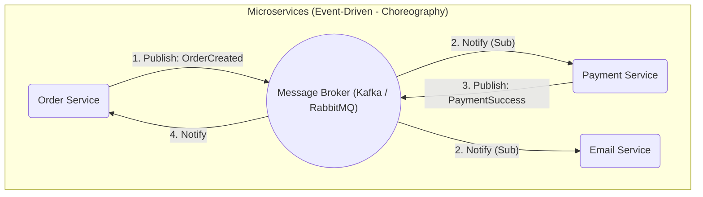

# Event-Driven Architecture (Kiến trúc hướng sự kiện - EDA)

> **Ý tưởng chính việc sử dụng:** Các service giao tiếp với nhau theo kiểu phát (Publish) và nghe (Subscribe) Sự kiện (Event) thông qua Message Broker, giúp chúng không bị trói buộc với nhau.
> **Ví dụ:** Service Đơn Hàng bắn event 'OrderCreated'. Service Gửi Mail và Service Giao Hàng nghe thấy và tự động xử lý mà không cần Đơn Hàng ra lệnh trực tiếp.

Trong thế giới Microservices, việc làm sao để hàng tá các service nhỏ lẻ nói chuyện với nhau một cách trơn tru là bài toán hóc búa nhất. Nếu chúng cứ gọi API trực tiếp với nhau (Synchronous - Đồng bộ), một service chết sẽ kéo theo toàn bộ hệ thống sập dây chuyền.
**Kiến trúc Hướng sự kiện (EDA)** được sinh ra để khắc phục nhược điểm "dính chùm" đó.

## 1. Mức Độ Cơ Bản (Basic)

### EDA là gì?
Thay vì "Ra lệnh" trực tiếp cho người khác làm việc, Service của bạn chỉ đơn giản là "La làng" (phát loa thông báo) vào khoảng không: "Tôi vừa làm xong việc X!". Bất kỳ ai quan tâm đến việc X sẽ tự động vểnh tai lên nghe (Subscribe) và tự giác đi làm việc của họ.

Ví dụ Hệ thống đặt hàng:
- **Kiểu cũ (API Call)**: `OrderService` gọi API tới `PaymentService` -> chờ tính tiền -> gọi API tới `EmailService` -> chờ gửi mail -> báo thành công. (Quá lâu và dính chùm).
- **Kiểu EDA**: `OrderService` lưu xong đơn, nó ném một Sự kiện `OrderCreated` vào bưu điện. Chấm hết. `PaymentService` nhận thư báo, lẳng lặng tính tiền. `EmailService` nhận thư báo, lẳng lặng gửi mail. Cực kỳ lỏng lẻo (Decoupled).

### Vấn đề cốt lõi giải quyết
- **Giảm khớp nối (Decoupling)**: Các service không cần biết địa chỉ IP của nhau. Không sợ lỗi Timeout.
- **Tăng khả năng chịu lỗi (Resilience)**: Nếu `EmailService` bị sập mạng, tin nhắn `OrderCreated` vẫn nằm an toàn ở Bưu điện (Message Broker). Khi `EmailService` được khởi động lại, nó sẽ đọc thư và gửi mail bù. Không một tin nhắn nào bị mất!

## 2. Mức Độ Trung Bình (Intermediate): Under the Hood

### Message Broker (Kẻ trung gian)
Để "la làng", ta cần một nơi lưu giữ tiếng la đó. Đó là Message Broker (như Kafka, RabbitMQ, AWS SQS).
- **Publisher (Người phát)**: Đẩy Event vào Broker.
- **Subscriber (Người nhận)**: Nghe Event từ Broker.
- Event thường ở thể **Quá khứ phân từ** (VD: `UserRegistered`, `ItemAddedToCart`).

### Orchestration vs Choreography
Có 2 phong cách giao tiếp bằng Event:
1. **Orchestration (Người nhạc trưởng)**: Có 1 service trung tâm cầm trịch, nó phát lệnh "Service A làm đi, xong báo tao. Tao báo Service B làm tiếp". Dễ kiểm soát rủi ro, nhưng hệ thống bị thắt cổ chai ở con Nhạc trưởng.
2. **Choreography (Tự biên tự diễn)**: Không ai làm sếp. A làm xong tự ném event, B thấy event tự nhào vô làm rồi ném event tiếp, C nhảy vào... Giống một đàn kiến tự làm việc với nhau. Ưu điểm: Lỏng lẻo tuyệt đối. Khuyết điểm: Cực khó Debug (trace) xem quy trình đang chạy đến đâu!

*Use Cases*: Microservices, xử lý luồng dữ liệu thời gian thực (Real-time data streaming), các hệ thống chịu tải cao (High scalability).
*Không nên dùng*: Ứng dụng nhỏ chạy trên 1 server, cần response ngay lập tức từ nhiều bộ phận.

## 3. Mức Độ Nâng Cao (Advanced)

### Idempotency (Tính Lũy đẳng)
Message Broker (như Kafka) thường đảm bảo việc giao tin nhắn theo chuẩn "At-least-once" (Giao ÍT NHẤT 1 lần). Có nghĩa là lâu lâu mạng bị lag, nó sẽ **gửi trùng 2 tin nhắn giống y hệt nhau**.
Nếu Subscriber nhận được sự kiện `Deduct 50$` hai lần, nó có trừ 100$ của khách không?
BẮT BUỘC bạn phải code tính **Idempotency**. Có nghĩa là: Dù nhận 1 hay 100 tin nhắn trùng nhau, kết quả thao tác vẫn chỉ tính là 1. (Thường giải quyết bằng cách lưu ID của Message đã xử lý vào Database để chặn tin trùng).

### Message Ordering (Thứ tự tin nhắn)
Event xảy ra trước chưa chắc đã đến tay người nhận trước (do trễ mạng). Cần xử lý cẩn thận nếu thứ tự tác động đến kết quả (Kafka giải quyết bằng Partition Key).

## 4. So Sánh (Compare & Contrast)

| Đặc điểm | Synchronous (REST API / gRPC) | Asynchronous (Event-Driven / Pub-Sub) |
| :--- | :--- | :--- |
| **Giao tiếp** | Gọi trực tiếp (A -> B). Đòi B phải trả lời ngay. | Gọi gián tiếp (A -> Broker -> B). A không cần B trả lời. |
| **Sự phụ thuộc (Coupling)**| Chặt (Tight Coupling). B sập thì A cũng lỗi theo. | Lỏng (Loose Coupling). B sập, A vẫn chạy khỏe. |
| **Tốc độ phản hồi UI** | Chậm (Phải đợi xử lý chùm xong). | Cực Nhanh (A xử lý xong là báo UI ngay, các việc hâu cần chạy ngầm). |
| **Độ khó bảo trì/Debug** | Rất dễ dò lỗi (Call Stack rõ ràng). | Cực khó theo vết (Tracing). |

## 5. Bài Tập Thực Hành Nhỏ

**Tình huống**: Trong file `demo-eda.ts`, một `OrderService` đang sử dụng API call đồng bộ để báo cho `EmailService` gửi thư. Code bị dính chặt vào nhau. Nếu `EmailService` báo lỗi, hàm tạo đơn hàng cũng bị Crash theo (Dù tiền đã thu xong!).

*Nhiệm vụ*: Áp dụng Event-Driven. Giả lập một hệ thống Pub/Sub (Broker) đơn giản bằng Javascript Array/EventEmitter. Tách rời `OrderService` khỏi `EmailService`. `OrderService` chỉ việc Publish event `OrderCreated`.

Code đề bài và đáp án nằm tại: [answers-eda](/Users/ductri0981/Documents/Studying-Software/event_driven_architecture/answers-eda.ts)

## 6. Phụ Lục (Sơ Đồ Kiến Trúc)

## 7. Giải Thích Thuật Ngữ (Glossary)
- **Pub/Sub (Publish/Subscribe)**: Mô hình Người xuất bản và Người đăng ký. Báo xuất bản báo, ai đặt mua (đăng ký) thì sẽ được giao tới nhà.
- **Message Broker (Người môi giới tin nhắn)**: Dịch vụ trung gian (như Bưu điện) làm nhiệm vụ trữ và phân phối tin nhắn. Tránh làm mất tin khi server đích chết mạng.
- **Orchestration**: Phong cách điều phối tập trung. Có một Service "chỉ huy" đứng giữa ra lệnh cho các service vệ tinh.
- **Choreography**: Phong cách điều phối phi tập trung. Các Service tự chủ động lắng nghe Event và tự phản ứng.
- **Idempotency (Lũy đẳng)**: Khả năng đảm bảo một hàm/API dù bị gọi/thực thi 1 lần hay 1000 lần với cùng một thông số (ID) thì kết quả cuối cùng ở DB vẫn chỉ thay đổi 1 lần duy nhất.
