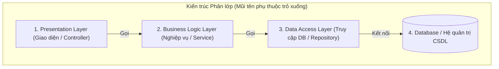

# Layered Architecture (Kiến trúc phân lớp / N-Tier)

> **Ý tưởng chính việc sử dụng:** Phân chia ứng dụng thành các lớp ngang (như Presentation, Business, Data) để dễ quản lý.
> **Ví dụ:** Lớp Controller tiếp nhận HTTP request, gọi lớp Service xử lý nghiệp vụ, Service gọi Repository để lưu Database.

Đây là một trong những kiến trúc phần mềm lâu đời, phổ biến và dễ hiểu nhất. Gần như mọi lập trình viên khi mới học đều làm quen với nó (thường được biết đến với cái tên Kiến trúc 3 lớp - 3 Tier / MVC).

## 1. Mức Độ Cơ Bản (Basic)

### Layered Architecture là gì?
Hãy tưởng tượng ứng dụng của bạn như một chiếc bánh sandwich nhiều tầng. Mỗi tầng (Layer) chịu trách nhiệm cho một công việc cụ thể và được xếp chồng lên nhau. Dữ liệu sẽ chảy từ tầng trên cùng xuống dưới cùng và ngược lại.

3 lớp phổ biến nhất:
1. **Presentation Layer (Lớp Giao diện / UI)**: Nơi người dùng nhìn thấy (Web HTML) hoặc nơi nhận API Request (REST Controllers).
2. **Business Logic Layer (Lớp Nghiệp vụ / BLL)**: Trái tim của ứng dụng, nơi tính toán, xử lý luật lệ kinh doanh (Ví dụ: kiểm tra tài khoản đủ tiền không).
3. **Data Access Layer (Lớp Truy cập dữ liệu / DAL)**: Nơi chuyên nói chuyện với Database (SQL, MongoDB) để lấy/lưu dữ liệu.

### Vấn đề cốt lõi giải quyết
**Sự phân chia mối quan tâm (Separation of Concerns)**. Nếu bạn nhét code kết nối CSDL, code kiểm tra tiền, và code trả về HTML vào chung 1 file thì file đó sẽ dài nghìn dòng, không ai đọc nổi. Chia lớp giúp code gọn gàng, dễ tìm, đội UI và đội DB có thể làm việc song song.

## 2. Mức Độ Trung Bình (Intermediate): Under the Hood

### Nguyên tắc hoạt động
- **Strict Layering (Phân lớp nghiêm ngặt)**: Lớp ở trên CHỈ ĐƯỢC PHÉP gọi lớp ngay sát dưới nó. Ví dụ: Lớp 1 gọi Lớp 2, Lớp 2 gọi Lớp 3. Lớp 1 tuyệt đối không được nhảy cóc gọi Lớp 3. Điều này giúp kiểm soát luồng đi chặt chẽ.
- **Relaxed Layering (Phân lớp nới lỏng)**: Lớp ở trên được phép gọi bất kỳ lớp nào bên dưới nó (Lớp 1 có thể gọi thẳng Lớp 3). Thường dùng ở các lớp tiện ích (Utility Layer) dùng chung cho toàn hệ thống.

*Use Cases*: Rất tốt cho các ứng dụng vừa và nhỏ, các dự án CRUD (Thêm, Đọc, Sửa, Xóa) cơ bản, các dự án có ngân sách và thời gian eo hẹp.
*Không nên dùng*: Khi logic nghiệp vụ quá phức tạp, hoặc hệ thống cần bảo trì trong 5-10 năm tới vì nó dễ dẫn tới tình trạng "Tight Coupling" (Dính chặt).

## 3. Mức Độ Nâng Cao (Advanced)

### Rủi ro và Anti-patterns
1. **Phụ thuộc mạnh vào Database (Database-Driven)**: Trong kiến trúc này, mũi tên phụ thuộc trỏ từ trên xuống dưới (UI -> BLL -> DAL -> DB). Hậu quả là lớp Business Logic (đáng lẽ phải quan trọng nhất) lại bị **phụ thuộc** vào lớp Database. Nếu thay đổi cấu trúc bảng SQL, lớp BLL cũng phải sửa theo.
2. **Anemic Domain Model (Mô hình miền thiếu máu)**: Lập trình viên thường tạo các class Entity (như `User`) chỉ có getter/setter (vô hồn) và tống hết mọi tính toán vào lớp Service. Điều này đi ngược lại nguyên lý Hướng Đối Tượng (OOP).
3. **Khó kiểm thử (Hard to test)**: Để test lớp BLL, bạn thường phải kết nối với một Database thật vì lớp BLL đã import trực tiếp lớp DAL.

## 4. So Sánh (Compare & Contrast)

| Đặc điểm | Layered Architecture | Hexagonal / Clean Architecture |
| :--- | :--- | :--- |
| **Hướng phụ thuộc** | Mũi tên từ trên xuống (Top-Down). UI -> Logic -> Data | Mũi tên hướng vào tâm. UI -> Logic <- Data |
| **Trung tâm hệ thống** | Cơ sở dữ liệu (Database) | Logic nghiệp vụ (Domain Model) |
| **Tính độc lập** | Thấp. Khó chạy nếu không có CSDL. | Rất cao. Logic chạy được ngay mà không cần CSDL. |
| **Độ khó setup** | Rất dễ, phổ biến nhất. | Khó, tốn nhiều code boilerplate. |

## 5. Bài Tập Thực Hành Nhỏ

**Tình huống**: Trong file `demo-layered.ts`, lớp `UserService` (BLL) đang khởi tạo trực tiếp `new UserRepository()` (DAL) bằng từ khóa `new`. Việc này tạo ra **Tight Coupling** (Khớp nối chặt) khiến ta không thể test `UserService` mà không có CSDL.
*Nhiệm vụ*: Hãy sửa lại đoạn code đó, áp dụng Dependency Injection (DI) thông qua constructor để gỡ bỏ khớp nối chặn này.

Code đề bài và đáp án nằm tại: [answers-layered](/Users/ductri0981/Documents/Studying-Software/layered_architecture/answers-layered.ts)

## 6. Phụ Lục (Sơ Đồ Kiến Trúc)

## 7. Giải Thích Thuật Ngữ (Glossary)
- **Separation of Concerns (SoC)**: Nguyên lý phân tách mối quan tâm. Chia chương trình thành các phần khác nhau, mỗi phần giải quyết 1 vấn đề riêng.
- **Tight Coupling (Khớp nối chặt)**: Khi 2 module dính chặt vào nhau (ví dụ dùng thẳng `new ClassA()` trong `ClassB`). A đổi thì B hỏng.
- **BLL (Business Logic Layer)**: Tầng chứa các quy tắc kinh doanh.
- **DAL (Data Access Layer)**: Tầng chứa các câu lệnh SQL/NoSQL để làm việc với dữ liệu.
- **Strict/Relaxed Layering**: Phân lớp nghiêm ngặt (không nhảy cóc) và phân lớp nới lỏng (được nhảy cóc).
- **Anemic Domain**: Class dữ liệu chỉ chứa các biến (fields) mà không có bất kỳ hàm xử lý nào bên trong, "thiếu máu" và "vô hồn".
