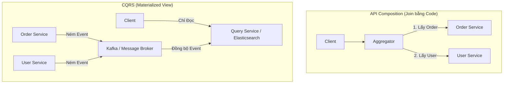

# Quản Lý Dữ Liệu Phân Tán (Foreign Keys & Joins) trong Microservices

> **Ý tưởng chính việc sử dụng:** Giải quyết bài toán lấy dữ liệu liên kết (Join) khi các bảng bị chia rẽ thành nhiều Database khác nhau.
> **Ví dụ:** Sử dụng API Composition gom JSON lại, hoặc dùng CQRS để sync data về chung một ElasticSearch.

## Mức độ Cơ bản (Basic)

### Vấn đề: Sự biến mất của Khóa ngoại (Foreign Keys) và JOIN
Trong kiến trúc Monolith (cơ sở dữ liệu tập trung), nếu bảng `Orders` cần thông tin từ bảng `Users`, bạn chỉ cần đặt một Khóa ngoại (`userId`) và dùng lệnh `SELECT ... JOIN users ON ...` là xong. Database sẽ lo toàn bộ việc ghép nối dữ liệu cực kỳ nhanh chóng.

Tuy nhiên, trong Microservices, nguyên tắc tối thượng là **Database per service** (Mỗi service có database riêng vật lý). 
- **Order Service** dùng MongoDB.
- **User Service** dùng PostgreSQL.

Lúc này, giữa 2 database ở 2 server khác nhau **không thể có Khóa ngoại** và cũng **không thể chạy lệnh JOIN SQL**. Trong bảng `Orders`, cột `userId` lúc này chỉ đơn thuần là một con số (Soft link - Liên kết mềm), không có bất kỳ ràng buộc vật lý nào dưới database đảm bảo ID đó tồn tại.

### Giải pháp Cơ bản: API Composition (Ghép nối qua API)
Thay vì để Database làm việc JOIN, chúng ta phải đẩy việc JOIN lên tầng code (Application Level).
**Cách hoạt động**:
1. Client yêu cầu xem "Chi tiết Đơn hàng kèm Thông tin người mua".
2. **Aggregator** (Một service trung gian hoặc API Gateway) sẽ gọi API tới `Order Service` để lấy thông tin đơn hàng. Đơn hàng trả về có chứa `userId`.
3. Aggregator tiếp tục lấy `userId` đó, gọi API tới `User Service` để lấy thông tin chi tiết của người dùng.
4. Aggregator ghép (merge) 2 cục JSON lại với nhau và trả về cho Client.

---

## Mức độ Trung bình (Intermediate)

### Những vấn đề nảy sinh từ API Composition
Cách làm API Composition rất dễ hiểu nhưng có nhược điểm chí mạng:
- **Hiệu suất cực thấp**: Thử tưởng tượng Client muốn lấy danh sách 100 Đơn hàng. Bạn sẽ phải gọi 1 lần lấy 100 đơn hàng, sau đó gọi thêm 100 lần API sang User Service để lấy thông tin 100 người dùng? Giải pháp mấu chốt là phải viết API dạng *Batch Request* (`GET /users?ids=1,2,3...`).
- **In-memory Join**: Khi join ở tầng code, bạn phải kéo một lượng lớn dữ liệu về RAM của server Node.js. Nếu bộ nhớ không đủ, server sẽ văng lỗi `Out Of Memory`.

### Giải pháp Trung bình: Data Duplication (Nhân bản dữ liệu có chủ đích)
Thay vì gọi chéo mạng tốn thời gian, tại sao Order Service không lưu luôn tên người dùng?
- Bảng Order: `{ id, productId, userId, userName }`
**Cách hoạt động**:
1. Khi User đổi tên bên User Service, User Service sẽ bắn một thông điệp (Message) vào **Message Broker** (RabbitMQ/Kafka) báo rằng: *"Ê, thằng user 1 vừa đổi tên thành Tí"*.
2. Order Service lắng nghe thông điệp đó, và thầm lặng update lại cột `userName` trong database của mình.
- **Ưu điểm**: Đọc cực nhanh vì không cần gọi API chéo nữa.
- **Nhược điểm**: Đòi hỏi hệ thống Message Broker phức tạp. Dữ liệu bị dư thừa (Redundancy).

---

## Mức độ Nâng cao (Advanced)

### Giải pháp Nâng cao: CQRS (Command Query Responsibility Segregation)
CQRS là đỉnh cao của việc giải quyết bài toán truy vấn (Query) phức tạp trong Microservices. Phân chia rõ 2 đường: đường Ghi (Command) và đường Đọc (Query).
**Cách hoạt động**:
- **Đường Ghi (Command)**: User Service cập nhật User. Order Service tạo Order. Mọi thứ diễn ra bình thường, độc lập ở từng Database. Mỗi khi có thay đổi, chúng đều ném Event vào Kafka.
- **Đường Đọc (Query - Materialized View)**: Ta xây dựng một **Query Service** riêng biệt. Service này dùng một Database chuyên để đọc (thường là Elasticsearch hoặc MongoDB). Nó lắng nghe TẤT CẢ Event từ Kafka, sau đó tự "xào nấu", JOIN sẵn dữ liệu và lưu thành một cục JSON hoàn chỉnh.
Khi Client muốn xem danh sách đơn hàng phức tạp, Client không gọi Order Service hay User Service nữa, mà gọi thẳng vào **Query Service**. Nó chỉ việc bốc cục JSON đã nặn sẵn ra trả về. 

### Các rủi ro và đánh đổi (Trade-offs)
- **Eventual Consistency (Tính nhất quán cuối cùng)**: Khi User đổi tên, phải mất vài mili-giây (hoặc vài giây nếu mạng lag) để thông điệp bay tới Query Service. Do đó, người dùng có thể thấy tên cũ trong một khoảng thời gian ngắn. Chấp nhận độ trễ này là đánh đổi lớn nhất trong kiến trúc Microservices để lấy tốc độ và khả năng scale.

---

## Phụ lục: Kiến trúc API Composition vs CQRS

---

## So sánh: Khóa ngoại (SQL) vs API Composition vs CQRS

| Tiêu chí | Khóa ngoại SQL (Monolith) | API Composition | CQRS / Data Duplication |
| :--- | :--- | :--- | :--- |
| **Bảo toàn dữ liệu** | Tuyệt đối (Database chặn lỗi xóa/sửa) | Không có (Liên kết mềm) | Không có (Liên kết mềm) |
| **Tốc độ đọc (Query)**| Cực nhanh (Database tối ưu) | Chậm (Phụ thuộc độ trễ mạng) | Cực nhanh (Đã join sẵn) |
| **Độ phức tạp** | Rất thấp | Trung bình | Cực kỳ cao |

---

## Bài Tập Thực Hành Nhỏ

1. **Thử thách (Fix hiệu năng)**: Hãy xem file `demo-api-composition.js`. Ở Route `/orders`, hiện tại để hiển thị thông tin user cho từng order, code đang lặp qua mảng orders và dùng `await axios.get` cho TỪNG order một (Hiện tượng N+1 Query cực đoan). Bạn hãy sửa lại code để: gom tất cả `userId` cần thiết lại, gọi một phát API `/users?ids=...` để lấy toàn bộ user 1 lần duy nhất, sau đó mới dùng JS để map dữ liệu vào mảng orders.

**ĐÁP ÁN BÀI TẬP**: Mình đã chuẩn bị sẵn file code giải cho thử thách giải quyết vấn đề N+1 Query này. Bạn có thể tham khảo tại: [answers-data-join.js](Users/ductri0981/Documents/Studying-Software/microservices/answers-data-join.js)

---

## Giải thích thuật ngữ (Glossary)

- **Soft Link (Liên kết mềm)**: Thay vì dùng khóa ngoại có ràng buộc cứng ở database (không cho phép xóa User nếu đang có Order), Soft Link chỉ đơn thuần là việc lưu con số `userId = 1`. Nếu User số 1 bị xóa ở service khác, bảng Order vẫn còn lưu số 1 đó, dẫn đến dữ liệu rác (Orphan record).
- **API Composition**: Mẫu thiết kế dùng một service trung gian để gọi nhiều API rời rạc khác nhau, sau đó "ghép" (compose) kết quả lại rồi mới trả về cho Client.
- **N+1 Query Problem**: Vấn đề hiệu năng khi bạn gọi 1 lần để lấy danh sách (1) gồm N phần tử, sau đó với mỗi phần tử bạn lại đi gọi 1 lần query/API nữa (N). Tổng cộng là 1+N lần gọi, gây thảm họa nếu N lớn.
- **CQRS (Command Query Responsibility Segregation)**: Nguyên lý tách biệt hoàn toàn module thực thi lệnh (Thêm/Sửa/Xóa - Command) khỏi module chuyên Truy vấn đọc dữ liệu (Query).
- **Materialized View (Khung nhìn cụ thể hóa)**: Khác với View thông thường (chỉ là câu lệnh SQL lưu sẵn), Materialized View thực sự lưu kết quả của lệnh JOIN xuống đĩa cứng vật lý thành một bảng mới để lần sau đọc lên với tốc độ tên lửa, nhưng phải bảo trì (update) nó mỗi khi dữ liệu gốc thay đổi.
- **Eventual Consistency (Tính nhất quán cuối cùng)**: Trái với Tính nhất quán tức thì (ACID), nghĩa là dữ liệu ở các database phân tán có thể không giống nhau ngay tại một thời điểm, nhưng "cuối cùng" (sau khi đồng bộ xong), chúng sẽ giống nhau.
