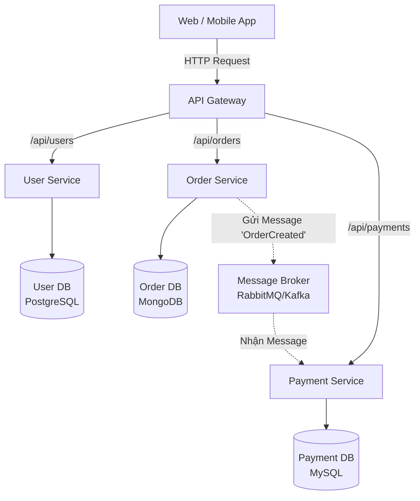

# Kiến Trúc Microservices (Vi Dịch Vụ)

> **Ý tưởng chính việc sử dụng:** Kiến trúc hệ thống chia nhỏ thành các dịch vụ độc lập, mỗi dịch vụ tự quản lý Database riêng và có thể được deploy riêng rẽ.
> **Ví dụ:** Tách ứng dụng E-commerce khổng lồ thành Dịch vụ User, Dịch vụ Order, Dịch vụ Payment, Dịch vụ Shipping chạy trên 4 server khác nhau.

## Mức độ Cơ bản (Basic)

### Microservices là gì?
**Microservices** (Kiến trúc Vi dịch vụ) là một phương pháp phát triển phần mềm, trong đó một ứng dụng lớn được chia nhỏ thành nhiều dịch vụ (service) độc lập. Mỗi dịch vụ chịu trách nhiệm cho một chức năng nghiệp vụ cụ thể (như Quản lý User, Quản lý Đơn Hàng, Thanh Toán), chạy trên một tiến trình (process) riêng biệt và giao tiếp với nhau qua môi trường mạng (thường là HTTP/REST hoặc Message Broker).

### Vấn đề cốt lõi mà Microservices giải quyết
Trong kiến trúc Monolith (Nguyên khối) truyền thống, tất cả code được gộp chung vào một source code duy nhất. Khi ứng dụng phình to:
- Sửa một lỗi nhỏ cũng phải deploy (triển khai) lại toàn bộ hệ thống.
- Nếu một tính năng (VD: Xử lý hình ảnh) bị quá tải và sập, nó có thể kéo sập toàn bộ các tính năng khác.
- Khó áp dụng nhiều ngôn ngữ lập trình khác nhau.

Microservices giải quyết vấn đề này bằng nguyên lý **Chia để trị**.

### Ví dụ thực tế
Hãy tưởng tượng một sàn thương mại điện tử như Shopee. Thay vì viết chung tất cả vào một cục, họ chia thành:
- **Service A**: Quản lý Người Dùng.
- **Service B**: Giỏ Hàng.
- **Service C**: Thanh toán.
Nếu ngày Black Friday, lượng người truy cập *Giỏ hàng* tăng đột biến, họ chỉ cần mua thêm server để nhân bản (scale) riêng Service B mà không cần động đến Service A hay C. Nếu Service C (Thanh toán) bị lỗi, người dùng vẫn có thể thêm hàng vào giỏ (Service B vẫn sống).

---

## Mức độ Trung bình (Intermediate)

### Cách thức hoạt động dưới nền tảng (Under the hood)

1. **Database riêng biệt (Database per service)**: Đây là nguyên tắc sống còn. Mỗi microservice phải có database của riêng nó. Service A không được phép chọc trực tiếp vào database của Service B, mà phải hỏi (gọi API) Service B để lấy dữ liệu.
2. **API Gateway (Cổng giao tiếp)**: Thay vì client (Web/Mobile) gọi trực tiếp hàng chục services, ta đặt một API Gateway ở giữa làm "bảo vệ". Client chỉ gọi vào Gateway, Gateway sẽ tự định tuyến (route) request đến đúng service cần thiết.
3. **Giao tiếp (Communication)**:
   - **Đồng bộ (Synchronous)**: Gọi HTTP RESTful API hoặc gRPC. Chờ có kết quả mới chạy tiếp.
   - **Bất đồng bộ (Asynchronous)**: Dùng Message Broker (RabbitMQ, Kafka). Bắn một sự kiện (Event) ra và không cần chờ đợi.

### Use Cases (Khi nào nên và không nên dùng)

| Đặc điểm | Nên dùng | Không nên dùng |
| :--- | :--- | :--- |
| **Quy mô dự án** | Hệ thống cực lớn, phức tạp, lượng người dùng khổng lồ. | Dự án nhỏ, startup mới thành lập cần ra mắt nhanh (MVP). |
| **Nhân sự** | Công ty có nhiều team phát triển độc lập (VD: Team A làm Node, Team B làm Go). | Team ít người (dưới 10 dev). Chi phí vận hành microservices rất lớn. |
| **Hạ tầng** | Có đội ngũ DevOps mạnh, thành thạo Docker, Kubernetes, CI/CD. | Thiếu người rành về hạ tầng, server. |

---

## Mức độ Nâng cao (Advanced)

### Các rủi ro, vấn đề về hiệu suất và sai lầm

#### 1. Vấn đề mạng (Network Latency)
Trong Monolith, gọi hàm chỉ tốn `0.001ms` (trên cùng RAM). Trong Microservices, gọi API qua mạng tốn `10-50ms`. Nếu xử lý 1 request mà phải gọi chéo qua 5 services, độ trễ sẽ cộng dồn lên rất lớn.

#### 2. Sai lầm: Distributed Monolith (Nguyên khối phân tán)
Chỉ tách code ra thành nhiều services nhưng chúng lại phụ thuộc chặt chẽ vào nhau (Service A sập thì Service B, C cũng sập theo). Đây là thảm họa vì bạn vừa phải chịu nỗi khổ của Monolith, vừa tốn tiền server của Microservices.

#### 3. Data Consistency (Tính nhất quán dữ liệu)
Vì không dùng chung Database, bạn **không thể dùng Transaction bình thường (như Postgres/Mongo)** để rollback nếu có lỗi xảy ra ở nhiều service. Bạn phải dùng các pattern nâng cao như **Saga Pattern** hoặc **Two-Phase Commit** để xử lý rollback phân tán.

#### 4. Khó gỡ lỗi (Debugging)
Lỗi xảy ra, làm sao biết nó xuất phát từ Service nào? Bắt buộc phải triển khai **Distributed Tracing** (Truy vết phân tán) bằng cách gắn một `Trace ID` duy nhất cho mỗi request đi từ Gateway xuyên qua tất cả services.

---

## Phụ lục: Kiến trúc Microservices cơ bản

---

## So sánh: Microservices vs Monolith vs Modular Monolith

- **Monolith (Nguyên khối)**: 1 Source Code, 1 Database, deploy thành 1 app. Dễ làm, dễ quản lý nhưng khó scale khi lớn.
- **Modular Monolith**: Vẫn 1 Source Code, 1 App, 1 Database nhưng code bên trong được chia module (thư mục) rất nghiêm ngặt, cấm gọi chéo lộn xộn. (Đây là cách tốt nhất cho hầu hết công ty trước khi lên Microservices).
- **Microservices**: Tách hoàn toàn thành các app vật lý riêng, DB riêng. Scale vô hạn, rủi ro sập toàn hệ thống thấp nhưng cực kỳ khó vận hành.

---

## Bài Tập Thực Hành Nhỏ

1. **Thử thách 1 (Khởi động)**: Trong file `demo-microservices.js`, hiện tại User Service và Order Service đang giao tiếp *đồng bộ* qua API Call (HTTP). Bạn hãy chạy thử file này để xem cách API Gateway điều hướng.
2. **Thử thách 2 (Nâng cấp - Đứt gãy mạng)**: Giả sử User Service bị sập (tắt máy chủ User). Nếu Order Service gọi API qua User Service để kiểm tra user có tồn tại không, nó sẽ bị lỗi (Timeout/Connection Refused). Nhiệm vụ của bạn là sửa file demo để thêm cơ chế "FallBack" (Báo lỗi thân thiện hoặc dùng dữ liệu mặc định) khi User Service không phản hồi.

**ĐÁP ÁN BÀI TẬP**: Sau khi đã tự thử nghiệm việc giao tiếp và bắt lỗi giữa 2 Microservices, bạn có thể tham khảo code giải chuẩn tại: [answers-microservices.js](/Users/ductri0981/Documents/Studying-Software/microservices/answers-microservices.js)

---

## Giải thích thuật ngữ (Glossary)

- **Process (Tiến trình)**: Một chương trình đang chạy trên hệ điều hành, có không gian bộ nhớ độc lập.
- **API Gateway**: Cổng đứng mũi chịu sào, nhận mọi request từ ngoài internet và chuyển tiếp (proxy) vào đúng service ẩn bên trong. Nó còn lo việc xác thực (Auth), giới hạn tốc độ (Rate Limit).
- **Message Broker (Trạm trung chuyển tin nhắn)**: Một hệ thống (như Kafka, RabbitMQ) đứng giữa để các service gửi "tin nhắn" cho nhau mà không cần kết nối trực tiếp, giúp hệ thống không bị treo khi chờ đợi (Bất đồng bộ).
- **Saga Pattern**: Mẫu thiết kế chuyên giải quyết bài toán Rollback ở nhiều database khác nhau. Thay vì dùng `ROLLBACK` SQL, Saga bắt bạn viết một API "bù trừ" (Compensating Transaction) để đảo ngược thao tác (Ví dụ: Đã cộng tiền thì API bù trừ là trừ tiền đi).
- **Distributed Tracing**: Kỹ thuật theo dõi một luồng request đi qua hàng chục server khác nhau để xem nó chậm ở đâu, lỗi ở server nào.
- **Two-Phase Commit (2PC)**: Một thuật toán phân tán để đảm bảo tất cả các database trong các service khác nhau đều đồng ý commit (Lưu) hoặc cùng nhau rollback (Hủy). Nó gồm 2 bước: Bước 1 (Prepare) - hỏi xem tất cả đã sẵn sàng chưa, Bước 2 (Commit/Rollback) - ra lệnh thực thi đồng loạt. Dù an toàn nhưng nó rất chậm và dễ gây nghẽn cổ chai (bottleneck) trong Microservices nên ít được dùng hơn Saga Pattern.
