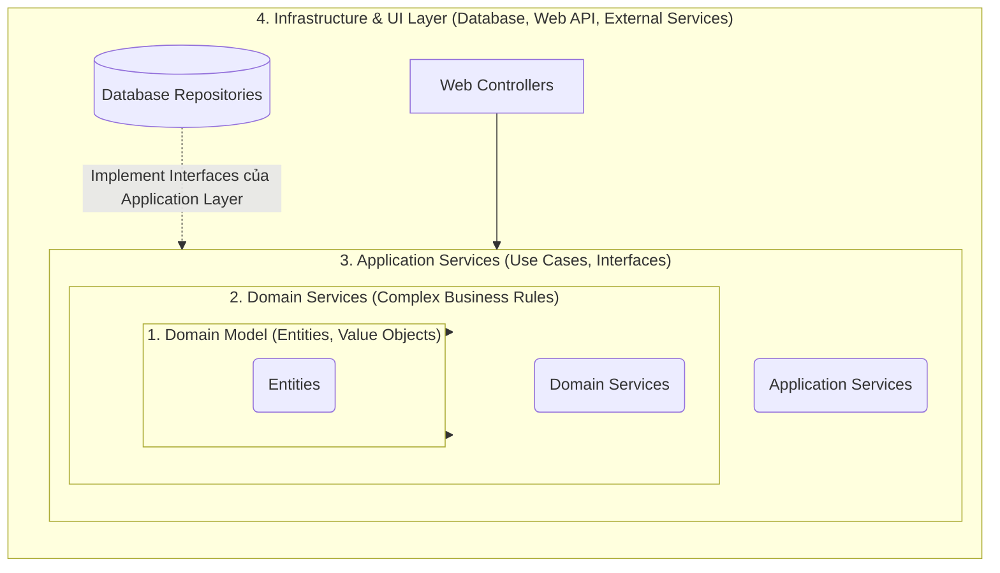

# Onion Architecture (Kiến trúc Củ Hành)

> **Ý tưởng chính việc sử dụng:** Tổ chức source code theo nhiều vòng tròn đồng tâm, vòng ngoài (Infrastructure) phụ thuộc vào vòng trong (Domain), tuyệt đối không có chiều ngược lại.
> **Ví dụ:** Class `Order` nằm ở nhân lõi không import bất kỳ thư viện nào (như axios, mongoose). Các logic này phải nằm ở lớp ngoài cùng.

Tương tự như Kiến trúc Lục giác (Hexagonal), Onion Architecture (do Jeffrey Palermo giới thiệu năm 2008) được sinh ra để giải quyết vấn đề mã nguồn bị trói buộc chặt chẽ (tight coupling) vào cơ sở dữ liệu hoặc các framework UI. Điểm khác biệt là nó sử dụng hình ảnh "củ hành tây" với các vòng tròn đồng tâm để quy định nghiêm ngặt về hướng phụ thuộc.

## 1. Mức Độ Cơ Bản (Basic)

### Onion Architecture là gì?
Hãy tưởng tượng hệ thống phần mềm của bạn như một củ hành tây với nhiều lớp bọc lấy nhau:
- **Lõi củ hành (Trung tâm)**: Chứa những gì cốt lõi nhất, thuần túy nhất của doanh nghiệp (ví dụ: Công thức tính lãi suất ngân hàng). Nó không biết gì về máy tính, mạng hay cơ sở dữ liệu.
- **Các lớp vỏ bên ngoài**: Chứa các phần mềm hỗ trợ để phần lõi có thể hoạt động được trong thế giới thực, như Web Framework (Express, React), Cơ sở dữ liệu (SQL, MongoDB).

### Vấn đề cốt lõi giải quyết
Trong kiến trúc truyền thống (Layered Architecture), lớp Logic nghiệp vụ thường gọi trực tiếp xuống lớp Database, khiến Logic bị kẹt chặt vào Database. Nếu đổi Database, toàn bộ Logic có nguy cơ phải đập đi viết lại. Onion Architecture đưa ra **Quy tắc Phụ thuộc (Dependency Rule)**: Mọi sự phụ thuộc chỉ được phép hướng từ ngoài vào trong. Lớp bên trong tuyệt đối KHÔNG được biết bất cứ thứ gì về lớp bên ngoài.

## 2. Mức Độ Trung Bình (Intermediate): Under the Hood

Một "củ hành" tiêu chuẩn thường có 4 lớp từ trong ra ngoài:

1. **Domain Model Layer (Lớp Lõi)**: Chứa các Đối tượng nghiệp vụ (Entities) và Trạng thái của chúng. Chỉ dùng ngôn ngữ lập trình thuần túy (như class User, class Product), hoàn toàn không có thư viện bên thứ 3.
2. **Domain Services Layer**: Chứa các logic nghiệp vụ phức tạp liên quan tới nhiều Entities mà không thể nhét vừa vào một Entity cụ thể nào.
3. **Application Services Layer (Use Cases)**: Đóng vai trò là "người điều phối". Nó nhận yêu cầu từ bên ngoài, gọi Domain thực thi logic, và định nghĩa ra các **Interfaces (Hợp đồng)** yêu cầu lớp bên ngoài phải cung cấp (Ví dụ: Định nghĩa `IUserRepository`).
4. **Infrastructure & UI Layer (Lớp Vỏ Ngoài Cùng)**: Chứa tất cả công nghệ thực tế. Web Controllers, Database Repositories, gửi Email, gọi API hệ thống khác. Lớp này sẽ *implement* các Interfaces do lớp Application định nghĩa.

*Use Cases*: Rất tuyệt vời cho các dự án lớn, phức tạp, áp dụng Domain-Driven Design (DDD). Không nên dùng cho các dự án làm tool nội bộ siêu nhỏ, hoặc API mang tính chất proxy/CRUD dữ liệu cơ bản vì sẽ tốn rất nhiều thời gian tạo các Interface và class trung gian.

## 3. Mức Độ Nâng Cao (Advanced)

### Làm sao Lớp Trong giao tiếp với Lớp Ngoài nếu không được gọi trực tiếp?
Nếu `Application Service` (Lớp 3) muốn lưu data vào SQL (Lớp 4), mà nó không được phép gọi SQL, thì nó làm kiểu gì?
-> **Giải pháp: Nguyên lý Dependency Inversion (Đảo ngược Phụ thuộc)**.
Lớp 3 tự định ra một cái luật (Interface) là `IRepository`. Lớp 4 (SQL) bắt buộc phải tuân theo luật đó (`class SQLRepo implements IRepository`). Ở thời điểm ứng dụng chạy (Runtime), ta dùng kỹ thuật **Dependency Injection (DI)** để "nhét" cái `SQLRepo` vào cho Lớp 3 dùng. Lớp 3 vẫn tưởng nó đang gọi `IRepository` chứ không hề biết sự tồn tại của SQL.

### Anti-patterns (Sai lầm thường gặp)
- **Truyền Entity trực tiếp ra ngoài API (UI)**: Lớp UI (Controller) nhận trực tiếp Entity từ Lõi và quăng thẳng về dạng JSON cho người dùng. 
  - *Hậu quả*: Vô tình lộ mật khẩu hoặc các trường nhạy cảm.
  - *Giải pháp*: Phải dùng DTO (Data Transfer Object) để chuyển đổi Entity thành dạng an toàn trước khi trả về ở lớp Application/UI.

## 4. So Sánh (Compare & Contrast)

| Đặc điểm | Onion Architecture | Hexagonal Architecture | Clean Architecture |
| :--- | :--- | :--- | :--- |
| **Góc nhìn chính** | Hình tròn đồng tâm. Phân định cực kỳ rõ ràng các lớp bên trong (Domain, Application). | Lục giác. Phân định theo Trong (Core) và Ngoài (Adapters). Ít rạch ròi các lớp bên trong Core. | Gần như là sự kết hợp và hoàn thiện của Onion và Hexagonal (bởi Uncle Bob). Tên gọi khác nhau nhưng chung tư tưởng. |
| **Kiểm soát Dependency** | Hướng vào tâm củ hành. | Core độc lập, Adapters phụ thuộc vào Core. | Hướng vào tâm. |
| **Tính ứng dụng** | Rất phổ biến trong cộng đồng C# (.NET) và Java. | Phổ biến trong thiết kế Microservices nói chung. | Trở thành tiêu chuẩn chung của nhiều ngôn ngữ (Go, TS, Python). |

## 5. Bài Tập Thực Hành Nhỏ

**Tình huống**: Trong file code demo bên dưới, chúng ta có một Use Case là tạo một `User` mới. Sếp yêu cầu: "Sau khi tạo User thành công, hãy gửi một Email thông báo cho họ". 
*Luật của Onion*: Logic tạo User nằm ở lớp Application Service (Lớp 3), còn code gửi Email (dùng thư viện SendGrid hay SMTP) bắt buộc phải nằm ở lớp Infrastructure (Lớp 4).

*Nhiệm vụ*: Hãy tạo một Interface `IEmailService` ở lớp phù hợp, sau đó viết code thực thi nó ở lớp Infrastructure, và "bơm" (Inject) nó vào Use Case để sử dụng mà không vi phạm quy tắc củ hành.

Code đề bài và đáp án nằm tại: [answers-onion](/Users/ductri0981/Documents/Studying-Software/onion_architecture/answers-onion.ts)

## 6. Phụ Lục (Sơ Đồ Kiến Trúc)

## 7. Giải Thích Thuật Ngữ (Glossary)

- **Tight Coupling (Khớp nối chặt)**: Trạng thái khi Component A phụ thuộc trực tiếp vào Component B. Nếu B thay đổi, A sẽ hỏng hoặc phải viết lại.
- **Dependency Rule (Quy tắc phụ thuộc)**: Trong Onion/Clean, mã nguồn chỉ được phép trỏ (phụ thuộc) từ lớp vỏ bên ngoài vào các lớp bên trong. Không có ngoại lệ.
- **Entity**: Một đối tượng cốt lõi có định danh (ID) duy nhất. Ví dụ: Khách hàng (User), Đơn hàng (Order). Nó chứa các thuộc tính và hành vi nội bộ của đối tượng đó.
- **Domain Service**: Nơi xử lý các nghiệp vụ (logic) liên quan đến nhiều Entity cùng lúc. Ví dụ: Dịch vụ Chuyển tiền (nhận tham số là 2 Entity Tài khoản).
- **Application Service (Use Case)**: Luồng nghiệp vụ cụ thể của hệ thống. Ví dụ: Người dùng đăng ký tài khoản (Nhận data từ UI -> Kiểm tra trùng lặp qua Repository -> Khởi tạo Entity User -> Lưu qua Repository).
- **Infrastructure**: Toàn bộ hệ thống kỹ thuật "vô tri vô giác" bên ngoài: Ổ cứng, Database MySQL, Cổng thanh toán Stripe, thư viện gửi Email.
- **DTO (Data Transfer Object)**: Một đối tượng chỉ chứa data tĩnh (không có logic), dùng để vận chuyển dữ liệu giữa các lớp (VD: từ Application Layer ra UI Layer) nhằm tránh làm lộ toàn bộ Entity gốc.
