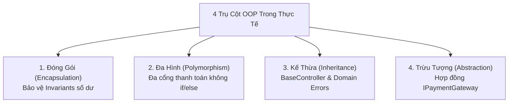
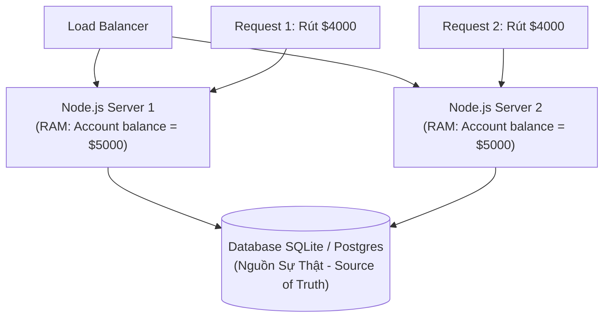
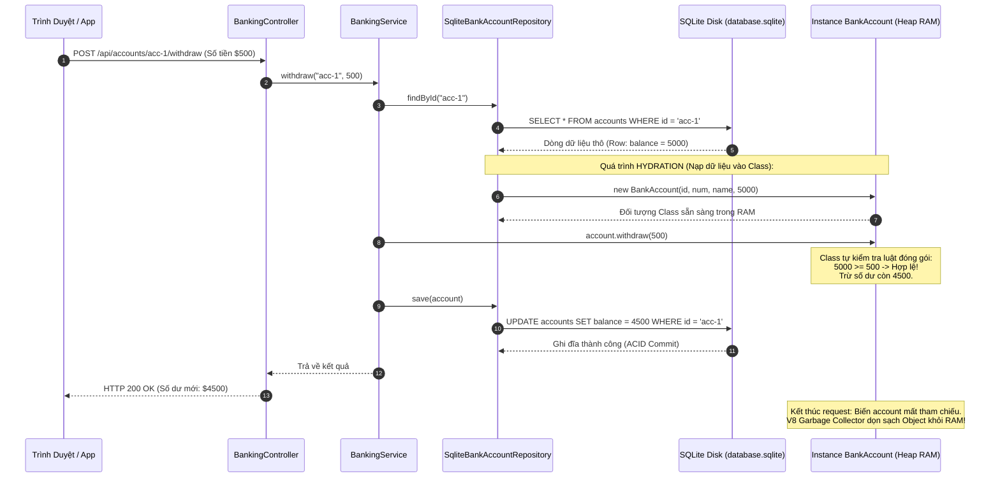
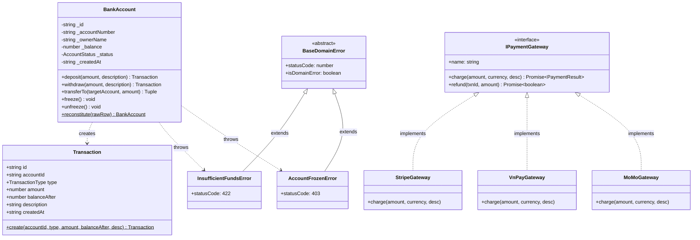

# Lập Trình Hướng Đối Tượng (OOP) Trong Thực Tế Kiến Trúc Phần Mềm & Database

Tài liệu này bóc tách tận cùng bản chất kỹ thuật, nguồn gốc ra đời, kiến trúc bộ nhớ và cơ chế vận hành thực chiến của **Lập trình Hướng Đối Tượng (OOP)** kết hợp với **Cơ sở dữ liệu (SQLite)** trong môi trường production.

---

## Mục Lục (Table of Contents)
1. [Mức Độ Cơ Bản (Basic Fundamentals)](#1-mức-độ-cơ-bản-basic-fundamentals)
   - [Class và OOP Là Gì?](#11-class-và-oop-là-gì)
   - [Ẩn Dụ Đời Thực (Real-World Analogy)](#12-ẩn-dụ-đời-thực-real-world-analogy)
   - [Vấn Đề Cốt Lõi Mà OOP Ra Đời Để Giải Quyết](#13-vấn-đề-cốt-lõi-mà-oop-ra-đời-để-giải-quyết)
2. [Mức Độ Trung Bình (Intermediate Architecture & Use Cases)](#2-mức-độ-trung-bình-intermediate-architecture--use-cases)
   - [Bốn Trụ Cột OOP Trong Thế Giới Thực](#21-bốn-trụ-cột-oop-trong-thế-giới-thực-không-dùng-ví-dụ-chómèo)
   - [Phân Biệt Hai Nhóm Class Trong Môi Trường Doanh Nghiệp](#22-phân-biệt-hai-nhóm-class-trong-môi-trường-doanh-nghiệp)
3. [Mức Độ Chuyên Sâu: BẢN CHẤT VẬN HÀNH (Under The Hood & Core Mechanics)](#3-mức-độ-chuyên-sâu-bản-chất-vận-hành-under-the-hood--core-mechanics)
   - [Tổ Chức Bộ Nhớ Tầng Thấp: Stack vs Heap](#31-tổ-chức-bộ-nhớ-tầng-thấp-stack-vs-heap-trong-v8-engine)
   - [Tại Sao Tuyệt Đối KHÔNG Load Hết Database Vào RAM Khi Start Server?](#32-sự-thật-vật-lý-tại-sao-tuyệt-đối-không-load-hết-database-vào-ram-khi-start-server)
   - [Lời Giải Chuẩn Doanh Nghiệp: Data Mapper & Quá Trình Hydration](#33-lời-giải-chuẩn-doanh-nghiệp-data-mapper--quá-trình-hydration)
4. [Mức Độ Nâng Cao: Vận Hành Thực Chiến (Production Engineering & Best Practices)](#4-mức-độ-nâng-cao-vận-hành-thực-chiến-production-engineering--best-practices)
   - [Anti-Pattern 1: The Anemic Domain Model (Mô Hình Nghiệp Vụ Thiếu Máu)](#41-anti-pattern-1-the-anemic-domain-model-mô-hình-nghiệp-vụ-thiếu-máu)
   - [Anti-Pattern 2: Cây Kế Thừa Quá Sâu (Deep Inheritance Hierarchy)](#42-anti-pattern-2-cây-kế-thừa-quá-sâu-deep-inheritance-hierarchy)
   - [Anti-Pattern 3: The God Class (Lớp Vạn Năng)](#43-anti-pattern-3-the-god-class-lớp-vạn-năng)
   - [Bẫy N+1 Query & Quản Lý Vòng Đời Entity](#44-bẫy-n1-query--quản-lý-vòng-đời-entity)
5. [Góc Nhìn Thực Chiến Cho Middle-Level Trở Xuống (Must-Know vs Nice-to-Know Roadmap)](#5-góc-nhìn-thực-chiến-cho-middle-level-trở-xuống-must-know-vs-nice-to-know-roadmap)
   - [Phân định ranh giới kiến thức theo từng cấp độ](#phân-định-ranh-giới-kiến-thức-theo-từng-cấp-độ)
   - [Bộ câu hỏi phỏng vấn thực chiến kinh điển (Intern -> Middle)](#bộ-câu-hỏi-phỏng-vấn-thực-chiến-kinh-điển-intern---middle)
   - [Những thứ TẠM THỜI BỎ QUA (Dành riêng cho Senior / Tech Lead / SRE)](#những-thứ-tạm-thời-bỏ-qua-dành-riêng-cho-senior--tech-lead--sre)
6. [So Sánh Theo Nguyên Lý Gốc (First-Principles Comparison)](#6-so-sánh-theo-nguyên-lý-gốc-first-principles-comparison)
7. [Sơ Đồ Kiến Trúc Lớp (Class Diagram)](#7-sơ-đồ-kiến-trúc-lớp-class-diagram)
8. [Bảng Tra Thuật Ngữ Kỹ Thuật (Glossary)](#8-bảng-tra-thuật-ngữ-kỹ-thuật-glossary)
9. [Hướng Dẫn Khởi Chạy & Kịch Bản Kiểm Chứng Thực Tế (Run Guide)](#9-hướng-dẫn-khởi-chạy--kịch-bản-kiểm-chứng-thực-tế)

---

## 1. Mức Độ Cơ Bản (Basic Fundamentals)

### 1.1 Class và OOP Là Gì?
Lập trình Hướng Đối Tượng (Object-Oriented Programming - OOP) là một mô hình lập trình tổ chức phần mềm xoay quanh các **Đối tượng (Objects)** thay vì các hàm và thủ tục đơn lẻ. Một **Class (Lớp)** là một bản thiết kế (blueprint) định nghĩa:
1. **Trạng thái (State / Attributes)**: Dữ liệu mà đối tượng nắm giữ.
2. **Hành vi (Behavior / Methods)**: Các hành động, quy tắc nghiệp vụ mà đối tượng có thể thực hiện trên dữ liệu đó.

### 1.2 Ẩn Dụ Đời Thực (Real-World Analogy)
* **Lập trình thủ tục (Procedural / Không dùng Class)**: Giống như bạn để toàn bộ tiền mặt của khách hàng vào một chiếc rương gỗ không khóa, vứt giữa chợ. Bất kỳ ai đi qua cũng có thể thò tay vào lấy tiền, sửa số tiền trong sổ tay, hoặc đếm nhầm. Không có bất kỳ người bảo vệ nào đứng ra kiểm tra xem người rút tiền có đủ số dư hay không.
* **Lập trình hướng đối tượng (OOP & Class)**: Giống như một **Cây ATM thông minh** (hoặc Két sắt ngân hàng tự động). Tiền mặt và số dư nằm kín bên trong lớp vỏ thép dày (`#balance` private). Người ngoài **tuyệt đối không thể tự thò tay vào sửa số dư**. Cách duy nhất để lấy tiền là đút thẻ, bấm mã PIN và gọi lệnh `withdraw(amount)`. Cây ATM sẽ tự động chạy quy trình kiểm tra:
  - Tài khoản có bị khóa không?
  - Số dư có đủ không?
  - Số tiền rút có phải số dương không?
  Nếu thỏa mãn toàn bộ luật lệ, ATM mới nhả tiền. Tính năng bảo vệ tự thân này chính là **Tính Đóng Gói (Encapsulation)**.

### 1.3 Vấn Đề Cốt Lõi Mà OOP Ra Đời Để Giải Quyết
Vào những năm 1960 - 1970, các chương trình phần mềm lớn viết bằng C, Pascal hoặc Fortran gặp phải cuộc khủng hoảng phần mềm (Software Crisis):
1. **Dữ liệu phân mảnh toàn cục (Global Mutable State)**: Các hàm ở module A có thể vô tình sửa biến của module B mà module B không hề hay biết, dẫn đến lỗi dây chuyền cực kỳ khó debug.
2. **Không có cơ chế tự bảo vệ luật nghiệp vụ (Broken Invariants)**: Ví dụ trong hệ thống thương mại điện tử, số lượng tồn kho sản phẩm bị giảm xuống số âm (`stock = -5`), hoặc đơn hàng đã giao thành công vẫn bị chuyển ngược về trạng thái `DRAFT`.
3. **OOP ra đời để thiết lập Trật Tự & Ranh Giới (Boundaries)**: Bằng cách gom dữ liệu và hành vi lại với nhau, Class trở thành người gác cổng bảo vệ tính toàn vẹn của dữ liệu tại mọi thời điểm trong suốt vòng đời của ứng dụng.

---

## 2. Mức Độ Trung Bình (Intermediate Architecture & Use Cases)

### 2.1 Bốn Trụ Cột OOP Trong Thế Giới Thực (Không Dùng Ví Dụ Chó/Mèo)



#### 🛡️ 1. Đóng Gói (Encapsulation)
- **Bản chất**: Giấu kín cấu trúc dữ liệu bên trong (`#balance`, `#status`) bằng private fields và chỉ phơi bày các phương thức công khai (`deposit()`, `withdraw()`, `transferTo()`).
- **Ứng dụng thực tế**: Đảm bảo luật nghiệp vụ không thể bị phá vỡ. Trong class `BankAccount`, phương thức `withdraw()` luôn kiểm tra `if (this.#balance < amount)` trước khi trừ tiền. Không ai có thể gán `account.balance = -1000`.

#### 🎭 2. Đa Hình (Polymorphism)
- **Bản chất**: Cùng một lời gọi phương thức `gateway.charge(amount)` nhưng các đối tượng khác nhau sẽ thực thi các hành vi hoàn toàn khác nhau mà không cần câu lệnh `switch/case` hay `if/else`.
- **Ứng dụng thực tế**:
  - `StripeGateway` gọi API thẻ tín dụng quốc tế và tính phí $2.9\% + \$0.3$.
  - `VnPayGateway` tạo chữ ký SHA512 và tính phí $1.1\%$.
  - `MoMoGateway` tạo mã Dynamic QR Code và tính phí $1.5\%$.
  - Bộ phận gọi thanh toán (`BankingService`) chỉ phụ thuộc vào interface `IPaymentGateway`. Khi thêm cổng thứ 4 (Apple Pay), code cũ không bị sửa đổi (Nguyên lý Open/Closed).

#### 🧬 3. Kế Thừa (Inheritance)
- **Bản chất**: Cho phép một lớp con kế thừa toàn bộ thuộc tính và phương thức của lớp cha để tái sử dụng và mở rộng.
- **Ứng dụng thực tế**:
  - `class BankingController extends BaseController`: Tái sử dụng các phương thức trả về chuẩn `this.ok()`, `this.created()` và bộ bắt lỗi tập trung `this.handleError()`.
  - `class InsufficientFundsError extends BaseDomainError`: Tự động mang theo mã lỗi HTTP 422 và đánh dấu là lỗi nghiệp vụ hợp lệ.

#### 🧩 4. Trừu Tượng (Abstraction)
- **Bản chất**: Ẩn đi chi tiết cài đặt phức tạp bên dưới và chỉ cung cấp giao diện giao tiếp đơn giản cho bên ngoài.
- **Ứng dụng thực tế**: Người dùng chỉ cần biết cổng thanh toán có hàm `charge(amount)`. Họ không cần biết bên trong Stripe dùng HTTP/2 hay gRPC, mã hóa RSA 2048-bit ra sao.

---

### 2.2 Phân Biệt Hai Nhóm Class Trong Môi Trường Doanh Nghiệp

Rất nhiều lập trình viên nhầm lẫn giữa Class chứa dữ liệu và Class xử lý logic. Trong thực tế, hệ thống phân tách rõ 2 nhóm:

| Tiêu Chí | Nhóm 1: Domain Model / Entity Class | Nhóm 2: Service / Infrastructure Class |
| :--- | :--- | :--- |
| **Ví dụ** | `BankAccount`, `Transaction`, `User`, `Order` | `BankingService`, `PaymentGateway`, `SqliteRepository` |
| **Vòng đời (Lifecycle)** | **Ngắn (Transient)**: Sinh ra khi có request, bị thu hồi RAM khi request xong | **Dài (Singleton / Long-lived)**: Khởi tạo 1 lần duy nhất khi server start |
| **Nhiệm vụ** | Mang dữ liệu của 1 dòng bản ghi + thực thi luật nghiệp vụ | Cung cấp thuật toán, kết nối database, gọi API bên ngoài |
| **Lưu trữ** | Tái tạo từ SQLite thông qua Repository | Không chứa dữ liệu cá nhân của bất kỳ khách hàng nào |

---

## 3. Mức Độ Chuyên Sâu: BẢN CHẤT VẬN HÀNH (Under The Hood & Core Mechanics)

Đây là phần trả lời trực tiếp cho câu hỏi: *"Dữ liệu lưu ở Database, vậy khi start server có load hết vào class không?"*.

---

### 3.1 Tổ Chức Bộ Nhớ Tầng Thấp: Stack vs Heap Trong V8 Engine

Khi bạn chạy dòng mã sau trong Node.js:
```typescript
const account = new BankAccount("acc-1", "10019988", "Nguyen Van An", 5000);
```

Hệ điều hành và máy ảo V8 (Node.js) tổ chức bộ nhớ như sau:

```
VÙNG NHỚ STACK (Nhanh, Cố định)          VÙNG NHỚ HEAP (Lớn, Động)
┌───────────────────────────────┐        ┌─────────────────────────────────────────┐
│ Con trỏ tham chiếu:           │        │ Đối Tượng BankAccount Object:           │
│ `account`                     │───────►│ ├─ __proto__ (Trỏ tới BankAccount.prototype)
│ (Địa chỉ: 0x7ffee3b2)          │        │ ├─ Hidden Class (Map/Shape con trỏ V8) │
│                               │        │ ├─ _id: "acc-1"                         │
│                               │        │ ├─ _balance: 5000 (Float64 - 8 bytes)   │
│                               │        │ └─ _status: "ACTIVE"                    │
└───────────────────────────────┘        └─────────────────────────────────────────┘
```

1. **Stack Memory**: Lưu trữ con trỏ tham chiếu cục bộ `account` (kích thước chỉ 8 bytes trên kiến trúc 64-bit). Con trỏ này tự động bị xóa sổ ngay khi hàm thoát khỏi phạm vi thực thi (Scope).
2. **Heap Memory**: Nơi chứa nội dung thực sự của đối tượng Class.
3. **VTable (Virtual Method Table) & Dynamic Dispatch**: Khi bạn gọi `gateway.charge()`, JavaScript Engine không biết trước hàm nào sẽ chạy. Nó nhìn vào `__proto__` của đối tượng trên Heap, tra cứu bảng con trỏ hàm VTable để nhảy tới đúng địa chỉ mã máy của `StripeGateway` hoặc `VnPayGateway`. Quá trình này gọi là **Dynamic Method Dispatch**.

---

### 3.2 Sự Thật Vật Lý: Tại Sao Tuyệt Đối KHÔNG Load Hết Database Vào RAM Khi Start Server?

Nếu một hệ thống nạp toàn bộ 10 triệu tài khoản ngân hàng từ SQLite/PostgreSQL vào các Class trong RAM khi bật máy chủ:

#### 1. Bão hòa RAM (V8 Heap Out of Memory - OOM Crash)
Mỗi đối tượng Class trong Node.js (bao gồm Hidden Class Map, Prototype, Properties) tiêu tốn khoảng $150 - 300\text{ bytes}$.
$$\text{RAM tiêu tốn} = 10,000,000 \times 250\text{ bytes} \approx 2.5\text{ GB RAM!}$$
V8 Engine mặc định chỉ cấp khoảng $1.4\text{GB} - 4\text{GB}$ cho Heap Memory. Máy chủ sẽ lập tức văng lỗi `FATAL ERROR: Ineffective mark-compacts near heap limit Allocation failed - JavaScript heap out of memory` và sập ngay lập tức.

#### 2. Thảm họa Khởi động (Cold Start & Autoscaling Failure)
Để đọc 2.5GB dữ liệu từ đĩa cứng và serialize thành 10 triệu instances Class:
- Server mất từ **3 đến 8 phút** chỉ để khởi động xong.
- Nếu hệ thống có đợt Flash Sale và Kubernetes cần bật thêm 5 Pods mới để chịu tải, cả 5 Pods đều bị treo trong 8 phút. Toàn bộ hệ thống sập hoàn toàn (Cascade Failure).

#### 3. Phân mảnh Dữ liệu & Xung Đột Trạng Thái (Distributed State & Split-Brain)
Trong môi trường production, luôn có nhiều server chạy song song sau Load Balancer:



- Nếu dữ liệu nằm trong Class ở RAM:
  - Khách hàng gửi Request 1 vào **Server 1**: Server 1 kiểm tra RAM thấy đủ $5000, trừ $4000, còn $1000.
  - Cùng lúc, khách hàng gửi Request 2 vào **Server 2**: Server 2 kiểm tra RAM của nó **vẫn thấy $5000** (vì nó không kết nối RAM với Server 1)! Server 2 tiếp tục cho rút $4000!
  - **Hậu quả**: Khách hàng rút được $8000 từ tài khoản chỉ có $5000 $\rightarrow$ Thất thoát tài chính nghiêm trọng!

---

### 3.3 Lời Giải Chuẩn Doanh Nghiệp: Data Mapper & Quá Trình Hydration

Để giải quyết mâu thuẫn giữa lập trình hướng đối tượng và cơ sở dữ liệu quan hệ (gọi là **Object-Relational Impedance Mismatch**), người ta áp dụng mô hình **Repository Pattern (Data Mapper)**:



#### Bản Chất Của Mô Hình Này:
1. **Database là Nguồn Sự Thật Duy Nhất (Single Source of Truth)**: Dữ liệu luôn nằm an toàn và bền vững trên đĩa cứng (SQLite file hoặc PostgreSQL disk blocks).
2. **Server là Hoàn Toàn Vô Trạng Thái (Stateless)**: Khi bật server, RAM hoàn toàn sạch sẽ, khởi động trong **0.1 giây**.
3. **Class chỉ là "Công Cụ Tính Toán Tạm Thời" (Transient Computation Tool)**:
   - Cần tính toán $\rightarrow$ Đọc 1 dòng từ đĩa lên $\rightarrow$ Nạp vào Class $\rightarrow$ Class tính toán bảo vệ luật $\rightarrow$ Ghi kết quả ngược lại đĩa $\rightarrow$ Xóa Class khỏi RAM.

---

## 4. Mức Độ Nâng Cao: Vận Hành Thực Chiến (Production Engineering & Best Practices)

### 4.1 Anti-Pattern 1: The Anemic Domain Model (Mô Hình Nghiệp Vụ Thiếu Máu)
* **Triệu chứng**: Tạo ra Class nhưng biến tất cả thuộc tính thành `public` kèm theo hàng loạt `get/set` vô nghĩa. Toàn bộ logic kiểm tra số dư bị kéo ra ngoài tầng Service hoặc Controller:
  ```typescript
  // ❌ TỒI TỆ (Thiếu máu - Không có đóng gói):
  class BankAccount {
    public balance: number; // Ai thích sửa gì thì sửa!
  }
  
  // Logic bị vứt lung tung ngoài Controller:
  if (account.balance >= amount) {
    account.balance -= amount; // Phá vỡ tính đóng gói!
  }
  ```
* **Khắc phục**: Đưa toàn bộ luật lệ vào chính Class đó (Rich Domain Model). Bên ngoài chỉ được gọi `account.withdraw(amount)`.

### 4.2 Anti-Pattern 2: Cây Kế Thừa Quá Sâu (Deep Inheritance Hierarchy)
* **Triệu chứng**: Kế thừa quá nhiều tầng: `Account -> SavingsAccount -> InterestSavingsAccount -> VipInterestSavingsAccount`.
* **Hậu quả**: Lỗi **Fragile Base Class** (Sửa một dòng ở lớp cha làm hỏng hành vi của 5 lớp con bên dưới mà không hề hay biết).
* **Quy tắc vàng**: **Composition over Inheritance (Ưu tiên Lắp ghép hơn Kế thừa)**. Chỉ kế thừa tối đa 1-2 tầng cho các thành phần hạ tầng (như `BaseController`, `BaseDomainError`).

### 4.3 Anti-Pattern 3: The God Class (Lớp Vạn Năng)
* **Triệu chứng**: Nhồi nhét mọi thứ vào 1 Class duy nhất: `class User` vừa lưu thông tin, vừa tự kết nối database, vừa tự gửi email, vừa tự băm mật khẩu.
* **Khắc phục**: Tuân thủ nguyên lý Đơn Trách Nhiệm (Single Responsibility Principle - SRP): Class `BankAccount` chỉ lo luật tiền tệ; Class `SqliteRepository` lo việc đọc ghi đĩa.

### 4.4 Bẫy N+1 Query & Quản Lý Vòng Đời Entity
* **Vấn đề**: Khi hydrate một tập hợp các đối tượng phức tạp (ví dụ nạp 100 `BankAccount`, mỗi tài khoản nạp thêm danh sách `Transaction`), nếu dùng vòng lặp gọi repository:
  ```typescript
  // ❌ Gây ra 1 + 100 câu truy vấn DB (N+1 Query Trap):
  const accounts = await repo.findAll();
  for (const acc of accounts) {
    acc.transactions = await txnRepo.findByAccountId(acc.id);
  }
  ```
* **Giải pháp**:
  - Dùng SQL JOIN hoặc `WHERE account_id IN (...)` để nạp dữ liệu theo mảng hàng loạt (Batch Hydration).
  - Tách ranh giới Aggregate: Chỉ nạp `transactions` khi người dùng thực sự xem lịch sử giao dịch (Lazy Loading / Dedicated Query).

---

## 5. Góc Nhìn Thực Chiến Cho Middle-Level Trở Xuống (Must-Know vs Nice-to-Know Roadmap)

### Phân định ranh giới kiến thức theo từng cấp độ

```
┌─────────────────────────────────────────────────────────────────────────────────┐
│ CẤP ĐỘ INTERN / JUNIOR (HIỂU BẢN CHẤT 4 TRỤ CỘT & THỰC THI ĐÚNG)                │
│  - Phân biệt rõ: Data Entity (BankAccount) vs Service Class (BankingService)    │
│  - Bảo vệ dữ liệu với private fields (#balance) và methods nghiệp vụ            │
│  - Hiểu nguyên lý Đa hình qua Interface IPaymentGateway (loại bỏ if/else)       │
│  - Nắm vững: Dữ liệu thật nằm ở Database Disk; Class chỉ sống tạm thời trong RAM│
│  - Tránh Anti-pattern "Thiếu máu" (Anemic): không public hết thuộc tính         │
└─────────────────────────────────────────────────────────────────────────────────┘
                                        │
                                        ▼
┌─────────────────────────────────────────────────────────────────────────────────┐
│ CẤP ĐỘ MIDDLE-LEVEL (KIẾN TRÚC DOANH NGHIỆP & BẢO VỆ TÍNH TOÀN VẸN)             │
│  - Thiết kế Rich Domain Model: Đóng gói chặt chẽ Domain Invariants              │
│  - Áp dụng Data Mapper / Repository Pattern tách biệt Domain khỏi Database      │
│  - Nắm vững "Composition over Inheritance", dùng Dependency Injection           │
│  - Tích hợp vòng đời Entity với DB Transactions & Pessimistic/Optimistic Lock   │
│  - Phòng tránh N+1 Query khi Hydrate cây quan hệ Object                         │
└─────────────────────────────────────────────────────────────────────────────────┘
```

#### Intern / Junior: Những gì BẮT BUỘC phải nắm vững
1. **Mô hình tư duy cốt lõi**:
   - Từ bỏ ví dụ sách vở "Chó sủa Gâu gâu, Mèo kêu Meo meo". Trong thực tế, Class là công cụ bảo vệ tiền bạc và dữ liệu khách hàng.
   - Nhớ rằng Database mới là nơi lưu dữ liệu lâu dài (Single Source of Truth). Đừng bao giờ nghĩ rằng "khởi động server thì load hết database vào RAM".
2. **Kỹ năng thực chiến**:
   - Khai báo thuộc tính private (dùng `#balance` trong JS/TS hoặc `private balance`).
   - Đưa logic kiểm tra điều kiện vào bên trong method của class (`if (this.#balance < amount) throw ...`).
   - Phân biệt Class chứa dữ liệu (`BankAccount` - sinh ra và mất đi theo request) với Class xử lý logic (`BankingService` - sống suốt vòng đời server).

#### Middle-Level: Tối ưu hóa & Thiết kế chuẩn mực
1. **Rich Domain Model vs Anemic Domain Model**: Không biến Entity thành một struct rỗng chỉ có getter/setter. Toàn bộ quy tắc chuyển trạng thái (State Transition, ví dụ `account.freeze()`, `account.withdraw()`) phải nằm trong Entity.
2. **Repository Pattern & Data Hydration**: Tách biệt rõ ràng tầng nghiệp vụ khỏi thư viện DB (SQLite, Prisma, TypeORM). Entity không được chứa mã SQL trực tiếp.
3. **Quản lý đồng thời & Transaction**: Khi 2 request cùng rút tiền, Class trong RAM không thể tự giải quyết race condition giữa 2 server instances. Bắt buộc phải kết hợp với Transaction và Row-level Lock (`SELECT FOR UPDATE`) ở tầng cơ sở dữ liệu.

---

### Bộ câu hỏi phỏng vấn thực chiến kinh điển (Intern -> Middle)

#### Câu 1 (Intern/Junior): Khi khởi động backend server, tại sao chúng ta không nạp hết toàn bộ dữ liệu từ database vào các đối tượng Class trong RAM để đọc cho nhanh?
- **Trả lời ghi điểm**:
  - **Tràn bộ nhớ (OOM)**: Hàng triệu bản ghi khi nạp thành Object Class kèm prototype và metadata sẽ ngốn hàng gigabyte RAM, làm sập tiến trình Node.js/Java ngay khi khởi động.
  - **Cold Start quá lâu**: Mất hàng phút để đọc và deserialize dữ liệu từ đĩa cứng, làm tê liệt khả năng Auto-scaling của hệ thống khi có tải đột biến.
  - **Xung đột dữ liệu phân tán (Split-Brain)**: Trong môi trường nhiều server chạy song song sau Load Balancer, nếu mỗi server lưu dữ liệu trong RAM của mình thì chúng sẽ không đồng bộ được số dư với nhau. Do đó, Database đĩa cứng phải là Nguồn Sự Thật Duy Nhất (Single Source of Truth); server phải giữ trạng thái vô trạng thái (Stateless) và chỉ nạp bản ghi vào Class tạm thời khi có request.

#### Câu 2 (Junior/Middle): Sự khác biệt giữa Anemic Domain Model và Rich Domain Model là gì?
- **Trả lời ghi điểm**:
  - **Anemic Domain Model (Mô hình thiếu máu)**: Entity chỉ chứa các thuộc tính public hoặc các hàm getter/setter đơn thuần, không có bất kỳ logic nghiệp vụ nào. Toàn bộ logic kiểm tra hợp lệ bị kéo ra ngoài tầng Service. Hậu quả là vi phạm tính Đóng gói (Encapsulation), logic bị trùng lặp ở nhiều nơi và dữ liệu dễ bị sửa sai luật.
  - **Rich Domain Model**: Entity chứa cả dữ liệu VÀ các hành vi nghiệp vụ. Mọi quy tắc bất biến (Invariants) như kiểm tra số dư, kiểm tra trạng thái khóa tài khoản đều được thực thi bên trong Entity. Tầng Service chỉ làm nhiệm vụ điều phối (Orchestration): lấy Entity từ DB ra, gọi hàm nghiệp vụ của Entity, và lưu Entity lại vào DB.

#### Câu 3 (Middle): Tại sao trong lập trình hướng đối tượng hiện đại, nguyên lý "Ưu tiên Lắp ghép hơn Kế thừa" (Composition over Inheritance) lại được khuyến nghị mạnh mẽ?
- **Trả lời ghi điểm**:
  - Kế thừa tạo ra mối liên kết quá chặt chẽ (Tight Coupling) giữa lớp cha và lớp con. Khi cây kế thừa sâu từ 3-4 tầng, sửa đổi một dòng ở lớp cha có thể vô tình phá vỡ hành vi của các lớp con bên dưới (vấn đề Fragile Base Class).
  - Lắp ghép (Composition) cho phép lắp ghép các hành vi thông qua Interfaces và Dependency Injection. Chúng ta có thể dễ dàng thay thế, mock khi viết Unit Test, hoặc hoán đổi hành vi tại runtime (ví dụ thay `StripeGateway` bằng `VnPayGateway`) mà không làm ảnh hưởng tới cấu trúc của các lớp khác, tuân thủ nguyên lý Open/Closed (OCP).

---

### Những thứ TẠM THỜI BỎ QUA (Dành riêng cho Senior / Tech Lead / SRE)
- **Chi tiết Hidden Class Shapes & Inline Caching (IC)**: Cơ chế tối ưu hóa con trỏ bộ nhớ tầng thấp của V8 Engine.
- **Triển khai kiến trúc Event Sourcing & CQRS phức tạp**: Tách biệt hoàn toàn Write Model và Read Model cho các ngân hàng quy mô hàng triệu giao dịch/giây.
- **Chiến lược Domain-Driven Design (DDD) Enterprise**: Thiết kế Aggregate Roots đa phân vùng và Anti-Corruption Layers giữa các hệ thống ngân hàng Core Banking cũ (Legacy COBOL).
- *Ở cấp độ Middle trở xuống, hãy tập trung vào việc áp dụng chuẩn 4 trụ cột OOP vào bài toán nghiệp vụ thực tế, đóng gói invariants chặt chẽ và kết hợp hài hòa với Database Transactions!*

---

## 6. So Sánh Theo Nguyên Lý Gốc (First-Principles Comparison)

| Tiêu Chí | Lập Trình Hướng Đối Tượng (OOP) | Lập Trình Hàm (Functional - FP) | Lập Trình Thủ Tục (Procedural) |
| :--- | :--- | :--- | :--- |
| **Đơn vị tổ chức** | Class & Object | Pure Functions & Immutable Data | Procedures & Global Data |
| **Quản lý trạng thái** | Đóng gói trạng thái bên trong Object | Trạng thái Bất biến (Immutability), không sửa đổi | Biến toàn cục / Con trỏ tự do |
| **Cách mở rộng** | Kế thừa, Đa hình (Polymorphism) | Function Composition, Higher-Order Functions | Viết thêm hàm mới thủ công |
| **Thế mạnh lớn nhất** | Mô hình hóa các hệ thống nghiệp vụ phức tạp (Ngân hàng, Game, E-commerce) | Xử lý dữ liệu lớn song song (Data Pipeline, AI, Concurrent Math) | Viết script nhỏ, Embedded C cho vi điều khiển |
| **Rủi ro lớn nhất** | Dễ rơi vào bẫy thiết kế cồng kềnh (Over-engineering) | Khó mô hình hóa các thực thể có trạng thái biến đổi liên tục | Mã nguồn mì ống (Spaghetti), không thể scale lớn |

---

## 7. Sơ Đồ Kiến Trúc Lớp (Class Diagram)



---

## 8. Bảng Tra Thuật Ngữ Kỹ Thuật (Glossary)

| Thuật Ngữ | Định Nghĩa & Bản Chất Kỹ Thuật |
| :--- | :--- |
| **Encapsulation (Đóng gói)** | Kỹ thuật gom dữ liệu và hành vi vào Class, ẩn giấu trạng thái nội bộ bằng `private` nhằm ngăn chặn các truy cập hoặc sửa đổi trái phép từ bên ngoài. |
| **Polymorphism (Đa hình)** | Khả năng các đối tượng thuộc các lớp khác nhau có thể phản hồi cùng một lời gọi phương thức theo những cách riêng biệt phù hợp với bản chất của chúng. |
| **Domain Invariant (Bất biến nghiệp vụ)** | Các điều kiện hoặc quy tắc mà dữ liệu của thực thể BẮT BUỘC phải thỏa mãn tại mọi thời điểm (ví dụ: số dư tài khoản không được âm, số tiền giao dịch phải $> 0$). |
| **Data Hydration (Tái tạo thực thể)** | Quá trình đọc một dòng dữ liệu thô (Raw Tuple/Row) từ cơ sở dữ liệu đĩa cứng và khởi tạo thành một đối tượng Class hoàn chỉnh trên bộ nhớ RAM. |
| **Data Mapper Pattern** | Lớp kiến trúc phân tách hoàn toàn giữa đối tượng nghiệp vụ trong bộ nhớ (Domain Entity) và cơ sở dữ liệu lưu trữ (SQLite/Postgres), giúp cả hai không bị phụ thuộc cứng vào nhau. |
| **Active Record Pattern** | Mô hình trong đó một Class vừa đại diện cho một dòng dữ liệu, vừa chứa trực tiếp các hàm `save()`, `delete()` xuống database. Phù hợp cho CRUD đơn giản nhưng kém linh hoạt hơn Data Mapper trong hệ thống lớn. |
| **VTable (Virtual Method Table)** | Bảng con trỏ hàm được trình biên dịch/runtime tạo ra trong bộ nhớ để thực hiện cơ chế Dynamic Dispatch (tra cứu hàm nào sẽ được thực thi khi gọi đa hình tại runtime). |
| **Hidden Class (Shapes trong V8)** | Cấu trúc dữ liệu nội bộ mà máy ảo V8 sử dụng để tối ưu hóa việc truy cập các thuộc tính của Object trên vùng nhớ Heap của JavaScript. |

---

## 9. Hướng Dẫn Khởi Chạy & Kịch Bản Kiểm Chứng Thực Tế

### 9.1 Khởi Chạy Hệ Thống (Không Dùng Docker)

#### Bước 1: Khởi động Backend Node.js + TypeScript + SQLite
Mở terminal 1:
```bash
cd /Users/ductri0981/Documents/Studying-Software/Software_Architecture/oop_in_practice/backend
npm install
npm run dev
# Server tự động tạo file database.sqlite và lắng nghe tại http://localhost:5002
```

#### Bước 2: Khởi động Frontend React + Vite
Mở terminal 2:
```bash
cd /Users/ductri0981/Documents/Studying-Software/Software_Architecture/oop_in_practice/frontend
npm install
npm run dev
# Mở trình duyệt truy cập: http://localhost:5173
```

---

### 9.2 Ba Kịch Bản Kiểm Chứng Thực Tế

#### Kịch bản 1: Kiểm chứng Tính Đóng Gói (Rút Quá Số Dư)
1. Trên giao diện, chọn tài khoản **Nguyễn Văn An (Số dư: $5000)**.
2. Bấm nút **Rút tiền**.
3. Cố tình nhập số tiền vượt quá số dư: `$99999`.
4. Bấm **Xác Nhận Thực Hiện**:
   - Giao diện lập tức hiện thông báo lỗi màu đỏ: `🛡️ Bị Chặn Bởi Luật Đóng Gói (Domain Exception: InsufficientFundsError)`.
   - **Bản chất**: Lệnh SQL `UPDATE` không bao giờ được chạy. Class `BankAccount` đã chặn đứng giao dịch và ném lỗi ngay từ trong bộ nhớ RAM, bảo vệ an toàn cho cơ sở dữ liệu!

#### Kịch bản 2: Kiểm chứng Trạng Thái Khóa (AccountFrozenError)
1. Chọn tài khoản **Lê Hoàng Cường (Tài khoản Đóng Băng)** đang có huy hiệu `FROZEN`.
2. Bấm nút **Rút** hoặc **Chuyển khoản**.
3. Nhập số tiền hợp lệ `$50`.
4. Bấm xác nhận:
   - Hệ thống lập tức trả về lỗi HTTP 403: `AccountFrozenError`.
   - Bấm vào biểu tượng ổ khóa màu đỏ trên thẻ để chuyển trạng thái sang `ACTIVE` (gọi hàm `account.unfreeze()`). Thử rút lại $\rightarrow$ Giao dịch thành công ngay lập tức!

#### Kịch bản 3: Kiểm chứng Tính Đa Hình & Đối Chiếu Dữ Liệu SQLite Thật Trên Đĩa
1. Chọn tài khoản bất kỳ, bấm nút **Cổng Pay**.
2. Chọn món hàng cần thanh toán (ví dụ: Khóa học Software Architecture $99).
3. Thử chuyển đổi giữa 3 cổng: **Stripe**, **VNPay**, và **MoMo**.
4. Bấm thanh toán:
   - Backend gọi `gateway.charge()` tương ứng với cổng đã chọn mà không cần một lệnh `if/else` nào.
5. Kéo chuột xuống phần **SQLite Database Inspector** ở cuối trang:
   - Bấm sang tab **Bảng transactions**: Bạn sẽ thấy dòng giao dịch vừa được ghi vĩnh viễn xuống đĩa cứng với mã ủy quyền tương ứng của cổng thanh toán.
   - Bấm sang tab **Bảng accounts**: Bạn thấy số dư đã bị trừ tương ứng.
   - 👉 **Kiểm chứng hoàn tất**: Dữ liệu nằm ở file `database.sqlite` trên đĩa, Class chỉ sống trong chớp mắt lúc xử lý giao dịch rồi biến mất khỏi RAM!
