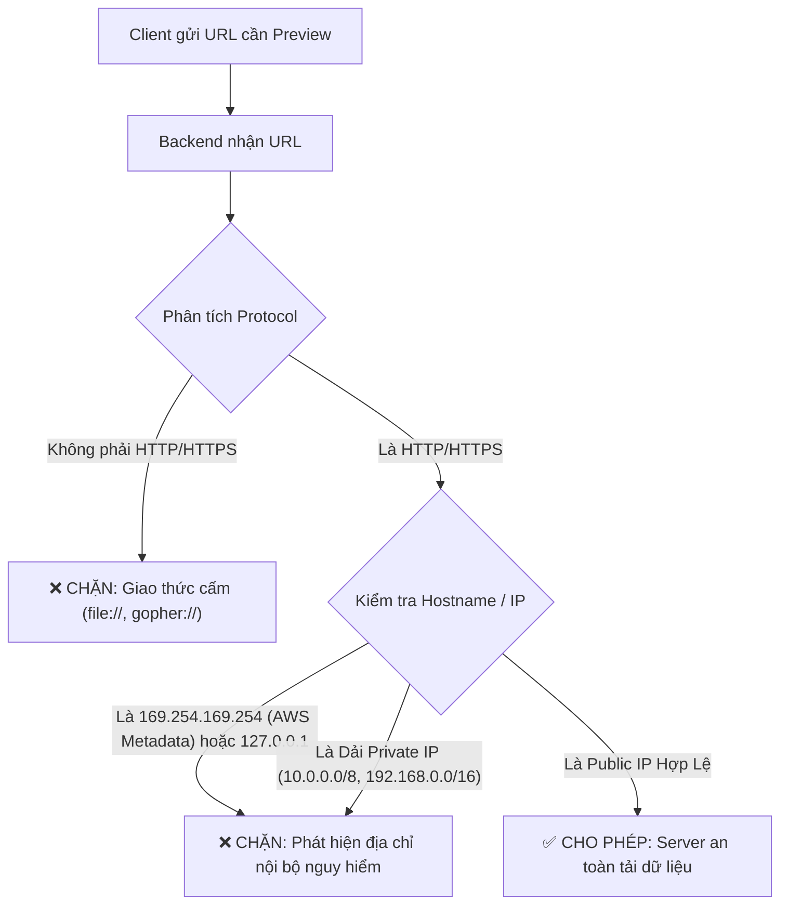

# BACKEND WEB SECURITY ARCHITECTURE & VULNERABILITIES DEEP DIVE

> **Tài liệu lý thuyết chuyên sâu và cẩm nang kiến trúc phòng thủ toàn diện dành cho Backend Engineer (OWASP Top 10, RFC Specifications & Production Engineering)**  
> Dành cho Software Engineer, Backend Developer, Tech Lead và DevOps/SecOps từ cấp độ Intern/Junior đến Middle-level và Architect.

---

## 📑 MỤC LỤC
1. [Mức Độ Cơ Bản (Basic Fundamentals)](#1-mức-độ-cơ-bản-basic-fundamentals)
2. [Mức Độ Trung Bình (Intermediate - Architecture & Use Cases)](#2-mức-độ-trung-bình-intermediate---architecture--use-cases)
3. [Mức Độ Chuyên Sâu: BẢN CHẤT VẬN HÀNH (Under The Hood & Core Mechanics)](#3-mức-độ-chuyên-sâu-bản-chất-vận-hành-under-the-hood--core-mechanics)
4. [Mức Độ Nâng Cao: Vận Hành Thực Chiến (Production Engineering & Best Practices)](#4-mức-độ-nâng-cao-vận-hành-thực-chiến-production-engineering--best-practices)
5. [Góc Nhìn Thực Chiến Cho Middle-Level Trở Xuống (Must-Know vs Nice-to-Know Roadmap)](#5-góc-nhìn-thực-chiến-cho-middle-level-trở-xuống-must-know-vs-nice-to-know-roadmap)
6. [So Sánh Bản Chất (First-Principles Comparison)](#6-so-sánh-bản-chất-first-principles-comparison)
7. [Sơ Đồ Trực Quan (Mermaid Diagrams)](#7-sơ-đồ-trực-quan-mermaid-diagrams)
8. [Bảng Tra Thuật Ngữ Chi Tiết (Glossary)](#8-bảng-tra-thuật-ngữ-chi-tiết-glossary)
9. [Hướng Dẫn Chạy & Kiểm Thử Hệ Thống (Step-by-Step Run Guide)](#9-hướng-dẫn-chạy--kiểm-thử-hệ-thống-step-by-step-run-guide)

---

## 1. Mức Độ Cơ Bản (Basic Fundamentals)

### 1.1. Định nghĩa & Ẩn dụ đời thực (Real-world Analogy)
**Bảo mật Backend (Backend Web Security)** là tập hợp các nguyên tắc thiết kế, cơ chế kiểm soát truy cập và kỹ thuật phòng thủ mã nguồn nhằm bảo vệ dữ liệu, hạ tầng máy chủ và phiên làm việc của người dùng trước các nỗ lực xâm nhập, thao túng hoặc phá hoại từ bên ngoài.

```
+-----------------------------------------------------------------------------------+
|                        ẨN DỤ: TÒA ĐẠI SỨ QUÁN BẢO MẬT ĐA TẦNG                     |
|                                                                                   |
|  [KHÁCH VÃNG LAI (REQUEST)]                                                       |
|       |                                                                           |
|       +---> [CỔNG AN NINH NGOÀI CÙNG (WAF / Rate Limiter)]:                       |
|       |     Kiểm tra vũ khí thô, chặn đám đông quá khích (DDoS / Brute Force).    |
|       |                                                                           |
|       +---> [QUẦY SOÁT VÉ & CCCD (Auth Middleware / JWT)]:                        |
|       |     Kiểm tra thẻ căn cước có giả mạo không (Authentication).              |
|       |                                                                           |
|       +---> [NHÂN VIÊN HỘ TỐNG ĐI THEO VÙNG (Authorization / RBAC / IDOR)]:       |
|       |     Khách chỉ được vào phòng họp của mình, không được mở cửa phòng VIP    |
|       |     của người khác (chống IDOR).                                          |
|       |                                                                           |
|       +---> [PHIÊN DỊCH VIÊN TIÊU CHUẨN (Parameterized Query / Sanitizer)]:       |
|       |     Bất kỳ lời nói nào của khách khi chuyển cho Lãnh đạo (Database) đều   |
|       |     được ghi chép thành văn bản thuần túy, không để khách ra lệnh trực    |
|       |     tiếp bằng mật mã hay ngôn từ kích động (chống SQL Injection).        |
+-----------------------------------------------------------------------------------+
```

* **Nếu không có bảo mật Backend**: Hệ thống như một ngôi nhà mở toang cửa, hoàn toàn phó mặc cho Frontend. Hacker có thể bỏ qua toàn bộ giao diện HTML, dùng Postman hoặc Python script gửi payload độc hại trực tiếp vào API để cướp toàn bộ cơ sở dữ liệu.
* **Khi có bảo mật Backend chuẩn mực**: Server hoạt động theo nguyên tắc **Zero Trust** (Không tin tưởng bất kỳ ai, kiểm duyệt từng byte dữ liệu đầu vào).

---

### 1.2. Vấn đề cốt lõi sinh ra công nghệ (Problem Statement)
Internet vốn được xây dựng trên các giao thức ban đầu rất cởi mở và tin cậy lẫn nhau (Stateless HTTP, Plaintext TCP). Khi ứng dụng web phát triển thành các hệ thống tài chính, ngân hàng và thương mại điện tử trị giá hàng tỷ USD:
1. **Trình duyệt chia sẻ tài nguyên mở**: Một tab có thể gửi request sang tab khác (sinh ra CSRF) hoặc tải script từ bên ngoài (sinh ra XSS).
2. **Kẻ tấn công có thể thao túng dữ liệu đầu vào**: Không chỉ gửi text bình thường mà gửi cả cú pháp SQL, ký tự điều khiển hệ thống, hoặc URL trỏ vào mạng nội bộ (sinh ra SQLi, SSRF).
3. **Mô hình Client-Server không có trạng thái**: Buộc máy chủ phải dùng Cookie/Token để duy trì đăng nhập. Nếu bảo vệ token lỏng lẻo, toàn bộ phiên của người dùng sẽ bị chiếm đoạt (Session Hijacking).

---

### 1.3. Kiến trúc tổng quan mức High-Level
Mô hình dòng chảy dữ liệu an toàn từ Client đến Database:

```
[ CLIENT / BROWSER ]
        |
        |--- (1. Gửi HTTPS Request kèm Cookie/Header) --->
        v
[ 1. EDGE & REVERSE PROXY ] -> (Nginx / Cloudflare: TLS Termination, DDoS Shield, Rate Limit)
        |
        v
[ 2. API GATEWAY / MIDDLEWARE PIPELINE ]
        |---> Helmet: Cấu hình Strict Security Headers (CSP, HSTS, X-Frame-Options)
        |---> CORS Middleware: Chỉ mở cho Whitelist Origins uy tín
        |---> Rate Limiter (Redis): Chặn Brute Force (Sliding Window 5 req/min)
        |---> Body Parser: Giới hạn Payload (< 10KB chống RAM Exhaustion)
        v
[ 3. AUTHENTICATION & BUSINESS LOGIC ]
        |---> Verify JWT / Session: Kiểm tra chữ ký bí mật
        |---> Anti-CSRF Token: So khớp token chống Cross-Site Forgery
        |---> Input Validation (Zod): Ép kiểu chặt chẽ, loại bỏ ký tự lạ
        |---> Fine-Grained Authorization: Kiểm tra quyền sở hữu đối tượng (chống IDOR)
        v
[ 4. DATA ACCESS LAYER (ORM / DRIVER) ]
        |---> Parameterized Queries ($1, $2): Tách rời mã SQL và tham số dữ liệu
        v
[ DATABASE & INTERNAL NETWORK ]
```

---

## 2. Mức Độ Trung Bình (Intermediate - Architecture & Use Cases)

### 2.1. Các thành phần cốt lõi (Core Components)

1. **XSS (Cross-Site Scripting)**:
   * **Bản chất**: Kẻ tấn công tiêm mã JavaScript độc hại vào ứng dụng để trình duyệt nạn nhân tự động thực thi.
   * **Phân loại**:
     * *Stored XSS (Persistent)*: Nguy hiểm nhất. Hacker gửi `<script>` qua comment, bài viết. Backend lưu thẳng vào DB. Mọi user xem comment đều bị dính mã độc.
     * *Reflected XSS*: Script nằm trong URL query string (`?q=<script>`), Backend lấy render thẳng ra HTML response.
   * **Lá chắn Backend**: Bật cờ `HttpOnly` cho Cookie (chặn đứng `document.cookie`), bật HTTP Header `Content-Security-Policy (CSP)`.

2. **CSRF (Cross-Site Request Forgery)**:
   * **Bản chất**: Lợi dụng việc trình duyệt tự động gửi Cookie của người dùng khi tạo request từ một trang web thứ ba lừa đảo (`evil.com`).
   * **Lá chắn Backend**: Đặt `SameSite=Strict/Lax` trên Cookie, sử dụng `Anti-CSRF Token` (Synchronizer Token Pattern).

3. **SQL Injection (SQLi) & NoSQL Injection**:
   * **Bản chất**: Lợi dụng việc nối chuỗi câu lệnh SQL/NoSQL để bẻ gãy cấu trúc logic truy vấn (ví dụ `' OR '1'='1`).
   * **Lá chắn Backend**: **Parameterized Queries (Prepared Statements)** và Validate kiểu dữ liệu nghiêm ngặt bằng Schema Validator (Zod/Joi).

4. **IDOR / BOLA (Insecure Direct Object References)**:
   * **Bản chất**: Lỗ hổng API số 1 thế giới. Người dùng thay đổi ID trên URL (`/api/orders/1002`) để xem trộm đơn hàng của người khác mà Backend không kiểm tra quyền sở hữu.
   * **Lá chắn Backend**: Luôn kèm điều kiện quyền sở hữu: `WHERE id = :id AND user_id = :current_user_id`.

5. **SSRF (Server-Side Request Forgery)**:
   * **Bản chất**: Hacker lừa Backend Server gọi HTTP request tới dải IP mạng nội bộ hoặc Cloud Metadata (`169.254.169.254`) để đánh cắp AccessKey/SecretKey của máy chủ AWS/GCP.
   * **Lá chắn Backend**: Chặn toàn bộ IP Private, loopback (`127.0.0.1`), chỉ cho phép giao thức HTTP/HTTPS với domain trong danh sách an toàn.

6. **Rate Limiting & Brute-Force Defense**:
   * **Bản chất**: Chống tấn công vét cạn mật khẩu, spam SMS OTP, hoặc làm cạn kiệt CPU server.
   * **Lá chắn Backend**: Giới hạn số lượng request bằng thuật toán **Sliding Window / Token Bucket** lưu trữ trên Redis.

---

### 2.2. Khi nào NÊN dùng và KHÔNG NÊN dùng

| Cơ chế bảo mật | Khi nào BẮT BUỘC DÙNG (Use Cases) | Sai lầm hoặc Tình huống KHÔNG NÊN DÙNG (Misuse) |
| :--- | :--- | :--- |
| **HttpOnly Cookie** | Cực kỳ bắt buộc khi lưu Auth Token, Refresh Token, Session ID. | Không dùng cho cookie dữ liệu giao diện cần JS đọc (theme, lang). |
| **Anti-CSRF Token** | Bắt buộc cho các Web App dùng Cookie Authentication truyền thống. | Không cần thiết nếu API là 100% Stateless chỉ nhận token qua Header `Authorization: Bearer <JWT>`. |
| **Parameterized Query** | Bắt buộc 100% cho mọi câu truy vấn Database. | Không có ngoại lệ. Tuyệt đối không nối chuỗi raw SQL trong bất kỳ trường hợp nào! |
| **CORS Whitelist** | Bắt buộc cho mọi API phục vụ Web Browser. | Không nên nghĩ CORS là lá chắn bảo vệ server khỏi hacker (tool Postman/Python bỏ qua CORS hoàn toàn). |
| **Private IP Blacklist** | Bắt buộc khi API nhận URL ngoài để fetch ảnh, webhook, preview link. | Không dùng để chặn các microservice nội bộ tin cậy cần giao tiếp với nhau qua Service Mesh. |

---

## 3. Mức Độ Chuyên Sâu: BẢN CHẤT VẬN HÀNH (Under The Hood & Core Mechanics)

### 3.1. Nguyên lý Lưu trữ & Tra cứu Cốt lõi (Storage & Data Layout)

#### A. Bản chất Prepared Statement trong Database Engine
Tại sao Prepared Statement chống được 100% SQL Injection?
Khi Client gửi câu lệnh:
```sql
PREPARE get_user (text) AS SELECT * FROM users WHERE username = $1;
EXECUTE get_user ('admin\' OR \'1\'=\'1');
```
* **Bên trong Database Engine**:
  1. **Bước 1 (Parse & Compile)**: Database phân tích cú pháp câu lệnh template `SELECT * FROM users WHERE username = $1` và xây dựng sẵn **Cây cú pháp trừu tượng (Abstract Syntax Tree - AST)**. Cấu trúc ngữ nghĩa của câu lệnh được cố định vĩnh viễn: Có 1 bảng, 1 điều kiện so sánh bằng trên cột `username`.
  2. **Bước 2 (Bind Parameters)**: Database đưa chuỗi `'admin\' OR \'1\'=\'1'` vào nút lá của AST dưới dạng một giá trị chuỗi thuần túy (Literal Value). Database không bao giờ dịch ngược chuỗi này thành lệnh `OR` hay `WHERE` nữa!

```
       [ CÂY CÚ PHÁP TRỪU TƯỢNG (AST) ]
                    SELECT
                   /      \
               COLUMNS    FROM (users)
                  *          \
                             WHERE
                               \
                             EQUALS (=)
                             /        \
                      COL(username)   PARAM($1)
                                         |
                       [ CHUỖI NGUYÊN BẢN: "admin' OR '1'='1" ]
                       (Chỉ là giá trị so sánh, không thể biến thành lệnh SQL)
```

#### B. Bản chất Sliding Window Rate Limiting trên Redis
Để đếm số request chính xác trong 1 phút mà không bị lỗi dồn request tại biên thời gian (Boundary Race Condition):
* Redis sử dụng cấu trúc dữ liệu **Sorted Set (ZSET)**:
  * `Key`: IP hoặc UserID (ví dụ `rate:ip:192.168.1.1`).
  * `Score`: Timestamp tính bằng mili-giây (`Date.now()`).
  * `Value`: Chuỗi định danh ngẫu nhiên của request.
* **Quy trình 3 bước nguyên tử (Atomic Pipeline)**:
  1. `ZREMRANGEBYSCORE key 0 (now - 60000)`: Xóa sạch tất cả request đã xảy ra quá 1 phút trước.
  2. `ZCARD key`: Đếm số phần tử còn lại trong Set trong vòng 60 giây qua.
  3. Nếu `count < 5`: Gọi `ZADD key now requestId` và `EXPIRE key 60` cho phép request đi qua; ngược lại trả về mã HTTP `429`.

---

### 3.2. Dòng chảy dữ liệu (Data Flow - Luồng Ghi & Luồng Đọc)

#### Luồng Ghi (Write Path) - Đăng nhập an toàn & Cấp phát Token:
```
[ CLIENT ]                                                   [ BACKEND SERVER ]
    |                                                                |
    |--- 1. POST /api/auth/login (username, password) -------------->|
    |                                                                | (1. Zod parse validate)
    |                                                                | (2. Hash compare bcrypt)
    |                                                                | (3. Sign JWT Token)
    |                                                                | (4. Sinh CSRF Token)
    |<-- 2. HTTP 200 OK ---------------------------------------------|
            Set-Cookie: secure_jwt=...; HttpOnly; SameSite=Strict    |
            Body: { csrfToken: "xyz123..." }                         |
```

#### Luồng Đọc / Thao tác (Read/Action Path) - Chuyển tiền phòng thủ kép:
```
[ CLIENT ]                                                   [ BACKEND SERVER ]
    |                                                                |
    |--- 1. POST /api/transfer ------------------------------------->|
    |       Cookie: secure_jwt=...                                   |
    |       Header: X-CSRF-Token: xyz123...                          |
    |       Body: { toAccount: "bob", amount: 100 }                  |
    |                                                                | (1. Trình duyệt tự gửi Cookie)
    |                                                                | (2. Server verify JWT)
    |                                                                | (3. So khớp X-CSRF-Token)
    |                                                                | (4. Check Balance trong DB)
    |<-- 2. HTTP 200 OK (Thành công) --------------------------------|
```

---

### 3.3. Cơ chế Xử lý Đồng thời & Chống Race Conditions trong Giao Dịch
Khi xảy ra tấn công **Concurrency / TOCTOU (Time-of-Check to Time-of-Use)**: Hacker gửi 10 request chuyển $100 đồng thời trong cùng một phần nghìn giây khi tài khoản chỉ có $100.
* **Nguyên nhân**: Cả 10 request cùng đọc số dư là $100 tại dòng code kiểm tra (`if balance >= 100`), sau đó cả 10 cùng thực hiện trừ tiền $\rightarrow$ Số dư bị âm -$900!
* **Cách giải quyết ở tầng Backend**: Sử dụng **Khóa hàng (Pessimistic Locking)** hoặc **Cập nhật nguyên tử (Atomic Update)** trong SQL:
```sql
-- CẬP NHẬT NGUYÊN TỬ CẤP DATABASE ENGINE:
UPDATE accounts 
SET balance = balance - 100 
WHERE id = 'usr_alice' AND balance >= 100;
-- Nếu số hàng bị ảnh hưởng (row affected) = 0 nghĩa là đã hết số dư!
```

---

## 4. Mức Độ Nâng Cao: Vận Hành Thực Chiến (Production Engineering & Best Practices)

### 4.1. Các kỹ thuật tối ưu hiệu năng và an toàn
1. **Security Headers với Helmet**:
   * `X-Frame-Options: DENY`: Ngăn chặn kẻ xấu nhúng website của bạn vào thẻ `<iframe>` trên trang khác để thực hiện tấn công **Clickjacking**.
   * `X-Content-Type-Options: nosniff`: Ngăn trình duyệt tự ý đoán định dạng file (MIME Sniffing), tránh việc hacker upload file ảnh nhưng chứa mã thực thi script.
   * `Strict-Transport-Security (HSTS)`: Ép trình duyệt luôn luôn dùng HTTPS, chống tấn công hạ cấp giao thức (SSL Stripping).

2. **Bảo vệ Secret Keys & Phân cấp Môi trường**:
   * Tuyệt đối không commit JWT Secret, Database Password vào Git.
   * Sử dụng AWS Secrets Manager, HashiCorp Vault hoặc Google Cloud Secret Manager kết hợp cơ chế xoay vòng khóa (Key Rotation).

### 4.2. Anti-patterns & Sai lầm phổ biến trong dự án (Common Pitfalls)

```
+-----------------------------------------------------------------------------------------+
|                        TOP 3 ANTI-PATTERNS BẢO MẬT KINH ĐIỂN                            |
|                                                                                         |
| 1. LƯU ACCESS TOKEN VÀO LOCALSTORAGE                                                    |
|    - Hiện tượng: Frontend dùng localStorage.setItem('token', jwt).                      |
|    - Rủi ro: Bất kỳ mã độc XSS nào từ thư viện npm bên thứ 3 đều đọc được localStorage.  |
|    - Khắc phục: Chuyển toàn bộ sang HttpOnly Cookie hoặc lưu trong RAM (JS Memory).    |
|                                                                                         |
| 2. CẤU HÌNH CORS VỚI ORIGIN PHẢN CHIẾU KÈM CREDENTIALS                                 |
|    - Hiện tượng: cors({ origin: req.headers.origin, credentials: true }).               |
|    - Rủi ro: Biến toàn bộ API thành mồi ngon cho CSRF và rò rỉ dữ liệu qua iframe.     |
|    - Khắc phục: Khai báo Whitelist mảng cố định ['https://myapp.com'].                  |
|                                                                                         |
| 3. TRUY VẤN DỮ LIỆU CHỈ THEO RECORD ID MÀ BỎ QUA USER ID                                |
|    - Hiện tượng: Order.findById(req.params.id).                                         |
|    - Rủi ro: Dính lỗ hổng IDOR, người dùng A xem trộm hóa đơn của người dùng B.        |
|    - Khắc phục: Order.findOne({ _id: req.params.id, userId: req.user.id }).             |
+-----------------------------------------------------------------------------------------+
```

---

## 5. Góc Nhìn Thực Chiến Cho Middle-Level Trở Xuống (Must-Know vs Nice-to-Know Roadmap)

```
+-----------------------------------------------------------------------------------+
|               LỘ TRÌNH BẢO MẬT BACKEND: TỪ INTERN ĐẾN ARCHITECT                   |
+-----------------------------------------------------------------------------------+
| [LEVEL 1: INTERN / JUNIOR] (80/20 - Quy tắc sống còn, không thể thỏa hiệp)       |
|   |-- 1. Tuyệt đối không cộng chuỗi SQL (Luôn dùng Parameterized Query / ORM)     |
|   |-- 2. Lưu Auth Token trong HttpOnly, Secure, SameSite Cookie                   |
|   |-- 3. Phân quyền chặt chẽ theo User ID chống IDOR                              |
|   |-- 4. Bật Helmet và validate dữ liệu đầu vào bằng Schema (Zod/Joi)             |
+-----------------------------------------------------------------------------------+
| [LEVEL 2: MIDDLE-LEVEL] (Thiết kế hệ thống chịu tải & Ngăn chặn khai thác)       |
|   |-- 1. Xây dựng Rate Limiting phân tán bằng Redis (Sliding Window)              |
|   |-- 2. Triển khai phòng thủ CSRF chuyên sâu (Synchronizer Token / Double Submit)|
|   |-- 3. Phòng thủ SSRF cho các tính năng Webhook / URL Ingestion                 |
|   |-- 4. Mã hóa dữ liệu nhạy cảm ở trạng thái nghỉ (Encryption at Rest / bcrypt)   |
+-----------------------------------------------------------------------------------+
| [LEVEL 3: SENIOR / ARCHITECT] (Quản trị hạ tầng & Zero-Trust Governance)          |
|   |-- 1. Triển khai mTLS giữa các Microservices nội bộ                            |
|   |-- 2. Key Rotation & Quản trị khóa tập trung (Vault / KMS)                     |
|   |-- 3. Tích hợp WAF thông minh & Hệ thống phát hiện xâm nhập (SIEM / IDS)       |
+-----------------------------------------------------------------------------------+
```

---

### 5.1. Chi Tiết Đáp Án & Kỹ Thuật Thực Chiến Cho Cấp Độ [INTERN / JUNIOR]

#### Mục 1: Parameterized Query chống SQL Injection
1. **Tại sao cần:** Nối chuỗi biến người dùng vào SQL khiến hacker có thể thay đổi cấu trúc truy vấn, đọc trộm mật khẩu hoặc xóa sạch cơ sở dữ liệu (`DROP TABLE`).
2. **Cách xử lý chuẩn:** Sử dụng cú pháp tham số hóa `$1, $2` hoặc ORM (Prisma, TypeORM, Mongoose).
3. **Code mẫu:**
```javascript
// ✅ CHUẨN: Tách bạch mã và dữ liệu
const text = 'SELECT id, email FROM users WHERE username = $1 AND is_active = $2';
const values = [req.body.username, true];
const res = await pool.query(text, values);
```

#### Mục 2: Cookie HttpOnly & SameSite chống XSS/CSRF
1. **Tại sao cần:** Nếu lưu token trong `localStorage`, một lỗi XSS nhỏ sẽ làm lộ sạch token của khách hàng.
2. **Cách xử lý chuẩn:** Thiết lập `httpOnly: true` (chặn JavaScript), `sameSite: 'strict'` hoặc `'lax'`, và `secure: true` (HTTPS).
3. **Code mẫu:**
```javascript
res.cookie('token', jwtToken, {
  httpOnly: true,
  secure: process.env.NODE_ENV === 'production',
  sameSite: 'strict',
  maxAge: 3600000
});
```

#### Mục 3: Phòng chống IDOR bằng Ownership Verification
1. **Tại sao cần:** Ngăn chặn người dùng đổi ID trên URL để xem lén hoặc xóa tài liệu của người khác.
2. **Cách xử lý chuẩn:** Luôn chèn `userId` lấy từ JWT/Session đã xác thực vào mệnh đề `WHERE`.
3. **Code mẫu:**
```javascript
// ✅ CHUẨN: Bắt buộc đơn hàng phải thuộc về user đang đăng nhập
const order = await Order.findOne({
  where: { id: req.params.orderId, userId: req.user.id }
});
if (!order) return res.status(404).json({ error: 'Không tìm thấy tài nguyên' });
```

---

### 5.2. Chi Tiết Đáp Án & Kỹ Thuật Thực Chiến Cho Cấp Độ [MIDDLE-LEVEL]

#### Mục 1: Rate Limiting phân tán bằng Redis
1. **Tại sao cần:** Bảo vệ endpoint đăng nhập và API tốn kém khỏi bị tấn công dò mật khẩu (Brute-Force) hoặc làm sập server (DoS).
2. **Cách xử lý chuẩn:** Dùng thư viện `express-rate-limit` kết hợp `rate-limit-redis`.
3. **Code mẫu:**
```javascript
const authLimiter = rateLimit({
  store: new RedisStore({ sendCommand: (...args) => redisClient.call(...args) }),
  windowMs: 15 * 60 * 1000, // 15 phút
  max: 5,                   // Tối đa 5 lần
  message: { error: 'Quá nhiều lần thử thất bại, vui lòng thử lại sau 15 phút.' }
});
```

#### Mục 2: Phòng thủ SSRF khi fetch URL ngoài
1. **Tại sao cần:** Hacker có thể gửi URL `http://169.254.169.254` để cướp quyền truy cập đám mây AWS/GCP của server.
2. **Cách xử lý chuẩn:** Phân tích hostname, kiểm tra và chặn dải IP Private (`10.x.x.x`, `192.168.x.x`, `127.0.0.1`, `169.254.169.254`).
3. **Code mẫu:**
```javascript
const parsed = new URL(targetUrl);
const blockedIps = ['127.0.0.1', 'localhost', '169.254.169.254'];
if (blockedIps.includes(parsed.hostname) || parsed.protocol !== 'https:') {
  throw new Error('SSRF Blocked: URL không được phép truy cập');
}
```

---

### 5.3. Chi Tiết Kỹ Thuật Cho Cấp Độ [SENIOR / ARCHITECT] (Mở Rộng)
* **Mutual TLS (mTLS)**: Thiết lập chứng chỉ số hai chiều giữa các microservices. Không dịch vụ nào có thể gọi dịch vụ khác nếu không có chứng chỉ TLS hợp lệ, loại bỏ nguy cơ hacker nghe lén trong mạng nội bộ.
* **Secrets Vault & Automatic Rotation**: Dùng HashiCorp Vault tự động cấp phát tài khoản DB có thời hạn 1 giờ (Ephemeral Credentials) và tự hủy sau khi sử dụng.

---

### 5.4. Bộ Câu Hỏi Phỏng Vấn Kinh Điển (Top Interview Questions)

#### Câu 1: Sự khác biệt bản chất giữa Cookie `SameSite=Lax` và `SameSite=Strict` là gì?
* **Trả lời chuẩn:**
  * `Strict`: Cookie **không bao giờ** được gửi kèm nếu request bắt nguồn từ một domain khác, ngay cả khi người dùng click vào một đường link thông thường từ email hoặc Google Search.
  * `Lax`: Cho phép gửi cookie trong các truy cập thông thường điều hướng cấp cao nhất (Top-level GET Navigation như click thẻ `<a>`), nhưng chặn hoàn toàn trong các request nguy hiểm như submit form POST ngầm, AJAX fetch hay thẻ `` từ trang web thứ ba.

#### Câu 2: Tại sao CORS không thể bảo vệ API Server của bạn khỏi các cuộc tấn công của hacker?
* **Trả lời chuẩn:**
  * CORS là **chính sách của Trình duyệt (Browser Mechanism)** nhằm bảo vệ người dùng không bị trang web lạ đọc trộm dữ liệu cá nhân. Các công cụ như Postman, cURL hoặc mã khai thác viết bằng Python/Go không tuân theo quy tắc CORS và có thể gửi request tự do tới API. Do đó, bảo mật API phải dựa vào Authentication, Authorization và Rate Limiting chứ không bao giờ dựa vào CORS.

#### Câu 3: Làm thế nào để phòng chống tấn công Race Condition khi trừ tiền tài khoản ngân hàng?
* **Trả lời chuẩn:**
  * Không thực hiện logic "Đọc số dư $\rightarrow$ So sánh bằng code $\rightarrow$ Ghi số dư mới" (Read-Modify-Write) ở tầng ứng dụng nếu không có cơ chế khóa.
  * Giải pháp 1: Thực hiện câu lệnh cập nhật nguyên tử ở tầng cơ sở dữ liệu: `UPDATE accounts SET balance = balance - :amount WHERE id = :id AND balance >= :amount`.
  * Giải pháp 2: Sử dụng Khóa phân tán (Distributed Lock qua Redis Redlock) hoặc khóa hàng `SELECT ... FOR UPDATE` trong Transaction của cơ sở dữ liệu.

---

## 6. So Sánh Bản Chất (First-Principles Comparison)

| Tiêu chí | XSS (Cross-Site Scripting) | CSRF (Cross-Site Request Forgery) | SQL Injection | SSRF (Server-Side Request Forgery) |
| :--- | :--- | :--- | :--- | :--- |
| **Mục tiêu bị tấn công** | Trình duyệt của Người dùng | Máy chủ Ứng dụng (Server) | Cơ sở dữ liệu (Database) | Hạ tầng đám mây / Mạng nội bộ |
| **Bản chất cuộc tấn công** | Trình duyệt bị lừa thực thi mã JavaScript độc hại | Máy chủ bị lừa thực hiện hành động mượn danh Cookie nạn nhân | Database bị lừa dịch chuỗi ký tự thành mã lệnh SQL | Server bị lừa gửi request vào địa chỉ nội bộ bí mật |
| **Điều kiện tiên quyết** | Ứng dụng cho phép render HTML/Script không kiểm duyệt | Ứng dụng dùng Cookie để xác thực nhưng thiếu SameSite/CSRF Token | Ứng dụng dùng phép cộng chuỗi để tạo câu lệnh SQL | Server có tính năng nhận URL ngoài để tải ảnh/dữ liệu |
| **Lá chắn then chốt** | `HttpOnly` Cookie & CSP Headers | Anti-CSRF Token & `SameSite` Cookie | **Parameterized Queries** | Chặn Private IP & Cloud Metadata 169.254 |

---

## 7. Sơ Đồ Trực Quan (Mermaid Diagrams)

### 7.1. Sơ đồ Luồng Phòng Thủ Tấn Công CSRF (Synchronizer Token Pattern)
```mermaid
sequenceDiagram
    autonumber
    actor User as Người Dùng Hợp Lệ
    participant Evil as Trang Độc Hại (evil.com)
    participant Browser as Trình Duyệt Web
    participant Server as Backend Server

    Note over User,Server: BƯỚC 1: ĐĂNG NHẬP & NHẬN PHIÊN
    User->>Browser: Đăng nhập thành công
    Browser->>Server: POST /api/login
    Server-->>Browser: "Set-Cookie: session_id=abc; HttpOnly"
    Server-->>Browser: Trả về Anti-CSRF Token bí mật (xyz789)

    Note over Evil,Server: BƯỚC 2: HACKER LỪA THỰC HIỆN CSRF
    User->>Browser: Vô tình mở trang evil.com
    Evil->>Browser: Tự submit Form POST /api/transfer
    Browser->>Server: POST /api/transfer (Trình duyệt tự đính kèm Cookie session_id)
    Note over Server: Server kiểm tra: Thiếu Header X-CSRF-Token!
    Server-->>Browser: 403 Forbidden - CSRF Attack Blocked!
```

---

### 7.2. Sơ đồ Phòng Thủ Tấn Công SSRF (Cloud Metadata Protection)


---

## 8. Bảng Tra Thuật Ngữ Chi Tiết (Glossary)

| Thuật ngữ | Tên đầy đủ | Giải thích ngắn gọn, súc tích |
| :--- | :--- | :--- |
| **XSS** | Cross-Site Scripting | Lỗ hổng chèn mã script độc hại vào website để thực thi trên trình duyệt người dùng. |
| **CSRF** | Cross-Site Request Forgery | Cuộc tấn công ép trình duyệt đã đăng nhập gửi request giả mạo tới server mục tiêu. |
| **SSRF** | Server-Side Request Forgery | Lỗ hổng cho phép hacker lừa server gửi HTTP request tới tài nguyên mạng nội bộ hoặc cloud metadata. |
| **IDOR** | Insecure Direct Object References | Lỗ hổng truy cập trực tiếp tài nguyên qua ID mà không kiểm tra quyền sở hữu. |
| **CSP** | Content Security Policy | HTTP Header chỉ thị cho trình duyệt các nguồn tài nguyên (script, css, img) được phép tải. |
| **HttpOnly** | HttpOnly Cookie Flag | Cờ bảo mật ngăn chặn JavaScript trên trình duyệt truy cập giá trị của Cookie. |
| **SameSite** | SameSite Cookie Attribute | Thuộc tính cookie kiểm soát việc gửi kèm cookie trong các request liên miền (Cross-Site). |
| **Parameterized Query**| Prepared Statement | Kỹ thuật biên dịch câu lệnh SQL trước khi truyền tham số, vô hiệu hóa 100% SQL Injection. |
| **Sliding Window** | Sliding Window Counter | Thuật toán giới hạn tốc độ request chính xác theo từng mili-giây, khắc phục nhược điểm của Fixed Window. |
| **Zero Trust** | Zero Trust Architecture | Mô hình kiến trúc an ninh mạng: "Không bao giờ tin tưởng, luôn luôn xác minh". |

---

## 9. Hướng Dẫn Chạy & Kiểm Thử Hệ Thống (Step-by-Step Run Guide)

Toàn bộ hệ thống lab phòng thủ bảo mật đã được đóng gói sẵn sàng chạy qua Docker và Node.js.

### 9.1. Khởi chạy bằng Docker Compose (Khuyên dùng)
Tại thư mục chứa dự án:
```bash
cd /Users/ductri0981/Documents/Studying-Software/Web_And_Technologies/backend_security
docker-compose up --build
```
* **Backend Security Service**: Khởi chạy tại `http://localhost:3003`
* **Frontend Security Console**: Khởi chạy tại `http://localhost:5177`
* **Redis Cache & Rate Limiting**: Khởi chạy tại cổng `6380`

---

### 9.2. Kịch bản kiểm thử trực quan trên giao diện Console

1. **Thử nghiệm XSS & HttpOnly Cookie (Tab 1)**:
   * Bấm nút **"Đăng Nhập Ngay"**.
   * Quan sát khung *Trình duyệt: Dữ liệu đọc được từ `document.cookie`*.
   * **Kết quả**: Bạn chỉ thấy cookie công khai `insecure_token`. Cookie bí mật `secure_jwt` đã được trình duyệt giấu kín hoàn toàn nhờ `HttpOnly`. Dù dính XSS cũng không lộ JWT!

2. **Thử nghiệm CSRF & Anti-CSRF Token (Tab 2)**:
   * Chọn chế độ `❌ Không bật Anti-CSRF`, bấm chuyển tiền $\rightarrow$ Giao dịch được thực thi ngay do server tin tưởng cookie.
   * Chuyển sang chế độ `✅ Bật Anti-CSRF Token`, bấm chuyển tiền $\rightarrow$ Server so khớp token bí mật và chặn đứng mọi request giả mạo!

3. **Thử nghiệm SQL Injection (Tab 3)**:
   * Nhập payload: `admin' OR '1'='1`.
   * Chọn chế độ ghép chuỗi $\rightarrow$ Bị dump toàn bộ danh sách users trong cơ sở dữ liệu.
   * Chọn chế độ Parameterized Query + Zod $\rightarrow$ Input bị tường lửa chặn đứng vì phát hiện ký tự điều khiển bất thường.

4. **Thử nghiệm IDOR (Tab 4)**:
   * Bạn là Alice, chọn xem đơn hàng của Bob (`ord_102`).
   * Chế độ Vulnerable: Bạn xem trộm được dữ liệu đơn hàng và địa chỉ nhà của Bob.
   * Chế độ Secure: Server trả về `404 Not Found` vì câu lệnh truy vấn có kèm `AND userId = currentUserId`.

5. **Thử nghiệm SSRF (Tab 5)**:
   * Chọn mẫu URL AWS Metadata: `http://169.254.169.254/latest/meta-data/`.
   * Chế độ Secure sẽ kích hoạt bộ lọc Private IP và từ chối gửi request ra mạng nội bộ.

6. **Thử nghiệm Rate Limiting (Tab 6)**:
   * Bấm nút gửi request liên tiếp 6 lần trong vòng 10 giây.
   * Đến lần thứ 6, hệ thống trả về HTTP `429 Too Many Requests` và ghi log cảnh báo tấn công dò mật khẩu.
