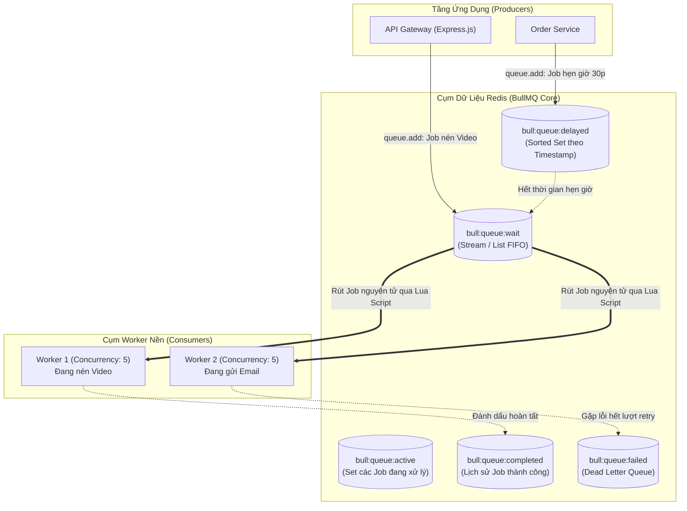

# BULLMQ DISTRIBUTED JOB QUEUE ARCHITECTURE & PRODUCTION ENGINEERING DEEP DIVE

> **Tài liệu lý thuyết chuyên sâu và hướng dẫn kiến trúc toàn diện về BullMQ (Redis-based Message & Job Queue for Node.js)**  
> Dành cho Software Engineer, Backend Developer và Hệ thống phân tán từ cấp độ Intern đến Middle-level và Tech Lead.

---

## 📑 MỤC LỤC
1. [Mức Độ Cơ Bản (Basic Fundamentals)](#1-mức-độ-cơ-bản-basic-fundamentals)
2. [Mức Độ Trung Bình (Intermediate - Architecture & Use Cases)](#2-mức-độ-trung-bình-intermediate---architecture--use-cases)
3. [Mức Độ Chuyên Sâu: BẢN CHẤT VẬN HÀNH (Under The Hood & Core Mechanics)](#3-mức-độ-chuyên-sâu-bản-chất-vận-hành-under-the-hood--core-mechanics)
4. [Mức Độ Nâng Cao: Vận Hành Thực Chiến (Production Engineering & Best Practices)](#4-mức-độ-nâng-cao-vận-hành-thực-chiến-production-engineering--best-practices)
5. [Góc Nhìn Thực Chiến Cho Middle-Level Trở Xuống (Must-Know vs Nice-to-Know Roadmap)](#5-góc-nhìn-thực-chiến-cho-middle-level-trở-xuống-must-know-vs-nice-to-know-roadmap)
6. [So Sánh Bản Chất (First-Principles Comparison)](#6-so-sánh-bản-chất-first-principles-comparison)
7. [Sơ Đồ Trực Quan (Mermaid Diagrams)](#7-sơ-đồ-trực-quan-mermaid-diagrams)
8. [Bảng Tra Thuật Ngữ Chi Tiết (Glossary)](#8-bảng-tra-thuật-ngữ-chi-tiết-glossary)
9. [Hướng Dẫn Chạy & Kiểm Thử Hệ Thống (Step-by-Step Run Guide)](#9-hướng-dẫn-chạy--kiểm-thử-hệ-thống-step-by-step-run-guide)

---

## 1. Mức Độ Cơ Bản (Basic Fundamentals)

### 1.1. Định nghĩa & Ẩn dụ đời thực (Real-world Analogy)
**BullMQ** là một thư viện hàng đợi công việc và thông điệp phân tán (Distributed Message & Job Queue) hiệu năng cực cao dành riêng cho nền tảng Node.js / TypeScript, hoạt động dựa trên cơ sở dữ liệu in-memory **Redis**.

```
+-----------------------------------------------------------------------------------+
|                        ẨN DỤ: QUẦY GỌI MÓN & BẾP TẠI NHÀ HÀNG FASTFOOD            |
|                                                                                   |
|  [KHÁCH HÀNG (CLIENT)]:                                                           |
|   - Đến quầy order một chiếc bánh Pizza nướng 20 phút (Heavy Job).                |
|   - Nhân viên thu ngân (Producer / API Gateway):                                  |
|     + KHÔNG bắt khách đứng chờ 20 phút tại quầy (Tránh nghẽn hàng).               |
|     + In một chiếc PHIẾU THỨ TỰ #42 (Job ID) đưa cho khách.                       |
|     + Đẩy đơn hàng vào BẢNG ĐƠN ĐANG CHỜ (Redis Queue).                           |
|     + Khách cầm phiếu đi về chỗ ngồi ung dung (HTTP 202 Accepted trong 5ms).      |
|                                                                                   |
|  [CỤM ĐẦU BẾP (WORKER PROCESSES)]:                                                |
|   - 4 đầu bếp ở phía sau (4 Workers) lần lượt rút từng phiếu order xuống nướng.   |
|   - Bánh nướng xong => Đổi trạng thái phiếu sang COMPLETED => Rung chuông báo     |
|     khách ra nhận bánh!                                                           |
+-----------------------------------------------------------------------------------+
```

- **Nếu không có BullMQ**: Người dùng bấm "Xuất báo cáo Excel 1 triệu dòng" $\rightarrow$ Backend Node.js thực thi đồng bộ $\rightarrow$ Event Loop bị khóa cứng $\rightarrow$ Toàn bộ website bị đơ không phục vụ được ai $\rightarrow$ Sau 60 giây, trình duyệt báo lỗi **HTTP 504 Gateway Timeout**.
- **Khi có BullMQ**: API nhận lệnh, đẩy Job vào hàng đợi trong **2 mili-giây** và trả ngay mã `jobId` cho khách hàng. Các tiến trình Worker chạy ngầm độc lập sẽ từ tốn tiêu thụ công việc mà không làm ảnh hưởng tới luồng người dùng web.

---

### 1.2. Vấn đề cốt lõi sinh ra công nghệ (Problem Statement)
Node.js sử dụng mô hình Single-Threaded Event Loop. Mặc dù xử lý các tác vụ I/O bất đồng bộ cực kỳ nhanh, nhưng Node.js lại rất sợ hai thứ:
1. **Tác vụ nặng về CPU (CPU-Intensive Tasks)**: Xử lý nén ảnh/video, tạo file PDF, mã hóa file, tính toán phân tích dữ liệu. Khi CPU chạy vòng lặp nặng, Event Loop bị dừng lại (Block), khiến mọi request HTTP khác của toàn bộ người dùng bị treo cứng.
2. **Tác vụ có độ trễ lớn (Long-Running Async Tasks)**: Gửi 50.000 email marketing, gọi webhook sang các đối tác bên ngoài, đồng bộ dữ liệu giữa các kho bãi.

**BullMQ ra đời để giải quyết triệt để vấn đề này**: Đưa toàn bộ các tác vụ tốn thời gian ra khỏi luồng xử lý HTTP Request chính, biến chúng thành các **Background Jobs** bất đồng bộ chạy trên cụm worker riêng biệt, hỗ trợ cơ chế tự động thử lại (Retry with Backoff), ưu tiên VIP (Priority), và hẹn giờ chạy sau (Delayed Jobs).

---

### 1.3. Vòng Đời Trạng Thái Của Job (Job State Machine)

```
[ THÊM JOB MỚI ]
       |
       +---> (Nếu có cấu hình delay) ---------> [ DELAYED ]
       |                                             |
       v                                             v (Hết thời gian hẹn giờ)
  [ WAITING ] <======================================+
       |
       v (Worker rút job về xử lý)
   [ ACTIVE ]
       |
       +---(Thành công)-----------------------> [ COMPLETED ]
       |
       +---(Gặp lỗi runtime)
             |
             +---> (Còn lượt thử lại) ---------> [ DELAYED / RETRY ]
             |                                       | (Quay lại sau backoff)
             |                                       v
             |                                  [ WAITING ]
             v
       (Hết số lần thử tối đa)
             |
             v
         [ FAILED ] (Chuyển vào Dead Letter Queue)
```

---

## 2. Mức Độ Trung Bình (Intermediate - Architecture & Use Cases)

### 2.1. Các thành phần cốt lõi của BullMQ

1. **`Queue` (Hàng Đợi - Phía Producer)**:
   - Dùng để đẩy công việc mới vào hàng đợi (`queue.add(jobName, jobData, options)`).
   - Thiết lập cấu hình chung: số lần retry, độ trễ, mức ưu tiên, dọn rác tự động.
2. **`Worker` (Người Tiêu Thụ - Phía Consumer)**:
   - Một tiến trình hoặc luồng chạy ngầm liên tục lắng nghe hàng đợi và thực thi hàm xử lý (`new Worker(queueName, async (job) => { ... })`).
   - Cấu hình thông số `concurrency` (số lượng job có thể xử lý song song trên 1 worker, ví dụ `concurrency: 5`).
3. **`QueueEvents` (Trạm Thu Phát Sự Kiện)**:
   - Sử dụng Redis Streams để lắng nghe các sự kiện thời gian thực của hàng đợi: `completed`, `failed`, `progress`, `stalled` mà không làm chậm tốc độ của Worker.
4. **`FlowProducer` (Luồng Công Việc Phức Tạp)**:
   - Cho phép tạo các chuỗi công việc phụ thuộc lẫn nhau (Job Parent-Child / DAG Workflow): Ví dụ Job "Gửi Email Thông Báo" chỉ được chạy sau khi Job "Tạo File PDF Hóa Đơn" đã hoàn tất thành công.

---

### 2.2. Khi nào NÊN dùng và KHÔNG NÊN dùng BullMQ

#### ✅ Khi nào NÊN dùng BullMQ (Best Use Cases)
1. **Xử lý nền các tác vụ nặng (Background Processing)**: Gửi email, SMS, push notification, convert video MP4 sang HLS/DASH, tạo thumbnail ảnh.
2. **Lên lịch tác vụ định kỳ (Cron Jobs / Scheduled Tasks)**: Tự động khóa các tài khoản hết hạn lúc 0h00 hàng ngày, quét đơn hàng chưa thanh toán sau 30 phút.
3. **Điều tiết lưu lượng bảo vệ bên thứ ba (Rate Limiting Jobs)**: Khi gọi API OpenAI hoặc Twilio có giới hạn $10\text{ calls/s}$, BullMQ có thể tự động kìm tốc độ của Worker để không bao giờ bị dính lỗi `429 Too Many Requests`.
4. **Hàng đợi có phân cấp ưu tiên (Priority Queue)**: Khách hàng gói VIP được xử lý trước khách hàng miễn phí dù vào hàng đợi sau.

#### ❌ Khi nào KHÔNG NÊN dùng BullMQ (What to Avoid)
1. **Hệ thống Streaming nhật ký khổng lồ (Event Sourcing / Log Streaming)**: Hàng triệu event mỗi giây như clickstream tracking, IoT sensor streaming. Lúc này hãy dùng **Apache Kafka** hoặc **AWS Kinesis**.
2. **Ứng dụng phi Node.js hoàn toàn**: Nếu backend của bạn viết bằng Java, Go, hoặc Python và không có kế hoạch dùng Node.js, hãy dùng **RabbitMQ** hoặc **Celery**.

---

## 3. Mức Độ Chuyên Sâu: BẢN CHẤT VẬN HÀNH (Under The Hood & Core Mechanics)

### 3.1. Cấu Trúc Dữ Liệu Redis Đằng Sau BullMQ
BullMQ không lưu trữ dữ liệu dưới dạng chuỗi JSON thô, mà tận dụng tối đa các cấu trúc dữ liệu nguyên thủy hiệu năng cao của Redis:

| Cấu Trúc Dữ Liệu Redis | Key Pattern trong Redis | Chức Năng Cốt Lõi |
| :--- | :--- | :--- |
| **Hash** | `bull:<queue>:<jobId>` | Lưu trữ toàn bộ thông tin chi tiết của Job: payload data, options, progress, stacktrace lỗi. |
| **Stream / List** | `bull:<queue>:wait` | Hàng đợi FIFO chứa danh sách các ID của những job đang chờ được xử lý. |
| **Sorted Set (ZSET)**| `bull:<queue>:delayed` | Chứa các Job hẹn giờ. **Score** chính là mốc thời gian Unix Epoch ($ms$) mà job sẽ được kích hoạt! |
| **Sorted Set (ZSET)**| `bull:<queue>:priority` | Chứa các Job có độ ưu tiên. **Score** là mức độ ưu tiên (Priority 1 xử lý trước Priority 10). |
| **Set** | `bull:<queue>:active` | Chứa ID các job đang được một Worker nào đó xử lý. |
| **Set** | `bull:<queue>:completed` | Chứa ID các job đã xử lý thành công. |
| **Set** | `bull:<queue>:failed` | Chứa ID các job đã thất bại sau khi hết số lần thử lại (Dead Letter Queue). |

---

### 3.2. Tính Nguyên Tử Tuyệt Đối Bằng Redis Lua Scripts
Khi có **50 Worker processes** chạy song song cùng rút công việc từ 1 hàng đợi, làm sao đảm bảo một Job chỉ được xử lý bởi **ĐÚNG 1 WORKER DUY NHẤT** mà không bị Race Condition?

```
CƠ CHẾ RÚT JOB NGUYÊN TỬ QUA REDIS LUA SCRIPT:

Worker gửi lệnh gọi LUA SCRIPT tới Redis:
  ├── 1. Lấy jobId từ đầu danh sách `wait` (RPOPLPUSH).
  ├── 2. Di chuyển jobId đó sang tập hợp `active`.
  ├── 3. Tạo một Khóa Khóa (Lock Key) gán cho Worker ID đó với thời hạn 30s.
  └── 4. Trả dữ liệu Job về cho Worker.

TOÀN BỘ 4 THAO TÁC TRÊN ĐƯỢC REDIS THỰC THI TRONG 1 SINGLE ATOMIC TRANSACTION!
Không có bất kỳ Worker nào khác có thể xen ngang ở giữa!
=> Loại bỏ 100% nguy cơ trùng lặp xử lý (Duplicate Execution).
```

---

### 3.3. Cơ Chế Nhịp Tim Khóa Job (Job Lock & Stalled Jobs Auto-Recovery)
Điều gì xảy ra nếu một Worker đang xử lý Job giữa chừng thì máy chủ bị mất điện, hoặc tiến trình Node.js bị lỗi `Out of Memory (OOM)` đột tử?

- Nếu không có cơ chế bảo vệ, Job đó sẽ mãi mãi bị kẹt ở trạng thái `ACTIVE` và không bao giờ được hoàn thành!
- **Giải pháp của BullMQ**:
  1. Khi nhận Job, Worker được cấp một **Job Lock** có thời hạn (mặc định là `30000ms`).
  2. Trong khi thực thi công việc, Worker định kỳ gửi tín hiệu nhịp tim (**Lock Heartbeat**) để gia hạn thêm thời gian sống cho Lock.
  3. Nếu Worker đột tử, nhịp tim ngừng gửi $\rightarrow$ Khóa Lock tự động hết hạn (TTL Expired).
  4. Một Worker khác trong cụm định kỳ kiểm tra các Job bị treo (**Stalled Job Checker**) sẽ phát hiện ra Job này mất khóa. Nó sẽ tự động đưa Job đó quay trở lại hàng đợi `WAITING` để một worker khỏe mạnh khác tiếp tục xử lý!

---

## 4. Mức Độ Nâng Cao: Vận Hành Thực Chiến (Production Engineering & Best Practices)

### 4.1. Code Mẫu Khởi Tạo Producer & Worker Chuẩn Enterprise

```javascript
const { Queue, Worker, QueueEvents } = require('bullmq');

const connection = {
  host: process.env.REDIS_HOST || 'localhost',
  port: parseInt(process.env.REDIS_PORT || '6379', 10)
};

// ------------------------------------------------------------------------------
// 1. PRODUCER: KHỞI TẠO HÀNG ĐỢI VÀ CẤU HÌNH DỌN RÁC (MEMORY CLEANUP)
// ------------------------------------------------------------------------------
const emailQueue = new Queue('email-delivery-queue', {
  connection,
  defaultJobOptions: {
    // Tự động thử lại 3 lần với khoảng cách tăng theo hàm mũ nếu gặp lỗi
    attempts: 3,
    backoff: {
      type: 'exponential',
      delay: 1000 // 1s, 2s, 4s...
    },
    // BẮT BUỘC TRONG PRODUCTION: Dọn dẹp Job cũ để tránh làm đầy 100% RAM Redis!
    removeOnComplete: { count: 1000 }, // Chỉ giữ lại 1000 job thành công gần nhất
    removeOnFail: { count: 5000 }      // Giữ lại 5000 job lỗi phục vụ việc điều tra lỗi
  }
});

// ------------------------------------------------------------------------------
// 2. CONSUMER: WORKER XỬ LÝ NỀN SONG SONG (CONCURRENCY & RATE LIMIT)
// ------------------------------------------------------------------------------
const emailWorker = new Worker(
  'email-delivery-queue',
  async (job) => {
    console.log(`[Worker] Bắt đầu xử lý Job #${job.id}: Gửi email tới ${job.data.to}`);

    // Báo cáo tiến độ thời gian thực (0% -> 100%)
    await job.updateProgress(25);

    // Nghiệp vụ gửi mail thực tế...
    if (job.data.forceError) {
      throw new Error('SMTP Server Timeout 504!');
    }

    await job.updateProgress(100);
    return { status: 'SENT', deliveredAt: new Date().toISOString() };
  },
  {
    connection,
    concurrency: 5, // Mỗi tiến trình xử lý song song tối đa 5 jobs
    limiter: {
      max: 10,       // Giới hạn tối đa 10 jobs
      duration: 1000 // trong mỗi 1000ms (Bảo vệ API tránh bị rate limit)
    }
  }
);

// ------------------------------------------------------------------------------
// 3. GRACEFUL SHUTDOWN KHI SERVER DỪNG
// ------------------------------------------------------------------------------
const gracefulShutdown = async () => {
  console.log('Đang chờ Worker hoàn tất các Active Jobs dở dang...');
  await emailWorker.close(); // Chờ xử lý xong job hiện tại trước khi thoát
  await emailQueue.close();
  process.exit(0);
};

process.on('SIGTERM', gracefulShutdown);
process.on('SIGINT', gracefulShutdown);
```

---

### 4.2. Anti-patterns & Sai lầm Kinh Điển khi Dùng BullMQ

#### ❌ Sai lầm 1: Nhét Payload File Nhị Phân Lớn Vào Job Data
- **Hiện tượng**: Bơm Buffer ảnh/video $50\text{MB}$ vào `queue.add('process-video', { fileBuffer })`. Sau vài giờ, Redis sập hoàn toàn vì hết RAM (`OOM command not allowed`).
- **Nguyên nhân**: Redis là cơ sở dữ liệu in-memory lưu trữ trên RAM đắt đỏ. Nhét dữ liệu nhị phân lớn vào Redis làm nghẽn băng thông mạng và phình to bộ nhớ.
- **Khắc phục**: Upload file lên Cloud Storage (S3, MinIO, GCS) trước, chỉ truyền **URL hoặc S3 Key** ngắn gọn vào Job Data.

#### ❌ Sai lầm 2: Quên Cấu Hình `removeOnComplete` và `removeOnFail`
- **Hiện tượng**: Hệ thống chạy mượt mà 3 tháng, đột ngột Redis phình lên $10\text{GB}$ RAM và crash.
- **Nguyên nhân**: Mặc định nếu không cấu hình, BullMQ sẽ lưu vĩnh viễn toàn bộ các Job đã hoàn thành trong quá khứ.
- **Khắc phục**: Luôn đặt `{ removeOnComplete: { count: 1000 }, removeOnFail: { count: 5000 } }`.

---

## 5. Góc Nhìn Thực Chiến Cho Middle-Level Trở Xuống (Must-Know vs Nice-to-Know Roadmap)

```
+------------------------------------------------------------------------------------+
|               LỘ TRÌNH KỸ NĂNG BULLMQ: PHÂN CẤP TỪ JUNIOR ĐẾN SENIOR               |
|                                                                                    |
|  [INTERN / JUNIOR] (80/20 - Sử dụng thực chiến)                                    |
|   ├── Hiểu tại sao cần Queue để tách rời tác vụ nặng ra khỏi HTTP Request          |
|   ├── Khởi tạo Queue (Producer) và đẩy Job (`queue.add`)                            |
|   ├── Viết Worker (Consumer) nhận Job và thực thi logic nghiệp vụ                  |
|   ├── Cấu hình số lần thử lại cơ bản (`attempts: 3, backoff: 'exponential'`)       |
|   └── Lắng nghe các sự kiện `completed` và `failed` để debug lỗi                   |
|                                                                                    |
|  ============================== Ranh giới Middle ===============================   |
|                                                                                    |
|  [MIDDLE-LEVEL] (Tối ưu hóa hiệu năng, Bảo vệ tài nguyên & Chịu tải)               |
|   ├── Cấu hình dọn rác tự động (`removeOnComplete`, `removeOnFail`) bảo vệ RAM     |
|   ├── Tinh chỉnh `concurrency` phù hợp với số nhân CPU và I/O                      |
|   ├── Thiết lập Rate Limiter ở tầng Worker để bảo vệ các API bên thứ ba            |
|   ├── Phân cấp ưu tiên Job (Priority Jobs: VIP vs Standard)                        |
|   ├── Cấu hình Graceful Shutdown (`worker.close()`) tránh mất mát dữ liệu          |
|   └── Cập nhật tiến độ thời gian thực (`job.updateProgress`) cho Frontend          |
|                                                                                    |
|  ============================== Ranh giới Senior / Architect ===================   |
|                                                                                    |
|  [SENIOR / ARCHITECT] (Tạm thời bỏ qua nếu ở mức Middle trở xuống)                 |
|   ├── Xây dựng luồng công việc phức tạp dạng đồ thị (FlowProducer DAG Workflows)   |
|   ├── Tối ưu hóa Redis Memory Fragmentation Ratio và Redis Persistence (RDB/AOF)   |
|   ├── Lập trình custom Redis Lua Script mở rộng tính năng của BullMQ Core          |
|   └── Tách cụm Redis Cluster chuyên biệt phân tách theo Hash Slot cho Queue        |
+------------------------------------------------------------------------------------+
```

---

### 5.1. Chi Tiết Đáp Án & Kỹ Thuật Thực Chiến Cho Cấp Độ [INTERN / JUNIOR]

#### 1. Hiểu tại sao cần Queue để tách rời tác vụ nặng ra khỏi HTTP Request
- **Vấn đề thực tế:** Khi user bấm "Đặt hàng", nếu server phải gửi email, nén PDF hóa đơn, gọi webhook sang đối tác giao vận ngay trong HTTP Request, client sẽ phải đợi 5-10 giây (hoặc bị Gateway Timeout 504).
- **Đáp án & Bản chất:** Tách biệt đồng bộ và bất đồng bộ. HTTP Request chỉ làm nhiệm vụ ghi đơn hàng và đẩy task vào Queue trong 5ms rồi phản hồi 200 OK ngay cho người dùng. Các tác vụ nặng để Worker ở background xử lý dần.

#### 2. Khởi tạo Queue (Producer) và đẩy Job (`queue.add`)
- **Đáp án & Code chuẩn:**
```typescript
import { Queue } from 'bullmq';

const emailQueue = new Queue('email-queue', {
  connection: { host: 'localhost', port: 6379 },
});

// Đẩy job vào hàng đợi
await emailQueue.add('send-welcome-email', {
  userId: 'user_123',
  email: 'customer@example.com',
  template: 'WELCOME',
});
```

#### 3. Viết Worker (Consumer) nhận Job và thực thi logic nghiệp vụ
- **Đáp án & Code chuẩn:**
```typescript
import { Worker } from 'bullmq';

const emailWorker = new Worker(
  'email-queue',
  async (job) => {
    console.log(`Đang xử lý job ${job.id} cho email: ${job.data.email}`);
    // Thực thi gửi email qua SMTP/SendGrid
    await sendEmailService(job.data);
    return { sentAt: new Date().toISOString() };
  },
  { connection: { host: 'localhost', port: 6379 } }
);
```

#### 4. Cấu hình số lần thử lại cơ bản (`attempts: 3, backoff: 'exponential'`)
- **Vấn đề thực tế:** Dịch vụ gửi mail hoặc webhook đối tác thỉnh thoảng chập chờn. Không có retry thì job chết ngay lần đầu.
- **Đáp án & Code chuẩn:**
```typescript
await emailQueue.add('send-invoice', invoiceData, {
  attempts: 3, // Thử lại tối đa 3 lần
  backoff: {
    type: 'exponential',
    delay: 2000, // Lần 1: 2s, Lần 2: 4s, Lần 3: 8s
  },
});
```

#### 5. Lắng nghe các sự kiện `completed` và `failed` để debug lỗi
- **Đáp án & Code chuẩn:**
```typescript
emailWorker.on('completed', (job) => {
  console.log(`Job ${job.id} đã hoàn tất thành công!`);
});

emailWorker.on('failed', (job, err) => {
  console.error(`Job ${job?.id} thất bại sau ${job?.attemptsMade} lần thử:`, err.message);
});
```

---

### 5.2. Chi Tiết Đáp Án & Kỹ Thuật Thực Chiến Cho Cấp Độ [MIDDLE-LEVEL]

#### 1. Cấu hình dọn rác tự động (`removeOnComplete`, `removeOnFail`) bảo vệ RAM
- **Vấn đề thực tế:** Mặc định BullMQ lưu lại toàn bộ dữ liệu của các job đã hoàn thành trên Redis để phục vụ tra cứu. Nếu mỗi ngày có 1 triệu job, Redis sẽ nhanh chóng cạn kiệt RAM và sập hệ thống (OOM).
- **Đáp án & Code chuẩn:**
```typescript
await emailQueue.add('report-task', data, {
  removeOnComplete: {
    age: 3600, // Tự xóa sau 1 giờ
    count: 1000, // Hoặc chỉ giữ tối đa 1000 job gần nhất
  },
  removeOnFail: {
    age: 86400 * 7, // Job lỗi giữ lại 7 ngày để dev điều tra bug
  },
});
```

#### 2. Tinh chỉnh `concurrency` phù hợp với số nhân CPU và I/O
- **Vấn đề thực tế:** Mặc định `concurrency = 1`, Worker chỉ xử lý từng job một, lãng phí tài nguyên máy chủ.
- **Đáp án & Công thức chuẩn:**
  - Nếu tác vụ **ngốn CPU** (Render video, Resize ảnh): `concurrency = số nhân CPU` (ví dụ 4 hoặc 8).
  - Nếu tác vụ **chờ I/O mạng** (Gửi HTTP request, gọi AI API, gửi email): `concurrency = 20 - 50` để tận dụng thời gian chờ phản hồi.
```typescript
const worker = new Worker('io-queue', processor, { concurrency: 25, connection });
```

#### 3. Thiết lập Rate Limiter ở tầng Worker để bảo vệ các API bên thứ ba
- **Vấn đề thực tế:** Bên thứ 3 (Telegram Bot API, Viettel Post) giới hạn tối đa 30 requests/giây. Nếu worker xả hàng ngàn job cùng lúc, bạn sẽ bị khóa tài khoản API (429 Ban).
- **Đáp án & Code chuẩn:**
```typescript
const worker = new Worker('third-party-queue', processor, {
  limiter: {
    max: 30, // Tối đa 30 job
    duration: 1000, // Trong vòng 1000ms
  },
  connection,
});
```

#### 4. Phân cấp ưu tiên Job (Priority Jobs: VIP vs Standard)
- **Vấn đề thực tế:** Người dùng trả phí (VIP) rút tiền cần được xử lý ngay lập tức, không thể xếp sau 50,000 job gửi mail quảng cáo của người dùng miễn phí.
- **Đáp án & Code chuẩn:**
```typescript
// Trong BullMQ, số priority CÀNG NHỎ THÌ ĐỘ ƯU TIÊN CÀNG CAO (1 là cao nhất)
await paymentQueue.add('withdraw-vip', vipData, { priority: 1 });
await paymentQueue.add('withdraw-standard', normalData, { priority: 10 });
```

#### 5. Cấu hình Graceful Shutdown (`worker.close()`) tránh mất mát dữ liệu
- **Vấn đề thực tế:** Khi triển khai code mới (Deploy / Restart container), nếu dùng `process.exit(0)` đột ngột, các job đang xử lý dở dang sẽ bị đứt gãy, dẫn đến dữ liệu nửa vời.
- **Đáp án & Code chuẩn:**
```typescript
process.on('SIGTERM', async () => {
  console.log('Đang chờ các Job hiện tại hoàn tất trước khi tắt server...');
  await emailWorker.close(); // Đợi job đang chạy xong, từ chối nhận job mới
  await emailQueue.close();
  process.exit(0);
});
```

#### 6. Cập nhật tiến độ thời gian thực (`job.updateProgress`) cho Frontend
- **Đáp án & Code chuẩn:**
```typescript
// Trong worker:
await job.updateProgress(25); // 25%
await job.updateProgress(100); // 100%

// Frontend / Client lắng nghe qua QueueEvents hoặc WebSocket:
const queueEvents = new QueueEvents('export-queue', { connection });
queueEvents.on('progress', ({ jobId, data }) => {
  console.log(`Tiến độ Job ${jobId}: ${data}%`);
});
```

---

### 5.3. Chi Tiết Kỹ Thuật Cho Cấp Độ [SENIOR / ARCHITECT] (Mở Rộng)

#### 1. Xây dựng luồng công việc phức tạp dạng đồ thị (FlowProducer DAG Workflows)
- **Bản chất:** Sử dụng `FlowProducer` để định nghĩa đồ thị có hướng không chu trình (DAG): Job C chỉ được chạy sau khi cả Job A và Job B hoàn thành; kết quả của A và B tự động được truyền làm input cho C.

#### 2. Tối ưu hóa Redis Memory Fragmentation Ratio và Persistence (RDB/AOF)
- **Bản chất:** Queue có đặc thù ghi/xóa liên tục làm tăng phân mảnh RAM trong Redis. Senior cần tắt AOF rewrite không cần thiết hoặc tinh chỉnh `active-defrag-ignore-bytes`, tách riêng Redis Queue khỏi Redis Cache dữ liệu.

#### 3. Lập trình custom Redis Lua Script mở rộng tính năng của BullMQ Core
- **Bản chất:** Can thiệp trực tiếp vào mã Lua Script của BullMQ để tùy biến cơ chế khóa nguyên tử, chia sẻ token bucket đa cụm hoặc custom thuật toán chọn job.

#### 4. Tách cụm Redis Cluster chuyên biệt phân tách theo Hash Slot cho Queue
- **Bản chất:** BullMQ yêu cầu tất cả key của cùng một Queue phải nằm trên cùng một Hash Slot trong Redis Cluster bằng cách dùng curly brackets `{queue-name}` để đảm bảo tính toàn vẹn của các giao dịch Multi/Exec và Lua Script.

---

### 5.4. Bộ Câu Hỏi Phỏng Vấn Kinh Điển (Top Interview Questions)

#### Câu 1: Tại sao chúng ta nên sử dụng BullMQ thay vì thực thi các tác vụ bất đồng bộ bằng `setTimeout` hoặc `Promise` thông thường trong Node.js?
> **Trả lời mẫu ghi điểm**:  
> "Nếu sử dụng `setTimeout` hoặc `Promise` trong bộ nhớ của Node.js:  
> 1. Khi máy chủ hoặc container bị khởi động lại (restart/deploy), toàn bộ các tác vụ đang chờ trong RAM sẽ bị bốc hơi hoàn toàn và mất trắng dữ liệu.  
> 2. Không có cơ chế tự động thử lại (Retry with Exponential Backoff) khi gặp lỗi mạng.  
> 3. Không thể mở rộng quy mô (Scale Out) nhiều worker trên các máy chủ khác nhau để chia sẻ tải.  
> BullMQ lưu trữ trạng thái hàng đợi trên cơ sở dữ liệu phân tán Redis bền vững. Ngay cả khi server bị crash, các Job vẫn nằm an toàn trên Redis để các worker khác tiếp tục xử lý. Ngoài ra, BullMQ còn cung cấp đầy đủ các tính năng enterprise như quản lý tiến độ, độ ưu tiên, khóa job chống trùng lặp và giới hạn tốc độ xử lý."

#### Câu 2: BullMQ giải quyết bài toán chống trùng lặp xử lý (Double Processing) khi có hàng chục Worker chạy đồng thời như thế nào?
> **Trả lời mẫu ghi điểm**:  
> "BullMQ sử dụng **Redis Lua Scripts** để thực hiện việc chuyển đổi trạng thái của Job từ hàng đợi `wait` sang `active` và cấp quyền sở hữu (Job Lock) cho Worker. Vì Redis là kiến trúc đơn luồng (Single-threaded) và Lua scripts được thực thi hoàn toàn nguyên tử (Atomic transaction), tại một thời điểm chỉ có duy nhất 1 Worker có thể rút thành công một Job cụ thể. Sau khi rút, Job đó lập tức được chuyển sang tập hợp `active` và gắn khóa Lock, ngăn chặn tuyệt đối các Worker khác nhìn thấy và xử lý lại Job đó."

#### Câu 3: Làm thế nào để bảo vệ bộ nhớ RAM của Redis không bị tràn khi ứng dụng chạy hàng triệu Jobs mỗi ngày với BullMQ?
> **Trả lời mẫu ghi điểm**:  
> "Ta áp dụng 2 nguyên tắc sống còn:  
> 1. **Cấu hình tự động dọn rác**: Luôn thiết lập các tùy chọn `removeOnComplete` và `removeOnFail` trong `defaultJobOptions` (ví dụ chỉ giữ lại 1.000 job thành công và 5.000 job thất bại gần nhất). Điều này ngăn chặn việc Redis tích tụ hàng triệu bản ghi lịch sử không cần thiết.  
> 2. **Không lưu trữ Payload lớn trong Redis**: Tuyệt đối không lưu dữ liệu file nhị phân (như buffer hình ảnh, video, dữ liệu raw) vào Job data. Thay vào đó, ta lưu trữ file trên Cloud Storage (S3/GCS) và chỉ lưu trữ đường link định danh (S3 Key) ngắn gọn vài chục bytes trong Job Data của BullMQ."

---

## 6. So Sánh Bản Chất (First-Principles Comparison)

| Tiêu Chí | **BullMQ** | **RabbitMQ** | **Apache Kafka** | **Agenda (MongoDB)** |
| :--- | :--- | :--- | :--- | :--- |
| **Hạ tầng lưu trữ** | **Redis (In-Memory)** | Erlang Mnesia / Đĩa | **Commit Log phân tán (Disk)** | MongoDB Collection |
| **Tốc độ / Thông lượng**| **Cực nhanh** (hàng chục ngàn jobs/s)| Rất cao | **Khổng lồ** (hàng triệu msgs/s)| Trung bình / Chậm |
| **Mô hình kiến trúc** | **Job Queue (Work Distribution)** | Message Broker (AMQP) | Event Streaming Log | Job Queue (Database polling) |
| **Tính năng Job** | Đầy đủ (Delayed, Retry, Priority)| Cần plugin cấu hình | Phức tạp (Cần build trên stream) | Đầy đủ |
| **Độ phức tạp vận hành**| **Rất thấp** (Chỉ cần 1 cụm Redis) | Trung bình | Rất cao (Cần Zookeeper/KRaft) | Rất thấp |
| **Môi trường phù hợp nhất**| **Hệ sinh thái Node.js / TypeScript** | Đa ngôn ngữ (Polyglot enterprise)| Dữ liệu lớn, Data Lake, Event Sourcing| Dự án nhỏ đã dùng sẵn MongoDB |

---

## 7. Sơ Đồ Trực Quan (Mermaid Diagrams)

### 7.1. Sơ đồ Kiến Trúc Producer - Redis Data Store - Worker Fleet


---

## 8. Bảng Tra Thuật Ngữ Chi Tiết (Glossary)

| Thuật Ngữ | Tên Tiếng Anh | Định Nghĩa & Ý Nghĩa Thực Tiễn |
| :--- | :--- | :--- |
| **Job Queue** | Job Queue | Hàng đợi chứa các đơn vị công việc cần được xử lý bất đồng bộ trong nền tảng phân tán. |
| **Producer** | Producer | Thành phần tạo ra và đẩy các công việc vào hàng đợi (thường là API web server). |
| **Consumer / Worker** | Consumer / Worker | Tiến trình chạy nền chuyên rút và thực thi các công việc từ hàng đợi. |
| **Concurrency** | Concurrency | Số lượng công việc tối đa mà một Worker có thể thực thi đồng thời song song tại một thời điểm. |
| **Delayed Job** | Delayed / Scheduled Job | Công việc được cấu hình để chỉ bắt đầu thực thi sau một khoảng thời gian chờ nhất định hoặc tại một mốc giờ cụ thể. |
| **Job Lock** | Job Lock | Khóa loại trừ tương hỗ đảm bảo một công việc chỉ thuộc quyền sở hữu của một Worker duy nhất tại một thời điểm. |
| **Stalled Job** | Stalled Job | Công việc đang ở trạng thái active nhưng Worker xử lý nó bị chết đột ngột và mất liên lạc. |
| **Dead Letter Queue** | Dead Letter Queue (DLQ) | Nơi lưu trữ các công việc đã bị thất bại hoàn toàn sau khi đã thử lại hết số lần tối đa để phục vụ điều tra lỗi. |

---

## 9. Hướng Dẫn Chạy & Kiểm Thử Hệ Thống (Step-by-Step Run Guide)

### 9.1. Cấu trúc thư mục Dự Án Demo
Dự án demo BullMQ bao gồm:
- **Hạ tầng (`docker-compose.yml`)**: Khởi chạy Redis 7.2 + Backend Node.js (tích hợp Producer Queue, Worker xử lý nền, QueueEvents) + Frontend Console (React/Vite).
- **Backend Service (`backend/`)**: Mô phỏng các nghiệp vụ nặng thực tế:
  - Job nén Video giả lập (xử lý trong 3 giây, cập nhật tiến độ 0% $\rightarrow$ 100%).
  - Job có độ ưu tiên VIP (Priority 1).
  - Job cố tình gây lỗi để kiểm chứng cơ chế Tự động thử lại (Retry with Backoff) và chuyển vào Dead Letter Queue.
- **Frontend Dashboard (React/Vite)**: Giao diện trực quan hóa các trạng thái Job (Waiting, Active, Completed, Failed), thanh tiến độ thời gian thực và log stream.

### 9.2. Lệnh Khởi Chạy
Mở terminal tại thư mục dự án:

```bash
# 1. Di chuyển vào thư mục BullMQ
cd /Users/ductri0981/Documents/Studying-Software/Web_And_Technologies/bullmq

# 2. Khởi chạy toàn bộ hệ thống bằng Docker Compose
docker compose up -d --build
```

Sau khi khởi chạy:
- **Frontend BullMQ Console**: Truy cập `http://localhost:5180`.
- **Backend API**: `http://localhost:4002/api/jobs`.

---

### 9.3. Kịch Bản Kiểm Thử Thực Tế Trên Giao Diện

#### Kịch Bản 1: Kiểm Chứng Tác Vụ Nền Bất Đồng Bộ & Cập Nhật Tiến Độ (0% $\rightarrow$ 100%)
1. Nhấn nút **"Tạo 1 Job Nén Video (Xử lý 3s)"**:
   - API phản hồi ngay lập tức trong **vài mili-giây** kèm mã `jobId`.
   - Quan sát trên giao diện: Job lập tức chuyển vào cột **ACTIVE**.
   - Thanh tiến độ (Progress bar) tăng dần từ $0\% \rightarrow 30\% \rightarrow 70\% \rightarrow 100\%$.
   - Khi hoàn tất, Job tự động nhảy sang cột **COMPLETED**!

#### Kịch Bản 2: Kiểm Chứng Hàng Đợi Ưu Tiên (VIP Priority Queue)
1. Nhấn nút **"Tạo 5 Jobs Tiêu Chuẩn (Standard Priority)"** liên tiếp.
2. Ngay lập tức nhấn nút **"Tạo 1 Job VIP (High Priority 1)"**:
   - Quan sát hàng đợi: Dù Job VIP được thêm vào sau, Worker vẫn **rút Job VIP ra xử lý trước** các Job Tiêu Chuẩn đang chờ!

#### Kịch Bản 3: Kiểm Chứng Tự Động Thử Lại & Dead Letter Queue (Auto-Retry)
1. Nhấn nút **"Tạo Job Cố Tình Gặp Lỗi (Failure Test)"**:
   - Lần 1: Worker gặp lỗi $\rightarrow$ Chuyển sang trạng thái RETRY chờ 1 giây.
   - Lần 2: Thử lại thất bại $\rightarrow$ Chờ 2 giây.
   - Lần 3: Thử lại thất bại $\rightarrow$ Hết số lần thử tối đa.
   - Job chính thức được đưa vào cột **FAILED (Dead Letter Queue)** kèm toàn bộ Stacktrace lỗi chi tiết!
