# HTTP COOKIES ARCHITECTURE & SECURITY DEEP DIVE

> **Tài liệu lý thuyết chuyên sâu và hướng dẫn kiến trúc toàn diện về HTTP Cookie & Quản Lý Trạng Thái Web (RFC 6265bis)**  
> Dành cho Software Engineer, Full-Stack Developer và Security Engineer từ cấp độ Intern đến Middle-level và Tech Lead.

---

## 📑 MỤC LỤC
1. [Mức Độ Cơ Bản (Basic Fundamentals)](#1-mức-độ-cơ-bản-basic-fundamentals)
2. [Mức Độ Trung Bình (Intermediate - Architecture & Use Cases)](#2-mức-độ-trung-bình-intermediate---architecture--use-cases)
3. [Mức Độ Chuyên Sâu: BẢN CHẤT VẬN HÀNH (Under The Hood & Core Mechanics)](#3-mức-độ-chuyên-sâu-bản-chất-vận-hành-under-the-hood--core-mechanics)
4. [Mức Độ Nâng Cao: Vận Hành Thực Chiến (Production Engineering & Best Practices)](#4-mức-độ-nâng-cao-vận-hành-thực-chiến-production-engineering--best-practices)
5. [Góc Nhìn Thực Chiến Cho Middle-Level Trở Xuống (Must-Know vs Nice-to-Know Roadmap)](#5-góc-nhìn-thực-chiến-cho-middle-level-trở-xuống-must-know-vs-nice-to-know-roadmap)
6. [So Sánh Bản Chất (First-Principles Comparison)](#6-so-sánh-bản-chất-first-principles-comparison)
7. [Sơ Đồ Trực Quan (Mermaid Diagrams)](#7-sơ-đồ-trực-quan-mermaid-diagrams)
8. [Bảng Tra Thuật Ngữ Chi Tiết (Glossary)](#8-bảng-tra-thuật-ngữ-chi-tiết-glossary)
9. [Hướng Dẫn Chạy & Kiểm Thử Hệ Thống (Step-by-Step Run Guide)](#9-hướng-dẫn-chạy--kiểm-thử-hệ-thống-step-by-step-run-guide)

---

## 1. Mức Độ Cơ Bản (Basic Fundamentals)

### 1.1. Định nghĩa & Ẩn dụ đời thực (Real-world Analogy)
**HTTP Cookie** (hay Web Cookie) là một mẩu dữ liệu nhỏ (tối đa $4\text{KB}$) do Máy chủ (Server) khởi tạo và gửi về cho Trình duyệt (Browser) của người dùng thông qua Header phản hồi `Set-Cookie`. Trình duyệt sẽ lưu mẩu dữ liệu này vào bộ nhớ lưu trữ an toàn (Cookie Jar) và **tự động đính kèm** vào Header `Cookie` của mọi HTTP Request tiếp theo gửi tới cùng tên miền đó.

```
+-----------------------------------------------------------------------------------+
|                        ẨN DỤ: CHIẾC VÒNG ĐEO TAY BUFFET TẠI RESORT                |
|                                                                                   |
|  [KHÁCH VÀO RESORT] ----> [QUẦY LỄ TÂN (SERVER)]                                  |
|                                  |                                                |
|                                  +---> 1. Khách xuất trình CCCD (Login).          |
|                                  +---> 2. Lễ tân phát một CHIẾC VÒNG ĐEO TAY      |
|                                  |        bằng nhựa có dán mã vạch bí mật         |
|                                  |        (HTTP Response: Set-Cookie sessionId).  |
|                                                                                   |
|  [ĐI ĂN TẠI TẤT CẢ CÁC NHÀ HÀNG TRONG RESORT (CÁC REQUEST TIẾP THEO)]:            |
|   - Bạn không cần khai lại họ tên hay CCCD.                                       |
|   - Bạn chỉ cần giơ cổ tay có chiếc vòng ra (Browser tự gửi Header Cookie).       |
|   - Đầu bếp quét mã vạch trên vòng và biết ngay bạn đã trả tiền (Authenticated)!  |
|   - Khi hết hạn 3 ngày (Max-Age), bảo vệ cắt vòng (Cookie Expired).               |
+-----------------------------------------------------------------------------------+
```

- **Nếu không có Cookie**: Giao thức HTTP là **Phi trạng thái (Stateless)**. Mỗi khi bạn bấm chuyển trang hoặc nhấn nút "Thêm vào giỏ hàng", máy chủ hoàn toàn không biết bạn là ai và sẽ bắt bạn đăng nhập lại từ đầu.
- **Khi có Cookie**: Trình duyệt đóng vai trò như một người trợ lý trung thành, tự động đưa chiếc thẻ căn cước (Session ID / Token) vào mỗi gói tin gửi đi, duy trì phiên làm việc liên tục và mượt mà.

---

### 1.2. Vấn đề cốt lõi sinh ra công nghệ (Problem Statement)
Năm 1994, lập trình viên **Lou Montulli** tại Netscape phát minh ra Cookie khi xây dựng giỏ hàng cho trang web thương mại điện tử đầu tiên của hãng MCI.
Vào thời điểm đó:
- Giao thức HTTP không có bất kỳ cơ chế ghi nhớ trạng thái nào giữa các kết nối TCP độc lập.
- Việc lưu trữ trạng thái người dùng bằng cách nối thêm tham số vào URL (ví dụ: `https://shop.com/cart?user_id=12345`) dẫn đến thảm họa bảo mật: Người dùng chia sẻ link cho bạn bè sẽ vô tình chia sẻ luôn tài khoản của mình, và URL bị lưu lại trong lịch sử duyệt web và file log của proxy trung gian.
- **Cookie ra đời để tạo ra một cơ chế quản trị phiên độc lập**: Dữ liệu nằm trong HTTP Header, được trình duyệt quản lý cách ly theo từng tên miền (Same-Origin Policy), có cơ chế phân quyền bảo mật và tự động hết hạn.

---

### 1.3. Kiến trúc tổng quan mức High-Level

```
[ BROWSER CLIENT ]                                       [ BACKEND SERVER ]
        |                                                        |
        |--- 1. POST /api/login (username/password) ------------>|
        |                                                        | (Xác thực thành công)
        |                                                        | (Tạo sessionId bí mật)
        |<-- 2. HTTP 200 OK -------------------------------------|
        |       Set-Cookie: sid=abc123xyz; Path=/;               |
        |                   HttpOnly; Secure; SameSite=Strict    |
        |                                                        |
  [ Lưu vào Cookie Jar ]                                         |
        |                                                        |
        |--- 3. GET /api/user/profile -------------------------->|
        |       Cookie: sid=abc123xyz                            | (Đọc sid, truy vấn DB)
        |<-- 4. HTTP 200 OK (Profile Data) ----------------------|
```

---

## 2. Mức Độ Trung Bình (Intermediate - Architecture & Use Cases)

### 2.1. 4 Cờ Bảo Mật "Sống Còn" của HTTP Cookie
Khi cấu hình Cookie trong Backend (Node.js/Express, Spring Boot, Go...), việc chỉ thiết lập `name` và `value` là một lỗ hổng bảo mật nghiêm trọng. Bạn bắt buộc phải nắm vững 4 chỉ thị sau:

```javascript
res.cookie('session_token', 'secret_value_123', {
  httpOnly: true,             // 1. Chống XSS (Cross-Site Scripting)
  secure: true,               // 2. Chống nghe lén mạng (MITM)
  sameSite: 'strict',         // 3. Chống CSRF (Cross-Site Request Forgery)
  maxAge: 7 * 24 * 3600 * 1000 // 4. Tuổi thọ cookie (7 ngày)
});
```

1. **`httpOnly: true` (Lá chắn chống XSS)**:
   - **Tác dụng**: Ngăn chặn hoàn toàn mã JavaScript phía Client (như lệnh `document.cookie`) đọc hoặc ghi đè cookie này.
   - **Mục đích**: Nếu ứng dụng của bạn dính lỗ hổng XSS (hacker chèn được script độc hại vào website), hacker cũng **không thể** đánh cắp được token đăng nhập lưu trong cookie.
2. **`secure: true` (Lá chắn chống nghe lén)**:
   - **Tác dụng**: Yêu cầu trình duyệt **chỉ gửi** cookie này qua các kết nối đã được mã hóa **HTTPS**. Không bao giờ gửi qua HTTP không mã hóa.
   - **Mục đích**: Phòng chống tấn công Man-in-the-Middle (nghe lén gói tin trên mạng Wi-Fi công cộng).
3. **`sameSite: 'Strict' | 'Lax' | 'None'` (Lá chắn chống CSRF)**:
   - Quy định xem cookie có được tự động đính kèm khi request được phát động từ một trang web bên thứ ba (Cross-Site) hay không:
     - **`Strict`**: Tuyệt đối không gửi cookie nếu request đến từ domain khác (dù là click link từ Google hay submit form từ Facebook). An toàn nhất cho các API chuyển tiền, đổi mật khẩu.
     - **`Lax`** (Mặc định trên trình duyệt hiện đại): Gửi cookie khi người dùng điều hướng cấp cao nhất (Top-level Navigation như bấm link dẫn sang web của bạn), nhưng chặn gửi cookie trong các request ngầm (POST form ngầm, thẻ ``, `<iframe>`).
     - **`None`**: Cho phép gửi cookie cross-site trong mọi trường hợp (bắt buộc phải kèm `secure: true`). Dùng cho widget nhúng hoặc API chia sẻ bên thứ ba.
4. **`maxAge` hoặc `expires`**:
   - Xác định tuổi thọ của cookie:
     - **Session Cookie** (không set Max-Age): Cookie chỉ sống trong RAM của trình duyệt và tự động biến mất khi người dùng đóng trình duyệt.
     - **Persistent Cookie** (có set Max-Age): Cookie được ghi xuống ổ đĩa và tồn tại cho đến khi hết hạn quy định.

---

### 2.2. Khi nào NÊN dùng và KHÔNG NÊN dùng Cookie

#### ✅ Khi nào NÊN dùng Cookie (Best Use Cases)
1. **Lưu trữ Session ID / Refresh Token**: Đây là nơi lưu trữ an toàn nhất trên trình duyệt cho token xác thực nhờ sự bảo vệ của cờ `HttpOnly`.
2. **Theo dõi trạng thái giỏ hàng của khách vãng lai (Guest Cart)**: Giúp khách hàng chưa đăng nhập không bị mất giỏ hàng khi tắt máy.
3. **Lưu tùy chọn người dùng (User Preferences)**: Ngôn ngữ hiển thị (`lang=vi`), chế độ giao diện (`theme=dark`).
4. **Phân tích A/B Testing**: Lưu mã biến thể người dùng (`experiment_variant=B`) để đảm bảo người dùng luôn nhìn thấy cùng một phiên bản giao diện.

#### ❌ Khi nào KHÔNG NÊN dùng Cookie (What to Avoid)
1. **Lưu trữ dữ liệu dung lượng lớn (> 4KB)**: Mỗi cookie bị giới hạn cứng $4096\text{ bytes}$. Nếu cần lưu trữ cache dữ liệu lớn, hãy dùng `IndexedDB` hoặc `localStorage`.
2. **Lưu thông tin nhạy cảm dạng Plaintext**: Tuyệt đối không lưu mật khẩu, số căn cước, số thẻ tín dụng vào cookie dù có set `httpOnly`.
3. **Giao tiếp API giữa các ứng dụng di động (Mobile Apps)**: Cookie được thiết kế tối ưu cho Trình duyệt web. Ứng dụng di động (Flutter, React Native, Swift) nên dùng Authorization Header (`Bearer Token`) lưu trong Secure Enclave / KeyStore.

---

## 3. Mức Độ Chuyên Sâu: BẢN CHẤT VẬN HÀNH (Under The Hood & Core Mechanics)

### 3.1. Cơ Chế Chữ Ký Cookie Chống Gian Lận (Signed Cookies với HMAC-SHA256)
Khi bạn lưu dữ liệu trong cookie (ví dụ `userId=100`), một người dùng am hiểu kỹ thuật có thể mở Developer Tools $\rightarrow$ Application $\rightarrow$ Cookies và sửa thành `userId=1` để mạo danh tài khoản Admin!

Làm thế nào Backend phát hiện ra cookie đã bị can thiệp trái phép?

```
+------------------------------------------------------------------------------------+
|                CƠ CHẾ KÝ VÀ KIỂM DUYỆT COOKIE BẰNG HMAC-SHA256                    |
|                                                                                    |
|  [SERVER TẠO SIGNED COOKIE]:                                                       |
|   1. Giá trị gốc: "100"                                                            |
|   2. Khóa bí mật (SECRET_KEY): "super_secret_salt_key_xyz"                         |
|   3. Tính toán: Signature = Base64(HMAC_SHA256("100", SECRET_KEY))                |
|      => Signature: "s:100.d3F7aB...9zQ"                                            |
|   4. Gửi về Client: Set-Cookie: user_id=s%3A100.d3F7aB...9zQ                      |
|                                                                                    |
|  [KỊCH BẢN GIAN LẬN: HACKER SỬA TRÊN TRÌNH DUYỆT THÀNH "1"]:                      |
|   1. Hacker sửa giá trị thành: "1" (hoặc tự bịa chữ ký mới).                       |
|   2. Request gửi lên Server kèm cookie: user_id=s%3A1.d3F7aB...9zQ                 |
|   3. Server tính toán lại: Expected_Sig = HMAC_SHA256("1", SECRET_KEY)             |
|   4. So sánh: Expected_Sig != Signature gửi lên!                                   |
|   => PHÁT HIỆN GIAN LẬN (TAMPERING DETECTED)! SERVER LẬP TỨC TỪ CHỐI REQUEST!      |
+------------------------------------------------------------------------------------+
```

- Nhờ cơ chế **HMAC (Hash-based Message Authentication Code)**, chỉ có Server sở hữu khóa bí mật mới có thể tạo ra chữ ký hợp lệ.
- Dù cookie được lưu ở máy khách hàng, tính toàn vẹn (Integrity) của dữ liệu vẫn được đảm bảo 100%.

---

### 3.2. Tiền Tố Bảo Mật Tiên Tiến: Cookie Prefixes (`__Host-` & `__Secure-`)
Trong tiêu chuẩn **RFC 6265bis**, các tiền tố bảo mật (Cookie Prefixes) ra đời để giải quyết lỗ hổng "Subdomain Cookie Hijacking" (khi một subdomain bị tấn công có thể ghi đè cookie của domain chính):

1. **`__Secure-` Prefix**:
   - Tên cookie bắt đầu bằng `__Secure-` (ví dụ: `__Secure-Token`).
   - **Ràng buộc cứng từ trình duyệt**: Cookie này **bắt buộc** phải có cờ `secure: true` và chỉ được thiết lập qua kênh HTTPS. Nếu không có cờ `secure`, trình duyệt sẽ từ chối lưu cookie này ngay lập tức!
2. **`__Host-` Prefix (Tiêu chuẩn an toàn cao nhất trong ngành)**:
   - Tên cookie bắt đầu bằng `__Host-` (ví dụ: `__Host-SessionId`).
   - **Ràng buộc cứng từ trình duyệt**:
     - Bắt buộc phải có `secure: true`.
     - Bắt buộc phải gửi từ domain HTTPS.
     - **TUYỆT ĐỐI KHÔNG ĐƯỢC CHỨA THUỘC TÍNH `Domain`** (ngăn chặn cookie bị chia sẻ hoặc bị ghi đè bởi các subdomain).
     - **BẮT BUỘC THUỘC TÍNH `Path=/`** (áp dụng cho toàn bộ domain).

---

### 3.3. Bản Chất Tấn Công CSRF & Phòng Ngự Bằng SameSite
Tại sao trước khi có thuộc tính `SameSite`, website ngân hàng rất dễ bị tấn công CSRF?

```
KỊCH BẢN TẤN CÔNG CSRF TRUYỀN THỐNG:
1. Bạn đăng nhập vào bank.com (Trình duyệt lưu cookie session_id của bank.com).
2. Bạn mở tab khác vào trang web độc hại evil.com.
3. Trang evil.com tự động chạy một đoạn mã HTML ngầm:
   <form action="https://bank.com/api/transfer" method="POST">
     <input type="hidden" name="to_account" value="hacker" />
     <input type="hidden" name="amount" value="10000000" />
   </form>
   <script>document.forms[0].submit();</script>
4. VÌ GIAO THỨC CŨ TỰ ĐỘNG GỬI COOKIE CỦA BANK.COM THEO FORM:
   Trình duyệt tự động đính kèm cookie của bạn vào request tới bank.com!
   Ngân hàng kiểm tra thấy cookie hợp lệ và thực hiện chuyển tiền!

VỚI CỜ SAMESITE=STRICT HOẶC LAX:
Trình duyệt nhận thấy request này được phát động từ "evil.com" (Cross-Site Context),
nó LẬP TỨC TƯỚC BỎ COOKIE, KHÔNG GỬI THEO REQUEST!
Request tới bank.com không có cookie => Ngân hàng từ chối => Giao dịch an toàn 100%!
```

---

## 4. Mức Độ Nâng Cao: Vận Hành Thực Chiến (Production Engineering & Best Practices)

### 4.1. Kiến Trúc Bảo Mật Kết Hợp Vàng: JWT trong RAM + Refresh Token trong HttpOnly Cookie

Nhiều lập trình viên tranh cãi: *Nên lưu JWT trong LocalStorage hay trong Cookie?*
- **LocalStorage**: Rất tiện cho code Frontend, nhưng **cực kỳ nguy hiểm** trước lỗ hổng XSS (bất kỳ đoạn mã JS nào cũng đọc được `localStorage.getItem('token')`).
- **Cookie**: Miễn nhiễm với XSS nếu có `HttpOnly`, nhưng lại đối mặt với nguy cơ CSRF.

**Giải Pháp Chuẩn Production Hiện Đại (Hybrid Architecture)**:

```
+------------------------------------------------------------------------------------+
|                     MÔ HÌNH XÁC THỰC HYBRID TOKEN PRODUCTION CHUẨN MỰC             |
|                                                                                    |
|  1. ACCESS TOKEN (Tuổi thọ siêu ngắn: 5 - 15 phút):                                |
|     - Lưu trong BỘ NHỚ RAM (Biến nội bộ Javascript / React Context State).         |
|     - Hoàn toàn không lưu vào LocalStorage, SessionStorage hay Cookie đĩa cứng.    |
|     - Được đính kèm vào HTTP Header: `Authorization: Bearer <access_token>`.       |
|     - Hacker không thể dùng CSRF vì request không tự động đính kèm header này!    |
|                                                                                    |
|  2. REFRESH TOKEN (Tuổi thọ dài: 7 - 30 ngày):                                     |
|     - Lưu trong HTTP COOKIE với đầy đủ 4 cờ:                                       |
|       `__Host-RefreshToken=...; HttpOnly; Secure; SameSite=Strict; Path=/`         |
|     - Miễn nhiễm với XSS (JS không đọc được).                                      |
|     - Miễn nhiễm với CSRF (SameSite=Strict chặn đứng mọi request cross-site).      |
|                                                                                    |
|  3. QUY TRÌNH REFRESH TỰ ĐỘNG:                                                     |
|     - Khi Access Token trong RAM hết hạn (HTTP 401):                               |
|     - Axios Interceptor gọi POST /api/auth/refresh (Browser tự gửi Refresh Cookie).|
|     - Server cấp Access Token mới vào RAM; người dùng tiếp tục thao tác mượt mà!   |
+------------------------------------------------------------------------------------+
```

---

### 4.2. Anti-patterns & Sai lầm Phổ Biến Trong Quản Lý Cookie

#### ❌ Sai lầm 1: Xóa Cookie Không Trùng Khớp `Domain` hoặc `Path`
- **Hiện tượng**: Backend gọi lệnh `res.clearCookie('session')` khi người dùng bấm Đăng Xuất, nhưng khi F5 lại trang, người dùng vẫn đang trong trạng thái đăng nhập!
- **Nguyên nhân**: Để xóa một cookie, trình duyệt yêu cầu các thông số `Path` và `Domain` khi xóa phải **trùng khớp tuyệt đối** với lúc cookie được tạo. Nếu lúc tạo set `path: '/api'` mà lúc xóa gọi `res.clearCookie('session')` (mặc định path là `/`), trình duyệt sẽ coi đó là 2 cookie khác nhau và không xóa!
- **Khắc phục**: Luôn chỉ định rõ ràng `path` và `domain` khi xóa:
  ```javascript
  res.clearCookie('session', { path: '/', httpOnly: true, secure: true });
  ```

#### ❌ Sai lầm 2: Phình To Dung Lượng Cookie Gây Lỗi HTTP 431
- **Hiện tượng**: Sau một thời gian duyệt web, người dùng nhận lỗi trắng trang **HTTP 431 Request Header Fields Too Large**.
- **Nguyên nhân**: Nhét quá nhiều dữ liệu vào cookie (như toàn bộ thông tin User, quyền hạn, metadata giỏ hàng). Vì cookie được tự động gửi trong **mọi request** (kể cả request tải file ảnh, css, js), tổng kích thước HTTP Request Header vượt quá giới hạn mặc định của Nginx/Node.js (thường là 8KB - 16KB).
- **Khắc phục**: Cookie chỉ nên chứa một định danh duy nhất (Session ID ngắn gọn 32 bytes). Toàn bộ dữ liệu chi tiết của người dùng phải lưu trong Database hoặc Redis ở phía Backend.

---

## 5. Góc Nhìn Thực Chiến Cho Middle-Level Trở Xuống (Must-Know vs Nice-to-Know Roadmap)

```
+------------------------------------------------------------------------------------+
|                  LỘ TRÌNH KỸ NĂNG COOKIE: PHÂN CẤP TỪ JUNIOR ĐẾN SENIOR            |
|                                                                                    |
|  [INTERN / JUNIOR] (80/20 - Sử dụng thực chiến)                                    |
|   ├── Hiểu rõ tại sao cần Cookie để duy trì trạng thái đăng nhập (Stateless HTTP)  |
|   ├── Sử dụng thành thạo thư viện `cookie-parser` trong Express.js                 |
|   ├── Thuộc lòng ý nghĩa và luôn luôn bật 3 cờ: httpOnly, secure, sameSite         |
|   ├── Phân biệt rõ Session Cookie (tắt trình duyệt là mất) vs Persistent Cookie    |
|   └── Biết cách Set, Đọc (req.cookies) và Clear cookie an toàn                     |
|                                                                                    |
|  ============================== Ranh giới Middle ===============================   |
|                                                                                    |
|  [MIDDLE-LEVEL] (Thiết kế kiến trúc bảo mật & Kiểm soát toàn vẹn)                 |
|   ├── Ký số bảo vệ dữ liệu bằng Signed Cookies (HMAC-SHA256 via cookie-parser)     |
|   ├── Phân biệt rạch ròi cơ chế SameSite=Strict vs Lax vs None                     |
|   ├── Thiết kế mô hình Hybrid Token: Access Token trong RAM + Refresh Token Cookie |
|   ├── Áp dụng tiêu chuẩn tiền tố Cookie Prefixes (__Host- và __Secure-)            |
|   └── Xử lý bài toán Cross-Subdomain Cookie Sharing (domain: '.company.com')       |
|                                                                                    |
|  ============================== Ranh giới Senior / Security =====================   |
|                                                                                    |
|  [SENIOR / SECURITY LEAD] (Tạm thời bỏ qua nếu ở mức Middle trở xuống)             |
|   ├── Cơ chế CHIPS (Cookies Having Independent Partitioned State) chống tracking   |
|   ├── Triển khai Storage Access API cho Third-Party Cookie Sandbox                 |
|   └── Tinh chỉnh cấu hình CSP (Content Security Policy) hạn chế cookie access      |
+------------------------------------------------------------------------------------+
```

---

### 5.1. Chi Tiết Đáp Án & Kỹ Thuật Thực Chiến Cho Cấp Độ [INTERN / JUNIOR]

#### 1. Hiểu rõ tại sao cần Cookie để duy trì trạng thái đăng nhập (Stateless HTTP)
- **Vấn đề thực tế:** Giao thức HTTP là vô trạng thái (Stateless). Khi user gửi Request 1 (Login) rồi gửi tiếp Request 2 (Xem trang cá nhân), máy chủ hoàn toàn không biết hai request này là cùng một người.
- **Đáp án & Bản chất:** Máy chủ gửi header `Set-Cookie: session_id=xyz`. Trình duyệt tự động lưu lại và âm thầm đính kèm header `Cookie: session_id=xyz` trong mọi request tiếp theo. Nhờ đó server nhận diện được phiên làm việc của user.

#### 2. Sử dụng thành thạo thư viện `cookie-parser` trong Express.js
- **Đáp án & Code chuẩn:**
```typescript
import express from 'express';
import cookieParser from 'cookie-parser';

const app = express();
// Khởi tạo cookie-parser với secret key phục vụ ký số
app.use(cookieParser('my-super-secret-signature-key'));
```

#### 3. Thuộc lòng ý nghĩa và luôn luôn bật 3 cờ: httpOnly, secure, sameSite
- **Vấn đề thực tế:** Nếu set cookie "trần" không có cờ bảo vệ, hacker có thể dùng XSS lấy cắp token hoặc dùng CSRF giả mạo request chuyển tiền.
- **Đáp án & Bộ ba quyền lực sống còn:**
  - `httpOnly: true`: Cấm JavaScript (`document.cookie`) đọc cookie $\rightarrow$ Chống đánh cắp qua XSS.
  - `secure: true`: Chỉ gửi cookie qua kết nối mã hóa HTTPS $\rightarrow$ Chống nghe lén qua mạng (Man-in-the-Middle).
  - `sameSite: 'strict'` (hoặc `'lax'`): Không gửi cookie khi request xuất phát từ website khác $\rightarrow$ Chống tấn công giả mạo CSRF.

#### 4. Phân biệt rõ Session Cookie (tắt trình duyệt là mất) vs Persistent Cookie
- **Đáp án:**
  - **Session Cookie:** Không thiết lập thuộc tính `Expires` hoặc `Max-Age`. Trình duyệt lưu trên RAM, khi người dùng tắt hẳn trình duyệt thì cookie biến mất.
  - **Persistent Cookie:** Thiết lập `maxAge: 7 * 24 * 60 * 60 * 1000` (7 ngày). Trình duyệt ghi xuống ổ đĩa, ngay cả khi tắt máy bật lại thì phiên đăng nhập vẫn còn.

#### 5. Biết cách Set, Đọc (`req.cookies`) và Clear cookie an toàn
- **Đáp án & Code chuẩn:**
```typescript
// Ghi Cookie
res.cookie('auth_token', token, {
  httpOnly: true,
  secure: process.env.NODE_ENV === 'production',
  sameSite: 'lax',
  maxAge: 3600000, // 1 giờ
});

// Đọc Cookie
const token = req.cookies['auth_token'];

// Xóa Cookie (Lưu ý: options truyền vào phải KHỚP CHÍNH XÁC với lúc tạo: path, domain, sameSite)
res.clearCookie('auth_token', {
  httpOnly: true,
  secure: process.env.NODE_ENV === 'production',
  sameSite: 'lax',
});
```

---

### 5.2. Chi Tiết Đáp Án & Kỹ Thuật Thực Chiến Cho Cấp Độ [MIDDLE-LEVEL]

#### 1. Ký số bảo vệ dữ liệu bằng Signed Cookies (HMAC-SHA256 via cookie-parser)
- **Vấn đề thực tế:** Người dùng có thể tự mở DevTools chỉnh sửa giá trị cookie (ví dụ sửa `user_id=10` thành `user_id=1` để chiếm tài khoản Admin).
- **Đáp án & Code chuẩn:**
```typescript
// Ghi signed cookie với cờ signed: true
res.cookie('role', 'admin', { signed: true, httpOnly: true });

// Đọc qua req.signedCookies:
// Nếu người dùng cố tình chỉnh sửa nội dung chuỗi cookie, Express sẽ phát hiện chữ ký HMAC không khớp và trả về false!
const userRole = req.signedCookies['role'];
if (userRole === false) {
  return res.status(403).send('Phát hiện gian lận cookie!');
}
```

#### 2. Phân biệt rạch ròi cơ chế SameSite=Strict vs Lax vs None
- **Đáp án & Quy chuẩn nghiệp vụ:**
  - `Strict`: Không bao giờ gửi cookie nếu request đến từ site khác, kể cả khi bấm vào link chia sẻ từ Facebook/Email. Phù hợp nhất cho Dashboard quản trị nội bộ hoặc ngân hàng.
  - `Lax`: Cho phép gửi cookie khi điều hướng mức cao (Top-level GET Navigation, ví dụ bấm link từ Google tìm kiếm sang web của bạn). Mặc định tốt nhất cho trải nghiệm người dùng.
  - `None`: Luôn gửi cookie trong mọi bối cảnh cross-site (bắt buộc phải kèm `secure: true`). Dùng cho nhúng Iframe hoặc Single Sign-On (SSO) đa domain.

#### 3. Thiết kế mô hình Hybrid Token: Access Token trong RAM + Refresh Token Cookie
- **Vấn đề thực tế:** Nếu lưu Access Token trong Cookie thì mỗi request tải ảnh, css, font đều kẹp theo token gây tốn băng thông. Nếu lưu ở localStorage thì dính XSS.
- **Đáp án chuẩn kiến trúc:**
  - **Access Token:** Lưu trong **RAM (React/Vue memory state)**. Chỉ sống 10-15 phút. Khi F5 thì mất, nhưng không bao giờ bị XSS cướp vĩnh viễn.
  - **Refresh Token:** Lưu trong **HttpOnly Cookie** với path `/api/auth/refresh`. Khi F5 hoặc hết hạn, ứng dụng âm thầm gọi API refresh để lấy lại Access Token vào RAM.

#### 4. Áp dụng tiêu chuẩn tiền tố Cookie Prefixes (`__Host-` và `__Secure-`)
- **Vấn đề thực tế:** Cookie trần có thể bị giả mạo từ subdomain bị nhiễm độc hoặc từ kết nối HTTP không an toàn.
- **Đáp án chuẩn W3C:**
  - `__Secure-token`: Trình duyệt chỉ chấp nhận nếu được set qua giao thức HTTPS và có cờ `Secure: true`.
  - `__Host-token`: Nghiêm ngặt nhất. Phải có `Secure: true`, `path: '/'`, và **tuyệt đối không được chỉ định thuộc tính Domain** (đảm bảo chỉ có chính xác domain hiện tại đọc được, không chia sẻ cho subdomain).

#### 5. Xử lý bài toán Cross-Subdomain Cookie Sharing (`domain: '.company.com'`)
- **Vấn đề thực tế:** Người dùng đăng nhập tại `auth.company.com` nhưng cần duy trì phiên đăng nhập khi nhảy sang `app.company.com` và `shop.company.com`.
- **Đáp án & Cấu hình:**
```typescript
res.cookie('sso_session', sessionId, {
  domain: '.company.com', // Dấu chấm phía trước cho phép toàn bộ subdomain cùng đọc
  path: '/',
  httpOnly: true,
  secure: true,
  sameSite: 'lax',
});
```

---

### 5.3. Chi Tiết Kỹ Thuật Cho Cấp Độ [SENIOR / SECURITY LEAD] (Mở Rộng)

#### 1. Cơ chế CHIPS (Cookies Having Independent Partitioned State) chống tracking
- **Bản chất:** Google Chrome và các trình duyệt chặn Third-Party Cookies. Cơ chế CHIPS cho phép tạo cookie có cờ `Partitioned: true` để lưu trữ cookie độc lập theo từng ngữ cảnh top-level site nhúng, ngăn chặn việc theo dõi người dùng chéo qua nhiều trang web khác nhau.

#### 2. Triển khai Storage Access API cho Third-Party Cookie Sandbox
- **Bản chất:** Sử dụng API `document.requestStorageAccess()` để chủ động xin phép người dùng cấp quyền truy cập cookie từ trong iframe cross-origin khi các chính sách bảo vệ quyền riêng tư mặc định của trình duyệt chặn truy cập.

#### 3. Tinh chỉnh cấu hình CSP (Content Security Policy) hạn chế cookie access
- **Bản chất:** Cấu hình CSP Header `default-src 'self'` chặt chẽ kết hợp nonce/hash để ngăn chặn 100% mã script inline độc hại thực thi, vô hiệu hóa hoàn toàn nguy cơ đọc trộm hoặc ghi đè cookie từ tầng client.

---

### 5.4. Bộ Câu Hỏi Phỏng Vấn Kinh Điển (Top Interview Questions)

#### Câu 1: Tại sao chúng ta nên lưu Refresh Token trong Cookie có cờ `HttpOnly` thay vì lưu trong `localStorage`?
> **Trả lời mẫu ghi điểm**:  
> "Nếu lưu Refresh Token trong `localStorage`, dữ liệu hoàn toàn mở đối với bất kỳ mã JavaScript nào chạy trên trình duyệt. Trong trường hợp ứng dụng dính lỗ hổng XSS (Cross-Site Scripting)—chẳng hạn do một thư viện npm bên thứ ba bị cài mã độc—hacker có thể dễ dàng đọc được token qua lệnh `localStorage.getItem()` và gửi về máy chủ của chúng.  
> Ngược lại, khi Refresh Token được lưu trong HTTP Cookie với cờ `HttpOnly: true`, trình duyệt sẽ cấm tuyệt đối mọi quyền truy cập từ JavaScript. Hacker dù có thực thi được mã độc XSS cũng không thể chạm tới token này. Kết hợp với cờ `Secure: true` và `SameSite: 'Strict'`, Cookie trở thành nơi lưu trữ an toàn nhất cho các token xác thực dài hạn."

#### Câu 2: Thuộc tính `SameSite: 'Lax'` khác gì so với `SameSite: 'Strict'`? Khi nào thì nên dùng cái nào?
> **Trả lời mẫu ghi điểm**:  
> "`SameSite: 'Strict'` áp dụng chính sách nghiêm ngặt nhất: Trình duyệt sẽ không bao giờ gửi cookie nếu request được phát động từ một tên miền khác. Điều này có nghĩa nếu người dùng bấm vào một đường link gửi qua email hoặc Facebook dẫn tới website của bạn, họ sẽ tạm thời ở trạng thái chưa đăng nhập cho đến khi thực hiện thao tác tiếp theo.  
> `SameSite: 'Lax'` linh hoạt hơn: Nó cho phép gửi cookie trong các điều hướng cấp cao nhất (Top-level Navigation) sử dụng phương thức GET an toàn (như bấm vào một link dẫn sang website), nhưng vẫn chặn đứng việc gửi cookie trong các request ngầm như POST form, Ajax fetch, hoặc thẻ nhúng từ website lạ.  
> Ta nên dùng `Strict` cho các API nhạy cảm đòi hỏi an toàn tối đa (như giao dịch ngân hàng, đổi mật khẩu), và dùng `Lax` cho các trang web thông thường để mang lại trải nghiệm mượt mà khi người dùng truy cập từ các liên kết bên ngoài."

#### Câu 3: Làm thế nào Signed Cookies trong Express.js ngăn chặn được việc người dùng tự ý chỉnh sửa giá trị cookie trên trình duyệt?
> **Trả lời mẫu ghi điểm**:  
> "Khi tạo một Signed Cookie, Express.js (thông qua `cookie-parser`) sẽ lấy giá trị gốc của cookie kết hợp với một chuỗi khóa bí mật (Secret Key) chỉ lưu tại server, sau đó áp dụng giải thuật mã hóa băm HMAC-SHA256 để tạo ra một chữ ký số duy nhất dạng `s:value.signature`.  
> Khi trình duyệt gửi cookie ngược lại, server sẽ bóc tách giá trị gốc và dùng khóa bí mật của mình để tính toán lại chữ ký mong đợi. Nếu người dùng tự ý sửa đổi giá trị (chẳng hạn sửa `role=user` thành `role=admin`), chữ ký mới được tính toán sẽ không còn khớp với chữ ký đính kèm trong cookie. Server phát hiện ngay dữ liệu đã bị can thiệp và từ chối request đó, đảm bảo tính toàn vẹn tuyệt đối."

---

## 6. So Sánh Bản Chất (First-Principles Comparison)

| Tiêu Chí | **HTTP Cookie** | **LocalStorage** | **SessionStorage** | **IndexedDB** |
| :--- | :--- | :--- | :--- | :--- |
| **Dung lượng tối đa** | **Nhỏ** (~$4\text{KB}$ mỗi cookie) | $5\text{MB} - 10\text{MB}$ | $5\text{MB}$ | **Rất lớn** ($> 50\text{MB} - \text{GB}$) |
| **Tự động gửi kèm HTTP Request**| **CÓ** (Tự động đính kèm qua header `Cookie`) | **KHÔNG** (Phải tự đọc bằng JS và nhét vào header) | **KHÔNG** | **KHÔNG** |
| **Miễn nhiễm với XSS** | **CÓ** (Nếu bật `HttpOnly: true`) | **KHÔNG** (Bị đọc trực tiếp bởi JS) | **KHÔNG** | **KHÔNG** |
| **Bảo vệ trước CSRF** | Cần cờ `SameSite` hoặc CSRF Token | **Tự nhiên miễn nhiễm** (vì không tự gửi kèm) | **Tự nhiên miễn nhiễm** | **Tự nhiên miễn nhiễm** |
| **Thời gian tồn tại** | Cấu hình qua `Max-Age` / `Expires` | Vĩnh viễn cho đến khi bị xóa chủ động | Mất ngay khi đóng Tab trình duyệt | Vĩnh viễn |
| **Phạm vi truy cập** | Domain & Path (Hỗ trợ chia sẻ subdomain) | Cùng Origin (Protocol + Domain + Port) | Cùng Tab + Cùng Origin | Cùng Origin |
| **Mục đích khuyên dùng** | **Session ID, Auth Tokens, Preferences** | Dữ liệu giao diện offline, theme, settings | Dữ liệu form nhiều bước trong 1 phiên | Dữ liệu offline lớn, PWA caching |

---

## 7. Sơ Đồ Trực Quan (Mermaid Diagrams)

### 7.1. Sơ đồ Vòng Đời Cookie và Luồng Chống Giả Mạo

```mermaid
sequenceDiagram
    autonumber
    actor Client as Trình Duyệt (Browser)
    participant Server as Backend Express Server

    Client->>Server: POST /api/login (credentials)
    Note over Server: Server xác thực hợp lệ - Tính toán HMAC-SHA256(userId, SECRET_KEY)
    Server-->>Client: HTTP 200 OK (Set-Cookie auth với cờ HttpOnly, Secure, SameSite)
    
    Note over Client: Trình duyệt lưu vào Cookie Jar an toàn - Mã JS document.cookie bị chặn đọc!

    rect rgb(20, 30, 45)
        Note over Client,Server: CÁC REQUEST TIẾP THEO (TỰ ĐỘNG GỬI)
        Client->>Server: GET /api/dashboard (Kèm Cookie auth đã ký số)
        Server->>Server: Kiểm tra chữ ký HMAC hợp lệ => Phục vụ dữ liệu
        Server-->>Client: HTTP 200 OK (Dashboard Data)
    end

    rect rgb(40, 20, 20)
        Note over Client,Server: KỊCH BẢN GIAN LẬN (COOKIE TAMPERING)
        Client->>Server: GET /api/dashboard (Hacker sửa ID trong cookie)
        Server->>Server: Tính lại HMAC != chữ ký gửi lên => LỖI GIAN LẬN!
        Server-->>Client: HTTP 401 Unauthorized (Invalid Cookie Signature)
    end
```


---

## 8. Bảng Tra Thuật Ngữ Chi Tiết (Glossary)

| Thuật Ngữ | Tên Tiếng Anh | Định Nghĩa & Ý Nghĩa Thực Tiễn |
| :--- | :--- | :--- |
| **Set-Cookie** | Set-Cookie Header | Header phản hồi của HTTP Server ra lệnh cho trình duyệt lưu trữ một cookie mới kèm theo các cờ chính sách bảo mật. |
| **Cookie Jar** | Browser Cookie Jar | Khu vực lưu trữ cục bộ có bảo vệ của trình duyệt chuyên quản lý, lưu giữ và cách ly các cookie theo từng tên miền. |
| **HttpOnly** | HttpOnly Flag | Cờ bảo mật cấm hoàn toàn mã JavaScript truy cập vào cookie, giúp vô hiệu hóa khả năng đánh cắp token qua tấn công XSS. |
| **SameSite** | SameSite Attribute | Thuộc tính điều tiết việc gửi cookie trong các ngữ cảnh Cross-Site, đóng vai trò lá chắn phòng ngự chính trước tấn công CSRF. |
| **Signed Cookie** | Signed Cookie | Cookie được gắn thêm chữ ký băm mật mã HMAC-SHA256 nhằm giúp máy chủ phát hiện ngay lập tức hành vi sửa đổi giá trị trái phép từ phía người dùng. |
| **Cookie Prefixes** | Cookie Prefixes (`__Host-`, `__Secure-`) | Tiêu chuẩn đặt tên tiền tố bắt buộc trình duyệt thực thi các chính sách bảo mật nghiêm ngặt nhất về HTTPS và phạm vi tên miền. |
| **XSS** | Cross-Site Scripting | Lỗ hổng cho phép kẻ tấn công chèn mã script độc hại vào website của nạn nhân để đánh cắp dữ liệu hoặc mạo danh. |
| **CSRF** | Cross-Site Request Forgery | Kiểu tấn công lợi dụng việc trình duyệt tự động gửi kèm cookie của người dùng để thực hiện các giao dịch trái phép từ trang web khác. |
| **Session Cookie** | Session Cookie | Cookie không có thời hạn hết hạn cụ thể, chỉ tồn tại tạm thời trong bộ nhớ RAM và tự động bị hủy khi đóng trình duyệt. |
| **Persistent Cookie** | Persistent Cookie | Cookie có cấu hình `Max-Age` hoặc `Expires`, được lưu trữ bền vững xuống đĩa cứng cho đến khi hết hạn. |

---

## 9. Hướng Dẫn Chạy & Kiểm Thử Hệ Thống (Step-by-Step Run Guide)

### 9.1. Cấu trúc thư mục Dự Án Demo
Dự án demo Cookie bao gồm:
- **Hạ tầng (`docker-compose.yml`)**: Khởi chạy Backend Express và Frontend React/Vite.
- **Backend Service (`backend/`)**: Viết bằng Express tích hợp `cookie-parser` với Secret Key HMAC, hỗ trợ cấp phát Cookie thông thường, Signed Cookie và phát hiện gian lận.
- **Frontend Dashboard (React/Vite)**: Giao diện tương tác cho phép xem Cookie Jar, kích hoạt thử nghiệm XSS (`document.cookie`), thử nghiệm sửa đổi Cookie và quan sát cơ chế bảo vệ của Backend.

### 9.2. Lệnh Khởi Chạy
Mở terminal tại thư mục dự án:

```bash
# 1. Di chuyển vào thư mục Cookie
cd /Users/ductri0981/Documents/Studying-Software/Web_And_Technologies/cookie

# 2. Khởi chạy toàn bộ hệ thống bằng Docker Compose
docker compose up -d --build
```

Sau khi khởi chạy:
- **Web Cookie Console**: Truy cập `http://localhost:5176`.
- **Backend API**: `http://localhost:3002/api/cookies`.

---

### 9.3. Kịch Bản Kiểm Thử Thực Tế Trên Giao Diện

#### Kịch Bản 1: Thiết Lập Cookie Bảo Mật & Thử Nghiệm XSS Shield
1. Trên giao diện Web Console, nhấn nút **"1. Đăng Nhập & Thiết Lập HttpOnly Cookie"**.
2. Quan sát: Backend trả về header `Set-Cookie` chứa token đã được ký số HMAC.
3. Nhấn nút **"2. Thử Đọc Cookie Bằng JavaScript (document.cookie)"**:
   - Trình duyệt chỉ in ra các cookie không có cờ `HttpOnly`.
   - Cookie chứa phiên đăng nhập hoàn toàn **VÔ HÌNH** đối với JavaScript, chứng minh lá chắn chống XSS hoạt động hoàn hảo!

#### Kịch Bản 2: Kiểm Chứng Cơ Chế Phát Hiện Giả Mạo (Cookie Tampering Detection)
1. Nhấn nút **"3. Kiểm Tra Cookie Hợp Lệ (Verify)"**: Backend xác nhận chữ ký HMAC hợp lệ và trả về thông tin người dùng chính xác.
2. Nhấn nút **"4. Giả Lập Hacker Can Thiệp Giá Trị Cookie (Tamper Cookie)"**:
   - Gửi request với giá trị cookie đã bị sửa đổi (nhưng không có chữ ký hợp lệ).
   - Backend lập tức phát hiện chữ ký bị sai lệch và phản hồi lỗi **$401\text{ Unauthorized (Cookie Tampering Detected)}$**!
