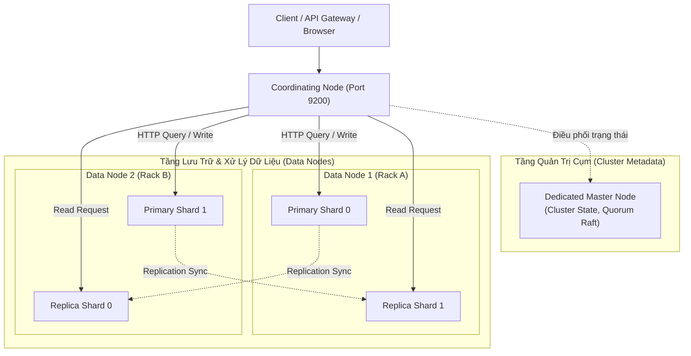
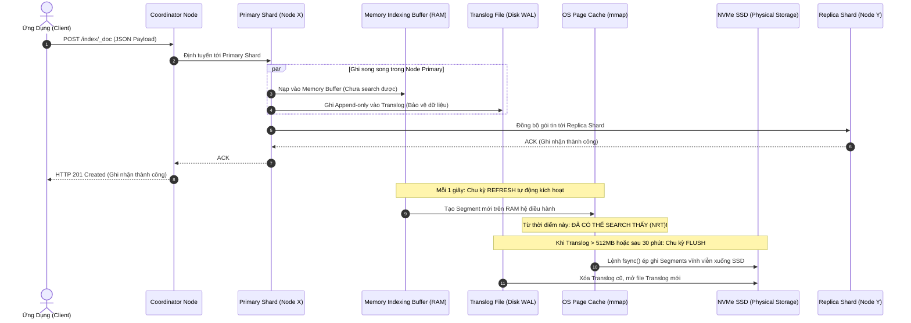
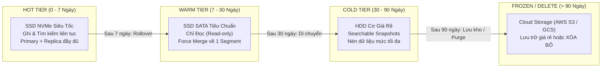

# Elasticsearch - Concept Deep Dive (Từ Nền Tảng Đến Bản Chất Lõi Hệ Thống)

> **Tài liệu lý thuyết chuyên sâu đạt chuẩn Enterprise: Khám phá kiến trúc phân tán, cấu trúc dữ liệu tầng thấp Apache Lucene, cơ chế vận hành phần cứng, hạt nhân Linux và các chiến lược tối ưu hóa quy mô lớn.**

---

## 📑 MỤC LỤC TỔNG QUAN

1. [Mức Độ Cơ Bản (Basic Fundamentals)](#1-mức-độ-cơ-bản-basic-fundamentals)
   - [Định nghĩa & Ẩn dụ đời thực (Real-world Analogy)](#định-nghĩa--ẩn-dụ-đời-thực-real-world-analogy)
   - [Vấn đề cốt lõi sinh ra công nghệ (Problem Statement)](#vấn-đề-cốt-lõi-sinh-ra-công-nghệ-problem-statement)
   - [Kiến trúc tổng quan mức High-Level](#kiến-trúc-tổng-quan-mức-high-level)
2. [Mức Độ Trung Bình (Intermediate - Architecture & Use Cases)](#2-mức-độ-trung-bình-intermediate---architecture--use-cases)
   - [Mổ xẻ các thành phần cốt lõi (Core Components)](#mổ-xẻ-các-thành-phần-cốt-lõi-core-components)
   - [Các vai trò của Node trong Cluster (Node Roles)](#các-vai-trò-của-node-trong-cluster-node-roles)
   - [Đường ống phân tích văn bản (Text Analysis Pipeline)](#đường-ống-phân-tích-văn-bản-text-analysis-pipeline)
   - [Khi nào NÊN dùng và KHÔNG NÊN dùng](#khi-nào-nên-dùng-và-không-nên-dùng)
3. [Mức Độ Chuyên Sâu: BẢN CHẤT VẬN HÀNH (Under The Hood & Core Mechanics)](#3-mức-độ-chuyên-sâu-bản-chất-vận-hành-under-the-hood--core-mechanics)
   - [3.1 Nguyên lý Lưu trữ & Tra cứu Cốt lõi (Storage & Data Layout)](#31-nguyên-lý-lưu-trữ--tra-cứu-cốt-lõi-storage--data-layout)
   - [3.2 Dòng chảy Dữ liệu (Data Flow - Luồng Ghi & Luồng Đọc)](#32-dòng-chảy-dữ-liệu-data-flow---luồng-ghi--luồng-đọc)
   - [3.3 Cơ chế Phân tán & Sao lưu Cơ bản (Sharding, Replication & Scatter-Gather)](#33-cơ-chế-phân-tán--sao-lưu-cơ-bản-sharding-replication--scatter-gather)
4. [Mức Độ Nâng Cao: Vận Hành Thực Chiến (Production Engineering & Best Practices)](#4-mức-độ-nâng-cao-vận-hành-thực-chiến-production-engineering--best-practices)
   - [4.1 Kỹ thuật Tối ưu Hiệu năng Thực chiến (Bulk API, Filter Cache, Shard Sizing)](#41-kỹ-thuật-tối-ưu-hiệu-năng-thực-chiến-bulk-api-filter-cache-shard-sizing)
   - [4.2 Anti-patterns & Sai lầm Phổ biến Cần tránh trong Dự án](#42-anti-patterns--sai-lầm-phổ-biến-cần-tránh-trong-dự-án)
5. [Góc Nhìn Thực Chiến Cho Middle-Level Trở Xuống (Must-Know vs Nice-to-Know Roadmap)](#5-góc-nhìn-thực-chiến-cho-middle-level-trở-xuống-must-know-vs-nice-to-know-roadmap)
   - [Phân định ranh giới kiến thức theo từng cấp độ](#phân-định-ranh-giới-kiến-thức-theo-từng-cấp-độ)
   - [Bộ câu hỏi phỏng vấn thực chiến kinh điển (Intern -> Middle)](#bộ-câu-hỏi-phỏng-vấn-thực-chiến-kinh-điển-intern---middle)
   - [Những thứ TẠM THỜI BỎ QUA (Dành riêng cho Senior / Tech Lead / SRE)](#những-thứ-tạm-thời-bỏ-qua-dành-riêng-cho-senior--tech-lead--sre)
6. [So Sánh Bản Chất (First-Principles Comparison)](#6-so-sánh-bản-chất-first-principles-comparison)
   - [Elasticsearch vs PostgreSQL (GIN/pg_trgm) vs MongoDB (Text Search) vs Meilisearch](#elasticsearch-vs-postgresql-ging_trgm-vs-mongodb-text-search-vs-meilisearch)
   - [Phân tích Trade-offs: Định lý CAP, PACELC, Latency vs Throughput](#phân-tích-trade-offs-định-lý-cap-pacelc-latency-vs-throughput)
7. [Sơ Đồ Trực Quan (Mermaid Diagrams)](#7-sơ-đồ-trực-quan-mermaid-diagrams)
   - [Sơ đồ 1: Kiến trúc Cụm phân tán (Cluster Topology & Node Roles)](#sơ-đồ-1-kiến-trúc-cụm-phân-tán-cluster-topology--node-roles)
   - [Sơ đồ 2: Luồng Ghi vật lý & Quá trình Refresh / Flush (Physical Write Path)](#sơ-đồ-2-luồng-ghi-vật-lý--quá-trình-refresh--flush-physical-write-path)
   - [Sơ đồ 3: Luồng Tìm kiếm phân tán (Distributed Read Path: Query & Fetch Phase)](#sơ-đồ-3-luồng-tìm-kiếm-phân-tán-distributed-read-path-query--fetch-phase)
   - [Sơ đồ 4: Phân tầng lưu trữ theo vòng đời Index (ILM Storage Tiering)](#sơ-đồ-4-phân-tầng-lưu-trữ-theo-vòng-đời-index-ilm-storage-tiering)
8. [Bảng Tra Thuật Ngữ Chi Tiết (Glossary)](#8-bảng-tra-thuật-ngữ-chi-tiết-glossary)
9. [Hướng Dẫn Chạy & Kiểm Thử Hệ Thống (Step-by-Step Run Guide)](#9-hướng-dẫn-chạy--kiểm-thử-hệ-thống-step-by-step-run-guide)

---

## 1. Mức Độ Cơ Bản (Basic Fundamentals)

### Định nghĩa & Ẩn dụ đời thực (Real-world Analogy)

**Elasticsearch (ES)** là một công cụ tìm kiếm và phân tích dữ liệu phân tán (Distributed Search & Analytics Engine) mã nguồn mở, được xây dựng trên nền tảng thư viện lõi **Apache Lucene** bằng Java. Elasticsearch tổ chức dữ liệu dưới dạng tài liệu JSON không có schema cứng nhắc (Schemaless / Dynamic Mapping) và cung cấp giao diện RESTful HTTP API để thực hiện tìm kiếm toàn văn (Full-Text Search) với độ trễ cực thấp (hàng mili-giây) trên quy mô hàng tỷ bản ghi.

Để hiểu bản chất của Elasticsearch so với Database truyền thống, hãy sử dụng ẩn dụ đời thực sau:

1. **Cách tìm kiếm của RDBMS (Mô hình Cuốn Sách không có mục lục tra cứu)**:
   - Tưởng tượng bạn có một cuốn bách khoa toàn thư dày 2,000 trang. Ai đó yêu cầu bạn: *"Hãy tìm tất cả các trang có nhắc đến từ 'khủng long'!"*.
   - Trong Cơ sở dữ liệu quan hệ (RDBMS như MySQL/PostgreSQL) khi dùng câu lệnh `WHERE content LIKE '%khủng long%'`, cách duy nhất máy tính có thể làm là: **lật từng trang một từ trang 1 đến trang 2,000**, dùng mắt quét từng dòng để xem có chữ "khủng long" hay không (Table Scan / Full Scan). Nếu sách dày hàng triệu trang, bạn sẽ mất hàng tiếng đồng hồ!
2. **Cách tìm kiếm của Elasticsearch (Mô hình Mục Lục Chỉ Mục Đảo - Inverted Index)**:
   - Elasticsearch không đọc sách theo kiểu tuần tự như vậy. Khi một cuốn sách được nhập vào, Elasticsearch tạo ra một **bảng tra cứu ở trang cuối cuốn sách (Index)**:
     - Từ khóa `"khủng long"` $\rightarrow$ Xuất hiện tại các trang: `[12, 45, 108, 590]`.
     - Từ khóa `"hóa thạch"` $\rightarrow$ Xuất hiện tại các trang: `[45, 210, 590]`.
   - Khi bạn hỏi: *"Tìm trang có cả 'khủng long' VÀ 'hóa thạch'!"*, Elasticsearch chỉ việc mở bảng mục lục tra cứu, lấy giao điểm của hai danh sách trang (`[45, 590]`) trong chưa đầy **0.001 giây**! Đó chính là sức mạnh tối thượng của cấu trúc **Inverted Index**.

---

### Vấn đề cốt lõi sinh ra công nghệ (Problem Statement)

Tại sao thế giới đã có những hệ quản trị cơ sở dữ liệu quan hệ (RDBMS) cực kỳ trưởng thành như Oracle, PostgreSQL, MySQL nhưng các kỹ sư công nghệ vẫn bắt buộc phải phát minh ra Elasticsearch?

1. **Sự bất lực của B-Tree đối với bài toán tìm kiếm từ vựng**:
   - Cấu trúc chỉ mục **B-Tree** của RDBMS được tối ưu hóa xuất sắc cho các truy vấn so khớp chính xác (`WHERE id = 500`) hoặc truy vấn khoảng số (`WHERE created_at >= '2026-01-01' AND price < 50`). Độ phức tạp của B-Tree là $\mathcal{O}(\log N)$.
   - Tuy nhiên, B-Tree hoàn toàn tê liệt khi gặp toán tử tìm kiếm chuỗi con chứa ký tự đại diện ở đầu: `LIKE '%smartphone%'`. Chỉ mục B-Tree bị vô hiệu hóa hoàn toàn, buộc cơ sở dữ liệu phải đọc toàn bộ bảng từ ổ đĩa vào RAM (Full Table Scan), gây nghẽn I/O và treo hệ thống khi dữ liệu vượt ngưỡng vài triệu dòng.
2. **Nhu cầu tìm kiếm mờ (Fuzzy Search) và Xếp hạng độ liên quan (Relevance Scoring)**:
   - RDBMS chỉ hiểu logic nhị phân: **Khớp (TRUE) hoặc Không khớp (FALSE)**.
   - Nhưng trong thế giới thực của con người (Google, Tiki, Shopee), người dùng gõ sai chính tả (`"iphoen"` thay vì `"iphone"`), gõ thiếu dấu, hoặc gõ từ đồng nghĩa (`"xe hơi"` vs `"ô tô"`). Người dùng không chỉ muốn biết bản ghi nào khớp, mà muốn **bản ghi nào phù hợp nhất được đẩy lên đầu tiên**. RDBMS hoàn toàn không có thuật toán xếp hạng ngữ nghĩa như **BM25 / TF-IDF**.
3. **Thách thức mở rộng ngang (Horizontal Scalability) đối với dữ liệu Log và Big Data**:
   - Khối lượng log và metric từ hàng nghìn microservices có thể đạt hàng chục Terabyte mỗi ngày. RDBMS truyền thống chỉ có thể mở rộng theo chiều dọc (Scale Up: mua máy chủ to hơn, đắt hơn). Khi chạm giới hạn phần cứng của một máy chủ vật lý, RDBMS sụp đổ. Elasticsearch sinh ra với kiến trúc phân cụm (Clustering) và chia nhỏ dữ liệu (Sharding) ngay từ dòng code đầu tiên.

---

### Kiến trúc tổng quan mức High-Level

```
[Client / Browser / Microservices]
               |
               v (HTTP REST API: JSON over Port 9200)
    +----------------------------------------------------------------+
    |                    ELASTICSEARCH CLUSTER                       |
    |                                                                |
    |   +-----------------------+        +-----------------------+   |
    |   |     NODE 1 (Master)   | <----> |     NODE 2 (Data)     |   |
    |   |                       |        |                       |   |
    |   | [Index: products]     |        | [Index: products]     |   |
    |   |  - Primary Shard 0    |        |  - Replica Shard 0    |   |
    |   |  - Replica Shard 1    |        |  - Primary Shard 1    |   |
    |   +-----------------------+        +-----------------------+   |
    |                                                                |
    +----------------------------------------------------------------+
               |
               v (Quản lý các Lucene Engines bên dưới)
    +----------------------------------------------------------------+
    |                     APACHE LUCENE CORE                         |
    |  - Inverted Index (FST + Term Dictionary + Postings List)      |
    |  - BKD Trees (Numeric & Geo Range Queries)                     |
    |  - Segment Files (Immutable on Disk) + Translog (Durability)   |
    +----------------------------------------------------------------+
```

---

## 2. Mức Độ Trung Bình (Intermediate - Architecture & Use Cases)

### Mổ xẻ các thành phần cốt lõi (Core Components)

Để làm chủ Elasticsearch, cần hiểu rõ mối tương quan giữa các khái niệm của ES với các khái niệm quen thuộc trong RDBMS:

| Khái niệm Elasticsearch | Tương đương RDBMS | Bản chất kiến trúc |
| :--- | :--- | :--- |
| **Cluster** | Toàn bộ hệ thống cơ sở dữ liệu | Một tập hợp gồm một hoặc nhiều Node (máy chủ vật lý/container) cùng chia sẻ trạng thái chung (`Cluster State`). |
| **Node** | Một máy chủ đơn lẻ | Một tiến trình Java (JVM) đang chạy Elasticsearch, tham gia vào cụm và lưu trữ dữ liệu. |
| **Index** | Bảng (Table) | Không gian tên logic nhóm các tài liệu có chung đặc tính. Bên dưới, một Index được chia thành nhiều Shards. |
| **Shard** | Một phân vùng vật lý (Partition) | **Trụ cột của khả năng mở rộng**: Mỗi Shard thực chất là một phiên bản độc lập hoàn chỉnh của thư viện Apache Lucene. |
| **Document** | Một bản ghi (Row) | Một đối tượng JSON chứa dữ liệu thực tế, có định danh duy nhất `_id`. |
| **Field** | Một cột (Column) | Một thuộc tính trong JSON (ví dụ: `title`, `price`). Mỗi field có thể có cấu hình bộ phân tích riêng. |
| **Mapping** | Cấu trúc bảng (Schema DDL) | Định nghĩa kiểu dữ liệu cho từng field (`text`, `keyword`, `integer`, `date`, `geo_point`). |

#### Primary Shard vs Replica Shard
- **Primary Shard**: Nơi tiếp nhận các thao tác ghi (Write) đầu tiên. Mỗi Document khi thêm vào Index sẽ thuộc về duy nhất một Primary Shard cụ thể (được tính bằng công thức băm: $\text{Shard ID} = \text{hash}(\_id) \pmod{\text{Số Primary Shards}}$).
- **Replica Shard**: Bản sao chính xác của Primary Shard:
  - **Tăng cường khả năng chịu lỗi (High Availability)**: Nếu Node chứa Primary Shard bị chết cháy phần cứng, Replica Shard trên Node khác lập tức được thăng cấp thành Primary Shard mới mà không làm gián đoạn hệ thống.
  - **Tăng thông lượng đọc (Read Throughput)**: Cả Primary và Replica Shard đều có khả năng phục vụ các câu truy vấn tìm kiếm song song.

---

### Các vai trò của Node trong Cluster (Node Roles)

Trong một hệ thống Production quy mô lớn, **tuyệt đối không bao giờ cấu hình tất cả các Node làm mọi việc**. Elasticsearch cho phép phân chia trách nhiệm rõ ràng cho từng máy chủ thông qua cờ cấu hình `node.roles`:

1. **Master-Eligible Node (`master`)**:
   - Chịu trách nhiệm quản lý **Cluster State**: theo dõi danh sách các node tham gia cụm, quyết định việc phân bổ shard, tạo/xóa index.
   - Không trực tiếp xử lý truy vấn tìm kiếm hoặc ghi dữ liệu nặng để tránh bị nghẽn CPU/RAM gây mất ổn định toàn cụm.
2. **Data Node (`data`)**:
   - Giữ các Shard dữ liệu vật lý trên ổ đĩa SSD.
   - Thực thi các tác vụ ngốn tài nguyên nhất: tính toán điểm BM25, lọc chỉ mục, nén dữ liệu, chạy phân tích Aggregations.
3. **Ingest Node (`ingest`)**:
   - Đóng vai trò như một trạm tiền xử lý dữ liệu (ETL mini). Có thể chạy các Ingest Pipelines (ví dụ: bóc tách địa chỉ IP bằng GeoIP, cắt chuỗi log bằng Grok filter) trước khi tài liệu được lập chỉ mục.
4. **Coordinating Node (Client / Gateway Node - không gán role nào)**:
   - Đóng vai trò làm Router / Load Balancer thông minh. Tiếp nhận HTTP request từ Client, phát tán truy vấn tới các Data Node tương ứng (Scatter), sau đó gộp kết quả trả về cho Client (Gather).
5. **Machine Learning Node (`ml`)**:
   - Chạy các mô hình phát hiện bất thường (Anomaly Detection) trên chuỗi thời gian hoặc phân loại dữ liệu AI.

---

### Đường ống phân tích văn bản (Text Analysis Pipeline)

Khi bạn lưu một chuỗi văn bản vào trường kiểu `text`, Elasticsearch không lưu nguyên văn chuỗi đó. Nó đẩy chuỗi qua một **Bộ phân tích (Analyzer)** gồm 3 công đoạn tuần tự:

```
Văn bản gốc: "<p>The Quick Brown FOXES jumped over 2 lazy dogs!</p>"
     |
     v
[1. Character Filters] ---> Loại bỏ thẻ HTML, chuẩn hóa ký tự: "The Quick Brown FOXES jumped over 2 lazy dogs!"
     |
     v
[2. Tokenizer]         ---> Cắt câu thành mảng từ dựa trên khoảng trắng và dấu câu:
                            ["The", "Quick", "Brown", "FOXES", "jumped", "over", "2", "lazy", "dogs"]
     |
     v
[3. Token Filters]     ---> - Lowercase filter: ["the", "quick", "brown", "foxes", "jumped", "over", "2", "lazy", "dogs"]
                            - Stopwords filter: Loại bỏ từ vô nghĩa ("the", "over") -> ["quick", "brown", "foxes", "jumped", "2", "lazy", "dogs"]
                            - Stemming / Lemmatization: Đưa về từ gốc ("foxes" -> "fox", "jumped" -> "jump", "dogs" -> "dog")
     |
     v
Kết quả lưu vào Inverted Index: ["quick", "brown", "fox", "jump", "2", "lazy", "dog"]
```

> Nhờ quy trình Stemming này, khi người dùng tìm kiếm từ khóa `"jumping dog"`, Elasticsearch vẫn tìm ra văn bản gốc chứa `"jumped over 2 lazy dogs"`!

---

### Khi nào NÊN dùng và KHÔNG NÊN dùng

#### ✅ KHI NÀO NÊN DÙNG:
1. **Tìm kiếm sản phẩm / nội dung toàn văn (E-commerce / Blog Search)**: Cần tìm kiếm mờ (Fuzzy), Autocomplete (gợi ý khi gõ), xếp hạng thông minh theo độ liên quan, highlight từ khóa tìm kiếm.
2. **Thu thập, Phân tích Log và Metrics (ELK / Observability Stack)**: Quản lý hàng tỷ dòng log hệ thống từ Filebeat/Logstash, truy vấn nhanh các lỗi crash hệ thống trong khoảng thời gian cụ thể.
3. **Phân tích dữ liệu lớn thời gian thực (Real-time Aggregations)**: Cần thống kê số lượng đơn hàng theo từng danh mục, tính giá trị trung bình theo từng vùng địa lý trên hàng triệu bản ghi trong vòng vài mili-giây.

#### ❌ KHI NÀO KHÔNG NÊN DÙNG:
1. **Không dùng làm Cơ sở dữ liệu giao dịch tài chính chính (Primary ACID Database)**:
   - Elasticsearch **KHÔNG HỖ TRỢ ACID TRANSACTION** giữa nhiều document. Không có cơ chế rollback giao dịch an toàn như PostgreSQL hay Oracle.
   - Việc ghi dữ liệu vào ES có độ trễ Near Real-Time (mặc định 1 giây sau khi ghi mới search thấy), không đáp ứng được yêu cầu đọc tức thời nghiêm ngặt (Strict Read-After-Write Consistency).
2. **Hệ thống có cấu trúc dữ liệu quan hệ chằng chịt (Highly Relational / Heavy JOINs)**:
   - Elasticsearch được thiết kế cho mô hình dữ liệu phẳng (Flat / Denormalized). ES cực kỳ ghét phép `JOIN`. Việc cố tình ép ES thực hiện các quan hệ cha-con phức tạp (`has_child`, `has_parent`) sẽ giết chết hiệu năng hệ thống.

---

## 3. Mức Độ Chuyên Sâu: BẢN CHẤT VẬN HÀNH (Under The Hood & Core Mechanics)

### 3.1 Nguyên lý Lưu trữ & Tra cứu Cốt lõi (Storage & Data Layout)

#### Inverted Index qua lăng kính trực quan
Elasticsearch tìm kiếm toàn văn bản (Full-text Search) siêu tốc là nhờ cấu trúc **Inverted Index (Chỉ mục đảo)**.

> 💡 **Cầu nối trực quan**: Hãy tưởng tượng cuốn sách giáo khoa dày 1.000 trang:
> - **Tìm kiếm thông thường (Forward Index)**: Bạn lật từng trang từ 1 đến 1.000 và quét mắt xem có từ "Database" hay không. Cách này quá chậm khi dữ liệu lớn.
> - **Inverted Index**: Chính là phần **Mục lục tra cứu cuối sách (Glossary/Index)**. Sách đã liệt kê sẵn bảng chữ cái: Từ "Database" xuất hiện ở trang 12, 45, 108. Bạn chỉ cần tra chữ cái "D", tìm từ "Database" và mở ngay các trang được chỉ định.

```
[Văn bản gốc (Documents)]
Doc 1: "Học Elasticsearch cơ bản"
Doc 2: "Học Redis và Elasticsearch"

                === Phân tích & Tách từ (Analysis) ===
                                  |
                                  v
[Inverted Index (Bảng tra cứu ngược)]
+---------------+------------------------+
| Từ khóa (Term)| Danh sách Document IDs |
+---------------+------------------------+
| "học"         | [ Doc 1, Doc 2 ]       |
| "elasticsearch| [ Doc 1, Doc 2 ]       |
| "cơ bản"      | [ Doc 1 ]              |
| "và"          | [ Doc 2 ] (hoặc bị lọc)|
| "redis"       | [ Doc 2 ]              |
+---------------+------------------------+
```

#### Term Dictionary & Postings List
Bản chất của một Inverted Index trong Elasticsearch gồm 2 thành phần chính:
1. **Term Dictionary**: Danh sách tất cả các từ khóa duy nhất đã được chuẩn hóa (chuyển chữ thường, bỏ dấu, tách từ) và sắp xếp theo thứ tự từ điển alphabet.
2. **Postings List**: Mảng danh sách các Document ID chứa từ khóa đó, kèm theo tần suất xuất hiện (Term Frequency) và vị trí của từ trong văn bản để phục vụ việc tính điểm và tìm kiếm theo cụm từ (phrase search).

#### Phân biệt bản chất: `text` vs `keyword`
Đây là quyết định kiến trúc quan trọng nhất khi thiết kế schema (mapping) trong Elasticsearch:
- **Kiểu `text`**: Dữ liệu đi qua **Analyzer** (tách thành từng từ rời rạc, chuyển chữ thường, bỏ stop words). Dùng cho tìm kiếm toàn văn (Full-text search), so khớp gần đúng, tìm theo ngữ cảnh.
- **Kiểu `keyword`**: Dữ liệu được giữ **nguyên vẹn 100%** thành một chuỗi duy nhất, không bị tách từ. Dùng để so khớp chính xác (Exact match), lọc (Filter), sắp xếp (Sort), và thống kê nhóm (Aggregations).

#### Cách Elasticsearch xử lý Số và Ngày tháng (Range Query)
Khác với văn bản dùng Inverted Index, các kiểu dữ liệu số (`integer`, `long`) và thời gian (`date`) được tổ chức theo cấu trúc phân cấp đa tầng (cây dải giá trị).
- Khi bạn truy vấn khoảng (`price BETWEEN 100 AND 500`), Elasticsearch không duyệt từng số lẻ mà khoanh vùng trực tiếp các khối chứa dải giá trị từ 100 đến 500 để đọc tuần tự, giúp các câu lệnh lọc ngày tháng hoặc mức giá diễn ra cực nhanh.

#### Thuật toán Xếp hạng BM25 (Relevance Scoring)
Khi tìm kiếm văn bản, Elasticsearch chấm điểm từng kết quả bằng thuật toán **BM25** dựa trên 3 yếu tố cốt lõi:
1. **IDF (Inverse Document Frequency - Độ hiếm của từ)**: Từ khóa càng hiếm gặp trong toàn bộ kho dữ liệu thì giá trị đóng góp điểm số càng cao (từ chuyên ngành có điểm cao hơn từ phổ biến như "cho", "và").
2. **TF Saturation (Tần suất xuất hiện & Độ bão hòa)**: Từ xuất hiện nhiều lần trong bài sẽ tăng điểm, nhưng có ngưỡng bão hòa (xuất hiện 20 lần không có nghĩa là hay gấp đôi bài xuất hiện 10 lần).
3. **Document Length Normalization (Độ dài tài liệu)**: Cùng chứa 1 từ khóa, nhưng bài viết ngắn gọn (tiêu đề 10 từ) sẽ được chấm điểm cao hơn cuốn sách 1.000 trang, tránh hiện tượng spam từ khóa.

---

### 3.2 Dòng chảy Dữ liệu (Data Flow - Luồng Ghi & Luồng Đọc)

#### Luồng Ghi Dữ liệu (Write Path) & Cơ chế Near Real-Time (NRT)

```
[Client] ---> POST /products/_doc/1
                  |
                  v
       [Coordinating Node] (Tính Shard ID = hash(_id) % Số Shard)
                  |
                  v
       [Primary Shard]
         +--------+--------+
         |                 |
         v                 v
[Memory Indexing Buffer]  [Translog File (WAL)]
(Dữ liệu JSON thô)        (Ghi tuần tự xuống đĩa chống mất điện)
         |
         | (Mỗi 1 giây: Lệnh REFRESH)
         v
[OS Filesystem Cache] <--- TẠI ĐÂY ĐÃ BẮT ĐẦU TÌM THẤY ĐƯỢC!
(Tạo Segment mới trên RAM)    (Near Real-Time Search)
         |
         | (Định kỳ hoặc Translog đầy: Lệnh FLUSH)
         v
[Lưu trữ Đĩa Cứng Vĩnh viễn] (fsync ghi xuống đĩa, dọn dẹp Translog cũ)
```

1. **Định tuyến (Routing)**: Coordinating Node nhận request, băm ID bản ghi để xác định Primary Shard tương ứng và chuyển tiếp request tới Node đó.
2. **Ghi đệm và Nhật ký (Memory Buffer & Translog)**:
   - Dữ liệu được đưa vào **Memory Indexing Buffer**. Lúc này tài liệu **chưa thể tìm kiếm được**.
   - Đồng thời, dữ liệu được ghi nối đuôi vào file **Translog (Transaction Log / Write-Ahead Log)** trên đĩa. Nếu máy chủ sập nguồn đột ngột, Elasticsearch sẽ đọc lại Translog khi khởi động để phục hồi dữ liệu.
3. **Khoảnh khắc Refresh (Biến thành Near Real-Time)**:
   - Mặc định **mỗi 1 giây**, Elasticsearch tự động kích hoạt tiến trình `refresh`.
   - Dữ liệu trong Memory Buffer được phân tích thành Inverted Index và tạo thành một file **Segment mới**.
   - Segment này được nạp vào bộ nhớ đệm hệ điều hành (OS Cache). Ngay lúc này, câu lệnh search đã có thể tìm thấy dữ liệu mới! Đó là lý do tại sao hệ thống được gọi là **Near Real-Time** (độ trễ khoảng 1 giây).
4. **Flush (Chốt ghi vĩnh viễn)**:
   - Khi Translog đạt dung lượng nhất định hoặc sau một khoảng thời gian, tiến trình `flush` ghi vĩnh viễn dữ liệu xuống đĩa cứng vật lý và xóa bỏ Translog cũ.

#### Tính Bất biến (Immutability) & Tiến trình Segment Merging
- **Tại sao Segment bất biến?** Các file Segment một khi đã sinh ra thì **không bao giờ bị chỉnh sửa**. Tính chất này giúp Elasticsearch đọc dữ liệu đồng thời cực nhanh mà không cần dùng khóa dữ liệu (Locks).
- **Cách xử lý Update và Delete**:
  - Khi bạn `DELETE`, bản ghi không bị xóa ngay trên đĩa mà được ghi ID vào danh sách đánh dấu xóa riêng (`.del` - Tombstone). Khi tìm kiếm, kết quả sẽ tự động lọc bỏ các ID này.
  - Khi bạn `UPDATE`, thực chất là đánh dấu xóa bản ghi cũ và ghi một bản ghi hoàn toàn mới vào Segment mới.
- **Segment Merging (Gộp Segment)**:
  - Việc sinh Segment mới liên tục sẽ khiến số lượng file tăng lên. Elasticsearch có tiến trình chạy ngầm định kỳ gộp nhiều Segment nhỏ thành một Segment lớn hơn, đồng thời dọn sạch vĩnh viễn các bản ghi đã bị đánh dấu xóa trong danh sách `.del`.

#### Luồng Đọc Dữ liệu (Read Path - Kỹ thuật Scatter-Gather)
Một câu truy vấn tìm kiếm phân tán được thực thi qua hai pha rõ ràng:

```
[Client] ---> GET /products/_search?q=laptop&size=10
                   |
                   v
         [Coordinating Node]
                   |
   +---------------+---------------+ (1. PHA SCATTER / QUERY: Phát tán tìm kiếm)
   |                               |
   v                               v
[Primary Shard 0]             [Replica Shard 1]
- Tìm kiếm Inverted Index     - Tìm kiếm Inverted Index
- Chấm điểm BM25              - Chấm điểm BM25
- Lấy Top 10 [Doc ID + Score] - Lấy Top 10 [Doc ID + Score]
   |                               |
   +---------------+---------------+ (2. Trả về danh sách cực nhẹ: CHƯA CÓ DATA NỘI DUNG)
                   |
                   v
         [Coordinating Node]
         - Gom các Top 10 lại, sắp xếp chọn Top 10 chiến thắng chung cuộc
                   |
   +---------------+---------------+ (3. PHA GATHER / FETCH: Đi đòi nội dung đầy đủ)
   |                               |
   v                               v
[Lấy _source của Doc #12]     [Lấy _source của Doc #45]
   |                               |
   +---------------+---------------+
                   |
                   v
[Đóng gói JSON hoàn chỉnh trả về Client]
```

1. **Pha 1 - Query Phase (Scatter - Phát tán)**: Coordinating Node gửi câu lệnh tìm kiếm song song tới các Shard liên quan. Mỗi Shard tự tính điểm và chỉ trả về một danh sách rất nhẹ gồm `[Document ID, Score]` của Top 10 bản ghi điểm cao nhất tại Shard đó.
2. **Pha 2 - Fetch Phase (Gather - Gom và lấy nội dung)**: Coordinating Node gom các danh sách Top 10 từ các Shard, sắp xếp lại để chọn ra Top 10 chung cuộc của toàn hệ thống. Sau đó, nó mới gửi yêu cầu tới các Shard chứa 10 bản ghi này để lấy toàn bộ nội dung JSON gốc (`_source`) và trả về cho Client.

---

### 3.3 Cơ chế Phân tán & Sao lưu Cơ bản (Sharding, Replication & Scatter-Gather)

#### Primary Shard và Replica Shard
- **Primary Shard**: Đơn vị lưu trữ dữ liệu chính. Một Index được chia thành nhiều Primary Shards để phân bổ dữ liệu và tải ghi lên nhiều máy chủ.
- **Replica Shard**: Bản sao y hệt của Primary Shard.
  - **Tăng tính sẵn sàng (High Availability)**: Nếu node chứa Primary Shard bị hỏng, Replica Shard lập tức được thăng cấp thành Primary Shard mới, hệ thống không bị mất dữ liệu.
  - **Nhân rộng tải đọc (Read Scalability)**: Các truy vấn tìm kiếm có thể đọc từ cả Primary và Replica, giúp thông lượng đọc tăng theo số lượng Replica.

#### Bầu Master Node và Cơ chế Quorum (Chống Split-Brain)
- Cụm Elasticsearch có một Master Node chịu trách nhiệm quản lý cấu trúc cụm (Cluster State: danh sách node, phân bổ shard).
- Khi Master Node gặp sự cố, các Node có quyền ứng cử sẽ tiến hành bầu chọn Master mới.
- **Quy tắc Quorum (Đa số quá bán)**: Để một Master mới được công nhận hoặc một thay đổi trạng thái cụm được áp dụng, nó phải được sự đồng thuận của hơn 50% số Master-eligible Nodes. Cơ chế này loại bỏ hoàn toàn hiện tượng **Split-Brain** (hai nửa cụm bị mất liên lạc và cùng tự bầu ra 2 Master riêng lẻ, dẫn đến ghi đè phá hủy dữ liệu của nhau).

---

## 4. Mức Độ Nâng Cao: Vận Hành Thực Chiến (Production Engineering & Best Practices)

### 4.1 Kỹ thuật Tối ưu Hiệu năng Thực chiến (Bulk API, Filter Cache, Shard Sizing)

#### 1. Luôn sử dụng Bulk API khi thêm/sửa dữ liệu hàng loạt
- **Vấn đề**: Gửi từng request đơn lẻ (10.000 HTTP requests cho 10.000 documents) gây quá tải kết nối mạng và lãng phí tài nguyên CPU cho việc mở/đóng kết nối.
- **Giải pháp**: Dùng API `_bulk` gom các bản ghi thành từng lô (kích thước khuyến nghị từ 5MB đến 15MB cho mỗi mẻ). Giảm thiểu tới 90% độ trễ mạng và tăng tốc độ nạp dữ liệu gấp nhiều lần.

#### 2. Tách biệt `query` tính điểm và `filter` có cache trong câu truy vấn
Trong truy vấn phức tạp (bool query):
- **Điều kiện `must` / `should` (Query Context)**: Tính điểm liên quan (BM25 scoring). Tốn nhiều CPU hơn. Dùng cho các trường văn bản người dùng gõ vào tìm kiếm.
- **Điều kiện `filter` (Filter Context)**: Chỉ kiểm tra Đúng/Sai (Ví dụ: `status == 'active'`, `category_id == 10`). **Không tính điểm**, và kết quả lọc được **tự động lưu vào Filter Cache trên RAM**. Các lần truy vấn sau với cùng điều kiện lọc sẽ trả về kết quả gần như tức thì.

```json
{
  "query": {
    "bool": {
      "must": [
        { "match": { "title": "bàn phím cơ" } }  // Cần tính điểm liên quan
      ],
      "filter": [
        { "term": { "status": "in_stock" } },    // Tận dụng Filter Cache, không tính điểm
        { "range": { "price": { "lte": 2000000 } } }
      ]
    }
  }
}
```

#### 3. Tạm thời tắt Refresh khi Import dữ liệu lớn
Khi cần nạp hàng triệu bản ghi từ cơ sở dữ liệu cũ sang Elasticsearch:
1. Tạm thời đặt `refresh_interval: -1` để tắt việc tạo Segment mỗi giây.
2. Chạy nạp dữ liệu bằng Bulk API.
3. Sau khi nạp xong, bật lại `refresh_interval: "30s"` hoặc `"1s"`. Việc này giúp giảm tải Disk I/O và tăng tốc import gấp 3-5 lần.

#### 4. Quy tắc vàng về Shard Sizing (Kích thước Shard)
- **Kích thước lý tưởng**: Một shard nên có dung lượng từ **10GB đến 50GB**.
- **Tránh bệnh Over-sharding (Tạo quá nhiều Shard bé)**: Nhiều người tạo Index chỉ vài chục MB nhưng chia thành 10-20 Shards. Mỗi Shard là một bộ máy Lucene độc lập chiếm bộ nhớ và luồng CPU. Quá nhiều Shard nhỏ sẽ gây lãng phí RAM và làm chậm toàn bộ cụm.

---

### 4.2 Anti-patterns & Sai lầm Phổ biến Cần tránh trong Dự án

#### 1. Deep Pagination (Phân trang quá sâu với `from` + `size`)
- **Sai lầm**: Người dùng gọi `GET /products/_search?from=100000&size=10` để xem trang thứ 10.000.
- **Hậu quả**: Tất cả các Shard đều phải lôi 100.010 bản ghi gửi về Coordinating Node. Coordinating Node phải chứa `100.010 * số Shard` bản ghi trong bộ nhớ RAM để sắp xếp lại, rồi bỏ đi 100.000 bản ghi đầu để lấy 10 bản ghi cuối. Gây nghẽn mạng và sập RAM ngay lập tức.
- **Cách khắc phục chuẩn**:
  - Với giao diện web thông thường: Giới hạn tối đa 1.000 kết quả đầu tiên.
  - Với luồng dữ liệu lớn hoặc cuộn trang vô tận (Infinite Scroll): Sử dụng API con trỏ **`search_after`** kết hợp với sắp xếp theo ID/Thời gian, giữ mức tiêu thụ RAM luôn là $\mathcal{O}(1)$.

#### 2. Mapping Explosion (Bùng nổ trường dữ liệu do `dynamic: true`)
- **Sai lầm**: Để cấu hình nhận diện trường tự động (`dynamic: true`) cho Index nhận log hoặc dữ liệu từ bên ngoài có chứa hàng nghìn trường JSON không cố định.
- **Hậu quả**: Mỗi trường mới sinh ra sẽ làm tăng kích thước Metadata của cụm (Cluster State). Mỗi khi trạng thái cụm thay đổi, Master Node phải đồng bộ file metadata phình to này tới toàn bộ các node qua mạng, làm nghẽn mạng nội bộ và treo cụm.
- **Cách khắc phục**: Luôn đặt `dynamic: strict` trên môi trường Production và chủ động khai báo Mapping rõ ràng trước khi cho phép ghi dữ liệu.

#### 3. Lạm dụng kiểu `text` cho các trường lọc chính xác
- **Sai lầm**: Khai báo các trường chỉ dùng để phân loại hoặc lọc trạng thái (như `status`, `user_id`, `category_code`) bằng kiểu `text`.
- **Hậu quả**: Elasticsearch phải tốn tài nguyên băm nhỏ chuỗi qua Analyzer. Khi chạy các câu lệnh thống kê nhóm (Aggregations) theo trường này, hệ thống phải nạp dữ liệu chuỗi vào RAM gây tràn bộ nhớ.
- **Cách khắc phục**: Luôn dùng kiểu **`keyword`** cho tất cả các trường dùng để lọc chính xác (Filter), sắp xếp (Sort) hoặc thống kê nhóm (Aggregations).

---

## 5. Góc Nhìn Thực Chiến Cho Middle-Level Trở Xuống (Must-Know vs Nice-to-Know Roadmap)

> 💡 **Thông điệp giải tỏa áp lực**: Nếu bạn là Intern, Junior hoặc Mid-level và cảm thấy các phần phân tích về Lucene FST, Segment Merging, JVM GC hay Raft Quorum ở trên quá "ngợp" — **điều đó hoàn toàn bình thường**! Kiến trúc tầng sâu đó thuộc về cấp độ Staff / System Architect / SRE. Để đi làm thực tế và tỏa sáng trong các buổi phỏng vấn, bạn chỉ cần nắm vững lộ trình thực chiến dưới đây theo quy tắc 80/20.

---

### Phân định ranh giới kiến thức theo từng cấp độ

```
  +---------------------------------------------------------------------------------+
  | CẤP ĐỘ INTERN / JUNIOR (QUY TẮC 80/20 - DEVELOPER SỬ DỤNG)                     |
  |  - Tư duy Inverted Index (Ẩn dụ trang mục lục tra cứu cuối sách)                |
  |  - Biết tại sao dùng ES thay cho SQL LIKE '%...%' (Full scan vs O(1) Lookup)    |
  |  - Phân biệt sống còn giữa kiểu 'text' (tách từ) và 'keyword' (lọc chính xác)   |
  |  - Viết được match, term, bool query (must, filter, should) trong Backend code   |
  |  - Tích hợp Elasticsearch SDK (@elastic/elasticsearch) vào Node.js/Java/Python  |
  +---------------------------------------------------------------------------------+
                                          │
                                          ▼
  +---------------------------------------------------------------------------------+
  | CẤP ĐỘ MIDDLE-LEVEL (DATA MODELING & VẬN HÀNH ỨNG DỤNG CHUẨN MỰC)               |
  |  - Thiết kế Mapping tường minh (dynamic: strict), tránh Mapping Explosion       |
  |  - Xử lý Autocomplete (Edge N-gram / search_as_you_type), Tiếng Việt (Analyzer)|
  |  - Đồng bộ DB -> ES: Hiểu Trade-offs giữa Dual-Write, Logstash và CDC/Debezium  |
  |  - Hiệu năng truy vấn: Tận dụng Filter Cache, Bulk API (_bulk), tránh Deep Page |
  |  - Xử lý lỗi ứng dụng: Retry with Exponential Backoff, Concurrency (_seq_no)    |
  +---------------------------------------------------------------------------------+
                                          │
                                          ▼
  +---------------------------------------------------------------------------------+
  | CẤP ĐỘ SENIOR / TECH LEAD / SRE (TẦNG HỆ THỐNG & HẠ TẦNG PHÂN TÁN)             |
  |  - Cấu trúc Lucene nội tại: FST, BKD-Tree, SkipList, Translog, fsync physics    |
  |  - Tối ưu OS & Phần cứng: JVM Heap <= 32GB (Compressed OOPs), 50% OS Page Cache |
  |  - Vận hành cụm: Shard Sizing (10-50GB), Master Election, Quorum, Split-Brain   |
  |  - Chiến lược ILM (Hot-Warm-Cold-Frozen), Snapshot/Restore, Disaster Recovery   |
  +---------------------------------------------------------------------------------+
```

#### A. Đối với Intern & Junior: Cần nắm chắc những gì?
1. **Bài toán nghiệp vụ**: Hiểu rõ khi nào RDBMS truyền thống bị nghẽn (khi văn bản dài hàng triệu dòng, tìm kiếm không dấu, tìm gần đúng/mờ, nhiều điều kiện lọc động).
2. **Cặp đôi `text` vs `keyword`**:
   - `text`: Dùng cho nội dung tìm kiếm (tiêu đề bài viết, mô tả sản phẩm, nội dung chat). Elasticsearch sẽ băm nhỏ chuỗi thành các token (Tokenization) và chuẩn hóa (Lowercase, Stemming) để lưu vào Inverted Index.
   - `keyword`: Dùng cho mã định danh, trạng thái, danh mục (`status = 'ACTIVE'`, `category_id = 'LAPTOP'`). Giữ nguyên chuỗi 100%, dùng để Lọc (`filter`), Sắp xếp (`sort`), hoặc Thống kê (`aggregations`).
3. **Cấu trúc câu truy vấn chuẩn mực (`bool query`)**:
   - `must`: Bắt buộc phải khớp VÀ có tính điểm liên quan (Relevance Score BM25).
   - `filter`: Bắt buộc phải khớp NHƯNG **không tính điểm**. Tốc độ siêu nhanh vì Elasticsearch tự động lưu kết quả vào **Node Query Cache (Filter Cache)** trên RAM.
   - `should`: Điều kiện cộng điểm (tương đương `OR` trong SQL).
4. **Tích hợp vào mã nguồn (Application Integration)**:
   - Viết được Service trong Backend (ví dụ NestJS/Express) khởi tạo client:
     ```typescript
     import { Client } from '@elastic/elasticsearch';
     const esClient = new Client({ node: process.env.ELASTICSEARCH_NODE || 'http://localhost:9200' });
     ```
   - Viết hàm Index dữ liệu khi người dùng tạo bản ghi mới và hàm Search dữ liệu khi người dùng gõ từ khóa.

#### B. Đối với Middle-Level: Những kỹ năng tạo nên sự khác biệt
1. **Tối ưu hóa Bulk Processing**: Tuyệt đối không dùng vòng lặp `for` để gọi `client.index()` từng document đơn lẻ khi nạp dữ liệu lớn. Phải gom lô (Batching 500 - 2,000 documents) và gửi qua `client.bulk()`.
2. **Chiến lược phân trang (Pagination Strategy)**:
   - Hiểu tại sao `from + size` quá $10,000$ (Deep Pagination) sẽ làm sập RAM của Coordinating Node (do phải gom và sắp xếp kết quả từ tất cả các Shard).
   - Biết cách thay thế bằng kỹ thuật **`search_after`** kết hợp với trường sort duy nhất (ví dụ `_id` hoặc `created_at`).
3. **Bài toán đồng bộ dữ liệu (Data Synchronization Architecture)**:
   - *Dual-Write (Ghi DB xong ghi luôn ES)*: Dễ làm nhất nhưng không đảm bảo ACID, nếu ES tạm thời chết thì dữ liệu bị lệch (Inconsistency).
   - *Change Data Capture (CDC)*: Dùng Debezium đọc Transaction Log của MySQL/Postgres bắn qua Kafka, Worker kéo về nạp vào ES. Đảm bảo dữ liệu luôn đồng bộ cuối cùng (Eventual Consistency).
4. **Ngăn chặn Mapping Explosion**:
   - Luôn đặt `"dynamic": "strict"` trong mapping production để tránh việc người dùng đẩy JSON bừa bãi làm phình to `Cluster State`.

---

### Bộ câu hỏi phỏng vấn thực chiến kinh điển (Intern -> Middle)

Dưới đây là 5 câu hỏi phỏng vấn xuất hiện với tần suất > 90% khi nhà tuyển dụng hỏi về Elasticsearch, kèm câu trả lời chuẩn ghi điểm cao:

#### ❓ Câu 1: Tại sao không dùng SQL `LIKE '%iphone%'` mà lại phải đưa Elasticsearch vào hệ thống?
* **Điểm yếu của SQL**: 
  - Khi đặt dấu `%` ở đầu (`'%iphone%'`), cơ sở dữ liệu quan hệ (B-Tree Index) **hoàn toàn vô dụng**, buộc phải quét toàn bộ bảng (Full Table Scan). Khi bảng có 10 triệu dòng, câu lệnh mất hàng chục giây và làm khóa (lock) CPU của database chính.
  - SQL không hỗ trợ tính điểm độ liên quan (Relevance Scoring), không hỗ trợ tìm kiếm không dấu (tiếng Việt), không xử lý được người dùng gõ sai chính tả (Typo tolerance).
* **Ưu thế của ES**:
  - Dùng **Inverted Index**: Tìm kiếm từ khóa dựa trên bảng tra cứu với độ phức tạp xấp xỉ $\mathcal{O}(1)$.
  - Trả về kết quả trong vài mili-giây, sắp xếp theo thuật toán chấm điểm thông minh (BM25), không làm ảnh hưởng đến cơ sở dữ liệu giao dịch chính.

#### ❓ Câu 2: Trong `bool query`, điều kiện `filter` khác `must` như thế nào về mặt bản chất và hiệu năng?
* **`must` (Scoring Query)**:
  - Kiểm tra document có khớp điều kiện hay không.
  - **Tính điểm liên quan (Relevance Score BM25)**: Document nào xuất hiện từ khóa nhiều hơn, mật độ cao hơn sẽ được điểm cao hơn và xếp lên đầu.
  - Tốn CPU hơn vì phải tính toán điểm số trên từng kết quả.
* **`filter` (Non-scoring / Filter Query)**:
  - Chỉ trả lời câu hỏi nhị phân: **Có** hoặc **Không** (Yes/No).
  - **Không tính điểm**, không làm thay đổi thứ hạng `_score`.
  - **Hiệu năng vượt trội**: Kết quả của `filter` được lưu vào **Node Query Cache (Filter Cache)** trong RAM dưới dạng bitset. Các câu query sau có cùng bộ lọc sẽ được trả về gần như tức thì.

#### ❓ Câu 3: Làm sao để xử lý tìm kiếm khi người dùng gõ sai chính tả (ví dụ gõ "iphoen" vẫn tìm ra "iPhone")?
* **Cách trả lời**:
  - Trong Elasticsearch, ta sử dụng **Fuzzy Query** (hoặc thêm tham số `"fuzziness": "AUTO"` vào `match query`).
  - Bản chất bên dưới: Elasticsearch sử dụng thuật toán **Khoảng cách Levenshtein (Levenshtein Automaton)** để đo số thao tác chỉnh sửa ký tự tối thiểu (chèn, xóa, thay thế, đảo vị trí) giữa từ khóa người dùng gõ và từ khóa thực tế trong chỉ mục.
  - `"fuzziness": "AUTO"` sẽ tự động cho phép sai lệch 1 ký tự với từ có độ dài 3-5 ký tự, và 2 ký tự với từ dài hơn 5 ký tự.

#### ❓ Câu 4: Làm thế nào để làm tính năng tìm kiếm gợi ý tức thì (Live Autocomplete / Search-as-you-type)?
* **Cách trả lời**:
  - Không nên dùng wildcard query `*abc*` vì cực kỳ chậm.
  - Thay vào đó, ta sử dụng kiểu dữ liệu **`search_as_you_type`** hoặc tự cấu hình custom analyzer với **Edge N-gram Token Filter**.
  - *Cơ chế Edge N-gram*: Khi index từ `"laptop"`, ES tự động băm sẵn các tiền tố từ đầu từ: `["l", "la", "lap", "lapt", "lapto", "laptop"]`. Khi người dùng mới gõ chữ `"lap"`, ES chỉ cần tra cứu chính xác token `"lap"` trong Inverted Index với tốc độ $\mathcal{O}(1)$ thay vì phải quét chuỗi.

#### ❓ Câu 5: Nếu Database chính là PostgreSQL và ta dùng Elasticsearch để tìm kiếm, làm sao để giữ dữ liệu 2 bên luôn đồng bộ?
* **Cách trả lời (Thể hiện tư duy Senior/Mid)**:
  - Phân tích rõ 2 hướng tiếp cận:
    1. **Phương pháp 1 (Application-level Dual Write)**: Khi backend xử lý tạo/sửa sản phẩm thành công trong PostgreSQL, backend tự gọi tiếp Elasticsearch API để ghi.
       * *Ưu điểm*: Đơn giản, triển khai nhanh.
       * *Nhược điểm*: Không có giao dịch phân tán (Distributed Transaction). Nếu ghi PostgreSQL thành công nhưng mạng chập chờn khiến ghi ES thất bại $\Rightarrow$ Dữ liệu bị lệch (Data desync).
    2. **Phương pháp 2 (Change Data Capture - CDC via Debezium/Kafka)**: 
       * PostgreSQL kích hoạt Logical Replication / WAL.
       * Debezium đọc sự thay đổi trực tiếp từ Write-Ahead Log và đẩy vào Kafka topic.
       * Một Worker đọc Kafka và ghi vào Elasticsearch.
       * *Ưu điểm*: Đảm bảo tính nhất quán cuối cùng (Eventual Consistency), không làm chậm luồng xử lý HTTP request chính, tự động thử lại khi ES gặp sự cố.

---

### Những thứ TẠM THỜI BỎ QUA (Dành riêng cho Senior / Tech Lead / SRE)

Nếu bạn chưa phải là người trực tiếp chịu trách nhiệm vận hành cụm máy chủ hàng chục Terabyte, bạn **hoàn toàn có thể bỏ qua** các mục sau trong bài đọc mà không ảnh hưởng tới năng lực lập trình hàng ngày:

1. **Thuật toán nén FST (Finite State Transducer) & BKD-Tree**: Cứ coi nó là "chiếc hộp đen kỳ diệu" giúp Lucene nén chỉ mục vào RAM và tìm kiếm số học/tọa độ đa chiều cực nhanh.
2. **Cơ chế vật lý fsync, Translog, Segment Merging**: Hãy hiểu đơn giản là: Document ghi vào được gom lại định kỳ (mỗi giây 1 lần - refresh) thành các file bất biến (Segments), các file nhỏ gộp dần thành file to.
3. **Cấu hình JVM Heap 50/50 & Compressed OOPs (32GB)**: Việc này do DevOps hoặc Cloud Provider (như Elastic Cloud, AWS OpenSearch) quản lý khi setup hạ tầng máy chủ.
4. **Bầu cử Master Node, Raft Consensus, Split-Brain**: Đây là lý thuyết hệ phân tán cao cấp, chỉ cần thiết khi bạn phải tự tay dựng cụm Elasticsearch Cluster nhiều node on-premise từ đầu.

---

## 6. So Sánh Bản Chất (First-Principles Comparison)

### Elasticsearch vs PostgreSQL (GIN/pg_trgm) vs MongoDB (Text Search) vs Meilisearch

| Tiêu chí | Elasticsearch | PostgreSQL (GIN + pg_trgm) | MongoDB (Text Index) | Meilisearch / Typesense |
| :--- | :--- | :--- | :--- | :--- |
| **Bản chất cốt lõi** | Search & Analytics Engine phân tán quy mô lớn | Hệ quản trị CSDL Quan hệ (RDBMS) chuẩn ACID | CSDL NoSQL Document hướng linh hoạt dữ liệu | Search Engine siêu nhẹ, tập trung trải nghiệm UI |
| **Công nghệ lõi** | Apache Lucene (Java, FST, BKD) | Generalized Inverted Index (GIN) trong Kernel C | Inverted Index cơ bản xây dựng trên WiredTiger | Viết bằng Rust/C++, In-Memory Data Structures |
| **Quy mô dữ liệu** | **Vô hạn** (Hàng tỷ document, hàng chục Terabyte phân tán) | Tốt dưới 50 triệu dòng; chậm dần khi kích thước vượt RAM | Trung bình (vài chục triệu document) | Nhỏ đến trung bình (< 10 triệu document nhét vừa RAM) |
| **Xếp hạng độ liên quan** | **BM25 xuất sắc**, hỗ trợ tùy biến trọng số, boosting, scripts | Cơ bản (`ts_rank`, tính toán theo mật độ từ thô sơ) | Rất thô sơ (chỉ tính theo tần suất xuất hiện) | Typo-tolerance cực đỉnh, tối ưu mặc định cho UI |
| **Tốc độ Autocomplete** | Rực rỡ (`search_as_you_type`, Edge N-gram) | Khá chậm khi dùng `LIKE '%abc%'` qua trigram | Kém, ngốn tài nguyên CPU | **Cực nhanh** (< 10ms ngay khi vừa gõ phím) |
| **Hỗ trợ Transaction** | **KHÔNG** (Không có ACID đa document, không rollback) | **HOÀN HẢO** (Chuẩn mực ACID cấp doanh nghiệp) | Có hỗ trợ Multi-document ACID Transactions | **KHÔNG** |
| **Độ phức tạp vận hành** | Rất cao (Cần quản lý Heap, Shards, Quorum, ILM) | Thấp đến Trung bình (DBA PostgreSQL thông thường) | Trung bình | Cực kỳ thấp (Cài đặt và chạy ngay trong 5 phút) |

---

### Phân tích Trade-offs: Định lý CAP, PACELC, Latency vs Throughput

#### 1. Định lý CAP: Elasticsearch là CP hay AP?
- **Câu trả lời chính xác**: Elasticsearch là một hệ thống **thiên về CP (Consistency & Partition Tolerance)** nhưng có thể tinh chỉnh để hoạt động theo kiểu AP trong một số trường hợp cụ thể.
- Khi xảy ra sự cố phân mảnh mạng (Network Partition), nếu một nửa cụm không đạt được đa số quá bán (**Quorum**), nửa cụm đó sẽ **ngừng phục vụ thao tác ghi** để bảo vệ tính nhất quán, không để dữ liệu bị sai lệch.
- Tuy nhiên, ở tầng dữ liệu của Shard, tính nhất quán là **Eventual Consistency** (Nhất quán cuối cùng) do độ trễ sao chép bất đồng bộ giữa Primary Shard và Replica Shard.

#### 2. Trade-off: Latency vs Throughput (Độ trễ vs Thông lượng)
- **Nếu muốn Tối đa hóa Thông lượng Ghi (High Ingestion Throughput - ví dụ: Lưu Log)**:
  - Tăng `refresh_interval` từ `1s` lên `30s` hoặc `60s`.
  - Tăng kích thước Buffer nạp dữ liệu.
  - **Đánh đổi**: Dữ liệu sau khi nạp phải mất tới 1 phút mới có thể tìm kiếm thấy.
- **Nếu muốn Tối đa hóa Trải nghiệm Tìm kiếm Thời gian Thực (Low Query Latency - ví dụ: Chat, E-commerce)**:
  - Giữ `refresh_interval = 1s`.
  - Giới hạn kích thước Shard nhỏ (< 30GB).
  - Tăng số lượng Replica Shard để phục vụ đọc song song.
  - **Đánh đổi**: Tốn nhiều CPU, RAM và dung lượng ổ cứng hơn gấp nhiều lần.

---

## 7. Sơ Đồ Trực Quan (Mermaid Diagrams)

### Sơ đồ 1: Kiến trúc Cụm phân tán (Cluster Topology & Node Roles)



---

### Sơ đồ 2: Luồng Ghi vật lý & Quá trình Refresh / Flush (Physical Write Path)



---

### Sơ đồ 3: Luồng Tìm kiếm phân tán (Distributed Read Path: Query & Fetch Phase)

```mermaid
sequenceDiagram
    autonumber
    actor User as Người Dùng
    participant Coord as Coordinator Node
    participant Shard0 as Data Node (Shard 0)
    participant Shard1 as Data Node (Shard 1)

    User->>Coord: GET /products/_search?q=phone&from=0&size=10
    
    rect rgb(30, 45, 60)
    Note over Coord,Shard1: PHA 1: QUERY PHASE (Phát tán & Xếp hạng điểm)
    par Phát tán song song (Scatter)
        Coord->>Shard0: Query "phone" (Lấy Top 10)
        Coord->>Shard1: Query "phone" (Lấy Top 10)
    end
    
    Shard0->>Shard0: Tra FST trên RAM -> Lấy Postings List -> Tính BM25 -> Lấy Top 10 Doc ID
    Shard1->>Shard1: Tra FST trên RAM -> Lấy Postings List -> Tính BM25 -> Lấy Top 10 Doc ID
    
    Shard0-->>Coord: Trả về: [Doc #12 (score: 8.5), Doc #34 (score: 7.2)...]
    Shard1-->>Coord: Trả về: [Doc #99 (score: 9.1), Doc #05 (score: 6.8)...]
    
    Coord->>Coord: Merge Sort 20 kết quả -> Chọn ra Top 10 Chiến Thắng Chung Cuộc
    end

    rect rgb(20, 50, 35)
    Note over Coord,Shard1: PHA 2: FETCH PHASE (Kéo dữ liệu JSON gốc)
    par Đi đòi dữ liệu gốc của các ID chiến thắng
        Coord->>Shard1: Lấy _source đầy đủ của Doc #99
        Coord->>Shard0: Lấy _source đầy đủ của Doc #12
    end
    Shard1-->>Coord: Payload JSON Doc #99
    Shard0-->>Coord: Payload JSON Doc #12
    end

    Coord-->>User: Trả về kết quả JSON kèm điểm Score & Highlight
```



---

### Sơ đồ 4: Phân tầng lưu trữ theo vòng đời Index (ILM Storage Tiering)



---

## 8. Bảng Tra Thuật Ngữ Chi Tiết (Glossary)

| Thuật ngữ | Tên tiếng Anh | Định nghĩa & Ý nghĩa vận hành cốt lõi |
| :--- | :--- | :--- |
| **Chỉ mục đảo** | Inverted Index | Cấu trúc dữ liệu ánh xạ từng từ khóa (Term) tới danh sách các tài liệu (Document IDs) chứa từ đó. |
| **Máy biến đổi trạng thái hữu hạn** | FST (Finite State Transducer) | Cấu trúc đồ thị nén siêu việt trên RAM biểu diễn Term Index, cho tốc độ tra cứu $\mathcal{O}(\text{Length})$. |
| **Khung tham chiếu** | Frame Of Reference (FOR) | Thuật toán nén danh sách số nguyên Doc IDs bằng cách lưu khoảng cách delta theo khối 128 số. |
| **Cây BKD** | BKD Tree | Cấu trúc cây đa chiều tối ưu hóa trên đĩa cứng cho việc lọc khoảng số (Numeric Range) và tọa độ địa lý (Geo). |
| **Nhật ký giao dịch** | Translog (WAL) | File ghi nối đuôi tuần tự trên đĩa bảo vệ dữ liệu chống mất mát khi mất điện trước khi dữ liệu kịp `fsync`. |
| **Mảnh dữ liệu Lucene** | Segment | File vật lý bất biến chứa một phần của Inverted Index trên ổ đĩa. |
| **Làm mới dữ liệu** | Refresh | Tiến trình định kỳ (mặc định 1s) đẩy dữ liệu từ buffer ra OS Page Cache để tài liệu có thể search được. |
| **Xả dữ liệu vĩnh viễn** | Flush | Tiến trình gọi lệnh hệ thống `fsync()` để đưa toàn bộ Segments từ RAM OS xuống ổ cứng vật lý. |
| **Ánh xạ bộ nhớ** | mmap (Memory-mapped file) | Cơ chế của Linux ánh xạ trực tiếp file trên đĩa vào không gian địa chỉ RAM của tiến trình (Zero-copy I/O). |
| **Con trỏ nén** | Compressed OOPs | Kỹ thuật của JVM 64-bit nén con trỏ đối tượng xuống 32-bit khi Heap < 32GB để tiết kiệm RAM. |
| **Độ trôi phân mảnh** | Split-Brain | Trạng thái lỗi phân rã mạng làm cụm phân tán bị xẻ thành 2 nửa độc lập, mỗi nửa tự bầu Master riêng gây hỏng dữ liệu. |
| **Số thứ tự giao dịch** | Sequence Number (`_seq_no`) | Bộ đếm nguyên tử tăng dần cho mỗi thao tác ghi trên Shard, phục vụ kiểm soát đồng thời lạc quan (OCC). |
| **Bộ ngắt mạch** | Circuit Breaker | Cơ chế tự bảo vệ của ES tự động ngắt câu truy vấn khi bộ nhớ RAM Heap chạm ngưỡng nguy hiểm để chống sập cụm. |
| **Tìm kiếm khi gõ** | Search-As-You-Type | Kiểu dữ liệu đặc thù của ES tự động sinh ra các cặp 2-gram, 3-gram và Edge N-gram để phục vụ Autocomplete. |
| **Khoảng cách Levenshtein** | Levenshtein Distance | Số thao tác chỉnh sửa tối thiểu (thêm, xóa, thay ký tự) để biến chuỗi A thành chuỗi B, nền tảng của Fuzzy Search. |

---

## 9. Hướng Dẫn Chạy & Kiểm Thử Hệ Thống (Step-by-Step Run Guide)

Dự án đi kèm một ứng dụng Full-Stack hoàn chỉnh mô phỏng nghiệp vụ **Chat System & Application-side Join**, minh họa cách tích hợp Elasticsearch chuẩn kiến trúc vào hệ thống thực tế.

### Bước 1: Khởi động Elasticsearch bằng Docker
Tại thư mục gốc của project:
```bash
cd /Users/ductri0981/Documents/Studying-Software/Web_And_Technologies/elasticsearch
docker compose up -d
```
Kiểm tra sức khỏe của Elasticsearch:
```bash
curl http://localhost:9200
```
Kết quả trả về JSON có thông số `"tagline": "You Know, for Search"` là thành công!

---

### Bước 2: Nạp dữ liệu mẫu (Seed Data) & Chạy Backend
Mở một cửa sổ Terminal:
```bash
cd backend
npm install
npm run seed       # Khởi tạo Index 'users' và 'messages', cấu hình mapping search_as_you_type
npm run dev        # Backend Express chạy tại http://localhost:3001
```

---

### Bước 3: Khởi động Giao diện Frontend (Vite + React)
Mở một cửa sổ Terminal mới:
```bash
cd ../frontend
npm install
npm run dev        # Giao diện chạy tại http://localhost:5173
```
Mở trình duyệt truy cập: **`http://localhost:5173`**

---

### Bước 4: Các Kịch Bản Kiểm Thử Trực Quan Trên Giao Diện

#### 🧪 Kịch bản 1: Kiểm thử Tính năng Autocomplete (Search-As-You-Type)
1. Trên thanh tìm kiếm, gõ từ từ từng chữ: `el` $\rightarrow$ `elas` $\rightarrow$ `elastic`.
2. **Quan sát**:
   - Ngay từ khi mới gõ chữ `el`, kết quả đã xuất hiện tức thì trong vòng **< 15ms**.
   - Từ khóa được tự động bôi đậm màu vàng (Highlighting) thông qua thẻ `<em>`.
   - **Bản chất dưới đáy**: Kiểu dữ liệu `search_as_you_type` đã băm từ vựng thành các Edge N-gram và tra cứu trực tiếp trên bảng FST ở RAM mà không cần quét bảng.

#### 🧪 Kịch bản 2: Kiểm thử Tìm kiếm Chịu Lỗi Chính Tả (Fuzzy Search)
1. Gõ cố tình sai chính tả: `"dienthoai"` hoặc `"mesage"` (thiếu chữ s).
2. **Quan sát**: Hệ thống vẫn tìm ra các tin nhắn chứa từ `"message"` với điểm số liên quan (`_score`) được tính toán thông minh dựa trên khoảng cách Levenshtein.

#### 🧪 Kịch bản 3: Kiểm thử Kiến Trúc Application-Side Join (Không sợ ghét JOIN)
1. Tìm một tin nhắn của người dùng **"John Doe"**.
2. Bấm nút **"✏️ Sửa Tên"** cạnh tên John Doe, đổi thành **"John Wick"**.
3. **Quan sát điều kỳ diệu**:
   - Toàn bộ các tin nhắn trước đây của John Doe lập tức đổi sang hiển thị tên "John Wick" trong tích tắc!
   - **Bản chất kiến trúc**: Ta **không lưu tên user bên trong index messages**. Ta chỉ lưu `userId`. Khi search, Backend chạy cơ chế **Application-side Join (Bơm ID)**: tìm ID user trước, lọc messages, sau đó ghép tên ở tầng RAM của Node.js. Giải quyết triệt để bài toán *"Update thông tin cha mà không cần re-index hàng triệu bản ghi con"*!
