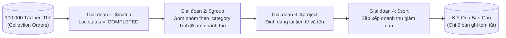

# MONGODB ARCHITECTURE & PRODUCTION ENGINEERING DEEP DIVE

> **Tài liệu lý thuyết chuyên sâu và hướng dẫn kiến trúc toàn diện về MongoDB (Document Database & WiredTiger Engine)**  
> Dành cho Software Engineer, Backend Developer và Database Architect từ cấp độ Intern đến Middle-level và Tech Lead.

---

## 📑 MỤC LỤC
1. [Mức Độ Cơ Bản (Basic Fundamentals)](#1-mức-độ-cơ-bản-basic-fundamentals)
2. [Mức Độ Trung Bình (Intermediate - Architecture & Use Cases)](#2-mức-độ-trung-bình-intermediate---architecture--use-cases)
3. [Mức Độ Chuyên Sâu: BẢN CHẤT VẬN HÀNH (Under The Hood & Core Mechanics)](#3-mức-độ-chuyên-sâu-bản-chất-vận-hành-under-the-hood--core-mechanics)
4. [Mức Độ Nâng Cao: Vận Hành Thực Chiến (Production Engineering & Best Practices)](#4-mức-độ-nâng-cao-vận-hành-thực-chiến-production-engineering--best-practices)
5. [Góc Nhìn Thực Chiến Cho Middle-Level Trở Xuống (Must-Know vs Nice-to-Know Roadmap)](#5-góc-nhìn-thực-chiến-cho-middle-level-trở-xuống-must-know-vs-nice-to-know-roadmap)
6. [So Sánh Bản Chất (First-Principles Comparison)](#6-so-sánh-bản-chất-first-principles-comparison)
7. [Sơ Đồ Trực Quan (Mermaid Diagrams)](#7-sơ-đồ-trực-quan-mermaid-diagrams)
8. [Bảng Tra Thuật Ngữ Chi Tiết (Glossary)](#8-bảng-tra-thuật-ngữ-chi-tiết-glossary)
9. [Hướng Dẫn Chạy & Kiểm Thử Hệ Thống (Step-by-Step Run Guide)](#9-hướng-dẫn-chạy--kiểm-thử-hệ-thống-step-by-step-run-guide)

---

## 1. Mức Độ Cơ Bản (Basic Fundamentals)

### 1.1. Định nghĩa & Ẩn dụ đời thực (Real-world Analogy)
**MongoDB** (xuất phát từ chữ *"Humongous"* - Khổng lồ) là một hệ quản trị cơ sở dữ liệu phi quan hệ mã nguồn mở thuộc nhóm **Document Database (Cơ sở dữ liệu dạng Tài Liệu)**. Thay vì lưu dữ liệu dưới dạng các hàng và cột cố định như cơ sở dữ liệu quan hệ (RDBMS), MongoDB lưu trữ dữ liệu dưới dạng các tài liệu linh hoạt (**Documents**) theo định dạng nhị phân **BSON** (Binary JSON).

```
+-----------------------------------------------------------------------------------+
|                        ẨN DỤ: BẢNG TÍNH EXCEL VS TỦ KẸP HỒ SƠ LINH HOẠT           |
|                                                                                   |
|  [RDBMS TRUYỀN THỐNG - SQL] - BẢNG TÍNH EXCEL CỐ ĐỊNH CỘT:                        |
|   - Bắt buộc phải có sẵn các cột cố định (Schema rígido).                         |
|   - Thêm 1 cột mới (ví dụ "Kích thước áo") => Toàn bộ 10 triệu dòng đều phải nạp  |
|     thêm cột đó, dù 8 triệu dòng kia là sản phẩm điện tử (Lãng phí / Khó sửa đổi).|
|   - Muốn xem đầy đủ thông tin: Phải JOIN qua 5 bảng khác nhau (Chậm chạp).        |
|                                                                                   |
|  [MONGODB - NOSQL] - TỦ HỒ SƠ KẸP TÀI LIỆU JSON ĐA DẠNG:                          |
|   - Mỗi bản ghi là một TẬP HỒ SƠ RIÊNG BIỆT (Document).                           |
|   - Hồ sơ Laptop: Chứa CPU, RAM, Ổ cứng.                                          |
|   - Hồ sơ Quần áo: Chứa Size, Màu sắc, Chất liệu.                                 |
|   - Chúng nằm chung một ngăn kéo (Collection) mà không xung đột!                  |
|   - Mở tập hồ sơ ra là có NGAY TOÀN BỘ THÔNG TIN trong 1 lần đọc duy nhất!        |
+-----------------------------------------------------------------------------------+
```

- **Nếu không có MongoDB**: Khi xây dựng sàn thương mại điện tử với hàng triệu mặt hàng đa dạng (từ điện thoại, thời trang, nội thất đến đồ ăn), thiết kế cơ sở dữ liệu SQL truyền thống sẽ rơi vào cái bẫy **EAV (Entity-Attribute-Value)** hoặc phải tạo ra hàng chục bảng trung gian nối `JOIN` chằng chịt, khiến truy vấn chậm chạp và bảo trì cực kỳ khổ sở.
- **Khi có MongoDB**: Mỗi sản phẩm là một tài liệu JSON/BSON tự mô tả (Self-describing), lưu trữ trực tiếp các thuộc tính động, mảng lồng nhau (Embedded Arrays) và đối tượng con một cách tự nhiên.

---

### 1.2. Ánh Xạ Thuật Ngữ Giữa SQL và MongoDB

| RDBMS (SQL) | MongoDB (NoSQL) | Ý Nghĩa Thực Tế |
| :--- | :--- | :--- |
| **Database** | **Database** | Vùng chứa logic gom nhóm các bảng / collection. |
| **Table** | **Collection** | Tập hợp các bản ghi (Không bắt buộc chung cấu trúc). |
| **Row / Record** | **Document (BSON)** | Một bản ghi dữ liệu đơn lẻ (Tối đa $16\text{MB}$). |
| **Column** | **Field** | Trường dữ liệu (Key-Value pair). |
| **Primary Key (`id`)** | **`_id` (ObjectId)** | Khóa chính duy nhất 12-byte tự động tạo. |
| **Foreign Key / JOIN** | **Embedding HOẶC `$lookup`** | Nhúng trực tiếp tài liệu con hoặc tham chiếu liên kết. |
| **Index** | **Index (B-Tree)** | Chỉ mục tối ưu hóa tốc độ tìm kiếm $O(\log N)$. |

---

## 2. Mức Độ Trung Bình (Intermediate - Architecture & Use Cases)

### 2.1. Các thành phần cốt lõi của MongoDB

1. **Tài liệu BSON (Binary JSON)**:
   - Dữ liệu lưu trên đĩa và truyền qua mạng ở dạng nhị phân BSON, hỗ trợ các kiểu dữ liệu phong phú hơn JSON thuần: `ObjectId`, `Date`, `Decimal128` (cho tính toán tiền tệ chính xác), `Binary Data`, `RegExp`.
2. **Khóa Chính Tự Động: `_id` & Cấu Trúc ObjectId (12 Bytes)**:
   - Một chuỗi 12-byte hexadecimal độc nhất vô nhị trên toàn cầu:
     - **4 bytes đầu**: Timestamp thời điểm tạo document (tính bằng giây). Giúp tự sắp xếp theo thời gian mà không cần thêm trường `createdAt`!
     - **5 bytes tiếp theo**: Giá trị ngẫu nhiên duy nhất cho máy chủ và tiến trình (Machine & Process Identifier).
     - **3 bytes cuối**: Bộ đếm tự tăng (Incrementing Counter).
3. **Các Loại Chỉ Mục (Indexes)**:
   - **Single Field Index**: Đánh chỉ mục trên 1 trường duy nhất (`{ email: 1 }`).
   - **Compound Index**: Đánh chỉ mục trên nhiều trường kết hợp (`{ status: 1, createdAt: -1 }`).
   - **TTL Index (Time-To-Live)**: Tự động xóa tài liệu sau $N$ giây (tuyệt vời cho lưu session, cache, mã OTP, log tạm).
   - **Text Index & Geospatial Index (2dsphere)**: Tìm kiếm toàn văn bản và tìm kiếm vị trí địa lý bán kính.
4. **Đường Ống Xử Lý Tổng Hợp (Aggregation Pipeline)**:
   - Công cụ phân tích và tổng hợp dữ liệu mạnh mẽ gồm nhiều giai đoạn liên hoàn: `$match` (Lọc) $\rightarrow$ `$group` (Gom nhóm và tính tổng/trung bình) $\rightarrow$ `$project` (Chọn lọc và đổi tên trường) $\rightarrow$ `$sort` (Sắp xếp) $\rightarrow$ `$unwind` (Trải phẳng mảng).

---

### 2.2. Khi nào NÊN dùng và KHÔNG NÊN dùng MongoDB

#### ✅ Khi nào NÊN dùng MongoDB (Best Use Cases)
1. **Catalog Sản Phẩm Đa Thuộc Tính (E-Commerce Product Catalogs)**: Mỗi loại mặt hàng có thuộc tính riêng biệt (quần áo có size/màu, điện thoại có ram/rom/chip).
2. **Hệ Quản Trị Nội Dung (CMS, Blogs, Social Networks)**: Bài viết có danh sách bình luận, thẻ tags nhúng trực tiếp vào cùng một document.
3. **Lưu Trữ Logs, Sự Kiện & Dữ Liệu Cảm Biến IoT**: Dữ liệu có cấu trúc thay đổi liên tục, tần suất ghi cực lớn, cần tự động xóa bằng TTL Index.
4. **Ứng Dụng Yêu Cầu Scale-Out Dữ Liệu Khổng Lồ (Sharding)**: Cần mở rộng dung lượng lên hàng Terabytes/Petabytes qua nhiều máy chủ phân tán một cách tự nhiên.

#### ❌ Khi nào KHÔNG NÊN dùng MongoDB (What to Avoid)
1. **Hệ Thống Giao Dịch Ngân Hàng Đa Bảng Phức Tạp (Core Banking)**: Yêu cầu chuẩn hóa 3NF tuyệt đối, các ràng buộc khóa ngoại (Foreign Key Constraints) khắt khe trên hàng trăm bảng quan hệ. Lúc này **PostgreSQL** là lựa chọn số 1.
2. **Hệ Thống Phân Tích OLAP Khổng Lồ Cho Data Warehouse**: Đòi hỏi quét hàng tỷ dòng theo cột (Columnar Database). Lúc này hãy dùng **BigQuery** hoặc **ClickHouse**.

---

## 3. Mức Độ Chuyên Sâu: BẢN CHẤT VẬN HÀNH (Under The Hood & Core Mechanics)

### 3.1. Bộ Máy Lưu Trữ WiredTiger (WiredTiger Storage Engine)
Từ phiên bản 3.2 trở đi, MongoDB sử dụng **WiredTiger** làm Storage Engine mặc định:

```
+------------------------------------------------------------------------------------+
|                KIẾN TRÚC BỘ MÁY LƯU TRỮ WIREDTIGER TRONG MONGODB                   |
|                                                                                    |
|  [CLIENT GHI DỮ LIỆU]                                                              |
|        |                                                                           |
|        +---> 1. Ghi tuần tự vào JOURNAL (Write-Ahead Log trên ổ cứng)              |
|        |        (Chống mất dữ liệu nếu cúp điện đột ngột)                          |
|        |                                                                           |
|        v                                                                           |
|  +------------------------------------------------------------------------------+  |
|  | WIREDTIGER CACHE (Bộ nhớ RAM nội bộ - Thường chiếm 50% RAM máy chủ - 1GB)    |  |
|  | - Lưu trữ B-Tree Nodes dữ liệu chưa nén (In-Memory Pages)                     |  |
|  | - Sửa đổi dữ liệu tại đây cực nhanh (O(1) / O(log N))                          |  |
|  +------------------------------------------------------------------------------+  |
|        |                                                                           |
|        | 2. CHECKPOINT ĐỊNH KỲ (Mỗi 60 giây hoặc khi Journal đạt 2GB)              |
|        v                                                                           |
|  +------------------------------------------------------------------------------+  |
|  | FILE SYSTEM PAGE CACHE CỦA HỆ ĐIỀU HÀNH LINUX                                 |  |
|  | - WiredTiger nén dữ liệu bằng thuật toán Snappy / zlib trước khi ghi            |  |
|  | - Tiết kiệm tới 60% - 70% dung lượng đĩa cứng so với dữ liệu thô!               |  |
|  +------------------------------------------------------------------------------+  |
|        |                                                                           |
|        v 3. DMA Flush                                                              |
|  [ Ổ ĐĨA CỨNG VẬT LÝ (NVMe / SSD Storage) ]                                        |
+------------------------------------------------------------------------------------+
```

#### Chi tiết cơ chế an toàn:
1. **Journaling (WAL - Write-Ahead Log)**: Trước khi dữ liệu kịp ghi xuống file dữ liệu chính, MongoDB ghi tuần tự (Append-only) vào file Journal trên đĩa cứng. Nếu máy chủ bị rút phích cắm điện, khi khởi động lại MongoDB chỉ cần đọc lại Journal để phục hồi nguyên vẹn các transaction chưa kịp checkpoint.
2. **Checkpointing**: Cứ mỗi 60 giây, WiredTiger tạo một điểm nhất quán (Checkpoint) bằng cách đồng bộ toàn bộ các trang dữ liệu bẩn (Dirty Pages) từ RAM xuống đĩa cứng.

---

### 3.2. Cấp Độ Nhất Quán & An Toàn: Write Concern & Read Concern
MongoDB cho phép lập trình viên tinh chỉnh sự cân bằng giữa **Hiệu Năng (Speed)** và **Độ An Toàn Dữ Liệu (Safety)** qua hai thông số vàng:

#### 1. Write Concern (`w` và `j`):
- `w: 1` (Mặc định): Server báo thành công ngay khi dữ liệu đã được ghi vào Primary Node. Cực nhanh nhưng nếu Primary chết trước khi kịp đồng bộ sang Secondary, dữ liệu có thể bị mất.
- `w: 'majority'`: Server chỉ báo thành công khi dữ liệu đã được **đa số (Majority, > 50%)** các node trong cụm Replica Set xác nhận đã lưu. Đảm bảo an toàn tuyệt đối chống mất dữ liệu khi failover.
- `j: true` (Journaled): Yêu cầu dữ liệu phải được flush trực tiếp vào file Journal trên đĩa cứng trước khi trả phản hồi.

#### 2. Read Concern:
- `local` / `available`: Trả về dữ liệu mới nhất trên node đang đọc (có thể là Dirty Read nếu node đó bị rollback).
- `majority`: Chỉ đọc dữ liệu đã được đa số các node xác nhận cam kết (Miễn nhiễm hoàn toàn với Rollback).

---

### 3.3. Cơ Chế Sao Lưu & Tự Phục Hồi (Replica Set & Raft-like Election)
Một cụm **Replica Set** tiêu chuẩn luôn gồm ít nhất **3 Nodes**: 1 Primary và 2 Secondaries (hoặc 1 Secondary + 1 Arbiter).

```
         +-------------------------------------+
         |      PRIMARY NODE (Nhận Đọc/Ghi)     |
         +-------------------------------------+
                 |                      |
      (Ghi Oplog)|                      |(Ghi Oplog)
                 v                      v
    +-----------------------+    +-----------------------+
    | SECONDARY NODE 1      |    | SECONDARY NODE 2      |
    | (Sao chép Oplog liên  |    | (Sao chép Oplog liên  |
    |  tục theo thời gian)  |    |  tục theo thời gian)  |
    +-----------------------+    +-----------------------+
```

1. **Oplog (Operations Log)**: Primary ghi lại mọi thao tác biến đổi dữ liệu vào một collection đặc biệt mang tên `local.oplog.rs` (Capped Collection). Các Secondary liên tục kéo (tail) Oplog này về để áp dụng lên dữ liệu của mình.
2. **Bầu cử tự động (Automatic Failover Election)**:
   - Các node gửi nhịp tim (Heartbeat) cho nhau mỗi 2 giây.
   - Nếu Primary không phản hồi sau 10 giây, 2 Secondary còn lại kích hoạt quy trình bầu cử theo giải thuật tương tự **Raft Consensus Protocol**. Node nào có Oplog mới nhất sẽ được bầu làm **Primary mới trong vòng < 2 giây** mà ứng dụng không bị gián đoạn!

---

## 4. Mức Độ Nâng Cao: Vận Hành Thực Chiến (Production Engineering & Best Practices)

### 4.1. Thiết Kế Mô Hình Dữ Liệu: Embedding vs Referencing
Sai lầm lớn nhất của người mới học MongoDB là thiết kế bảng giống hệt RDBMS (tách bảng và dùng Foreign Key).

```
QUY TẮC VÀNG THIẾT KẾ DATA MODEL MONGODB:
"Data that is accessed together should be stored together!"
(Dữ liệu nào thường được truy vấn cùng nhau thì nên lưu cùng một chỗ!)
```

1. **Mối quan hệ 1 - Vài (1-to-Few)** $\rightarrow$ **NHÚNG (EMBEDDING)**:
   - *Ví dụ*: Một người dùng có 2-3 địa chỉ giao hàng.
   - *Thiết kế*: Nhúng trực tiếp mảng `addresses: [{ street, city }]` vào trong document User. Lợi ích: Lấy toàn bộ thông tin chỉ trong 1 lần đọc đĩa duy nhất!
2. **Mối quan hệ 1 - Nhiều (1-to-Many)** $\rightarrow$ **THAM CHIẾU (REFERENCING)**:
   - *Ví dụ*: Một đơn hàng có thể có vài chục sản phẩm, hoặc một bộ phận có vài trăm nhân viên.
   - *Thiết kế*: Lưu mảng các `ObjectId` hoặc lưu `departmentId` ở phía nhân viên.
3. **Mối quan hệ 1 - Vô Tận (1-to-Squillions)** $\rightarrow$ **THAM CHIẾU NGƯỢC (PARENT REFERENCING)**:
   - *Ví dụ*: Một thiết bị IoT ghi lại 10 triệu dòng log cảm biến.
   - *Tuyệt đối không nhúng mảng vào Document Thiết bị* (sẽ làm vỡ giới hạn $16\text{MB}$/doc). Lưu từng log thành 1 document riêng chứa `deviceId`.

---

### 4.2. Tối Ưu Hóa Chỉ Mục: Quy Tắc ESR (Equality, Sort, Range)
Khi tạo Compound Index (Chỉ mục kết hợp) cho truy vấn phức tạp, thứ tự đặt các trường quyết định việc query chạy trong $1\text{ms}$ hay $1000\text{ms}$:

$$\mathbf{E} \text{ (Equality)} \longrightarrow \mathbf{S} \text{ (Sort)} \longrightarrow \mathbf{R} \text{ (Range)}$$

```javascript
// TRUY VẤN: Tìm các sản phẩm thuộc danh mục 'Laptops', sắp xếp theo giá tăng dần, và số lượng tồn kho > 0
db.products.find({ category: 'Laptops', stock: { $gt: 0 } }).sort({ price: 1 });

// CHỈ MỤC CHUẨN MỰC THEO QUY TẮC ESR:
// 1. E (Equality): category (so sánh bằng)
// 2. S (Sort): price (sắp xếp)
// 3. R (Range): stock (so sánh khoảng > 0)
db.products.createIndex({ category: 1, price: 1, stock: 1 });
```
*Tại sao?* Nếu đặt Range trước Sort, MongoDB sẽ quét một tập dữ liệu lớn qua bộ nhớ RAM để sắp xếp lại (In-Memory Sort), gây chậm và dễ dính lỗi `Sort exceeded memory limit of 33554432 bytes`.

---

### 4.3. Anti-patterns & Sai lầm Phổ Biến Trong Dự Án

#### ❌ Sai lầm 1: Mảng Tăng Vô Hạn (Unbounded Arrays)
- **Hiện tượng**: Tạo một document bài viết và nhúng toàn bộ bình luận vào mảng `comments: []`. Khi bài viết viral có 50.000 bình luận, document vượt quá giới hạn cứng **$16\text{MB}$**, câu lệnh ghi bị lỗi `BSONObjMaxUserSize` làm sập ứng dụng!
- **Khắc phục**: Áp dụng mô hình **Subset Pattern** (chỉ nhúng 10 bình luận mới nhất vào bài viết để hiển thị nhanh, các bình luận cũ lưu sang collection `comments` riêng).

#### ❌ Sai lầm 2: Lạm Dụng `$lookup` Biến MongoDB Thành RDBMS Chậm Chạp
- **Hiện tượng**: Thiết kế dữ liệu phẳng hoàn toàn như SQL, sau đó trong code liên tục dùng `$lookup` để join 4-5 collection.
- **Khắc phục**: Tận dụng triệt để sức mạnh của Embedding. Chấp nhận phi chuẩn hóa (Denormalization) có kiểm soát để đổi lại tốc độ đọc $O(1)$.

---

## 5. Góc Nhìn Thực Chiến Cho Middle-Level Trở Xuống (Must-Know vs Nice-to-Know Roadmap)

```
+------------------------------------------------------------------------------------+
|               LỘ TRÌNH KỸ NĂNG MONGODB: PHÂN CẤP TỪ JUNIOR ĐẾN SENIOR              |
|                                                                                    |
|  [INTERN / JUNIOR] (80/20 - Sử dụng thực chiến)                                    |
|   ├── Hiểu rõ sự khác biệt giữa Table/Row (SQL) và Collection/Document (NoSQL)     |
|   ├── Thao tác CRUD cơ bản qua Mongoose / Native Driver (find, insert, update, del)|
|   ├── Sử dụng các toán tử truy vấn phổ biến ($in, $gt, $set, $push, $pull)         |
|   ├── Phân biệt rõ kiểu dữ liệu ObjectId và cách truy vấn theo `_id`               |
|   └── Tạo chỉ mục cơ bản (Single Index) trên các trường thường xuyên tìm kiếm      |
|                                                                                    |
|  ============================== Ranh giới Middle ===============================   |
|                                                                                    |
|  [MIDDLE-LEVEL] (Mô hình hóa dữ liệu chuẩn mực, Aggregation & Tối ưu hiệu năng)    |
|   ├── Nắm vững nghệ thuật Data Modeling: Embedding vs Referencing (1-N, 1-Squillion)|
|   ├── Sử dụng thành thạo Aggregation Pipeline ($match, $group, $project, $lookup)  |
|   ├── Tối ưu hóa Compound Index theo quy tắc vàng ESR (Equality, Sort, Range)      |
|   ├── Đọc và phân tích Explain Plan (`executionStats`), loại bỏ triệt để COLLSCAN   |
|   ├── Cấu hình Write Concern (`w: majority`) và TTL Index tự động dọn rác          |
|   └── Hiểu rõ cơ chế Failover của Replica Set và WiredTiger Checkpoint             |
|                                                                                    |
|  ============================== Ranh giới Senior / DBA =========================   |
|                                                                                    |
|  [SENIOR / DATABASE ARCHITECT] (Tạm thời bỏ qua nếu ở mức Middle trở xuống)        |
|   ├── Thiết kế kiến trúc phân mảnh Sharding (Lựa chọn Shard Key: Hash vs Range)    |
|   ├── Tinh chỉnh WiredTiger Cache Size và Linux Virtual Memory Dirty Ratios        |
|   ├── Quản trị phân vùng đa trung tâm dữ liệu (Zone Sharding / Tag-aware Sharding) |
|   └── Xử lý xung đột Oplog Truncation và Distributed Transactions đa Shard        |
+------------------------------------------------------------------------------------+
```

---

### 5.1. Chi Tiết Đáp Án & Kỹ Thuật Thực Chiến Cho Cấp Độ [INTERN / JUNIOR]

#### 1. Hiểu rõ sự khác biệt giữa Table/Row (SQL) và Collection/Document (NoSQL)
- **Vấn đề thực tế:** Khi chuyển từ SQL sang MongoDB, nhiều bạn vẫn cố gắng chia bảng thành 10 bảng nhỏ rồi `JOIN` liên tục, làm triệt tiêu sức mạnh của MongoDB.
- **Đáp án & Bản chất:** SQL lưu theo bảng 2 chiều cố định (schema rigid). MongoDB lưu theo Document dạng JSON/BSON linh hoạt. Một Document có thể chứa mảng, đối tượng lồng nhau (Nested Objects), giúp gom dữ liệu liên quan vào 1 chỗ để đọc nhanh trong 1 lần truy cập đĩa.

#### 2. Thao tác CRUD cơ bản qua Mongoose / Native Driver
- **Đáp án & Code chuẩn:**
```typescript
import mongoose, { Schema } from 'mongoose';

const UserSchema = new Schema({
  name: { type: String, required: true },
  email: { type: String, unique: true },
  age: Number,
});
const UserModel = mongoose.model('User', UserSchema);

// Create: await UserModel.create({ name: 'Tri', email: 'tri@test.com', age: 25 });
// Read:   const user = await UserModel.findOne({ email: 'tri@test.com' });
// Update: await UserModel.updateOne({ _id: user._id }, { $set: { age: 26 } });
// Delete: await UserModel.deleteOne({ _id: user._id });
```

#### 3. Sử dụng các toán tử truy vấn phổ biến (`$in`, `$gt`, `$set`, `$push`, `$pull`)
- **Đáp án & Code chuẩn:**
```typescript
// Tìm người dùng có tuổi > 18 và trạng thái nằm trong danh sách
await UserModel.find({
  age: { $gt: 18 },
  status: { $in: ['ACTIVE', 'VERIFIED'] },
});

// Cập nhật: $set thay đổi trường, $push thêm vào mảng, $pull xóa khỏi mảng
await UserModel.updateOne(
  { _id: userId },
  {
    $set: { lastActive: new Date() },
    $push: { tags: 'VIP' },
    $pull: { notifications: { isRead: true } },
  }
);
```

#### 4. Phân biệt rõ kiểu dữ liệu ObjectId và cách truy vấn theo `_id`
- **Vấn đề thực tế:** Client gửi lên chuỗi String `'651234abcd...'`. Nếu dùng driver native mà không cast sang `ObjectId` thì `find({ _id: '651234...' })` sẽ trả về `null` vì sai kiểu dữ liệu BSON.
- **Đáp án & Code chuẩn:**
```typescript
import { ObjectId } from 'mongodb';
// Luôn bọc new ObjectId() khi dùng Native Driver (Mongoose tự động cast nhưng native thì không)
const user = await db.collection('users').findOne({ _id: new ObjectId(userIdString) });
```

#### 5. Tạo chỉ mục cơ bản (Single Index) trên các trường thường xuyên tìm kiếm
- **Vấn đề thực tế:** Nếu không đánh index, câu lệnh tìm theo `email` sẽ quét toàn bộ Collection (`COLLSCAN`) ngốn 100% CPU.
- **Đáp án & Code chuẩn:**
```typescript
// Đánh index trên email: 1 là sắp xếp tăng dần
UserSchema.index({ email: 1 });
// Hoặc bằng MongoDB Shell:
// db.users.createIndex({ email: 1 });
```

---

### 5.2. Chi Tiết Đáp Án & Kỹ Thuật Thực Chiến Cho Cấp Độ [MIDDLE-LEVEL]

#### 1. Nắm vững nghệ thuật Data Modeling: Embedding vs Referencing (1-N, 1-Squillion)
- **Đáp án chuẩn kiến trúc:**
  - **Embedding (Nhúng mảng con):** Áp dụng cho quan hệ `1 - Vài` (1-to-Few, ví dụ 1 User có 2-3 địa chỉ). Dữ liệu luôn được đọc cùng nhau, chỉ tốn 1 lần đọc đĩa.
  - **Referencing (Lưu ID tham chiếu):** Áp dụng cho quan hệ `1 - Rất nhiều` (1-to-Squillions, ví dụ 1 Cửa hàng có 10 triệu Log giao dịch). Nếu nhúng sẽ vượt quá giới hạn cứng $16\text{MB}$ của 1 Document trong MongoDB và làm chậm bộ nhớ.

#### 2. Sử dụng thành thạo Aggregation Pipeline (`$match`, `$group`, `$project`, `$lookup`)
- **Đáp án & Code chuẩn:**
```typescript
// Tính tổng doanh thu theo từng danh mục sản phẩm của các đơn hàng đã thanh toán
const stats = await OrderModel.aggregate([
  { $match: { status: 'PAID' } }, // 1. Lọc đơn đã trả tiền (Tận dụng Index)
  { $unwind: '$items' },          // 2. Tách mảng items thành từng dòng
  {
    $group: {                     // 3. Gom nhóm theo danh mục
      _id: '$items.categoryId',
      totalRevenue: { $sum: { $multiply: ['$items.price', '$items.quantity'] } },
      orderCount: { $sum: 1 },
    },
  },
  { $sort: { totalRevenue: -1 } }, // 4. Sắp xếp giảm dần
  { $limit: 10 }                   // 5. Lấy top 10
]);
```

#### 3. Tối ưu hóa Compound Index theo quy tắc vàng ESR (Equality, Sort, Range)
- **Vấn đề thực tế:** Tạo chỉ mục gồm nhiều trường nhưng sai thứ tự sẽ khiến MongoDB phải sắp xếp trong RAM (`InMemorySort`), gây chậm truy vấn.
- **Đáp án & Quy tắc ESR:** Khi viết index tổng hợp cho câu query `find({ status: 'ACTIVE', age: { $gte: 20 } }).sort({ createdAt: -1 })`:
  1. **E (Equality):** Đặt trường so sánh bằng lên đầu $\rightarrow$ `status: 1`
  2. **S (Sort):** Đặt trường sắp xếp tiếp theo $\rightarrow$ `createdAt: -1`
  3. **R (Range):** Đặt trường khoảng/lớn hơn/nhỏ hơn ở cuối $\rightarrow$ `age: 1`
  $\Rightarrow$ Tạo index: `{ status: 1, createdAt: -1, age: 1 }`.

#### 4. Đọc và phân tích Explain Plan (`executionStats`), loại bỏ triệt để COLLSCAN
- **Đáp án:** Chạy `.explain('executionStats')`.
  - Nếu thấy `stage: "COLLSCAN"` và `totalDocsExamined: 500000` trong khi `nReturned: 1` $\rightarrow$ Thảm họa quét toàn bộ bảng!
  - Mục tiêu tối thượng: Chuyển sang `stage: "IXSCAN"` (Index Scan) và `totalDocsExamined == nReturned`.

#### 5. Cấu hình Write Concern (`w: majority`) và TTL Index tự động dọn rác
- **Đáp án & Code chuẩn:**
```typescript
// 1. Write Concern đảm bảo dữ liệu ghi thành công lên đa số Replica Nodes trước khi phản hồi (an toàn tài chính)
await OrderModel.create([orderData], { writeConcern: { w: 'majority', wtimeout: 5000 } });

// 2. TTL Index tự động xóa token/OTP sau 5 phút:
TokenSchema.index({ createdAt: 1 }, { expireAfterSeconds: 300 });
```

#### 6. Hiểu rõ cơ chế Failover của Replica Set và WiredTiger Checkpoint
- **Bản chất:** Replica Set gồm 1 Primary và 2 Secondary. Nếu Primary chết, 2 node còn lại tự bầu cử (Raft-like Consensus) trong 2-5 giây để đưa 1 Secondary lên làm Primary mới. WiredTiger định kỳ 60s tạo Checkpoint ghi dữ liệu từ RAM xuống Disk để đảm bảo độ bền (Durability).

---

### 5.3. Chi Tiết Kỹ Thuật Cho Cấp Độ [SENIOR / DATABASE ARCHITECT] (Mở Rộng)

#### 1. Thiết kế kiến trúc phân mảnh Sharding (Lựa chọn Shard Key: Hash vs Range)
- **Bản chất:** Khi dữ liệu vượt quá dung lượng 1 máy chủ, dùng `mongos` router chia dữ liệu qua các Shard. Chọn Hashed Shard Key để phân bổ dữ liệu đều tăm tắp chống Hotspot; chọn Ranged Shard Key khi cần tối ưu truy vấn theo dải thời gian liên tục.

#### 2. Tinh chỉnh WiredTiger Cache Size và Linux Virtual Memory Dirty Ratios
- **Bản chất:** WiredTiger mặc định chỉ chiếm 50% RAM cho cache của nó, 50% còn lại nhường cho OS Filesystem Cache. Senior cần tinh chỉnh `vm.dirty_background_ratio` để OS xả dữ liệu xuống NVMe SSD nhịp nhàng, tránh I/O freeze.

#### 3. Quản trị phân vùng đa trung tâm dữ liệu (Zone Sharding / Tag-aware Sharding)
- **Bản chất:** Gắn thẻ địa lý cho Shard (`zone: "EU"`, `zone: "ASIA"`) để dữ liệu công dân Châu Âu nằm đúng trung tâm dữ liệu Frankfurt tuân thủ luật GDPR, đồng thời giảm độ trễ truy cập địa phương.

#### 4. Xử lý xung đột Oplog Truncation và Distributed Transactions đa Shard
- **Bản chất:** Quản lý kích thước Replication Oplog để các node mạng chậm không bị rơi vào trạng thái `RECOVERING` vô hạn. Quản trị Two-Phase Commit cho distributed transactions xuyên shard.

---

### 5.4. Bộ Câu Hỏi Phỏng Vấn Kinh Điển (Top Interview Questions)

#### Câu 1: Sự khác biệt bản chất giữa việc nhúng dữ liệu (Embedding) và tham chiếu (Referencing) trong MongoDB là gì? Khi nào nên chọn cách nào?
> **Trả lời mẫu ghi điểm**:  
> "Khác biệt cốt lõi nằm ở cách dữ liệu được tổ chức vật lý trên đĩa cứng:  
> - **Embedding (Nhúng)**: Lưu trữ các tài liệu con trực tiếp bên trong một tài liệu cha duy nhất. Ưu điểm là tối đa hóa hiệu năng đọc (chỉ cần 1 thao tác đọc đĩa duy nhất là lấy được toàn bộ dữ liệu) và đảm bảo tính nguyên tử (Atomic Write) trên toàn bộ tài liệu. Nên dùng khi mối quan hệ là '1 - Vài' (1-to-Few) và dữ liệu thường xuyên được đọc cùng nhau (ví dụ: các địa chỉ của 1 người dùng).  
> - **Referencing (Tham chiếu)**: Lưu trữ các tài liệu ở các collection riêng biệt và liên kết với nhau qua `ObjectId`. Ưu điểm là tránh trùng lặp dữ liệu, giữ kích thước document nhỏ hơn $16\text{MB}$ và dễ quản lý khi dữ liệu tăng trưởng vô tận. Nên dùng khi mối quan hệ là '1 - Rất nhiều' (1-to-Many / 1-to-Squillions) hoặc dữ liệu thường xuyên được cập nhật độc lập mà không cần đọc kèm tài liệu cha."

#### Câu 2: Trong MongoDB, `COLLSCAN` là gì và tại sao nó là kẻ thù số 1 của hiệu năng hệ thống? Làm thế nào để khắc phục?
> **Trả lời mẫu ghi điểm**:  
> "`COLLSCAN` (Collection Scan) là trạng thái mà bộ máy truy vấn của MongoDB phải đọc tuần tự toàn bộ từng tài liệu có trong Collection từ đầu đến cuối trên đĩa cứng để tìm ra các bản ghi thỏa mãn điều kiện, tương đương với độ phức tạp $O(N)$ (giống Full Table Scan trong SQL). Khi collection có hàng triệu bản ghi, `COLLSCAN` sẽ làm nghẽn hoàn toàn I/O đĩa cứng và đẩy thời gian phản hồi từ vài mili-giây lên hàng giây.  
> Để khắc phục, ta chạy lệnh `.explain('executionStats')` để phân tích truy vấn. Khi phát hiện `COLLSCAN`, ta phải tạo chỉ mục (Index) thích hợp trên các trường tìm kiếm để chuyển trạng thái sang `IXSCAN` (Index Scan). Lúc này MongoDB chỉ cần duyệt qua cấu trúc cây B-Tree với độ phức tạp $O(\log N)$, giảm số lượng tài liệu cần quét từ hàng triệu xuống chỉ còn đúng số lượng bản ghi cần tìm."

#### Câu 3: Hãy giải thích ý nghĩa của thông số `Write Concern` trong MongoDB và tại sao trong các ứng dụng tài chính ta nên đặt `w: 'majority'`?
> **Trả lời mẫu ghi điểm**:  
> "`Write Concern` là mức độ bảo đảm an toàn mà MongoDB cam kết trước khi trả về phản hồi ghi thành công cho Client:  
> - Với `w: 1` (mặc định), hệ thống báo thành công ngay khi dữ liệu được ghi vào RAM của node Primary. Nếu node Primary gặp sự cố sập nguồn trước khi kịp đồng bộ sang các Secondary, dữ liệu đó sẽ bị mất vĩnh viễn (Rollback).  
> - Với `w: 'majority'`, MongoDB chỉ trả về phản hồi thành công sau khi dữ liệu đã được ghi nhận an toàn trên đa số các node (trên 50% số node) trong cụm Replica Set.  
> Trong các ứng dụng nhạy cảm về tiền bạc và giao dịch, ta bắt buộc phải sử dụng `w: 'majority'` để đảm bảo ngay cả khi node Primary hiện tại đột ngột phát nổ, một trong các node Secondary đã nắm giữ dữ liệu đó sẽ được bầu làm Primary mới, ngăn chặn tuyệt đối nguy cơ mất mát dữ liệu tài chính."

---

## 6. So Sánh Bản Chất (First-Principles Comparison)

| Tiêu Chí | **MongoDB** | **PostgreSQL (với JSONB)** | **MySQL** | **Redis** |
| :--- | :--- | :--- | :--- | :--- |
| **Mô hình dữ liệu** | **Document BSON (Schema-less)**| Quan hệ + Bán cấu trúc JSONB| Quan hệ bảng cứng (RDBMS) | Key-Value In-Memory |
| **Tính linh hoạt Schema**| **Tuyệt đối** (Mỗi doc có cấu trúc riêng)| Trung bình (Schema cứng + cột JSON) | Cứng nhắc (Cần ALTER TABLE)| Rất cao |
| **Khả năng JOIN** | Hỗ trợ cơ bản qua `$lookup` | **Xuất sắc** (Hỗ trợ JOIN phức tạp) | **Xuất sắc** | Không hỗ trợ |
| **Mở rộng chiều ngang**| **Tích hợp sẵn Sharding tự nhiên** | Khó (Cần plugin Citus) | Khó (Cần Vitess / ShardingSphere)| Redis Cluster Sharding |
| **Hiệu năng Ghi** | **Rất cao** (WiredTiger Append Journal)| Cao | Trung bình | **Siêu tốc** (RAM thuần túy) |
| **Trường hợp khuyên dùng**| Catalog sản phẩm, CMS, IoT, Big Data | Ứng dụng nghiệp vụ chuẩn mực, Fintech | Monolith web truyền thống | Cache, Session, Leaderboard |

---

## 7. Sơ Đồ Trực Quan (Mermaid Diagrams)

### 7.1. Sơ đồ Đường Ống Xử Lý Tổng Hợp (Aggregation Pipeline)


---

## 8. Bảng Tra Thuật Ngữ Chi Tiết (Glossary)

| Thuật Ngữ | Tên Tiếng Anh | Định Nghĩa & Ý Nghĩa Thực Tiễn |
| :--- | :--- | :--- |
| **BSON** | Binary JSON | Định dạng mã hóa nhị phân của JSON do MongoDB phát triển, bổ sung thêm kiểu dữ liệu và tăng tốc độ duyệt $O(1)$. |
| **ObjectId** | ObjectId | Khóa chính 12-byte duy nhất tự động sinh ra cho mỗi document, tích hợp sẵn dấu ấn thời gian (Timestamp). |
| **WiredTiger** | WiredTiger Engine | Bộ máy lưu trữ cốt lõi của MongoDB phụ trách việc quản lý RAM Cache, nén dữ liệu và ghi đĩa. |
| **COLLSCAN** | Collection Scan | Hiện tượng truy vấn phải quét toàn bộ từng document trong collection do thiếu Index, gây chậm hệ thống nghiêm trọng. |
| **IXSCAN** | Index Scan | Trạng thái truy vấn tối ưu tận dụng cây B-Tree của Index để tìm nhanh bản ghi với độ phức tạp $O(\log N)$. |
| **Replica Set** | Replica Set | Cụm máy chủ MongoDB gồm nhiều node giữ bản sao dữ liệu giống nhau để đảm bảo tính sẵn sàng cao (High Availability). |
| **Oplog** | Operations Log | Collection đặc biệt lưu nhật ký tuần tự các thay đổi dữ liệu dùng để đồng bộ giữa Primary và các Secondary. |
| **Sharding** | Sharding | Kỹ thuật phân mảnh dữ liệu ngang qua nhiều máy chủ khác nhau để mở rộng dung lượng vượt giới hạn của 1 máy đơn lẻ. |
| **Write Concern** | Write Concern | Cấp độ bảo đảm xác nhận an toàn dữ liệu từ cụm máy chủ trước khi trả phản hồi ghi cho Client. |
| **TTL Index** | Time-To-Live Index | Loại chỉ mục đặc biệt tự động xóa document sau một khoảng thời gian hết hạn định trước. |

---

## 9. Hướng Dẫn Chạy & Kiểm Thử Hệ Thống (Step-by-Step Run Guide)

### 9.1. Cấu trúc thư mục Dự Án Demo
Dự án demo MongoDB bao gồm:
- **Hạ tầng (`docker-compose.yml`)**: Khởi chạy MongoDB 7.0 + Mongo Express UI (giao diện quản trị database trực quan trên cổng 8082) + Backend Express/Mongoose + Frontend Dashboard.
- **Backend Service (`backend/`)**:
  - Mô hình Dynamic Product Catalog với thuộc tính linh hoạt (Embedded specs).
  - API Aggregation Pipeline tính toán doanh thu bán hàng theo danh mục.
  - API Benchmark đo lường sự chênh lệch hiệu năng giữa **IXSCAN (Có Index)** và **COLLSCAN (Không có Index)** trên 10.000 bản ghi.
- **Frontend Dashboard (React/Vite)**: Giao diện trực quan hóa Catalog sản phẩm, Studio Aggregation Pipeline và bảng phân tích Explain Plan Benchmark.

### 9.2. Lệnh Khởi Chạy
Mở terminal tại thư mục dự án:

```bash
# 1. Di chuyển vào thư mục MongoDB
cd /Users/ductri0981/Documents/Studying-Software/Web_And_Technologies/mongodb

# 2. Khởi chạy toàn bộ hệ thống bằng Docker Compose
docker compose up -d --build
```

Sau khi khởi chạy:
- **Frontend MongoDB Console**: Truy cập `http://localhost:5181`.
- **Mongo Express Web UI**: Truy cập `http://localhost:8082` để xem trực tiếp các collection trong cơ sở dữ liệu.
- **Backend API**: `http://localhost:4003/api`.

---

### 9.3. Kịch Bản Kiểm Thử Thực Tế Trên Giao Diện

#### Kịch Bản 1: Kiểm Chứng Mô Hình Tài Liệu Linh Hoạt (Dynamic Schema)
1. Trên giao diện, chọn Tab **"Product Catalog"**.
2. Nhấn nút **"Tạo Sản Phẩm Laptop"**: Chứa các trường đặc thù như `specs: { cpu, ram, ssd }`.
3. Nhấn nút **"Tạo Sản Phẩm Thời Trang"**: Chứa các trường hoàn toàn khác như `specs: { size, color, material }`.
4. Quan sát: Cả hai sản phẩm cùng nằm chung trong 1 Collection `products` mà không hề gặp lỗi cấu trúc (No ALTER TABLE needed)!

#### Kịch Bản 2: Kiểm Chứng Sức Mạnh Aggregation Pipeline
1. Chuyển sang Tab **"Aggregation Studio"**.
2. Nhấn nút **"Chạy Pipeline Báo Cáo Doanh Thu"**:
   - Hệ thống thực thi 4 giai đoạn (`$match` $\rightarrow$ `$group` $\rightarrow$ `$project` $\rightarrow$ `$sort`).
   - Kết quả: Trả về biểu đồ phân tích doanh thu theo từng danh mục hàng hóa trong **chưa đầy 5ms**!

#### Kịch Bản 3: Benchmark Hiệu Năng: IXSCAN vs COLLSCAN
1. Chuyển sang Tab **"Index Performance Benchmark"**.
2. Nhấn nút **"Chạy Truy Vấn KHÔNG CÓ INDEX (COLLSCAN)"**:
   - Quan sát số lượng document đã quét: $10.000\text{ docs}$ (Quét toàn bộ đĩa cứng).
   - Thời gian thực thi: **~80ms - 120ms**.
3. Nhấn nút **"Chạy Truy Vấn CÓ INDEX (IXSCAN)"**:
   - Quan sát số lượng document đã quét: Đúng $1\text{ doc}$!
   - Thời gian thực thi: **1ms - 2ms** (Nhanh hơn gấp 50x lần!).
