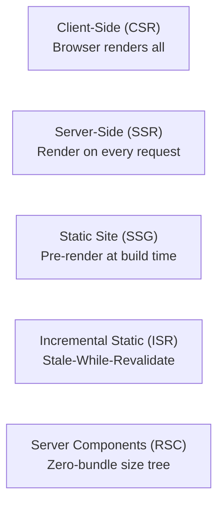
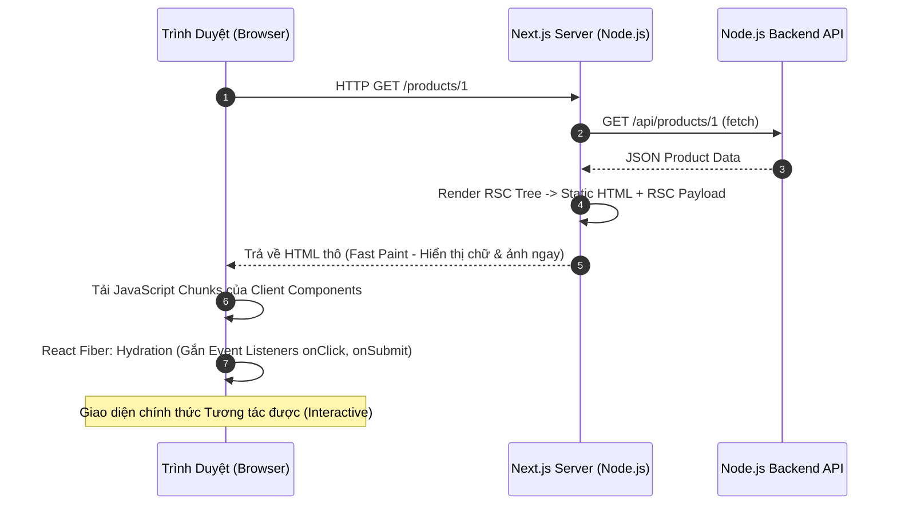
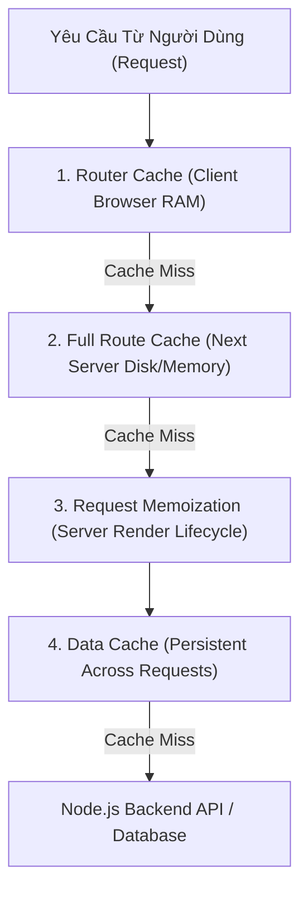
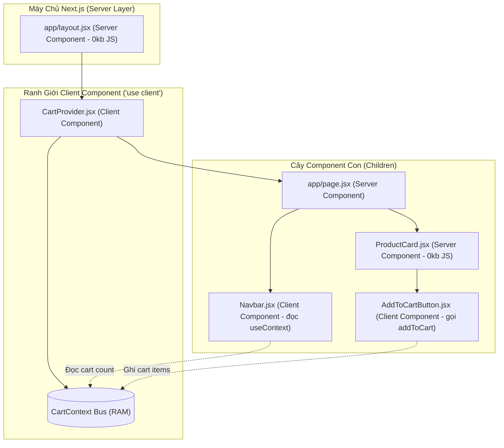
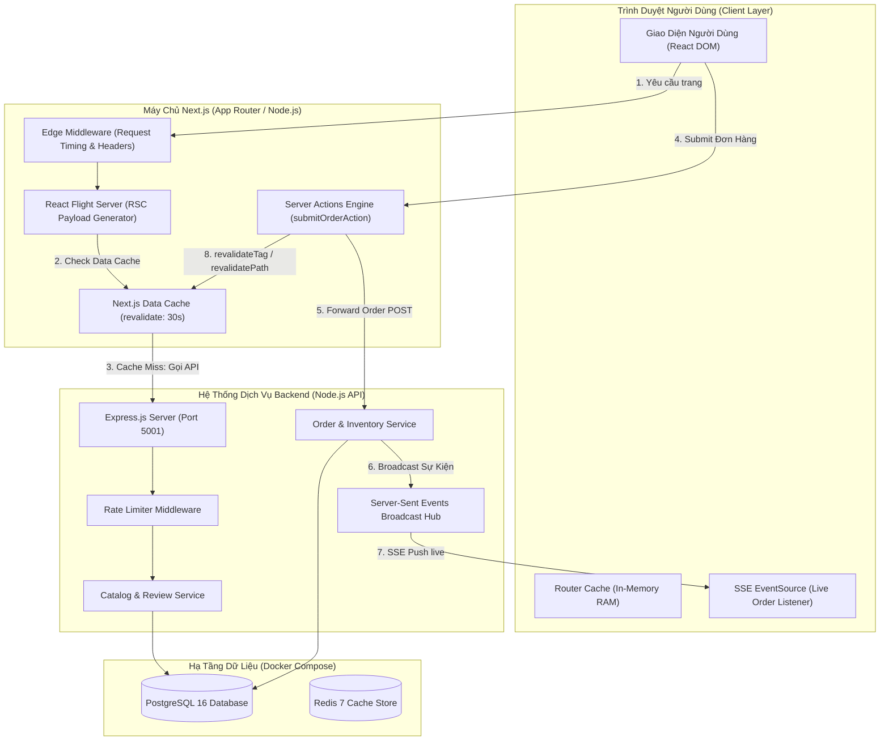

# Next.js - Concept Deep Dive (Từ Nền Tảng Đến Bản Chất Lõi Hệ Thống)

Tài liệu này cung cấp cái nhìn toàn diện từ các khái niệm cơ bản cho đến mức độ chuyên gia (Hardcore Deep Dive), bóc tách tận cùng bản chất vật lý, giao thức truyền tải, kiến trúc bộ nhớ và cơ chế thực thi của **Next.js App Router** kết hợp với **Node.js Backend**.

---

## Mục Lục (Table of Contents)
1. [Mức Độ Cơ Bản (Basic Fundamentals)](#1-mức-độ-cơ-bản-basic-fundamentals)
   - [Next.js Là Gì?](#11-nextjs-là-gì)
   - [Ẩn Dụ Đời Thực (Real-World Analogy)](#12-ẩn-dụ-đời-thực-real-world-analogy)
   - [Vấn Đề Cốt Lõi Mà Next.js Giải Quyết](#13-vấn-đề-cốt-lõi-mà-nextjs-giải-quyết)
2. [Mức Độ Trung Bình (Intermediate Architecture & Use Cases)](#2-mức-độ-trung-bình-intermediate-architecture--use-cases)
   - [Các Mô Hình Render (Rendering Paradigms)](#21-các-mô-hình-render-rendering-paradigms)
   - [Kiến Trúc App Router vs Pages Router](#22-kiến-trúc-app-router-vs-pages-router)
   - [Khi Nào NÊN và KHÔNG NÊN Dùng Next.js](#23-khi-nào-nên-và-không-nên-dùng-nextjs)
3. [Mức Độ Chuyên Sâu: BẢN CHẤT VẬN HÀNH (Under The Hood & Core Mechanics)](#3-mức-độ-chuyên-sâu-bản-chất-vận-hành-under-the-hood--core-mechanics)
   - [Giải Phẫu Định Dạng RSC Wire Format (React Flight Payload)](#31-giải-phẫu-định-dạng-rsc-wire-format-react-flight-payload)
   - [React Fiber Hydration & Bí Mật Đằng Sau Hydration Mismatch](#32-react-fiber-hydration--bí-mật-đằng-sau-hydration-mismatch)
   - [Bản Chất Vật Lý Của Dòng Chảy Dữ Liệu (Write & Read Path)](#33-bản-chất-vật-lý-của-dòng-chảy-dữ-liệu-write--read-path)
   - [Bốn Tầng Cache Độc Quyền Của Next.js](#34-bốn-tầng-cache-độc-quyền-của-nextjs-the-4-caching-layers)
   - [Tương Tác Runtime: Node.js Runtime vs Edge Runtime](#35-tương-tác-runtime-nodejs-runtime-vs-edge-runtime)
   - [Bản Chất Cốt Lõi Của React Hooks & Context API Trong App Router](#36-bản-chất-cốt-lõi-của-react-hooks--context-api-trong-nextjs-app-router)
4. [Mức Độ Nâng Cao: Vận Hành Thực Chiến (Production Engineering & Best Practices)](#4-mức-độ-nâng-cao-vận-hành-thực-chiến-production-engineering--best-practices)
   - [Cạm Bẫy 1: Thác Nước Fetch Dữ Liệu (Waterfall Requests)](#41-cạm-bẫy-1-thác-nước-fetch-dữ-liệu-waterfall-requests)
   - [Cạm Bẫy 2: Đẩy Directive 'use client' Lên Quá Cao](#42-cạm-bẫy-2-đẩy-directive-use-client-lên-quá-cao)
   - [Cạm Bẫy 3: Rò Rỉ Bí Mật (Secret Leaks & server-only)](#43-cạm-bẫy-3-rò-rỉ-bí-mật-secret-leaks)
   - [Quản Lý Cache Invalidation & Revalidation Chiến Lược](#44-quản-lý-cache-invalidation--revalidation-chiến-lược)
5. [Góc Nhìn Thực Chiến Cho Middle-Level Trở Xuống (Must-Know vs Nice-to-Know Roadmap)](#5-góc-nhìn-thực-chiến-cho-middle-level-trở-xuống-must-know-vs-nice-to-know-roadmap)
   - [Phân định ranh giới kiến thức theo từng cấp độ](#phân-định-ranh-giới-kiến-thức-theo-từng-cấp-độ)
   - [Bộ câu hỏi phỏng vấn thực chiến kinh điển (Intern -> Middle)](#bộ-câu-hỏi-phỏng-vấn-thực-chiến-kinh-điển-intern---middle)
   - [Những thứ TẠM THỜI BỎ QUA (Dành riêng cho Senior / Tech Lead / SRE)](#những-thứ-tạm-thời-bỏ-qua-dành-riêng-cho-senior--tech-lead--sre)
6. [So Sánh Theo Nguyên Lý Gốc (First-Principles Comparison)](#6-so-sánh-theo-nguyên-lý-gốc-first-principles-comparison)
7. [Sơ Đồ Kiến Trúc Hệ Thống (Mermaid Diagram)](#7-sơ-đồ-kiến-trúc-hệ-thống-mermaid-diagram)
8. [Bảng Tra Cứu Thuật Ngữ Kỹ Thuật (Glossary)](#8-bảng-tra-cứu-thuật-ngữ-kỹ-thuật-glossary)
9. [Hướng Dẫn Khởi Chạy & Kịch Bản Kiểm Chứng Thực Tế (Run Guide)](#9-hướng-dẫn-khởi-chạy--kịch-bản-kiểm-chứng-thực-tế)

---

## 1. Mức Độ Cơ Bản (Basic Fundamentals)

### 1.1 Next.js Là Gì?
Next.js là một **React Framework cho Production**, được xây dựng để giải quyết các hạn chế lớn nhất của mô hình Single Page Application (SPA) truyền thống. Thay vì chỉ chạy JavaScript trên trình duyệt của người dùng (Client-Side Rendering), Next.js kết hợp sức mạnh của **Server (Node.js / Edge Runtime)** và **Client (Trình duyệt)** để tạo ra trải nghiệm web tải tức thì, tối ưu hóa SEO và bảo mật dữ liệu.

### 1.2 Ẩn Dụ Đời Thực (Real-World Analogy)
* **Single Page Application (Vite / CRA - Client-Side Rendering)**: Giống như bạn vào nhà hàng và bồi bàn mang ra cho bạn một rổ nguyên liệu tươi sống kèm một tờ công thức nấu ăn, rồi bắt bạn tự bật bếp ga tại bàn để nấu từ đầu đến cuối. Trình duyệt của bạn phải tải một file JS khổng lồ (vài MB), phân tích cú pháp, rồi mới vẽ được giao diện. Nếu máy yếu hoặc mạng lag, khách hàng sẽ nhìn vào màn hình trắng trơn (Blank White Screen).
* **Next.js (Server-Side Rendering / RSC)**: Giống như nhà bếp trung tâm với các đầu bếp 5 sao đã nấu chín sẵn toàn bộ món ăn, bày biện đẹp mắt lên đĩa nóng hổi và mang thẳng ra bàn cho bạn thưởng thức ngay lập tức. Sau đó, bồi bàn chỉ mang thêm một chút gia vị (Client interactivity) để bạn tùy chỉnh. Bạn thấy thức ăn ngay trong tích tắc (FCP cực nhanh), và các con bọ tìm kiếm của Google (Web Crawlers) có thể đọc toàn bộ nội dung mà không cần chạy JavaScript.

### 1.3 Vấn Đề Cốt Lõi Mà Next.js Giải Quyết
Trước khi Next.js ra đời, các kỹ sư phần mềm phải đối mặt với một sự đánh đổi nghiệt ngã (Trade-off):
1. **Multi-Page Application (MPA truyền thống như PHP, JSP, Ruby on Rails)**: Tốt cho SEO và tải trang đầu nhanh, nhưng mỗi lần click chuyển trang thì toàn bộ màn hình bị nhấp nháy (Full page reload), mất toàn bộ trạng thái (State) và trải nghiệm người dùng rất giật cục.
2. **Single Page Application (React / Vue thuần)**: Chuyển trang mượt mà không reload, nhưng điểm SEO cực kém (vì bot chỉ thấy `<div id="root"></div>` rỗng), First Contentful Paint (FCP) rất chậm và kích thước gói bundle JS ngày càng phình to theo thời gian.
3. **Giải pháp của Next.js**: Kết hợp tinh hoa của cả hai thế giới: **Lần đầu tiên tải trang (Initial Load)** được kết xuất sẵn từ Server (HTML đầy đủ), nhưng **các lần chuyển trang sau đó (Subsequent Navigation)** lại hoạt động như một SPA mượt mà thông qua cơ chế nạp trước (Prefetching) và Soft Navigation.

---

## 2. Mức Độ Trung Bình (Intermediate Architecture & Use Cases)

### 2.1 Các Mô Hình Render (Rendering Paradigms)



| Mô Hình | Thời Điểm Render | Chi Phí Server | Tốc Độ Phản Hồi | Phù Hợp Cho |
| :--- | :--- | :--- | :--- | :--- |
| **CSR (Client-Side)** | Trên trình duyệt | Rất thấp (Static file) | Chậm lần đầu | Dashboard nội bộ, CMS Admin có đăng nhập |
| **SSR (Server-Side)** | Tại mỗi Request đến | Trung bình - Cao | Phụ thuộc latency DB | Trang cá nhân hóa cao, Bảng giá realtime |
| **SSG (Static Site)** | Tại Build Time (`next build`) | Cực thấp (CDN Cache) | Nhanh nhất ($< 50\text{ms}$) | Blog, Tài liệu kỹ thuật, Trang landing page |
| **ISR (Incremental)** | Build time + Background Revalidate | Rất thấp | Cực nhanh | Trang sản phẩm E-commerce, Tin tức báo chí |
| **RSC (Server Comp.)**| Server render $\rightarrow$ RSC Flight Stream | Tối ưu | Cực nhanh + 0kb JS | Mặc định trong App Router từ Next.js 13+ |

### 2.2 Kiến Trúc App Router vs Pages Router

* **Pages Router (`pages/`) - Thế hệ cũ**:
  - Dựa trên các hàm vòng đời: `getServerSideProps`, `getStaticProps`, `getInitialProps`.
  - Nguyên lý "Tất cả hoặc không": Toàn bộ trang phải là SSR hoặc SSG. Dù code chạy trên server nhưng toàn bộ code component vẫn bị đóng gói vào bundle JS gửi xuống browser để phục vụ Hydration!
* **App Router (`app/`) - Thế hệ mới**:
  - Dựa trên **React Server Components (RSC)** và React 18/19 Architecture.
  - Phân tách rõ ràng giữa **Server Component** (chạy mãi mãi trên server, 0 byte JS gửi xuống client) và **Client Component** (`'use client'`, chỉ dùng cho tương tác người dùng).
  - Hỗ trợ lồng ghép (Interleaving): Server Component có thể bọc Client Component, và Client Component có thể nhận Server Component làm `children`.

### 2.3 Khi Nào NÊN và KHÔNG NÊN Dùng Next.js

#### ✅ NÊN DÙNG:
1. **Ứng dụng cần SEO xuất sắc**: E-commerce, nền tảng tin tức, mạng xã hội, diễn đàn, landing page.
2. **Ứng dụng có lượng người dùng lớn**: Cần phân phối qua CDN toàn cầu (Edge Network) với TTFB thấp.
3. **Ứng dụng Full-Stack vừa và lớn**: Muốn viết cả giao diện lẫn Server Actions / API Gateway trên cùng một codebase tinh gọn.

#### ❌ KHÔNG NÊN DÙNG:
1. **Ứng dụng thuần túy Offline-First**: Ứng dụng PWA cần chạy hoàn toàn khi mất mạng.
2. **Dashboard nội bộ phía sau tường lửa (Intranet)**: Nơi không cần SEO, mọi trang đều cần xác thực nghiêm ngặt và dữ liệu thay đổi liên tục theo mili-giây. Dùng Vite React SPA hoặc TanStack Router sẽ đơn giản và tiết kiệm chi phí server hơn.

---

## 3. Mức Độ Chuyên Sâu: BẢN CHẤT VẬN HÀNH (Under The Hood & Core Mechanics)

Đây là tầng kiến trúc sâu nhất, bóc tách cơ chế bên trong của Next.js và React Server Components.

---

### 3.1 Giải Phẫu Định Dạng RSC Wire Format (React Flight Payload)

Khi một React Server Component (RSC) được render trên server, Next.js **KHÔNG** trả về mã nguồn JavaScript của component đó cho trình duyệt. Thay vào đó, nó tạo ra một luồng dữ liệu nhị phân/văn bản đặc biệt gọi là **RSC Payload (Flight Protocol)**.

Hãy xem một ví dụ thực tế về chuỗi RSC Wire Format được gửi qua mạng:

```text
1:I["components/AddToCartButton.jsx",["app/page.js"],"default"]
2:{"name":"MacBook Pro M3 Max","price":3499,"stock":12}
0:["$","div",null,{"className":"product-card","children":[["$","h3",null,{"children":"MacBook Pro M3 Max"}],["$","$L1",null,{"product":"$2"}]]}]
```

#### Ý nghĩa từng ký tự trong Flight Protocol:
1. **`1:I[...]` (Module Reference Identifier)**: Đánh dấu một Client Component (`AddToCartButton`). Server nói với Browser: *"Tôi không render component này trên server, bạn hãy tải file chunk JS `AddToCartButton.jsx` về và hydrate tại vị trí này."*
2. **`2:{...}` (Serialized Props Stream)**: Dữ liệu JSON được serialize chứa props truyền từ Server Component sang Client Component.
3. **`0:["$","div",...]` (Virtual DOM Tuple)**: 
   - Ký tự `$` tượng trưng cho `Symbol.for('react.element')`.
   - Tuple đại diện cho cây ảo: `[Type, Key, Props]`.
   - `$L1`: Trỏ tới Client Component ở dòng 1 với props là `$2`.

#### 💡 Điểm Đột Phá Về Bản Chất:
Toàn bộ mã xử lý logic nặng, các hàm tiện ích (utilities), các thư viện parse Markdown khổng lồ hay Database Drivers chỉ nằm trên Server. **Kích thước bundle JavaScript gửi về client bằng 0 byte đối với Server Component!**

---

### 3.2 React Fiber Hydration & Bí Mật Đằng Sau Hydration Mismatch



#### Quá Trình Hydration Diễn Ra Như Thế Nào?
1. **Bước 1 (Paint HTML)**: Trình duyệt nhận chuỗi HTML thô do Server trả về và vẽ ra màn hình (DOM Nodes thật). Người dùng đã có thể đọc chữ và xem hình ảnh.
2. **Bước 2 (Build VDOM)**: Trình duyệt tải các file JS client và dựng lại cây Virtual DOM (React Fiber Tree) trong bộ nhớ.
3. **Bước 3 (Reconciliation & Event Attachment)**: React duyệt qua cây Real DOM đang có sẵn trên màn hình, so khớp từng thuộc tính (Attributes) và gắn các sự kiện (`addEventListener('click')`, `onChange`) vào đúng node DOM tương ứng mà **KHÔNG CẦN TẠO LẠI DOM MỚI**.

#### Cơn Ác Mộng: Hydration Mismatch Là Gì?
Nếu HTML do Server tạo ra khác với Virtual DOM do Client tạo ra trong lần render đầu tiên (ví dụ: dùng `typeof window !== 'undefined'`, dùng `Date.now()` hoặc `Math.random()`), React Fiber sẽ phát hiện sự bất nhất:
- React cảnh báo: *"Text content did not match. Server: 'X' Client: 'Y'"*.
- Hậu quả: React buộc phải hủy bỏ toàn bộ cây DOM có sẵn và re-render lại từ đầu trên client, gây giật lag giao diện và phá hỏng toàn bộ lợi thế hiệu năng của SSR.

---

### 3.3 Bản Chất Vật Lý Của Dòng Chảy Dữ Liệu (Write & Read Path)

#### Read Path: HTTP/2 Chunked Transfer & Progressive Streaming
Next.js tận dụng cơ chế **Chunked Transfer Encoding** của HTTP/1.1 và **Multiplexed Streams** của HTTP/2:

1. **Chặng 1 (Head Flush)**: Server gửi ngay lập tức thẻ `<head>`, các thẻ CSS, và phần khung trang tĩnh (Header, Navbar, Skeleton). Trình duyệt lập tức render layout trong vòng $10\text{ms}$.
2. **Chặng 2 (Async Boundary Suspension)**: Khi gặp component bất đồng bộ nằm trong `<Suspense fallback={<Skeleton />}>` (như `ReviewsStream` bị trễ 1.5s):
   - Server Next.js gửi thẻ `<template id="B:0"></template>` đại diện cho vị trí của Reviews.
   - Kết nối TCP/HTTP vẫn được **giữ mở (Keep-Alive)**.
3. **Chặng 3 (Chunk Injection)**: Sau 1.5s, khi Node.js backend trả về reviews:
   - Server Next.js render Reviews thành đoạn HTML nhỏ và gửi tiếp chunk qua stream:
     ```html
     <div hidden id="S:0">...Nội dung đánh giá 5 sao...</div>
     <script>$RC("B:0", "S:0")</script>
     ```
   - Hàm JavaScript siêu nhỏ `$RC` (React Replace Chunk) lập tức nhặt khối HTML từ `S:0` thế chỗ vào vị trí `B:0` trên màn hình mà **không cần tải lại trang hay gọi thêm request fetch mới**!

#### Write Path: Server Actions & Cache Invalidation
Khi người dùng bấm Submit đơn hàng:
1. Trình duyệt gửi request HTTP `POST /checkout` với Header đặc biệt `Next-Action: <action-id>`.
2. Next.js Server thực thi hàm `submitOrderAction()` trên Node.js.
3. Hàm gọi sang Node.js Backend API trừ kho hàng.
4. Khi gặp lệnh `revalidateTag('products')` hoặc `revalidatePath('/')`:
   - Next.js xóa các mục tương ứng trong bộ nhớ **Data Cache**.
   - Next.js tạo mới cây RSC Payload của các trang bị ảnh hưởng.
5. **Đột phá**: Next.js trả về kết quả mutation VÀ luồng RSC Payload mới **trong cùng một HTTP Round-trip duy nhất**. Trình duyệt cập nhật giao diện ngay lập tức mà không cần gọi thêm request GET thứ hai!

---

### 3.4 Bốn Tầng Cache Độc Quyền Của Next.js (The 4 Caching Layers)

Next.js sở hữu hệ thống bộ nhớ đệm đa tầng phức tạp nhất trong thế giới web:



1. **Request Memoization (Server)**:
   - *Phạm vi*: Trong vòng đời của 1 request duy nhất (1 render pass).
   - *Bản chất*: Nếu bạn gọi `fetch('http://api/products')` ở 5 component khác nhau trong cùng 1 trang, Next.js tự động gom lại và chỉ gọi mạng đến Backend **đúng 1 lần duy nhất**. Dữ liệu được lưu trong bộ nhớ tạm của hàm render.
2. **Data Cache (Server - Bền Vững)**:
   - *Phạm vi*: Kéo dài xuyên suốt nhiều request của nhiều người dùng khác nhau.
   - *Bản chất*: Lưu trữ kết quả của các hàm `fetch(url, { next: { revalidate: 30 } })` xuống đĩa cứng hoặc Redis. Khi hết 30 giây, cơ chế **Stale-While-Revalidate (SWR)** cho phép trả về dữ liệu cũ ngay lập tức trong khi âm thầm gọi backend để làm mới dữ liệu cho request tiếp theo.
3. **Full Route Cache (Server)**:
   - *Phạm vi*: Bền vững trên server.
   - *Bản chất*: Lưu trữ toàn bộ mã HTML và RSC Payload của các trang tĩnh (Static Pages). Khi có request đến, Next.js không chạy lại code JavaScript mà trả thẳng file từ cache với tốc độ tương đương NGINX.
4. **Router Cache (Client Browser)**:
   - *Phạm vi*: Lưu trong bộ nhớ RAM của tab trình duyệt hiện tại.
   - *Bản chất*: Khi người dùng di chuột qua các thẻ `<Link href="/products/1">`, Next.js âm thầm nạp trước (prefetch) RSC Payload vào RAM trình duyệt. Khi người dùng click, trang mở ra tức thì ($0\text{ms}$) mà không cần gửi tín hiệu về server.

---

### 3.5 Tương Tác Hệ Điều Hành & Phần Cứng: Node.js Runtime vs Edge Runtime

| Tiêu Chí | Node.js Runtime (Default) | Edge Runtime (V8 Isolates) |
| :--- | :--- | :--- |
| **Công nghệ nền tảng** | Node.js Process (V8 + Libuv event-loop) | Lightweight V8 Engine Isolates |
| **Thời gian khởi động (Cold Start)** | $\sim 200\text{ms} - 1000\text{ms}$ | $\sim 0\text{ms} - 5\text{ms}$ |
| **Dung lượng RAM tiêu thụ** | Lớn ($\sim 50\text{MB} - 200\text{MB}$ / container) | Cực nhỏ ($\sim 5\text{MB}$ / isolate) |
| **Hỗ trợ API** | Toàn bộ API của Node.js (`fs`, `net`, `crypto`, native addons) | Chỉ hỗ trợ Web Standard APIs (`fetch`, `Request`, `Response`, `SubtleCrypto`) |
| **Truy cập Database trực tiếp** | Tốt (hỗ trợ mọi ORM, Prisma, TypeORM, TCP Sockets) | Hạn chế (chỉ hỗ trợ HTTP-based DB như Supabase, Neon, Upstash) |
| **Vị trí triển khai** | Single Server / Kubernetes / Docker | Hàng trăm PoP (Edge CDN) sát cạnh người dùng |

---

### 3.6 Bản Chất Cốt Lõi Của React Hooks & Context API Trong Next.js App Router

Khi làm việc với các file như `context/CartContext.jsx`, chúng ta thường xuyên sử dụng bộ công cụ React Hooks (`useState`, `useEffect`, `useContext`, `useMemo`, `useCallback`, `useRef`). Dưới đây là phân tích từ **cơ chế bộ nhớ tầng thấp (React Fiber Engine)** đến cách chúng tương tác với **Next.js App Router**.

---

#### 1. Ranh Giới Bất Khả Xâm Phạm: Server Components vs React Hooks
Trong Next.js App Router, có một quy tắc vàng: **React Hooks CHỈ HOẠT ĐỘNG TRONG CLIENT COMPONENTS (`'use client'`), TUYỆT ĐỐI CẤM DÙNG TRONG SERVER COMPONENTS (RSC).**

* **Tại sao lại như vậy? (Bản chất vật lý)**:
  - **Server Components (RSC)** chỉ là một hàm bất đồng bộ (async function) chạy đúng **MỘT LẦN DUY NHẤT** trên máy chủ Node.js để kết xuất HTML và Flight Payload. Sau khi trả luồng stream về mạng, tiến trình render kết thúc. RSC **không có vòng đời (No Lifecycle)**, không có khái niệm "re-render", không có DOM để bắt sự kiện click, và không có tab trình duyệt để duy trì trạng thái tương tác.
  - **React Hooks** (`useState`, `useEffect`...) được thiết kế để phục vụ cho **vòng đời tương tác người dùng trên trình duyệt**. Chúng cần bộ nhớ RAM của tab trình duyệt để ghi nhớ giá trị thay đổi theo thời gian.
  - Do đó, bất kỳ component nào muốn dùng Hook bắt buộc phải khai báo directive `'use client'` ở dòng đầu tiên.

---

#### 2. `createContext` & `useContext`: Cơ Chế Context Bus & Mô Hình "Provider Injection"



* **Vấn đề cốt lõi mà Context giải quyết**:
  - **Prop Drilling (Thủng tầng Props)**: Nếu không có Context, để truyền dữ liệu `cart` từ đỉnh trang xuống một nút bấm nằm sâu ở tầng thứ 10, bạn phải truyền prop qua tất cả 9 component trung gian, dù các component đó không hề cần đến dữ liệu này.
  - Context tạo ra một **Kênh truyền thông tin ngầm (Context Bus)**: Bất kỳ component nào nằm bên dưới `<Context.Provider>` đều có thể gọi `useContext(Context)` để lấy dữ liệu với độ phức tạp $O(1)$ mà không làm phiền các component trung gian.
* **Mô hình "Provider Injection Pattern" trong Next.js App Router**:
  - *Câu hỏi hóc búa*: Nếu `CartProvider` cần dùng `createContext` (vốn là Client Component), mà ta lại muốn bọc nó ở `app/layout.jsx` (Root Layout) để toàn bộ trang web đều dùng được giỏ hàng, thì **liệu toàn bộ trang web có bị biến thành Client Component không?**
  - *Câu trả lời là **KHÔNG**!* Nhờ cơ chế **React Composition (`children` prop)**:
    ```jsx
    // app/layout.jsx (Server Component 100%)
    import { CartProvider } from '../context/CartContext'; // Client Component

    export default function RootLayout({ children }) {
      return (
        <html>
          <body>
            <CartProvider>
              {children} {/* Các Server Components bên trong VẪN LÀ SERVER COMPONENTS! */}
            </CartProvider>
          </body>
        </html>
      );
    }
    ```
  - Khi Next.js biên dịch, `RootLayout` render `{children}` trên server thành HTML và RSC payload trước, sau đó mới nhét kết quả vào slot của `CartProvider`. **Các trang con bên trong vẫn giữ nguyên ưu điểm 0-byte JavaScript!**

---

#### 3. `useState`: Cấu Trúc Dữ Liệu Danh Sách Liên Kết (Linked List) Trong React Fiber

Nhiều lập trình viên nghĩ rằng khi gọi `useState(0)`, biến state được lưu cục bộ ngay trong hàm component. **Đây là một sự hiểu lầm lớn!** Khi state thay đổi, toàn bộ hàm component bị gọi lại từ đầu đến cuối, biến cục bộ sẽ bị reset.

* **Bản chất tầng thấp trong React Fiber**:
  - Mỗi component trên màn hình tương ứng với một node trên cây **Fiber Tree** (`FiberNode`).
  - Trong mỗi `FiberNode`, React lưu trữ một **Danh Sách Liên Kết Đơn (Singly Linked List)** của các Hooks tại thuộc tính `fiber.memoizedState`:
  
  ```
  FiberNode (CartProvider)
    └─ memoizedState ──► [Hook 1: useState(items)]
                            ├─ memoizedState: [] (Mảng sản phẩm)
                            ├─ queue: (Hàng đợi cập nhật)
                            └─ next ──► [Hook 2: useState(isLoaded)]
                                          ├─ memoizedState: false
                                          ├─ queue: ...
                                          └─ next ──► [Hook 3: useEffect] ──► null
  ```

* **Tại sao React cấm tuyệt đối gọi Hook trong `if`, `for` hay hàm lồng nhau?**
  - React **KHÔNG dùng tên biến** để phân biệt state! Nó nhận diện Hook hoàn toàn bằng **THỨ TỰ GỌI (Execution Index)** khi duyệt qua con trỏ `hook.next`.
  - Nếu bạn đặt `useState` bên trong câu lệnh `if (condition)`: Khi điều kiện đổi từ `true` sang `false`, một Hook bị bỏ qua $\rightarrow$ Con trỏ của danh sách liên kết sẽ bị lệch một bước $\rightarrow$ `isLoaded` sẽ đọc nhầm giá trị của `items` $\rightarrow$ Toàn bộ ứng dụng bị sập hoặc hỏng dữ liệu!
* **Cơ chế Gom Nhóm Tự Động (Automatic Batching trong React 18/19)**:
  - Nếu bạn gọi:
    ```javascript
    setItems(newItems);
    setIsLoaded(true);
    ```
  - React không chạy lại component 2 lần. Nó đẩy cả 2 cập nhật vào một hàng đợi (Update Queue) và xử lý trong **1 Microtask duy nhất**, chỉ kích hoạt đúng 1 lần Re-render để tối ưu hiệu năng CPU.

---

#### 4. `useEffect`: Vòng Đời Thực Thi & Cạm Bẫy Hydration Mismatch

* **Bản chất của `useEffect`**: Dùng để đồng bộ hóa component với các hệ thống bên ngoài React (External Systems) như LocalStorage, Web APIs, Timers, DOM Listeners, hoặc Network Sockets.
* **Ba giai đoạn thực thi (Execution Phases) trong Fiber**:
  1. **Render Phase**: React gọi hàm component để tính toán Virtual DOM (chạy thuần túy, không được có side-effect).
  2. **Commit Phase**: React cập nhật các thay đổi lên Real DOM của trình duyệt.
  3. **Passive Effects Phase**: **Sau khi trình duyệt đã vẽ xong giao diện (Browser Paint)**, React mới thực thi hàm callback bên trong `useEffect`. Việc này đảm bảo các tác vụ nặng (như đọc storage hay gọi API) không làm đơ khung hình của người dùng.
* **Tại sao `useEffect` KHÔNG BAO GIỜ chạy trên máy chủ (Server-Side)?**
  - Quá trình SSR trên Node.js chỉ chạy Render Phase để xuất ra chuỗi HTML thô (`renderToString`). Server không có DOM thật, không có màn hình hiển thị (No Paint), do đó React cố tình bỏ qua hoàn toàn các hàm `useEffect` trên máy chủ.
* **Cạm bẫy Hydration Mismatch kinh điển & Giải pháp trong `CartContext.jsx`**:
  - *Sai lầm phổ biến*:
    ```javascript
    // ❌ NGUY HIỂM:
    const [items, setItems] = useState(
      typeof window !== 'undefined' ? JSON.parse(localStorage.getItem('cart') || '[]') : []
    );
    ```
    - Trên Server: `window` là `undefined` $\rightarrow$ Server tạo ra HTML giỏ hàng rỗng: `<span class="badge">0</span>`.
    - Trên Browser: `localStorage` có 3 món hàng $\rightarrow$ Client tạo ra DOM: `<span class="badge">3</span>`.
    - **Kết quả**: React Fiber báo lỗi đỏ rực: *"Text content does not match server-rendered HTML"* và phải phá bỏ DOM để render lại từ đầu!
  - *Giải pháp chuẩn mực trong dự án*:
    ```javascript
    // ✅ CHUẨN DOANH NGHIỆP (Two-pass Rendering):
    const [items, setItems] = useState([]); // Khởi tạo rỗng đồng nhất cả Server & Client
    const [isLoaded, setIsLoaded] = useState(false);

    useEffect(() => {
      // Chỉ đọc localStorage SAU KHI component đã mount thành công trên Browser
      const saved = localStorage.getItem('techstore_cart');
      if (saved) setItems(JSON.parse(saved));
      setIsLoaded(true);
    }, []); // Chạy 1 lần duy nhất sau khi Hydration hoàn tất!
    ```

---

#### 5. `useMemo` & `useCallback`: Bộ Nhớ Đệm Hiệu Năng (Memoization)

* **`useMemo` (Cache Giá Trị Tính Toán)**:
  - Dùng để ghi nhớ kết quả của một phép tính tốn kém CPU:
    ```javascript
    const totalAmount = useMemo(() => {
      return items.reduce((sum, item) => sum + item.price * item.quantity, 0);
    }, [items]); // Chỉ tính toán lại khi mảng items thay đổi!
    ```
  - Trong mỗi lần render, React so sánh từng phần tử trong mảng dependencies bằng thuật toán `Object.is()`. Nếu không có gì đổi, nó trả lại kết quả cũ từ `memoizedState` trong $O(1)$.
* **`useCallback` (Cache Tham Chiếu Con Trỏ Hàm)**:
  - Trong JavaScript, mỗi lần hàm component chạy lại, mọi hàm khai báo bên trong nó đều được tạo ra ở **một địa chỉ ô nhớ hoàn toàn mới trong RAM**:
    ```javascript
    // Không dùng useCallback:
    const handleRemove = (id) => { ... }; // Ô nhớ 0x01 ở lần render 1, ô nhớ 0x02 ở lần render 2!
    ```
  - Nếu truyền `handleRemove` xuống component con được bọc trong `React.memo`, component con sẽ bị re-render vô ích vì nó tưởng prop bị thay đổi (so sánh con trỏ `0x01 !== 0x02`).
  - `useCallback(fn, deps)` giữ nguyên địa chỉ con trỏ hàm qua các lần render cho đến khi dependencies đổi.
* **⚠️ Cảnh Báo: Khi Nào KHÔNG NÊN Dùng `useMemo` / `useCallback`?**
  - Bản thân việc tạo closure và so sánh mảng dependencies trong `useMemo` cũng tiêu tốn bộ nhớ và chu kỳ CPU.
  - Nếu phép tính chỉ là một phép cộng trừ đơn giản (`item.price * item.quantity`), chi phí chạy `useMemo` còn nặng hơn việc tính toán trực tiếp! Chỉ dùng khi xử lý danh sách hàng ngàn phần tử hoặc các phép tính đồ họa/toán học phức tạp.

---

#### 6. `useRef`: Chiếc Hộp Bộ Nhớ Đột Biến (Mutable Container)

* **Sự khác biệt cốt lõi giữa `useRef` và `useState`**:
  - `useState`: Khi giá trị thay đổi $\rightarrow$ **Kích hoạt Re-render** component.
  - `useRef`: Khi `ref.current` thay đổi $\rightarrow$ **KHÔNG KÍCH HOẠT RE-RENDER**.
* **Hai ứng dụng thực tế quan trọng nhất**:
  1. **Truy cập trực tiếp DOM Element**: `const inputRef = useRef(null);` $\rightarrow$ `<input ref={inputRef} />` $\rightarrow$ gọi `inputRef.current.focus()`.
  2. **Lưu trữ biến trạng thái qua các lần render mà không muốn vẽ lại giao diện**: Ví dụ lưu trữ ID của hàm hẹn giờ (`timerId.current = setInterval(...)`), hoặc lưu giá trị trước đó (Previous Props) để so sánh.

---

## 4. Mức Độ Nâng Cao: Vận Hành Thực Chiến (Production Engineering & Best Practices)

### 4.1 Cạm Bẫy 1: Thác Nước Fetch Dữ Liệu (Waterfall Requests)
* **Sai lầm**:
  ```javascript
  // ❌ TỒI TỆ: Component con chờ Component cha xong mới bắt đầu fetch
  const user = await fetchUser();
  const orders = await fetchOrders(user.id);
  const recommendations = await fetchRecommendations();
  ```
* **Bản chất**: Mỗi lời gọi mạng tuần tự cộng dồn độ trễ ($100\text{ms} + 150\text{ms} + 200\text{ms} = 450\text{ms}$).
* **Giải pháp chuẩn**:
  - Dùng `Promise.all([fetchUser(), fetchRecommendations()])` để chạy song song.
  - Tách các khối độc lập ra các Server Component riêng biệt và bọc trong `<Suspense>`.

### 4.2 Cạm Bẫy 2: Đẩy Directive `'use client'` Lên Quá Cao
* **Sai lầm**: Đặt `'use client'` ngay trên đầu file `app/layout.jsx` hoặc `app/page.jsx` chỉ vì muốn dùng một hook nhỏ như `useState`.
* **Hậu quả**: Toàn bộ các component con bên dưới đều bị ép buộc biến thành Client Components, khiến kích thước bundle JS tải về trình duyệt tăng vọt và làm tê liệt tính năng Server Components!
* **Quy tắc vàng**: Đẩy `'use client'` xuống sâu nhất có thể ở các **lá của cây giao diện (Leaf Components)**.

### 4.3 Cạm Bẫy 3: Rò Rỉ Bí Mật (Secret Leaks)
* **Nguy cơ**: Sử dụng các biến môi trường nhạy cảm như `DATABASE_URL`, `STRIPE_SECRET_KEY` trong component có chỉ định `'use client'`.
* **Giải pháp**:
  - Không bao giờ đặt tiền tố `NEXT_PUBLIC_` cho các biến nhạy cảm.
  - Cài đặt package `server-only`:
    ```javascript
    import 'server-only';
    // Nếu file này vô tình bị import vào Client Component, build sẽ báo lỗi ngay lập tức!
    ```

### 4.4 Quản Lý Cache Invalidation & Revalidation Chiến Lược
* **Time-based Revalidation**:
  - Phù hợp với dữ liệu ít biến động như bài viết blog, thông số cấu hình:
    ```javascript
    fetch('https://api.example.com/posts', { next: { revalidate: 3600 } }); // 1 giờ
    ```
* **On-demand Revalidation với Tags (Khuyên Dùng)**:
  - Khi có hành động thay đổi dữ liệu (Server Action), hủy cache chính xác những dữ liệu liên quan:
    ```javascript
    // Khi gọi fetch:
    fetch('https://api.example.com/products', { next: { tags: ['products'] } });

    // Trong Server Action sau khi thêm/sửa sản phẩm:
    revalidateTag('products');
    ```
  - Tránh dùng `revalidatePath('/', 'layout')` quá đà vì sẽ xóa sạch cache của toàn bộ website, buộc server phải render lại toàn bộ.

---

## 5. Góc Nhìn Thực Chiến Cho Middle-Level Trở Xuống (Must-Know vs Nice-to-Know Roadmap)

### Phân định ranh giới kiến thức theo từng cấp độ

```
┌─────────────────────────────────────────────────────────────────────────────────┐
│ CẤP ĐỘ INTERN / JUNIOR (HIỂU BẢN CHẤT APP ROUTER & SỬ DỤNG ĐÚNG)                │
│  - Phân biệt rõ ràng Server Component (mặc định) vs Client Component ('use client') │
│  - Biết khi nào bắt buộc dùng 'use client' (hooks, onClick, browser APIs)        │
│  - Nắm vững hệ thống định tuyến thư mục: page.js, layout.js, loading.js         │
│  - Fetch dữ liệu trực tiếp trong Server Component bằng async/await               │
│  - Tránh lỗi Hydration Mismatch cơ bản khi đọc localStorage hoặc Date.now()      │
└─────────────────────────────────────────────────────────────────────────────────┘
                                        │
                                        ▼
┌─────────────────────────────────────────────────────────────────────────────────┐
│ CẤP ĐỘ MIDDLE-LEVEL (TỐI ƯU HÓA HIỆU NĂNG, CACHE & SERVER ACTIONS)              │
│  - Tối ưu Streaming & Suspense để loại bỏ Request Waterfalls                     │
│  - Kiểm soát 4 tầng Cache (Data Cache, Router Cache, Full Route Cache)          │
│  - Thiết kế Server Actions chuẩn mực kết hợp useTransition / useActionState     │
│  - Cấu hình On-demand Revalidation (revalidateTag) sau khi thao tác dữ liệu     │
│  - Tách bạch cấu trúc Component (Composition) để giữ 0kb bundle cho Server code  │
│  - Bảo vệ dữ liệu nhạy cảm bằng 'server-only'                                    │
└─────────────────────────────────────────────────────────────────────────────────┘
```

#### Intern / Junior: Những gì BẮT BUỘC phải nắm vững
1. **Mô hình tư duy cốt lõi**:
   - Mặc định mọi component trong App Router là **Server Component**. Chúng chạy trên server, truy cập trực tiếp backend/database an toàn, và có kích thước bundle 0 byte gửi về trình duyệt.
   - Chỉ thêm directive `'use client'` khi component thực sự cần: quản lý state (`useState`), bắt sự kiện (`onClick`, `onSubmit`), chạy hiệu ứng (`useEffect`), hoặc truy cập Web APIs (`window`, `localStorage`).
2. **Kỹ năng thực chiến**:
   - Không dùng `useEffect` để fetch dữ liệu trong trang nữa. Hãy biến component thành `async function Page()` và `await fetch()` trực tiếp.
   - Khi cần dùng `localStorage`, luôn đọc nó trong `useEffect` sau khi component đã mount trên client để tránh lỗi đỏ rực Hydration Mismatch.

#### Middle-Level: Tối ưu hóa & Thiết kế chuẩn mực
1. **Kiểm soát Waterfalls & Streaming**: Không bao giờ `await` tuần tự nhiều API độc lập. Dùng `Promise.all` hoặc tách thành các Server Component con bọc trong `<Suspense fallback={<Skeleton />}>` để truyền HTML sớm về cho client.
2. **Làm chủ Server Actions**: Viết mutations trực tiếp trong file action với directive `'use server'`. Tự động cập nhật giao diện bằng cách gọi `revalidateTag()` ngay sau mutation mà không cần trang phải reload.
3. **Tối ưu hóa Bundle Size**: Không bao giờ đặt `'use client'` ở root layout hay page component cấp cao. Luôn đẩy `'use client'` xuống sâu nhất tại các leaf components (như nút bấm, input form) và truyền Server Components qua `children`.

---

### Bộ câu hỏi phỏng vấn thực chiến kinh điển (Intern -> Middle)

#### Câu 1 (Intern/Junior): Server Component khác Client Component như thế nào? Khi nào bắt buộc phải dùng `'use client'`?
- **Trả lời ghi điểm**:
  - **Server Component (mặc định trong App Router)**: Chạy hoàn toàn trên máy chủ, tạo ra mã HTML và RSC Flight Payload. Code JavaScript của nó không bao giờ được gửi xuống browser (0 byte bundle size). Có thể truy cập trực tiếp file system, database, biến môi trường bí mật. Nhược điểm: Không dùng được hooks (`useState`, `useEffect`) và không bắt được sự kiện người dùng (`onClick`).
  - **Client Component (`'use client'`)**: Được render trước trên server thành HTML (SSR) và gửi kèm file JS chunk xuống browser để React gắn sự kiện (Hydration).
  - **Bắt buộc dùng `'use client'` khi**: Cần tương tác người dùng (`onClick`, `onChange`), dùng React State & Lifecycle Hooks (`useState`, `useReducer`, `useEffect`), hoặc dùng Browser APIs (`localStorage`, `navigator`, `window`).

#### Câu 2 (Junior/Middle): Lỗi Hydration Mismatch là gì? Làm thế nào để khắc phục khi cần hiển thị dữ liệu từ `localStorage`?
- **Trả lời ghi điểm**:
  - Hydration Mismatch xảy ra khi cấu trúc HTML do Server render ra không khớp chính xác với cây Virtual DOM mà React khởi tạo trên Client trong lần render đầu tiên.
  - Khi đọc `localStorage` trực tiếp trong `useState(localStorage.getItem('cart'))`: Server không có `window` nên render ra rỗng, trong khi Client có dữ liệu nên render ra có item $\rightarrow$ Lệch HTML và DOM $\rightarrow$ React báo lỗi và phải hủy DOM để render lại từ đầu.
  - **Cách khắc phục chuẩn (Two-pass rendering)**: Khởi tạo state bằng giá trị mặc định đồng nhất (`useState([])`), sau đó dùng `useEffect(() => { setItems(JSON.parse(localStorage.getItem('cart'))); }, [])` để chỉ đọc storage sau khi client đã mount thành công.

#### Câu 3 (Middle): Next.js App Router có các tầng Cache nào? Nếu database đã cập nhật nhưng trang web vẫn hiển thị dữ liệu cũ thì xử lý thế nào?
- **Trả lời ghi điểm**:
  - Next.js có 4 tầng cache: **Request Memoization** (trong 1 render pass), **Data Cache** (lưu kết quả `fetch` qua nhiều request), **Full Route Cache** (lưu HTML/RSC của trang tĩnh trên server), và **Router Cache** (lưu RSC payload trong RAM trình duyệt).
  - Hiện tượng web hiện dữ liệu cũ thường do **Data Cache** hoặc **Full Route Cache** đang giữ bản sao tĩnh.
  - **Cách xử lý**:
    1. Gán cache tags cho lời gọi dữ liệu: `fetch(url, { next: { tags: ['products'] } })`.
    2. Trong Server Action cập nhật sản phẩm, gọi ngay lệnh: `revalidateTag('products')` hoặc `revalidatePath('/products')`. Lệnh này sẽ xóa Data Cache cũ và làm mới Full Route Cache ngay trong cùng round-trip.

---

### Những thứ TẠM THỜI BỎ QUA (Dành riêng cho Senior / Tech Lead / SRE)
- **Cấu trúc nhị phân nội bộ của React Flight Protocol**: Không cần thuộc lòng các mã opcode `1:I[...]` hay chuỗi serialize `Symbol.for('react.element')`.
- **Cấu hình V8 Isolates & Edge CDN PoP**: Việc phân bổ bộ nhớ cho V8 Isolate và định tuyến địa lý thuộc về hạ tầng đám mây của Vercel / Cloudflare.
- **Tùy biến bộ nhớ Standalone Output Docker**: Tối ưu hóa Node.js garbage collection và heap size trong container Docker quy mô lớn dành cho DevOps/SRE.
- *Ở cấp độ Middle trở xuống, hãy tập trung vào việc phân định đúng Server/Client Component, xử lý cache mượt mà, viết Server Actions chuẩn và tối ưu hóa trải nghiệm tải trang với Suspense!*

---

## 6. So Sánh Theo Nguyên Lý Gốc (First-Principles Comparison)

| Tiêu Chí | Next.js 14/15 App Router | Vite + React (SPA thuần) | Remix / React Router v7 | Nuxt 3 (Vue Ecosystem) |
| :--- | :--- | :--- | :--- | :--- |
| **Kiến Trúc Thành Phần** | React Server Components (RSC) | 100% Client Components | Nested Routes + Loaders / Actions | Vue Server Engine (Nitro) |
| **Kích Thước Bundle Client** | **Nhỏ nhất** (RSC không gửi JS) | Lớn (toàn bộ app tải về client) | Trung bình (cần JS cho loaders) | Nhỏ - Trung bình |
| **Khả Năng Streaming** | Out-of-the-box với `<Suspense>` | Không hỗ trợ (Chỉ tải sau khi bundle tải xong) | Hỗ trợ qua hàm `defer()` | Hỗ trợ qua `useAsyncData` |
| **Mô Hình Bộ Nhớ Đệm** | 4 tầng Cache phức hợp tự động | Không có cache tích hợp | Phụ thuộc hoàn toàn HTTP Cache headers | Tích hợp Nitro Cache |
| **Độ Phức Tạp Học Tập** | Cao (Cần hiểu rõ ranh giới Server/Client) | Rất thấp | Trung bình | Trung bình |

---

## 7. Sơ Đồ Kiến Trúc Hệ Thống (Mermaid Diagram)



---

## 8. Bảng Tra Cứu Thuật Ngữ Kỹ Thuật (Glossary)

| Thuật Ngữ | Định Nghĩa & Bản Chất Kỹ Thuật |
| :--- | :--- |
| **React Server Component (RSC)** | Thành phần React chỉ chạy độc quyền trên Server, render ra chuỗi Flight Payload và HTML, không bao giờ được đóng gói vào JavaScript bundle gửi xuống trình duyệt. |
| **Client Component (`'use client'`)** | Thành phần React được render trước trên Server thành HTML (SSR) và được nạp kèm mã JavaScript xuống trình duyệt để React Fiber thực hiện gắn tương tác (Hydration). |
| **Hydration** | Quá trình React duyệt qua cây DOM tĩnh có sẵn do Server tạo ra và đăng ký các Event Listeners (`onClick`, `onSubmit`) để trang web có thể tương tác được. |
| **Flight Protocol / RSC Wire Format** | Định dạng giao thức nhị phân/văn bản dạng stream do React định nghĩa để tuần tự hóa cây Virtual DOM từ Server gửi về Browser. |
| **Incremental Static Regeneration (ISR)** | Kỹ thuật cho phép tái tạo (regenerate) các trang web tĩnh trong nền ngầm sau một khoảng thời gian định sẵn mà không cần build lại toàn bộ ứng dụng. |
| **Server Actions** | Các hàm bất đồng bộ chạy trên máy chủ được kích hoạt trực tiếp từ thẻ `<form>` hoặc Client Component, tự động mã hóa qua HTTP POST mà không cần tạo file API Route riêng. |
| **Chunked Transfer Encoding** | Cơ chế truyền tải dữ liệu của HTTP cho phép Server bắt đầu gửi các phần dữ liệu (chunks) về client ngay khi vừa tính toán xong mà không cần chờ toàn bộ trang render hoàn tất. |
| **Time to First Byte (TTFB)** | Khoảng thời gian từ lúc trình duyệt gửi request HTTP cho đến khi nhận được byte dữ liệu đầu tiên từ máy chủ. |
| **First Contentful Paint (FCP)** | Thời điểm mà trình duyệt render phần nội dung đầu tiên (chữ, hình ảnh, SVG) lên màn hình của người dùng. |
| **V8 Isolate** | Thể hiện (instance) độc lập của máy ảo V8 Engine với không gian bộ nhớ riêng biệt, cho phép khởi động cực nhanh trong vài phần nghìn giây tại các trạm Edge CDN. |

---

## 9. Hướng Dẫn Khởi Chạy & Kịch Bản Kiểm Chứng Thực Tế

### 9.1 Các Bước Khởi Chạy Hệ Thống

#### Bước 1: Khởi động Hạ tầng Docker (Tùy chọn)
Nếu bạn có Docker, khởi động PostgreSQL và Redis:
```bash
cd /Users/ductri0981/Documents/Studying-Software/Web_And_Technologies/nextjs
docker-compose up -d
```

#### Bước 2: Khởi động Backend Node.js
Mở terminal 1:
```bash
cd /Users/ductri0981/Documents/Studying-Software/Web_And_Technologies/nextjs/backend
npm install
npm run dev
# Server lắng nghe tại http://localhost:5001
```

#### Bước 3: Khởi động Frontend Next.js
Mở terminal 2:
```bash
cd /Users/ductri0981/Documents/Studying-Software/Web_And_Technologies/nextjs/frontend
npm install
npm run dev
# Next.js App Router khởi chạy tại http://localhost:3000
```

---

### 9.2 Các Kịch Bản Kiểm Chứng Trực Quan

#### Kịch bản 1: Kiểm chứng Zero-Bundle Size của React Server Component
1. Mở trình duyệt truy cập: `http://localhost:3000`.
2. Bấm phím `F12` mở Chrome DevTools $\rightarrow$ chuyển sang tab **Network** $\rightarrow$ chọn filter **JS**.
3. Tải lại trang: Bạn sẽ thấy **hoàn toàn không có mã nguồn của `ProductCard.jsx`** hay logic render catalog được tải về. Chỉ có file chunk nhỏ xíu của `AddToCartButton.jsx` (Client Component) được tải về để xử lý click!
4. Mở floating badge **Next.js Concept Inspector** ở góc dưới bên phải màn hình để xem giải thích trực quan.

#### Kịch bản 2: Kiểm chứng React Streaming & Suspense với độ trễ 1.5s
1. Bấm vào sản phẩm bất kỳ (ví dụ: `MacBook Pro M3 Max`).
2. Quan sát kỹ:
   - Toàn bộ thông tin sản phẩm, cấu hình Specs, hình ảnh hiển thị **NGAY LẬP TỨC**.
   - Phần "Đánh Giá Thực Tế Từ Người Dùng" phía dưới ban đầu hiển thị Skeleton nhấp nháy.
   - Sau đúng 1.5 giây (được Node.js backend cố tình làm trễ), khối đánh giá được stream mượt mà xuất hiện trên giao diện mà trình duyệt **không hề giật lag hay reload**.

#### Kịch bản 3: Kiểm chứng Next.js Server Actions & Node.js SSE Realtime
1. Mở 2 tab trình duyệt song song cạnh nhau:
   - **Tab 1**: Mở trang Admin Live Stream: `http://localhost:3000/admin`. Bạn sẽ thấy đèn trạng thái báo `Node.js SSE: CONNECTED`.
   - **Tab 2**: Mở trang Catalog `http://localhost:3000`, thêm sản phẩm vào giỏ và bấm nút **"Giỏ hàng"** $\rightarrow$ chuyển sang trang `http://localhost:3000/checkout`.
2. Tại Tab 2, điền họ tên, email và bấm nút **"Xác Nhận Đặt Hàng (Server Action)"**.
3. **Quan sát điều kỳ diệu**:
   - Tab 2: Server Action gửi request tới Node.js Backend, nhận mã đơn hàng và tự động kích hoạt `revalidateTag('products')`.
   - Tab 1: Trong cùng tích tắc đó, bảng điều khiển Admin nhận được gói tin SSE từ Node.js Backend và **đơn hàng mới tự động nhảy vào danh sách theo thời gian thực** kèm âm thanh/log trực quan!
   - Quay lại trang Catalog: Số lượng tồn kho (stock) của sản phẩm vừa mua đã tự động giảm đi đúng số lượng bạn đã đặt.
