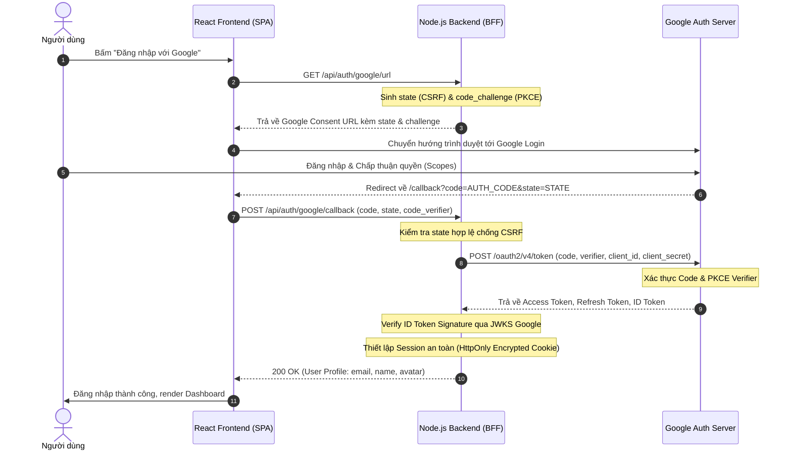

# Chuyên Đề: OAuth 2.0 & Google Authentication (Bản Chất, Vận Hành & Khắc Tinh Bảo Mật)

---

## 1. Mức Độ Cơ Bản (Dành cho người mới bắt đầu)

### 1.1. Ẩn dụ thực tế trực quan
Hãy tưởng tượng bạn lái xe đến một khách sạn hạng sang và sử dụng dịch vụ đỗ xe hộ (**Valet Parking**):
* **Cách ngây thơ (Anti-pattern):** Bạn giao toàn bộ chùm chìa khóa nhà, két sắt và chìa khóa tổng của chiếc xe cho nhân viên đỗ xe. Nhân viên có thể mở cốp, lục lọi tài sản cá nhân và thậm chí nhân bản chìa khóa để vào nhà bạn.
* **Cách chuẩn mực (OAuth 2.0):** Bạn chỉ giao cho họ chiếc **chìa khóa Valet** (Valet Key). Chiếc chìa khóa này chỉ có quyền khởi động máy và lái xe vào bãi đỗ với tốc độ tối đa 20km/h; nó không thể mở cốp xe, không mở được hộp đựng găng tay bí mật và tự động hết hiệu lực sau khi xe đã được đỗ.

> Trong thế giới phần mềm, **OAuth 2.0** chính là cơ chế cấp phát "chìa khóa Valet" (Access Token) cho ứng dụng bên thứ ba (Third-party App) truy cập tài nguyên của bạn trên Google Drive, Gmail hay Google Calendar mà **không bao giờ phải giao mật khẩu tài khoản Google** của bạn cho ứng dụng đó.

### 1.2. Vấn đề thực tế mà OAuth 2.0 giải quyết
Trước khi có OAuth, nếu bạn muốn một ứng dụng in ảnh (như PhotoPrint) in album ảnh từ tài khoản Flickr của bạn, bạn phải:
1. Nhập username và password Flickr trực tiếp vào ứng dụng PhotoPrint.
2. Ứng dụng lưu mật khẩu dạng plaintext trong cơ sở dữ liệu của họ.
3. Ứng dụng có toàn quyền trên tài khoản Flickr của bạn (xóa ảnh, đổi thông tin cá nhân).
4. Để thu hồi quyền truy cập của PhotoPrint, cách duy nhất là bạn phải đổi mật khẩu Flickr, làm sập toàn bộ các dịch vụ khác đang kết nối.

**OAuth 2.0 giải quyết triệt để vấn đề này:**
* Ủy quyền có phạm vi giới hạn (**Scope** - ví dụ: chỉ cho phép đọc ảnh, không cho xóa).
* Quyền truy cập có thời hạn ngắn hạn (**TTL** - ví dụ: Access Token chỉ sống trong 1 giờ).
* Thu hồi quyền truy cập (**Revoke**) bất cứ lúc nào từ Google Account Settings mà không cần đổi mật khẩu gốc.

### 1.3. Bốn vai trò cốt lõi trong mô hình OAuth 2.0

```
 +-------------------------------------------------------------------+
 | 1. Resource Owner (Người dùng sở hữu tài khoản Google)           |
 +-------------------------------------------------------------------+
          |                                            ^
          | (Ủy quyền đăng nhập)                      | (Cấp phép)
          v                                            |
 +-------------------------------------+      +---------------------+
 | 2. Client (Ứng dụng Web / Mobile)   |      | 3. Auth Server      |
 | - Frontend React                    | <--> | (Google Accounts)   |
 | - Backend Node.js                   |      | accounts.google.com |
 +-------------------------------------+      +---------------------+
          |                                            ^
          | (Gọi API kèm Access Token)                 | (Kiểm tra token)
          v                                            |
 +-------------------------------------------------------------------+
 | 4. Resource Server (API lưu trữ dữ liệu người dùng)                |
 | - Google Drive API / Gmail API / Backend User Profile API         |
 +-------------------------------------------------------------------+
```

---

## 2. Mức Độ Trung Bình (Dành cho Lập trình viên)

### 2.1. Phân biệt then chốt: Authentication (OIDC) vs Authorization (OAuth 2.0)
* **OAuth 2.0 là giao thức Ủy quyền (Authorization):** Trả lời câu hỏi *"Ứng dụng này được phép làm gì?"* Kết quả trả về là **Access Token**. OAuth 2.0 nguyên bản **không quan tâm bạn là ai**, nó chỉ quan tâm token có quyền truy cập tài nguyên hay không.
* **OpenID Connect (OIDC) là tầng Xác thực (Authentication) xây dựng trên OAuth 2.0:** Trả lời câu hỏi *"Người đang ngồi trước màn hình là ai?"* Kết quả trả về là **ID Token** (định dạng chuẩn JSON Web Token - JWT chứa thông tin profile: sub, email, name, avatar).

### 2.2. Phân biệt bộ ba Token: Access Token vs Refresh Token vs ID Token

| Loại Token | Định dạng phổ biến | Thời gian sống (TTL) | Lưu trữ an toàn | Mục đích sử dụng |
| :--- | :--- | :--- | :--- | :--- |
| **Access Token** | Opaque String hoặc JWT | Ngắn (15 phút - 1 giờ) | Memory / Backend Session | Kèm vào header `Authorization: Bearer <token>` để gọi Resource Server API. |
| **Refresh Token** | Chuỗi ngẫu nhiên mã hóa | Dài (vài ngày đến vài tháng) | Database Backend / Encrypted HttpOnly Cookie | Dùng để xin cấp mới Access Token khi Access Token hết hạn mà không bắt người dùng đăng nhập lại. |
| **ID Token** | JWT (JSON Web Signature) | Ngắn (1 giờ) | Backend Session / Verified Client Cache | Chứa thông tin nhận dạng cá nhân (Identity Proof). Không được dùng để gọi API tài nguyên. |

### 2.3. Luồng Authorization Code Flow kèm PKCE (Proof Key for Code Exchange)
Tại sao không trả thẳng Access Token về trình duyệt (Implicit Flow - hiện đã bị cấm)?
1. **Implicit Flow nguy hiểm:** Token nằm ngay trên URL Fragment (`#access_token=...`), dễ bị rò rỉ qua Browser History, Referer Header hoặc script độc hại.
2. **Authorization Code Flow:** Trình duyệt chỉ nhận một mã trung gian tạm thời dùng một lần (**Authorization Code**). Backend của bạn bí mật gửi mã này kèm `client_secret` lên Auth Server qua kênh Back-channel an toàn để đổi lấy Token.
3. **PKCE (RFC 7636):** Ngăn chặn tấn công chiếm đoạt Authorization Code trên ứng dụng Single Page App (SPA) và Mobile bằng cặp khóa mật mã sinh động: `code_verifier` và `code_challenge`.

---

## 3. Mức Độ Chuyên Sâu: BẢN CHẤT VẬN HÀNH (Under The Hood)

### 3.1. Cấu trúc và Giải mã mật mã của Token (JWT Deep Dive)
ID Token và Access Token từ Google sử dụng chuẩn RFC 7519 (JWT), gồm 3 phần phân tách bởi dấu chấm (`.`):

```
eyJhbGciOiJSUzI1NiIsImtpZCI6IjFhMmI..." . "eyJpc3MiOiJodHRwczovL2FjY291bnRz..." . "dBjftJeZ4CVP-mB..."
[------------ HEADER -------------]   [------------- PAYLOAD -------------]   [--- SIGNATURE ---]
```

1. **Header:** Thuật toán ký đối xứng/bất đối xứng (`alg: "RS256"`) và Key ID (`kid`) để tra cứu khóa công khai trên JWKS endpoint.
2. **Payload:** Các claims tiêu chuẩn:
   * `iss` (Issuer): Phải chính xác là `https://accounts.google.com`.
   * `aud` (Audience): Phải khớp chính xác với `GOOGLE_CLIENT_ID` của bạn (ngăn chặn kẻ xấu dùng token của ứng dụng khác giả mạo vào ứng dụng của bạn).
   * `sub` (Subject): Định danh duy nhất, bất biến của người dùng trên Google (Google User ID).
   * `exp` (Expiration Time): Unix timestamp hết hạn.
3. **Signature:** Chữ ký số tạo bởi Khóa bí mật (Private Key) của Google. Bất kỳ sự sửa đổi nào vào Header hoặc Payload sẽ làm sai lệch chữ ký số ngay lập tức.

### 3.2. Tra cứu JWKS (JSON Web Key Sets) & Xác thực Cục Bộ
Resource Server hoặc Backend không cần gửi yêu cầu xác thực mạng mỗi khi nhận được token. Thay vào đó:
1. Backend tải danh sách khóa công khai từ `https://www.googleapis.com/oauth2/v3/certs`.
2. Cache lại bộ khóa này trong bộ nhớ theo TTL (thường là 6 đến 24 giờ).
3. Khi nhận Token có `kid = "abc"`, backend lấy Public Key `abc` tương ứng trong cache để verify RSA Signature bằng CPU nội bộ. Thời gian xác thực chỉ tốn **dưới 1ms**, loại bỏ hoàn toàn Network Latency.

### 3.3. Cơ chế hoạt động của PKCE (S256 Hash)
```
Client (Browser)                           Google Auth Server
       |                                          |
 1. Sinh ngẫu nhiên:                              |
    code_verifier (128 bytes entropy)             |
 2. Băm mật mã:                                   |
    code_challenge = BASE64URL(SHA256(verifier))  |
 3. Gửi yêu cầu Consent kèm code_challenge -----> | (Lưu code_challenge)
                                                  |
 4. Trả về Authorization Code <------------------ |
       |                                          |
 5. Gửi Code + code_verifier gốc ---------------> | 6. Auth Server băm SHA256(verifier)
                                                  |    và so khớp với code_challenge đã lưu.
 7. Trả về Access Token + ID Token <------------- |    Nếu khớp: Cấp phát Token!
```

---

## 4. Mức Độ Nâng Cao: Vận Hành Thực Chiến & Khắc Tinh Lỗ Hổng

### 4.1. Bộ tham số chống tấn công sống còn: `state` và `nonce`
* **Tham số `state` (Phòng chống CSRF Login Attack):**
  * *Kịch bản tấn công:* Kẻ tấn công khởi tạo đăng nhập Google với tài khoản của chính hắn, lấy `code`, rồi lừa nạn nhân bấm vào link callback có chứa mã `code` đó. Nạn nhân vô tình liên kết dữ liệu cá nhân của mình vào tài khoản của kẻ tấn công.
  * *Giải pháp:* Client sinh một chuỗi ngẫu nhiên mã hóa có độ entropy cao, lưu vào Session/Cookie an toàn và gửi kèm `state=<random>`. Khi Google chuyển hướng về, so khớp `req.query.state` với cookie. Nếu không khớp -> Hủy bỏ ngay lập tức!
* **Tham số `nonce` (Phòng chống Replay Attack trên ID Token):**
  * Gắn chuỗi bí mật vào yêu cầu ban đầu, Google cam kết gắn chính xác `nonce` này vào Payload của ID Token. Client giải mã ID Token và kiểm tra nonce có trùng khớp hay không.

### 4.2. Refresh Token Rotation & Phát hiện Đánh cắp Token (Token Reuse Detection)
Nếu một kẻ tấn công đánh cắp được Refresh Token:
* **Chiến lược an toàn (Rotation):** Mỗi lần Refresh Token được sử dụng để đổi Access Token mới, Auth Server sẽ **thu hồi ngay lập tức Refresh Token cũ và phát hành một Refresh Token mới**.
* **Phát hiện tái sử dụng (Reuse Detection):** Nếu Auth Server phát hiện một Refresh Token đã cũ (đã từng bị thu hồi) được gửi lên lần thứ hai, Auth Server hiểu rằng **token đã bị rò rỉ**. Hệ thống lập tức vô hiệu hóa toàn bộ chuỗi token (Token Family) và buộc người dùng đăng nhập lại.

### 4.3. Ba Anti-Patterns Sống Còn

#### Anti-pattern 1: Lưu Access Token trong `localStorage`
* **Hiện tượng:** Token lưu tại `window.localStorage.getItem('token')`.
* **Hậu quả:** Bất kỳ lỗ hổng XSS (từ thư viện bên thứ 3 npm bị nhiễm độc) đều có thể đọc trộm token và gửi về server của hacker mà người dùng không hề hay biết.
* **Giải pháp:** Sử dụng mô hình **BFF (Backend for Frontend)**: Access Token được lưu tại Backend Session hoặc đóng gói trong Cookie với cờ `HttpOnly; Secure; SameSite=Lax`. JavaScript trên trình duyệt hoàn toàn không thể chạm tới cookie này.

#### Anti-pattern 2: Dùng Access Token để xác định danh tính người dùng
* **Hiện tượng:** Giải mã Access Token hoặc gọi API UserInfo bằng Access Token không kiểm tra `aud`.
* **Hậu quả (Token Substitution Attack):** Hacker dùng ứng dụng khác của hắn dụ người dùng đăng nhập, lấy được Access Token hợp lệ của người dùng đó trên ứng dụng của hắn, sau đó gửi Access Token này lên ứng dụng của bạn để mạo danh người dùng.
* **Giải pháp:** Luôn sử dụng **ID Token** và bắt buộc kiểm tra trường `aud === process.env.GOOGLE_CLIENT_ID`.

#### Anti-pattern 3: Hardcode Google Client Secret ở Frontend SPA
* **Hiện tượng:** Khai báo `VITE_GOOGLE_CLIENT_SECRET=GOCSPX-...` trong code React.
* **Hậu quả:** Mọi người dùng mở F12 DevTools đều có thể xem được mã bí mật này, làm rò rỉ danh tính ứng dụng.
* **Giải pháp:** Client Secret là bí mật tuyệt đối của máy chủ, chỉ được nằm trong biến môi trường của Node.js Backend.

---

## 5. Góc Nhìn Thực Chiến Cho Middle-Level Trở Xuống

### 5.1. Ranh giới phân định vai trò (ASCII Boundary)

```
[ INTERN / JUNIOR ]
  |-- Thuộc lòng 4 vai trò OAuth 2.0.
  |-- Sử dụng thư viện chuẩn (google-auth-library, passport-google-oauth20).
  |-- Không bao giờ lưu token nhạy cảm trong localStorage hoặc commit secret lên Git.
  v
====================== RANH GIỚI TRÁCH NHIỆM PHÁT TRIỂN ======================
  ^
[ MIDDLE DEVELOPER ]
  |-- Thiết kế luồng PKCE an toàn cho Single Page Application (SPA).
  |-- Triển khai BFF Pattern với HttpOnly Cookie Session.
  |-- Xử lý token expiration, refresh concurrency & state CSRF validation.
  |-- Cấu hình JWKS caching & kiểm tra Claims (iss, aud, exp, sub).
```

---

### 5.2. Chi Tiết Đáp Án & Kỹ Thuật Thực Chiến Cho Cấp Độ [INTERN / JUNIOR]

#### 1. Thuộc lòng 4 vai trò cốt lõi trong OAuth 2.0
- **Đáp án & Cách hiểu:**
  1. **Resource Owner (Chủ tài nguyên):** Người dùng sở hữu tài khoản Google.
  2. **Client (Ứng dụng yêu cầu):** Trang web của bạn muốn xin thông tin người dùng.
  3. **Authorization Server (Máy chủ ủy quyền):** Máy chủ của Google (accounts.google.com) hiển thị màn hình đăng nhập và cấp Token.
  4. **Resource Server (Máy chủ tài nguyên):** API của Google (Google Drive, Gmail, UserInfo API) lưu giữ dữ liệu thật của người dùng.

#### 2. Sử dụng thư viện chuẩn (`google-auth-library` hoặc `passport-google-oauth20`)
- **Vấn đề thực tế:** Tự viết HTTP call để handshake với Google OAuth rất dễ sai sót ở khâu bảo mật (quên state, verify token lỏng lẻo).
- **Đáp án & Code chuẩn Node.js:**
```typescript
import { OAuth2Client } from 'google-auth-library';

const client = new OAuth2Client(
  process.env.GOOGLE_CLIENT_ID,
  process.env.GOOGLE_CLIENT_SECRET,
  process.env.GOOGLE_REDIRECT_URI
);

// Tạo URL chuyển hướng đăng nhập
const authUrl = client.generateAuthUrl({
  access_type: 'offline', // Để nhận Refresh Token
  scope: ['https://www.googleapis.com/auth/userinfo.profile', 'email'],
  prompt: 'consent',
});
```

#### 3. Không bao giờ lưu token nhạy cảm trong `localStorage` hoặc commit secret lên Git
- **Vấn đề thực tế:** Hacker chỉ cần cài mã độc qua thư viện npm hoặc lỗ hổng XSS là đọc được `localStorage.getItem('token')`. Nếu vô tình push `client_secret` lên GitHub public, bot sẽ quét và chiếm quyền API của bạn trong 5 giây.
- **Đáp án & Quy tắc:**
  - Token phải được chuyển thành Session Cookie có cờ `HttpOnly: true`.
  - Toàn bộ Client ID, Secret phải nằm trong file `.env` và đưa vào `.gitignore`.

---

### 5.3. Chi Tiết Đáp Án & Kỹ Thuật Thực Chiến Cho Cấp Độ [MIDDLE DEVELOPER]

#### 1. Thiết kế luồng PKCE an toàn cho Single Page Application (SPA)
- **Vấn đề thực tế:** Trình duyệt là môi trường không bảo mật (Public Client), không thể giữ bí mật `client_secret`.
- **Đáp án:** Dùng giao thức **PKCE (Proof Key for Code Exchange)**:
  1. Trình duyệt tự sinh chuỗi ngẫu nhiên bí mật `code_verifier`.
  2. Băm bằng SHA-256 tạo ra `code_challenge` và gửi lên Google.
  3. Khi nhận được code chuyển hướng về, gửi kèm `code_verifier` gốc để Google đối chiếu. Kẻ trộm bắt được code trên URL cũng vô dụng vì không có `code_verifier`.

#### 2. Triển khai BFF Pattern (Backend-For-Frontend) với HttpOnly Cookie Session
- **Đáp án chuẩn kiến trúc:**
  - Không cho Frontend SPA trực tiếp giữ hay xử lý Access/Refresh Token của Google.
  - Xây dựng một Backend-For-Frontend (Node.js/Next.js Route Handler): Backend nhận Token từ Google, cất vào Redis, và chỉ trả về cho trình duyệt một **Encrypted Session ID trong HttpOnly Cookie**. Mọi request gọi API từ Frontend đều đi qua BFF trung gian.

#### 3. Xử lý token expiration, refresh concurrency & state CSRF validation
- **Đáp án & Kỹ thuật:**
  - **Chống CSRF bằng `state` parameter:** Trước khi chuyển sang Google, sinh một mã ngẫu nhiên `state = crypto.randomUUID()`, lưu vào cookie/session tạm thời. Khi Google callback về, kiểm tra `req.query.state === session.state`. Nếu lệch thì từ chối ngay lập tức.
  - **Khóa Refresh Concurrency:** Khi token hết hạn, dùng Mutex lock trong Backend để chỉ gọi API Refresh của Google đúng 1 lần duy nhất, tránh lỗi thu hồi token vì vi phạm Token Rotation.

#### 4. Cấu hình JWKS caching & kiểm tra Claims (`iss`, `aud`, `exp`, `sub`)
- **Vấn đề thực tế:** Khi nhận được Google ID Token (JWT), làm sao xác minh nó là do Google ký thật chứ không phải hacker tự chế?
- **Đáp án & Code chuẩn:**
```typescript
const ticket = await client.verifyIdToken({
  idToken: idTokenString,
  audience: process.env.GOOGLE_CLIENT_ID, // BẮT BUỘC: aud phải đúng là Client ID của app mình
});
const payload = ticket.getPayload();
// Kiểm tra issuer: iss phải là 'accounts.google.com' hoặc 'https://accounts.google.com'
// sub: là Google User ID cố định không bao giờ đổi của người dùng
const googleUserId = payload?.sub;
```

---

### 5.4. Bộ câu hỏi phỏng vấn thực tế & Câu trả lời chuẩn mực

#### Q1: Tại sao luồng Authorization Code lại cần bước chuyển hướng trung gian với "Code", sao không gửi thẳng Access Token cho trình duyệt?
> **Trả lời:**
> Gửi Access Token thẳng qua URL trình duyệt (Implicit Grant) có nguy cơ rò rỉ cực cao vì URL hiển thị trong Browser History, Server Access Log, và dễ bị script độc hại đánh cắp. Bằng cách sử dụng Authorization Code:
> 1. Trình duyệt chỉ nhận một mã code tạm thời, thời hạn sống cực ngắn (~30-60 giây) và chỉ dùng được duy nhất 1 lần.
> 2. Bước đổi code lấy Token diễn ra trên kênh Back-channel an toàn từ Backend trực tiếp tới Google Server kèm `client_secret`. Hacker dù bắt được code trên trình duyệt cũng không thể đổi thành token vì thiếu `client_secret`.

#### Q2: PKCE sinh ra để giải quyết vấn đề gì khi ứng dụng là React SPA?
> **Trả lời:**
> SPA chạy hoàn toàn trên trình duyệt của người dùng nên không thể lưu giữ an toàn `client_secret` (public client). Nếu kẻ tấn công trên cùng thiết bị can thiệp vào luồng chuyển hướng và bắt được Authorization Code, hắn có thể đổi lấy token nếu không có secret.
> PKCE giải quyết vấn đề này bằng cách sinh ra chuỗi bí mật ngẫu nhiên `code_verifier` trên bộ nhớ trình duyệt, gửi bản băm `code_challenge` lên Google trước. Khi đổi code, chỉ client sở hữu `code_verifier` gốc mới có thể giải mã và hoàn tất giao dịch.

#### Q3: Sự khác biệt bản chất giữa `scope` và `role` là gì?
> **Trả lời:**
> * `Role` (Vai trò) là thuộc tính nội bộ của người dùng trong hệ thống (ví dụ: Admin, Moderator, User) xác định quyền hạn của họ.
> * `Scope` (Phạm vi) là quyền hạn mà **người dùng đồng ý ủy quyền cho ứng dụng bên thứ ba**. Người dùng có thể là Admin, nhưng họ chỉ cấp `scope: read_profile` cho ứng dụng, thì ứng dụng tuyệt đối không thể thực hiện các thao tác quản trị khác.

---

## 6. So Sánh Bản Chất: Bảng So Sánh First-Principles

| Tiêu chí | Basic Auth | Session & Cookie truyền thống | JWT Standalone | OAuth 2.0 + OIDC (Google Auth) |
| :--- | :--- | :--- | :--- | :--- |
| **Bản chất** | Gửi kèm user/pass trong mỗi request | State lưu trữ tại Server Memory/Redis | Stateless Token tự mang chữ ký | Giao thức chuẩn hóa ủy quyền và định danh bên thứ 3 |
| **Bảo mật mật khẩu** | Rất kém, mật khẩu gửi đi liên tục | An toàn, mật khẩu chỉ gửi 1 lần khi login | An toàn khi login ban đầu | Tuyệt đối an toàn: Người dùng không bao giờ nhập mật khẩu vào ứng dụng |
| **Hỗ trợ Third-party** | Không thể | Không thể (bị cản bởi CORS/SameSite) | Không chuẩn hóa quyền hạn | Hoàn hảo qua cơ chế Scope và Client ID |
| **Độ phức tạp tích hợp** | Rất thấp (1 dòng header) | Thấp (Stateful Session) | Trung bình | Cao (Handshake, Callback, Token Exchange, Key Rotation) |

---

## 7. Sơ Đồ Trực Quan



---

## 8. Bảng Tra Thuật Ngữ Chi Tiết (Glossary)

| Thuật ngữ | Khái niệm kỹ thuật |
| :--- | :--- |
| **Client ID** | Chuỗi công khai định danh ứng dụng của bạn đăng ký tại Google Cloud Console. |
| **Client Secret** | Khóa bí mật chỉ máy chủ backend được biết, dùng để xác thực danh tính ứng dụng với Google. |
| **Redirect URI** | Danh sách URL được cho phép mà Google được quyền chuyển hướng người dùng về sau khi đăng nhập. |
| **Scope** | Phạm vi quyền hạn được yêu cầu (ví dụ: `openid`, `profile`, `email`, `drive.readonly`). |
| **State** | Chuỗi ngẫu nhiên bảo vệ chống tấn công CSRF trong quá trình đăng nhập. |
| **PKCE** | Proof Key for Code Exchange - Kỹ thuật mã hóa bảo vệ Authorization Code cho SPA và Mobile. |
| **Code Verifier** | Chuỗi bí mật ngẫu nhiên sinh ra tại client (43 - 128 ký tự). |
| **Code Challenge** | Bản băm `BASE64URL(SHA256(code_verifier))` gửi lên Auth Server trước. |
| **JWKS** | JSON Web Key Set - Điểm cuối chứa danh sách public key dùng để xác minh chữ ký số của token. |

---

## 9. Hướng Dẫn Chạy & Kiểm Thử Hệ Thống

### 9.1. Khởi chạy bằng Docker Compose
```bash
cd Web_And_Technologies/oauth2_google_auth
docker compose up -d --build
```

### 9.2. Kiểm tra các dịch vụ
* **React Frontend Visualizer:** Mở trình duyệt tại `http://localhost:5182`
* **Node.js OAuth2 Backend:** Mở tại `http://localhost:4004/health`
* **Mock Google Auth Server:** Tích hợp sẵn trong Backend để thử nghiệm toàn bộ luồng OAuth2 & PKCE mà không bắt buộc phải có tài khoản Google Cloud Console thực tế.

### 9.3. Kịch bản kiểm thử trực quan trên UI
1. **Kiểm thử Luồng Chuẩn (Happy Path):**
   * Bấm nút *"Bắt đầu Luồng Đăng nhập Google"* trên giao diện.
   * Quan sát quá trình sinh mã `state` và `code_challenge` (PKCE).
   * Màn hình Consent mô phỏng hiển thị -> Bấm *"Chấp thuận Quyền"*.
   * Backend tiến hành trao đổi mã (Token Exchange) và giải mã ID Token hiển thị chi tiết Header, Payload claims (`iss`, `aud`, `sub`, `email`).
2. **Kiểm thử Phòng thủ CSRF (Attack Simulation):**
   * Bật tùy chọn *"Làm sai lệch mã State (Simulate Tampered State)"*.
   * Hệ thống lập tức từ chối callback và thông báo lỗi `403 Forbidden: Invalid CSRF State parameter`.
3. **Kiểm thử Thu hồi & Cấp mới (Refresh Token Rotation):**
   * Bấm nút *"Cấp mới Access Token (Token Refresh)"*.
   * Quan sát Access Token mới được sinh ra và Refresh Token cũ bị thu hồi để đảm bảo an toàn tuyệt đối.
