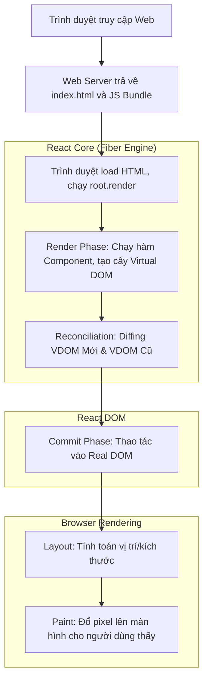

# React Rendering Workflow: Từ URL đến Giao Diện (Client-Side Rendering)

> **Ý tưởng chính việc sử dụng:** Luồng hoạt động từ lúc người dùng nhập URL cho đến khi hiển thị giao diện qua Virtual DOM và Component-based.
> **Ví dụ:** Tải HTML trắng -> Chạy bundle.js -> React dựng Virtual DOM -> Gắn vào root div -> Fetch API -> Cập nhật State -> Re-render.

Khi bạn nhập một URL vào trình duyệt và nhận được giao diện của một ứng dụng React (bỏ qua phần backend xử lý dữ liệu), có một chuỗi các sự kiện phức tạp xảy ra dưới nền tảng. Dưới đây là phân tích chi tiết.

## 1. Mức Độ Cơ Bản (Basic)

### Luồng hoạt động tổng quan:
1. **Nhập URL và Tải HTML**: Trình duyệt yêu cầu trang web và nhận về một file `index.html`. File này thường rất trống rỗng, chỉ chứa một thẻ như `

` và một đường link tới file JavaScript (`bundle.js`).
2. **Tải và Thực thi JavaScript**: Trình duyệt tải file JS này. File này chứa toàn bộ thư viện React, React DOM, và code ứng dụng của bạn.
3. **Khởi động React (Bootstrapping)**: React tìm thẻ `div` có id `root` và "gắn" (mount) ứng dụng của bạn vào đó thông qua lệnh `root.render(<App />)`.
4. **Tạo Giao Diện**: React đọc code của bạn, hiểu bạn muốn hiển thị gì, và thao tác với trình duyệt để tạo ra các thẻ HTML thật (như `<h1>`, `<button>`) rồi nhét vào trong thẻ `root`.

**Vấn đề cốt lõi giải quyết**: React giúp chúng ta không phải tự tay viết các lệnh DOM API lặp đi lặp lại (`document.createElement`, `document.getElementById`) vốn rất dễ sinh lỗi, dài dòng và khó bảo trì. Thay vào đó, ta chỉ cần khai báo "Tôi muốn giao diện trông như thế này" (Declarative UI) dựa trên trạng thái (State) hiện tại của ứng dụng.

## 2. Mức Độ Trung Bình (Intermediate): Under the Hood

### Quá Trình React Tạo Ra Giao Diện (Từ State đến UI)

Khi JavaScript bắt đầu chạy `root.render(<App />)`, hoặc khi một State thay đổi, React thực hiện chu trình sau:

1. **Render Phase (Pha Kết Xuất)**:
   - React gọi các Component của bạn (thực chất là các hàm JavaScript).
   - Component trả về JSX. Dưới nền tảng, mã JSX này được biên dịch thành các object JavaScript (`React.createElement(...)`) dùng để mô tả giao diện. Cấu trúc mô phỏng HTML này gọi là **Virtual DOM** (DOM Ảo).
   - Ở lần chạy đầu tiên (Initial Mount), React tạo ra toàn bộ cây Virtual DOM này.
   - *Lưu ý*: Trong pha này, KHÔNG có gì thay đổi trên màn hình cả. Đây hoàn toàn là quá trình tính toán ngầm trong bộ nhớ (memory).

2. **Reconciliation (Đối Soát - Diffing Algorithm)**:
   - Nếu đây là lần render đầu tiên, React bỏ qua bước so sánh và ghi nhận toàn bộ là giao diện mới.
   - Nếu là lần cập nhật (khi State thay đổi), React tạo ra một cây Virtual DOM mới. Sau đó, nó so sánh cây Virtual DOM mới này với Virtual DOM cũ. Thuật toán này giúp React tìm ra chính xác những điểm khác biệt nhỏ nhất (những node nào cần thêm, sửa, hoặc xóa).

3. **Commit Phase (Pha Áp Dụng)**:
   - Sau khi biết chính xác những gì cần thay đổi, React áp dụng (commit) những thay đổi đó vào **Real DOM** (DOM Thật) của trình duyệt.
   - Tại đây, React tự động gọi các DOM API như `appendChild()`, `removeChild()`, `setAttribute()` để thao tác UI thực sự.

4. **Trình Duyệt Vẽ Lên Màn Hình (Browser Painting)**:
   - Sau khi React cập nhật Real DOM xong, quyền điều khiển trở lại với Trình duyệt.
   - Trình duyệt sẽ tính toán lại kích thước, vị trí (Layout Phase) và tiến hành tô màu các Pixel (Painting Phase) lên màn hình để người dùng nhìn thấy.

*Use Cases*: Mô hình này rất phù hợp cho các Single Page Applications (SPA) có tương tác UI phức tạp, dữ liệu thay đổi liên tục và mượt mà như dùng App Mobile. Không nên dùng cho các trang web nặng về nội dung tĩnh, ít tương tác (như blog tĩnh, trang giới thiệu công ty) vì việc tải file JS khổng lồ ở bước đầu sẽ làm trang hiển thị chậm (thay vào đó nên dùng Next.js SSG/SSR).

## 3. Mức Độ Nâng Cao (Advanced)

### React Fiber Architecture (Kiến Trúc Sợi)
Từ React 16, lõi của React được viết lại hoàn toàn, gọi là engine **React Fiber**.
- Cấu trúc thuật toán cũ xử lý Virtual DOM dưới dạng một cây đệ quy (recursive tree). Khi bắt đầu render, nó không thể dừng lại cho đến khi xong toàn bộ. Nếu ứng dụng quá lớn, nó chặn luôn luồng chính (Main Thread) khiến trình duyệt bị "đơ".
- **Fiber** cấu trúc lại các node thành một danh sách liên kết (Linked List). Mỗi Component là một "Fiber Node". Sự thay đổi này cho phép React có thể **dừng lại (interrupt), chia nhỏ tác vụ (time-slicing), ưu tiên (prioritize), hoặc hủy bỏ (abort)** công việc render dở dang nếu có một sự kiện quan trọng hơn chen ngang (ví dụ: người dùng đang gõ phím nhanh).

### Batched Updates (Cập Nhật Hàng Loạt)
Khi bạn gọi `setState` 10 lần liên tiếp trong một hàm, thay vì render 10 lần làm tốn tài nguyên, React 18 sẽ gom chúng lại (batching) thành một lần render duy nhất.

### Rủi ro hiệu suất (Performance) & Anti-patterns
- **Rerender theo hiệu ứng Domino**: Nếu component cha thay đổi State và render lại, thì *toàn bộ* component con bên trong nó sẽ mặc định bị render lại, dù props của chúng không hề thay đổi.
- **Giải pháp**:
  - Đẩy state xuống các component con sâu nhất có thể (Push state down).
  - Sử dụng `React.memo` để bọc component con, chỉ render lại khi props thực sự thay đổi.
  - Dùng `useMemo` và `useCallback` để giữ lại các tham chiếu object/function giữa các lần render, tránh làm vỡ `React.memo`.
- **Anti-pattern cực kỳ phổ biến**: Thực hiện Side Effects (như gọi API fetch, thao tác DOM trực tiếp, cài đặt `setInterval`) ngay bên trong phần thân của hàm component (tức là trong Render Phase). Render phase bắt buộc phải là *Pure*. Mọi Side effect PHẢI nằm trong `useEffect` (Hook này đảm bảo effect chỉ chạy sau khi Commit Phase đã hoàn thành).

## 4. So Sánh (Compare & Contrast)

| Đặc điểm | Vanilla JavaScript (Thao tác DOM trực tiếp) | React (Virtual DOM) | Svelte / SolidJS (No Virtual DOM) |
| :--- | :--- | :--- | :--- |
| **Cách tiếp cận** | Mệnh lệnh (Imperative): Tập trung vào "Làm thế nào" (cầm tay chỉ việc từng DOM). | Khai báo (Declarative): Tập trung vào "Trông như thế nào" ở State hiện tại. | Khai báo, nhưng biên dịch thẳng ra code DOM thực thi (không dùng object trung gian). |
| **Hiệu suất (Performance)** | Nhanh nhất nếu lập trình viên tự tay tối ưu hoàn hảo, cực chậm nếu code ẩu (layout thrashing). | Rất nhanh nhờ cơ chế Batching và Diffing, nhưng vẫn tốn bộ nhớ lưu trữ VDOM và chi phí so sánh VDOM. | Siêu nhanh, vừa nhẹ bộ nhớ (không cần VDOM), vừa cập nhật chính xác (fine-grained reactivity). |
| **Bảo trì code** | Cực kỳ khó bảo trì khi app lớn (Spaghetti code). | Dễ bảo trì, tính cấu thành cao nhờ việc phân tách thành các Component độc lập. | Dễ bảo trì, cú pháp thường ngắn gọn hơn React. |

## 5. Bài Tập Thực Hành Nhỏ

**Bài tập**: Bạn đang viết một Component có một bộ đếm số (Counter). Tuy nhiên, mỗi lần người dùng click đếm số, một hàm `tinhToanPhucTap()` bên trong Component đó bị chạy lại vô cớ làm ứng dụng giật lag kinh khủng (dù hàm đó không liên quan gì đến State đếm số).

*Thử thách*: Hãy sử dụng một Hook phù hợp của React để "đóng băng" (cache) kết quả của hàm tính toán đó lại, ngăn chặn hàm này chạy lại nếu biến đầu vào của nó không bị thay đổi.

Code đề bài và đáp án nằm tại: [answers-react-workflow.jsx](/Users/ductri0981/Documents/Studying-Software/reactjs/answers-react-workflow.jsx)

## 6. Phụ Lục (Sơ Đồ Kiến Trúc)

## 7. Giải Thích Thuật Ngữ (Glossary)

- **DNS (Domain Name System)**: Hệ thống phân giải tên miền. Giống như danh bạ điện thoại, nó dịch một tên dễ nhớ như `facebook.com` thành một địa chỉ IP như `157.240.22.35` để máy tính hiểu được.
- **TCP/IP**: Bộ giao thức mạng cơ bản giúp thiết lập kết nối tin cậy giữa trình duyệt và máy chủ trước khi có thể truyền tải bất kỳ dữ liệu nào.
- **HTTP Request / Response**: Chuẩn giao tiếp trên web. Trình duyệt gửi gói tin "Request" (yêu cầu) đi và nhận về gói tin "Response" (trả lời) chứa HTML, JS, CSS từ máy chủ.
- **Bundle (Gói/Gom cục)**: Các ứng dụng hiện đại có hàng trăm file JS. Trình duyệt tải từng file sẽ rất chậm. Các công cụ (Webpack, Vite) sẽ gom hàng trăm file đó thành 1 file khổng lồ duy nhất gọi là "Bundle" để tải nhanh hơn.
- **Virtual DOM (DOM Ảo)**: Một object JavaScript đơn giản (trọng lượng nhẹ) mô phỏng lại cấu trúc cây HTML của giao diện. Thao tác và so sánh trên object JS luôn nhanh hơn rất nhiều so với thao tác trực tiếp trên giao diện trình duyệt.
- **Real DOM (DOM Thật)**: Document Object Model, là cấu trúc thật sự của trang web mà trình duyệt quản lý, tính toán và hiển thị.
- **Reconciliation (Diffing)**: Thuật toán cốt lõi của React dùng để so sánh 2 cây VDOM. React áp dụng Heuristic (kinh nghiệm) để giảm độ phức tạp từ O(n^3) xuống chỉ còn O(n) (siêu nhanh).
- **Fiber Architecture**: Cấu trúc lõi của React thay đổi từ V16. Giúp React chia nhỏ công việc render thành từng mẩu nhỏ (Fibers), cho phép dừng, huỷ, hoặc ưu tiên công việc thay vì phải render một mạch từ đầu đến cuối như cấu trúc cây.
- **Render Phase**: Giai đoạn React tính toán ngầm trong bộ nhớ xem giao diện "sắp tới" sẽ trông như thế nào. Hoàn toàn KHÔNG tác động tới màn hình.
- **Commit Phase**: Giai đoạn tiếp theo khi React tiến hành sửa chữa, thay đổi (commit) DOM thật trên trình duyệt dựa vào kết quả khác biệt tìm ra ở Render Phase.
- **Layout / Painting / Compositing**: Các bước trình duyệt tiến hành vẽ sau khi Real DOM bị thay đổi. *Layout* (tính toán toán học vị trí tọa độ các hộp), *Painting* (tô màu điểm ảnh), *Compositing* (Xếp chồng các lớp Z-index lên nhau).
- **CSR (Client Side Rendering)**: Quá trình tạo ra mã HTML hoàn toàn được thực hiện trên trình duyệt của người dùng thông qua JavaScript tải về, trái ngược với Server Side Rendering (SSR) là server trả thẳng HTML đã dựng sẵn.
- **Declarative UI**: Lập trình khai báo. Bạn chỉ định nghĩa kết quả (Vd: `<h1>{count}</h1>`), hệ thống sẽ tự tìm cách (cập nhật DOM) để biến kết quả đó thành hiện thực. Trái với Imperative (mệnh lệnh) là bạn phải gõ từng lệnh tạo thẻ h1, gán text, chèn vào màn hình.
- **Pure Function (Hàm thuần khiết)**: Hàm có 2 đặc tính: 1) Cùng một đầu vào luôn trả ra đúng một đầu ra. 2) Không gây ra bất kỳ thay đổi hay tác động nào ra bên ngoài hàm đó (như sửa biến cục bộ, gọi API). Render function của React là Pure.
- **Side Effect (Hiệu ứng phụ/Tác động phụ)**: Bất kỳ thao tác mã nào làm trạng thái bên ngoài thay đổi: ví dụ như fetch dữ liệu từ API, đổi tiêu đề tab trang web, sửa một biến global, hoặc gắn event listener vào `window`.

## 8. Web Server của React là gì?

Thực chất, **React bản thân nó KHÔNG CÓ một "Web Server" nào cả.** React đơn thuần chỉ là một thư viện JavaScript chạy trên trình duyệt (Client-side) dùng để xây dựng giao diện người dùng.

Tuy nhiên, khái niệm "server của React" sẽ khác nhau tùy thuộc vào môi trường bạn đang làm việc:

### Môi trường phát triển (Development)
Khi bạn gõ lệnh `npm start` hoặc `npm run dev` để code ở máy local (ví dụ: `http://localhost:3000`), bạn đang được phục vụ bởi một **Development Server** (Server ảo dùng để phát triển). Tùy vào công cụ bạn tạo app mà server này sẽ khác nhau:

*   **Nếu dùng Vite (Khuyên dùng)**: Nó sử dụng Development Server tích hợp sẵn của **Vite** (chạy trên Node.js), cực kỳ nhanh nhờ công nghệ HMR (Hot Module Replacement).
*   **Nếu dùng Create React App (CRA)**: Nó sử dụng gói **`webpack-dev-server`**. Dưới nền tảng, đây thực chất là một server **Express.js** nhỏ gọn giúp theo dõi các file bạn sửa để tự động tải lại (live-reload) trình duyệt.

*Lưu ý: Các server này chỉ dùng để giúp lập trình viên code dễ hơn. Tuyệt đối không dùng chúng để chạy thực tế trên mạng.*

### Môi trường thực tế (Production)
Khi bạn làm xong app và chạy lệnh `npm run build`, React sẽ nén và gom toàn bộ code của bạn thành các file tĩnh (Static files) gồm `index.html`, `bundle.js`, `style.css`.

Lúc này, bạn có thể mang các file tĩnh này đưa lên **BẤT KỲ Web Server nào trên thế giới**. React không kén chọn:
*   **Nginx** hoặc **Apache** (Các web server chuyên dụng cực kỳ phổ biến).
*   **Node.js / Express** (Dùng code backend tự viết để trả file ra).
*   **Các dịch vụ Cloud (Serverless)**: Vercel, Netlify, Firebase Hosting, AWS S3, GitHub Pages,...

### Ngoại lệ: Next.js / Remix
Nếu bạn không dùng React thuần mà dùng một Framework bọc ngoài React như **Next.js** hay **Remix**, thì cấu trúc lại khác. Next.js đi kèm với một **Web Server bằng Node.js** thực thụ. Server này không chỉ trả về các file tĩnh mà nó còn thực thi code React ngay trên server (Server-Side Rendering - SSR) để tạo ra mã HTML hoàn chỉnh gửi về trình duyệt.
