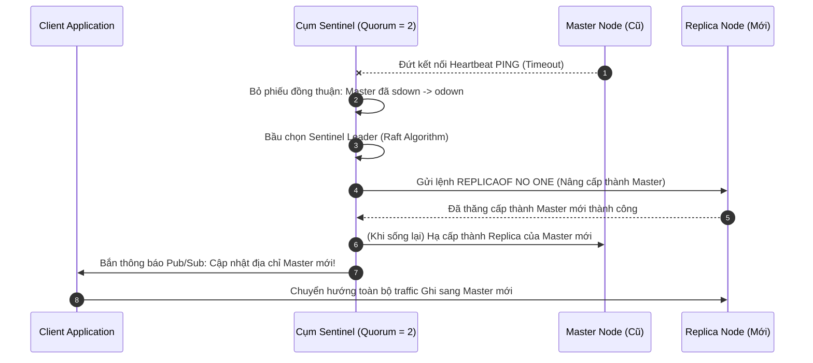

# Redis - Concept Deep Dive (Từ Cơ Bản Đến Lõi Hệ Thống Tầng Sâu)

Tài liệu này cung cấp một cái nhìn toàn diện từ các nguyên lý cơ bản đến mức độ chuyên sâu nhất (Hardcore Deep Dive) về **Redis (Remote Dictionary Server)**. Chúng ta sẽ đi sâu vào cấu trúc dữ liệu tầng C, cơ chế quản lý bộ nhớ, tương tác nhân Linux (Kernel), kiến trúc Event Loop I/O Multiplexing, mô hình phân tán, và các bài toán kỹ thuật vận hành ở quy mô hàng triệu requests/giây — **với tiêu chí đào sâu tận gốc rễ nhưng luôn có diễn giải trực quan, bình dân để ai cũng có thể nắm bắt bản chất một cách dễ dàng nhất**.

---

## 📑 MỤC LỤC TỔNG QUAN

1. [Mức Độ Cơ Bản (Basic Fundamentals)](#1-mức-độ-cơ-bản-basic-fundamentals)
   - [1.1 Redis Là Gì? Ẩn Dụ Đời Thực (Real-world Analogy)](#11-redis-là-gì-ẩn-dụ-đời-thực-real-world-analogy)
   - [1.2 Vấn Đề Cốt Lõi Sinh Ra Redis (Problem Statement)](#12-vấn-đề-cốt-lõi-sinh-ra-redis-problem-statement)
   - [1.3 Kiến Trúc Mức Cao (High-Level Architecture)](#13-kiến-trúc-mức-cao-high-level-architecture)
2. [Mức Độ Trung Bình (Intermediate - Data Types & Use Cases)](#2-mức-độ-trung-bình-intermediate---data-types--use-cases)
   - [2.1 Mổ Xẻ Chi Tiết Các Cấu Trúc Dữ Liệu Cốt Lõi](#21-mổ-xẻ-chi-tiết-các-cấu-trúc-dữ-liệu-cốt-lõi)
   - [2.2 Khi Nào Nên Dùng và Không Nên Dùng Redis?](#22-khi-nào-nên-dùng-và-không-nên-dùng-redis)
3. [Mức Độ Chuyên Sâu: BẢN CHẤT VẬN HÀNH (Under The Hood & Core Mechanics)](#3-mức-độ-chuyên-sâu-bản-chất-vận-hành-under-the-hood--core-mechanics)
   - [3.1 Nguyên lý Lưu trữ & Tra cứu Cốt lõi (Storage & Data Layout)](#31-nguyên-lý-lưu-trữ--tra-cứu-cốt-lõi-storage--data-layout)
   - [3.2 Dòng chảy Dữ liệu (Data Flow - Luồng Ghi & Luồng Đọc)](#32-dòng-chảy-dữ-liệu-data-flow---luồng-ghi--luồng-đọc)
   - [3.3 Cơ chế Xử lý Đồng thời Đơn Luồng (Single-Thread Event Loop & I/O Multiplexing)](#33-cơ-chế-xử-lý-đồng-thời-đơn-luồng-single-thread-event-loop--io-multiplexing)
   - [3.4 Cơ chế Phân tán & Sao lưu Cơ bản (Replication, Sentinel & Cluster Basics)](#34-cơ-chế-phân-tán--sao-lưu-cơ-bản-replication-sentinel--cluster-basics)
4. [Mức Độ Nâng Cao: Vận Hành Thực Chiến (Production Engineering & Best Practices)](#4-mức-độ-nâng-cao-vận-hành-thực-chiến-production-engineering--best-practices)
   - [4.1 Kỹ thuật Tối ưu Hiệu năng Thực chiến (Pipelining, Pooling, UNLINK)](#41-kỹ-thuật-tối-ưu-hiệu-năng-thực-chiến-pipelining-pooling-unlink)
   - [4.2 Khóa Phân Tán Chuẩn Mực (Safe Distributed Lock với Lua Script)](#42-khóa-phân-tán-chuẩn-mực-safe-distributed-lock-với-lua-script)
   - [4.3 Bộ Ba Thảm họa Cache & Chiến lược Phòng thủ (Penetration, Avalanche, Breakdown)](#43-bộ-ba-thảm-họa-cache--chiến-lược-phòng-thủ-penetration-avalanche-breakdown)
   - [4.4 Anti-patterns & Sai lầm Phổ biến Cần tránh](#44-anti-patterns--sai-lầm-phổ-biến-cần-tránh)
5. [Góc Nhìn Thực Chiến Cho Middle-Level Trở Xuống (Must-Know vs Nice-to-Know Roadmap)](#5-góc-nhìn-thực-chiến-cho-middle-level-trở-xuống-must-know-vs-nice-to-know-roadmap)
   - [5.1 Phân định ranh giới kiến thức theo từng cấp độ](#51-phân-định-ranh-giới-kiến-thức-theo-từng-cấp-độ)
   - [5.2 Bộ câu hỏi phỏng vấn thực chiến kinh điển (Intern -> Middle)](#52-bộ-câu-hỏi-phỏng-vấn-thực-chiến-kinh-điển-intern---middle)
   - [5.3 Những thứ TẠM THỜI BỎ QUA (Dành riêng cho Senior / Tech Lead / SRE)](#53-những-thứ-tạm-thời-bỏ-qua-dành-riêng-cho-senior--tech-lead--sre)
6. [So Sánh Bản Chất (First-Principles Comparison)](#6-so-sánh-bản-chất-first-principles-comparison)
   - [6.1 Bảng So Sánh Toàn Diện](#61-bảng-so-sánh-toàn-diện)
   - [6.2 Đánh Đổi Theo Định Lý CAP & PACELC](#62-đánh-đổi-theo-định-lý-cap--pacelc)
7. [Sơ Đồ Trực Quan (Mermaid Diagrams)](#7-sơ-đồ-trực-quan-mermaid-diagrams)
   - [7.1 Sơ Đồ Kiến Trúc I/O Multiplexing & Reactor Pattern](#71-sơ-đồ-kiến-trúc-io-multiplexing--reactor-pattern)
   - [7.2 Sơ Đồ Master - Replica - Sentinel Failover](#72-sơ-đồ-master---replica---sentinel-failover)
   - [7.3 Sơ Đồ Bảo Vệ Cache Breakdown (SingleFlight Mutex Lock)](#73-sơ-đồ-bảo-vệ-cache-breakdown-singleflight-mutex-lock)
8. [Bảng Tra Thuật Ngữ Chi Tiết (Glossary)](#8-bảng-tra-thuật-ngữ-chi-tiết-glossary)
9. [Hướng Dẫn Chạy & Kiểm Thử Hệ Thống (Step-by-Step Run Guide)](#9-hướng-dẫn-chạy--kiểm-thử-hệ-thống-step-by-step-run-guide)
   - [9.1 Khởi Động Hạ Tầng Dịch Vụ (Docker Compose)](#91-khởi-động-hạ-tầng-dịch-vụ-docker-compose)
   - [9.2 Cài Đặt & Khởi Chạy Backend](#92-cài-đặt--khởi-chạy-backend)
   - [9.3 Cài Đặt & Khởi Chạy Frontend](#93-cài-đặt--khởi-chạy-frontend)
   - [9.4 Các Kịch Bản Thử Nghiệm Kiểm Chứng Lý Thuyết](#94-các-kịch-bản-thử-nghiệm-kiểm-chứng-lý-thuyết)

---

## 1. Mức Độ Cơ Bản (Basic Fundamentals)

### 1.1 Redis Là Gì? Ẩn Dụ Đời Thực (Real-world Analogy)
**Redis** (viết tắt của **RE**mote **DI**ctionary **S**erver) là một hệ thống lưu trữ cấu trúc dữ liệu trong bộ nhớ chính (In-Memory Data Structure Store) mã nguồn mở. Nó thường được sử dụng làm **Cache**, **Message Broker**, **Streaming Engine**, và **Cơ sở dữ liệu NoSQL tốc độ cao**.

> 💡 **Ẩn Dụ Đời Thực (Real-world Analogy):**
> - **Cơ sở dữ liệu truyền thống (RDBMS như PostgreSQL / MySQL):** Giống như một **Kho lưu trữ tài liệu dưới tầng hầm**. Mỗi khi cần một bản hợp đồng cũ, thủ thư phải đi cầu thang xuống hầm, tra cứu ngăn tủ, mở khóa và lục từng tập hồ sơ (tương đương với việc đầu đọc đĩa cơ HDD quay cơ học hoặc chip NAND Flash SSD phải đọc I/O vật lý). Dù dữ liệu được lưu vĩnh viễn và an toàn, nhưng thời gian đi lấy mất từ vài chục mili-giây đến vài giây.
> - **Redis:** Giống như một **Bảng ghi chú tốc ký dán ngay trên bàn làm việc**. Bất kỳ thông tin nào cần tra cứu tức thì (như mã OTP vừa gửi, giỏ hàng hiện tại, số điện thoại khẩn cấp) được viết ngay trên bảng. Bạn chỉ cần liếc mắt một phần nghìn giây ($< 1\text{ms}$) là đọc được ngay vì nó nằm sẵn trong tầm nhìn (tương đương thanh RAM máy tính).

---

### 1.2 Vấn Đề Cốt Lõi Sinh Ra Redis (Problem Statement)
Vào năm **2009**, nhà phát triển người Ý **Salvatore Sanfilippo** (biệt danh **antirez**) đang xây dựng một công cụ phân tích lưu lượng web theo thời gian thực mang tên **LLOOGG**. 

Mỗi khi có lượt truy cập, hệ thống cần ghi nhận log và hiển thị danh sách 30 trang gần nhất cho hàng ngàn quản trị viên web cùng lúc. Khi sử dụng MySQL:
1. Mỗi lượt request đòi hỏi một câu lệnh `INSERT` vào bảng log và hàng loạt câu lệnh `SELECT ... ORDER BY timestamp DESC LIMIT 30`.
2. Dù đã đánh chỉ mục (Index) bằng B-Tree, bảng log phình to lên hàng chục triệu dòng khiến MySQL liên tục thực hiện **Random Disk I/O** để cập nhật cây chỉ mục.
3. Ổ đĩa máy chủ chạm ngưỡng bão hòa IOPS (Input/Output Operations Per Second), CPU bị dồn ứ ở trạng thái `iowait`, khiến toàn bộ ứng dụng bị nghẽn (bottleneck).

Antirez nhận ra: *Tại sao phải ghi dữ liệu dạng chuỗi tạm thời xuống đĩa cơ rồi lại vất vả đọc lên, trong khi bộ nhớ RAM nhanh hơn đĩa hàng chục ngàn lần và chỉ cần một cấu trúc danh sách (List) có giới hạn cố định?*

Ông đã viết bản prototype đầu tiên của Redis bằng ngôn ngữ Tcl, sau đó viết lại hoàn toàn bằng **ngôn ngữ C thuần túy** để tối ưu từng byte bộ nhớ và từng chu kỳ xung nhịp CPU. Redis ra đời và giải quyết triệt để bài toán thắt nút cổ chai I/O đĩa.

---

### 1.3 Kiến Trúc Mức Cao (High-Level Architecture)

Dữ liệu trong Redis được tổ chức dưới dạng Key-Value Dictionary lưu hoàn toàn trên RAM. Mọi lệnh đọc/ghi đều tương tác trực tiếp với RAM, mang lại độ trễ chỉ từ vài trăm micro-giây đến 2 mili-giây.

```
       +-------------------------------------------------------------+
       |                     CLIENT APPLICATIONS                     |
       |             (Web Backend, Microservices, Workers)           |
       +-------------------------------------------------------------+
                                      |
                      RESP Protocol over TCP Socket
                                      v
+---------------------------------------------------------------------------+
|                               REDIS SERVER                                |
|                                                                           |
|   +-------------------------------------------------------------------+   |
|   |         Single-Threaded Event Loop Engine (ae event library)       |   |
|   |  - Non-blocking I/O Multiplexing (epoll / kqueue)                 |   |
|   |  - Zero Lock Contention / Deterministic Execution                 |   |
|   +-------------------------------------------------------------------+   |
|                                     |                                     |
|                                     v                                     |
|   +-------------------------------------------------------------------+   |
|   |                    RAM DATA STRUCTURES (jemalloc)                 |   |
|   |  Strings (SDS) | Hashes (Dict) | Lists (Quicklist)                |   |
|   |  Sets (IntSet) | Sorted Sets (SkipList) | Streams (Radix Tree)    |   |
|   +-------------------------------------------------------------------+   |
|                                     |                                     |
|                 Asynchronous Background Persistence                       |
|                 +-------------------+-------------------+                 |
|                 |                                       |                 |
|                 v (Copy-On-Write fork)                  v (Append Log)    |
|       +-------------------+                   +-------------------+       |
|       |   RDB Snapshot    |                   |    AOF (Append    |       |
|       |  (dump.rdb Disk)  |                   |    Only File)     |       |
|       +-------------------+                   +-------------------+       |
+---------------------------------------------------------------------------+
```

---

## 2. Mức Độ Trung Bình (Intermediate - Data Types & Use Cases)

Redis không chỉ là một Key-Value store đơn thuần kiểu `Memcached` (chỉ lưu chuỗi thô). Điểm mạnh vượt trội của Redis nằm ở **hệ sinh thái cấu trúc dữ liệu phong phú** được tối ưu hóa ở tầng byte:

### 2.1 9 Cấu Trúc Dữ Liệu Cốt Lõi
| Cấu Trúc | Lệnh Tiêu Biểu | Cấu Trúc Dữ Liệu Tầng C Bên Dưới | Trường Hợp Ứng Dụng Thực Tế |
| :--- | :--- | :--- | :--- |
| **String** | `SET`, `GET`, `INCR`, `MSET` | Simple Dynamic String (SDS) | Caching HTML/JSON, Đếm lượt xem, Token Session, Distributed Lock. |
| **List** | `LPUSH`, `RPOP`, `BRPOP`, `LRANGE` | Quicklist (kết hợp Listpack/Ziplist và Doubly Linked List) | Hàng đợi tác vụ (Job Queue FIFO), Dòng tin tức (Timeline Feed) hiển thị N phần tử mới nhất. |
| **Hash** | `HSET`, `HGET`, `HGETALL`, `HINCRBY` | Listpack (khi nhỏ) hoặc Dict (Hashtable) | Lưu thông tin đối tượng (User Profile, Giỏ hàng E-commerce, Cấu hình hệ thống). |
| **Set** | `SADD`, `SMEMBERS`, `SINTER`, `SISMEMBER` | Intset (khi chứa số nguyên nhỏ) hoặc Dict | Nhóm bạn chung (Intersection), Danh sách người thích bài viết, Lọc phần tử trùng lặp. |
| **Sorted Set (ZSet)** | `ZADD`, `ZRANGE`, `ZREVRANK`, `ZINCRBY` | Listpack (khi nhỏ) hoặc SkipList + Dict | Bảng xếp hạng game (Leaderboard), Sliding Window Rate Limiter, Priority Queue. |
| **Bitmap** | `SETBIT`, `GETBIT`, `BITCOUNT`, `BITOP` | String (Chuỗi nhị phân xử lý bitwise) | Điểm danh người dùng hàng ngày (1 bit = 1 ngày), Đo lường Daily Active Users (DAU) tiết kiệm RAM cực đỉnh. |
| **HyperLogLog** | `PFADD`, `PFCOUNT`, `PFMERGE` | Thuật toán xác suất thống kê HyperLogLog | Đếm số lượng phần tử duy nhất (Cardinality) hàng triệu IP/User chỉ với cố định **12 KB RAM** (sai số ~0.81%). |
| **Geospatial (GEO)** | `GEOADD`, `GEODIST`, `GEORADIUS` | Sorted Set (Mã hóa tọa độ bằng thuật toán Geohash 52-bit) | Tìm tài xế công nghệ gần nhất (Grab/Gojek), Tìm cửa hàng trong bán kính 5km. |
| **Streams** | `XADD`, `XREAD`, `XREADGROUP`, `XACK` | Radix Tree (Rax) kết hợp Listpack | Nhật ký sự kiện phân tán, hàng đợi tin cậy hỗ trợ Consumer Groups (Tương tự Apache Kafka thu nhỏ). |

---

### 2.2 Khi Nào NÊN Dùng và KHÔNG NÊN Dùng Redis

#### NÊN DÙNG (Sweet Spots):
1. **Bộ nhớ đệm siêu tốc (Cache-Aside, Write-Through):** Giảm tải 80-95% truy vấn cho cơ sở dữ liệu quan hệ phía sau.
2. **Khóa phân tán (Distributed Lock):** Đồng bộ hóa tài nguyên tranh chấp giữa hàng trăm microservices (ví dụ: trừ tồn kho Flash Sale, xử lý thanh toán tài chính duy nhất một lần).
3. **Giới hạn tốc độ truy cập (Rate Limiting):** Bảo vệ API khỏi bị DDoS hoặc lạm dụng bằng thuật toán Sliding Window hoặc Token Bucket.
4. **Bảng xếp hạng thời gian thực (Real-time Leaderboard):** Xếp hạng triệu người chơi tức thì bằng Sorted Set $\mathcal{O}(\log N)$.
5. **Session Store & Token Blacklist:** Lưu trữ phiên đăng nhập JWT/Session ID với cơ chế tự động hủy bằng TTL (Time-To-Live).

#### TUYỆT ĐỐI KHÔNG NÊN DÙNG (Anti-Patterns):
1. **Thay thế cơ sở dữ liệu quan hệ (Primary Relational Database):** Redis không hỗ trợ câu lệnh JOIN phức tạp, không có Foreign Key constraints, không có công cụ tối ưu hóa truy vấn đại số (Query Optimizer) như Postgres.
2. **Lưu trữ dữ liệu lớn vượt quá dung lượng RAM:** RAM có giá thành đắt hơn ổ cứng SSD từ 10 đến 20 lần. Đưa dữ liệu ít truy cập (Cold Data) vào Redis là một sự lãng phí ngân sách nghiêm trọng.
3. **Phân tích dữ liệu lớn (OLAP / Big Data Analytics):** Các truy vấn quét toàn bộ bảng (Full Table Scan), Aggregation đa chiều trên hàng tỷ dòng thuộc về ClickHouse, BigQuery, hoặc Snowflake; không phải Redis.

---

## 3. Mức Độ Chuyên Sâu: BẢN CHẤT VẬN HÀNH (Under The Hood & Core Mechanics)

*Mục này giải thích cách Redis hoạt động bên trong một cách mạch lạc, dễ hiểu, tập trung vào mô hình tư duy kiến trúc thay vì các chi tiết vi mô tầng mã máy:*

---

### 3.1 Nguyên Lý Lưu Trữ & Tra Cứu Cốt Lõi (Storage & Data Layout)

Dữ liệu trong Redis được tổ chức trong bộ nhớ RAM dưới dạng một **Bảng băm toàn cục (Global Hash Table / Dictionary)** ánh xạ từ Key sang Value:

1. **Tra cứu tốc độ $\mathcal{O}(1)$ bằng Bảng Băm (Hash Table)**:
   - Khi bạn gọi `GET user:100`, Redis băm chuỗi key ra một mã số và nhảy thẳng tới địa chỉ ô nhớ chứa value đó. Thời gian truy xuất chỉ mất vài micro-giây.
   - **Cơ chế nới rộng bảng băm êm ái (Incremental Rehashing)**: Khi số lượng key tăng từ 1 triệu lên 20 triệu, Redis không dừng hệ thống để copy toàn bộ bảng băm sang vùng nhớ mới (tránh đứng máy). Thay vào đó, mỗi khi có request đọc/ghi tới, Redis tranh thủ dọn 1-2 ô sang bảng mới, giúp quá trình mở rộng diễn ra mượt mà mà người dùng không hề nhận thấy.

2. **Cấu trúc chuỗi tự nhớ độ dài (Simple Dynamic String - SDS)**:
   - *Ẩn dụ trực quan*: Giống như một **thước cuộn có màn hình điện tử hiện sẵn độ dài**, thay vì một sợi dây dù trơn tuột mà mỗi lần muốn biết dài bao nhiêu bạn phải lấy tay đo từng mét từ đầu tới cuối.
   - Nhờ lưu sẵn độ dài chuỗi trong header, lệnh `STRLEN` luôn chạy trong $\mathcal{O}(1)$ và an toàn tuyệt đối khi chứa dữ liệu nhị phân (ảnh, file).

3. **Bảng nhảy phân tầng (SkipList) trong Sorted Set (ZSET)**:
   - *Ẩn dụ trực quan*: Hãy hình dung bạn đi **tàu điện ngầm có tuyến tàu nhanh (Express) và tuyến tàu chậm (Local)**:
     - Tuyến tàu chậm dừng ở mọi ga: 1, 2, 3, 4, 5... (tìm kiếm chậm $\mathcal{O}(N)$).
     - Tuyến tàu nhanh chỉ dừng ở các ga lớn: 5, 10, 15, 20...
     - Khi muốn đến ga 15, bạn nhảy lên tuyến tàu nhanh đi vèo tới ga 15 chỉ mất vài bước thay vì đi qua từng ga.
   - Nhờ cấu trúc SkipList, Redis có thể tìm kiếm thứ hạng và lấy một dải phần tử (`ZRANGEBYSCORE`) với độ phức tạp chỉ **$\mathcal{O}(\log N)$**.

---

### 3.2 Dòng Chảy Dữ Liệu (Data Flow - Luồng Ghi & Luồng Đọc)

```
[ Client Request: SET key "hello" ]
                 │
                 ▼
     [ TCP Socket Mạng Đón Nhận ]
                 │
                 ▼ (epoll thông báo có dữ liệu)
 [ Single-Threaded Event Loop (Đơn Luồng) ]
                 │
                 ├─► [ Cập nhật RAM: Ghi vào Hash Table ] ──► Phản hồi Client (< 1ms, Xong!)
                 │
                 ▼ (Nếu bật cơ chế lưu đĩa nền)
     [ Ghi nối đuôi vào AOF Buffer ] ──► [ Xả xuống đĩa định kỳ 1s/lần ]
```

* **Luồng Ghi (Write Path)**:
  1. Client gửi lệnh qua kết nối mạng TCP.
  2. Event Loop nhận lệnh, kiểm tra cú pháp và ghi trực tiếp vào cấu trúc dữ liệu trên RAM.
  3. Trả về kết quả `OK` ngay cho Client (toàn bộ diễn ra trong chưa đầy 1 mili-giây).
  4. Nếu bật tính năng bền vững (Persistence), lệnh được chép vào bộ đệm AOF trong RAM để chuẩn bị lưu xuống đĩa ngầm.

* **Luồng Đọc (Read Path)**:
  1. Client gửi lệnh `GET key`.
  2. Event Loop tra cứu bảng băm RAM với tốc độ $\mathcal{O}(1)$.
  3. Bắn kết quả ngược về mạng cho Client ngay lập tức, không qua bất kỳ lớp trung gian hay truy xuất đĩa nào.

---

### 3.3 Cơ Chế Xử Lý Đồng Thời Đơn Luồng (Single-Thread Event Loop & I/O Multiplexing)

Tại sao Redis chỉ chạy **Đơn Luồng (Single-Thread)** để thực thi lệnh mà vẫn phục vụ được hơn 100,000 requests/giây?

> 🌉 **Cầu Nối Trực Quan (Ẩn Dụ Đầu Bếp 5 Sao):**
> - Hãy hình dung một **đầu bếp 5 sao thao tác tay nhanh như chớp** trong một căn bếp mà tất cả nguyên liệu đã được sơ chế sẵn trên bàn (RAM).
> - Nếu bạn thuê 10 đầu bếp vào một căn bếp chật hẹp, họ sẽ liên tục va vào nhau, tranh nhau cái chảo, phải xin phép nhau dùng dao (**Lock Contention & Race Conditions**), và người quản lý phải liên tục đổi ca làm việc (**Context Switching Overhead**).
> - Một đầu bếp duy nhất làm việc liên tục không ngừng nghỉ, không bị ai cản đường, sẽ nấu xong 100,000 đĩa ăn/giây dễ dàng hơn nhiều so với việc phối hợp 10 người!

* **Không tranh chấp khóa (Zero Locking Overhead)**: Vì chỉ có 1 luồng xử lý tuần tự từng lệnh, Redis **không bao giờ có Deadlock hay Race Condition nội bộ**. Mọi thao tác trên dữ liệu đều là nguyên tử (Atomic).
* **Cơ chế I/O Multiplexing (`epoll` / `kqueue`)**:
  - *Ẩn dụ*: Bạn chờ 10,000 kiện hàng từ bưu điện. Thay vì mỗi phút chạy ra cổng hỏi bác bảo vệ một lần (Polling), bạn để lại số điện thoại và nhờ bác: *"Có gói nào tới thì bấm chuông cho cháu"*.
  - Nhân hệ điều hành Linux sẽ đánh thức Redis và trao thẳng danh sách chính xác các kết nối socket có dữ liệu để xử lý tuần tự, không lãng phí CPU.

---

### 3.4 Cơ Chế Phân Tán & Sao Lưu Cơ Bản (Replication, Sentinel & Cluster Basics)

1. **Lưu trữ xuống đĩa bền vững (Persistence Basics)**:
   - **RDB (Snapshot)**: Chụp lại toàn bộ bức ảnh dữ liệu trong RAM thành 1 file nhị phân định kỳ (ví dụ mỗi 15 phút). Nhanh, gọn, phù hợp backup sang server khác.
   - **AOF (Append-Only File)**: Ghi nối đuôi từng câu lệnh sửa đổi (`SET`, `DEL`...) vào một cuốn nhật ký. Mặc định 1 giây xả xuống đĩa một lần (`appendfsync everysec`). Nếu cúp điện, chỉ mất tối đa dữ liệu trong 1 giây gần nhất.

2. **Cơ chế Sao lưu (Master - Replica)**:
   - Mọi thao tác ghi được gửi tới máy **Master**.
   - Master tự động sao chép các lệnh ghi sang các máy **Replica** (Slave) qua mạng.
   - Client có thể chia tải đọc sang các máy Replica để tăng thông lượng đọc (Read Throughput).

3. **Tự động cứu hộ (Failover qua Redis Sentinel)**:
   - Các node **Sentinel** đóng vai trò như ban trọng tài đứng ngoài quan sát.
   - Khi Master bị sập, các Sentinel bỏ phiếu (Quorum) để cùng đồng thuận xác nhận Master đã chết.
   - Sentinel tự động chọn một Replica xuất sắc nhất và **thăng cấp lên làm Master mới**, đồng thời thông báo địa chỉ mới cho ứng dụng Backend.

4. **Chia nhỏ dữ liệu (Sharding qua Redis Cluster)**:
   - Khi dữ liệu vượt quá dung lượng RAM của 1 máy chủ, Redis Cluster chia toàn bộ dữ liệu thành **16,384 Hash Slots**.
   - Mỗi máy chủ trong cụm sẽ chịu trách nhiệm một dải slots nhất định. Công thức: $\text{Slot} = \text{CRC16}(\text{key}) \pmod{16384}$.

---

## 4. Mức Độ Nâng Cao: Vận Hành Thực Chiến (Production Engineering & Best Practices)

*Phân tích các bài toán thực tế mà kỹ sư phần mềm thường gặp khi đưa Redis vào môi trường Production:*

---

### 4.1 Kỹ Thuật Tối Ưu Hiệu Năng Thực Chiến

#### 1. Gom lệnh bằng Pipelining (Redis Pipelining)
- *Vấn đề*: Khi bạn muốn gửi 100 câu lệnh, nếu gọi `await redis.set()` 100 lần tuần tự, bạn sẽ tốn 100 vòng đi-về qua mạng (Round-Trip Time - RTT), khiến thời gian chờ tăng vọt dù Redis xử lý rất nhanh.
- *Giải pháp*: Gom cả 100 lệnh vào một túi (Pipeline) và gửi đi trong **duy nhất 1 gói tin TCP**. Thời gian thực thi giảm từ hàng trăm mili-giây xuống chỉ còn vài mili-giây.

#### 2. Tái sử dụng kết nối (Connection Pooling)
- Việc bắt tay thiết lập một kết nối TCP (3-way handshake) giữa Backend và Redis tốn nhiều tài nguyên. Luôn cấu hình **Connection Pool** trong thư viện client để tái sử dụng lại các kết nối sẵn có thay vì mở/đóng liên tục trên mỗi request.

#### 3. Dọn rác an toàn cho Key lớn: Dùng `UNLINK` thay vì `DEL`
- *Ẩn dụ*: Hãy tưởng tượng sảnh chính có một tảng đá nặng 2 tấn (Big Key dung lượng lớn). Lệnh `DEL` giống như một mình bạn đứng giữa sảnh đập đá thành từng mảnh nhỏ khiến mọi người phải đứng chờ ngoài cửa (**Block luồng chính của Redis**).
- *Lệnh `UNLINK`*: Bạn chỉ mất 1 giây dán nhãn "đã hủy bỏ" lên tảng đá để giải phóng sảnh ngay tức khắc. Sau đó một đội xe cẩu chạy ngầm trong đêm (**Background Thread**) sẽ đến dọn tảng đá đi mà không làm nghẽn bất kỳ request nào.

---

### 4.2 Khóa Phân Tán Chuẩn Mực (Safe Distributed Lock)

Khi chạy nhiều instance backend (ví dụ 3 Pods trong Kubernetes), làm sao để đảm bảo chỉ có 1 Pod duy nhất được xử lý một tác vụ nhạy cảm (như trừ tiền tài khoản hoặc tạo đơn hàng)?

```
     Pod 1 (Thử chiếm lock)  ──────►  [ SET lock:order:123 uuid NX PX 5000 ]  ──► Thành công!
     Pod 2 (Thử chiếm lock)  ──────►  [ SET lock:order:123 uuid NX PX 5000 ]  ──► Thất bại (Bị từ chối)
```

1. **Lệnh chiếm khóa an toàn**:
   ```bash
   SET lock:order:123 <random_uuid> NX PX 5000
   ```
   - `NX`: Chỉ tạo key nếu key CHƯA tồn tại (đảm bảo tính độc quyền).
   - `PX 5000`: Khóa tự động bốc hơi sau 5 giây nếu Pod bị crash (chống Deadlock vĩnh viễn).

2. **Giải phóng khóa bắt buộc bằng Lua Script**:
   Để tránh trường hợp Pod 1 xử lý chậm quá 5 giây làm khóa tự hết hạn, Pod 2 nhảy vào chiếm khóa, rồi Pod 1 chạy xong lại gọi `DEL` xóa nhầm khóa của Pod 2:
   ```lua
   if redis.call("get", KEYS[1]) == ARGV[1] then
       return redis.call("del", KEYS[1])
   else
       return 0
   end
   ```
   Lua Script đảm bảo việc kiểm tra UUID và xóa key diễn ra **nguyên tử (Atomic)** trong 1 chu kỳ duy nhất.

---

### 4.3 Bộ Ba Thảm Họa Cache & Chiến Lược Phòng Thủ

| Thảm họa Cache | Hiện tượng thực tế | Giải pháp chuẩn mực |
| :--- | :--- | :--- |
| **1. Cache Penetration (Thủng Cache)** | Hacker cố tình gửi truy vấn các ID không hề tồn tại ở cả Cache lẫn Database (ví dụ `id = -9999`). Request đâm thẳng làm kiệt quệ Database. | **Cache Null Object**: Lưu giá trị rỗng kèm TTL ngắn (30-60s) vào Redis; hoặc dùng **Bloom Filter** chặn ngay từ tầng ngoài. |
| **2. Cache Breakdown (Gãy đổ Hot Key)** | Đúng duy nhất 1 Hot Key (ví dụ: sản phẩm Flash Sale cực hot) vừa hết hạn TTL. Ngay lập tức hàng chục ngàn user cùng đổ dồn xuống Database làm sập DB. | Áp dụng **Distributed Mutex Lock / SingleFlight**: Chỉ cho phép 1 request duy nhất chiếm lock để xuống DB nạp lại cache, các request khác xếp hàng chờ lấy ké. |
| **3. Cache Avalanche (Tuyết lở Cache)** | Hàng triệu key được cài đặt cùng hết hạn vào đúng một thời điểm (ví dụ 00:00). Toàn bộ cache bốc hơi đồng loạt, lưu lượng đè sập Database. | Thêm **Random Jitter (độ lệch ngẫu nhiên)** vào TTL khi ghi key (ví dụ: `TTL = 3600 + random(1, 300)` giây) để thời điểm hết hạn rải đều. |

---

### 4.4 Anti-patterns & Sai Lầm Phổ Biến Cần Tránh

1. **Chạy lệnh `KEYS *` trên môi trường Production**:
   - *Hiện tượng*: Redis bị treo cứng, toàn bộ ứng dụng gọi tới Redis bị timeout.
   - *Nguyên nhân*: `KEYS *` duyệt tuần tự qua toàn bộ hàng triệu key trong RAM, chiếm trọn Single-thread.
   - *Khắc phục*: Luôn sử dụng lệnh **`SCAN`** với con trỏ cursor để duyệt từng đợt nhỏ.

2. **Lưu trữ Key mà không cài đặt TTL (Quên đặt hạn sử dụng)**:
   - *Hiện tượng*: RAM máy chủ Redis tăng dần đều qua các tháng cho tới khi đầy 100%, kích hoạt cơ chế xóa dữ liệu ngẫu nhiên hoặc làm sập tiến trình.
   - *Khắc phục*: Mọi dữ liệu mang tính chất cache tạm thời đều bắt buộc phải có thời gian sống (TTL).

3. **Lưu trữ dữ liệu khổng lồ (Big Keys)**:
   - *Hiện tượng*: Mạng bị nghẽn, lệnh đọc/xóa tốn hàng chục mili-giây.
   - *Nguyên nhân*: Lưu một chuỗi JSON hoặc một danh sách (List/Set) lên tới hàng chục Megabyte trong 1 key duy nhất.
   - *Khắc phục*: Chia nhỏ dữ liệu thành nhiều key nhỏ hơn hoặc chỉ lưu các trường cần thiết.

---

## 5. Góc Nhìn Thực Chiến Cho Middle-Level Trở Xuống (Must-Know vs Nice-to-Know Roadmap)

> 💡 **Thông điệp giải tỏa áp lực**: Nếu bạn là Intern, Junior hoặc Mid-level và cảm thấy các phần phân tích về SDS, jemalloc, epoll/kqueue, SkipList, Replication Backlog, Sentinels Quorum hay Copy-On-Write ở trên quá "ngợp" — **điều đó hoàn toàn bình thường**! Kiến trúc tầng sâu đó thuộc về cấp độ Staff / System Architect / SRE hoặc nhà phát triển phần mềm hệ thống (C core). Để đi làm thực tế và tỏa sáng trong các buổi phỏng vấn, bạn chỉ cần nắm vững lộ trình thực chiến dưới đây theo quy tắc 80/20.

---

### 5.1 Phân định ranh giới kiến thức theo từng cấp độ

```
  +---------------------------------------------------------------------------------+
  | CẤP ĐỘ INTERN / JUNIOR (QUY TẮC 80/20 - DEVELOPER SỬ DỤNG)                     |
  |  - Tư duy In-Memory Cache (Ẩn dụ bảng ghi chú tốc ký dán ngay trên bàn)        |
  |  - Nắm chắc 3 bài toán: Cache Aside, Lưu Session / OTP, Rate Limiting cơ bản    |
  |  - Sử dụng thành thạo: String (SET/GET/INCR/EXPIRE), List (L/R POP), Hash     |
  |  - Nguyên tắc sống còn: LUÔN LUÔN set TTL (hạn dùng), không lưu key vô tội vạ   |
  |  - Tích hợp Redis SDK (ioredis / redis-py / Spring Data Redis) an toàn vào App  |
  +---------------------------------------------------------------------------------+
                                          │
                                          ▼
  +---------------------------------------------------------------------------------+
  | CẤP ĐỘ MIDDLE-LEVEL (DATA MODELING & VẬN HÀNH ỨNG DỤNG CHUẨN MỰC)               |
  |  - Quy chuẩn Key Naming: Namespace rõ ràng (user:{id}:profile), tránh Key trôi  |
  |  - Làm chủ 3 thảm họa Cache: Cache Penetration (Null cache/Bloom), Avalanche     |
  |    (Random Jitter), Cache Breakdown (Mutex Lock / SingleFlight Pattern)         |
  |  - Khóa phân tán (Distributed Lock): SET NX PX + Lua Script giải phóng an toàn  |
  |  - Cấu trúc nâng cao: ZSET (Leaderboard / Sliding Window Rate Limit), Bitmaps   |
  |  - Tối ưu hiệu năng mức code: Redis Pipeline, thay KEYS * bằng SCAN, UNLINK     |
  +---------------------------------------------------------------------------------+
                                          │
                                          ▼
  +---------------------------------------------------------------------------------+
  | CẤP ĐỘ SENIOR / TECH LEAD / SRE (TẦNG HỆ THỐNG & HẠ TẦNG PHÂN TÁN)             |
  |  - Cấu trúc dữ liệu tầng C: SDS header, SkipList random level, quicklist/ziplist|
  |  - Quản lý bộ nhớ: jemalloc binning, Active Defrag, Memory Fragmentation Ratio   |
  |  - Tương tác OS Kernel: epoll I/O multiplexing, vm.overcommit_memory, tắt THP   |
  |  - Vận hành HA & Cluster: Sentinel Raft Quorum, Cluster 16,384 slots sharding   |
  |  - Độ bền dữ liệu: RDB fork Copy-On-Write physics, AOF rewrite & fsync policy   |
  +---------------------------------------------------------------------------------+
```

#### A. Đối với Intern & Junior: Cần nắm chắc những gì?
1. **Bài toán nghiệp vụ**: Hiểu rõ vì sao Database quan hệ (PostgreSQL/MySQL) bị nghẽn khi có hàng ngàn lượt đọc cùng lúc (Random Disk I/O) $\rightarrow$ Redis sinh ra để gánh tải tầng đọc bằng cách lưu dữ liệu trên RAM.
2. **Nguyên tắc "Vàng" sống còn: Luôn luôn đặt TTL (Time-To-Live)**:
   - Trong code, tuyệt đối tránh viết `SET user:123 "data"` mà không có tham số hết hạn. Luôn dùng `SET user:123 "data" EX 3600` (hết hạn sau 1 giờ).
   - Nếu không đặt TTL, RAM máy chủ Redis sẽ dần bị đầy theo thời gian, kích hoạt cơ chế xóa dữ liệu (Eviction Policy) hoặc làm crash Redis.
3. **Thành thạo các lệnh kinh điển**:
   - `String`: `GET`, `SET`, `INCR` (tăng biến đếm nguyên tử, làm lượt xem/view counter), `EXPIRE`.
   - `Hash`: `HSET`, `HGET`, `HGETALL` (lưu trữ object có cấu trúc như user profile).
   - `List`: `LPUSH`, `RPOP` (làm hàng đợi tác vụ đơn giản - task queue).
4. **Tích hợp vào Backend**:
   - Khởi tạo kết nối an toàn với cơ chế reconnect và đọc thông số từ biến môi trường:
     ```typescript
     import Redis from 'ioredis';
     const redis = new Redis({
       host: process.env.REDIS_HOST || 'localhost',
       port: Number(process.env.REDIS_PORT) || 6379,
       retryStrategy: (times) => Math.min(times * 100, 3000), // Tự động thử lại khi rớt mạng
     });
     ```

#### B. Đối với Middle-Level: Những kỹ năng tạo nên sự khác biệt
1. **Khóa phân tán (Distributed Lock) chuẩn xác**:
   - Biết dùng `SET resource_key uuid NX PX 5000` để chiếm quyền xử lý độc quyền.
   - Hiểu lý do **bắt buộc phải giải phóng khóa bằng Lua Script**: Nếu luồng chạy quá 5s làm khóa tự hết hạn, một luồng khác nhảy vào chiếm khóa, luồng cũ chạy xong gọi lệnh `DEL` sẽ xóa nhầm khóa của luồng mới! Lua script đảm bảo việc kiểm tra UUID và xóa key diễn ra nguyên tử (Atomic).
2. **Kỹ thuật gom lệnh Pipeline (Redis Pipelining)**:
   - Khi cần thực hiện 100 thao tác ghi vào Redis, không gọi `await redis.set()` 100 lần tuần tự (gây ra 100 lần Round-Trip Time qua mạng).
   - Dùng `const pipeline = redis.pipeline(); ... await pipeline.exec();` để đóng gói 100 lệnh gửi đi trong duy nhất 1 gói TCP.
3. **Dùng Sorted Set (ZSET) cho các bài toán thời gian thực**:
   - *Bảng xếp hạng (Leaderboard)*: `ZADD leaderboard 1500 "user_A"`, `ZREVRANGE leaderboard 0 9 WITHSCORES` (lấy top 10 với độ phức tạp $\mathcal{O}(\log N)$).
   - *Sliding Window Rate Limiter*: Lưu timestamp vào score của ZSET để giới hạn số request trong khung giờ trượt chính xác đến từng mili-giây.
4. **Không bao giờ dùng `KEYS *`**: Luôn sử dụng lệnh **`SCAN`** với con trỏ cursor để duyệt key an toàn trên Production.

---

### 5.2 Bộ câu hỏi phỏng vấn thực chiến kinh điển (Intern -> Middle)

Dưới đây là 5 câu hỏi phỏng vấn xuất hiện với tần suất > 90% khi nhà tuyển dụng hỏi về Redis, kèm câu trả lời chuẩn ghi điểm cao:

#### ❓ Câu 1: Tại sao Redis chỉ chạy Đơn Luồng (Single-Thread) mà lại đạt được hơn 100,000 QPS?
* **Cách trả lời chuẩn**:
  Redis nhanh vượt trội nhờ 4 yếu tố cốt lõi:
  1. **Lưu trữ hoàn toàn trên RAM**: Tốc độ truy xuất RAM đo bằng nano-giây, nhanh hơn hàng chục ngàn lần so với I/O đĩa.
  2. **Zero Lock Contention & No Context Switch**: Vì đơn luồng xử lý lệnh, Redis không bao giờ phải chịu chi phí hoán đổi ngữ cảnh CPU (Context Switching) và không cần dùng bất kỳ cơ chế khóa (Mutex Lock/Spinlock) nào, loại bỏ hoàn toàn nguy cơ Race Condition và Deadlock nội bộ.
  3. **I/O Multiplexing (Reactor Pattern)**: Sử dụng các cơ chế ngắt sự kiện hiện đại của Kernel (`epoll` trên Linux, `kqueue` trên macOS) để 1 luồng duy nhất có thể quản lý hàng chục ngàn socket mạng đồng thời mà không bị nghẽn (Non-blocking I/O).
  4. **Cấu trúc dữ liệu tầng C siêu tối ưu**: SDS (chuỗi tự nhớ độ dài), SkipList (bảng nhảy $\mathcal{O}(\log N)$), Quicklist/Listpack (nén dữ liệu liền kề trên RAM).

#### ❓ Câu 2: Tại sao tuyệt đối KHÔNG ĐƯỢC chạy lệnh `KEYS *` trên Production? Dùng lệnh gì thay thế?
* **Hậu quả**: Vì Redis là đơn luồng tuần tự, nếu hệ thống có hàng triệu key, lệnh `KEYS *` sẽ quét toàn bộ bộ nhớ và **block (chiếm giữ) hoàn toàn luồng chính** trong vài giây đến cả phút. Mọi request khác của toàn bộ hệ thống gọi tới Redis đều bị treo cứng và timeout.
* **Giải pháp thay thế**: Sử dụng lệnh **`SCAN cursor [MATCH pattern] [COUNT count]`**. `SCAN` dựa trên con trỏ (cursor-based iterator), chia việc quét ra thành từng đợt nhỏ (mỗi đợt vài chục key), trả về cursor để client gọi tiếp ở vòng lặp sau. Luồng chính của Redis hoàn toàn không bị block.

#### ❓ Câu 3: Phân biệt 3 thảm họa Cache kinh điển: Cache Penetration, Cache Avalanche, Cache Breakdown và cách khắc phục?
* **Cache Penetration (Thủng Cache)**:
  - *Hiện tượng*: Client truy vấn liên tục các ID không hề tồn tại ở cả Cache lẫn Database (thường do hacker tấn công). Mọi request đều trượt Cache và đâm thẳng xuống DB làm sập DB.
  - *Khắc phục*: Lưu giá trị rỗng (`Cache NULL` hoặc giá trị sentinel `@@NULL@@`) với TTL ngắn (1-2 phút); hoặc sử dụng **Bloom Filter** chặn ngay từ tầng ngoài.
* **Cache Avalanche (Sạt lở Cache)**:
  - *Hiện tượng*: Một lượng lớn key trong Cache cùng hết hạn tại một thời điểm chính xác (hoặc Redis server bị restart). Hàng triệu request đồng loạt đâm thẳng xuống DB.
  - *Khắc phục*: Thêm **Random Jitter** (độ lệch ngẫu nhiên) vào TTL khi set key (ví dụ: `TTL = 3600 + random(1, 300)` giây) để thời điểm hết hạn phân tán đều; xây dựng kiến trúc Redis Sentinel / Cluster dự phòng cao.
* **Cache Breakdown (Vỡ đê Cache)**:
  - *Hiện tượng*: Đúng duy nhất **1 Hot Key** (ví dụ sản phẩm Flash Sale cực hot) vừa hết hạn, ngay lập tức hàng chục ngàn request đồng thời đổ dồn xuống DB cùng lúc để truy vấn lại sản phẩm đó.
  - *Khắc phục*: Áp dụng mẫu hình **SingleFlight / Mutex Lock**: Khi phát hiện cache miss, chỉ cho phép **1 request duy nhất** chiếm được khóa phân tán để xuống DB đọc và nạp lại Cache, các request còn lại ngủ chờ vài chục ms rồi đọc lại từ Cache.

#### ❓ Câu 4: Khóa phân tán (Distributed Lock) trong Redis hoạt động thế nào? Tại sao giải phóng khóa bắt buộc phải dùng Lua Script?
* **Cách tạo khóa**:
  - Dùng lệnh nguyên tử: `SET lock_resource_name client_uuid NX PX 5000` (`NX`: chỉ set nếu key chưa tồn tại; `PX`: thời gian tự hủy sau 5,000ms).
* **Tại sao giải phóng khóa cần Lua Script?**:
  - Khi mở khóa, ta cần kiểm tra: *Giá trị của lock có đúng bằng `client_uuid` của mình không? Nếu đúng thì mới xóa (`DEL`)*.
  - Nếu làm 2 bước rời rạc (`GET` kiểm tra, sau đó `DEL`): Giả sử luồng A bị trễ (GC pause hoặc mạng chậm), lock tự động hết hạn và luồng B nhảy vào chiếm lock. Khi luồng A tỉnh dậy, nó thấy điều kiện `GET` trước đó thỏa mãn và thực hiện `DEL` $\Rightarrow$ **Luồng A xóa nhầm khóa của luồng B!**
  - **Lua Script** được Redis thực thi dưới dạng một khối nguyên tử (Atomic transaction), đảm bảo việc so sánh UUID và xóa key diễn ra trọn vẹn trong một chu kỳ, ngăn chặn hoàn toàn lỗi xóa nhầm khóa.

#### ❓ Câu 5: Khi lưu thông tin User Profile (name, email, age), nên dùng kiểu String (chứa chuỗi JSON stringified) hay kiểu Hash?
* **Dùng kiểu Hash (`HSET user:1 name "A" email "b@c"`) khi**:
  - Ứng dụng thường xuyên đọc hoặc cập nhật **từng trường riêng lẻ** (ví dụ chỉ đổi `name`). Không cần tải cả cục JSON to về máy chủ ứng dụng rồi parse lại, giúp tiết kiệm băng thông mạng và CPU.
  - Tiết kiệm RAM nhờ cấu hình tối ưu Listpack/Ziplist của Redis khi số lượng field nhỏ.
* **Dùng kiểu String (`SET user:1 '{"name":"A",...}'`) khi**:
  - Dữ liệu có cấu trúc lồng nhau phức tạp (Nested objects, arrays).
  - Ứng dụng luôn luôn đọc và ghi toàn bộ object cùng một lúc.

---

### 5.3 Những thứ TẠM THỜI BỎ QUA (Dành riêng cho Senior / Tech Lead / SRE)

Nếu bạn chưa phải là người trực tiếp chịu trách nhiệm hạ tầng cụm máy chủ Redis chịu tải hàng trăm ngàn kết nối, bạn **hoàn toàn có thể bỏ qua** các mục sau:

1. **Cấu trúc dữ liệu nội tại bằng ngôn ngữ C**: Các chi tiết như byte padding của SDS header (`sdshdr8`, `sdshdr16`), cơ chế thăng cấp Random Level của SkipList, cấu trúc nén `quicklist` hay `listpack`.
2. **Cơ chế cấp phát bộ nhớ tầng sâu**: Kỹ thuật phân chia ô nhớ của `jemalloc`, thuật toán giải phóng phân mảnh `Active Defragmentation` trong RAM.
3. **Cấu hình Kernel Linux**: Các tham số `vm.overcommit_memory = 1`, tắt `Transparent Huge Pages (THP)` hay tinh chỉnh TCP backlog socket `somaxconn`.
4. **Quản trị cụm phân tán phức tạp**: Cơ chế bỏ phiếu Quorum giữa các Sentinel Node, thuật toán Gossip Protocol giữa 16,384 Hash Slots của Redis Cluster.

---

## 6. So Sánh Bản Chất (First-Principles Comparison)

### 6.1 Bảng So Sánh Toàn Diện
| Tiêu Chí | Redis | Memcached | KeyDB | Dragonfly | PostgreSQL (UNLOGGED / In-Memory) |
| :--- | :--- | :--- | :--- | :--- | :--- |
| **Kiến Trúc Luồng** | Single-thread engine + Multi-thread I/O | Multi-threaded | Multi-threaded (Fork của Redis) | Multi-threaded (Shared-nothing, fibers) | Multi-process |
| **Cấu Trúc Dữ Liệu** | Rất đa dạng (9+ types, Bitmaps, Streams, ZSet) | Chỉ hỗ trợ String (Raw bytes/JSON) | Tương tự Redis | Tương thích Redis API | Dạng bảng quan hệ (Tables, Relational) |
| **Độ Bền Vững (Persistence)**| Rất tốt (RDB Snapshots + AOF Log) | Không có (Mất sạch khi restart) | Tương tự Redis | Snapshot định kỳ | WAL (Write-Ahead Logging) |
| **High Availability**| Sentinel / Cluster bản địa | Cần client-side hashing | Active-Active Replication | Tương thích Redis Sentinel | Patroni / Streaming Replication |
| **Khả Năng Phân Cụm** | Cluster 16,384 slots tự động | Sharding ở Client (Consistent Hashing) | Tương tự Redis | Tương thích Redis Cluster | Sharding qua Citus / FDW |
| **Thông Lượng (Throughput)** | Rất cao (~100k - 200k ops/sec/node) | Cực cao (~500k ops/sec nhờ đa luồng) | Cực cao (~500k ops/sec) | Siêu cao (~1M+ ops/sec trên CPU nhiều lõi)| Trung bình (~10k - 30k ops/sec) |

---

### 6.2 Đánh Đổi Theo Định Lý CAP & PACELC
- **Redis Cluster tuân theo mô hình AP (Availability & Partition Tolerance):** Khi xảy ra phân mảnh mạng (Network Partition), Redis ưu tiên tính sẵn sàng (Availability) và độ trễ thấp (Latency). Quá trình replication là bất đồng bộ (Asynchronous), do đó trong kịch bản Master bị cô lập và failover diễn ra, một lượng nhỏ dữ liệu chưa kịp đồng bộ sang Replica có thể bị mất mát (**Failover Data Loss**).
- Theo định lý **PACELC**: Nếu có phân mảnh (**P**), Redis chọn **A**vailability hơn **C**onsistency; Bình thường (**E**lse), Redis chọn **L**atency cực thấp hơn là **C**onsistency tuyệt đối.

---

## 7. Sơ Đồ Trực Quan (Mermaid Diagrams)

### 7.1 Sơ Đồ Kiến Trúc I/O Multiplexing & Reactor Pattern

```mermaid
flowchart TB
    subgraph Clients["Tầng Clients"]
        C1["Client 1 (Web App)"]
        C2["Client 2 (Worker)"]
        C3["Client 3 (Mobile)"]
    end

    subgraph OS_Kernel["Nhân Hệ Điều Hành (Linux Kernel)"]
        FD["File Descriptors (TCP Sockets)"]
        EPOLL["epoll Subsystem (Event Demultiplexer)"]
    end

    subgraph Redis_Core["Redis Single-Threaded Core"]
        AE["ae Event Loop Engine"]
        DISPATCHER["Event Dispatcher"]
        CMD_EXEC["Lõi Thực Thi Lệnh (Single-Thread)"]
        MEM_DICT["Cấu Trúc Dữ Liệu RAM (Dict / ZSet / SDS)"]
    end

    C1 -->|TCP Send| FD
    C2 -->|TCP Send| FD
    C3 -->|TCP Send| FD

    FD -->|I/O Ready Signals| EPOLL
    EPOLL -->|Trao Danh Sách Socket Sẵn Sàng| AE
    AE --> DISPATCHER
    DISPATCHER -->|Xử lý tuần tự, Zero Lock| CMD_EXEC
    CMD_EXEC <-->|Đọc / Ghi siêu tốc O(1)| MEM_DICT
```

---

### 7.2 Sơ Đồ Master - Replica - Sentinel Failover



---

### 7.3 Sơ Đồ Bảo Vệ Cache Breakdown (SingleFlight Mutex Lock)

```mermaid
flowchart TD
    REQ["10,000 Concurrent Requests Đồng Thời"] --> CHECK_CACHE{"Kiểm Tra Redis Cache"}
    
    CHECK_CACHE -->|Cache Hit| RETURN_CACHE["Trả kết quả ngay lập tức (< 2ms)"]
    CHECK_CACHE -->|Cache Miss (Hot Key Vừa Hết Hạn)| TRY_LOCK{"Thử chiếm Mutex Lock<br/>SET key uuid NX PX 3000"}

    TRY_LOCK -->|Thành Công (Luồng Duy Nhất)| QUERY_DB["Truy vấn Database Vật Lý (150ms)"]
    QUERY_DB --> POPULATE["Nạp lại Redis Cache (TTL = 60s)"]
    POPULATE --> RELEASE_LOCK["Giải phóng Lock bằng Lua Script"]
    RELEASE_LOCK --> RETURN_DB["Trả kết quả cho Luồng 1"]

    TRY_LOCK -->|Thất Bại (9,999 Luồng Còn Lại)| SLEEP["Ngủ chờ 100ms (Tránh nghẽn DB)"]
    SLEEP --> RETRY_CACHE["Đọc lại từ Cache đã được nạp mới"]
    RETRY_CACHE --> RETURN_RETRY["Trả kết quả thành công mà KHÔNG đè sập DB!"]
```

---

## 8. Bảng Tra Thuật Ngữ Chi Tiết (Glossary)

| Thuật Ngữ | Tên Đầy Đủ / Định Nghĩa | Bản Chất & Ý Nghĩa Kỹ Thuật (Giải Thích Dễ Hiểu) |
| :--- | :--- | :--- |
| **RESP** | REdis Serialization Protocol | Giao thức truyền tin nhị phân/văn bản đơn giản chạy trên TCP giữa Client và Redis. |
| **SDS** | Simple Dynamic String | Chuỗi động tự nhớ độ dài của chính mình, an toàn nhị phân và chống tràn bộ đệm. |
| **COW** | Copy-On-Write | Cơ chế nhân Linux cho hai tiến trình đọc chung RAM, chỉ khi sửa trang nào mới copy riêng trang đó. |
| **I/O Multiplexing** | Ghép kênh I/O | Kỹ thuật (`epoll`, `kqueue`) cho phép 1 luồng theo dõi hàng chục ngàn socket mạng mà không cần tạo hàng ngàn thread. |
| **SkipList** | Bảng nhảy phân tầng | Cấu trúc dữ liệu nhiều tầng tàu nhanh / tàu chậm giúp tìm kiếm và lấy khoảng phần tử với tốc độ $O(\log N)$. |
| **Jemalloc** | Jason Evans Memory Allocator | Bộ cấp phát bộ nhớ chia sẵn các ô kích thước chuẩn để chống hiện tượng phân mảnh RAM. |
| **Replication Backlog** | Bộ đệm vòng tròn | Cuốn sổ tay 1MB lưu các lệnh gần nhất để khi Replica mất mạng chốc lát có thể nối lại chép tiếp mà không cần tải lại cả snapshot. |
| **Hash Slot** | Khe băm phân mảnh | Đơn vị chia đất trong cụm Redis Cluster (gồm đúng 16,384 slots) để phân bổ các key về các máy chủ khác nhau. |
| **Quorum** | Ngưỡng đồng thuận tối thiểu | Số lượng phiếu tối thiểu mà các node Sentinel phải cùng nhất trí trước khi kích hoạt quy trình cứu viện (failover). |
| **Bloom Filter** | Bộ lọc xác suất Bloom | Tấm màng lọc siêu nhẹ giúp trả lời chắc chắn một key "không tồn tại" để chặn truy vấn rác đâm xuống DB. |
| **SingleFlight / Mutex**| Khóa hợp nhất truy vấn | Cơ chế chỉ cho duy nhất 1 người xuống DB lấy dữ liệu khi mất cache, những người khác xếp hàng chờ lấy ké. |
| **TTL** | Time To Live | Hạn sử dụng của một key trong RAM, hết hạn sẽ tự động bốc hơi. |
| **Unlink** | Xóa bất đồng bộ | Lệnh xóa key trong 1 micro-giây, giao việc cẩu rác giải phóng RAM lại cho luồng chạy ngầm. |

---

## 9. Hướng Dẫn Chạy & Kiểm Thử Hệ Thống (Step-by-Step Run Guide)

Dự án đi kèm bản demo Full-Stack Production-Grade đặt tại thư mục:
`Web_And_Technologies/redis/`

### 9.1 Khởi Động Hạ Tầng Dịch Vụ (Docker Compose)
Mở terminal và di chuyển vào thư mục dự án:
```bash
cd /Users/ductri0981/Documents/Studying-Software/Web_And_Technologies/redis

# Khởi chạy Redis 7 Server và Redis Commander Web UI
docker compose up -d
```
- **Redis Server Port:** `localhost:6379`
- **Redis Commander (Web Management UI):** Mở trình duyệt truy cập `http://localhost:8081`

---

### 9.2 Cài Đặt & Khởi Chạy Backend
Mở một cửa sổ terminal mới:
```bash
cd /Users/ductri0981/Documents/Studying-Software/Web_And_Technologies/redis/backend

# Cài đặt thư viện (express, ioredis, cors, uuid...)
npm install

# Khởi chạy server ở chế độ watch mode
npm run dev
```
Backend sẽ khởi chạy tại cổng: `http://localhost:5001`.
Kiểm tra sức khỏe kết nối Redis: `http://localhost:5001/health` (Phải trả về `"status": "UP"`).

---

### 9.3 Cài Đặt & Khởi Chạy Frontend
Mở tiếp một cửa sổ terminal mới:
```bash
cd /Users/ductri0981/Documents/Studying-Software/Web_And_Technologies/redis/frontend

# Cài đặt thư viện React và Vite
npm install

# Khởi chạy frontend dev server
npm run dev
```
Mở trình duyệt truy cập: `http://localhost:3000` để trải nghiệm giao diện trực quan hóa.

---

### 9.4 Các Kịch Bản Thử Nghiệm Kiểm Chứng Lý Thuyết

#### Kịch Bản 1: Đo Lường Chênh Lệch Tốc Độ Cache Aside
1. Vào tab **"⚡ Cache Aside & Benchmark"**.
2. Chọn sản phẩm `MacBook Pro M3 Max` và bấm **"Gửi Request Lấy Sản Phẩm"**.
   - *Lần 1 (Cache Miss):* Độ trễ khoảng **180ms - 250ms** do hệ thống phải xuống Database vật lý đọc dữ liệu.
   - *Lần 2 (Cache Hit):* Bấm lại lần nữa, độ trễ tụt xuống chỉ còn **1ms - 3ms** (Nhanh gấp gần 100 lần) vì dữ liệu được lấy thẳng từ RAM của Redis!
3. Bấm **"Test Cache Penetration"**: Kiểm chứng cơ chế cache sentinel `@@NULL@@` với TTL ngắn để chặn các ID rác không tồn tại.

#### Kịch Bản 2: Concurrency Battle - Tận Mắt Thấy Lỗ Hổng Race Condition & Sức Mạnh Của Khóa Phân Tán
1. Vào tab **"⚔️ Flash Sale & Distributed Lock"**.
2. Kho hàng ban đầu có đúng **5 chiếc iPhone**.
3. **Thử nghiệm không dùng Lock (Race Condition):**
   - Bấm **"Test KHÔNG Lock"**.
   - Hệ thống bắn 30 request đồng thời. Do độ trễ I/O bất đồng bộ, nhiều request cùng đọc ra tồn kho cũ và cùng trừ -> Kết quả: Bán quá số lượng (ví dụ: bán thành công 12 chiếc, kho bị âm).
4. Bấm **"Reset Kho = 5"** để đưa kho về trạng thái ban đầu.
5. **Thử nghiệm có Redis Distributed Lock (Atomic SET NX PX + Lua Script):**
   - Bấm **"Test CÓ Redis Lock"**.
   - Hệ thống đảm bảo tuần tự hóa các giao dịch qua khóa phân tán. Đúng chính xác **5 sản phẩm** được bán ra, 25 người còn lại nhận thông báo "Hết hàng" an toàn tuyệt đối!

#### Kịch Bản 3: Bắn Phá Cửa Sổ Trượt (Sliding Window Rate Limiter)
1. Vào tab **"⏱️ Sliding Window Rate Limiter"**.
2. Giới hạn là **10 requests / 10 giây**.
3. Bấm liên tục vào nút **"Bấm Liên Tục Để Spam Request"**.
4. Khi chạm mốc 10 request, hệ thống lập tức trả về mã lỗi **`HTTP 429 Too Many Requests`** và kích hoạt đồng hồ đếm ngược cooldown.
5. Quan sát bảng bên dưới để thấy từng bản ghi trong **Redis Sorted Set (ZSET)** được tự động dọn rác bằng `ZREMRANGEBYSCORE`.

#### Kịch Bản 4: Bảng Xếp Hạng Gaming Tức Thì (Real-Time Leaderboard)
1. Vào tab **"🏆 Real-time Leaderboard"**.
2. Bấm nút **"+200"** hoặc **"-150"** trên bất kỳ game thủ nào.
3. Quan sát vị trí thứ hạng thay đổi ngay tức khắc mà không cần reload trang nhờ lệnh `ZINCRBY` và `ZREVRANGE` với độ phức tạp $O(\log N)$.

#### Kịch Bản 5: Truyền Tin Sự Kiện Thời Gian Thực (Pub/Sub & SSE)
1. Vào tab **"📡 Pub/Sub & SSE Stream"**.
2. Nhập một thông báo khẩn cấp và bấm **"Publish Ngay"**.
3. Bản tin được đẩy lên Redis Broker qua lệnh `PUBLISH` và phát sóng tức thì xuống trình duyệt qua kênh Server-Sent Events (SSE).

#### Kịch Bản 6: Khám Phá Chỉ Số Nội Bộ Động Cơ Redis (Metrics Inspector)
1. Vào tab **"📊 Engine Internals & Metrics"**.
2. Quan sát trực tiếp:
   - Bộ nhớ RAM thực tế đang tiêu thụ (`used_memory_human`).
   - Tỷ lệ phân mảnh bộ nhớ (`mem_fragmentation_ratio`).
   - Tần suất xử lý lệnh trong 1 giây (`instantaneous_ops_per_sec`).
   - Danh sách chi tiết các keys và thời gian sống (TTL) còn lại trong Redis DB.

---

*Tài liệu được biên soạn và chuẩn hóa phục vụ mục đích đào tạo kỹ sư phần mềm chuyên sâu.*
