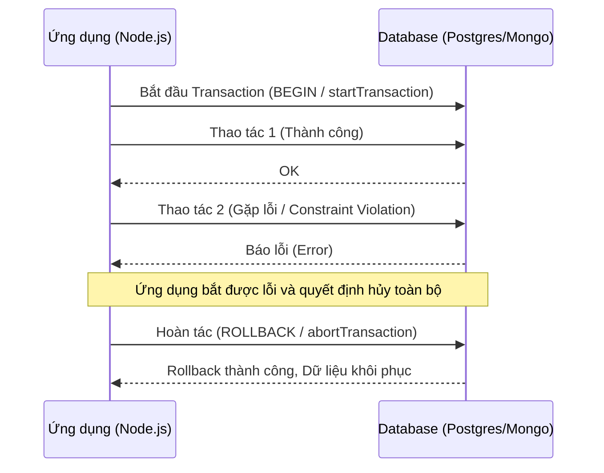

# Transaction Rollback trong PostgreSQL và MongoDB

> **Ý tưởng chính việc sử dụng:** Khái niệm giao dịch nguyên tử (ACID), đảm bảo một loạt thao tác DB phải thành công toàn bộ, nếu lỗi thì quay về trạng thái đầu.
> **Ví dụ:** Trong SQL, nếu Trừ Tiền A thành công nhưng Cộng Tiền B lỗi, hệ thống gọi lệnh ROLLBACK để trả lại tiền cho A.

## Mức độ Cơ bản (Basic)

### Transaction và Rollback là gì?
Trong cơ sở dữ liệu, một **Transaction (Giao dịch)** là một chuỗi các thao tác (ví dụ: Thêm, Xóa, Sửa) được thực thi như một đơn vị công việc duy nhất. Nguyên tắc cốt lõi của transaction là tính **ACID**, trong đó chữ **A** (Atomicity - Tính toàn vẹn) đảm bảo rằng: **"Hoặc tất cả các thao tác đều thành công, hoặc không có thao tác nào được thực hiện."**

**Rollback (Hoàn tác)** là cơ chế dùng để hủy bỏ tất cả các thay đổi đã được thực hiện trong một transaction nếu có bất kỳ lỗi nào xảy ra ở giữa chừng. 

### Ví dụ thực tế:
Hãy tưởng tượng quá trình chuyển tiền từ tài khoản A sang tài khoản B:
1. Trừ 100k từ tài khoản A.
2. Cộng 100k vào tài khoản B.

Nếu bước 1 thành công nhưng bước 2 thất bại (do lỗi hệ thống, sập mạng...), nếu không có transaction, tài khoản A sẽ mất 100k mà B không nhận được.
Nếu có transaction: Khi bước 2 lỗi, ta gọi lệnh **Rollback**. Hệ thống sẽ tự động hoàn tác bước 1, trả lại 100k cho A. Trạng thái dữ liệu trở về y như trước khi chuyển tiền.

---

## Mức độ Trung bình (Intermediate)

### Cách thức hoạt động dưới nền tảng (Under the hood)

#### 1. PostgreSQL (Relational DB)
PostgreSQL quản lý transaction dựa trên cơ chế **MVCC (Multi-Version Concurrency Control)** và **WAL (Write-Ahead Logging)**.
- Khi một transaction bắt đầu (`BEGIN`), mọi thay đổi dữ liệu sẽ được tạo ra dưới dạng các "phiên bản mới" (new tuples) của dòng dữ liệu đó, nhưng chúng sẽ "tàng hình" đối với các transaction khác (Isolation).
- Khi có lệnh `ROLLBACK`, PostgreSQL chỉ đơn giản là đánh dấu transaction đó là "đã bị hủy" (aborted). Các phiên bản dữ liệu mới được tạo ra sẽ bị hệ thống dọn dẹp sau này bởi tiến trình `VACUUM`. Dữ liệu gốc không hề bị ghi đè.

#### 2. MongoDB (NoSQL)
Từ phiên bản 4.0, MongoDB hỗ trợ **Multi-document ACID Transactions** (cho Replica Sets) và từ 4.2 (cho Sharded Clusters).
- MongoDB sử dụng **WiredTiger storage engine**, kết hợp cơ chế snapshot và ghi log (journaling).
- Khi transaction đang diễn ra (`session.startTransaction()`), các thay đổi được giữ trong bộ nhớ đệm (memory cache) của WiredTiger và chưa được ghi chính thức vào collections.
- Khi gọi `session.abortTransaction()` (Rollback), MongoDB sẽ hủy bỏ các thay đổi trong bộ nhớ đệm này, đảm bảo không có dữ liệu nào được flush xuống đĩa.

### Use Cases (Khi nào nên và không nên dùng)

| Đặc điểm | Nên dùng Transaction | Không nên dùng (Hoặc hạn chế) |
| :--- | :--- | :--- |
| **PostgreSQL** | Thao tác liên quan đến tiền bạc, thanh toán, đơn hàng (cần cập nhật tồn kho + hóa đơn cùng lúc). | Khi chỉ thực hiện các câu lệnh `SELECT` (đọc) đơn giản. Tránh giữ transaction quá lâu (Long-running transactions) vì nó gây phình database (bloat do MVCC) và lock table/row. |
| **MongoDB** | Khi bắt buộc phải cập nhật nhiều documents trên nhiều collections khác nhau và cần tính nhất quán tuyệt đối. | Nếu có thể gộp dữ liệu vào chung một document (Embedded Document), vì MongoDB mặc định đã đảm bảo tính Atomicity ở mức độ *single-document*. Transaction trong MongoDB tốn nhiều chi phí hiệu năng hơn so với Postgres. |

---

## Mức độ Nâng cao (Advanced)

### Các rủi ro, vấn đề về hiệu suất và cách tối ưu

#### 1. Vấn đề về hiệu suất (Performance & Scaling)
- **Locking & Deadlocks**: Trong PostgreSQL, nếu hai transactions cùng cố gắng cập nhật chéo hai dòng dữ liệu, có thể xảy ra Deadlock. Database sẽ phải kill một transaction và tự động rollback nó.
- **Chi phí (Overhead)**: Transaction trong MongoDB (distributed transaction) tốn kém hơn nhiều. Nó cần cơ chế "Two-Phase Commit" (2PC) ngầm bên dưới nếu chạy trên mô hình Sharding. Sử dụng transaction bừa bãi trong Mongo sẽ làm giảm throughput (số lượng request/s) đáng kể.

#### 2. Sai lầm thường gặp (Anti-patterns)
- **Giữ transaction quá lâu**: Code thực hiện call API ra bên ngoài hoặc chờ I/O bên trong một transaction block (`BEGIN` -> call API HTTP -> `COMMIT`/`ROLLBACK`). Điều này giữ khóa (lock) DB trong thời gian dài, khiến các requests khác bị block.
- **Sử dụng Transaction trong MongoDB khi không cần thiết**: Quên mất nguyên lý "Data Modeling" của NoSQL (gộp chung data vào 1 object thay vì chia nhiều bảng như SQL).

#### 3. Tối ưu hóa (Best Practices)
- Luôn giữ các thao tác logic bên trong transaction **ngắn gọn và nhanh nhất có thể**. Chỉ bao gồm các thao tác với Database.
- Xử lý các logic I/O (gửi email, call 3rd party API) **sau khi** transaction đã commit thành công.
- Ở PostgreSQL, hiểu rõ về các **Isolation Levels** (Read Committed, Repeatable Read, Serializable) để tránh các hiệu ứng phụ (như Phantom Reads) thay vì chỉ biết mỗi ROLLBACK.

---

## Phụ lục: Hình ảnh minh họa (Luồng xử lý Transaction)

---

## So Sánh: PostgreSQL vs MongoDB Transactions

| Tiêu chí | PostgreSQL | MongoDB |
| :--- | :--- | :--- |
| **Bản chất** | Hỗ trợ Native, bắt buộc trong thiết kế Relational. | Là tính năng mở rộng, khuyến khích dùng Data Modeling trước. |
| **Cơ chế lưu trữ** | MVCC & WAL (tạo version mới trên đĩa/page). | WiredTiger memory cache, flush sau khi commit. |
| **Phân tán (Distributed)**| Cần công cụ bên thứ 3 hoặc cấu hình phức tạp. | Hỗ trợ sẵn (Replica Sets, Sharding). |

---

## Bài Tập Thực Hành Nhỏ

1. **Thử thách 1 (Mongo)**: Bạn hãy thử cấu hình một Replica Set nhỏ trên local (hoặc dùng MongoDB Atlas), viết code sử dụng transaction, cố ý làm sai ở collection thứ hai và in ra kết quả của collection thứ nhất xem nó có bị đổi không. *(Lưu ý: MongoDB transaction KHÔNG chạy trên bản Standalone).*
2. **Thử thách 2 (Postgres)**: Sửa đoạn code demo đính kèm, thêm lệnh `await new Promise(res => setTimeout(res, 10000))` vào giữa các câu query trong lúc transaction đang chạy. Đồng thời mở một kết nối DB khác cố gắng `SELECT` dữ liệu đang bị sửa để quan sát hiện tượng "Block" và "Read Committed".

> [!TIP]
> **ĐÁP ÁN BÀI TẬP**: Mình đã chuẩn bị sẵn file code giải cho 2 thử thách trên. Sau khi tự thử nghiệm, bạn có thể tham khảo tại: [answers-transaction-rollback.js](Users/ductri0981/Documents/Studying-Software/transaction/answers-transaction-rollback.js)

---

## Giải thích thuật ngữ (Glossary)

- **ACID**: 4 tính chất quan trọng nhất của database để đảm bảo dữ liệu luôn đúng đắn: **Atomicity** (Toàn vẹn - hoặc tất cả hoặc không có gì), **Consistency** (Nhất quán), **Isolation** (Độc lập - các transaction không ảnh hưởng nhau), **Durability** (Bền vững - dữ liệu không mất đi kể cả sập nguồn).
- **MVCC (Multi-Version Concurrency Control)**: Cơ chế "đa phiên bản". Khi bạn update dữ liệu, thay vì ghi đè trực tiếp, database tạo ra một bản copy mới (version mới) để những người khác vẫn có thể đọc bản cũ cho đến khi bạn hoàn tất (commit) bản copy mới.
- **WAL (Write-Ahead Logging)**: Cơ chế "Ghi log trước". Mọi thay đổi đều được ghi ra một file log (nhật ký) trước khi thực sự áp dụng vào các file dữ liệu chính, giúp hệ thống khôi phục (recovery) lại nếu có sự cố sập nguồn bất ngờ.
- **Replica Set (MongoDB)**: Một cụm nhiều server MongoDB chứa cùng một tập dữ liệu, dùng để dự phòng (nếu 1 server sập thì server khác thay thế). Transaction trong Mongo yêu cầu có Replica Set để phối hợp đồng bộ dữ liệu.
- **Deadlock**: Hiện tượng 2 hoặc nhiều transaction chờ đợi lẫn nhau vô thời hạn để tranh giành tài nguyên (tương tự như 2 chiếc xe kẹt cứng đối đầu trong 1 con hẻm nhỏ).
