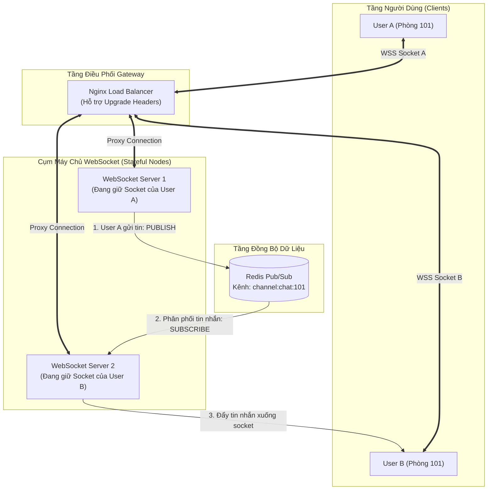

# WEBSOCKET ARCHITECTURE & REAL-TIME ENGINEERING DEEP DIVE

> **Tài liệu lý thuyết chuyên sâu và hướng dẫn kiến trúc toàn diện về WebSocket (RFC 6455)**  
> Dành cho Software Engineer, Full-Stack Developer và DevOps Engineer từ cấp độ Intern đến Middle-level và Tech Lead.

---

## 📑 MỤC LỤC
1. [Mức Độ Cơ Bản (Basic Fundamentals)](#1-mức-độ-cơ-bản-basic-fundamentals)
2. [Mức Độ Trung Bình (Intermediate - Architecture & Use Cases)](#2-mức-độ-trung-bình-intermediate---architecture--use-cases)
3. [Mức Độ Chuyên Sâu: BẢN CHẤT VẬN HÀNH (Under The Hood & Core Mechanics)](#3-mức-độ-chuyên-sâu-bản-chất-vận-hành-under-the-hood--core-mechanics)
4. [Mức Độ Nâng Cao: Vận Hành Thực Chiến (Production Engineering & Best Practices)](#4-mức-độ-nâng-cao-vận-hành-thực-chiến-production-engineering--best-practices)
5. [Góc Nhìn Thực Chiến Cho Middle-Level Trở Xuống (Must-Know vs Nice-to-Know Roadmap)](#5-góc-nhìn-thực-chiến-cho-middle-level-trở-xuống-must-know-vs-nice-to-know-roadmap)
6. [So Sánh Bản Chất (First-Principles Comparison)](#6-so-sánh-bản-chất-first-principles-comparison)
7. [Sơ Đồ Trực Quan (Mermaid Diagrams)](#7-sơ-đồ-trực-quan-mermaid-diagrams)
8. [Bảng Tra Thuật Ngữ Chi Tiết (Glossary)](#8-bảng-tra-thuật-ngữ-chi-tiết-glossary)
9. [Hướng Dẫn Chạy & Kiểm Thử Hệ Thống (Step-by-Step Run Guide)](#9-hướng-dẫn-chạy--kiểm-thử-hệ-thống-step-by-step-run-guide)

---

## 1. Mức Độ Cơ Bản (Basic Fundamentals)

### 1.1. Định nghĩa & Ẩn dụ đời thực (Real-world Analogy)
**WebSocket** (chuẩn hóa theo **RFC 6455**) là giao thức truyền thông mạng cung cấp một kênh giao tiếp hai chiều đồng thời (**Full-Duplex**), liên tục và có trạng thái (**Stateful**) qua một kết nối **TCP** duy nhất giữa Trình duyệt (Client) và Máy chủ (Server).

```
+-----------------------------------------------------------------------------------+
|                        ẨN DỤ: BỨC THƯ BƯU ĐIỆN VS CUỘC ĐIỆN THOẠI TRỰC TIẾP       |
|                                                                                   |
|  [HTTP Truyền Thống] - GỬI THƯ TAY QUA BƯU ĐIỆN:                                  |
|   - Bạn (Client) muốn biết bạn bè làm gì: Phải viết thư, dán tem (HTTP Header),   |
|     gửi đi và chờ hồi âm.                                                         |
|   - Người nhận (Server) KHÔNG THỂ tự ý gửi thư cho bạn nếu bạn không hỏi trước!   |
|   - Cứ mỗi lần hỏi là một phong bì mới, tốn tem, tốn công vận chuyển (Overhead).  |
|                                                                                   |
|  [WebSocket] - CUỘC GỌI ĐIỆN THOẠI THƯỜNG TRỰC:                                   |
|   - Hai bên bấm số gọi và nhấc máy (Bắt tay HTTP Upgrade Handshake).              |
|   - Đường dây giữ thông suốt (Persistent TCP Connection).                         |
|   - Bất kỳ ai có chuyện gì đều có thể nói ngay lập tức (Full-Duplex),             |
|     độ trễ gần như bằng 0, không cần phong bì thư nào nữa (Frame chỉ 2 - 10 bytes)|
+-----------------------------------------------------------------------------------+
```

- **Nếu không có WebSocket**: Để làm ứng dụng chat hay cập nhật giá cổ phiếu, Client phải dùng kỹ thuật **Polling** (cứ 1 giây lại gửi một HTTP Request hỏi Server *"Có tin nhắn mới không?"*) hoặc **Long Polling** (Server giữ kết nối HTTP cho đến khi có dữ liệu rồi ngắt). Điều này gây lãng phí hàng triệu HTTP Request thừa, ngốn băng thông vì Header lặp đi lặp lại và làm nghẽn máy chủ.
- **Khi có WebSocket**: Kết nối TCP được mở sẵn. Server có thể chủ động bắn (Push) dữ liệu xuống Client ngay thời điểm sự kiện xảy ra mà Client không cần tốn công hỏi.

---

### 1.2. Vấn đề cốt lõi sinh ra công nghệ (Problem Statement)
Giao thức **HTTP/1.1** được thiết kế dựa trên triết lý **Request - Response (Kéo - Pull)**: Client luôn là bên chủ động khởi tạo phiên kết nối, Server là bên bị động lắng nghe và phản hồi rồi kết thúc (Stateless).

Mô hình này bộc lộ những hạn chế chết người trong thời đại Web Real-time:
1. **Lãng phí băng thông khổng lồ (Header Overhead)**: Mỗi HTTP request gửi đi đều mang theo Cookie, User-Agent, Accept headers... nặng từ 500 bytes đến 2KB. Nếu một game hoặc sàn chứng khoán cần cập nhật dữ liệu 10 lần/giây, băng thông dành cho HTTP Header chiếm tới 95% tổng lượng dữ liệu truyền qua mạng!
2. **Độ trễ cao (High Latency)**: Cơ chế Long-polling phải liên tục đóng và mở lại kết nối TCP (3-way handshake) mỗi khi có dữ liệu mới.
3. **Server không thể chủ động (No Server-Push)**: Server biết đơn hàng vừa bị hủy nhưng không có cách nào thông báo ngay cho Shipper nếu Shipper chưa gửi request lên.

WebSocket sinh ra để giải quyết triệt để bài toán này: **1 lần bắt tay qua cổng HTTP (80/443) duy nhất, sau đó chuyển thành đường truyền nhị phân 2 chiều siêu nhẹ**.

---

### 1.3. Kiến trúc tổng quan mức High-Level

```
[ BROWSER CLIENT ]                                 [ WEBSOCKET SERVER ]
        |                                                    |
        |--- 1. HTTP GET /chat (Upgrade: websocket) -------->|  (HTTP Handshake)
        |<-- 2. HTTP 101 Switching Protocols ----------------|
        |                                                    |
        |=== 3. KÊNH TCP FULL-DUPLEX ĐƯỢC THIẾT LẬP =========|  (Persistent Socket)
        |                                                    |
        |--- 4. Client Frame ("Xin chào") ------------------>|  (Chỉ 2-6 bytes header)
        |<-- 5. Server Frame ("Thông báo mới") --------------|  (Server chủ động push)
        |                                                    |
        |--- 6. Ping Frame --------------------------------->|  (Heartbeat kiểm tra sống/chết)
        |<-- 7. Pong Frame ----------------------------------|
        |                                                    |
        |--- 8. Close Frame (Mã 1000 Bình thường) ---------->|
        |<-- 9. Close Frame Ack -----------------------------|  (Đóng kết nối an toàn)
```

---

## 2. Mức Độ Trung Bình (Intermediate - Architecture & Use Cases)

### 2.1. Các thành phần cốt lõi của giao thức WebSocket

1. **Quá trình Bắt Tay Nâng Cấp (HTTP Upgrade Handshake)**:
   - WebSocket tận dụng cổng mạng tiêu chuẩn của Web (`80` cho `ws://` và `443` cho `wss://`).
   - Client gửi HTTP Request mang các header đặc biệt:
     - `Upgrade: websocket`: Yêu cầu máy chủ nâng cấp giao thức.
     - `Connection: Upgrade`: Báo hiệu cho các proxy trung gian biết kết nối này sẽ chuyển đổi.
     - `Sec-WebSocket-Key`: Chuỗi ngẫu nhiên 16 bytes base64 do Client tạo.
     - `Sec-WebSocket-Version: 13`: Phiên bản giao thức RFC 6455.
   - Server phản hồi mã trạng thái **HTTP 101 Switching Protocols** kèm header:
     - `Sec-WebSocket-Accept`: Chuỗi hash chứng minh Server hỗ trợ WebSocket.
   - Kể từ thời điểm này, kết nối TCP không bị đóng mà chuyển thẳng sang chế độ truyền Frame nhị phân.

2. **Cấu trúc Gói Tin (WebSocket Frame Structure)**:
   - Thay vì văn bản thuần túy (Plaintext Headers) cồng kềnh như HTTP, WebSocket đóng gói dữ liệu vào các **Frame** nhị phân với header chỉ từ **2 đến 10 bytes**.
   - Hỗ trợ cả dữ liệu dạng văn bản (**UTF-8 String**) và dữ liệu nhị phân thô (**ArrayBuffer / Blob / Binary**).

3. **Giao thức Nhịp Tim (Heartbeat Ping / Pong)**:
   - Hai loại Frame điều khiển đặc biệt (`Opcode 0x9: Ping` và `Opcode 0xA: Pong`) được định nghĩa sẵn ở tầng giao thức.
   - Cho phép Client và Server chủ động phát hiện kết nối bị đứt ngầm (Silent Disconnect / Half-Open Connection) để dọn dẹp tài nguyên kịp thời.

4. **Kênh và Phòng (Rooms / Namespaces)**:
   - Giao thức WebSocket thuần túy chỉ gửi dữ liệu giữa 1 Client và 1 Server.
   - Khái niệm "Phòng chat (Room)" hoặc "Kênh chủ đề (Topic)" là kiến trúc tầng ứng dụng (Application Layer): Server duy trì một bảng băm (Map) liên kết giữa `roomId` và danh sách các kết nối socket đang tham gia để thực hiện Broadcast.

---

### 2.2. Khi nào NÊN dùng và KHÔNG NÊN dùng WebSocket

#### ✅ Khi nào NÊN dùng WebSocket (Best Use Cases)
1. **Ứng dụng Chat & Nhắn tin thời gian thực**: Trò chuyện 1-1, nhóm chat, thông báo đã xem, hiển thị trạng thái "đang soạn tin...".
2. **Cộng tác trực tuyến thời gian thực (Collaborative Tools)**: Google Docs, Figma, bảng vẽ Miro nơi nhiều người cùng chỉnh sửa đồng thời.
3. **Bảng giá tài chính & Sàn giao dịch (Crypto / Stock / Forex)**: Dữ liệu lệnh mua/bán thay đổi từng mili-giây cần độ trễ thấp nhất.
4. **Game trực tuyến Multiplayer trên trình duyệt**: Đồng bộ vị trí nhân vật, hành động người chơi liên tục.
5. **Dashboard giám sát IoT & Telemetry**: Nhận dữ liệu cảm biến đo lường trực tiếp từ thiết bị.

#### ❌ Khi nào KHÔNG NÊN dùng WebSocket (What to Avoid)
1. **Ứng dụng CRUD thông thường (Đọc/Ghi dữ liệu tĩnh)**: Danh sách tin tức, trang chi tiết sản phẩm thương mại điện tử. Hãy dùng RESTful API hoặc GraphQL vì chúng tận dụng được bộ nhớ đệm HTTP (Browser Cache, CDN) mà WebSocket không thể có.
2. **Thông báo đơn hướng từ Server xuống Client (Server-to-Client only)**: Nếu bạn chỉ cần thông báo đẩy (như thông báo "Đơn hàng đã giao thành công"), hãy dùng **Server-Sent Events (SSE)**. SSE chạy trên HTTP chuẩn, tự động reconnect, nhẹ nhàng hơn và không đòi hỏi quản lý kết nối 2 chiều phức tạp.
3. **Truyền tải File dung lượng lớn (Video / Large File Upload)**: Hãy dùng HTTP Multipart Upload kết hợp luồng Chunking hoặc Presigned URL S3. Truyền file gigabytes qua WebSocket sẽ làm nghẽn bộ đệm socket RAM.

---

## 3. Mức Độ Chuyên Sâu: BẢN CHẤT VẬN HÀNH (Under The Hood & Core Mechanics)

### 3.1. Chi tiết Thuật Toán Bắt Tay (Handshake Cryptography - RFC 6455)
Tại sao WebSocket lại cần chuỗi `Sec-WebSocket-Key` và `Sec-WebSocket-Accept`?

Mục đích của việc này **không phải để bảo mật hay xác thực danh tính**, mà là để **ngăn chặn các Proxy Cache cũ bị nhầm lẫn (Caching Poisoning)**:

```
BƯỚC 1: Client sinh chuỗi ngẫu nhiên 16 bytes, mã hóa Base64:
  Sec-WebSocket-Key: dGhlIHNhbXBsZSBub25jZQ==

BƯỚC 2: Server nối chuỗi này với một chuỗi GUID cố định duy nhất theo chuẩn RFC 6455:
  GUID bí mật toàn cầu: "258EAFA5-E914-47DA-95CA-C5AB0DC85B11"
  Chuỗi kết hợp: "dGhlIHNhbXBsZSBub25jZQ==258EAFA5-E914-47DA-95CA-C5AB0DC85B11"

BƯỚC 3: Server băm chuỗi trên bằng giải thuật SHA-1, sau đó mã hóa kết quả sang Base64:
  SHA-1 Digest: b3 7a 4f 2c c0 62 4f 16 90 d6 46 06 cf 38 59 45 b2 be c4 ea
  Sec-WebSocket-Accept: s3pPLMBiTxaQ1kYGzzhZRbK+xOo=

BƯỚC 4: Client nhận được phản hồi, tự tính toán lại. Nếu khớp => Bắt tay thành công!
```
Nhờ cơ chế này, nếu request vô tình đi qua một Proxy Server cũ không hiểu WebSocket, Proxy sẽ không thể sinh ra chuỗi Accept chính xác, ngăn chặn việc kết nối bị lưu cache sai lệch.

---

### 3.2. Cấu Trúc Khung Nhị Phân (WebSocket Data Frame Format)
Sau khi handshake hoàn tất, dữ liệu được truyền dưới dạng các Frame có cấu trúc nhị phân như sau:

```
 0                   1                   2                   3
 0 1 2 3 4 5 6 7 8 9 0 1 2 3 4 5 6 7 8 9 0 1 2 3 4 5 6 7 8 9 0 1
+-+-+-+-+-------+-+-------------+-------------------------------+
|F|R|R|R| opcode|M| Payload len |    Extended payload length    |
|I|S|S|S|  (4)  |A|     (7)     |             (16/64)           |
|N|V|V|V|       |S|             |   (if payload len==126/127)   |
| |1|2|3|       |K|             |                               |
+-+-+-+-+-------+-+-------------+ - - - - - - - - - - - - - - - +
|     Extended payload length continued, if payload len == 127  |
+ - - - - - - - - - - - - - - - +-------------------------------+
|                               |Masking-key, if MASK set to 1  |
+-------------------------------+-------------------------------+
| Masking-key (continued)       |          Payload Data         |
+-------------------------------- - - - - - - - - - - - - - - - +
:                     Payload Data continued ...                :
+---------------------------------------------------------------+
```

#### Ý nghĩa từng bit trường dữ liệu:
- **`FIN` (1 bit)**: Cho biết đây có phải là frame cuối cùng của thông điệp hay không (`1` = Frame kết thúc, `0` = Còn các frame tiếp theo chia nhỏ).
- **`Opcode` (4 bits)**: Định nghĩa loại dữ liệu:
  - `0x1`: Text Frame (UTF-8).
  - `0x2`: Binary Frame (Dữ liệu nhị phân).
  - `0x8`: Connection Close (Đóng kết nối).
  - `0x9`: Ping.
  - `0xA`: Pong.
- **`MASK` (1 bit)**: Cho biết dữ liệu có bị mã hóa mặt nạ (Masking) hay không.
  - **QUY TẮC BẮT BUỘC**: Mọi frame gửi từ **Client lên Server BẮT BUỘC MASK = 1** (nếu Client gửi không mask, Server phải ngắt kết nối ngay lập tức). Frame từ **Server xuống Client MASK = 0**.
- **`Masking-key` (4 bytes)**: Khóa mặt nạ 32-bit ngẫu nhiên do Client sinh ra. Dữ liệu Payload được mã hóa bằng phép toán XOR:
  $$\text{TransformedByte}[i] = \text{OriginalByte}[i] \oplus \text{MaskingKey}[i \pmod 4]$$
  *Tại sao phải Masking?* Để ngăn chặn tấn công **Cache Poisoning** đối với các proxy trung gian kém thông minh. Nhờ phép biến đổi XOR ngẫu nhiên, nội dung nhị phân truyền qua mạng không bao giờ trùng với các HTTP command thông thường.

---

### 3.3. Vấn Đề Kết Nối Ma (Ghost / Half-Open Connections) & Heartbeat
Một kết nối TCP trên lý thuyết có thể giữ mở vô tận nếu không có bên nào chủ động đóng. Tuy nhiên, trong thực tế:
- Người dùng đi vào thang máy, tắt Wi-Fi, chuyển sang 4G hoặc thiết bị hết pin sập nguồn đột ngột.
- Vì không có gói tin `TCP FIN` hay `TCP RST` nào được gửi đi, **Server vẫn đinh ninh kết nối TCP đó đang sống bình thường**.
- Kết quả: Server tiếp tục lưu giữ socket handle trong RAM, tiếp tục broadcast tin nhắn vào một kết nối đã chết. Sau vài ngày, hàng chục ngàn **Kết nối ma (Ghost Connections)** làm cạn kiệt bộ nhớ máy chủ.

```
CƠ CHẾ PHÒNG VỆ HEARTBEAT (PING/PONG TICK):

[SERVER TIMER: Định kỳ 30s]
      |
      v
Server duyệt qua toàn bộ kết nối:
  - Nếu kết nối có cờ `isAlive === false`:
    => ĐÂY LÀ KẾT NỐI MA! Chủ động gọi socket.terminate() để dọn dẹp RAM ngay!
  - Nếu kết nối `isAlive === true`:
    => Đặt lại cờ `isAlive = false`.
    => Gửi gói tin Ping Frame (Opcode 0x9) xuống Client.

[CLIENT NHẬN PING]:
      |
      v
Trình duyệt / Client tự động gửi lại Pong Frame (Opcode 0xA).
Server nhận Pong => Bật lại cờ `isAlive = true`.
```

---

### 3.4. Mở Rộng Quy Mô Theo Chiều Ngang (Horizontal Scaling) với Redis Pub/Sub
Khác với ứng dụng REST API (Stateless - người dùng gửi request vào server nào cũng như nhau), **WebSocket là Stateful**:
- Client A kết nối vào **Server Node 1**.
- Client B kết nối vào **Server Node 2**.
- Khi Client A gửi tin nhắn cho Client B: Server Node 1 nhận được tin nhắn, nhưng **Server Node 1 không giữ kết nối socket của Client B**! Làm sao Client B nhận được tin?

```
+------------------------------------------------------------------------------------+
|                MÔ HÌNH PHÂN TÁN WEBSOCKET QUA REDIS PUB/SUB ADAPTER                |
|                                                                                    |
|  [Client A] --------> [ WebSocket Server Node 1 ]                                  |
|                             |                                                      |
|                             v (PUBLISH channel:chat "Hello B")                     |
|                 +-----------------------+                                          |
|                 | REDIS PUB/SUB CLUSTER |                                          |
|                 +-----------------------+                                          |
|                             |                                                      |
|                             v (SUBSCRIBE nhận message)                             |
|  [Client B] <-------- [ WebSocket Server Node 2 ]                                  |
+------------------------------------------------------------------------------------+
```

1. Mọi WebSocket Server Node khi khởi động đều đăng ký (SUBSCRIBE) lắng nghe các kênh sự kiện từ **Redis**.
2. Khi bất kỳ node nào nhận tin nhắn từ client của mình, thay vì chỉ broadcast cục bộ, node đó sẽ **PUBLISH** sự kiện vào Redis.
3. Redis lập tức phân phối thông điệp tới toàn bộ các node còn lại trong cụm cluster.
4. Mỗi node kiểm tra xem người nhận (Client B) có đang kết nối vào node của mình không; nếu có, node đó sẽ đẩy dữ liệu xuống socket của Client B.

---

## 4. Mức Độ Nâng Cao: Vận Hành Thực Chiến (Production Engineering & Best Practices)

### 4.1. Bảo Mật WebSocket (Security Hardening)

#### 1. Phòng chống Cross-Site WebSocket Hijacking (CSWSH)
Giống như tấn công CSRF trong HTTP, một trang web độc hại `attacker.com` có thể mở thẻ `<script>` cố tình kết nối tới `wss://your-bank.com/ws`. Vì trình duyệt tự động đính kèm Cookie của nạn nhân trong request handshake, kết nối có thể được chấp thuận!

- **Cách phòng chống chuẩn mực**:
  1. **Kiểm tra Header `Origin` tại Server**:
     ```javascript
     const wss = new WebSocket.Server({ noServer: true });
     server.on('upgrade', (req, socket, head) => {
       const origin = req.headers.origin;
       if (!ALLOWED_ORIGINS.includes(origin)) {
         socket.write('HTTP/1.1 403 Forbidden\r\n\r\n');
         socket.destroy();
         return;
       }
     });
     ```
  2. **Truyền Token một lần (One-Time Ticket) hoặc JWT**: Không dựa dẫm vào Cookie. Trước khi mở WebSocket, Client gọi API lấy một `ws_ticket` ngắn hạn (sống 30s) và truyền qua query parameter hoặc protocol header: `ws://api.com/ws?ticket=xyz123`.

---

### 4.2. Vấn Đề Áp Lực Ngược (Backpressure & Slow Consumer Problem)
Trong Node.js, khi Server phát sóng (broadcast) một lượng dữ liệu lớn cho hàng ngàn người dùng, sẽ luôn có những người dùng mạng yếu (3G chập chờn).
- Tốc độ Server đẩy dữ liệu vào socket nhanh hơn tốc độ card mạng của Client nhận dữ liệu.
- Dữ liệu bị ứ đọng lại trong bộ nhớ RAM của Server (Buffer Queue).
- Nếu không kiểm soát, một vài Client mạng lag có thể làm Server bị **tràn bộ nhớ (Heap Out of Memory)**!

```javascript
// KIỂM TRA BỘ ĐỆM BUFFERED AMOUNT TRƯỚC KHI GỬI
function safeSend(ws, data) {
  // Nếu bộ đệm RAM của socket này đã tích tụ quá 1MB chưa gửi xong
  if (ws.bufferedAmount > 1024 * 1024) {
    console.warn(`[Slow Consumer] Client ${ws.id} mạng quá chậm! Bỏ qua frame để bảo vệ server.`);
    return false; // Áp dụng Drop Frame hoặc Backpressure
  }
  ws.send(data);
  return true;
}
```

---

### 4.3. Chiến Lược Tự Động Kết Nối Lại Phía Client (Reconnection with Exponential Backoff)
Nếu máy chủ bị khởi động lại hoặc mạng client bị ngắt, Client không được gửi yêu cầu kết nối lại dồn dập (ví dụ cứ 100ms thử lại 1 lần), vì khi 100.000 users cùng kết nối lại tại một thời điểm sẽ tạo ra **Thảm họa Thundering Herd (Bão kết nối)** làm sập máy chủ mới bật lên.

```javascript
// EXPONENTIAL BACKOFF KẾT HỢP JITTER (ĐỘ LỆCH NGẪU NHIÊN)
let retryCount = 0;
function connectWebSocket() {
  const ws = new WebSocket('wss://api.example.com/ws');

  ws.onclose = () => {
    // Thời gian chờ tăng theo hàm mũ: 1s, 2s, 4s, 8s... tối đa 30s
    const baseDelay = Math.min(30000, 1000 * Math.pow(2, retryCount));
    // Thêm độ lệch ngẫu nhiên (Jitter) ±20% để phân tán thời điểm kết nối của các client
    const jitter = baseDelay * (0.8 + Math.random() * 0.4);

    retryCount++;
    console.log(`Mất kết nối. Thử lại sau ${Math.round(jitter)}ms...`);
    setTimeout(connectWebSocket, jitter);
  };

  ws.onopen = () => {
    console.log('Kết nối thành công!');
    retryCount = 0; // Đặt lại số lần thử
  };
}
```

---

## 5. Góc Nhìn Thực Chiến Cho Middle-Level Trở Xuống (Must-Know vs Nice-to-Know Roadmap)

```
+------------------------------------------------------------------------------------+
|               LỘ TRÌNH KỸ NĂNG WEBSOCKET: PHÂN CẤP TỪ JUNIOR ĐẾN SENIOR            |
|                                                                                    |
|  [INTERN / JUNIOR] (80/20 - Sử dụng thực chiến)                                    |
|   ├── Hiểu rõ sự khác biệt giữa HTTP Request-Response và WebSocket Full-Duplex     |
|   ├── Biết khi nào NÊN dùng WebSocket và khi nào NÊN dùng REST API / SSE           |
|   ├── Khởi tạo kết nối phía Client (new WebSocket('ws://...')), lắng nghe sự kiện  |
|   │   (onopen, onmessage, onerror, onclose)                                        |
|   ├── Xây dựng server cơ bản bằng thư viện `ws` hoặc `socket.io` trong Node.js     |
|   └── Xử lý parse JSON dữ liệu an toàn và đóng kết nối khi component unmount       |
|                                                                                    |
|  ============================== Ranh giới Middle ===============================   |
|                                                                                    |
|  [MIDDLE-LEVEL] (Thiết kế chịu tải, Ổn định mạng & Mở rộng cụm)                   |
|   ├── Thiết lập Heartbeat Ping/Pong để dọn dẹp các kết nối ma (Ghost Connections)  |
|   ├── Tự động kết nối lại (Reconnection) bằng Exponential Backoff kết hợp Jitter    |
|   ├── Xác thực người dùng (Auth Ticket/JWT) tại bước HTTP Upgrade Handshake        |
|   ├── Mở rộng chiều ngang (Horizontal Scaling) bằng Redis Pub/Sub Adapter          |
|   ├── Quản lý danh sách phòng (Rooms) và chia kênh theo chủ đề hiệu quả            |
|   └── Kiểm soát áp lực ngược (Backpressure qua ws.bufferedAmount)                  |
|                                                                                    |
|  ============================== Ranh giới Senior / SRE =========================   |
|                                                                                    |
|  [SENIOR / DEVOPS / SRE] (Tạm thời bỏ qua nếu ở mức Middle trở xuống)              |
|   ├── Tinh chỉnh Kernel TCP Socket (net.ipv4.tcp_max_syn_backlog, somaxconn)       |
|   ├── Cấu hình Nginx / Envoy WebSocket Proxying (Upgrade headers, timeout 86400s)  |
|   ├── Tối ưu hóa bộ nhớ C++ Buffer của V8 engine cho hàng triệu kết nối đồng thời  |
|   └── Chuyển đổi sang WebTransport / HTTP/3 QUIC Streams cho trường hợp cực hạn    |
+------------------------------------------------------------------------------------+
```

---

### 5.1. Chi Tiết Đáp Án & Kỹ Thuật Thực Chiến Cho Cấp Độ [INTERN / JUNIOR]

#### 1. Hiểu rõ sự khác biệt giữa HTTP Request-Response và WebSocket Full-Duplex
- **Vấn đề thực tế:** HTTP chỉ hoạt động theo kiểu một chiều: Client hỏi thì Server mới trả lời (Half-Duplex). Server không thể tự động chủ động đẩy dữ liệu xuống client khi có tin nhắn mới.
- **Đáp án & Bản chất:** WebSocket thiết lập một đường ống hai chiều liên tục (Full-Duplex) trên 1 kết nối TCP duy nhất. Cả Client và Server đều có thể bắn tin nhắn cho nhau bất kỳ lúc nào với độ trễ tính bằng mili-giây và không cần gửi lại HTTP header.

#### 2. Biết khi nào NÊN dùng WebSocket và khi nào NÊN dùng REST API / SSE
- **Đáp án chuẩn kiến trúc:**
  - **REST API:** Dùng cho tác vụ CRUD thông thường (Xem danh sách, Tạo bài viết, Sửa thông tin).
  - **SSE (Server-Sent Events):** Dùng khi **chỉ cần Server đẩy 1 chiều xuống Client** (Thông báo notification, giá chứng khoán realtime, streaming chữ ChatGPT AI). Nhẹ hơn WebSocket rất nhiều và tự động reconnect.
  - **WebSocket:** Bắt buộc khi cần **tương tác 2 chiều liên tục** (Chat trực tiếp, Bảng trắng vẽ cộng tác real-time, Game online multiplayer).

#### 3. Khởi tạo kết nối phía Client (`new WebSocket('ws://...')`), lắng nghe sự kiện
- **Đáp án & Code chuẩn:**
```typescript
const ws = new WebSocket('ws://localhost:8080');

ws.onopen = () => console.log('Đã kết nối tới WebSocket Server!');
ws.onmessage = (event) => {
  const data = JSON.parse(event.data);
  console.log('Nhận tin nhắn từ Server:', data);
};
ws.onerror = (err) => console.error('Lỗi socket:', err);
ws.onclose = () => console.log('Kết nối WebSocket đã đóng.');
```

#### 4. Xây dựng server cơ bản bằng thư viện `ws` trong Node.js
- **Đáp án & Code chuẩn:**
```typescript
import { WebSocketServer } from 'ws';

const wss = new WebSocketServer({ port: 8080 });

wss.on('connection', (ws) => {
  console.log('Client mới đã kết nối!');

  ws.on('message', (message) => {
    console.log('Nhận:', message.toString());
    // Phản hồi lại client
    ws.send(JSON.stringify({ text: 'Server đã nhận!', at: Date.now() }));
  });
});
```

#### 5. Xử lý parse JSON dữ liệu an toàn và đóng kết nối khi component unmount
- **Vấn đề thực tế:** Nếu không bọc `try/catch` khi parse JSON, 1 tin nhắn hỏng từ client khác có thể làm crash toàn bộ UI React. Nếu không đóng socket khi unmount component, người dùng chuyển trang qua lại sẽ tạo ra hàng chục kết nối rác gây memory leak.
- **Đáp án & Code React chuẩn:**
```typescript
useEffect(() => {
  const socket = new WebSocket('wss://example.com/ws');

  socket.onmessage = (event) => {
    try {
      const payload = JSON.parse(event.data);
      setMessages((prev) => [...prev, payload]);
    } catch (e) {
      console.warn('Tin nhắn không đúng định dạng JSON:', event.data);
    }
  };

  // Dọn dẹp kết nối khi component bị hủy (unmount):
  return () => {
    socket.close();
  };
}, []);
```

---

### 5.2. Chi Tiết Đáp Án & Kỹ Thuật Thực Chiến Cho Cấp Độ [MIDDLE-LEVEL]

#### 1. Thiết lập Heartbeat Ping/Pong để dọn dẹp các kết nối ma (Ghost Connections)
- **Vấn đề thực tế:** Người dùng đi vào thang máy mất sóng hoặc sập nguồn điện thoại. TCP socket không gửi gói tin `FIN/RST`. Server vẫn tưởng client đang online và giữ mở socket trong RAM. Hàng ngàn kết nối ma như vậy sẽ làm cạn kiệt socket file descriptors của server.
- **Đáp án & Code chuẩn:**
```typescript
// Định kỳ mỗi 30s, Server gửi Ping tới tất cả client
const interval = setInterval(() => {
  wss.clients.forEach((ws: any) => {
    if (ws.isAlive === false) return ws.terminate(); // 1. Quá hạn không thấy Pong => Đóng kết nối ma!

    ws.isAlive = false; // Đánh dấu tạm thời
    ws.ping();          // 2. Gửi Ping
  });
}, 30000);

wss.on('connection', (ws: any) => {
  ws.isAlive = true;
  ws.on('pong', () => { ws.isAlive = true; }); // 3. Nhận Pong => Sống sót!
});
```

#### 2. Tự động kết nối lại (Reconnection) bằng Exponential Backoff kết hợp Jitter
- **Vấn đề thực tế:** Mạng WiFi bị chập chờn. Nếu client reconnect ngay lập tức trong vòng lặp `while(true)`, máy chủ vừa khởi động lại sẽ bị hàng ngàn client cùng lúc "dội bom" sập tiếp.
- **Đáp án & Code chuẩn:**
```typescript
let retryCount = 0;
function connect() {
  const ws = new WebSocket('wss://api.example.com/ws');
  ws.onclose = () => {
    // Backoff hàm mũ + random jitter (tối đa 30s)
    const delay = Math.min(30000, Math.pow(2, retryCount) * 1000 + Math.random() * 1000);
    retryCount++;
    setTimeout(connect, delay);
  };
  ws.onopen = () => { retryCount = 0; };
}
```

#### 3. Xác thực người dùng (Auth Ticket/JWT) tại bước HTTP Upgrade Handshake
- **Vấn đề thực tế:** WebSocket không hỗ trợ gửi Custom Headers từ trình duyệt (`new WebSocket(url)` không cho nhét header `Authorization: Bearer`).
- **Đáp án chuẩn bảo mật:**
  - **Cách 1 (Khuyên dùng):** Dùng **One-Time Ticket Pattern**. Client gọi REST API POST `/api/ws-ticket` lấy 1 mã ticket tạm thời sống 30 giây. Sau đó kết nối `wss://host/ws?ticket=abcxyz`.
  - **Cách 2:** Đọc Token từ **HttpOnly Cookie** trong hàm `server.on('upgrade', (req, socket, head) => ...)` trước khi chấp thuận nâng cấp kết nối.

#### 4. Mở rộng chiều ngang (Horizontal Scaling) bằng Redis Pub/Sub Adapter
- **Vấn đề thực tế:** Có 2 máy chủ: Server A và Server B. User 1 nối vào Server A, User 2 nối vào Server B. Khi User 1 gửi tin nhắn cho User 2, Server A không có socket của User 2 trong RAM nên không thể gửi được!
- **Đáp án:** Dùng **Redis Pub/Sub** làm cầu nối xương sống. Server A publish tin nhắn lên Redis channel `chat:room_1`. Mọi server khác (bao gồm Server B) subscribe vào channel này sẽ nhận được tin và bắn xuống socket của các user tương ứng.

#### 5. Quản lý danh sách phòng (Rooms) và chia kênh theo chủ đề hiệu quả
- **Đáp án:** Tổ chức dữ liệu bằng `Map<string, Set<WebSocket>>` (ví dụ: `rooms.get('room_101')`). Khi broadcast, chỉ duyệt qua các socket trong phòng đó thay vì duyệt qua toàn bộ connection của server.

#### 6. Kiểm soát áp lực ngược (Backpressure qua `ws.bufferedAmount`)
- **Vấn đề thực tế:** Client dùng mạng 3G yếu, tải chậm. Server gửi liên tục dữ liệu lớn làm bộ đệm RAM của socket trên server (`ws.bufferedAmount`) tăng lên hàng trăm MB gây crash server.
- **Đáp án:** Kiểm tra `if (ws.bufferedAmount > 1024 * 1024)` (vượt quá 1MB) thì tạm dừng gửi (`pause`) cho đến khi buffer xả bớt.

---

### 5.3. Chi Tiết Kỹ Thuật Cho Cấp Độ [SENIOR / DEVOPS / SRE] (Mở Rộng)

#### 1. Tinh chỉnh Kernel TCP Socket (`net.ipv4.tcp_max_syn_backlog`, `somaxconn`)
- **Bản chất:** Mặc định Linux chỉ cho phép hàng đợi kết nối vài trăm socket. Cần tăng `fs.file-max` lên 1,000,000 và chỉnh `somaxconn = 65535` trong `/etc/sysctl.conf` để 1 máy chủ có thể giữ hàng triệu kết nối mở.

#### 2. Cấu hình Nginx / Envoy WebSocket Proxying (Upgrade headers, timeout 86400s)
- **Bản chất:** Nginx mặc định đóng kết nối TCP sau 60 giây không có dữ liệu (`proxy_read_timeout 60s`). Cần tăng lên 1 ngày (`86400s`) và cấu hình đúng `proxy_set_header Upgrade $http_upgrade; proxy_set_header Connection "upgrade";`.

#### 3. Tối ưu hóa bộ nhớ C++ Buffer của V8 engine cho hàng triệu kết nối đồng thời
- **Bản chất:** Thay thế engine `ws` thuần JavaScript bằng thư viện viết bằng C++ siêu tối ưu như `uWebSockets.js` để giảm tiêu thụ RAM từ 30KB/socket xuống chỉ còn <2KB/socket.

#### 4. Chuyển đổi sang WebTransport / HTTP/3 QUIC Streams cho trường hợp cực hạn
- **Bản chất:** Khắc phục nhược điểm "Head-of-Line Blocking" của TCP. Khi 1 gói tin bị rớt trên mạng, HTTP/3 QUIC chỉ làm trễ đúng stream đó mà không làm nghẽn toàn bộ kênh truyền của các luồng khác.

---

### 5.4. Bộ Câu Hỏi Phỏng Vấn Kinh Điển (Top Interview Questions)

#### Câu 1: Tại sao WebSocket có thể bắt đầu bằng một HTTP Request thông thường nhưng sau đó lại truyền dữ liệu nhanh hơn HTTP rất nhiều?
> **Trả lời mẫu ghi điểm**:  
> "WebSocket bắt đầu bằng một HTTP GET Request thông thường với các header đặc biệt `Upgrade: websocket` và `Connection: Upgrade` để tận dụng các cổng mạng tiêu chuẩn 80/443 và dễ dàng đi qua các bức tường lửa (Firewall) hoặc Reverse Proxy của hạ tầng web hiện có.  
> Sau khi máy chủ đồng ý nâng cấp với mã phản hồi `101 Switching Protocols`, kết nối TCP bên dưới được giữ mở liên tục. Kể từ thời điểm đó, hai bên không còn gửi dữ liệu dưới dạng văn bản HTTP kèm theo các header nặng nề (thường tốn 1-2KB cho mỗi request) nữa, mà đóng gói dữ liệu vào các Frame nhị phân siêu nhẹ có kích thước header chỉ từ 2 đến 10 bytes. Việc loại bỏ hoàn toàn chi phí đóng mở TCP handshake và overhead của HTTP header giúp WebSocket đạt được độ trễ cực thấp và thông lượng truyền tải vượt trội."

#### Câu 2: Trong ứng dụng thực tế, tại sao chúng ta bắt buộc phải cấu hình cơ chế Heartbeat (Ping/Pong) cho WebSocket Server?
> **Trả lời mẫu ghi điểm**:  
> "Trong môi trường mạng thực tế, kết nối giữa Client và Server có thể bị đứt đột ngột mà không có gói tin thông báo nào được gửi đi (ví dụ thiết bị người dùng bị sập nguồn, mất sóng di động, hoặc các thiết bị NAT Router/Tường lửa tự động ngắt kết nối không hoạt động để giải phóng bảng định tuyến). Lúc này xảy ra hiện tượng 'Kết nối nửa mở' (Half-Open Connection) hay 'Kết nối ma' (Ghost Connection): Server vẫn tin rằng Client đang online và tiếp tục giữ socket trong bộ nhớ RAM.  
> Cơ chế Heartbeat (định kỳ gửi Ping và chờ nhận Pong) cho phép Server chủ động kiểm tra trạng thái sống còn của Client. Nếu sau một khoảng thời gian quy định mà Client không phản hồi Pong, Server sẽ chủ động gọi hàm đóng kết nối và giải phóng tài nguyên RAM ngay lập tức, ngăn ngừa nguy cơ rò rỉ bộ nhớ khi phục vụ hàng chục ngàn người dùng."

#### Câu 3: Làm thế nào để mở rộng (Scale Out) một hệ thống WebSocket chạy trên nhiều máy chủ khác nhau?
> **Trả lời mẫu ghi điểm**:  
> "Vì WebSocket là giao thức có trạng thái (Stateful) gắn chặt với từng kết nối TCP vật lý trên từng server cụ thể, nên một máy chủ không thể trực tiếp gửi tin nhắn tới người dùng đang kết nối vào một máy chủ khác.  
> Để mở rộng hệ thống theo chiều ngang, ta áp dụng mô hình phân tán sử dụng một Message Broker trung gian như **Redis Pub/Sub** (hoặc RabbitMQ/Kafka):  
> 1. Mỗi server WebSocket sẽ đăng ký (SUBSCRIBE) lắng nghe một kênh tin nhắn chung trên Redis.  
> 2. Khi một người dùng gửi tin nhắn tới Server A, Server A sẽ PUBLISH tin nhắn đó vào Redis.  
> 3. Redis phân phối thông điệp tới tất cả các Server còn lại (bao gồm Server B).  
> 4. Server B kiểm tra xem người nhận có đang kết nối vào mình hay không; nếu có, Server B sẽ đẩy tin nhắn xuống socket của người nhận đó. Nhờ vậy, người dùng có thể giao tiếp thông suốt bất kể họ kết nối vào cụm máy chủ nào."

---

## 6. So Sánh Bản Chất (First-Principles Comparison)

| Tiêu Chí | **WebSocket (RFC 6455)** | **HTTP/1.1 Polling** | **Server-Sent Events (SSE)** | **WebRTC** |
| :--- | :--- | :--- | :--- | :--- |
| **Giao thức nền tảng** | TCP (Upgrade từ HTTP) | TCP (HTTP thông thường) | HTTP/1.1 hoặc HTTP/2 | UDP / SCTP / SRTP |
| **Chiều truyền tin** | **Hai chiều đồng thời (Full-Duplex)** | Đơn hướng (Client hỏi $\rightarrow$ Server trả) | **Đơn hướng (Chỉ Server $\rightarrow$ Client)** | Hai chiều Peer-to-Peer |
| **Độ trễ (Latency)** | **Cực thấp** (< 5ms) | Cao (Phụ thuộc chu kỳ poll) | Rất thấp (< 10ms) | Siêu thấp (Thời gian thực tuyệt đối) |
| **Overhead mỗi tin** | **2 - 10 Bytes** | Lớn (500B - 2KB headers) | Nhỏ (~20 Bytes) | Rất nhỏ |
| **Khả năng tự Reconnect** | Không (Phải tự code ở Client) | Không áp dụng | **Tích hợp sẵn trong trình duyệt** | Phức tạp (Cần Signaling server) |
| **Tận dụng HTTP Cache** | Không thể | Có | Không thể | Không thể |
| **Trường hợp khuyên dùng** | Chat 2 chiều, Game, Sàn giao dịch, Collaborative app | Dữ liệu cập nhật chậm (vài phút 1 lần) | Thông báo đẩy, Bảng tin tức, Stream AI Chatbot (ChatGPT) | Video Call, Audio Streaming trực tiếp giữa 2 trình duyệt |

---

## 7. Sơ Đồ Trực Quan (Mermaid Diagrams)

### 7.1. Sơ đồ Tuần Tự Bắt Tay Handshake & Vòng Lặp Dữ Liệu

```mermaid
sequenceDiagram
    autonumber
    actor Client as Trình Duyệt (Client)
    participant Nginx as Nginx / Gateway
    participant Server as Node.js WebSocket Server

    Client->>Nginx: HTTP GET /chat (Headers: Upgrade: websocket, Sec-WebSocket-Key)
    Nginx->>Server: Chuyển tiếp Request nâng cấp kết nối
    Server->>Server: Tính SHA-1(Key + GUID) => Sinh Sec-WebSocket-Accept
    Server-->>Nginx: HTTP 101 Switching Protocols
    Nginx-->>Client: Chuyển tiếp HTTP 101 Handshake thành công
    
    Note over Client,Server: KẾT NỐI CHUYỂN SANG DẠNG PERSISTENT TCP SOCKET
    
    rect rgb(20, 30, 45)
        Note over Client,Server: LUỒNG TRAO ĐỔI DỮ LIỆU THỜI GIAN THỰC
        Client->>Server: Client Frame (Masked XOR, Text: "Xin chào phòng chat")
        Server->>Server: Unmask dữ liệu và xử lý logic
        Server-->>Client: Server Frame (Unmasked, Broadcast tin nhắn tới mọi thành viên)
    end

    rect rgb(30, 40, 30)
        Note over Client,Server: CHU KỲ KIỂM TRA SỨC KHỎE (HEARTBEAT)
        Server->>Client: Ping Frame (Opcode 0x9)
        Client-->>Server: Pong Frame (Opcode 0xA) - Xác nhận socket vẫn sống
    end
```


---

### 7.2. Sơ đồ Kiến Trúc Cụm Phân Tán (Redis Pub/Sub Multi-Node)


---

## 8. Bảng Tra Thuật Ngữ Chi Tiết (Glossary)

| Thuật Ngữ | Tên Tiếng Anh | Định Nghĩa & Ý Nghĩa Thực Tiễn |
| :--- | :--- | :--- |
| **Full-Duplex** | Full-Duplex Communication | Truyền thông song công hai chiều: Cả hai bên đều có thể gửi và nhận dữ liệu cùng một lúc mà không cần chờ đợi. |
| **Half-Duplex** | Half-Duplex Communication | Truyền thông bán song công: Tại một thời điểm chỉ một bên được truyền dữ liệu (như bộ đàm đàm thoại). |
| **Upgrade Handshake** | HTTP Upgrade Handshake | Quy trình chuyển đổi giao thức từ HTTP/1.1 thông thường sang giao thức WebSocket nhị phân thông qua mã phản hồi HTTP 101. |
| **Frame** | WebSocket Data Frame | Đơn vị đóng gói dữ liệu cơ bản của giao thức WebSocket, bao gồm phần đầu nhị phân nhẹ (2-10 bytes) và phần tải dữ liệu (Payload). |
| **Masking** | Client Frame Masking | Kỹ thuật bắt buộc biến đổi dữ liệu từ Client lên Server bằng phép toán XOR 4-byte ngẫu nhiên để chống tấn công Cache Poisoning. |
| **Ghost Connection** | Ghost / Half-Open Connection | Trạng thái một kết nối TCP đã bị đứt về mặt vật lý nhưng máy chủ không nhận được tín hiệu đóng và vẫn giữ socket trong bộ nhớ. |
| **Heartbeat** | Ping / Pong Heartbeat | Cơ chế định kỳ gửi gói tin kiểm tra kết nối để phát hiện và dọn dẹp các kết nối ma. |
| **Backpressure** | Backpressure | Cơ chế kiểm soát áp lực ngược khi tốc độ gửi dữ liệu của một bên vượt quá khả năng xử lý hoặc băng thông mạng của bên kia. |
| **Exponential Backoff** | Exponential Backoff with Jitter | Thuật toán tăng dần thời gian chờ thử lại kết nối theo hàm mũ kết hợp độ lệch ngẫu nhiên để chống nghẽn mạng dồn dập. |
| **CSWSH** | Cross-Site WebSocket Hijacking | Lỗ hổng bảo mật tương tự CSRF cho phép trang web độc hại mở kết nối WebSocket bất hợp pháp mượn danh nghĩa người dùng. |

---

## 9. Hướng Dẫn Chạy & Kiểm Thử Hệ Thống (Step-by-Step Run Guide)

### 9.1. Cấu trúc thư mục Dự Án Demo
Dự án demo WebSocket chuẩn Production bao gồm:
- **Hạ tầng (`docker-compose.yml`)**: Khởi chạy Redis làm Message Broker trung gian + WebSocket Backend Server + Frontend React Dashboard.
- **Backend Service (`backend/`)**: Xây dựng bằng Node.js và thư viện `ws`, hỗ trợ Redis Pub/Sub Adapter, Heartbeat Ping/Pong và quản lý Room chat.
- **Frontend Dashboard (React/Vite)**: Giao diện chat thời gian thực đa phòng, màn hình giám sát độ trễ Ping (Latency Inspector) và xem trực tiếp khung nhị phân WebSocket Frames.

### 9.2. Lệnh Khởi Chạy
Mở terminal tại thư mục dự án:

```bash
# 1. Di chuyển vào thư mục WebSocket
cd /Users/ductri0981/Documents/Studying-Software/Web_And_Technologies/websocket

# 2. Khởi chạy toàn bộ cụm dịch vụ qua Docker Compose
docker compose up -d --build

# 3. Xem log thời gian thực của WebSocket Server và Redis
docker compose logs -f websocket_backend
```

Sau khi khởi chạy:
- **Frontend Chat & Console**: Truy cập `http://localhost:5175`.
- **WebSocket Gateway URL**: `ws://localhost:4000/ws`.

---

### 9.3. Kịch Bản Kiểm Thử Thực Tế Trên Giao Diện

#### Kịch Bản 1: Kiểm Chứng Hai Chiều Tức Thời (Full-Duplex & Multi-Room)
1. Mở hai cửa sổ trình duyệt ẩn danh độc lập tại `http://localhost:5175`.
2. Đặt tên Client 1 là **"Alice"** và Client 2 là **"Bob"**, cả hai cùng tham gia phòng `#general`.
3. Gõ tin nhắn từ Alice: Tin nhắn lập tức xuất hiện trên màn hình của Bob trong **vòng 1-2 mili-giây** mà Bob không cần F5 hay gửi bất kỳ request hỏi nào!
4. Đổi Bob sang phòng `#crypto`: Alice gửi tin nhắn ở `#general` thì Bob không còn nhận được nữa, chứng minh tính năng Room Isolation hoạt động chính xác.

#### Kịch Bản 2: Kiểm Chứng Heartbeat & Phát Hiện Rớt Mạng (Ghost Connection Guard)
1. Mở Tab **"Socket Telemetry & Heartbeat"** trên giao diện.
2. Quan sát đồng hồ đo nhịp tim: Cứ mỗi 15 giây, một gói tin `PING` từ Server sẽ tới và Client phản hồi ngay `PONG`. Độ trễ phản hồi được vẽ biểu đồ trực tiếp (~2ms).
3. Bấm nút **"Giả Lập Rớt Mạng Đột Ngột (Drop Network)"**: 
   - Client ngừng phản hồi PONG.
   - Quan sát Server log: Sau chu kỳ kiểm tra, Server phát hiện không nhận được Pong, lập tức đóng socket và thông báo dọn dẹp tài nguyên trên màn hình quản trị!

#### Kịch Bản 3: Kiểm Chứng Tự Động Kết Nối Lại (Exponential Backoff Reconnect)
1. Bấm nút **"Ngắt Kết Nối Socket"**.
2. Quan sát khung log Client: Trình duyệt kích hoạt chiến lược Exponential Backoff với độ trễ tăng dần ($1\text{s} \rightarrow 2\text{s} \rightarrow 4\text{s} \dots$) kèm độ lệch Jitter ngẫu nhiên để bảo vệ máy chủ khỏi thảm họa Thundering Herd!
